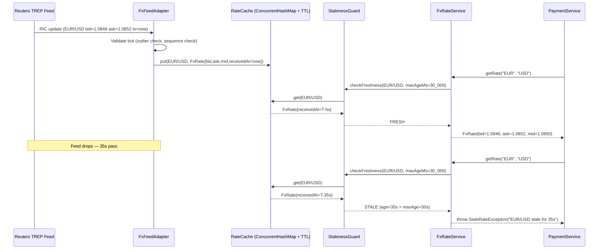

# أنظمة الصرف الأجنبي (FX) — الأسعار والتحويل والانكشاف

## نظرة عامة

الصرف الأجنبي أكبر سوق مالية على الأرض، إذ يبلغ حجم تداوله نحو **9.6 تريليون دولار يوميًا** (المسح الثلاثي لبنك التسويات الدولية، أبريل 2025؛ و7.5 تريليون في 2022). وكل بنك يحتفظ بحسابات متعددة العملات، أو يعالج مدفوعات عابرة للحدود، أو يصدر بطاقات تُستخدم في الخارج يشغّل نظام صرف أجنبي — ومع ذلك فأنظمة الصرف من أكثر المكونات حساسية للدقة وتعقيدًا تشغيليًا في المنظومة التقنية البنكية. فخطأ تقريب واحد بالفاصلة العائمة يتراكم عبر ملايين التحويلات اليومية قد يكلف البنك مئات آلاف الجنيهات؛ وسعر قديم يُقدَّم لعميل بعد عشر ثوانٍ من حدث في السوق قد يولّد انكشافًا فوريًا غير مغطى. ويبني هذا الدرس المعرفة الهندسية اللازمة لتصميم أنظمة صرف صحيحة، ومنخفضة الزمن، وآمنة تشغيليًا.

## أهداف التعلم

في نهاية هذا الدرس ستستطيع:

- التمييز بين أسعار spot والآجل والمتوسط والشراء والبيع وشرح متى يُطبق كل منها في سياق بنكي
- تصميم بنية لتغذية أسعار الصرف تستوعب من LSEG ‏(Refinitiv) أو Bloomberg، وتخزن الأسعار مؤقتًا، وتكتشف الأسعار القديمة
- تنفيذ `FxRateService` في Java مع انتهاء صلاحية الأسعار، وحراسات الأسعار القديمة، وتخزين مؤقت آمن للخيوط
- شرح لماذا لا يصلح `double` و`float` قطعًا لحساب الصرف واستخدام `BigDecimal` بشكل صحيح
- تنفيذ ذرية تحويل الصرف: تثبيت السعر، والتحويل، وقيود الدفتر بالعملتين في معاملة واحدة
- حساب أرباح وخسائر الصرف، وتقييم المراكز المفتوحة بسعر السوق، وفرض حدود الانكشاف
- تطبيق هامش الشراء/البيع وهامش العميل لاشتقاق أسعار التجزئة من أسعار المتوسط بين البنوك
- وصف كيف تغطي فرق الخزينة مراكز الصرف المفتوحة والأنظمة الهندسية التي تدعم ذلك

## سياق العمل

في مارس 2018 ترك انتقال بنك TSB الفاشل في نظامه البنكي الأساسي 1.9 مليون عميل غير قادرين على الوصول إلى حساباتهم لأسابيع. أما أنظمة الصرف فتفشل بهدوء أكبر. *مثال مركّب (مبني على أنماط فشل شائعة في الصناعة، لا على بنك بعينه):* ظل نظام الصرف في بنك للأفراد يقدّم سعر GBP/USD مخزنًا معظم ساعة أثناء حركة حادة في السوق. فحوّل آلاف العملاء العملة بسعر بعيد عن السوق الحية؛ ولأن البنك وعد بـ "أسعار سوق حية"، تحمّل الفرق — خسارة كبيرة في ظهيرة واحدة. والسبب الجذري: مستهلك تغذية أسعار ابتلع بصمت انتهاء مهلة اتصال التغذية وظل يقدّم آخر سعر مخزن، دون إطلاق تنبيه أو إيقاف نقطة التحويل.

يحدد هذا الحادث المتطلبات الهندسية لهذا الدرس: يجب أن يكون لتغذيات أسعار الصرف عقود حداثة صريحة، ويجب أن يفحص كل بحث عن سعر قِدمه قبل الاستخدام، ويجب أن يكون مسار التحويل ذريًا أو لا يمضي إطلاقًا.

## أنواع أسعار الصرف وأعراف السوق

تعمل سوق الصرف بين البنوك على نموذج شراء/بيع مستمر. وفهم كل نوع سعر إلزامي قبل كتابة سطر واحد من شيفرة الصرف.

| نوع السعر | التعريف | الاستخدام الهندسي |
|---|---|---|
| **السعر الفوري (Spot)** | تسليم خلال T+2 أيام عمل بسعر السوق الحالي | تسعير التحويل الآني |
| **سعر المتوسط** | المتوسط الحسابي لسعري الشراء والبيع | تقييم الأرباح والخسائر بسعر السوق، والتحويلات الداخلية |
| **سعر الشراء (Bid)** | السعر الذي يشتري به صانع السوق العملة الأساسية | العميل يبيع العملة الأساسية |
| **سعر البيع (Ask)** | السعر الذي يبيع به صانع السوق العملة الأساسية | العميل يشتري العملة الأساسية |
| **السعر الآجل** | سعر متفق عليه لتسليم مستقبلي، مشتق من الفوري + فرق أسعار الفائدة | عقود الصرف الآجلة، وتغطية الخزينة |
| **سعر العميل** | المتوسط أو الشراء/البيع + هامش البنك | تحويلات الأفراد والشركات الصغيرة |

تتبع أزواج العملات العرف `BASE/QUOTE`: فـ EUR/USD = 1.0850 تعني أن يورو واحدًا يشتري 1.0850 دولار. والعملة الأساسية دائمًا وحدة واحدة؛ وعملة التسعير هي التي تتحرك. ويجب ترميز هذا العرف صراحة في كل صنف نموذج — فخطأ في الاتجاه يعكس صيغة التحويل، وقد سبب حوادث إنتاج.

> [!IMPORTANT]
> لا تخزّن أبدًا سعرًا دون اتجاهه. خزّن دائمًا زوج العملات كـ `base`/`quote` بحيث يعني السعر "وحدة واحدة من `base` = `rate` وحدة من `quote`". فتخزين `BigDecimal` مجرد دون بيانات اتجاه عيب تصميمي حرج.

## بنية تغذية أسعار الصرف

تستهلك أنظمة الصرف الإنتاجية الأسعار من مزوّد بيانات سوق أو أكثر (LSEG/Refinitiv، أو Bloomberg B-PIPE، أو تغذيات CME المباشرة) عبر اتصالات TCP دائمة ببروتوكولات خاصة بكل مزوّد. ويجب أن تتعامل البنية مع فشل الاتصال، والقفزات الشاذة في الأسعار (اكتشاف القيم الشاذة)، والتحول بين التغذيات دون تقديم أسعار قديمة.



الذاكرة المؤقتة للأسعار `ConcurrentHashMap<CurrencyPair, TimestampedRate>`. ويفحص حارس القِدم عمر السعر عند كل قراءة. ويجب أن يحدث هذا الفحص داخل الخدمة، لا عند المستدعي.

> [!WARNING]
> لا تعتمد على إخلاء الذاكرة المؤقتة بمدة الصلاحية لفرض حداثة الأسعار. فالإخلاء يحذف المدخل — مما يسبب إخفاقًا في الذاكرة لا خطأ قِدم. والمدخل المفقود قد يسقط بصمت إلى بحث ثانوي أو يعيد null، وهذا أسوأ من سعر قديم. فاحتفظ دائمًا بالمدخل وافحص عمره صراحة.

## تنفيذ FxRateService

تغلّف طبقة الخدمة ذاكرة الأسعار المؤقتة، وتفرض الحداثة، وتشتق الأسعار العكسية، وتعرض آلية تثبيت السعر للتحويلات الذرية.

```java
@Service
public class FxRateService {

    private static final Logger log = LoggerFactory.getLogger(FxRateService.class);

    private final RateCache rateCache;
    private final RateLockRepository rateLockRepository;
    private final MeterRegistry meterRegistry;

    // Maximum age in milliseconds before a rate is considered stale
    private static final long MAX_RATE_AGE_MS = 30_000L;
    // Lock validity window — customer must complete conversion within this window
    private static final long RATE_LOCK_DURATION_MS = 15_000L;

    public FxRateService(RateCache rateCache,
                         RateLockRepository rateLockRepository,
                         MeterRegistry meterRegistry) {
        this.rateCache = rateCache;
        this.rateLockRepository = rateLockRepository;
        this.meterRegistry = meterRegistry;
    }

    /**
     * Returns the live FxRate for a currency pair.
     * Throws StaleRateException if the cached rate exceeds MAX_RATE_AGE_MS.
     * Derives inverse rates (e.g. USD/EUR from EUR/USD) automatically.
     */
    public FxRate getRate(String baseCurrency, String quoteCurrency) {
        CurrencyPair directPair = CurrencyPair.of(baseCurrency, quoteCurrency);
        CurrencyPair inversePair = CurrencyPair.of(quoteCurrency, baseCurrency);

        TimestampedRate cached = rateCache.get(directPair);
        if (cached == null) {
            // Attempt inverse derivation
            cached = rateCache.get(inversePair);
            if (cached == null) {
                meterRegistry.counter("fx.rate.miss",
                    "pair", directPair.toString()).increment();
                throw new RateNotFoundException(
                    "No rate available for " + directPair + " or its inverse");
            }
            cached = cached.invert(); // 1/rate with bid/ask swap
        }

        long ageMs = Duration.between(cached.receivedAt(), Instant.now()).toMillis();
        if (ageMs > MAX_RATE_AGE_MS) {
            meterRegistry.counter("fx.rate.stale",
                "pair", directPair.toString()).increment();
            throw new StaleRateException(
                String.format("Rate for %s is stale: age=%dms maxAge=%dms",
                    directPair, ageMs, MAX_RATE_AGE_MS));
        }

        meterRegistry.timer("fx.rate.age.ms",
            "pair", directPair.toString()).record(ageMs, TimeUnit.MILLISECONDS);
        return cached.toFxRate();
    }

    /**
     * Locks a rate for a specific amount for RATE_LOCK_DURATION_MS.
     * Returns a RateLock token the caller must present when executing conversion.
     * This prevents rate slippage between quote and execution.
     */
    @Transactional
    public RateLock lockRate(String baseCurrency, String quoteCurrency,
                             BigDecimal baseAmount, String customerId) {
        FxRate rate = getRate(baseCurrency, quoteCurrency);
        BigDecimal customerRate = applyMarkup(rate.mid(), baseCurrency, quoteCurrency);
        BigDecimal quoteAmount = baseAmount.multiply(customerRate)
            .setScale(2, RoundingMode.HALF_UP);

        RateLock lock = RateLock.builder()
            .lockId(UUID.randomUUID().toString())
            .customerId(customerId)
            .baseCurrency(baseCurrency)
            .quoteCurrency(quoteCurrency)
            .baseAmount(baseAmount)
            .quoteAmount(quoteAmount)
            .lockedRate(customerRate)
            .lockedAt(Instant.now())
            .expiresAt(Instant.now().plusMillis(RATE_LOCK_DURATION_MS))
            .status(RateLockStatus.ACTIVE)
            .build();

        rateLockRepository.save(lock);
        log.info("Rate locked: lockId={} pair={}/{} rate={} baseAmount={} quoteAmount={}",
            lock.lockId(), baseCurrency, quoteCurrency, customerRate,
            baseAmount, quoteAmount);
        return lock;
    }

    /**
     * Applies bank markup to mid rate to derive customer rate.
     * Markup is loaded from configuration per currency pair tier.
     */
    BigDecimal applyMarkup(BigDecimal midRate, String base, String quote) {
        BigDecimal markupBps = markupConfig.getMarkupBps(base, quote); // e.g. 150 bps
        BigDecimal markupFactor = markupBps
            .divide(BigDecimal.valueOf(10_000), 10, RoundingMode.HALF_UP);
        // Customer sells base and receives quote: SUBTRACT the markup from mid
        // (the customer receives less quote currency). A real system starts
        // from bid/ask, not mid, and picks the side from the trade direction
        return midRate.subtract(midRate.multiply(markupFactor))
            .setScale(6, RoundingMode.HALF_UP);
    }
}
```

عندما يبيع العميل العملة الأساسية ويتلقى عملة التسعير يُطرح الهامش من المتوسط (فيتلقى العميل أقل). والنظام الحقيقي يبدأ من سعري الشراء/البيع لا المتوسط، ويختار الجانب حسب اتجاه الصفقة.

## دقة BigDecimal في حسابات الصرف

استخدام `double` أو `float` في الحساب النقدي أو حساب الصرف خطأ في الفئة، لا مسألة أسلوب. فالفاصلة العائمة IEEE 754 لا تستطيع تمثيل معظم الكسور العشرية بدقة. وعند أحجام الصرف لا يكون الخطأ نظريًا.

```java
// CATASTROPHIC — never do this
double eurUsd = 1.0850;
double amount = 1_000_000.00;
double converted = amount * eurUsd;
System.out.println(converted); // 1085000.0000000002 — not 1085000.00

// CORRECT
BigDecimal rate = new BigDecimal("1.0850");     // Always use String constructor
BigDecimal amountBD = new BigDecimal("1000000.00");
BigDecimal result = amountBD.multiply(rate)
    .setScale(2, RoundingMode.HALF_UP);
System.out.println(result); // 1085000.00
```

> [!NOTE]
> استخدم دائمًا المُنشئ `BigDecimal(String)`، لا `BigDecimal(double)` أبدًا. فـ `new BigDecimal(1.0850)` ينتج `1.08499999999999996447286321199...` لأنه يمثّل بأمانة القيمة الثنائية الفعلية للـ double. أما `new BigDecimal("1.0850")` فينتج `1.0850` بالضبط.

تتطلب أسعار الصرف مقياسًا من 6 خانات عشرية على الأقل (مثلًا USD/JPY قد تكون `149.8523`). ويجب أن تحمل الحسابات الوسيطة 10 خانات عشرية ولا تقرّب إلا في خطوة المخرج النهائية.

```java
// Correct scale management for FX conversion
public BigDecimal convert(BigDecimal amount, BigDecimal rate) {
    return amount
        .multiply(rate)                          // carry full precision during multiply
        .setScale(2, RoundingMode.HALF_UP);      // round to currency minor units at output
}

// Cross-rate derivation: EUR/JPY from EUR/USD and USD/JPY
public BigDecimal deriveCrossRate(BigDecimal eurUsd, BigDecimal usdJpy) {
    return eurUsd
        .multiply(usdJpy)
        .setScale(6, RoundingMode.HALF_UP);
}
```

| النوع | 1,000,000 × 1.0850 | الخطأ | الحكم |
|---|---|---|---|
| `double` | 1085000.0000000002 | +0.0002 | **لا تستخدمه أبدًا** |
| `float` | 1084999.875 | -0.125 | **لا تستخدمه أبدًا** |
| `BigDecimal` | 1085000.00 | 0 | استخدم هذا |

## ذرية تحويل الصرف

يتضمن تحويل الصرف أربعة قيود دفترية على الأقل: خصم من حساب العميل بالعملة المصدر، وإضافة إلى حساب مركز الصرف للبنك بتلك العملة، وخصم من حساب مركز الصرف بالعملة الوجهة، وإضافة إلى حساب العميل بالعملة الوجهة. وتتوازن كل عملة بمفردها (لا يمكنك جمع الجنيه مع اليورو). ويجب أن تلتزم كل القيود، وسجل الصفقة، واستهلاك تثبيت السعر ذريًا. وأي التزام جزئي يترك الدفاتر غير متوازنة.

```java
@Transactional(isolation = Isolation.READ_COMMITTED, rollbackFor = Exception.class)
public FxConversionResult executeConversion(String rateLockId, String customerId) {
    // 1. Validate and consume the rate lock — locked FOR UPDATE, so two
    //    concurrent requests with the same lock cannot BOTH convert
    RateLock lock = rateLockRepository.findByLockIdForUpdate(rateLockId)
        .filter(l -> l.status() == RateLockStatus.ACTIVE)
        .orElseThrow(() -> new InvalidRateLockException(
            "Lock not found or already consumed: " + rateLockId));

    if (!lock.customerId().equals(customerId)) {
        // A lock belongs to one customer — never let another customer use it
        throw new InvalidRateLockException("Lock does not belong to this customer");
    }
    if (clock.instant().isAfter(lock.expiresAt())) {
        // (marking the lock EXPIRED here would be rolled back with the
        //  exception — a cleanup job expires old locks instead)
        throw new RateLockExpiredException("Rate lock expired at " + lock.expiresAt());
    }

    // 2. Lock both customer accounts in a CANONICAL order (by account id).
    //    "Debit first, then credit" is NOT a safe order: a GBP→EUR and a
    //    EUR→GBP conversion would lock the same two rows in opposite order
    Account source = accountRepository.findIdByCustomerAndCurrency(customerId, lock.baseCurrency());
    Account dest   = accountRepository.findIdByCustomerAndCurrency(customerId, lock.quoteCurrency());
    List<Account> locked = accountRepository.lockAllForUpdateOrderedById(
        List.of(source.id(), dest.id()));
    Account sourceAccount = locked.stream().filter(a -> a.id().equals(source.id())).findFirst().orElseThrow();
    Account destAccount   = locked.stream().filter(a -> a.id().equals(dest.id())).findFirst().orElseThrow();

    if (sourceAccount.availableBalance().compareTo(lock.baseAmount()) < 0) {
        throw new InsufficientFundsException(
            "Available: " + sourceAccount.availableBalance() +
            " Required: " + lock.baseAmount());
    }

    // 3. Exposure limit check BEFORE any ledger entry (see the challenge)
    exposureGuard.checkWithinLimit(lock);

    // 4. Post the ledger entries — balanced PER CURRENCY through the bank's
    //    FX position accounts:
    //      DR customer base account   / CR FX position (base currency)
    //      DR FX position (quote ccy)  / CR customer quote account
    ledger.post(JournalEntry.of(lock.baseCurrency(),
        Debit.of(sourceAccount, lock.baseAmount()),
        Credit.of(fxPositionAccount(lock.baseCurrency()), lock.baseAmount())));
    ledger.post(JournalEntry.of(lock.quoteCurrency(),
        Debit.of(fxPositionAccount(lock.quoteCurrency()), lock.quoteAmount()),
        Credit.of(destAccount, lock.quoteAmount())));

    // 5. Write FX trade record for P&L and exposure tracking
    FxTrade trade = FxTrade.builder()
        .tradeId(UUID.randomUUID().toString())
        .customerId(customerId)
        .rateLockId(rateLockId)
        .baseCurrency(lock.baseCurrency())
        .quoteCurrency(lock.quoteCurrency())
        .baseAmount(lock.baseAmount())
        .quoteAmount(lock.quoteAmount())
        .rate(lock.lockedRate())
        .tradedAt(clock.instant())
        .build();
    fxTradeRepository.save(trade);

    // 6. Mark lock as consumed
    lock.consume(trade.tradeId());
    rateLockRepository.save(lock);

    return FxConversionResult.success(trade);
}
```

يُقفل تثبيت السعر `FOR UPDATE`، فلا يستطيع طلبان متزامنان بالتثبيت نفسه التحويل **معًا**. والتثبيت يخص عميلًا واحدًا — فلا تدع عميلًا آخر يستخدمه أبدًا. ويُقفل حسابا العميل بترتيب قياسي (حسب معرّف الحساب)، ويُفحص حد الانكشاف قبل أي قيد دفتري.

> [!IMPORTANT]
> احصل دائمًا على أقفال صفوف الحسابات (`SELECT ... FOR UPDATE`) بترتيب ثابت وحتمي — مثلًا حسب معرّف الحساب — لمنع الجمود عندما يتضمن تحويلان متزامنان الحسابات نفسها باتجاهين متعاكسين. و"الخصم قبل الإضافة" **ليس** ترتيبًا ثابتًا: ففي تحويل من الجنيه إلى اليورو وآخر من اليورو إلى الجنيه يقفل الصفين نفسيهما بترتيبين متعاكسين.

## أرباح وخسائر الصرف وتتبع الانكشاف المفتوح

يراكم البنك انكشافًا مفتوحًا في الصرف كلما حوّل عملة العميل دون تغطيتها فورًا في السوق بين البنوك. ويجب تتبع الانكشاف المفتوح آنيًا ومقارنته بالحدود التي وافقت عليها الخزينة.

```sql
-- fx_rates: canonical store of ingested interbank rates
CREATE TABLE fx_rates (
    id              BIGSERIAL PRIMARY KEY,
    base_currency   CHAR(3)        NOT NULL,
    quote_currency  CHAR(3)        NOT NULL,
    bid_rate        NUMERIC(18, 8) NOT NULL,
    ask_rate        NUMERIC(18, 8) NOT NULL,
    mid_rate        NUMERIC(18, 8) NOT NULL,
    source          VARCHAR(20)    NOT NULL,  -- 'REUTERS', 'BLOOMBERG', 'MANUAL'
    received_at     TIMESTAMPTZ    NOT NULL,
    created_at      TIMESTAMPTZ    NOT NULL DEFAULT NOW(),
    CONSTRAINT uq_fx_rate_pair_ts UNIQUE (base_currency, quote_currency, received_at)
);

CREATE INDEX idx_fx_rates_pair_time
    ON fx_rates (base_currency, quote_currency, received_at DESC);

-- fx_trades: each executed customer conversion
CREATE TABLE fx_trades (
    trade_id        UUID           PRIMARY KEY,
    customer_id     VARCHAR(36)    NOT NULL,
    base_currency   CHAR(3)        NOT NULL,
    quote_currency  CHAR(3)        NOT NULL,
    base_amount     NUMERIC(18, 2) NOT NULL,
    quote_amount    NUMERIC(18, 2) NOT NULL,
    customer_rate   NUMERIC(18, 8) NOT NULL,
    mid_rate        NUMERIC(18, 8) NOT NULL,  -- rate at time of trade for P&L
    hedge_trade_id  UUID,                      -- linked interbank hedge if any
    traded_at       TIMESTAMPTZ    NOT NULL DEFAULT NOW()
);
```

يمكن حساب صافي الانكشاف المفتوح بعملة معينة بتجميع بسيط:

```sql
-- Unhedged volume per base currency today (simplified: a real position NETS
-- both legs of every trade by direction — buying EUR and selling EUR cancel)
SELECT
    base_currency,
    SUM(base_amount) FILTER (WHERE hedge_trade_id IS NULL) AS unhedged_base_amount,
    COUNT(*) FILTER (WHERE hedge_trade_id IS NULL)          AS unhedged_trade_count
FROM fx_trades
WHERE traded_at >= CURRENT_DATE
GROUP BY base_currency
ORDER BY unhedged_base_amount DESC;
```

> [!WARNING]
> تجذب مراكز الصرف المفتوحة رسوم رأس مال لمخاطر السوق بموجب إطار بازل، وتحدها شهية البنك للمخاطر. والأنظمة التي تسمح بتجاوز الانكشاف للحدود المعتمدة من الخزينة دون حجب الصفقات الجديدة تنشئ مخاطر تنظيمية مباشرة. فيجب فرض حدود الانكشاف بشكل متزامن في مسار التحويل، لا في مهمة خلفية.

## هامش السعر وحساب سعر العميل

سعر المتوسط بين البنوك هو سعر الكلفة للبنك. وتتضمن أسعار العملاء هامشًا يغطي كلفة التغطية، والتكاليف التشغيلية، وهامش الربح. ويُعبّر عن الهامش عادة بنقاط الأساس (bps) حيث 1 نقطة = 0.01%.

```java
public record MarkupConfig(
    BigDecimal retailMarkupBps,      // e.g. 150 bps for retail
    BigDecimal smeMarkupBps,         // e.g. 80 bps for SME
    BigDecimal corporateMarkupBps    // e.g. 30 bps for corporate
) {}

// Customer rate = mid rate × (1 - markup/10000) for buy, × (1 + markup/10000) for sell
public BigDecimal customerBuyRate(BigDecimal mid, BigDecimal markupBps) {
    // Customer buys base currency (e.g. buys EUR, sells GBP)
    // Bank sells EUR to customer at a rate worse than mid → customer pays more GBP
    BigDecimal markupFactor = markupBps.divide(
        BigDecimal.valueOf(10_000), 10, RoundingMode.HALF_UP);
    return mid.add(mid.multiply(markupFactor))
        .setScale(6, RoundingMode.HALF_UP);
}

public BigDecimal customerSellRate(BigDecimal mid, BigDecimal markupBps) {
    // Customer sells base currency (e.g. sells EUR, buys GBP)
    // Bank buys EUR from customer at a rate worse than mid → customer receives less GBP
    BigDecimal markupFactor = markupBps.divide(
        BigDecimal.valueOf(10_000), 10, RoundingMode.HALF_UP);
    return mid.subtract(mid.multiply(markupFactor))
        .setScale(6, RoundingMode.HALF_UP);
}
```

لعميل فرد بهامش 150 نقطة أساس وسعر متوسط EUR/GBP = 0.8560:

- سعر البيع للعميل (العميل يبيع اليورو) = 0.8560 × (1 − 0.0150) = **0.8432**
- سعر الشراء للعميل (العميل يشتري اليورو) = 0.8560 × (1 + 0.0150) = **0.8688**

## التغطية وحدود انكشاف الصرف

تغطي الخزينة مركز الصرف المفتوح المتراكم للبنك بتنفيذ صفقات معاكسة في السوق بين البنوك. ويجب أن تعرض الأنظمة الهندسية بيانات الانكشاف آنيًا وتدعم مشغّلات التغطية الآلية.

```java
// Gauges are registered ONCE (Micrometer keeps a weak reference to the
// measured object — a gauge created from a fresh Double each run reads NaN)
private final Map<String, AtomicReference<BigDecimal>> exposureGauges = new ConcurrentHashMap<>();

@Scheduled(fixedDelayString = "${fx.hedge.check.interval.ms:60000}")
public void evaluateHedgeTriggers() {
    Map<String, BigDecimal> exposures = fxExposureRepository.getOpenExposures();

    for (Map.Entry<String, BigDecimal> entry : exposures.entrySet()) {
        String currency = entry.getKey();
        BigDecimal openAmount = entry.getValue();
        BigDecimal limit = limitConfig.getHedgeTriggerLimit(currency);

        exposureGauges.computeIfAbsent(currency, c -> {
            AtomicReference<BigDecimal> ref = new AtomicReference<>(BigDecimal.ZERO);
            meterRegistry.gauge("fx.open.exposure", Tags.of("currency", c), ref,
                r -> r.get().doubleValue());
            return ref;
        }).set(openAmount);

        if (openAmount.abs().compareTo(limit) > 0) {
            // The job runs every minute: do NOT send a new hedge request while
            // one for this currency is still open — that would double-hedge
            if (hedgeRequestRepository.existsOpenRequest(currency)) {
                continue;
            }
            log.warn("FX exposure limit breached: currency={} open={} limit={}",
                currency, openAmount, limit);

            // Raise hedge request to treasury system — recorded first, so a
            // crash after sending cannot cause a second request
            HedgeRequest hedgeRequest = hedgeRequestRepository.saveNew(HedgeRequest.builder()
                .currency(currency)
                .amount(openAmount)
                .requestedAt(clock.instant())
                .build());
            treasuryGateway.submitHedgeRequest(hedgeRequest);   // idempotent by request id
        }
    }
}
```

تُسجّل مقاييس gauge مرة واحدة (فـ Micrometer يحتفظ بمرجع ضعيف للكائن المقيس — وgauge يُنشأ من Double جديد كل تشغيل يقرأ NaN). والمهمة تعمل كل دقيقة: فلا ترسل طلب تغطية جديدًا ما دام هناك طلب مفتوح لهذه العملة — وإلا تتضاعف التغطية. ويُسجّل الطلب أولًا، فلا يسبب تعطل بعد الإرسال طلبًا ثانيًا.

> [!NOTE]
> التغطية عند كل صفقة غير عملية تشغيليًا. فتجمع البنوك عادة كل صفقات صرف العملاء خلال فترة (مثل دقيقة) وتغطي صافي المركز بصفقة واحدة بين البنوك. وتواتر التغطية قرار عمل يحدده تقلب السوق، والقدرة التشغيلية، وشهية المخاطر.

## اختبار المعرفة

**س1: لماذا يُعد استخدام `double` في حساب الصرف عيبًا حرجًا لا مجرد مسألة أسلوب برمجي بسيطة؟**

ج: لا تستطيع `double` وفق IEEE 754 تمثيل معظم الكسور العشرية بدقة. والخطأ في العملية الواحدة صغير (نحو 10⁻¹⁶ نسبيًا)، لكن النتائج تعتمد حينها على ترتيب العمليات ومواضع التقريب، وعبر ملايين التحويلات اليومية تتراكم فروق منهجية صغيرة. والأخطر أن عدم الاتساق بين المبلغ المعروض للعميل والمبلغ المرحّل إلى الدفتر قد يسبب كسورًا غير قابلة للمطابقة في مطابقة النوسترو ويطلق التزامات إبلاغ تنظيمية. و`BigDecimal` بمقياس صريح و`RoundingMode` هو النوع الصحيح الوحيد للحساب المالي.

**س2: يطلب عميل تحويلًا من EUR إلى USD، وأحدث سعر في الذاكرة المؤقتة عمره 42 ثانية، وقيمة `MAX_RATE_AGE_MS` المضبوطة 30,000. ماذا يجب أن يفعل النظام ولماذا؟**

ج: يجب أن يرمي النظام `StaleRateException` ويرفض طلب التحويل. ويجب ألا يقدّم السعر القديم. والسبب مزدوج: (1) في 42 ثانية خلال جلسة متقلبة قد يتحرك EUR/USD ‏30–50 نقطة (0.0030–0.0050)، فينشأ انكشاف فوري غير مغطى إذا حوّل البنك بسعر عمره 42 ثانية ثم غطى بسعر السوق الحالي؛ (2) وعد البنك عملاءه بسعر حالي، وقواعد حماية المستهلك بشأن رسوم تحويل العملة (مثلًا في الاتحاد الأوروبي) تتطلب أن يكون السعر والتكاليف المعروضة قبل الدفع دقيقة. والاستجابة التشغيلية الصحيحة أن ينبّه النظام مسار مراقبة التغذية، ويحاول التحول إلى تغذية ثانوية، ثم إما يقدم سعرًا حيًا من التغذية الاحتياطية أو يعيد خطأ يطلب من العميل إعادة المحاولة.

## التحدي العملي

1. **مراقب صحة تغذية الأسعار:** نفّذ صنف `FxFeedHealthMonitor` يتتبع طوابع `receivedAt` لكل زوج وينشر مقياس Micrometer ‏`fx.rate.age.seconds` لكل زوج عملات نشط. وأضف تنبيهًا يطلق `RateFeedDegradedEvent` عندما يتجاوز أي زوج 20 ثانية دون تحديث. واكتب اختبار وحدة بساعة ثابتة يتحقق من إطلاق التنبيه عند 20 ثانية بالضبط.

2. **اشتقاق السعر العكسي:** يجب أن تعمل `FxRateService.getRate("USD", "EUR")` حتى لو كان EUR/USD وحده في الذاكرة المؤقتة، بحساب السعر العكسي مع تبديل الشراء/البيع (الشراء العكسي = 1/البيع الأصلي، والبيع العكسي = 1/الشراء الأصلي). ونفّذه بحساب `BigDecimal` صحيح، بمقياس 8 خانات عشرية وتقريب `HALF_UP`. واكتب اختبارًا بمعاملات يتحقق من عكس الشراء/البيع لثلاثة أزواج عملات.

3. **اختبار تكامل للتحويل الذري:** باستخدام اختبار Spring Boot مع PostgreSQL مضمّن (Testcontainers)، اكتب اختبار تكامل يقوم بـ: (أ) إنشاء تثبيت سعر، (ب) إنهاء صلاحيته عمدًا بتقديم ساعة وهمية بعد `expiresAt`، (ج) التحقق من أن استدعاء `executeConversion` بالتثبيت المنتهي يرمي `RateLockExpiredException` وأنه لم يُكتب لا الخصم ولا الإضافة في جدول الحسابات.

4. **فرض حد الانكشاف:** نفّذ `FxExposureGuard` يُستدعى بشكل متزامن داخل `executeConversion` قبل كتابة أي قيود دفترية. ويجب أن يحمّل الانكشاف المفتوح الحالي للعملة الأساسية للصفقة من قاعدة البيانات، ويضيف مبلغ الصفقة الجديدة، ويرمي `ExposureLimitBreachException` إذا تجاوزت النتيجة الحد المضبوط. واكتب اختبارًا يتحقق من رمي الاستثناء عند حد الخرق وأن الحسابات تبقى دون تغيير.

<!-- KNOWLEDGE-CHECK
{
  "questions": [
    {
      "text": "لماذا يُعد استخدام `double` في حساب الصرف عيبًا حرجًا لا مجرد مسألة أسلوب برمجي بسيطة؟",
      "options": [
        "إنه مجرد مسألة أسلوب — فرق الدقة ضئيل في الحسابات المالية",
        "لا تستطيع `double` وفق IEEE 754 تمثيل معظم الكسور العشرية بدقة، فتتراكم الأخطاء عند أحجام المعاملات البنكية وتسبب كسور مطابقة نوسترو غير قابلة للحل",
        "يسبب مشاكل أداء لا مشاكل صحة",
        "يهم فقط للعملات ذات أكثر من خانتين عشريتين"
      ],
      "correct": 1,
      "explanation": "لا تستطيع `double` وفق IEEE 754 تمثيل معظم الكسور العشرية بدقة. فتعتمد النتائج حينها على ترتيب العمليات ومواضع التقريب، وعبر ملايين تحويلات الصرف اليومية تتراكم فروق منهجية صغيرة — وقد يختلف المبلغ المعروض للعميل عن المبلغ المرحّل إلى الدفتر، فتنشأ كسور مطابقة غير قابلة للحل. و`BigDecimal` بمقياس صريح و`RoundingMode` هو النوع الصحيح للحساب المالي."
    },
    {
      "text": "يطلب عميل تحويل EUR/USD، وأحدث سعر في الذاكرة المؤقتة عمره 42 ثانية، مع `MAX_RATE_AGE_MS` قدره 30,000. ماذا يجب أن يفعل النظام؟",
      "options": [
        "قدّم السعر القديم — 42 ثانية قريبة بما يكفي من 30 ثانية",
        "طبّق عقوبة هامش لتعويض القِدم",
        "ارمِ `StaleRateException` وارفض طلب التحويل",
        "سجّل تحذيرًا لكن امضِ في التحويل"
      ],
      "correct": 2,
      "explanation": "يجب أن يرمي النظام `StaleRateException` ويرفض التحويل. ففي 42 ثانية خلال أسواق متقلبة قد يتحرك EUR/USD عشرات النقاط، فينشأ انكشاف فوري غير مغطى، ولن يكون السعر المعروض للعميل سعرًا حاليًا. والاستجابة الصحيحة تنبيه مسار مراقبة التغذية والتحول إلى تغذية ثانوية إن توفرت."
    },
    {
      "text": "عند اشتقاق سعر عكسي (مثل USD/EUR من EUR/USD)، كيف يجب تحويل سعري الشراء والبيع؟",
      "options": [
        "الشراء العكسي = 1/الشراء الأصلي، والبيع العكسي = 1/البيع الأصلي",
        "الشراء العكسي = 1/البيع الأصلي، والبيع العكسي = 1/الشراء الأصلي",
        "الشراء العكسي = البيع الأصلي، والبيع العكسي = الشراء الأصلي",
        "يستخدم السعر العكسي سعر المتوسط فقط، ولا ينطبق الشراء/البيع"
      ],
      "correct": 1,
      "explanation": "عند عكس سعر يُبدّل الشراء والبيع: الشراء العكسي = 1/البيع الأصلي، والبيع العكسي = 1/الشراء الأصلي. وذلك لأن سعر شراء صانع السوق في اتجاه هو سعر بيعه في الاتجاه العكسي. ويجب أن يستخدم الحساب `BigDecimal` بمقياس 8 خانات عشرية وتقريب `HALF_UP`."
    }
  ]
}
-->

<!-- PRACTICAL-CHALLENGE
{
  "title": "خدمة أسعار الصرف مع اكتشاف القِدم والتحكم في الانكشاف",
  "difficulty": "advanced",
  "estimatedMinutes": 45,
  "tasks": [
    {
      "id": "1",
      "description": "نفّذ صنف `FxFeedHealthMonitor` يتتبع طوابع `receivedAt` لكل زوج وينشر مقياس Micrometer ‏`fx.rate.age.seconds` لكل زوج عملات نشط. وأضف تنبيهًا يطلق `RateFeedDegradedEvent` عندما يتجاوز أي زوج 20 ثانية دون تحديث. واكتب اختبار وحدة بساعة ثابتة يتحقق من إطلاق التنبيه عند 20 ثانية بالضبط."
    },
    {
      "id": "2",
      "description": "نفّذ `FxRateService.getRate('USD', 'EUR')` ليعمل حتى لو كان EUR/USD وحده في الذاكرة المؤقتة، بحساب السعر العكسي مع تبديل الشراء/البيع (الشراء العكسي = 1/البيع الأصلي، والبيع العكسي = 1/الشراء الأصلي). واستخدم `BigDecimal` بمقياس 8 وتقريب `HALF_UP`. واكتب اختبارًا بمعاملات يتحقق من عكس الشراء/البيع لثلاثة أزواج عملات."
    },
    {
      "id": "3",
      "description": "باستخدام Spring Boot مع Testcontainers ‏(PostgreSQL مضمّن)، اكتب اختبار تكامل: (أ) ينشئ تثبيت سعر، (ب) ينهي صلاحيته عمدًا بتقديم ساعة وهمية بعد `expiresAt`، (ج) يتحقق من أن استدعاء `executeConversion` بالتثبيت المنتهي يرمي `RateLockExpiredException` وأنه لم يُكتب لا الخصم ولا الإضافة في جدول الحسابات."
    },
    {
      "id": "4",
      "description": "نفّذ `FxExposureGuard` يُستدعى بشكل متزامن داخل `executeConversion` قبل كتابة القيود الدفترية. حمّل الانكشاف المفتوح الحالي للعملة الأساسية للصفقة، وأضف مبلغ الصفقة الجديدة، وارمِ `ExposureLimitBreachException` إذا تجاوز الحد المضبوط. واكتب اختبارًا يتحقق من الاستثناء عند حد الخرق وأن الحسابات تبقى دون تغيير."
    }
  ]
}
-->
