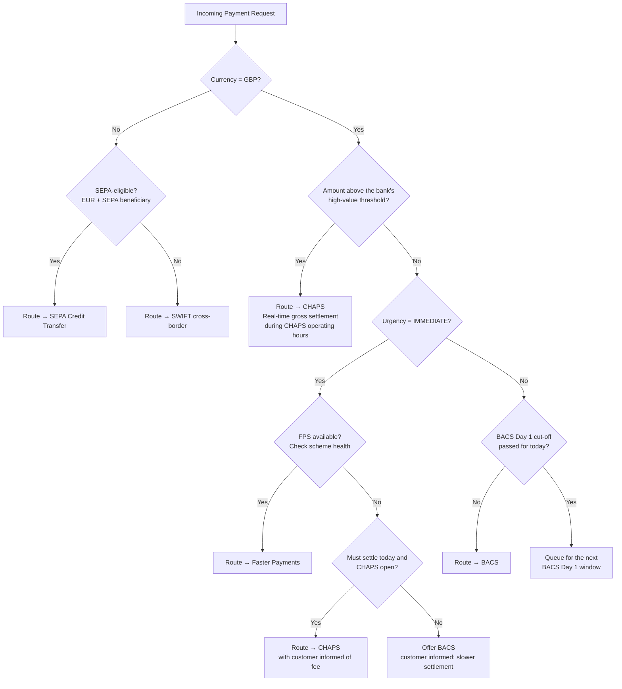

# توجيه المدفوعات — اختيار نظام المقاصة والدفعات والمقاصة الصافية

## نظرة عامة

يبدو سؤال "على أي نظام أرسل هذه الدفعة؟" بسيطًا حتى تبني النظام الذي يجب أن يجيب عنه في أقل من 50 مللي ثانية لـ 10,000 دفعة في الثانية، مع احترام أوقات القطع عبر خمسة أنظمة مقاصة في أربع مناطق زمنية، والتراجع بسلاسة عندما يتدهور نظام ما، وضمان استيفاء قيود الصيغة وحدود القيمة ودورة المعالجة للنظام المختار. فتوجيه المدفوعات ليس جدول إعدادات — بل محرك قرار مدمج فيه وعي آني بصحة الأنظمة، وتنسيق الدفعات المجمّعة، وتحسين المقاصة الصافية. ويجهز هذا الدرس المهندسين الكبار لتصميم هذا المحرك وتنفيذه.

## أهداف التعلم

في نهاية هذا الدرس ستستطيع:

- ربط خصائص الدفعة (المبلغ، والعملة، والوجهة، والاستعجال) بنظام المقاصة الصحيح
- تنفيذ `PaymentRouter` بنمط Strategy مع معالجات أنظمة قابلة للاستبدال والاختبار المستقل
- وصف دورة BACS ذات الأيام الثلاثة (إدخال في اليوم 1، وتسوية في اليوم 3) وآثارها التشغيلية
- شرح أعراف صيغة ملفات ACH المجمّعة وبنية سجلات NACHA ذات 94 حرفًا
- حساب صافي المراكز الثنائية بين طرفين وتنفيذ استعلام SQL لذلك
- التمييز بين المقاصة الثنائية ومتعددة الأطراف والتسوية الإجمالية الآنية (RTGS) مثل CHAPS
- توليد ملف بصيغة BACS Standard 18 من قائمة سجلات `BacsPayment`
- تنفيذ منطق التراجع بين الأنظمة (FPS غير متاح ← بديل) مع فرض أوقات القطع

## سياق العمل

*مثال مركّب (مبني على أنماط فشل شائعة في الصناعة، لا على بنك بعينه):* فاتت منصة المدفوعات في أحد البنوك موعد إدخال اليوم 1 في Bacs ‏(22:30). فتأخرت مدفوعات الرواتب والخصومات المباشرة لمئات آلاف العملاء يومًا كاملًا. وكان الملف نفسه قد وُلّد بشكل صحيح — لكن آلة حالة التوجيه لم تميّز بين "تم توليد الملف" و"تم إرسال الملف وأقرّته Bacs". وكانت هناك تنبيهات على توليد الملف، لكن لا شيء على إقرار الإرسال، فلم يلاحظ أحد حتى الصباح. وتبع ذلك إصلاح وتعويضات واهتمام رقابي، وكشفت المراجعة عيبًا تصميميًا أساسيًا: يجب أن يتتبع توجيه المدفوعات المجمّعة حالة الإرسال حتى إقرار النظام، لا مجرد إنشاء الملف.

يحدد هذا الحادث المتطلبات الهندسية لهذا الدرس: يجب أن يكون التوجيه ذا حالة، ويجب تتبع إقرار النظام، ويجب أن يمنع فرض أوقات القطع قرارات التوجيه الجديدة بمجرد إغلاق نافذة الإرسال.

## إطار قرار توجيه المدفوعات

يتطلب توجيه الدفعة تقييم شجرة قرار عبر أربعة أبعاد رئيسية بالترتيب. وتُقلّم الشجرة سريعًا في معظم الحالات الشائعة، لكن يجب تقييم كل فرع بالكامل قبل اختيار النظام.



> [!IMPORTANT]
> يجب تقييم أوقات القطع وفق ساعة النظام، لا التوقيت المحلي لمنشئ الدفعة. فإدخال اليوم 1 في BACS يُغلق عند 22:30 بتوقيت المملكة المتحدة (GMT/BST). والنظام الذي يستخدم UTC دون وعي بالتوقيت الصيفي البريطاني سيرسل متأخرًا ساعة خلال الصيف — وهو بالضبط نوع الموعد الفائت الموصوف أعلاه. ولاحظ أيضًا أن CHAPS ليس مفتوحًا على مدار الساعة: فله ساعات تشغيل وأوقات قطع يومية، ولا يعمل في عطلات نهاية الأسبوع أو العطلات الرسمية.

## نمط Strategy في PaymentRouter

لكل نظام مقاصة قواعد تحقق وصيغ ملفات ودورات تسوية وقيود تشغيلية مختلفة جذريًا. ويعزل نمط Strategy هذه الاهتمامات ويسمح بإضافة الأنظمة واستبدالها واختبارها مستقلة.

```java
// Core routing strategy interface
public interface SchemeHandler {
    SchemeCapabilities capabilities();
    ValidationResult validate(PaymentRequest payment);
    RoutingDecision route(PaymentRequest payment);
    boolean isAvailable();  // real-time scheme health check
}

public record SchemeCapabilities(
    String schemeName,
    BigDecimal maxAmount,
    Set<String> supportedCurrencies,
    boolean supportsInstantSettlement,
    LocalTime cutOffTime,          // null = always-on (FPS). CHAPS has daily hours
    int settlementDays             // 0 = immediate; BACS settles on day 3 of its cycle
) {}

@Service
public class PaymentRouter {

    private final List<SchemeHandler> handlers;
    private final SchemeHealthMonitor healthMonitor;
    private final RoutingAuditRepository auditRepository;
    private final Clock clock;

    public PaymentRouter(List<SchemeHandler> handlers,
                         SchemeHealthMonitor healthMonitor,
                         RoutingAuditRepository auditRepository,
                         Clock clock) {
        this.handlers = handlers;
        this.healthMonitor = healthMonitor;
        this.auditRepository = auditRepository;
        this.clock = clock;
    }

    @Transactional
    public RoutingDecision route(PaymentRequest payment) {
        List<SchemeHandler> eligible = handlers.stream()
            .filter(h -> h.capabilities().supportedCurrencies()
                          .contains(payment.currency()))
            .filter(h -> h.capabilities().maxAmount()
                          .compareTo(payment.amount()) >= 0)
            .filter(h -> isCutOffSatisfied(h.capabilities()))
            .filter(SchemeHandler::isAvailable)
            .filter(h -> h.validate(payment).isValid())
            .sorted(Comparator.comparingInt(h ->
                routingPriority(h, payment)))
            .toList();

        if (eligible.isEmpty()) {
            throw new NoEligibleSchemeException(
                "No scheme can handle payment: " + payment.paymentId());
        }

        SchemeHandler selected = eligible.get(0);
        RoutingDecision decision = selected.route(payment);

        auditRepository.save(RoutingAuditRecord.builder()
            .paymentId(payment.paymentId())
            .selectedScheme(selected.capabilities().schemeName())
            .eligibleSchemes(eligible.stream()
                .map(h -> h.capabilities().schemeName()).toList())
            .decisionAt(Instant.now(clock))
            .build());

        return decision;
    }

    private boolean isCutOffSatisfied(SchemeCapabilities cap) {
        if (cap.cutOffTime() == null) return true; // always-on scheme
        // Use the injected clock (testable) in the SCHEME's time zone
        LocalTime now = LocalTime.now(clock.withZone(ZoneId.of("Europe/London")));
        return now.isBefore(cap.cutOffTime());
    }

    private int routingPriority(SchemeHandler handler, PaymentRequest payment) {
        if (payment.urgency() == Urgency.IMMEDIATE &&
            handler.capabilities().supportsInstantSettlement()) return 0;
        if (handler.capabilities().settlementDays() == 0) return 1;
        if (handler.capabilities().settlementDays() >= 2) return 2;
        return 3;
    }
}
```

```java
// Example: BACS scheme handler
@Component
public class BacsSchemeHandler implements SchemeHandler {

    private static final SchemeCapabilities CAPS = new SchemeCapabilities(
        "BACS",
        new BigDecimal("20000000.00"),
        Set.of("GBP"),
        false,
        LocalTime.of(22, 30),  // Day 1 cut-off: 22:30 UK time
        2                      // input day + 2 business days = entry day
    );

    @Override
    public SchemeCapabilities capabilities() { return CAPS; }

    @Override
    public ValidationResult validate(PaymentRequest payment) {
        List<String> errors = new ArrayList<>();
        if (payment.beneficiarySortCode() == null ||
            !SORT_CODE_PATTERN.matcher(payment.beneficiarySortCode()).matches()) {
            errors.add("Invalid or missing sort code for BACS");
        }
        if (payment.beneficiaryAccountNumber() == null ||
            payment.beneficiaryAccountNumber().length() != 8) {
            errors.add("BACS requires 8-digit account number");
        }
        return errors.isEmpty()
            ? ValidationResult.valid()
            : ValidationResult.invalid(errors);
    }

    @Override
    public boolean isAvailable() {
        return healthMonitor.isSchemeAvailable("BACS");
    }

    @Override
    public RoutingDecision route(PaymentRequest payment) {
        return RoutingDecision.builder()
            .scheme("BACS")
            .settlementDate(nextBacsSettlementDate())
            .processingInstruction(ProcessingInstruction.QUEUE_FOR_BATCH)
            .build();
    }
}
```

## دورة BACS ذات الأيام الثلاثة

تعمل BACS ‏(Bankers' Automated Clearing Services) بدورة معالجة ثابتة من 3 أيام عمل. وتفويت موعد إدخال اليوم 1 يسبب تأخيرًا 24 ساعة — يوم عمل كامل — في وصول المال للمستفيد.

| اليوم | النشاط | وقت القطع |
|---|---|---|
| **اليوم 1 (يوم الإدخال)** | يرسل مستخدم الخدمة / البنك ملف المدفوعات إلى Bacs | 22:30 بتوقيت المملكة المتحدة |
| **اليوم 2 (يوم المعالجة)** | تتحقق Bacs من المدفوعات وترتبها وتوزعها على البنوك المستلمة | — |
| **اليوم 3 (يوم القيد)** | يُخصم من الدافع ويُضاف للمستفيد؛ وتتم التسوية بين البنوك في بنك إنجلترا | الصباح الباكر |

القيد الهندسي الحاسم أن إرسال الملف يجب أن يُتتبع حتى إقرار Bacs (تقرير ملخص الإرسال / تقرير الإدخال المعاد عبر Bacstel-IP). فتوليد الملف ليس إرسالًا. (لا تخلط هذا مع AUDDIS — إيداع تعليمات الخصم المباشر — أو ARUDD — تقارير الخصومات المباشرة غير المدفوعة.) ويجب أن يحدّث إقرار الإرسال آلة حالة الدفعة المجمّعة قبل أن يعتبر نظام مراقبة القطع أن الدفعة عولجت بنجاح.

```java
public enum BacsBatchStatus {
    COLLECTING,         // payments being added to the batch
    FROZEN,             // cut-off reached, no more additions
    FILE_GENERATED,     // Standard 18 file written to disk/SFTP staging
    SUBMITTED,          // file transferred to Bacs
    ACKNOWLEDGED,       // Bacs returned a positive submission report
    REJECTED,           // Bacs rejected the file — repair and resubmit
    SETTLED             // Day 3: Bank of England confirmed settlement
}
```

> [!WARNING]
> يجب ألا يُعاد إرسال ملفات BACS بعد الإقرار. فإرسال ملف مكرر يسبب إضافات مدفوعات مكررة للمستفيدين. ويجب أن تكون حالة `ACKNOWLEDGED` بوابة نهائية: فأي طلب إعادة إرسال يجب أن يتطلب تجاوزًا صريحًا من المشغّل بتفويض شخصين ومبرر رقابي.

## نظرة عامة على صيغة دفعات ACH

تستخدم شبكة ACH الأمريكية (التي تحكمها NACHA) صيغة سجلات ثابتة العرض من 94 حرفًا منظمة كملف هرمي: ترويسة الملف ← ترويسة الدفعة (أو أكثر) ← سجلات تفاصيل القيود ← ضابط الدفعة ← ضابط الملف.

```
(simplified — real records are exactly 94 characters, with fixed field positions)
File Header (Type 1):  101 bank routing ABA   company ID   date  BATCHFILE
Batch Header (Type 5): 5200Company Name  Company ID SEC CCD  entry descr  date  seq
Entry Detail (Type 6): 6271123456781234567890     000010000John Smith          0001
Batch Control (Type 8): 8200000001000012345678900000100000000000000Company ID     00
File Control (Type 9): 9000001000001000000010001234567890000010000000000000000000
Padding (Type 9):      9999999999999999999999999999999999999999999999999999999999999999
```

يجب أن ينتهي كل ملف بعدد سجلات من مضاعفات 10 (عامل الكتلة). وتملأ سجلات الحشو (كلها 9) الصفوف المتبقية حتى المضاعف التالي لـ 10.

> [!NOTE]
> يحدد رمز SEC ‏(Standard Entry Class) في ACH كيف يُفسر سجل تفاصيل القيد. فـ `CCD` ‏(Corporate Credit or Debit) يُستخدم لمدفوعات الشركات فيما بينها. و`PPD` ‏(Prearranged Payment and Deposit) يُستخدم لإضافات المستهلكين (الرواتب، والمعونات الحكومية). واستخدام رمز SEC خاطئ قد يجعل البنك المستلم يعيد القيد.

## المقاصة الثنائية ومتعددة الأطراف

تقلل المقاصة الصافية عدد التسويات بين البنوك وقيمتها الإجمالية بمقابلة الالتزامات بين الطرفين نفسيهما. وهي آلية أساسية لتقليل مخاطر التسوية ومتطلبات السيولة.

**المقاصة الثنائية** بين البنك A والبنك B: بدل أن يدفع البنك A للبنك B ‏50 مليون جنيه ويدفع البنك B للبنك A ‏35 مليونًا (85 مليونًا إجمالًا)، يُسوّى صافي الالتزام فقط: يدفع البنك A للبنك B ‏15 مليونًا.

```sql
-- Bilateral net position: what does Bank A owe Bank B net?
-- Positive = Bank A owes Bank B; Negative = Bank B owes Bank A
WITH gross_positions AS (
    SELECT
        'A_TO_B' AS direction,
        SUM(amount) AS gross_amount
    FROM interbank_obligations
    WHERE originating_bank = 'BANK_A'
      AND receiving_bank   = 'BANK_B'
      AND settlement_date  = CURRENT_DATE
      AND status           = 'PENDING'

    UNION ALL

    SELECT
        'B_TO_A' AS direction,
        SUM(amount) AS gross_amount
    FROM interbank_obligations
    WHERE originating_bank = 'BANK_B'
      AND receiving_bank   = 'BANK_A'
      AND settlement_date  = CURRENT_DATE
      AND status           = 'PENDING'
)
-- COALESCE: SUM over no rows is NULL, which would make the result NULL
SELECT
    COALESCE(SUM(CASE WHEN direction = 'A_TO_B' THEN gross_amount END), 0)
  - COALESCE(SUM(CASE WHEN direction = 'B_TO_A' THEN gross_amount END), 0)
        AS net_position_gbp,
    COALESCE(SUM(gross_amount), 0)
        AS gross_position_gbp
FROM gross_positions;
```

**المقاصة متعددة الأطراف** (المستخدمة في أنظمة التسوية الصافية المؤجلة مثل Bacs وFaster Payments — **لا** في CHAPS الذي يسوّي كل دفعة إجماليًا): يسوّي كل مشارك مركزه الصافي الوحيد مقابل الجميع، بدل المراكز الثنائية مقابل كل طرف. وهذا يقلل السيولة المطلوبة للتسوية أكثر، مقابل مخاطر تسوية حتى تُسوّى الدورة.

| الطريقة | التسوية الإجمالية | التسوية الصافية | السيولة المطلوبة |
|---|---|---|---|
| إجمالية (دون مقاصة) | 850 مليون جنيه | 850 مليون جنيه | 100% |
| مقاصة ثنائية | 850 مليون جنيه | 480 مليون جنيه | 56% |
| مقاصة متعددة الأطراف | 850 مليون جنيه | 120 مليون جنيه | 14% |

## توليد ملف BACS Standard 18

صيغة BACS Standard 18 ملف نصي ثابت العرض. وكل سجل دفعة 100 حرف. ويحيط الملف سجلات الدفع بسجلات تسمية (VOL1 وHDR1 وHDR2 وUHL1 في البداية؛ وEOF1 وEOF2 وUTL1 في النهاية)، ويحمل سجل الختام UTL1 مجاميع الإضافة والخصم وأعداد السجلات التي تفحصها Bacs.

```java
public class BacsStandard18FileGenerator {

    private static final int RECORD_LENGTH = 100;

    public byte[] generate(BacsBatch batch) {
        StringBuilder sb = new StringBuilder();
        sb.append(formatLabels(batch));               // VOL1 / HDR1 / HDR2 / UHL1
        long creditTotalPence = 0;
        int creditCount = 0;

        for (BacsPayment payment : batch.payments()) {
            String record = formatPaymentRecord(payment);
            if (record.length() != RECORD_LENGTH) {
                throw new IllegalStateException("Bad record length " + record.length());
            }
            sb.append(record).append("\r\n");
            creditTotalPence = Math.addExact(creditTotalPence, payment.amountPence());
            creditCount++;
        }

        // Contra record + EOF1 / EOF2 / UTL1 with totals and counts
        sb.append(formatTrailers(batch, creditTotalPence, creditCount));
        return sb.toString().getBytes(StandardCharsets.US_ASCII);  // restricted character set
    }

    private String formatPaymentRecord(BacsPayment p) {
        // Standard 18 payment record layout (positions 1-100):
        // 1-6:   Destination sort code (no dashes)
        // 7-14:  Destination account number
        // 15:    Destination account type (normally 0)
        // 16-17: Transaction code (99 = credit, 17 = direct debit, ...)
        // 18-23: Originating sort code
        // 24-31: Originating account number
        // 32-35: Free format (often spaces / RTI field)
        // 36-46: Amount in pence (11 digits, zero-padded)
        // 47-64: Service user's name (18 chars, space-padded)
        // 65-82: Service user's reference (18 chars, space-padded)
        // 83-100: Destination account name (18 chars, space-padded)
        return String.format("%-6s%-8s%1s%2s%-6s%-8s%-4s%011d%-18s%-18s%-18s",
            p.destinationSortCode().replace("-", ""),
            p.destinationAccountNumber(),
            "0",
            p.transactionCode(),
            p.originatingSortCode().replace("-", ""),
            p.originatingAccountNumber(),
            "",
            p.amountPence(),
            truncatePad(p.originatingName(), 18),
            truncatePad(p.reference(), 18),
            truncatePad(p.destinationName(), 18)
        );
    }

    private String truncatePad(String value, int length) {
        if (value == null) return " ".repeat(length);
        String upper = value.toUpperCase(Locale.ROOT);   // Bacs uses upper case
        return String.format("%-" + length + "s",
            upper.length() > length ? upper.substring(0, length) : upper);
    }
}
```

## منطق التراجع بين الأنظمة وفرض أوقات القطع

يجب أن يتعامل نظام التوجيه الإنتاجي مع عدم توفر الأنظمة بسلاسة ويفرض أوقات القطع لمنع وضع المدفوعات في طابور نافذة معالجة مغلقة.

```java
@Service
public class FallbackAwareRouter {

    // Fallback chain: FPS → BACS (if same-day not required) → CHAPS (if high-value)
    private static final Map<String, List<String>> FALLBACK_CHAINS = Map.of(
        "FPS", List.of("BACS", "CHAPS"),
        "BACS", List.of("CHAPS"),
        "SEPA_CT", List.of("SWIFT")
    );

    public RoutingDecision routeWithFallback(PaymentRequest payment) {
        String primaryScheme = determinePrimaryScheme(payment);
        List<String> candidates = new ArrayList<>();
        candidates.add(primaryScheme);
        candidates.addAll(FALLBACK_CHAINS.getOrDefault(primaryScheme, List.of()));

        for (String scheme : candidates) {
            if (!healthMonitor.isSchemeAvailable(scheme)) {
                log.warn("Scheme unavailable, trying fallback: failed={} next={}",
                    scheme, nextFallback(candidates, scheme));
                continue;
            }
            if (!isCutOffOpen(scheme)) {
                log.warn("Cut-off passed for scheme: scheme={} cutOff={}",
                    scheme, getCutOff(scheme));
                continue;
            }
            SchemeHandler handler = getHandler(scheme);
            ValidationResult validation = handler.validate(payment);
            if (!validation.isValid()) {
                log.warn("Payment invalid for scheme: scheme={} errors={}",
                    scheme, validation.errors());
                continue;
            }
            return handler.route(payment);
        }

        throw new NoEligibleSchemeException(
            "All schemes unavailable or past cut-off for payment: " +
            payment.paymentId());
    }
}
```

> [!NOTE]
> التراجع من FPS إلى BACS يغير بصمت التسوية من فورية إلى اليوم الثالث من دورة Bacs. ويجب إبلاغ منشئ الدفعة بهذا التغيير ليُخبر العميل. فلا تخفض أبدًا سرعة تسوية دفعة بصمت دون إظهار التغيير في استجابة قرار التوجيه.

## اختبار المعرفة

**س1: تصل دفعة راتب بقيمة 2,500 جنيه عند 23:00 بتوقيت المملكة المتحدة يوم اثنين. FPS متاح. وBACS غير متاح (بعد وقت القطع). وCHAPS لا يُستخدم إلا للمدفوعات فوق 250,000 جنيه. ما قرار التوجيه الذي يجب أن يتخذه النظام ولماذا؟**

ج: يجب توجيه الدفعة عبر FPS ‏(Faster Payments). فـ FPS يدعم مدفوعات الجنيه حتى 1,000,000 جنيه، ويعمل على مدار الساعة طوال الأسبوع دون وقت قطع، وهو متاح. ورغم أن الوقت بعد قطع اليوم 1 في BACS ‏(22:30)، فإن FPS نظام آني مفتوح دائمًا. وCHAPS غير مؤهل لأن الدفعة أقل من 250,000 جنيه (وهو الحد الأدنى الخاص بالبنك لـ CHAPS في هذا الإعداد — والنظام نفسه لا حد أدنى له)، ولأن CHAPS مغلق عند 23:00 أصلًا. ويجب أن يسجّل قرار التوجيه في سجل التدقيق أن FPS اختير وأن BACS وCHAPS نُظر فيهما ورُفضا، مع أسباب الرفض.

**س2: ما الفرق بين المقاصة الثنائية والمقاصة متعددة الأطراف، ولماذا تقلل المقاصة متعددة الأطراف السيولة المطلوبة للتسوية بشكل كبير؟**

ج: تقابل المقاصة الثنائية الالتزامات بين طرفين بالضبط، فيسوّي البنك A والبنك B صافي التزامهما المتبادل فقط. أما المقاصة متعددة الأطراف فتقابل التزامات كل مشارك عبر كل الأطراف في آن واحد — فيحسب كل بنك مركزه الصافي الوحيد مقابل نظام المقاصة كله ويسوّي ذلك المبلغ الصافي فقط. ولأن الالتزامات بين عدة بنوك قد تتقابل في أنماط مثلثية معقدة لا تلتقطها المقاصة الثنائية، تحقق المقاصة متعددة الأطراف تخفيضًا أكبر بكثير. ففي نظام من خمسة بنوك بالتزامات دائرية (A مدين لـ B، وB مدين لـ C، وC مدين لـ A)، تخفض المقاصة الثنائية التسوية الإجمالية بنحو 50%؛ بينما قد تخفضها المقاصة متعددة الأطراف بنسبة 85–90%، لأن السلسلة الدائرية تُلغى تقريبًا بالكامل في الحساب الصافي.

## التحدي العملي

1. **اكتمال نمط Strategy:** نفّذ `ChapsSchemeHandler` و`SepaSchemeHandler` إلى جانب `BacsSchemeHandler` المعروض في هذا الدرس. ويجب أن يفرض `ChapsSchemeHandler` الحد الأدنى الذي تحدده سياسة البنك وهو 250,000 جنيه، وألا يكون له حد أقصى عملي، وأن يحترم ساعات تشغيل CHAPS (مغلق في عطلات نهاية الأسبوع والعطلات الرسمية). ويجب أن يقبل `SepaSchemeHandler` اليورو فقط ويتحقق من أن دولة IBAN المستفيد ضمن قائمة دول SEPA. واكتب اختبارات وحدة لدالة `validate()` في كل معالج تغطي الحالات الصحيحة وغير الصحيحة.

2. **فرض وقت القطع مع التوقيت الصيفي البريطاني:** يجب أن تتعامل `PaymentRouter.isCutOffSatisfied()` بشكل صحيح مع التوقيت الصيفي البريطاني. واكتب اختبارًا بمعاملات باستخدام `java.time.ZoneId.of("Europe/London")` يتحقق من: (أ) أن دفعة عند 22:29 في يوم صيفي تُقبل في BACS، (ب) أن دفعة عند 22:31 في يوم صيفي تُرفض في BACS لكن تُقبل في FPS، (ج) أن الأوقات نفسها مع ساعة النظام المضبوطة على GMT تنتج حدود القطع نفسها.

3. **توليد ملف BACS والتحقق منه:** وسّع `BacsStandard18FileGenerator` ليكتب سجل المقابل (contra) وسجل الختام UTL1 مع مجموع الإضافات (بالبنس) وعدد سجلات الإضافة. واكتب اختبار تكامل يولّد ملفًا لخمس مدفوعات معروفة، ويتحقق من أن كل سجل دفعة 100 حرف بالضبط، ويحلل سجل UTL1، ويؤكد أن المجموع والعدد يطابقان قيمًا محسوبة مستقلة.

4. **سجل تدقيق التراجع:** عدّل `FallbackAwareRouter.routeWithFallback()` بحيث يُسجّل كل نظام نُظر فيه ورُفض (لعدم التوفر، أو وقت القطع، أو فشل التحقق) في قائمة `RoutingAttempt` تُحفظ مع `RoutingAuditRecord` النهائي. واكتب اختبارًا يحاكي عدم توفر FPS ويتحقق من أن سجل التدقيق يحتوي مدخل `REJECTED` لـ FPS بالسبب `SCHEME_UNAVAILABLE` ومدخل `ACCEPTED` لـ BACS.

<!-- KNOWLEDGE-CHECK
{
  "questions": [
    {
      "text": "تصل دفعة راتب بقيمة 2,500 جنيه عند 23:00 بتوقيت المملكة المتحدة يوم اثنين. FPS متاح، وBACS بعد وقت قطع اليوم 1، والبنك لا يستخدم CHAPS إلا فوق 250,000 جنيه (وCHAPS مغلق أيضًا في تلك الساعة). ما قرار التوجيه الذي يجب أن يتخذه النظام؟",
      "options": [
        "التوجيه عبر BACS — فهو الخيار الأرخص بغض النظر عن وقت القطع",
        "التوجيه عبر CHAPS — فهو مفتوح دائمًا ومضمون",
        "التوجيه عبر FPS — فهو متاح على مدار الساعة، ويدعم حتى 1,000,000 جنيه، ولا يوجد نظام مؤهل آخر متاح",
        "احتجاز الدفعة حتى يوم معالجة BACS التالي"
      ],
      "correct": 2,
      "explanation": "‏FPS هو الخيار الصحيح. فهو يدعم مدفوعات الجنيه حتى حده البالغ 1,000,000 جنيه، ويعمل على مدار الساعة، وهو متاح. وBACS بعد قطع اليوم 1 عند 22:30. وCHAPS مستبعد بحد البنك البالغ 250,000 جنيه، وهو مغلق عند 23:00 على أي حال. ويجب أن يسجّل قرار التوجيه في سجل التدقيق أن BACS وCHAPS نُظر فيهما ورُفضا مع أسبابهما."
    },
    {
      "text": "ما الفرق الأساسي بين المقاصة الثنائية والمقاصة متعددة الأطراف، ولماذا تقلل المقاصة متعددة الأطراف السيولة المطلوبة للتسوية بشكل أكبر؟",
      "options": [
        "المقاصة الثنائية تشمل مشاركين أكثر، فتحقق تخفيضًا أكبر",
        "المقاصة متعددة الأطراف تقابل التزامات كل مشارك عبر كل الأطراف في آن واحد، فتلتقط سلاسل الالتزامات الدائرية التي تفوتها المقاصة الثنائية",
        "تحققان التخفيض نفسه؛ والفرق فقط في سرعة التسوية",
        "المقاصة الثنائية تُستخدم في CHAPS؛ والمقاصة متعددة الأطراف في BACS"
      ],
      "correct": 1,
      "explanation": "تقابل المقاصة الثنائية الالتزامات بين طرفين بالضبط. وتقابل المقاصة متعددة الأطراف التزامات كل بنك عبر كل الأطراف في آن واحد. فالالتزامات الدائرية (A مدين لـ B، وB مدين لـ C، وC مدين لـ A) تُلغى تقريبًا بالكامل في المقاصة متعددة الأطراف، فقد تنخفض التسوية الإجمالية بنسبة 85–90% مقابل نحو 50% في المقاصة الثنائية."
    },
    {
      "text": "تعمل دورة معالجة BACS على الأيام 1 و2 و3. في أي يوم يتلقى المستفيد المال في حسابه؟",
      "options": [
        "اليوم 1 — يوم الإرسال",
        "اليوم 2 — يوم المعالجة",
        "اليوم 3 — يوم القيد",
        "اليوم 4 — تستغرق الدورة 4 أيام"
      ],
      "correct": 2,
      "explanation": "لدورة Bacs ثلاثة أيام: اليوم 1 (الإدخال — تُرسل الملفات قبل 22:30)، واليوم 2 (المعالجة — تتحقق Bacs وتوزع على البنوك المستلمة)، واليوم 3 (يوم القيد — يُخصم من الدافع ويُضاف للمستفيد وتتم التسوية بين البنوك). والملفات المرسلة بعد قطع اليوم 1 تبدأ دورتها في يوم العمل التالي."
    }
  ]
}
-->

<!-- PRACTICAL-CHALLENGE
{
  "title": "نمط Strategy لتوجيه المدفوعات وتوليد ملفات BACS",
  "difficulty": "advanced",
  "estimatedMinutes": 45,
  "tasks": [
    {
      "id": "1",
      "description": "نفّذ `ChapsSchemeHandler` و`SepaSchemeHandler` إلى جانب `BacsSchemeHandler`. ويجب أن يفرض `ChapsSchemeHandler` الحد الأدنى لسياسة البنك وهو 250,000 جنيه ويحترم ساعات تشغيل CHAPS. ويجب أن يقبل `SepaSchemeHandler` اليورو فقط ويتحقق من أن دولة IBAN المستفيد ضمن قائمة دول SEPA. واكتب اختبارات وحدة لدالة `validate()` في كل معالج تغطي الحالات الصحيحة وغير الصحيحة."
    },
    {
      "id": "2",
      "description": "تأكد من أن `PaymentRouter.isCutOffSatisfied()` تتعامل بشكل صحيح مع التوقيت الصيفي البريطاني. واكتب اختبارًا بمعاملات باستخدام `java.time.ZoneId.of('Europe/London')` يتحقق من: (أ) قبول دفعة عند 22:29 في يوم صيفي في BACS؛ (ب) رفض دفعة عند 22:31 في يوم صيفي في BACS وقبولها في FPS؛ (ج) أن الأوقات نفسها مع ساعة النظام على GMT تنتج حدود القطع نفسها."
    },
    {
      "id": "3",
      "description": "وسّع `BacsStandard18FileGenerator` ليكتب سجل المقابل وسجل الختام UTL1 مع مجموع الإضافات (بالبنس) وعدد سجلات الإضافة. واكتب اختبار تكامل يولّد ملفًا لخمس مدفوعات معروفة، ويتحقق من أن كل سجل دفعة 100 حرف بالضبط، ويحلل سجل UTL1، ويؤكد أن المجموع والعدد يطابقان قيمًا محسوبة مستقلة."
    },
    {
      "id": "4",
      "description": "عدّل `FallbackAwareRouter.routeWithFallback()` ليسجّل كل نظام نُظر فيه ورُفض (عدم التوفر، أو وقت القطع، أو فشل التحقق) في قائمة `RoutingAttempt` تُحفظ مع `RoutingAuditRecord`. واختبر محاكاة عدم توفر FPS وتحقق من أن سجل التدقيق يحتوي مدخل `REJECTED` لـ FPS بالسبب `SCHEME_UNAVAILABLE` ومدخل `ACCEPTED` لـ BACS."
    }
  ]
}
-->
