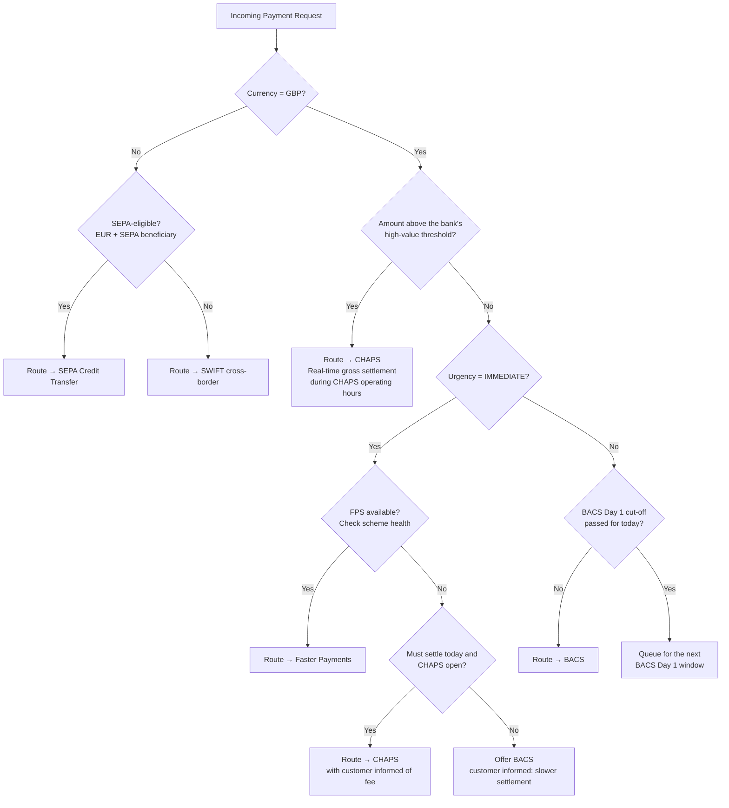

## Overview

The question "which rail do I send this payment on?" sounds simple until you are building the system that must answer it in under 50 milliseconds for 10,000 payments per second, honour cut-off times across five clearing schemes in four time zones, fall back gracefully when a scheme is degraded, and guarantee that the chosen rail's format, value limits, and processing cycle constraints are all satisfied. Payment routing is not a configuration table — it is a decision engine with real-time scheme health awareness, batch orchestration, and netting optimisation built in. This lesson equips senior engineers to design and implement that engine.

## Learning Objectives

By the end of this lesson you will be able to:

- Map payment attributes (amount, currency, destination, urgency) to the correct clearing scheme
- Implement `PaymentRouter` using the Strategy pattern with pluggable, independently testable scheme handlers
- Describe the BACS 3-day cycle (Day 1 input, Day 3 settlement) and its operational implications
- Explain ACH batch file format conventions and the NACHA 94-character record structure
- Calculate bilateral net positions between two counterparties and implement the SQL query
- Distinguish bilateral and multilateral netting from real-time gross settlement (RTGS) such as CHAPS
- Generate a BACS Standard 18 formatted output file from a list of `BacsPayment` records
- Implement scheme fallback logic (FPS unavailable → BACS) with cut-off time enforcement

## Business Context

*Composite example (based on common industry failure patterns, not a specific bank):* a bank's payment platform missed the Bacs Day 1 input deadline (22:30). Salary payments and direct debits for hundreds of thousands of customers were delayed by a full day. The file itself had been generated correctly — but the routing state machine did not distinguish "file generated" from "file submitted and acknowledged by Bacs". There was alerting on file generation, but none on the submission acknowledgement, so nobody noticed until the morning. Remediation, compensation and regulatory attention followed, and the review exposed a basic design flaw: batch payment routing must track submission state all the way to the scheme's acknowledgement, not just file creation.

This incident defines the engineering requirements for this lesson: routing must be stateful, scheme acknowledgement must be tracked, and cut-off enforcement must block new routing decisions once the submission window is closed.

## Payment Routing Decision Framework

Routing a payment requires evaluating a decision tree across four primary dimensions in order. The tree prunes quickly for most common cases, but every branch must be evaluated completely before a scheme is selected.



> [!IMPORTANT]
> Cut-off times must be evaluated against the scheme's clock, not the payment originator's local time. BACS Day 1 input closes at 22:30 UK time (GMT/BST). A system that uses UTC without BST awareness will submit one hour late during British Summer Time — exactly the kind of missed deadline described above. Note also that CHAPS is not open 24/7: it has daily operating hours and cut-offs, and does not run on weekends or bank holidays.

## PaymentRouter Strategy Pattern

Each clearing scheme has fundamentally different validation rules, file formats, settlement cycles, and operational constraints. The Strategy pattern isolates these concerns and allows schemes to be added, replaced, and independently tested.

```java
// Core routing strategy interface
public interface SchemeHandler {
    SchemeCapabilities capabilities();
    ValidationResult validate(PaymentRequest payment);
    RoutingDecision route(PaymentRequest payment);
    boolean isAvailable();  // real-time scheme health check
}

public record SchemeCapabilities(
    String schemeName,
    BigDecimal maxAmount,
    Set<String> supportedCurrencies,
    boolean supportsInstantSettlement,
    LocalTime cutOffTime,          // null = always-on (FPS). CHAPS has daily hours
    int settlementDays             // 0 = immediate; BACS settles on day 3 of its cycle
) {}

@Service
public class PaymentRouter {

    private final List<SchemeHandler> handlers;
    private final SchemeHealthMonitor healthMonitor;
    private final RoutingAuditRepository auditRepository;
    private final Clock clock;

    public PaymentRouter(List<SchemeHandler> handlers,
                         SchemeHealthMonitor healthMonitor,
                         RoutingAuditRepository auditRepository,
                         Clock clock) {
        this.handlers = handlers;
        this.healthMonitor = healthMonitor;
        this.auditRepository = auditRepository;
        this.clock = clock;
    }

    @Transactional
    public RoutingDecision route(PaymentRequest payment) {
        List<SchemeHandler> eligible = handlers.stream()
            .filter(h -> h.capabilities().supportedCurrencies()
                          .contains(payment.currency()))
            .filter(h -> h.capabilities().maxAmount()
                          .compareTo(payment.amount()) >= 0)
            .filter(h -> isCutOffSatisfied(h.capabilities()))
            .filter(SchemeHandler::isAvailable)
            .filter(h -> h.validate(payment).isValid())
            .sorted(Comparator.comparingInt(h ->
                routingPriority(h, payment)))
            .toList();

        if (eligible.isEmpty()) {
            throw new NoEligibleSchemeException(
                "No scheme can handle payment: " + payment.paymentId());
        }

        SchemeHandler selected = eligible.get(0);
        RoutingDecision decision = selected.route(payment);

        auditRepository.save(RoutingAuditRecord.builder()
            .paymentId(payment.paymentId())
            .selectedScheme(selected.capabilities().schemeName())
            .eligibleSchemes(eligible.stream()
                .map(h -> h.capabilities().schemeName()).toList())
            .decisionAt(Instant.now(clock))
            .build());

        return decision;
    }

    private boolean isCutOffSatisfied(SchemeCapabilities cap) {
        if (cap.cutOffTime() == null) return true; // always-on scheme
        // Use the injected clock (testable) in the SCHEME's time zone
        LocalTime now = LocalTime.now(clock.withZone(ZoneId.of("Europe/London")));
        return now.isBefore(cap.cutOffTime());
    }

    private int routingPriority(SchemeHandler handler, PaymentRequest payment) {
        if (payment.urgency() == Urgency.IMMEDIATE &&
            handler.capabilities().supportsInstantSettlement()) return 0;
        if (handler.capabilities().settlementDays() == 0) return 1;
        if (handler.capabilities().settlementDays() >= 2) return 2;
        return 3;
    }
}
```

```java
// Example: BACS scheme handler
@Component
public class BacsSchemeHandler implements SchemeHandler {

    private static final SchemeCapabilities CAPS = new SchemeCapabilities(
        "BACS",
        new BigDecimal("20000000.00"),
        Set.of("GBP"),
        false,
        LocalTime.of(22, 30),  // Day 1 cut-off: 22:30 UK time
        2                      // input day + 2 business days = entry day
    );

    @Override
    public SchemeCapabilities capabilities() { return CAPS; }

    @Override
    public ValidationResult validate(PaymentRequest payment) {
        List<String> errors = new ArrayList<>();
        if (payment.beneficiarySortCode() == null ||
            !SORT_CODE_PATTERN.matcher(payment.beneficiarySortCode()).matches()) {
            errors.add("Invalid or missing sort code for BACS");
        }
        if (payment.beneficiaryAccountNumber() == null ||
            payment.beneficiaryAccountNumber().length() != 8) {
            errors.add("BACS requires 8-digit account number");
        }
        return errors.isEmpty()
            ? ValidationResult.valid()
            : ValidationResult.invalid(errors);
    }

    @Override
    public boolean isAvailable() {
        return healthMonitor.isSchemeAvailable("BACS");
    }

    @Override
    public RoutingDecision route(PaymentRequest payment) {
        return RoutingDecision.builder()
            .scheme("BACS")
            .settlementDate(nextBacsSettlementDate())
            .processingInstruction(ProcessingInstruction.QUEUE_FOR_BATCH)
            .build();
    }
}
```

## BACS 3-Day Cycle

BACS (Bankers' Automated Clearing Services) operates on a fixed 3-business-day processing cycle. Missing the Day 1 input deadline causes a 24-hour delay — a full business day — in recipient settlement.

| Day | Activity | Cut-off |
|---|---|---|
| **Day 1 (Input day)** | The service user / bank submits the payment file to Bacs | 22:30 UK time |
| **Day 2 (Processing day)** | Bacs validates, sorts and distributes the payments to receiving banks | — |
| **Day 3 (Entry day)** | Payer debited and payee credited; interbank settlement at the Bank of England | Early morning |

The critical engineering constraint is that file submission must be tracked through to Bacs's acknowledgement (the submission summary / input report returned via Bacstel-IP). File generation is not submission. (Do not confuse this with AUDDIS — direct debit instruction lodgement — or ARUDD — reports of unpaid direct debits.) Submission acknowledgement must update the payment batch state machine before the cut-off monitoring system can consider the batch successfully processed.

```java
public enum BacsBatchStatus {
    COLLECTING,         // payments being added to the batch
    FROZEN,             // cut-off reached, no more additions
    FILE_GENERATED,     // Standard 18 file written to disk/SFTP staging
    SUBMITTED,          // file transferred to Bacs
    ACKNOWLEDGED,       // Bacs returned a positive submission report
    REJECTED,           // Bacs rejected the file — repair and resubmit
    SETTLED             // Day 3: Bank of England confirmed settlement
}
```

> [!WARNING]
> BACS files must not be resubmitted after acknowledgement. Duplicate file submission causes duplicate payment credits to beneficiaries. The `ACKNOWLEDGED` state must be a terminal gate: any resubmission request must require an explicit operator override with two-person authorisation and regulatory justification.

## ACH Batch Format Overview

The US ACH network (governed by NACHA) uses a fixed-width 94-character record format organised as a hierarchical file: File Header → Batch Header(s) → Entry Detail records → Batch Control → File Control.

```
(simplified — real records are exactly 94 characters, with fixed field positions)
File Header (Type 1):  101 bank routing ABA   company ID   date  BATCHFILE
Batch Header (Type 5): 5200Company Name  Company ID SEC CCD  entry descr  date  seq
Entry Detail (Type 6): 6271123456781234567890     000010000John Smith          0001
Batch Control (Type 8): 8200000001000012345678900000100000000000000Company ID     00
File Control (Type 9): 9000001000001000000010001234567890000010000000000000000000
Padding (Type 9):      9999999999999999999999999999999999999999999999999999999999999999
```

Each file must end with a number of records that is a multiple of 10 (block factor). Padding records (all 9s) fill the remaining rows to reach the next multiple of 10.

> [!NOTE]
> The ACH SEC (Standard Entry Class) code determines how the entry detail record is interpreted. `CCD` (Corporate Credit or Debit) is used for B2B payments. `PPD` (Prearranged Payment and Deposit) is used for consumer credits (payroll, government benefits). Using the wrong SEC code can cause the receiving bank to return the entry.

## Bilateral and Multilateral Netting

Netting reduces the number and gross value of interbank settlements by offsetting obligations between the same two counterparties. It is a key mechanism for reducing settlement risk and liquidity requirements.

**Bilateral netting** between Bank A and Bank B: instead of Bank A paying Bank B £50M and Bank B paying Bank A £35M (£85M gross), only the net obligation settles: Bank A pays Bank B £15M.

```sql
-- Bilateral net position: what does Bank A owe Bank B net?
-- Positive = Bank A owes Bank B; Negative = Bank B owes Bank A
WITH gross_positions AS (
    SELECT
        'A_TO_B' AS direction,
        SUM(amount) AS gross_amount
    FROM interbank_obligations
    WHERE originating_bank = 'BANK_A'
      AND receiving_bank   = 'BANK_B'
      AND settlement_date  = CURRENT_DATE
      AND status           = 'PENDING'

    UNION ALL

    SELECT
        'B_TO_A' AS direction,
        SUM(amount) AS gross_amount
    FROM interbank_obligations
    WHERE originating_bank = 'BANK_B'
      AND receiving_bank   = 'BANK_A'
      AND settlement_date  = CURRENT_DATE
      AND status           = 'PENDING'
)
-- COALESCE: SUM over no rows is NULL, which would make the result NULL
SELECT
    COALESCE(SUM(CASE WHEN direction = 'A_TO_B' THEN gross_amount END), 0)
  - COALESCE(SUM(CASE WHEN direction = 'B_TO_A' THEN gross_amount END), 0)
        AS net_position_gbp,
    COALESCE(SUM(gross_amount), 0)
        AS gross_position_gbp
FROM gross_positions;
```

**Multilateral netting** (used in deferred net settlement schemes such as Bacs and Faster Payments — **not** in CHAPS, which settles every payment gross): each participant settles only its single net position against all others, rather than bilateral positions against each counterparty. This further reduces required settlement liquidity, at the cost of settlement risk until the cycle settles.

| Method | Gross Settlement | Net Settlement | Liquidity Required |
|---|---|---|---|
| Gross (no netting) | £850M | £850M | 100% |
| Bilateral netting | £850M | £480M | 56% |
| Multilateral netting | £850M | £120M | 14% |

## BACS Standard 18 File Generation

The BACS Standard 18 format is a fixed-width flat file. Each payment record is 100 characters. The file wraps the payment records in label records (VOL1, HDR1, HDR2, UHL1 at the start; EOF1, EOF2, UTL1 at the end), and the UTL1 trailer carries the credit and debit totals and record counts that Bacs checks.

```java
public class BacsStandard18FileGenerator {

    private static final int RECORD_LENGTH = 100;

    public byte[] generate(BacsBatch batch) {
        StringBuilder sb = new StringBuilder();
        sb.append(formatLabels(batch));               // VOL1 / HDR1 / HDR2 / UHL1
        long creditTotalPence = 0;
        int creditCount = 0;

        for (BacsPayment payment : batch.payments()) {
            String record = formatPaymentRecord(payment);
            if (record.length() != RECORD_LENGTH) {
                throw new IllegalStateException("Bad record length " + record.length());
            }
            sb.append(record).append("\r\n");
            creditTotalPence = Math.addExact(creditTotalPence, payment.amountPence());
            creditCount++;
        }

        // Contra record + EOF1 / EOF2 / UTL1 with totals and counts
        sb.append(formatTrailers(batch, creditTotalPence, creditCount));
        return sb.toString().getBytes(StandardCharsets.US_ASCII);  // restricted character set
    }

    private String formatPaymentRecord(BacsPayment p) {
        // Standard 18 payment record layout (positions 1-100):
        // 1-6:   Destination sort code (no dashes)
        // 7-14:  Destination account number
        // 15:    Destination account type (normally 0)
        // 16-17: Transaction code (99 = credit, 17 = direct debit, ...)
        // 18-23: Originating sort code
        // 24-31: Originating account number
        // 32-35: Free format (often spaces / RTI field)
        // 36-46: Amount in pence (11 digits, zero-padded)
        // 47-64: Service user's name (18 chars, space-padded)
        // 65-82: Service user's reference (18 chars, space-padded)
        // 83-100: Destination account name (18 chars, space-padded)
        return String.format("%-6s%-8s%1s%2s%-6s%-8s%-4s%011d%-18s%-18s%-18s",
            p.destinationSortCode().replace("-", ""),
            p.destinationAccountNumber(),
            "0",
            p.transactionCode(),
            p.originatingSortCode().replace("-", ""),
            p.originatingAccountNumber(),
            "",
            p.amountPence(),
            truncatePad(p.originatingName(), 18),
            truncatePad(p.reference(), 18),
            truncatePad(p.destinationName(), 18)
        );
    }

    private String truncatePad(String value, int length) {
        if (value == null) return " ".repeat(length);
        String upper = value.toUpperCase(Locale.ROOT);   // Bacs uses upper case
        return String.format("%-" + length + "s",
            upper.length() > length ? upper.substring(0, length) : upper);
    }
}
```

## Scheme Fallback Logic and Cut-off Enforcement

A production routing system must handle scheme unavailability gracefully and enforce cut-off times to prevent payments from being queued into a closed processing window.

```java
@Service
public class FallbackAwareRouter {

    // Fallback chain: FPS → BACS (if same-day not required) → CHAPS (if high-value)
    private static final Map<String, List<String>> FALLBACK_CHAINS = Map.of(
        "FPS", List.of("BACS", "CHAPS"),
        "BACS", List.of("CHAPS"),
        "SEPA_CT", List.of("SWIFT")
    );

    public RoutingDecision routeWithFallback(PaymentRequest payment) {
        String primaryScheme = determinePrimaryScheme(payment);
        List<String> candidates = new ArrayList<>();
        candidates.add(primaryScheme);
        candidates.addAll(FALLBACK_CHAINS.getOrDefault(primaryScheme, List.of()));

        for (String scheme : candidates) {
            if (!healthMonitor.isSchemeAvailable(scheme)) {
                log.warn("Scheme unavailable, trying fallback: failed={} next={}",
                    scheme, nextFallback(candidates, scheme));
                continue;
            }
            if (!isCutOffOpen(scheme)) {
                log.warn("Cut-off passed for scheme: scheme={} cutOff={}",
                    scheme, getCutOff(scheme));
                continue;
            }
            SchemeHandler handler = getHandler(scheme);
            ValidationResult validation = handler.validate(payment);
            if (!validation.isValid()) {
                log.warn("Payment invalid for scheme: scheme={} errors={}",
                    scheme, validation.errors());
                continue;
            }
            return handler.route(payment);
        }

        throw new NoEligibleSchemeException(
            "All schemes unavailable or past cut-off for payment: " +
            payment.paymentId());
    }
}
```

> [!NOTE]
> Falling back from FPS to BACS silently changes the settlement from immediate to the third day of the Bacs cycle. This change must be communicated back to the payment initiator so that the customer can be informed. Never silently downgrade a payment's settlement speed without surfacing the change in the routing decision response.

## Knowledge Check

**Q1: A salary payment for £2,500 arrives at 23:00 UK time on a Monday. FPS is available. BACS is unavailable (past cut-off). CHAPS is available but only for payments above £250,000. What routing decision should the system make and why?**

A: The payment should be routed via FPS (Faster Payments). FPS supports GBP payments up to £1,000,000, operates 24/7 with no cut-off, and is available. Even though it is after the BACS Day 1 cut-off (22:30), FPS is a real-time scheme that is always open. CHAPS is not eligible because the payment is below £250,000 (the bank's own minimum for CHAPS in this configuration — the scheme has no minimum) and because CHAPS is closed at 23:00 anyway. The routing decision must record that FPS was selected and that BACS and CHAPS were considered and rejected, with their rejection reasons, in the audit log.

**Q2: What is the difference between bilateral netting and multilateral netting, and why does multilateral netting dramatically reduce required settlement liquidity?**

A: Bilateral netting offsets obligations between exactly two counterparties, so Bank A and Bank B settle only their net obligation to each other. Multilateral netting offsets each participant's obligations across all counterparties simultaneously — each bank calculates its single net position with the entire clearing system and settles only that net amount. Because obligations between multiple banks can offset in complex triangular patterns that bilateral netting cannot capture, multilateral netting achieves far greater reduction. In a system of five banks with circular obligations (A owes B, B owes C, C owes A), bilateral netting reduces gross settlement by roughly 50%; multilateral netting can reduce it by 85–90%, because the circular chain cancels almost entirely in the net calculation.

## Practical Challenge

1. **Strategy pattern completeness:** Implement `ChapsSchemeHandler` and `SepaSchemeHandler` alongside the `BacsSchemeHandler` shown in this lesson. `ChapsSchemeHandler` must enforce the bank-policy minimum of £250,000, have no practical maximum, and respect CHAPS operating hours (closed at weekends and on bank holidays). `SepaSchemeHandler` must accept only EUR and validate that the beneficiary IBAN's country is in the SEPA country list. Write unit tests for each handler's `validate()` method covering both valid and invalid cases.

2. **Cut-off time enforcement with BST:** `PaymentRouter.isCutOffSatisfied()` must correctly handle British Summer Time. Write a parameterised test using `java.time.ZoneId.of("Europe/London")` that verifies (a) a payment at 22:29 on a BST day is accepted by BACS, (b) a payment at 22:31 on a BST day is rejected by BACS but accepted by FPS, and (c) the same times with the system clock set to GMT produce the same cut-off boundaries.

3. **BACS file generation and validation:** Extend `BacsStandard18FileGenerator` to write the contra record and the UTL1 trailer with the credit total (in pence) and the credit record count. Write an integration test that generates a file for 5 known payments, checks every payment record is exactly 100 characters, parses the UTL1 record back, and asserts that the total and count match values computed independently.

4. **Fallback audit trail:** Modify `FallbackAwareRouter.routeWithFallback()` so that every scheme that was considered and rejected (whether for unavailability, cut-off, or validation failure) is recorded in a `RoutingAttempt` list that is persisted alongside the final `RoutingAuditRecord`. Write a test that simulates FPS being unavailable and verifies that the audit record contains a `REJECTED` entry for FPS with reason `SCHEME_UNAVAILABLE` and an `ACCEPTED` entry for BACS.

<!-- KNOWLEDGE-CHECK
{
  "questions": [
    {
      "text": "A £2,500 salary payment arrives at 23:00 UK time on a Monday. FPS is available, BACS is past its Day 1 cut-off, and the bank only uses CHAPS above £250,000 (CHAPS is also closed at that hour). What routing decision should the system make?",
      "options": [
        "Route via BACS — it is the cheapest option regardless of cut-off",
        "Route via CHAPS — it is always open and guaranteed",
        "Route via FPS — it is available 24/7, supports up to £1,000,000, and no other eligible scheme is available",
        "Hold the payment until the next BACS processing day"
      ],
      "correct": 2,
      "explanation": "FPS is the correct choice. It supports GBP payments up to its scheme limit of £1,000,000, operates 24/7, and is available. BACS is past its 22:30 Day 1 cut-off. CHAPS is excluded by the bank's own £250,000 threshold and is closed at 23:00 in any case. The routing decision must record that BACS and CHAPS were considered and rejected, with their reasons, in the audit log."
    },
    {
      "text": "What is the key difference between bilateral netting and multilateral netting, and why does multilateral netting reduce required settlement liquidity more dramatically?",
      "options": [
        "Bilateral netting involves more participants, so achieves more reduction",
        "Multilateral netting offsets each participant's obligations across all counterparties simultaneously, capturing circular obligation chains that bilateral netting misses",
        "They achieve the same reduction; the difference is only in the speed of settlement",
        "Bilateral netting is used for CHAPS; multilateral netting is used for BACS"
      ],
      "correct": 1,
      "explanation": "Bilateral netting offsets obligations between exactly two counterparties. Multilateral netting offsets each bank's obligations across all counterparties simultaneously. Circular obligations (A owes B, B owes C, C owes A) nearly cancel entirely in multilateral netting, potentially reducing gross settlement by 85-90% versus ~50% for bilateral netting."
    },
    {
      "text": "The BACS 3-day processing cycle operates on Days 1, 2, and 3. On which day does the beneficiary receive funds in their account?",
      "options": [
        "Day 1 — submission day",
        "Day 2 — processing day",
        "Day 3 — settlement day",
        "Day 4 — the cycle takes 4 days"
      ],
      "correct": 2,
      "explanation": "The Bacs cycle has three days: Day 1 (input — files submitted by 22:30), Day 2 (processing — Bacs validates and distributes to receiving banks), Day 3 (entry day — payer debited, beneficiary credited, interbank settlement). Files submitted after the Day 1 cut-off start their cycle on the next business day."
    }
  ]
}
-->

<!-- PRACTICAL-CHALLENGE
{
  "title": "Payment Routing Strategy Pattern and BACS File Generation",
  "difficulty": "advanced",
  "estimatedMinutes": 45,
  "tasks": [
    {
      "id": "1",
      "description": "Implement `ChapsSchemeHandler` and `SepaSchemeHandler` alongside `BacsSchemeHandler`. `ChapsSchemeHandler` must enforce the bank-policy minimum of £250,000 and respect CHAPS operating hours. `SepaSchemeHandler` must accept only EUR and validate that the beneficiary IBAN's country is in the SEPA country list. Write unit tests for each handler's `validate()` method covering both valid and invalid cases."
    },
    {
      "id": "2",
      "description": "Ensure `PaymentRouter.isCutOffSatisfied()` correctly handles British Summer Time. Write a parameterised test using `java.time.ZoneId.of('Europe/London')` verifying: (a) payment at 22:29 on a BST day is accepted by BACS; (b) payment at 22:31 on a BST day is rejected by BACS but accepted by FPS; (c) the same times with the system clock set to GMT produce the same cut-off boundaries."
    },
    {
      "id": "3",
      "description": "Extend `BacsStandard18FileGenerator` to write the contra record and the UTL1 trailer with the credit total (in pence) and the credit record count. Write an integration test that generates a file for 5 known payments, checks each payment record is exactly 100 characters, parses the UTL1 record back, and asserts the total and count match independently computed values."
    },
    {
      "id": "4",
      "description": "Modify `FallbackAwareRouter.routeWithFallback()` to record every scheme that was considered and rejected (unavailability, cut-off, validation failure) in a `RoutingAttempt` list persisted alongside the `RoutingAuditRecord`. Test that simulates FPS unavailable and verifies audit record contains `REJECTED` entry for FPS with reason `SCHEME_UNAVAILABLE` and `ACCEPTED` for BACS."
    }
  ]
}
-->

