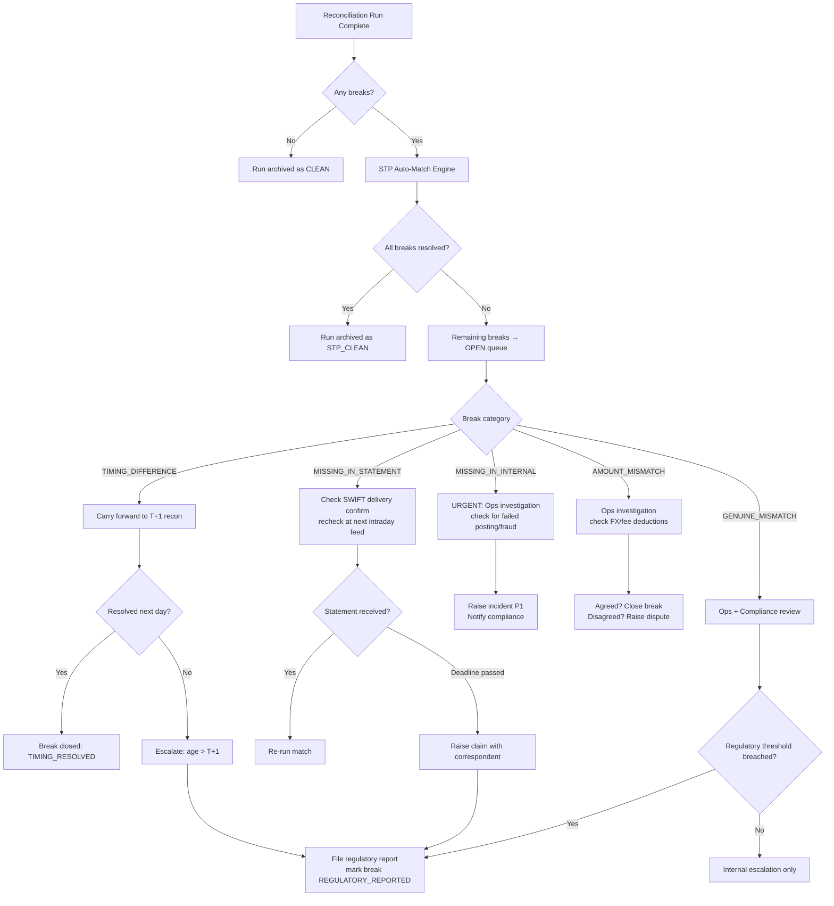

# المطابقة — النوسترو والفروقات وسير عمل حلها

## نظرة عامة

المطابقة هي جهاز المناعة التشغيلي للبنك. فهي العملية التي يتحقق بها البنك باستمرار من أن سجلاته الداخلية تتفق مع العالم الخارجي — أن ما يعتقد النظام البنكي الأساسي أنه حدث لدى بنك مراسل قد حدث فعلًا، وأن ما يبلغ معالج البطاقات أنه سوّاه يطابق دفتر المعاملات الداخلي، وأن أموال العملاء المحتفظ بها في حسابات منفصلة تساوي ما يستحقه العملاء حتى آخر قرش. وعندما تعمل المطابقة بصمت، فلا شيء معطل. وعندما تكشف فرقًا (break)، فقد حدث خطأ له عواقب مالية حقيقية: خصم خاطئ، أو تسوية فاشلة، أو دفعة مكررة، أو احتيال. والتحدي الهندسي جعل المطابقة سريعة بما يكفي لاكتشاف الفروقات في يوم حدوثها، وآلية بما يكفي لمعالجة ملايين السجلات دون تدخل يدوي، ودقيقة بما يكفي ليطلق كل فرق غير مفسَّر تحقيقًا قبل أن يتفاقم.

## أهداف التعلم

في نهاية هذا الدرس ستستطيع:

- وصف تسلسل أنواع المطابقة في البنك وشرح غرض كل منها
- شرح مطابقة النوسترو: كيف يُطابق كشف حساب MT940 / camt.053 مع دفتر النوسترو الداخلي
- تنفيذ `NostroReconciliationJob` باستخدام SQL FULL OUTER JOIN (مع مطابقة ثانوية واحد لواحد) لتحديد السجلات غير المطابقة على الجانبين
- تصنيف فروقات المطابقة إلى فروقات توقيت، وعدم تطابق حقيقي، وقيود مفقودة، وتكرارات
- تصميم مخطط `reconciliation_breaks` مع آلة حالة لسير العمل لإدارة دورة حياة الفرق
- تنفيذ قواعد المطابقة الآلية STP ‏(المعالجة المباشرة) لتعظيم نسب الحل الآلي
- وصف وقت القطع في نهاية اليوم، ونافذة التسامح T+1، وآثارهما التشغيلية
- شرح الالتزامات الرقابية للإبلاغ عن فروقات المطابقة غير المحلولة

## سياق العمل

في أغسطس 2012 نشرت Knight Capital شيفرة تداول جديدة على سبعة فقط من خوادمها الثمانية؛ وأعاد علم (flag) أُعيد استخدامه تشغيل شيفرة قديمة غير مستخدمة على الخادم الثامن. وفي نحو 45 دقيقة أرسل النظام ملايين الأوامر غير المقصودة، وبنى مراكز بمليارات الدولارات، وخسرت Knight نحو 460 مليون دولار (أمر هيئة SEC، 2013). كان ذلك أساسًا فشلًا في النشر وضوابط المخاطر، لكنه يحمل درسًا في المطابقة: لم يكن هناك ضابط آلي يقارن ما تنوي الشركة الاحتفاظ به بما يؤكده السوق، بسرعة تكفي لإيقاف الضرر. والمقارنة السريعة والآلية للسجلات الداخلية بالتأكيدات الخارجية هي بالضبط ما توفره المطابقة.

يعالج هذا الدرس النسخة البنكية من تلك المشكلة: مطابقة نوسترو تكتشف الفروقات خلال ساعات من حدوثها لا أيام، وسير عمل لإدارة الفروقات يوجّه كل فرق إلى مسار الحل الصحيح دون أن يحتاج إنسان إلى فرز آلاف السجلات يدويًا.

## تسلسل أنواع المطابقة

تشغّل البنوك عمليات مطابقة متعددة متزامنة. ويستهدف كل نوع علاقة مختلفة بين السجلات الداخلية ومصدر حقيقة خارجي.

| النوع | المصدر الداخلي | المصدر الخارجي | التواتر | الدافع الرقابي |
|---|---|---|---|---|
| **مطابقة النوسترو** | دفتر النوسترو الداخلي | كشف المراسل (MT940 / camt.053؛ وخلال اليوم MT942 / camt.052) | يوميًا، وخلال اليوم حيث يتوفر | ضوابط المخاطر التشغيلية والسيولة |
| **مطابقة معالج البطاقات** | سجل معاملات البطاقات الداخلي | ملف تسوية المعالج (Visa/Mastercard) | يوميًا بعد التسوية | قواعد أنظمة البطاقات، ومخاطر التسوية |
| **المطابقة بين شركات المجموعة** | دفتر الأستاذ للكيان A | دفتر الأستاذ للكيان B | يوميًا / شهريًا | التوحيد وفق IFRS |
| **مطابقة أموال العملاء** | دفتر أموال العملاء | كشف الحساب البنكي المنفصل | يوميًا | FCA CASS 7 |
| **مطابقة أمين الحفظ** | مركز الأوراق المالية الداخلي | تقرير مراكز أمين الحفظ | يوميًا / شهريًا على الأقل لأصول العملاء | FCA CASS 6 (قواعد الحفظ) |

> [!IMPORTANT]
> لمطابقة أموال العملاء (FCA CASS 7.15) أشد المواعيد: إذا أظهرت المطابقة عجزًا في أموال العملاء، يجب على الشركة إيداع أموالها الخاصة لتغطيته **بحلول نهاية يوم العمل الذي أُجريت فيه المطابقة**. وإذا لم تستطع الشركة إجراء مطابقاتها أو تغطية العجز، يجب أن تُبلغ FCA **دون تأخير**. ويجب أن تعطي الأنظمة الهندسية فروقات أموال العملاء أولوية فوق كل أنواع المطابقة الأخرى.

## مطابقة النوسترو ومطابقة MT940

**حساب النوسترو** حساب للبنك لدى بنك مراسل بعملة أجنبية (من الإيطالية "nostro" — أي "لنا"). ويرسل البنك المراسل كشفًا في نهاية اليوم — رسالة SWIFT ‏MT940 ‏(Customer Statement Message) أو، بشكل متزايد، مقابلها في ISO 20022 وهو camt.053 — يحتوي الرصيد الافتتاحي، وكل المعاملات المرحّلة خلال اليوم، والرصيد الختامي. وكشف اليوم D يصل عادة صباح اليوم D+1.

تحدي المطابقة: قد يستخدم البنك المراسل رقم مرجع مختلفًا، أو يقتطع تفاصيل الدفعة، أو يرحّل الإضافات والخصومات في دفعات مختلفة على مدار اليوم. ويجب أن تتعامل مطابقة STP مع كل هذه الحالات.

```sql
-- NostroReconciliationJob — pass 1: match by reference
-- Filter EACH side in a CTE first. A WHERE clause on i.* after a FULL OUTER
-- JOIN would delete every row where i is NULL — i.e. exactly the
-- MISSING_IN_INTERNAL breaks, the riskiest ones.
-- Both sides include all still-UNMATCHED items up to the date, so a timing
-- difference (entry on different days) still pairs up.
WITH i AS (
    SELECT * FROM internal_nostro_entries
    WHERE nostro_account_id = :nostroAccountId
      AND value_date       <= :reconciliationDate
      AND match_state       = 'UNMATCHED'
),
s AS (
    SELECT * FROM statement_entries
    WHERE nostro_account_id = :nostroAccountId
      AND booking_date     <= :reconciliationDate
      AND match_state       = 'UNMATCHED'
)
SELECT
    i.entry_id             AS internal_id,
    i.internal_ref,
    i.amount               AS internal_amount,
    i.credit_debit_flag    AS internal_cd,
    i.value_date           AS internal_value_date,
    s.entry_id             AS statement_id,
    s.related_ref          AS statement_ref,   -- our reference echoed by the correspondent
    s.amount               AS statement_amount,
    s.credit_debit_flag    AS statement_cd,
    s.value_date           AS statement_value_date,
    CASE
        WHEN i.entry_id IS NULL THEN 'MISSING_IN_INTERNAL'
        WHEN s.entry_id IS NULL THEN 'MISSING_IN_STATEMENT'
        WHEN i.amount <> s.amount THEN 'AMOUNT_MISMATCH'
        WHEN i.value_date <> s.value_date THEN 'TIMING_DIFFERENCE'
        ELSE 'MATCHED'
    END AS match_status
FROM i
FULL OUTER JOIN s
    ON  i.internal_ref      = s.related_ref
    AND i.credit_debit_flag = s.credit_debit_flag;
-- (PostgreSQL only allows FULL JOIN on merge- or hash-joinable conditions,
--  so an "ref = ref OR (amount = amount AND ...)" condition is rejected.)

-- Pass 2 (run on what pass 1 left unmatched): amount + value date + C/D,
-- paired ONE-TO-ONE with ROW_NUMBER so two equal payments never both match
-- the same statement line
WITH i2 AS (
    SELECT entry_id, amount, value_date, credit_debit_flag,
           ROW_NUMBER() OVER (PARTITION BY amount, value_date, credit_debit_flag
                              ORDER BY entry_id) AS rn
    FROM internal_nostro_entries
    WHERE nostro_account_id = :nostroAccountId AND match_state = 'UNMATCHED'
),
s2 AS (
    SELECT entry_id, amount, value_date, credit_debit_flag,
           ROW_NUMBER() OVER (PARTITION BY amount, value_date, credit_debit_flag
                              ORDER BY entry_id) AS rn
    FROM statement_entries
    WHERE nostro_account_id = :nostroAccountId AND match_state = 'UNMATCHED'
)
SELECT i2.entry_id AS internal_id, s2.entry_id AS statement_id
FROM i2
JOIN s2 USING (amount, value_date, credit_debit_flag, rn);
```

> [!NOTE]
> قد تنتج المطابقة الثانوية (المبلغ + التاريخ + علم الإضافة/الخصم) إيجابيات كاذبة عندما تُسوّى عدة دفعات بالمبلغ نفسه في اليوم نفسه. فشغّلها فقط على البنود التي تركتها المطابقة بالمرجع، واقرن الصفوف واحدًا لواحد (حيلة `ROW_NUMBER` أعلاه)، وعامل هذه المطابقات كأقل ثقة — مثلًا علّمها لمراجعة بالعينة.

## تنفيذ NostroReconciliationJob

```java
@Component
public class NostroReconciliationJob {

    private static final Logger log = LoggerFactory.getLogger(NostroReconciliationJob.class);

    private final NostroReconciliationRepository repo;
    private final BreakRepository breakRepo;
    private final AutoMatchEngine autoMatchEngine;
    private final MeterRegistry meterRegistry;

    // Must be called through the Spring proxy (from another bean), or the
    // transaction does not apply
    @Transactional
    public ReconciliationRunResult reconcile(String nostroAccountId,
                                             LocalDate reconciliationDate) {
        log.info("Starting nostro reconciliation: account={} date={}",
            nostroAccountId, reconciliationDate);

        List<ReconciledEntry> entries = repo.runFullOuterJoin(
            nostroAccountId, reconciliationDate);
        // (pass 2 — the one-to-one amount/date match — runs after this on the
        //  remaining items; omitted here for brevity)

        int matched = 0, broken = 0;
        List<ReconciliationBreak> newBreaks = new ArrayList<>();

        for (ReconciledEntry entry : entries) {
            if (entry.matchStatus() == MatchStatus.MATCHED) {
                markMatched(entry);
                matched++;
            } else {
                BreakCategory category = categoriseBreak(entry);
                ReconciliationBreak brk = ReconciliationBreak.builder()
                    .breakId(UUID.randomUUID().toString())
                    .nostroAccountId(nostroAccountId)
                    .reconciliationDate(reconciliationDate)
                    .internalRef(entry.internalRef())
                    .statementRef(entry.statementRef())
                    .internalAmount(entry.internalAmount())
                    .statementAmount(entry.statementAmount())
                    .breakCategory(category)
                    .breakStatus(BreakStatus.OPEN)
                    .detectedAt(clock.instant())
                    .build();

                newBreaks.add(brk);
                broken++;
            }
        }

        // STP auto-match pass: attempt to auto-resolve timing differences
        int autoResolved = autoMatchEngine.process(newBreaks, reconciliationDate);

        // Idempotent: a unique key on (account, date, internal_id, statement_id)
        // means re-running the job updates existing breaks instead of
        // creating duplicates
        breakRepo.upsertAll(newBreaks);
        meterRegistry.counter("recon.breaks.detected",
            "account", nostroAccountId).increment(broken);
        meterRegistry.counter("recon.breaks.auto_resolved",
            "account", nostroAccountId).increment(autoResolved);

        log.info("Reconciliation complete: account={} date={} matched={} broken={} autoResolved={}",
            nostroAccountId, reconciliationDate, matched, broken, autoResolved);

        return new ReconciliationRunResult(matched, broken, autoResolved,
            broken - autoResolved);
    }

    private BreakCategory categoriseBreak(ReconciledEntry entry) {
        if (entry.internalRef() == null) return BreakCategory.MISSING_IN_INTERNAL;
        if (entry.statementRef() == null) return BreakCategory.MISSING_IN_STATEMENT;
        // compareTo, not equals: BigDecimal("10.0").equals(BigDecimal("10.00")) is false
        if (entry.internalAmount().compareTo(entry.statementAmount()) != 0)
            return BreakCategory.AMOUNT_MISMATCH;
        if (!entry.internalValueDate().equals(entry.statementValueDate()))
            return BreakCategory.TIMING_DIFFERENCE;
        return BreakCategory.GENUINE_MISMATCH;
    }
}
```

يجب استدعاء `reconcile` عبر وكيل Spring (من حبة أخرى) وإلا لا تنطبق المعاملة. ويُحفظ الفرق بعملية upsert: فمفتاح فريد على (الحساب، والتاريخ، ومعرّف البند الداخلي، ومعرّف بند الكشف) يجعل إعادة تشغيل المهمة تحدّث الفروقات الموجودة بدل إنشاء تكرارات. وتُقارن المبالغ بـ `compareTo` لا `equals`، لأن `BigDecimal("10.0").equals(BigDecimal("10.00"))` تعيد false.

## تصنيف الفروقات والمخطط

لكل فرق فئة تحدد أهليته للحل الآلي ومسار التحقيق فيه.

| الفئة | الوصف | قابل للحل الآلي؟ | السبب المعتاد |
|---|---|---|---|
| `TIMING_DIFFERENCE` | القيد موجود على الجانبين لكن بتواريخ قيمة مختلفة | نعم — إذا كان ضمن يوم عمل واحد | توقيت الترحيل خلال اليوم مقابل نهاية اليوم |
| `MISSING_IN_STATEMENT` | الدفتر الداخلي فيه القيد؛ وكشف المراسل لا | مشروط — إذا تأكد إرسال الدفعة | قطع كشف خلال اليوم، ترحيل متأخر |
| `MISSING_IN_INTERNAL` | الكشف فيه القيد؛ والدفتر الداخلي لا | لا — يتطلب تحقيقًا | فشل ترحيل دفعة، خطأ المراسل، احتيال |
| `AMOUNT_MISMATCH` | المرجع نفسه على الجانبين، والمبالغ مختلفة | لا — يتطلب تحقيقًا دائمًا | خطأ تحويل عملة، رسوم خصمها المراسل |
| `GENUINE_MISMATCH` | المراجع متطابقة لكن عدة حقول مختلفة | لا — يتطلب تحقيقًا دائمًا | معاملة خاطئة، احتيال |
| `DUPLICATE` | القيد نفسه يظهر مرتين في جانب واحد | لا — يتطلب تحقيقًا دائمًا | تكرار من النظام، ترحيل مزدوج |

```sql
-- reconciliation_breaks: schema DDL
CREATE TABLE reconciliation_breaks (
    break_id              UUID           PRIMARY KEY,
    nostro_account_id     VARCHAR(50)    NOT NULL,
    reconciliation_date   DATE           NOT NULL,
    break_category        VARCHAR(30)    NOT NULL,  -- see BreakCategory enum
    break_status          VARCHAR(20)    NOT NULL DEFAULT 'OPEN',
    internal_entry_id     BIGINT,
    statement_entry_id    BIGINT,
    internal_ref          VARCHAR(100),
    statement_ref         VARCHAR(100),
    internal_amount       NUMERIC(18, 2),
    statement_amount      NUMERIC(18, 2),
    amount_difference     NUMERIC(18, 2) GENERATED ALWAYS AS
                          (COALESCE(internal_amount, 0) - COALESCE(statement_amount, 0))
                          STORED,
    internal_value_date   DATE,
    statement_value_date  DATE,
    auto_resolution_rule  VARCHAR(100),   -- which STP rule resolved it, if any
    resolved_at           TIMESTAMPTZ,
    resolved_by           VARCHAR(100),   -- system user ID or 'AUTO_STP'
    resolution_notes      TEXT,
    escalated_at          TIMESTAMPTZ,    -- set when escalated to ops team
    regulatory_reported   BOOLEAN        NOT NULL DEFAULT FALSE,
    detected_at           TIMESTAMPTZ    NOT NULL DEFAULT NOW(),
    updated_at            TIMESTAMPTZ    NOT NULL DEFAULT NOW(),
    -- one break per item pair per run date: re-runs update, never duplicate
    -- (NULLS NOT DISTINCT, PostgreSQL 15+, so one-sided breaks are covered too)
    CONSTRAINT uq_break_items UNIQUE NULLS NOT DISTINCT
        (nostro_account_id, reconciliation_date, internal_entry_id, statement_entry_id)
);

CREATE INDEX idx_recon_breaks_account_date
    ON reconciliation_breaks (nostro_account_id, reconciliation_date, break_status);

CREATE INDEX idx_recon_breaks_open_category
    ON reconciliation_breaks (break_status, break_category, detected_at)
    WHERE break_status = 'OPEN';
```

## قواعد المطابقة الآلية STP

تسمح قواعد المعالجة المباشرة لمحرك المطابقة بإغلاق الفروقات آليًا دون تدخل بشري. وكل قاعدة شرط يُقيّم مقابل `ReconciliationBreak`. وتُرتب القواعد حسب الثقة — فالفرق الذي تحله قاعدة عالية الثقة لا يحتاج مراجعة إضافية.

```java
public interface AutoMatchRule {
    String ruleName();
    int confidenceScore();  // 0-100; below 70 requires manual review
    boolean matches(ReconciliationBreak brk, LocalDate reconDate);
    AutoResolutionAction resolve(ReconciliationBreak brk);
}

@Component
public class TimingDifferenceRule implements AutoMatchRule {

    @Override
    public String ruleName() { return "TIMING_DIFFERENCE_T1"; }

    @Override
    public int confidenceScore() { return 95; }

    @Override
    public boolean matches(ReconciliationBreak brk, LocalDate reconDate) {
        return brk.breakCategory() == BreakCategory.TIMING_DIFFERENCE
            && brk.internalAmount().compareTo(brk.statementAmount()) == 0
            && brk.internalValueDate() != null
            && brk.statementValueDate() != null
            // BUSINESS days: Friday → Monday is 3 calendar days but 1 business day
            && businessCalendar.businessDaysBetween(
                brk.internalValueDate(), brk.statementValueDate()) <= 1;
    }

    @Override
    public AutoResolutionAction resolve(ReconciliationBreak brk) {
        // The entry will appear on the following day's statement — carry forward
        return AutoResolutionAction.builder()
            .action(ResolutionAction.CARRY_FORWARD)
            .newStatus(BreakStatus.TIMING_CARRY_FORWARD)
            .carryForwardDate(brk.statementValueDate())
            .build();
    }
}
```

يُحسب الفرق بأيام **العمل**: فمن الجمعة إلى الاثنين 3 أيام تقويمية لكنها يوم عمل واحد.

## سير عمل حل الفروقات



> [!WARNING]
> يجب معاملة فروقات `MISSING_IN_INTERNAL` — حيث يُظهر كشف البنك المراسل خصمًا لا يعرفه الدفتر الداخلي — كـ **حوادث P1**. فهي تدل إما على فشل ترحيل دفعة (خطأ تشغيلي) أو على معاملة غير مصرح بها (احتيال). ويجب ألا تتجاوز يومها أبدًا دون تحقيق نشط وإبلاغ الامتثال.

## القطع في نهاية اليوم والإبلاغ الرقابي

القطع في نهاية اليوم هو النقطة التي تجمّد بعدها مهمة المطابقة رؤيتها لدفتر النوسترو وقيود الكشف لتاريخ معين. وأي قيود تصل بعد القطع تُنسب إلى مطابقة يوم العمل التالي.

```java
// End-of-day statements for day D arrive early on D+1, so the day-end
// reconciliation runs the next morning for the PREVIOUS business day
// (an intraday run on MT942 / camt.052 data catches breaks earlier)
@Scheduled(cron = "0 0 7 * * MON-FRI", zone = "Europe/London")
public void runDayEndReconciliation() {
    LocalDate reconDate = businessCalendar.previousBusinessDay(
        LocalDate.now(clock.withZone(ZoneId.of("Europe/London"))));
    List<String> nostroAccounts = nostroAccountRepository.findAllActiveAccountIds();

    for (String accountId : nostroAccounts) {
        try {
            if (!statementRepository.hasFinalStatement(accountId, reconDate)) {
                // A missing statement is itself a break — never reconcile
                // against nothing and report "all clean"
                alertingService.raiseCriticalAlert(
                    "STATEMENT_NOT_RECEIVED", accountId, reconDate.toString());
                continue;
            }
            ReconciliationRunResult result = reconciliationJob.reconcile(accountId, reconDate);
            if (result.unresolvedBreaks() > 0) {
                checkRegulatoryReportingThresholds(accountId, reconDate, result);
            }
        } catch (Exception ex) {
            log.error("Day-end reconciliation failed: account={}", accountId, ex);
            alertingService.raiseCriticalAlert(
                "DAY_END_RECON_FAILED", accountId, ex.getMessage());
        }
    }
}

private void checkRegulatoryReportingThresholds(String accountId,
                                                 LocalDate date,
                                                 ReconciliationRunResult result) {
    BigDecimal unresolvedValue = breakRepo.sumUnresolvedAmount(accountId, date);
    BigDecimal threshold = regulatoryConfig.getReportingThreshold(accountId);

    if (unresolvedValue.compareTo(threshold) > 0) {
        log.warn("Escalation threshold breached: account={} unresolvedValue={} threshold={}",
            accountId, unresolvedValue, threshold);
        regulatoryReporter.flagForReport(accountId, date, unresolvedValue,
            RegulatoryReportType.OPERATIONAL_RISK_BREAK);
    }
}
```

كشوف نهاية اليوم D تصل صباح D+1، فتعمل مطابقة نهاية اليوم في الصباح التالي ليوم العمل السابق (والتشغيل خلال اليوم على بيانات MT942 / camt.052 يكتشف الفروقات أبكر). والكشف المفقود فرق بحد ذاته — فلا تطابق مقابل لا شيء ثم تبلغ "كل شيء نظيف".

يجب تصعيد فروقات النوسترو غير المحلولة التي تتجاوز يوم عمل واحدًا ضمن إطار المخاطر التشغيلية للبنك: فهي تظهر في تقارير المخاطر، وأي خسارة ناتجة تُسجّل كحدث خسارة تشغيلية. وتتوقع الجهات الرقابية أن تعمل هذه الضوابط، ويختبرها المدققون. أما أموال العملاء فقواعدها أشد: يجب تغطية العجز في اليوم نفسه، ويجب إبلاغ FCA دون تأخير إذا لم تستطع الشركة تغطيته أو إجراء مطابقاتها.

> [!NOTE]
> نافذة التسامح T+1 ليست فترة سماح للتقاعس. فهي موجودة خصيصًا لفروقات التوقيت — القيود التي عبرت منتصف الليل بين الترحيل الداخلي وترحيل المراسل. أما كل فئات الفروقات الأخرى (عدم تطابق المبلغ، والمفقود داخليًا، وعدم التطابق الحقيقي) فيجب التحقيق فيها منذ لحظة اكتشافها، بغض النظر عن نافذة التسامح.

## اختبار المعرفة

**س1: استخدام FULL OUTER JOIN في `NostroReconciliationJob` غير مألوف — فمعظم شيفرة التطبيقات تستخدم LEFT أو INNER JOIN. لماذا يُعد FULL OUTER JOIN أساسيًا للمطابقة، وماذا سيحدث لو استخدمت LEFT JOIN بدلًا منه؟**

ج: يعيد FULL OUTER JOIN كل الصفوف من الدفتر الداخلي والكشف الخارجي معًا، فيربط حيث يوجد تطابق ويعيد `NULL` في الجانب غير المطابق حيث لا يوجد. وهذا أساسي لأن المطابقة يجب أن تكتشف الفروقات في الاتجاهين معًا: قيود موجودة داخليًا وليست في الكشف (أخطاء ترحيل محتملة أو فروقات توقيت)، وقيود موجودة في الكشف وليست داخليًا (ترحيلات فائتة محتملة أو احتيال). أما LEFT JOIN فسيعيد كل القيود الداخلية مع ما يطابقها من الكشف — لكنه سيحذف تمامًا قيود الكشف التي لا مقابل داخليًا لها (فئة `MISSING_IN_INTERNAL`). وهذه بالضبط أعلى الفروقات خطرًا: فالبنك المراسل رحّل خصمًا لا يملك نظام البنك أي سجل له، وقد يدل ذلك على معاملة غير مصرح بها. فـ LEFT JOIN سيجعل تلك القيود غير مرئية بصمت. (وللسبب نفسه، يجب تصفية كل جانب في CTE قبل الربط: فشرط WHERE على أعمدة الجانب الداخلي بعد الربط يحوّل FULL OUTER JOIN فعليًا إلى LEFT JOIN.)

**س2: اشرح لماذا تُعد فروقات `TIMING_DIFFERENCE` الأكثر أمانًا للحل الآلي بقاعدة STP، بينما يجب أن تطلق فروقات `MISSING_IN_INTERNAL` تحقيقًا يدويًا دائمًا. ما الذي قد يسوء لو طبقت منطق الحل الآلي نفسه على الاثنين؟**

ج: يتميز فرق `TIMING_DIFFERENCE` بظهور المبلغ نفسه، والمرجع نفسه، واتجاه الإضافة/الخصم نفسه على الجانبين — ولا يختلف إلا تاريخ القيمة بيوم عمل واحد. وهذا نمط تشغيلي مفهوم جيدًا: فترحيلات الدفع خلال اليوم تعبر أحيانًا حدود اليوم بين قطع الدفتر الداخلي وقطع كشف المراسل. وخطر سوء التصنيف منخفض لأن معايير المطابقة الثلاثة (المبلغ، والمرجع، والاتجاه) مؤكدة. أما فرق `MISSING_IN_INTERNAL` فله جانب واحد فقط: الكشف فيه قيد لا مقابل داخليًا له إطلاقًا. ولا يوجد مرجع داخلي مطابق للتحقق منه. وحلّه آليًا يعني أن النظام يعلّمه "مُرحّل لليوم التالي" أو "مفسَّر" دون أن يتحقق أحد مما يمثله خصم البنك المراسل فعلًا. فإذا كان ذلك الخصم سحبًا غير مصرح به، فالحل الآلي يخفي احتيالًا. وإذا كان خطأ من البنك المراسل، فالحل الآلي يُضيع حق البنك في الاعتراض عليه ضمن نافذة النزاع. وكلا النتيجتين غير مقبولة.

## التحدي العملي

1. **محلل MT940:** نفّذ `Mt940Parser` يقرأ نص رسالة SWIFT ‏MT940 وينتج قائمة كائنات `StatementEntry`. ويجب أن يتعامل المحلل مع حقل المعاملة `:61:` (تاريخ القيمة، ورمز الإضافة/الخصم، والمبلغ، والمرجع) وحقل الوصف `:86:`. واكتب اختبارات لثلاث رسائل MT940: إضافة بسيطة، وخصم بمرجع مراسل مختلف عن المرجع الداخلي، ورسالة فيها رصيد ختامي نهائي (الحقل `:62F:`).

2. **ترتيب محرك المطابقة الآلية:** يجب أن تقيّم `AutoMatchEngine.process()` القواعد بترتيب تنازلي حسب `confidenceScore` وتتوقف عن تقييم قواعد أخرى للفرق بمجرد تطابق قاعدة (اختصار). ونفّذ ذلك باستخدام قائمة مرتبة من حبوب `AutoMatchRule` يحقنها Spring. واكتب اختبارًا يتحقق من أن فرقًا يطابق قاعدة بثقة 95 وقاعدة بثقة 70 يُحل بالقاعدة ذات الثقة 95.

3. **استعلام لوحة أعمار الفروقات:** اكتب استعلام SQL يعيد، لحساب نوسترو معين، عدد الفروقات المفتوحة ومبلغها الإجمالي مجمّعة حسب `break_category` وفئة العمر (`< 1 day` و`1–2 days` و`2–5 days` و`> 5 days`). واستخدم `NOW() - detected_at` لحساب العمر. ويجب ترتيب النتيجة حسب فئة العمر تنازليًا لتظهر أقدم الفروقات أولًا.

4. **اختبار تنبيه الحد الرقابي:** اكتب اختبار تكامل باستخدام Testcontainers ‏(PostgreSQL) يزرع خمسة فروقات `MISSING_IN_INTERNAL` مجموعها 600,000 جنيه لحساب نوسترو حده الرقابي مضبوط على 500,000 جنيه. وتحقق من أن `checkRegulatoryReportingThresholds()` تستدعي `regulatoryReporter.flagForReport()` مرة واحدة بالضبط بمعرّف الحساب والتاريخ ونوع التقرير الصحيحة. وتحقق من أنه مع مبلغ مزروع 400,000 جنيه (تحت الحد) لا تُستدعى `flagForReport()`.

<!-- KNOWLEDGE-CHECK
{
  "questions": [
    {
      "text": "يُستخدم FULL OUTER JOIN في استعلام المطابقة في NostroReconciliationJob. ما الذي سيفوت لو استُخدم LEFT JOIN بدلًا منه؟",
      "options": [
        "القيود الداخلية التي لا يقابلها قيد في الكشف",
        "قيود الكشف التي لا يقابلها قيد داخلي",
        "القيود التي يختلف تاريخ قيمتها بيوم عمل واحد",
        "القيود التي حقل المرجع فيها null"
      ],
      "correct": 1,
      "explanation": "يعيد LEFT JOIN كل القيود الداخلية وما يطابقها من الكشف، لكنه يحذف تمامًا قيود الكشف التي لا مقابل داخليًا لها. وفروقات MISSING_IN_INTERNAL هذه أعلى الفئات خطرًا — فقد تمثل معاملات غير مصرح بها. ويلزم FULL OUTER JOIN لاكتشاف الفروقات في الاتجاهين معًا."
    },
    {
      "text": "أي فئة من فروقات المطابقة هي الأكثر أمانًا للحل الآلي بقاعدة STP، ولماذا؟",
      "options": [
        "‏MISSING_IN_INTERNAL — الكشف له الأسبقية دائمًا على السجلات الداخلية",
        "‏AMOUNT_MISMATCH — الفروقات الصغيرة غالبًا أخطاء تقريب",
        "‏TIMING_DIFFERENCE — المبلغ والمرجع والاتجاه نفسها مؤكدة على الجانبين، ولا يختلف إلا تاريخ القيمة بيوم عمل واحد",
        "‏GENUINE_MISMATCH — الجانبان يتفقان على أن القيد خاطئ"
      ],
      "correct": 2,
      "explanation": "لفروقات TIMING_DIFFERENCE معايير المطابقة الثلاثة مؤكدة (المبلغ، والمرجع، والاتجاه) — ولا يختلف إلا تاريخ القيمة بيوم عمل واحد بسبب توقيت قطع الترحيل. فخطر سوء التصنيف منخفض. أما فروقات MISSING_IN_INTERNAL فيجب أن تطلق تحقيقًا يدويًا دائمًا لأن الحل الآلي قد يخفي احتيالًا أو يُضيع حقوق الاعتراض."
    },
    {
      "text": "ما الغرض من نافذة التسامح T+1 في مطابقة النوسترو؟",
      "options": [
        "تمنح المهندسين وقتًا لإصلاح الأخطاء قبل أن تلاحظ الجهات الرقابية الفروقات",
        "تسمح لفروقات التوقيت — القيود التي عبر ترحيلها منتصف الليل بين القطع الداخلي وقطع المراسل — بأن تُحل دون إثارة فرق",
        "تؤجل كل تحقيقات الفروقات إلى يوم العمل التالي",
        "هي فترة سماح رقابية لا يُطلب خلالها أي إبلاغ"
      ],
      "correct": 1,
      "explanation": "نافذة التسامح T+1 موجودة خصيصًا لفروقات التوقيت — القيود التي عبرت منتصف الليل بين الترحيل الداخلي وترحيل المراسل. وليست فترة سماح للتقاعس؛ فكل فئات الفروقات الأخرى (عدم تطابق المبلغ، والمفقود داخليًا، وعدم التطابق الحقيقي) يجب التحقيق فيها فورًا بغض النظر عن النافذة."
    }
  ]
}
-->

<!-- PRACTICAL-CHALLENGE
{
  "title": "بناء محرك إنتاجي لمطابقة النوسترو",
  "difficulty": "advanced",
  "estimatedMinutes": 60,
  "tasks": [
    {"id": "1", "description": "نفّذ MT940Parser يقرأ نص رسالة SWIFT ‏MT940 وينتج قائمة كائنات StatementEntry، ويتعامل مع حقل المعاملة :61: وحقل الوصف :86:. واكتب اختبارات لإضافة بسيطة، وخصم بمرجع مراسل مختلف، ورسالة فيها حقل الرصيد الختامي النهائي."},
    {"id": "2", "description": "نفّذ AutoMatchEngine.process() بحيث تُقيّم القواعد بترتيب تنازلي حسب confidenceScore، مع التوقف بمجرد تطابق قاعدة. واحقن القواعد كقائمة مرتبة من حبوب AutoMatchRule عبر Spring."},
    {"id": "3", "description": "اكتب استعلام SQL يعيد الفروقات المفتوحة لحساب نوسترو معين مجمّعة حسب break_category وفئة العمر (< 1 day و1-2 days و2-5 days و> 5 days)، مرتبة حسب فئة العمر تنازليًا."},
    {"id": "4", "description": "اكتب اختبار تكامل باستخدام Testcontainers ‏(PostgreSQL) يزرع فروقات MISSING_IN_INTERNAL مجموعها 600,000 جنيه لحساب نوسترو حده الرقابي 500,000 جنيه، ويؤكد أن regulatoryReporter.flagForReport() تُستدعى مرة واحدة بالضبط بالمعاملات الصحيحة."}
  ]
}
-->
