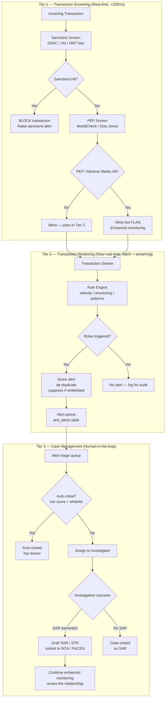
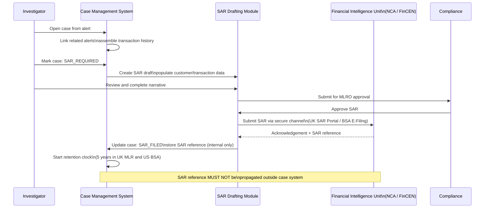

# مكافحة غسل الأموال (AML) — المراقبة والتنبيهات وتقارير الاشتباه

## نظرة عامة

يمر عبر النظام المالي العالمي ما يُقدّر بـ **800 مليار إلى 2 تريليون دولار** من الأموال المغسولة كل عام (مكتب الأمم المتحدة المعني بالمخدرات والجريمة). والبنوك هي حرّاس البوابة الأساسيون ضد هذا التدفق، وقد أوضحت الجهات الرقابية أن فشل الحارس له عواقب وجودية: فقد وافق Danske Bank على دفع نحو 2 مليار دولار (2022) بسبب فضيحة غسل الأموال في فرعه الإستوني؛ ودفع Westpac ‏1.3 مليار دولار أسترالي عن 23 مليون مخالفة لقانون مكافحة غسل الأموال وتمويل الإرهاب. لذلك فالأنظمة الهندسية التي تكتشف النشاط المشبوه وتنبّه إليه وتبلغ عنه ليست عبئًا امتثاليًا — بل بنية أساسية للمخاطر. وبناؤها بشكل سيئ يخلق مسؤولية رقابية؛ وبناؤها جيدًا ميزة تنافسية لأنه يمكّن البنك من خدمة شرائح عملاء أعلى خطرًا بأمان. ويغطي هذا الدرس البنية كاملة: من الإطار الرقابي إلى مسار التنبيهات إلى سير عمل تقديم تقارير الاشتباه (SAR).

## أهداف التعلم

في نهاية هذا الدرس ستستطيع:

- وصف توصيات FATF الأربعين وتوجيهات الاتحاد الأوروبي لمكافحة غسل الأموال وشرح آثارها الهندسية المباشرة
- تصميم بنية AML من ثلاث طبقات (فحص المعاملات، ومراقبة المعاملات، وإدارة الحالات)
- تنفيذ مراقبة قائمة على القواعد: فحوص السرعة، واكتشاف التجزئة، واستعلامات SQL للأنماط غير المعتادة
- بناء `AmlRuleEngine` بتعريفات قواعد قابلة للإعداد ومخزنة في قاعدة البيانات تُقيّم وقت التشغيل
- شرح تسجيل نقاط التنبيهات، وإزالة تكرارها، وكبتها، وتنفيذ كل منها في Java
- وصف سير عمل تقديم SAR/STR من توليد التنبيه حتى الإرسال إلى وحدة الاستخبارات المالية
- تصميم مخططي `aml_alerts` و`aml_cases` مع آلات حالة وسجلات تدقيق مناسبة
- شرح حظر التنبيه (tipping-off) وآثاره على تصميم الأنظمة وتوثيق الشيفرة
- وصف تكامل فحص الأشخاص المعرضين سياسيًا (PEP) والأخبار السلبية، وإدارة مخاطر نماذج التعلم الآلي

## سياق العمل

في سبتمبر 2020 نشر صحفيون (BuzzFeed News والاتحاد الدولي للصحفيين الاستقصائيين ICIJ) "ملفات FinCEN" — أكثر من 2,100 تقرير نشاط مشبوه مسرّب قُدّمت إلى FinCEN، شبكة مكافحة الجرائم المالية الأمريكية. ووصفت نحو 2 تريليون دولار من المعاملات المشبوهة عولجت بين 1999 و2017، غالبًا لدى بنوك قدّمت تقارير اشتباه واستمرت في معالجة تدفقات مشابهة للعملاء أنفسهم. والدرس الذي يمكن للمهندسين استخلاصه يتعلق بـ **طبقة إدارة الحالات**: فالتنبيهات كانت تُولّد وتقارير الاشتباه تُقدّم، لكن تقديم تقرير ليس كالتصرف بناءً على نمط. فحجم التنبيهات دون ذكاء الحالات ليس مكافحة لغسل الأموال — بل أوراق. ويجب أن تربط أنظمة AML الفعالة التنبيهات بالحالات، والحالات بالكيانات، والكيانات بالشبكات، وأن تعيد النتيجة إلى قرارات علاقة العميل.

## الإطار الرقابي لمكافحة غسل الأموال

توصيات FATF ‏(مجموعة العمل المالي) الأربعون هي المعيار العالمي. وتتطلب من البنوك تطبيق "اعرف عميلك" (KYC)، والمراقبة المستمرة للمعاملات، والإبلاغ عن المعاملات المشبوهة إلى وحدة الاستخبارات المالية الوطنية (FIU).

| التنظيم | الولاية القضائية | المتطلبات الهندسية الرئيسية |
|---|---|---|
| **توصيات FATF الأربعون** | عالمي (أكثر من 200 ولاية قضائية عبر FATF وهيئاتها الإقليمية) | النهج القائم على المخاطر؛ ومراقبة المعاملات؛ والإبلاغ عن المعاملات المشبوهة |
| **توجيهات الاتحاد الأوروبي (4AMLD–6AMLD) ولائحة AML الجديدة** | الدول الأعضاء في الاتحاد الأوروبي | العناية الواجبة بالعملاء، والمراقبة، والإبلاغ؛ ويوحّد 6AMLD ‏22 جريمة أصلية والمسؤولية الجنائية للأشخاص الاعتباريين؛ وتطبق لائحة AML ‏(EU 2024/1624) من يوليو 2027 بإشراف الهيئة الجديدة AMLA |
| **قانون سرية البنوك / FinCEN** | الولايات المتحدة | تقديم SAR خلال 30 يومًا من الاكتشاف (حتى 60 إذا لم يُحدد مشتبه)؛ وتقرير CTR للنقد فوق 10,000 دولار |
| **POCA 2002 / MLR 2017** | المملكة المتحدة | تقارير الاشتباه إلى UKFIU ‏(جزء من NCA)؛ وطلبات الدفاع ضد غسل الأموال (DAML) قبل المضي في معاملة مشبوهة؛ وجريمة التنبيه |
| **قانون AML/CTF لعام 2006** | أستراليا | الإبلاغ إلى AUSTRAC؛ وفحص الهوية بـ 100 نقطة |

> [!IMPORTANT]
> يجعل **حظر التنبيه** (المادة 333A من POCA البريطاني؛ والمادة 39 من التوجيه الأوروبي 2015/849) إبلاغ العميل أو أي طرف ثالث بأن تقرير اشتباه قد قُدّم أو بأن تحقيقًا جارٍ جريمة جنائية — تصل عقوبتها إلى السجن سنتين. ولهذا الحظر آثار هندسية مباشرة: يجب ألا تظهر حالة SAR أبدًا في واجهات العملاء، أو استجابات تطبيق الجوال، أو إشعارات تجميد الحسابات، أو أي ملف سجل يستطيع قراءته موظف دون تفويض AML. ويجب تخزين بيانات SAR في نظام بتحكم صارم في الوصول، معزول تمامًا عن الأنظمة المواجهة للعملاء. ولا يصل إلى جدولي `aml_alerts` و`aml_cases` إلا من يملك الدور `AML_INVESTIGATOR`؛ وحسابات خدمة التطبيقات العادية يجب ألا تملك صلاحية SELECT عليهما.

## بنية AML من ثلاث طبقات



## مراقبة المعاملات القائمة على القواعد

تقيّم المراقبة القائمة على القواعد كل معاملة (أو دفعة معاملات) مقابل مجموعة قابلة للإعداد من الأنماط المرتبطة بأساليب غسل الأموال المعروفة.

### فحص السرعة (تحويلات متكررة منخفضة القيمة)

```sql
-- Velocity rule: >10 outbound transfers totalling >£5,000 in 24 hours
-- Flags potential smurfing (structuring to avoid reporting thresholds)
SELECT
    account_id,
    COUNT(*)                    AS transfer_count,
    SUM(amount)                 AS total_amount,
    MIN(created_at)             AS window_start,
    MAX(created_at)             AS window_end,
    ARRAY_AGG(transaction_id)   AS transaction_ids
FROM transactions
WHERE transaction_type = 'OUTBOUND_TRANSFER'
  AND created_at >= NOW() - INTERVAL '24 hours'
  AND status = 'COMPLETED'
GROUP BY account_id
HAVING COUNT(*) > 10
   AND SUM(amount) > 5000
ORDER BY total_amount DESC;
```

### اكتشاف التجزئة (معاملات تحت حد الإبلاغ مباشرة)

```sql
-- Structuring rule (US example): multiple cash deposits each just below the
-- $10,000 Currency Transaction Report threshold in a 7-day window
-- (classic "smurfing" to avoid CTR filing — structuring is itself a crime)
SELECT
    account_id,
    COUNT(*)        AS deposit_count,
    SUM(amount)     AS total_deposited,
    MAX(amount)     AS largest_single_deposit,
    MIN(amount)     AS smallest_single_deposit
FROM transactions
WHERE transaction_type IN ('CASH_DEPOSIT', 'BRANCH_DEPOSIT')
  AND currency = 'USD'
  AND amount BETWEEN 7000 AND 9999.99
  AND created_at >= NOW() - INTERVAL '7 days'
GROUP BY account_id
HAVING COUNT(*) >= 3
ORDER BY total_deposited DESC;
```

### اكتشاف الدوران (أموال تخرج وتعود بسرعة)

```sql
-- Round-trip detection: funds leave account and return via different path
-- within 48 hours — potential layering typology
WITH outbound AS (
    SELECT account_id, amount, created_at, counterparty_account_id
    FROM transactions
    WHERE transaction_type = 'OUTBOUND_TRANSFER'
      AND created_at >= NOW() - INTERVAL '48 hours'
),
inbound AS (
    SELECT account_id, amount, created_at, counterparty_account_id
    FROM transactions
    WHERE transaction_type = 'INBOUND_TRANSFER'
      AND created_at >= NOW() - INTERVAL '48 hours'
)
SELECT
    o.account_id,
    o.amount                             AS outbound_amount,
    i.amount                             AS inbound_amount,
    o.created_at                         AS outbound_at,
    i.created_at                         AS inbound_at,
    EXTRACT(EPOCH FROM (i.created_at - o.created_at))/3600 AS hours_gap
FROM outbound o
JOIN inbound i
    ON o.account_id = i.account_id
    AND ABS(o.amount - i.amount) / o.amount < 0.05  -- within 5% of original amount
    AND i.created_at > o.created_at
    AND o.counterparty_account_id <> i.counterparty_account_id  -- different route back
ORDER BY hours_gap;
```

> [!NOTE]
> تنتج المراقبة القائمة على القواعد إيجابيات كاذبة. فنشاط تجاري بحجم معاملات عالٍ (شركة خدمات تحويل أموال، أو مزوّد رواتب) قد يطلق مشروعًا كل قاعدة سرعة كل يوم. ويجب أن يستطيع نظام الكبت والقوائم البيضاء (إزالة تكرار التنبيهات في الطبقة 2) تعليم الأنماط المشروعة المعروفة كمتوقعة لشرائح عملاء محددة، مع الاستمرار في التنبيه إذا انحرفت تلك الأنماط عن خط الأساس.

## تنفيذ AmlRuleEngine

يقيّم محرك القواعد مجموعة قابلة للإعداد من القواعد مقابل أحداث المعاملات الواردة. وتُخزّن القواعد في قاعدة البيانات لتسمح لفرق الامتثال بتعديل الحدود دون نشر شيفرة.

```java
// Rule definition — stored in aml_rule_definitions table
public record AmlRuleDefinition(
    String ruleId,
    String ruleName,
    String typology,            // e.g. "STRUCTURING", "VELOCITY", "ROUND_TRIP"
    Map<String, Object> params, // threshold values loaded from DB
    int baseAlertScore,         // 1-100
    boolean enabled
) {}

// Separate bean: @Cacheable only works through the Spring proxy, so a call
// from inside AmlRuleEngine to its own @Cacheable method would skip the cache.
// The "aml-rules" cache is configured (Caffeine) with expireAfterWrite = 5 min
// so compliance changes are picked up without a deployment.
@Service
public class AmlRuleCatalog {
    private final AmlRuleDefinitionRepository ruleRepo;

    public AmlRuleCatalog(AmlRuleDefinitionRepository ruleRepo) { this.ruleRepo = ruleRepo; }

    @Cacheable(value = "aml-rules", unless = "#result.isEmpty()")
    public List<AmlRuleDefinition> getEnabledRules() {
        return ruleRepo.findAllByEnabledTrue();
    }
}

@Service
public class AmlRuleEngine {

    private static final Logger log = LoggerFactory.getLogger(AmlRuleEngine.class);

    private final AmlRuleCatalog ruleCatalog;
    private final AmlAlertRepository alertRepo;
    private final AlertDeduplicator deduplicator;
    private final EvaluationGapRepository gapRepo;
    private final MeterRegistry meterRegistry;
    private final Clock clock;

    // Runs AFTER the payment has committed (e.g. from an outbox/Kafka consumer)
    @Async("amlRuleExecutor")
    @Transactional(propagation = Propagation.REQUIRES_NEW)
    public CompletableFuture<List<AmlAlert>> evaluate(TransactionEvent event) {
        List<AmlAlert> generatedAlerts = new ArrayList<>();

        for (AmlRuleDefinition rule : ruleCatalog.getEnabledRules()) {
            try {
                RuleEvaluationResult result = evaluateRule(rule, event);
                if (result.triggered()) {
                    AmlAlert alert = buildAlert(rule, event, result);
                    if (deduplicator.isDuplicate(alert)) {
                        // Do not DROP the evidence: attach this transaction to
                        // the existing open alert for the same customer + rule
                        alertRepo.attachToOpenAlert(alert.customerId(), rule.ruleId(),
                            event.transactionId());
                        continue;
                    }
                    // A partial unique index on (customer_id, rule_id) WHERE status
                    // is open makes concurrent duplicates fail instead of both
                    // being inserted (check-then-insert alone is a race)
                    alertRepo.insertIfNoOpenAlert(alert);
                    generatedAlerts.add(alert);
                    meterRegistry.counter("aml.alerts.generated",
                        "rule", rule.ruleId(),
                        "typology", rule.typology()).increment();
                    // Log ids only — never customer names or narrative
                    log.info("AML alert generated: alertId={} ruleId={} score={}",
                        alert.alertId(), rule.ruleId(), alert.score());
                }
            } catch (Exception ex) {
                // Rule evaluation failures must NOT fail the payment — but an
                // unevaluated transaction is a monitoring GAP: record it so it
                // is re-evaluated, never silently skipped
                log.error("AML rule evaluation failed: ruleId={} eventId={}",
                    rule.ruleId(), event.transactionId(), ex);
                gapRepo.recordForRetry(event.transactionId(), rule.ruleId());
                meterRegistry.counter("aml.rule.errors",
                    "rule", rule.ruleId()).increment();
            }
        }
        return CompletableFuture.completedFuture(generatedAlerts);
    }

    private AmlAlert buildAlert(AmlRuleDefinition rule,
                                 TransactionEvent event,
                                 RuleEvaluationResult result) {
        int adjustedScore = adjustScore(rule.baseAlertScore(), event);
        return AmlAlert.builder()
            .alertId(UUID.randomUUID().toString())
            .ruleId(rule.ruleId())
            .typology(rule.typology())
            .customerId(event.customerId())
            .accountId(event.accountId())
            .triggeringTransactionId(event.transactionId())
            .relatedTransactionIds(result.relatedTransactionIds())
            .score(adjustedScore)
            .status(AlertStatus.OPEN)
            .detectedAt(clock.instant())
            .build();
    }

    private int adjustScore(int baseScore, TransactionEvent event) {
        int score = baseScore;
        // Boost score for high-risk customers (e.g. PEPs, high-risk business types)
        if (event.customerRiskRating() == RiskRating.HIGH) score += 15;
        // Boost score for high-risk jurisdictions
        if (event.destinationCountryRisk() == JurisdictionRisk.HIGH) score += 10;
        // Reduce score for long-established customers with clean history
        if (event.customerTenureYears() > 5 && event.historicalAlertCount() == 0) score -= 10;
        return Math.min(100, Math.max(1, score));
    }
}
```

يوضع الكاش في حبة منفصلة لأن `@Cacheable` لا يعمل إلا عبر وكيل Spring. والتنبيه المكرر لا يُحذف بل تُرفق معاملته بالتنبيه المفتوح الموجود، ويمنع فهرس فريد جزئي إدراج تكرارات متزامنة. وفشل تقييم قاعدة لا يُفشل الدفعة — لكن المعاملة غير المقيّمة فجوة في المراقبة، فتُسجّل لإعادة التقييم ولا تُتخطى بصمت.

## تسجيل نقاط التنبيهات وإزالة تكرارها

قد يولّد نظام مراقبة معاملات عالي الحجم ملايين التنبيهات يوميًا. ودون إزالة التكرار وتسجيل النقاط يغرق المحققون في الضجيج.

```java
@Component
public class AlertDeduplicator {

    private static final Duration DEDUP_WINDOW = Duration.ofHours(24);

    private final AmlAlertRepository alertRepo;

    /**
     * Returns true if a materially identical alert already exists in the
     * deduplication window (same customer, same rule, same typology).
     * Prevents alert storms when a single account triggers the same rule
     * repeatedly in a short window.
     */
    public boolean isDuplicate(AmlAlert newAlert) {
        return alertRepo.existsByCustomerIdAndRuleIdAndStatusInAndDetectedAtAfter(
            newAlert.customerId(),
            newAlert.ruleId(),
            List.of(AlertStatus.OPEN, AlertStatus.UNDER_INVESTIGATION),
            clock.instant().minus(DEDUP_WINDOW)
        );
    }
}
```

تُسجّل التنبيهات من 1 إلى 100. وتُربط نطاقات النقاط بأولوية الفرز:

| نطاق النقاط | الأولوية | المهلة المتوقعة | الإجراء |
|---|---|---|---|
| 85–100 | P1 — حرج | ساعتان | تعيين محقق فوري |
| 70–84 | P2 — عالٍ | 24 ساعة | تعيين محقق في اليوم نفسه |
| 50–69 | P3 — متوسط | 5 أيام عمل | وضع في طابور التحقيق |
| 20–49 | P4 — منخفض | 30 يومًا | إغلاق آلي إن لم يُصعّد |
| 1–19 | P5 — ضجيج | إغلاق آلي | يُغلق بالسبب `LOW_SCORE` |

الإغلاق الآلي قرار مخاطر لا مجرد قرار تقني: يجب أن يعتمد الامتثال الحدود، وأن تبررها اختبارات ما تحت الخط (below-the-line)، وأن تُراجع عينة من التنبيهات المغلقة آليًا بانتظام لضمان الجودة.

## سير عمل تقديم SAR/STR



> [!NOTE]
> في المملكة المتحدة، إذا لم تكن المعاملة المشبوهة قد حدثت **بعد**، فلا يجوز للبنك أن يقدّم التقرير ثم يمضي ببساطة: بل يقدّم طلب دفاع ضد غسل الأموال (DAML) وينتظر الموافقة أو مرور فترة الإشعار القانونية (7 أيام عمل). ويجب أن يستطيع نظام الحالات احتجاز المعاملة في تلك الحالة.

## مخطط AML بلغة DDL

```sql
-- aml_alerts: individual alerts generated by rule engine
CREATE TABLE aml_alerts (
    alert_id                    UUID           PRIMARY KEY,
    rule_id                     VARCHAR(50)    NOT NULL,
    typology                    VARCHAR(50)    NOT NULL,
    customer_id                 VARCHAR(36)    NOT NULL,
    account_id                  VARCHAR(36)    NOT NULL,
    triggering_transaction_id   UUID           NOT NULL,
    related_transaction_ids     UUID[]         NOT NULL DEFAULT '{}',
    score                       SMALLINT       NOT NULL CHECK (score BETWEEN 1 AND 100),
    status                      VARCHAR(30)    NOT NULL DEFAULT 'OPEN',
    -- status: OPEN | UNDER_INVESTIGATION | AUTO_CLOSED | ESCALATED_TO_CASE | CLOSED_NO_SAR
    case_id                     UUID,          -- set when escalated to aml_cases
    assigned_to                 VARCHAR(100),
    detected_at                 TIMESTAMPTZ    NOT NULL DEFAULT NOW(),
    updated_at                  TIMESTAMPTZ    NOT NULL DEFAULT NOW(),
    closed_at                   TIMESTAMPTZ,
    close_reason                VARCHAR(100)
);

-- Index for investigator triage queue: open alerts ordered by score descending
CREATE INDEX idx_aml_alerts_triage
    ON aml_alerts (status, score DESC, detected_at)
    WHERE status = 'OPEN';

-- aml_cases: investigation cases aggregating one or more alerts
CREATE TABLE aml_cases (
    case_id             UUID           PRIMARY KEY,
    customer_id         VARCHAR(36)    NOT NULL,
    case_status         VARCHAR(30)    NOT NULL DEFAULT 'OPEN',
    -- status: OPEN | UNDER_INVESTIGATION | PENDING_MLRO | SAR_REQUIRED |
    --         SAR_DRAFTED | SAR_FILED | CLOSED_NO_SAR | CLOSED_POST_SAR
    risk_rating         VARCHAR(10)    NOT NULL,  -- LOW | MEDIUM | HIGH | CRITICAL
    assigned_to         VARCHAR(100),
    mlro_assigned_to    VARCHAR(100),
    opened_at           TIMESTAMPTZ    NOT NULL DEFAULT NOW(),
    sar_required        BOOLEAN        NOT NULL DEFAULT FALSE,
    sar_filed_at        TIMESTAMPTZ,
    -- SAR reference is stored here but must NEVER be returned via any API
    -- accessible to non-AML-authorised personnel (tipping-off prohibition)
    sar_reference       VARCHAR(50),
    closed_at           TIMESTAMPTZ,
    close_reason        TEXT,
    retention_expires_at TIMESTAMPTZ  -- 5 years (UK MLR 2017, US BSA) or longer if local law requires
);

CREATE INDEX idx_aml_cases_customer
    ON aml_cases (customer_id, case_status, opened_at DESC);
```

> [!WARNING]
> يجب ألا يُعيد أي endpoint عمودي `sar_reference` و`sar_filed_at` في `aml_cases` إذا كان يمكن أن يستدعيه موظفو خدمة العملاء، أو خلفيات تطبيقات الجوال، أو أي نظام يصل إليه العميل. ولا يصل إلى هذين العمودين إلا تطبيق تحقيقات AML تحت الدور `AML_INVESTIGATOR`. ويجب فرض هذا الحد بأمان مستوى الصفوف (PostgreSQL RLS) أو بتحكم الوصول في طبقة التطبيق.

## تكامل فحص PEP والأخبار السلبية

يتطلب الأشخاص المعرضون سياسيًا (PEPs) والعملاء الذين لديهم تغطية إعلامية سلبية عناية واجبة معززة. وحالة PEP ليست ثابتة — بل يجب إعادة فحصها دوريًا وعند أحداث المعاملات.

```java
@Service
public class PepScreeningService {

    private final WorldCheckClient worldCheckClient;
    private final ScreeningReviewQueue reviewQueue;

    public ScreeningResult screen(String customerId, String fullName,
                                   LocalDate dateOfBirth, String nationality) {
        WorldCheckResponse response = worldCheckClient.search(
            WorldCheckQuery.builder()
                .name(fullName)
                .dateOfBirth(dateOfBirth)
                .nationality(nationality)
                .build()
        );

        // Check SANCTIONS FIRST and on its own: a sanctions match must never be
        // missed just because there is no PEP or adverse-media match
        if (response.hasSanctionsMatch()) {
            // Potential match: hold activity and send to a sanctions analyst;
            // only a CONFIRMED match leads to blocking/freezing and reporting
            reviewQueue.submitSanctions(customerId, response.matchedListEntries());
            return ScreeningResult.sanctionsHit(response.matchedListEntries());
        }

        if (response.hasPepMatch()) {
            // PEP: not prohibited — an analyst confirms the match, then enhanced
            // due diligence, senior-management approval and enhanced monitoring
            // apply (the risk rating changes AFTER confirmation, not on a fuzzy hit)
            reviewQueue.submitPep(customerId, response.pepCategory(),
                response.matchedListEntries());
            return ScreeningResult.pepHit(response.pepCategory(),
                response.matchedListEntries());
        }

        if (response.hasAdverseMediaMatch()) {
            reviewQueue.submitAdverseMedia(customerId, response.matchedListEntries());
            return ScreeningResult.adverseMediaHit(response.matchedListEntries());
        }

        return ScreeningResult.clean();
    }
}
```

افحص العقوبات **أولًا** وبشكل مستقل: فتطابق العقوبات يجب ألا يفوت أبدًا لمجرد عدم وجود تطابق PEP أو أخبار سلبية. والتطابق المحتمل يُحتجز ويُرسل لمحلل؛ ولا يؤدي إلى الحجب أو التجميد والإبلاغ إلا التطابق المؤكد. وكون الشخص PEP ليس محظورًا — بل يؤكد محلل التطابق، ثم تُطبق العناية الواجبة المعززة وموافقة الإدارة العليا والمراقبة المعززة.

## إدارة مخاطر النماذج للمراقبة القائمة على التعلم الآلي

تعزز بنوك كثيرة المراقبة القائمة على القواعد بنماذج تعلم آلي (gradient boosting، والشبكات العصبية) تكتشف أنماطًا شاذة لا تلتقطها القواعد الصريحة. وتفرض نماذج التعلم الآلي في AML متطلبات حوكمة محددة بموجب إرشادات إدارة مخاطر النماذج مثل SR 11-7 (الولايات المتحدة) وPRA SS1/23 (المملكة المتحدة، سارية منذ مايو 2024).

| الخطر | الوصف | التخفيف |
|---|---|---|
| **انجراف النموذج** | يتغير سلوك العملاء؛ فتصبح بيانات تدريب النموذج غير ممثلة | مراقبة أداء شهرية؛ وتتبع معدل التنبيهات ومعدل الإيجابيات الكاذبة |
| **قابلية التفسير** | يجب أن يفهم المحققون والمدققون والجهات الرقابية سبب إطلاق التنبيه | نسب الخصائص (مثل SHAP) لكل تنبيه من النموذج؛ ورموز أسباب يستطيع المحقق التحقق منها |
| **تحيز بيانات التدريب** | النموذج المدرب على تقارير اشتباه تاريخية يفرط في تعليم الفئات التي رُوقبت تاريخيًا | اختبار العدالة؛ والتحقق بعينات محجوزة عبر شرائح العملاء |
| **التكيف العدائي** | يكتشف غاسلو الأموال المحترفون أنماط النموذج ويتحايلون عليها | تدوير إصدارات النماذج؛ وتنوع المجموعات |

> [!IMPORTANT]
> لا تستطيع نماذج التعلم الآلي في AML أن تحل محل الحكم البشري في قرارات تقديم تقارير الاشتباه. ففي المملكة المتحدة قد يرتكب الموظف المسمّى (MLRO) شخصيًا جريمة جنائية إذا لم يبلّغ عن اشتباه (المادة 331 من POCA)؛ وفي الولايات المتحدة يُسأل مسؤول BSA عن برنامج تقارير الاشتباه. ويمكن للنماذج ترتيب أولويات التنبيهات وتسجيل نقاطها، لكن قرار تقديم SAR يجب أن يشمل دائمًا محققًا بشريًا وموافقة MLRO. ووثّق هذا القيد في كل بطاقة نموذج وفي سجل قرار بنية نظام AML.

## اختبار المعرفة

**س1: لماذا يجب ألا تُفشل أخطاء تقييم قواعد AML (الاستثناءات التي تُرمى أثناء معالجة القواعد) معاملة الدفع؟ وما النمط الهندسي الصحيح؟**

ج: لو أفشل خطأ تقييم قواعد AML معاملة الدفع، لصار خلل في نظام AML هجوم حجب خدمة على معالجة المدفوعات في البنك — فكل دفعة ستفشل حتى يُصلح نظام AML. وهذا غير مقبول من منظور التوفر. والنمط الصحيح فصل معاملة معالجة الدفع عن تقييم AML: تلتزم معالجة الدفع بقاعدة البيانات فورًا؛ ويعمل تقييم AML بشكل غير متزامن (أو في معاملة `REQUIRES_NEW` منفصلة) بعد التزام الدفعة. وتُسجّل أخطاء تقييم القواعد وتُقاس وتطلق تنبيهًا تشغيليًا، لكنها لا تتراجع عن الدفعة — وتُسجّل المعاملات المتأثرة لإعادة تقييمها بعد إصلاح المشكلة. (فحص العقوبات مختلف: فهو ضابط قبل الدفع ويجب أن يحجب بشكل متزامن.) والمقايضة أنه في الحالة النادرة لانقطاع طويل لنظام AML قد تُقيّم بعض المعاملات متأخرة — وهذا مقبول ومفضل على حجب المدفوعات. ويجب أن يكون لدى البنك إجراء موثق لمراجعة المعاملات التي لم تُقيّم أثناء فترة الانقطاع.

**س2: اشرح حظر التنبيه وصف ثلاثة قرارات تصميم محددة تفرضه في المنظومة التقنية للبنك.**

ج: يجعل حظر التنبيه (المادة 333A من POCA 2002؛ والمادة 39 من التوجيه الأوروبي 2015/849) إبلاغ الشخص موضوع تقرير الاشتباه، أو أي طرف ثالث، بأن تقريرًا قُدّم أو بأن تحقيقًا في نشاط مشبوه جارٍ جريمة جنائية. والغرض منع الأشخاص من إتلاف الأدلة أو نقل الأموال قبل أن تتمكن جهات إنفاذ القانون من التصرف. وثلاثة قرارات تصميم تفرضه: (1) **عزل الواجهات** — يجب ألا يُربط جدولا `aml_cases` و`aml_alerts` في أي استعلام تنفذه خدمة مواجهة للعملاء؛ ويجب ألا تظهر حالة SAR ومعرّفات الحالات في أي استجابة API تُعاد إلى العميل أو إلى موظفي خدمة العملاء؛ (2) **الوصول إلى البيانات حسب الدور** — يجب أن يقيّد أمان مستوى الصفوف في PostgreSQL أو تحكم الوصول في طبقة التطبيق صلاحية `SELECT` على `sar_reference` و`sar_filed_at` بالمستخدمين ذوي الدور `AML_INVESTIGATOR`؛ ويجب ألا تملك حسابات الخدمة التي تستخدمها واجهات الدفع هذا الدور؛ (3) **صياغة تقييد الحساب** — إذا قُيّد حساب بسبب تحقيق AML، يجب أن تذكر رسالة العميل سببًا عامًا ("الحساب قيد المراجعة") ويجب ألا تشير إلى تقرير اشتباه أو معرّف تنبيه أو رقم حالة تحقيق.

## التحدي العملي

1. **إعادة تحميل تعريفات القواعد دون إعادة تشغيل:** ‏`AmlRuleCatalog.getEnabledRules()` مخزنة مؤقتًا بـ `@Cacheable` من Spring. أضف endpoint بـ `@CacheEvict` (للمسؤولين فقط، يتطلب `ROLE_AML_ADMIN`) يُبطل الكاش ويفرض إعادة التحميل من قاعدة البيانات. واكتب اختبارًا: (أ) يحمّل القواعد من قاعدة البيانات، (ب) يحدّث حد قاعدة في قاعدة البيانات، (ج) يستدعي endpoint الإبطال، (د) يتحقق من أن الاستدعاء التالي لـ `getEnabledRules()` يعيد الحد المحدّث.

2. **اختبار رجعي لاكتشاف التجزئة:** نفّذ `StructuringDetector` يشغّل استعلام التجزئة (إيداعات نقدية بالدولار بين 7,000 و9,999.99 دولار في نافذة 7 أيام) كمهمة Spring ‏`@Scheduled` كل 15 دقيقة. واكتب اختبار تكامل باستخدام Testcontainers يزرع 4 إيداعات مؤهلة لعميل و2 لآخر، ويتحقق من أن العميل الأول وحده يطلق تنبيهًا (الحد: 3 إيداعات أو أكثر).

3. **اختبار نافذة إزالة تكرار التنبيهات:** تستخدم `AlertDeduplicator.isDuplicate()` نافذة 24 ساعة. اكتب اختبارًا بساعة ثابتة ينشئ تنبيهًا مفتوحًا عند T=0 لـ `(customerId=CUST1, ruleId=VEL_001)`، ثم يتحقق من: (أ) أن تنبيهًا جديدًا للعميل والقاعدة نفسيهما عند T=12h مكرر؛ (ب) أن التنبيه نفسه عند T=25h **ليس** مكررًا (انتهت النافذة)؛ (ج) أن تنبيهًا جديدًا لـ `(customerId=CUST1, ruleId=STRUCT_001)` عند T=12h **ليس** مكررًا (قاعدة مختلفة).

4. **اختبار تحكم الوصول لحظر التنبيه:** اكتب اختبار تكامل Spring Security يتحقق من: (أ) أن مستخدمًا بالدور `ROLE_AML_INVESTIGATOR` يستطيع استدعاء `GET /internal/aml/cases/{caseId}` ويتلقى الحالة كاملة بما فيها `sarReference`؛ (ب) أن مستخدمًا بالدور `ROLE_CUSTOMER_SERVICE` يستدعي الـ endpoint نفسه يتلقى 403 Forbidden؛ (ج) أن endpoint حالة الحساب المواجه للعميل `GET /api/accounts/{accountId}/status` لا يتضمن أبدًا أي حقل باسم `alertId` أو `caseId` أو `sarReference` أيًا كان دور المستدعي.

<!-- KNOWLEDGE-CHECK
{
  "questions": [
    {
      "text": "لماذا يجب ألا تُفشل أخطاء تقييم قواعد AML (الاستثناءات التي تُرمى أثناء معالجة القواعد) معاملة الدفع؟",
      "options": [
        "قواعد AML استشارية فقط ولا وزن قانونيًا لها",
        "خلل في نظام AML سيصبح هجوم حجب خدمة على معالجة المدفوعات؛ والنمط الصحيح يفصل معالجة الدفع عن تقييم AML",
        "تقييم AML أبطأ من أن يعمل بشكل متزامن مع المدفوعات",
        "معاملات الدفع معزولة عن AML بتصميم قاعدة البيانات"
      ],
      "correct": 1,
      "explanation": "لو أفشل خطأ تقييم قواعد AML الدفعة، لحجب خلل في نظام AML كل دفعة حتى يُصلح. فمعالجة الدفع تلتزم أولًا؛ ويعمل تقييم AML بشكل غير متزامن في معاملة `REQUIRES_NEW` منفصلة. وتُسجّل أخطاء القواعد وتُقاس وتُسجّل المعاملة لإعادة التقييم، لكن الدفعة لا تُتراجع. (فحص العقوبات، وهو ضابط قبل الدفع، هو الاستثناء.)"
    },
    {
      "text": "يجعل حظر التنبيه (المادة 333A من POCA 2002) فعل ماذا جريمة جنائية؟",
      "options": [
        "تقديم SAR دون أدلة كافية",
        "تأخير تقديم SAR أكثر من 7 أيام",
        "إبلاغ الشخص موضوع تقرير الاشتباه، أو أي طرف ثالث، بأن تقريرًا قُدّم أو بأن تحقيقًا جارٍ",
        "مشاركة معلومات SAR بين المؤسسات المالية دون أمر قضائي"
      ],
      "correct": 2,
      "explanation": "يجعل حظر التنبيه إبلاغ الشخص موضوع تقرير الاشتباه، أو أي طرف ثالث، بأن تقريرًا قُدّم أو بأن تحقيقًا في نشاط مشبوه جارٍ جريمة جنائية. والغرض منع الأشخاص من إتلاف الأدلة أو نقل الأموال قبل أن تتمكن جهات إنفاذ القانون من التصرف."
    },
    {
      "text": "تكتشف قاعدة AML التجزئة: 3 إيداعات نقدية أو أكثر بالدولار بين 7,000 و9,999.99 دولار ضمن نافذة متحركة من 7 أيام. لدى عميل إيداعان مؤهلان. ما الإجراء الذي يجب أن يتخذه النظام؟",
      "options": [
        "إنشاء تنبيه فورًا — الحد إيداعان",
        "لا إجراء — لم يتحقق الحد",
        "حجب حساب العميل احتياطًا",
        "تقديم SAR آلي إلى FinCEN"
      ],
      "correct": 1,
      "explanation": "حد اكتشاف التجزئة 3 إيداعات أو أكثر، فمع إيداعين فقط لم يتحقق الحد ولا يجب إنشاء تنبيه. ويجب أن يستمر محرك القواعد في المراقبة ولا ينشئ تنبيهًا إلا عند حدوث الإيداع المؤهل الثالث ضمن النافذة المتحركة من 7 أيام."
    }
  ]
}
-->

<!-- PRACTICAL-CHALLENGE
{
  "title": "محرك قواعد AML مع إعادة التحميل وإزالة التكرار",
  "difficulty": "advanced",
  "estimatedMinutes": 45,
  "tasks": [
    {
      "id": "1",
      "description": "أضف endpoint بـ `@CacheEvict` (للمسؤولين فقط، يتطلب `ROLE_AML_ADMIN`) لـ `AmlRuleCatalog.getEnabledRules()` يُبطل كاش `@Cacheable` ويفرض إعادة التحميل من قاعدة البيانات. واكتب اختبارًا: (أ) يحمّل القواعد من قاعدة البيانات، (ب) يحدّث حد قاعدة فيها، (ج) يستدعي endpoint الإبطال، (د) يتحقق من أن الاستدعاء التالي يعيد الحد المحدّث."
    },
    {
      "id": "2",
      "description": "نفّذ `StructuringDetector` يشغّل استعلام التجزئة (إيداعات نقدية بالدولار بين 7,000 و9,999.99 دولار في نافذة 7 أيام) كمهمة Spring ‏`@Scheduled` كل 15 دقيقة. واكتب اختبار تكامل باستخدام Testcontainers يزرع 4 إيداعات مؤهلة لعميل و2 لآخر، ويتحقق من أن العميل الأول وحده يطلق تنبيهًا (الحد: 3 إيداعات أو أكثر)."
    },
    {
      "id": "3",
      "description": "اكتب اختبارًا بساعة ثابتة لـ `AlertDeduplicator.isDuplicate()` بنافذة 24 ساعة يتحقق من: (أ) أن تنبيهًا للعميل والقاعدة نفسيهما عند T=12h مكرر؛ (ب) أن التنبيه نفسه عند T=25h ليس مكررًا (انتهت النافذة)؛ (ج) أن تنبيهًا للعميل نفسه بقاعدة مختلفة عند T=12h ليس مكررًا."
    },
    {
      "id": "4",
      "description": "اكتب اختبار تكامل Spring Security يتحقق من تحكم الوصول لحظر التنبيه: (أ) `ROLE_AML_INVESTIGATOR` يستطيع استدعاء `GET /internal/aml/cases/{caseId}` ويتلقى الحالة كاملة بما فيها `sarReference`؛ (ب) `ROLE_CUSTOMER_SERVICE` يتلقى 403 عند استدعاء الـ endpoint نفسه؛ (ج) endpoint حالة الحساب المواجه للعميل لا يتضمن أبدًا `alertId` أو `caseId` أو `sarReference` أيًا كان دور المستدعي."
    }
  ]
}
-->
