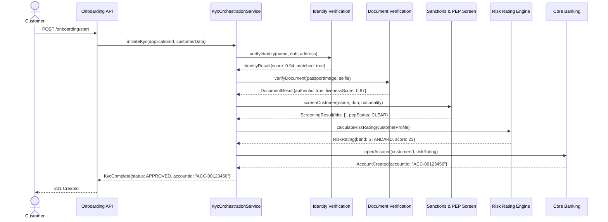

# اعرف عميلك (KYC) — العناية الواجبة وتقييم المخاطر والمالك المستفيد

## نظرة عامة

"اعرف عميلك" (KYC) هو حجر الأساس في التزامات الامتثال لمكافحة الجرائم المالية. فكل مؤسسة مالية خاضعة للرقابة يجب أن تستطيع الإجابة عن سؤال يبدو بسيطًا قبل فتح حساب: من هذا الشخص، وهل هو من يدّعي، وما الخطر الذي يمثله، وهل استخدامه المقصود للمنتج متسق مع نشاط مشروع؟ والخطأ في الإجابة في أي اتجاه يكلف مالًا حقيقيًا — فقد دفع HSBC ‏1.9 مليار دولار في تسوية مع وزارة العدل الأمريكية عام 2012 بسبب إخفاقات منهجية في KYC، ودفع ING Bank N.V. ‏775 مليون يورو في 2018 بعد أن وجد الادعاء الهولندي إخفاقات جسيمة وهيكلية في العناية الواجبة بالعملاء ومراقبة المعاملات. والخطأ في الاتجاه الآخر — رفض العملاء المشروعين أو خسارتهم بسبب احتكاك مفرط — مكلف أيضًا: فرحلات فتح الحسابات الرقمية تفقد عادة نسبة كبيرة من المتقدمين عند خطوة التحقق من الهوية. وبصفتك مهندسًا كبيرًا يبني أنظمة فتح الحسابات، فأنت في نقطة التقاء الالتزام الرقابي والضرورة التجارية.

## أهداف التعلم

- شرح إطار المستويات الثلاثة CDD/EDD/SDD وعوامل المخاطر التي تحدد أي مستوى ينطبق على عميل معين
- ربط توصيات FATF الأربعين وتوجيهات الاتحاد الأوروبي لمكافحة غسل الأموال (من 4AMLD حتى 6AMLD) بمتطلبات تقنية ملموسة في نظام فتح الحسابات
- تصميم `KycOrchestrationService` قائمة على نمط saga تنسّق التحقق من الهوية، وفحص المستندات، وفحص PEP/العقوبات، وتقييم المخاطر كخطوات قابلة للتعويض
- كتابة DDL بجودة إنتاجية لجدول `customer_risk_ratings` يلتقط سجل التدقيق الكامل الذي تطلبه الجهات الرقابية
- تنفيذ نموذج لتسجيل المخاطر يوزن الولاية القضائية، والمهنة، ونوع المنتج، والإشارات السلوكية في نطاق مخاطر رقمي
- حل تسلسلات المالك المستفيد النهائي (UBO) لعملاء الشركات وتخزين رسم الملكية الناتج
- تصميم مشغّلات المراجعة الدورية التي تحترم التزامات إعادة التقييم الزمنية والقائمة على الأحداث والحدود
- التفكير في التعارض بين حق المحو في GDPR والتزامات الاحتفاظ بالبيانات في AML

## سياق العمل

في ديسمبر 2022 فرضت هيئة السلوك المالي (FCA) غرامة 107.7 مليون جنيه على Santander UK بسبب إخفاقات في مكافحة غسل الأموال في قسم الخدمات المصرفية للشركات بين 2012 و2017، طالت نحو 560,000 عميل تجاري. ووجدت FCA أن البنك لم يتحقق بشكل صحيح من المعلومات التي قدمها العملاء عند فتح الحسابات (مثل حجم الأعمال المتوقع)، ولم يراقب بفعالية هل تُستخدم الحسابات كما صُرّح، ولم يتصرف بسرعة كافية عند تحديد المخاطر. فالبيانات جُمعت — لكن الفشل كان في كيفية فحصها وصيانتها والتصرف بناءً عليها. *النمط الهندسي وراء إخفاقات كهذه (مثال مركّب، لا وصف لأنظمة Santander):* خدمة فتح حسابات تكتب `risk_tier` نهائيًا في سجل العميل ولا تعود إليه أبدًا؛ فتسقط الحالات الطرفية — الجنسية المزدوجة، والأسماء المنقولة حرفيًا، وسلاسل الملكية الطويلة، والعملاء الذين يتغير سلوكهم بعد فتح الحساب. وتعادل الغرامة نحو 192 جنيهًا لكل عميل متأثر، أي أكثر بكثير مما كان سيكلفه نظام سليم للعناية الواجبة المستمرة.

## الإطار الرقابي: FATF وتوجيهات الاتحاد الأوروبي

مجموعة العمل المالي (FATF) هي الهيئة الحكومية الدولية التي تضع المعيار العالمي لمكافحة غسل الأموال (AML) وتمويل الإرهاب (CTF). وتحدد توصياتها الأربعون، الصادرة أولًا عام 1990 والمعدلة جوهريًا عام 2012، النهج القائم على المخاطر الذي يجب أن تطبقه كل الأنظمة الوطنية. فالتوصية 10 تعرّف العناية الواجبة بالعملاء. والتوصية 12 تعرّف العناية الواجبة المعززة للأشخاص المعرضين سياسيًا. ووُسّعت التوصية 15 (التقنيات الجديدة) في 2018–2019 لتشمل الأصول الافتراضية: يجب تنظيم مزوّدي خدمات الأصول الافتراضية وتطبيقهم العناية الواجبة، بما في ذلك "قاعدة السفر" للتحويلات.

نقل الاتحاد الأوروبي التزامات FATF عبر توجيهات متتالية لمكافحة غسل الأموال. وشدد كل توجيه متطلبات لها آثار معمارية مباشرة.

| التوجيه | السنة | الأثر الهندسي الرئيسي |
|-----------|------|------------------------|
| 4AMLD | 2017 | النهج القائم على المخاطر صار إلزاميًا؛ وأُدخل سجل المالكين المستفيدين |
| 5AMLD | 2020 | دخلت منصات العملات الافتراضية في النطاق؛ وفُتحت سجلات المالكين المستفيدين للعموم (ألغت محكمة العدل الأوروبية الوصول العام الشامل في 2022؛ ويتطلب الوصول الآن مصلحة مشروعة) |
| 6AMLD | 2021 | توحيد 22 جريمة أصلية؛ وتمديد المسؤولية الجنائية إلى الأشخاص الاعتباريين؛ وحد أقصى للسجن لا يقل عن 4 سنوات لغسل الأموال |
| حزمة AML لعام 2024 | تطبق اللائحة AMLR من يوليو 2027 | لائحة AML نافذة مباشرة؛ وهيئة AML الأوروبية (AMLA)؛ وحد 10,000 يورو للمدفوعات النقدية |

> [!IMPORTANT]
> تنشئ حزمة AML الأوروبية لعام 2024 مشرفًا على مستوى الاتحاد، هو AMLA (ومقرها فرانكفورت)، بدأت العمل في 2025 وستشرف مباشرة على مجموعة مختارة من أعلى المؤسسات العابرة للحدود خطرًا اعتبارًا من 2028. وتحل لائحة AML محل كثير من القواعد الوطنية بكتاب قواعد واحد نافذ مباشرة من يوليو 2027. فصمم بيانات العملاء وسجلات التدقيق الآن لتستطيع الإجابة عن الطلبات الإشرافية بصيغة موحدة على مستوى الاتحاد.

## مستويات CDD وEDD وSDD

يتطلب النهج القائم على المخاطر أن تتناسب شدة العناية الواجبة مع الخطر المقيّم. وينتج عن ذلك ثلاثة مستويات يجب أن يوجّه مسار فتح الحسابات العملاء عبرها.

**العناية الواجبة القياسية (CDD)** تنطبق على غالبية عملاء الأفراد. وتتطلب التحقق من الهوية (الاسم، وتاريخ الميلاد، والعنوان)، والتحقق من المستندات (جواز السفر أو الهوية الوطنية)، وفهم غرض علاقة العمل وطبيعتها المقصودة.

**العناية الواجبة المعززة (EDD)** تنطبق عند وجود عوامل خطر. ومن مشغّلات EDD الإلزامية: الأشخاص المعرضون سياسيًا (PEPs) وأفراد عائلاتهم والمقربون منهم؛ والعملاء من ولايات قضائية عالية الخطر أو تحت المراقبة لدى FATF (القائمة الرمادية/السوداء)؛ وعلاقات البنوك المراسلة؛ وأي عميل أو معاملة تعتبرها تقييمات المؤسسة نفسها عالية الخطر. وتتطلب EDD الحصول على معلومات إضافية عن مصدر الأموال، ومصدر الثروة، وموافقة الإدارة العليا على فتح الحساب، ومراقبة مستمرة معززة.

**العناية الواجبة المبسطة (SDD)** قد تنطبق حيث يكون الخطر منخفضًا بشكل مثبت: المؤسسات المالية الخاضعة للرقابة، والشركات المدرجة في بورصات معترف بها، والجهات الحكومية. وتسمح SDD بتقليل تواتر التحقق وعمق التوثيق، لكنها ليست إعفاءً من CDD — بل تخفيض معايَر.

> [!NOTE]
> ‏SDD تخفيض متناسب مع الخطر، لا تصريح مرور مجاني. فبموجب المادة 15 من 4AMLD (واللائحة 37 من MLR 2017 البريطانية)، يجب على الشركات توثيق سبب انطباق SDD ومواصلة مراقبة العلاقة بحثًا عن إشارات تستدعي رفعها إلى CDD القياسية أو EDD. والعميل المؤهل لـ SDD عند فتح الحساب قد يحتاج EDD بعد ذلك بوقت قصير إذا لم يطابق سلوكه الغرض المصرح به.

## بنية مسار فتح الحسابات

مسار فتح الحسابات الرقمي عملية متعددة الخطوات، لكل خطوة اعتماديات خارجية (مزوّدو الهوية، وواجهات التحقق من المستندات، وقوائم العقوبات، وقواعد بيانات PEP)، وقد تفشل كل خطوة مستقلة. ونمط saga هو الاختيار المعماري الصحيح: لكل خطوة معاملة تعويضية، ويحتفظ المنسّق بآلة الحالة الكلية.



يجب أن يتعامل منسّق saga مع أنماط الفشل في كل خطوة. فإذا كان التحقق من المستند غير حاسم بعد نجاح التحقق من الهوية (صورة ضبابية، أو نتيجة حيوية منخفضة)، تذهب الطلبة إلى `PENDING_MANUAL_REVIEW` لا `REJECTED` — وهو تمييز حاسم لأن العميل ربما قدّم صورة منخفضة الجودة فقط. ولا يُرفض إلا المستند المؤكد تزويره (ويُحال إلى فريق الاحتيال). وتُحفظ نتيجة كل خطوة في معاملة قصيرة خاصة بها، فيستطيع saga الاستئناف بعد تعطل؛ ويجب ألا يُبقي المنسّق أبدًا معاملة قاعدة بيانات واحدة مفتوحة عبر استدعاءات خارجية بطيئة.

```java
// KycOrchestrationService.java
@Service
@Slf4j
public class KycOrchestrationService {

    private final KycApplicationRepository applicationRepo;
    private final IdentityVerificationClient idvClient;
    private final DocumentVerificationClient docClient;
    private final SanctionsScreeningClient sanctionsClient;
    private final RiskRatingEngine riskEngine;
    private final CoreBankingClient coreBankingClient;
    private final ApplicationEventPublisher eventPublisher;

    // NOT @Transactional: one DB transaction held open across several slow
    // HTTP calls would pin a connection for seconds, and a rollback at step 5
    // would erase the saved progress while the external effects remain.
    // updateStatus/persist* each commit in their own short transaction
    // (TransactionTemplate), so the saga can resume from its last state.
    public KycResult orchestrate(KycApplication application) {
        log.info("Starting KYC orchestration for applicationId={}", application.getId());
        updateStatus(application, KycStatus.IDENTITY_VERIFICATION_IN_PROGRESS);

        // Step 1: Identity Verification
        IdentityVerificationResult idvResult;
        try {
            idvResult = idvClient.verify(IdentityVerificationRequest.from(application));
        } catch (IdentityVerificationException e) {
            return failApplication(application, KycFailureReason.IDV_PROVIDER_ERROR, e);
        }

        if (idvResult.score() < 0.85) {
            return requireManualReview(application, "IDV score below threshold: " + idvResult.score());
        }

        updateStatus(application, KycStatus.DOCUMENT_VERIFICATION_IN_PROGRESS);

        // Step 2: Document Verification
        DocumentVerificationResult docResult;
        try {
            docResult = docClient.verify(DocumentVerificationRequest.from(application));
        } catch (DocumentVerificationException e) {
            // Provider error is not the customer's fault: retry later
            return failApplication(application, KycFailureReason.DOC_PROVIDER_ERROR, e);
        }

        if (docResult.forgeryDetected()) {
            // Confirmed forgery: reject and refer to the fraud team
            return rejectApplication(application, KycFailureReason.DOCUMENT_NOT_AUTHENTIC);
        }
        if (!docResult.authentic() || docResult.livenessScore() < 0.90) {
            // Inconclusive (blurry photo, poor lighting): a human decides
            return requireManualReview(application, "Document check inconclusive");
        }

        updateStatus(application, KycStatus.SANCTIONS_SCREENING_IN_PROGRESS);

        // Step 3: Sanctions and PEP Screening
        ScreeningResult screeningResult;
        try {
            screeningResult = sanctionsClient.screen(ScreeningRequest.from(application));
        } catch (ScreeningException e) {
            // Never treat "screening unavailable" as "no hit"
            return failApplication(application, KycFailureReason.SCREENING_PROVIDER_ERROR, e);
        }

        if (screeningResult.hasConfirmedSanctionsMatch()) {
            return blockApplication(application, screeningResult);
        }
        if (screeningResult.hasPotentialSanctionsMatch()) {
            // Fuzzy match: hold for a sanctions analyst — do not auto-block
            return holdForSanctionsReview(application, screeningResult);
        }

        boolean requiresEdd = screeningResult.pepStatus() != PepStatus.CLEAR
                || isHighRiskJurisdiction(application.getNationality())
                || isHighRiskJurisdiction(application.getCountryOfResidence())
                || application.getProductType().requiresEdd();

        updateStatus(application, KycStatus.RISK_RATING_IN_PROGRESS);

        // Step 4: Risk Rating
        RiskRatingInput ratingInput = RiskRatingInput.builder()
                .customerId(application.getCustomerId())
                .jurisdiction(application.getCountryOfResidence())
                .occupation(application.getOccupation())
                .productType(application.getProductType())
                .pepStatus(screeningResult.pepStatus())
                .idvScore(idvResult.score())
                .requiresEdd(requiresEdd)
                .build();

        CustomerRiskRating riskRating = riskEngine.calculate(ratingInput);
        persistRiskRating(riskRating);

        // EDD (PEPs, high-risk countries) and HIGH / VERY_HIGH bands need
        // senior-management approval before the relationship starts
        boolean needsApproval = requiresEdd
                || riskRating.band() == RiskBand.HIGH
                || riskRating.band() == RiskBand.VERY_HIGH;
        if (needsApproval && !riskRating.seniorManagerApproved()) {
            return awaitSeniorApproval(application, riskRating);
        }

        updateStatus(application, KycStatus.ACCOUNT_OPENING_IN_PROGRESS);

        // Step 5: Account Opening — idempotent by applicationId, so a retry
        // after a timeout returns the same account instead of opening a second
        AccountCreationResult accountResult = coreBankingClient.openAccount(
                AccountCreationRequest.builder()
                        .idempotencyKey(application.getId().toString())
                        .customerId(application.getCustomerId())
                        .riskRatingId(riskRating.id())
                        .cddTier(riskRating.cddTier())
                        .build()
        );

        updateStatus(application, KycStatus.COMPLETED);
        eventPublisher.publishEvent(new KycCompletedEvent(application.getId(), accountResult.accountId()));

        return KycResult.approved(accountResult.accountId(), riskRating);
    }

    private KycResult blockApplication(KycApplication application, ScreeningResult result) {
        application.setStatus(KycStatus.BLOCKED);
        application.setBlockedReason("SANCTIONS_MATCH: " + result.highestMatchScore());
        applicationRepo.save(application);
        // Sanctions team handles any reporting duty (rules differ by country);
        // the customer gets a neutral decline — NEVER the reason
        eventPublisher.publishEvent(new SanctionsBlockEvent(application.getId(), result));
        return KycResult.blocked();
    }
}
```

لا تُعامل "خدمة الفحص غير متاحة" أبدًا كـ "لا تطابق". والتطابق التقريبي يُحتجز لمحلل العقوبات ولا يُحجب آليًا. وفتح الحساب idempotent بمعرّف الطلب، فإعادة المحاولة بعد انتهاء مهلة تعيد الحساب نفسه بدل فتح حساب ثانٍ.

> [!WARNING]
> عندما تُحجب طلبة أو تُحتجز بسبب تطابق عقوبات أو اشتباه، لا تخبر العميل بالسبب. فحيث قُدّم تقرير اشتباه، قد يكون إخباره "تنبيهًا" (tipping off) — وهو جريمة جنائية بموجب قانون عائدات الجريمة 2002 (المملكة المتحدة) وقوانين مماثلة في معظم الولايات القضائية — وعلى أي حال فهو يساعد الأشخاص المعاقبين على التهرب من الضوابط. ويجب رفض الطلبة برسالة محايدة. وكل تواصل بشأن الحجب يجب أن يمر عبر فريق الامتثال والمستشار القانوني.

## مخطط تقييم مخاطر العملاء والخدمة

جدول `customer_risk_ratings` سجل تدقيق للإضافة فقط. فلا تحدّث أبدًا صف تقييم مخاطر — بل تنشئ صفًا جديدًا وتضبط طابع `superseded_at` للصف السابق. وهذا متطلب رقابي: يجب أن تستطيع الجهات الرقابية إعادة بناء ملف مخاطر العميل في أي لحظة زمنية.

```sql
-- customer_risk_ratings DDL
CREATE TABLE customer_risk_ratings (
    id                      BIGSERIAL PRIMARY KEY,
    customer_id             BIGINT NOT NULL,
    rating_reference        VARCHAR(50) NOT NULL UNIQUE,  -- e.g. CRR-20240315-00001
    risk_score              INTEGER NOT NULL CHECK (risk_score BETWEEN 0 AND 100),
    risk_band               VARCHAR(20) NOT NULL CHECK (risk_band IN ('LOW', 'STANDARD', 'HIGH', 'VERY_HIGH')),
    cdd_tier                VARCHAR(20) NOT NULL CHECK (cdd_tier IN ('SIMPLIFIED', 'STANDARD', 'ENHANCED')),

    -- Scoring factors (stored for reproducibility)
    jurisdiction_score      INTEGER NOT NULL,
    occupation_score        INTEGER NOT NULL,
    product_score           INTEGER NOT NULL,
    pep_score               INTEGER NOT NULL DEFAULT 0,
    behaviour_score         INTEGER NOT NULL DEFAULT 0,

    -- Metadata
    rating_reason           VARCHAR(100) NOT NULL,  -- INITIAL_ONBOARDING, PERIODIC_REVIEW, EVENT_TRIGGERED, MANUAL_OVERRIDE
    rated_by_user_id        BIGINT,                 -- NULL for automated ratings
    rated_by_service        VARCHAR(100),           -- service name for automated ratings
    senior_manager_approved BOOLEAN NOT NULL DEFAULT FALSE,
    senior_manager_id       BIGINT,
    approval_timestamp      TIMESTAMPTZ,

    -- Lifecycle
    effective_from          TIMESTAMPTZ NOT NULL DEFAULT NOW(),
    superseded_at           TIMESTAMPTZ,            -- NULL = current rating
    next_review_due         DATE NOT NULL,

    created_at              TIMESTAMPTZ NOT NULL DEFAULT NOW(),

    CONSTRAINT fk_customer FOREIGN KEY (customer_id) REFERENCES customers(id)
);

CREATE INDEX idx_crr_customer_current
    ON customer_risk_ratings (customer_id)
    WHERE superseded_at IS NULL;

CREATE INDEX idx_crr_next_review
    ON customer_risk_ratings (next_review_due)
    WHERE superseded_at IS NULL;

-- Prevent more than one current rating per customer
CREATE UNIQUE INDEX idx_crr_customer_active
    ON customer_risk_ratings (customer_id)
    WHERE superseded_at IS NULL;
```

يوزن نموذج تسجيل المخاطر أربعة عوامل رئيسية في متوسط موزون، ثم يطبق **حدودًا دنيا**: فبعض الحقائق (مثل كون الشخص PEP) تضع العميل في نطاق عالٍ مهما قال المتوسط. فيجب ألا يُخفَّض PEP أبدًا إلى "قياسي" بسبب نتيجة منتج منخفضة. ويجب أن يخضع النموذج للتحكم في الإصدارات: فتغيير الأوزان تغيير جوهري يجب توثيقه واعتماده من MLRO ‏(مسؤول الإبلاغ عن غسل الأموال).

```java
// RiskRatingEngine.java
@Component
public class RiskRatingEngine {

    // Weights must be approved by MLRO — do not change without change management sign-off
    // (they sum to 100, so the weighted average stays on a 0–100 scale)
    private static final int JURISDICTION_WEIGHT    = 35;
    private static final int OCCUPATION_WEIGHT      = 25;
    private static final int PRODUCT_WEIGHT         = 20;
    private static final int BEHAVIOUR_WEIGHT       = 20;

    private static final Map<String, Integer> JURISDICTION_SCORES = Map.of(
        "FATF_HIGH_RISK",   100,
        "FATF_MONITORED",    75,
        "EU_THIRD_COUNTRY",  50,
        "EEA",               10,
        "UK",                 5
    );

    private final Clock clock;

    public RiskRatingEngine(Clock clock) { this.clock = clock; }

    public CustomerRiskRating calculate(RiskRatingInput input) {
        int jurisdictionScore = resolveJurisdictionScore(input.jurisdiction());
        int occupationScore   = resolveOccupationScore(input.occupation());
        int productScore      = resolveProductScore(input.productType());
        int behaviourScore    = input.behaviourScore();      // 0–100, 0 at onboarding

        // Weighted average across factors (each on a 0–100 scale)
        int weighted = Math.round((jurisdictionScore * JURISDICTION_WEIGHT
                    + occupationScore   * OCCUPATION_WEIGHT
                    + productScore      * PRODUCT_WEIGHT
                    + behaviourScore    * BEHAVIOUR_WEIGHT) / 100f);

        RiskBand band = scoreToBand(weighted);

        // Floors: facts that override the average
        int pepScore = 0;
        if (input.pepStatus() != PepStatus.CLEAR) {
            pepScore = 100;
            band = RiskBand.max(band, RiskBand.HIGH);          // PEP → at least HIGH
        }
        if (jurisdictionScore == 100) {
            band = RiskBand.max(band, RiskBand.HIGH);          // FATF high-risk → EDD
        }

        return CustomerRiskRating.builder()
                .customerId(input.customerId())
                .riskScore(weighted)
                .riskBand(band)
                // SDD only for documented low-risk categories (regulated firm,
                // listed company, public body) — a low score alone is not enough
                .cddTier(band == RiskBand.HIGH || band == RiskBand.VERY_HIGH ? CddTier.ENHANCED
                        : band == RiskBand.LOW && input.sddEligible() ? CddTier.SIMPLIFIED
                        : CddTier.STANDARD)
                .jurisdictionScore(jurisdictionScore)
                .occupationScore(occupationScore)
                .productScore(productScore)
                .behaviourScore(behaviourScore)
                .pepScore(pepScore)
                .nextReviewDue(calculateNextReview(band))
                .build();
    }

    private RiskBand scoreToBand(int score) {
        if (score <= 25)  return RiskBand.LOW;
        if (score <= 55)  return RiskBand.STANDARD;
        if (score <= 80)  return RiskBand.HIGH;
        return RiskBand.VERY_HIGH;
    }

    private LocalDate calculateNextReview(RiskBand band) {
        LocalDate today = LocalDate.now(clock);
        return switch (band) {
            case LOW       -> today.plusYears(3);
            case STANDARD  -> today.plusYears(1);
            case HIGH      -> today.plusMonths(6);
            case VERY_HIGH -> today.plusMonths(3);
        };
    }
}
```

## حل المالك المستفيد لعملاء الشركات

أدخل 4AMLD الأوروبي سجلات إلزامية للمالكين المستفيدين النهائيين (UBO)، تتطلب من الشركات تحديد كل شخص طبيعي يملك عميلًا من الشركات أو يسيطر عليه في النهاية — عبر أكثر من 25% من الأسهم أو حقوق التصويت، أو عبر السيطرة بوسائل أخرى. وإذا لم يتأهل أحد، تسجّل الشركة كبار المسؤولين الإداريين بدلًا من ذلك وتوثق السبب. وعمليًا، تتضمن هياكل الملكية طبقات متعددة من الشركات القابضة والصناديق الائتمانية والشراكات، ويجب تطبيق حد 25% بتجميع الملكيات المباشرة وغير المباشرة.

```java
// UboResolutionService.java
@Service
public class UboResolutionService {

    private static final BigDecimal UBO_THRESHOLD = new BigDecimal("0.25");
    private static final int MAX_RESOLUTION_DEPTH = 15; // internal safety limit — deeper chains go to manual review

    public List<UboRecord> resolveUbos(String legalEntityId) {
        Map<String, BigDecimal> effectiveOwnership = new HashMap<>();
        resolveRecursive(legalEntityId, BigDecimal.ONE, effectiveOwnership, 0, new HashSet<>());

        return effectiveOwnership.entrySet().stream()
                .filter(e -> e.getKey().startsWith("PERSON:"))  // only natural persons
                .filter(e -> e.getValue().compareTo(UBO_THRESHOLD) > 0)   // MORE than 25%
                .map(e -> buildUboRecord(e.getKey(), e.getValue()))
                .toList();
    }

    private void resolveRecursive(String entityId, BigDecimal parentShare,
                                  Map<String, BigDecimal> accumulated,
                                  int depth, Set<String> visited) {
        if (depth > MAX_RESOLUTION_DEPTH) {
            throw new UboResolutionException(
                "Ownership chain exceeds maximum depth " + MAX_RESOLUTION_DEPTH
                + " at entity " + entityId + ". Manual review required.");
        }
        if (visited.contains(entityId)) {
            // Circular ownership on this path — flag for manual review.
            // (visited is copied per branch, so the same holding company reached
            //  through two different paths — a "diamond" — is NOT a cycle)
            throw new CircularOwnershipException(entityId);
        }

        visited.add(entityId);
        List<OwnershipRecord> owners = ownershipRepo.findDirectOwners(entityId);

        for (OwnershipRecord owner : owners) {
            BigDecimal effectiveShare = parentShare.multiply(owner.ownershipPercentage())
                    .divide(new BigDecimal("100"), 10, RoundingMode.HALF_UP);

            String ownerId = owner.ownerType() == OwnerType.PERSON
                    ? "PERSON:" + owner.ownerId()
                    : "ENTITY:" + owner.ownerId();

            accumulated.merge(ownerId, effectiveShare, BigDecimal::add);

            if (owner.ownerType() == OwnerType.LEGAL_ENTITY) {
                resolveRecursive(owner.ownerId(), effectiveShare, accumulated,
                        depth + 1, new HashSet<>(visited));
            }
        }
    }
}
```

مجموعة `visited` تُنسخ لكل فرع، فالشركة القابضة نفسها التي يُوصل إليها عبر مسارين مختلفين ("معيّن") **ليست** دورة.

> [!NOTE]
> حد 25% هو المعيار الرقابي، ويجوز للشركات النزول تحته. والأسهم ليست القصة كلها أيضًا: فقد يسيطر شخص على شركة عبر اتفاقيات تصويت، أو حقوق تعيين مجلس الإدارة، أو صندوق ائتماني دون أن يملك 25%، وهؤلاء مالكون مستفيدون أيضًا. وتطبق مؤسسات كثيرة حد 10% للعملاء عالي الخطر أو في قطاعات معرضة لإساءة استخدام الملكية المستفيدة (القمار، والعقارات، وخدمات تحويل الأموال). ويجب أن يكون الثابت UBO_THRESHOLD قابلًا للإعداد حسب شريحة العملاء، لا قيمة عامة مثبتة في الشيفرة.

## المراجعة الدورية والاحتفاظ بالبيانات

العناية الواجبة المستمرة ليست اختيارية. فالتوصية 10(d) من FATF تتطلب من الشركات ضمان أن تبقى المستندات والبيانات والمعلومات المجمعة بموجب CDD محدّثة وذات صلة. ويمكّن الفهرس `idx_crr_next_review` على جدول `customer_risk_ratings` مهمة مجدولة من تحديد المراجعات المتأخرة.

```java
// PeriodicReviewScheduler.java
@Component
@Slf4j
public class PeriodicReviewScheduler {

    @Scheduled(cron = "0 0 6 * * MON-FRI")  // 06:00 every business day
    public void triggerDueReviews() {
        LocalDate reviewCutoff = LocalDate.now(clock).plusDays(14); // 14-day lead time
        List<CustomerRiskRating> dueRatings =
                ratingRepo.findCurrentRatingsDueBy(reviewCutoff);

        log.info("Periodic review: found {} customers due for review by {}",
                dueRatings.size(), reviewCutoff);

        dueRatings.forEach(rating -> {
            // The job runs every day and a rating stays "due" for 14 days:
            // without this check it would create 10 duplicate tasks per customer.
            // (Backed by a unique index on (rating_id, review_type) for open tasks.)
            if (reviewWorkflowService.hasOpenTask(rating.getId(), ReviewType.PERIODIC)) {
                return;
            }
            reviewWorkflowService.createReviewTask(
                    ReviewTaskRequest.builder()
                            .customerId(rating.getCustomerId())
                            .ratingId(rating.getId())
                            .reviewType(ReviewType.PERIODIC)
                            .dueDate(rating.getNextReviewDue())
                            .priority(rating.getRiskBand().reviewPriority())
                            .build()
            );
        });
    }
}
```

المهمة تعمل كل يوم ويبقى التقييم "مستحقًا" 14 يومًا: فدون فحص المهمة المفتوحة ستُنشئ 10 مهام مكررة لكل عميل.

**تعارض حق المحو في GDPR.** بموجب المادة 17 من GDPR، لأصحاب البيانات حق المحو. وبموجب لوائح AML (مثل المادة 40 من 4AMLD، واللائحة 40 من MLR 2017 البريطانية)، يجب على الشركات الاحتفاظ بسجلات العناية الواجبة لخمس سنوات بعد انتهاء علاقة العمل؛ ويجوز لدول الاتحاد السماح بفترة إضافية أو اشتراطها، حتى عشر سنوات إجمالًا، مثلًا حين تلزم السجلات لتحقيقات أو إجراءات قضائية. وهذان الالتزامان في تعارض مباشر.

الحل راسخ في الإرشادات القانونية لكنه نادرًا ما يُطبق بشكل صحيح في الأنظمة:

1. تستثني المادة 17(3)(b) من GDPR صراحة المحو حيث يكون الاحتفاظ ضروريًا للامتثال لالتزام قانوني. والتزامات الاحتفاظ في AML مؤهلة.
2. الاستجابة الصحيحة لطلب محو من عميل سابق ليست الحذف بل **الترميز المستعار (pseudonymisation) مع تقييد الوصول**: استبدل المعرّفات المباشرة (الاسم، والرقم الوطني، والعنوان) باسم مستعار، واحتفظ بسجلات المعاملات وCDD في أرشيف مقيد الوصول، وسجّل حدث الترميز في سجل قابل للتدقيق. ولا يجوز الحذف الكامل إلا بعد انتهاء فترة الاحتفاظ في AML.
3. يجب أن يميز نموذج بياناتك بين **البيانات الشخصية المعرِّفة** (الخاضعة للمحو) و**بيانات سجلات الامتثال** (الخاضعة للاحتفاظ). ويجب تخزينها في جداول منفصلة أو مخططات منفصلة بسياسات احتفاظ مختلفة من اليوم الأول.

## اختبار المعرفة

**س1: يفتح عميل حسابًا جاريًا قياسيًا ثم يبدأ بتلقي حوالات كبيرة غير منتظمة من ولاية قضائية في القائمة الرمادية لـ FATF. وكان تقييم المخاطر الأولي STANDARD. ماذا يجب أن يحدث معماريًا، ولماذا لا يكفي هنا جدول مراجعة دورية زمني بحت؟**

ج: يجب أن ينفذ النظام مراجعة تطلقها الأحداث إضافة إلى المراجعة الزمنية. فأنظمة مراقبة المعاملات التي تكتشف سلوكًا شاذًا (تحويلات غير معتادة عالية القيمة، وتغير الخطر الجغرافي) يجب أن تصدر أحداثًا تستهلكها خدمة KYC. ويجب أن تستطيع خدمة KYC رفع تقييم المخاطر خارج جدول المراجعة العادي وإطلاق EDD لعميل حالي بتقييم STANDARD. والجدول الزمني البحت سيترك عميلًا STANDARD في مستوى المخاطر الخطأ حتى اثني عشر شهرًا قبل المراجعة السنوية التالية. ويدعم تصميم الإضافة فقط في جدول `customer_risk_ratings` ذلك — إذ يُدرج صف جديد بـ `rating_reason = 'EVENT_TRIGGERED'` دون إتلاف التقييم الأصلي.

**س2: ترمي `UboResolutionService` لديك `CircularOwnershipException`. ماذا يمثل ذلك في العالم الحقيقي، وماذا يجب أن يفعل نظامك بعد ذلك؟**

ج: الملكية الدائرية (الشركة A تملك الشركة B التي تملك الشركة A) علامة تحذير ترتبط غالبًا بالإخفاء المتعمد للملكية المستفيدة. وهي نادرة في الهياكل المشروعة (بعض المجموعات لديها ملكيات متقاطعة)، وتجعل تحديد المالك الحقيقي صعبًا — فلا يمكن حلها آليًا أبدًا. والاستجابة الصحيحة: (1) منع الطلبة من المضي آليًا؛ (2) توجيهها إلى محلل متخصص للتحقيق اليدوي؛ (3) النظر في تقديم تقرير نشاط مشبوه (SAR) إلى وحدة الاستخبارات المالية (FIU) المعنية إذا بدا الهيكل الدائري متعمدًا؛ (4) توثيق التحقيق كاملًا في ملف امتثال العميل أيًا كانت النتيجة.

## التحدي العملي

1. **وسّع نموذج تسجيل المخاطر** بإضافة عامل `sourceOfFunds`. ويجب أن تحصل الأنشطة كثيفة النقد (المطاعم، ومغاسل السيارات، ومحلات الرهن) على 70 في هذا البعد؛ والتوظيف براتب على 10؛ والعمل الحر على 30. وادمج العامل الجديد في `RiskRatingEngine` بوزن 15، وأعد معايرة الأوزان الحالية لتبقى مجموعها 100، وأضف اختبار وحدة يغطي الحد بين نطاقي STANDARD وHIGH.

2. **نفّذ نمط الإلغاء والإدراج** لتحديثات تقييم المخاطر. اكتب دالة في `RiskRatingRepository` باسم `supersedeCurrent(customerId, newRating)` تفتح معاملة، وتضبط `superseded_at = NOW()` على الصف النشط الحالي، وتدرج صف التقييم الجديد، وتؤكد أن الفهرس الجزئي الفريد ما زال صالحًا بعد العملية. واختبر ذلك بسيناريو تحديث متزامن باستخدام خيطين.

3. **ابنِ معالج الترميز المستعار لـ GDPR.** اكتب `GdprErasureService` تقبل `customerId`، وتتحقق هل انتهت فترة الاحتفاظ في AML (باستخدام `account_closed_at + 5 years`)، ثم إما: (أ) تُجري الترميز المستعار إن كانت ما زالت ضمن نافذة الاحتفاظ — باستبدال الاسم والرقم الوطني والعنوان بأسماء مستعارة حتمية مشتقة من مفتاح سري — أو (ب) تُجري حذفًا كاملًا إن انتهت فترة الاحتفاظ. ويجب أن يكون الترميز قابلًا للعكس لموظفي الامتثال الذين يملكون المفتاح الصحيح.

4. **اكتب اختبار تكامل بـ Testcontainers** يشغّل تدفق `KycOrchestrationService.orchestrate()` كاملًا مقابل نسخة PostgreSQL حقيقية. وحاكِ عملاء IDV والمستندات والعقوبات الخارجيين بـ WireMock. وتحقق من: أن عميل PEP يوجَّه إلى `CddTier.ENHANCED`؛ وأن تطابق عقوبات مؤكدًا ينتج `KycStatus.BLOCKED` وينشر `SanctionsBlockEvent`؛ وأن تحققًا غير حاسم من المستند ينتج `KycStatus.PENDING_MANUAL_REVIEW` لا `REJECTED`.

<!-- KNOWLEDGE-CHECK
{
  "questions": [
    {
      "text": "يفتح عميل حسابًا جاريًا قياسيًا ثم يبدأ بتلقي حوالات كبيرة غير منتظمة من ولاية قضائية في القائمة الرمادية لـ FATF. وكان تقييم المخاطر الأولي STANDARD. ماذا يجب أن يحدث معماريًا؟",
      "options": [
        "انتظار المراجعة الدورية السنوية التالية لتقييم الخطر الجديد",
        "الرفع آليًا إلى EDD بناءً على حجم المعاملات وحده",
        "حجب الحساب فورًا بانتظار التحقيق",
        "تنفيذ مراجعة تطلقها الأحداث ترفع تقييم المخاطر خارج جدول المراجعة العادي عند اكتشاف سلوك شاذ"
      ],
      "correct": 3,
      "explanation": "يجب أن ينفذ النظام مراجعة تطلقها الأحداث إضافة إلى المراجعة الزمنية. فمراقبة المعاملات التي تكتشف سلوكًا شاذًا يجب أن تصدر أحداثًا تستهلكها خدمة KYC، التي تستطيع رفع تقييم المخاطر خارج الجدول العادي. والجدول الزمني البحت يترك العميل في مستوى المخاطر الخطأ حتى 12 شهرًا."
    },
    {
      "text": "ترمي `UboResolutionService` لديك `CircularOwnershipException`. ماذا يمثل ذلك في العالم الحقيقي؟",
      "options": [
        "خطأ تقني في خوارزمية اجتياز الرسم البياني",
        "هيكل قابضة شائع تتملك فيه الشركات الأم بعضها بعضًا",
        "علامة تحذير على الإخفاء المتعمد للملكية المستفيدة، ترتبط بغسل الأموال",
        "هيكل ملكية يتطلب تحققًا يدويًا من الكيانات الأجنبية"
      ],
      "correct": 2,
      "explanation": "الملكية الدائرية (الشركة A تملك الشركة B التي تملك الشركة A) علامة تحذير ترتبط غالبًا بالإخفاء المتعمد للملكية المستفيدة. وهي نادرة في الهياكل المشروعة وتجعل تحديد المالك الحقيقي صعبًا. والاستجابة الصحيحة: إيقاف المعالجة الآلية، والتوجيه إلى محلل متخصص، والنظر في تقديم SAR إن بدت متعمدة، وتوثيق التحقيق."
    },
    {
      "text": "ما التعارض بين حق المحو في GDPR ومتطلبات الاحتفاظ بالسجلات في AML؟",
      "options": [
        "لا تعارض — GDPR يعفي البيانات المالية من متطلبات المحو",
        "يمنح GDPR حق المحو، لكن لوائح AML تتطلب الاحتفاظ بسجلات العملاء 5 سنوات بعد انتهاء العلاقة",
        "تتطلب لوائح AML الحذف بعد سنتين، وهذا يتعارض مع الحد الأدنى في GDPR وهو 7 سنوات",
        "يتطلب GDPR وAML كلاهما احتفاظًا 5 سنوات دون تعارض"
      ],
      "correct": 1,
      "explanation": "حق المحو في GDPR في توتر مع قواعد AML التي تتطلب الاحتفاظ بسجلات العملاء 5 سنوات بعد انتهاء العلاقة (وأطول في بعض الحالات). وتستثني المادة 17(3)(b) من GDPR البيانات اللازمة لالتزام قانوني، فالحل احتفاظ مقيد بترميز مستعار خلال نافذة AML وحذف كامل فقط بعد انتهائها."
    }
  ]
}
-->

<!-- PRACTICAL-CHALLENGE
{
  "title": "تنسيق KYC مع تسجيل المخاطر والامتثال لـ GDPR",
  "difficulty": "advanced",
  "estimatedMinutes": 45,
  "tasks": [
    {
      "id": "1",
      "description": "وسّع نموذج تسجيل المخاطر بإضافة عامل `sourceOfFunds`. الأنشطة كثيفة النقد 70، والتوظيف براتب 10، والعمل الحر 30. وادمجه في `RiskRatingEngine` بوزن 15، وأعد معايرة الأوزان الحالية لتبقى مجموعها 100، وأضف اختبار وحدة يغطي الحد بين نطاقي STANDARD وHIGH."
    },
    {
      "id": "2",
      "description": "اكتب دالة في `RiskRatingRepository` باسم `supersedeCurrent(customerId, newRating)` تفتح معاملة، وتضبط `superseded_at = NOW()` على الصف النشط الحالي، وتدرج صف التقييم الجديد، وتؤكد أن الفهرس الجزئي الفريد ما زال صالحًا. واختبر بسيناريو تحديث متزامن باستخدام خيطين."
    },
    {
      "id": "3",
      "description": "اكتب `GdprErasureService` تقبل `customerId`، وتتحقق هل انتهت فترة الاحتفاظ في AML ‏(`account_closed_at + 5 years`)، ثم إما: (أ) تُجري ترميزًا مستعارًا يستبدل الاسم والرقم الوطني والعنوان بأسماء مستعارة حتمية مشتقة من مفتاح سري (قابلة للعكس لموظفي الامتثال)؛ أو (ب) تُجري حذفًا كاملًا إن انتهت فترة الاحتفاظ."
    },
    {
      "id": "4",
      "description": "اكتب اختبار تكامل بـ Testcontainers يشغّل تدفق `KycOrchestrationService.orchestrate()` كاملًا مقابل PostgreSQL حقيقي. وحاكِ عملاء IDV والمستندات والعقوبات بـ WireMock. وتحقق من: توجيه عميل PEP إلى `CddTier.ENHANCED`؛ وأن تطابق عقوبات مؤكدًا ينتج `KycStatus.BLOCKED` وينشر `SanctionsBlockEvent`؛ وأن تحققًا غير حاسم من المستند ينتج `KycStatus.PENDING_MANUAL_REVIEW` لا `REJECTED`."
    }
  ]
}
-->
