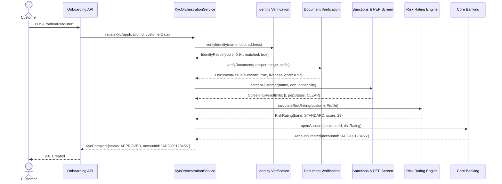

## Overview

Know Your Customer (KYC) is the cornerstone obligation of financial crime compliance. Every regulated financial institution must be able to answer a deceptively simple question before opening an account: who is this person, are they who they claim to be, what risk do they pose, and is their intended use of the product consistent with legitimate activity? Getting that answer wrong in either direction costs real money — HSBC paid $1.9 billion in a 2012 US Department of Justice settlement for systematic KYC failures, and ING Bank N.V. paid €775 million in 2018 after Dutch prosecutors found serious, structural failures in its customer due diligence and transaction monitoring. Getting it wrong in the other direction — rejecting or losing legitimate customers through excessive friction — is costly too: digital onboarding journeys commonly lose a large share of applicants at the identity-verification step. As a senior engineer building onboarding systems, you sit at the intersection of regulatory obligation and commercial imperative.

## Learning Objectives

- Explain the three-tier CDD/EDD/SDD framework and the risk factors that determine which tier applies to a given customer
- Map the FATF 40 Recommendations and EU AML Directives (4AMLD through 6AMLD) to concrete technical requirements in an onboarding system
- Design a saga-based `KycOrchestrationService` that coordinates identity verification, document checking, PEP/sanctions screening, and risk rating as compensatable steps
- Write production-quality DDL for a `customer_risk_ratings` table that captures the full audit trail required by regulators
- Implement a risk scoring model that weights jurisdiction, occupation, product type, and behavioural signals into a numeric risk band
- Resolve Ultimate Beneficial Owner (UBO) hierarchies for corporate customers and store the resulting ownership graph
- Design periodic review triggers that honour time-based, event-based, and threshold-based reassessment obligations
- Reason through the conflict between GDPR right-to-erasure obligations and AML data-retention mandates

## Business Context

In December 2022, the Financial Conduct Authority fined Santander UK £107.7 million for anti-money laundering failures in its business banking division between 2012 and 2017, affecting around 560,000 business customers. The FCA found that the bank did not properly verify information customers gave at onboarding (such as expected turnover), did not effectively monitor whether accounts were used as declared, and did not act quickly enough when risks were identified. Data was collected — the failure was in how it was checked, maintained and acted upon. *The engineering pattern behind failures like this (a composite, not a description of Santander's systems):* an onboarding service writes a final `risk_tier` to the customer record and never revisits it; edge cases — dual nationality, transliterated names, long ownership chains, customers whose behaviour changes after onboarding — fall through. The fine works out at roughly £192 per affected customer, far more than a proper ongoing due diligence system would have cost.

## Regulatory Framework: FATF and EU AML Directives

The Financial Action Task Force (FATF) is the inter-governmental body that sets the global standard for anti-money laundering (AML) and counter-terrorist financing (CTF). Its 40 Recommendations, first issued in 1990 and substantially revised in 2012, define the risk-based approach that all national AML regimes must implement. Recommendation 10 defines Customer Due Diligence. Recommendation 12 defines Enhanced Due Diligence for Politically Exposed Persons. Recommendation 15 (new technologies) was extended in 2018–2019 to cover virtual assets: virtual asset service providers must be regulated and apply CDD, including the "travel rule" for transfers.

The EU has transposed FATF obligations through successive AML Directives. Each directive tightened requirements that have direct architectural implications.

| Directive | Year | Key Engineering Impact |
|-----------|------|------------------------|
| 4AMLD | 2017 | Risk-based approach made mandatory; UBO register introduced |
| 5AMLD | 2020 | Virtual currency platforms brought in scope; UBO registers opened to the public (general public access was struck down by the EU Court of Justice in 2022; access now requires a legitimate interest) |
| 6AMLD | 2021 | 22 predicate offences harmonised; criminal liability extended to legal persons; maximum prison term of at least 4 years for money laundering |
| AML Package 2024 | AMLR applies from July 2027 | Directly applicable AML Regulation; EU AML Authority (AMLA); €10,000 cash payment limit |

> [!IMPORTANT]
> The 2024 EU AML Package creates a new EU-level supervisor, AMLA (based in Frankfurt), which began operating in 2025 and will directly supervise a selected group of the highest-risk cross-border institutions from 2028. The AML Regulation replaces many national rules with one directly applicable rulebook from July 2027. Design customer data and audit trails now so they can answer supervisory requests in a consistent, EU-wide format.

## CDD, EDD, and SDD Tiers

The risk-based approach requires that the intensity of due diligence be proportionate to the assessed risk. This produces three tiers that your onboarding pipeline must route customers through.

**Standard CDD** applies to the majority of retail customers. It requires identity verification (name, date of birth, address), document verification (passport or national ID), and understanding of the purpose and intended nature of the business relationship.

**Enhanced Due Diligence (EDD)** applies when risk factors are present. Mandatory EDD triggers include: Politically Exposed Persons (PEPs) and their family members or close associates; customers from FATF high-risk or monitored jurisdictions (grey/black list); correspondent banking relationships; and any customer or transaction the institution's own risk assessment deems high-risk. EDD requires obtaining additional information on source of funds, source of wealth, senior management approval for onboarding, and enhanced ongoing monitoring.

**Simplified Due Diligence (SDD)** may apply where risk is demonstrably low: regulated financial institutions, listed companies on recognised exchanges, government bodies. SDD permits reduced verification frequency and documentation depth, but it is not an exemption from CDD — it is a calibrated reduction.

> [!NOTE]
> SDD is a risk-proportionate reduction, not a free pass. Under 4AMLD Article 15 (and UK MLR 2017 regulation 37), firms must document why SDD applies and keep monitoring the relationship for signals that should escalate it to standard CDD or EDD. A customer who qualified for SDD at onboarding may need EDD soon afterwards if their behaviour does not match the stated purpose.

## Onboarding Pipeline Architecture

The digital onboarding pipeline is a multi-step process where each step has external dependencies (identity providers, document verification APIs, sanctions lists, PEP databases) and each step can fail independently. The saga pattern is the correct architectural choice: each step has a compensating transaction, and the orchestrator maintains the overall state machine.



The saga orchestrator must handle the failure modes at each step. If document verification is inconclusive after identity verification has succeeded (blurry image, low liveness score), the application goes to `PENDING_MANUAL_REVIEW` rather than `REJECTED` — a critical distinction because the customer may simply have submitted a low-quality photograph. Only a document confirmed as forged is rejected (and referred to the fraud team). Each step's result is saved in its own short transaction, so the saga can resume after a crash; the orchestrator must never hold one database transaction open across slow external calls.

```java
// KycOrchestrationService.java
@Service
@Slf4j
public class KycOrchestrationService {

    private final KycApplicationRepository applicationRepo;
    private final IdentityVerificationClient idvClient;
    private final DocumentVerificationClient docClient;
    private final SanctionsScreeningClient sanctionsClient;
    private final RiskRatingEngine riskEngine;
    private final CoreBankingClient coreBankingClient;
    private final ApplicationEventPublisher eventPublisher;

    // NOT @Transactional: one DB transaction held open across several slow
    // HTTP calls would pin a connection for seconds, and a rollback at step 5
    // would erase the saved progress while the external effects remain.
    // updateStatus/persist* each commit in their own short transaction
    // (TransactionTemplate), so the saga can resume from its last state.
    public KycResult orchestrate(KycApplication application) {
        log.info("Starting KYC orchestration for applicationId={}", application.getId());
        updateStatus(application, KycStatus.IDENTITY_VERIFICATION_IN_PROGRESS);

        // Step 1: Identity Verification
        IdentityVerificationResult idvResult;
        try {
            idvResult = idvClient.verify(IdentityVerificationRequest.from(application));
        } catch (IdentityVerificationException e) {
            return failApplication(application, KycFailureReason.IDV_PROVIDER_ERROR, e);
        }

        if (idvResult.score() < 0.85) {
            return requireManualReview(application, "IDV score below threshold: " + idvResult.score());
        }

        updateStatus(application, KycStatus.DOCUMENT_VERIFICATION_IN_PROGRESS);

        // Step 2: Document Verification
        DocumentVerificationResult docResult;
        try {
            docResult = docClient.verify(DocumentVerificationRequest.from(application));
        } catch (DocumentVerificationException e) {
            // Provider error is not the customer's fault: retry later
            return failApplication(application, KycFailureReason.DOC_PROVIDER_ERROR, e);
        }

        if (docResult.forgeryDetected()) {
            // Confirmed forgery: reject and refer to the fraud team
            return rejectApplication(application, KycFailureReason.DOCUMENT_NOT_AUTHENTIC);
        }
        if (!docResult.authentic() || docResult.livenessScore() < 0.90) {
            // Inconclusive (blurry photo, poor lighting): a human decides
            return requireManualReview(application, "Document check inconclusive");
        }

        updateStatus(application, KycStatus.SANCTIONS_SCREENING_IN_PROGRESS);

        // Step 3: Sanctions and PEP Screening
        ScreeningResult screeningResult;
        try {
            screeningResult = sanctionsClient.screen(ScreeningRequest.from(application));
        } catch (ScreeningException e) {
            // Never treat "screening unavailable" as "no hit"
            return failApplication(application, KycFailureReason.SCREENING_PROVIDER_ERROR, e);
        }

        if (screeningResult.hasConfirmedSanctionsMatch()) {
            return blockApplication(application, screeningResult);
        }
        if (screeningResult.hasPotentialSanctionsMatch()) {
            // Fuzzy match: hold for a sanctions analyst — do not auto-block
            return holdForSanctionsReview(application, screeningResult);
        }

        boolean requiresEdd = screeningResult.pepStatus() != PepStatus.CLEAR
                || isHighRiskJurisdiction(application.getNationality())
                || isHighRiskJurisdiction(application.getCountryOfResidence())
                || application.getProductType().requiresEdd();

        updateStatus(application, KycStatus.RISK_RATING_IN_PROGRESS);

        // Step 4: Risk Rating
        RiskRatingInput ratingInput = RiskRatingInput.builder()
                .customerId(application.getCustomerId())
                .jurisdiction(application.getCountryOfResidence())
                .occupation(application.getOccupation())
                .productType(application.getProductType())
                .pepStatus(screeningResult.pepStatus())
                .idvScore(idvResult.score())
                .requiresEdd(requiresEdd)
                .build();

        CustomerRiskRating riskRating = riskEngine.calculate(ratingInput);
        persistRiskRating(riskRating);

        // EDD (PEPs, high-risk countries) and HIGH / VERY_HIGH bands need
        // senior-management approval before the relationship starts
        boolean needsApproval = requiresEdd
                || riskRating.band() == RiskBand.HIGH
                || riskRating.band() == RiskBand.VERY_HIGH;
        if (needsApproval && !riskRating.seniorManagerApproved()) {
            return awaitSeniorApproval(application, riskRating);
        }

        updateStatus(application, KycStatus.ACCOUNT_OPENING_IN_PROGRESS);

        // Step 5: Account Opening — idempotent by applicationId, so a retry
        // after a timeout returns the same account instead of opening a second
        AccountCreationResult accountResult = coreBankingClient.openAccount(
                AccountCreationRequest.builder()
                        .idempotencyKey(application.getId().toString())
                        .customerId(application.getCustomerId())
                        .riskRatingId(riskRating.id())
                        .cddTier(riskRating.cddTier())
                        .build()
        );

        updateStatus(application, KycStatus.COMPLETED);
        eventPublisher.publishEvent(new KycCompletedEvent(application.getId(), accountResult.accountId()));

        return KycResult.approved(accountResult.accountId(), riskRating);
    }

    private KycResult blockApplication(KycApplication application, ScreeningResult result) {
        application.setStatus(KycStatus.BLOCKED);
        application.setBlockedReason("SANCTIONS_MATCH: " + result.highestMatchScore());
        applicationRepo.save(application);
        // Sanctions team handles any reporting duty (rules differ by country);
        // the customer gets a neutral decline — NEVER the reason
        eventPublisher.publishEvent(new SanctionsBlockEvent(application.getId(), result));
        return KycResult.blocked();
    }
}
```

> [!WARNING]
> When an application is blocked or held because of a sanctions match or a suspicion, do NOT tell the customer the reason. Where a suspicion has been reported, telling them can be "tipping off" — a criminal offence under the Proceeds of Crime Act 2002 (UK) and equivalent laws in most jurisdictions — and in any case it helps sanctioned persons evade controls. The application should be declined with a neutral message. All communication about the block must go through your compliance team and legal counsel.

## Customer Risk Rating Schema and Service

The `customer_risk_ratings` table is an append-only audit log. You never update a risk rating row — you create a new one and set the previous row's `superseded_at` timestamp. This is a regulatory requirement: regulators must be able to reconstruct the customer's risk profile at any point in time.

```sql
-- customer_risk_ratings DDL
CREATE TABLE customer_risk_ratings (
    id                      BIGSERIAL PRIMARY KEY,
    customer_id             BIGINT NOT NULL,
    rating_reference        VARCHAR(50) NOT NULL UNIQUE,  -- e.g. CRR-20240315-00001
    risk_score              INTEGER NOT NULL CHECK (risk_score BETWEEN 0 AND 100),
    risk_band               VARCHAR(20) NOT NULL CHECK (risk_band IN ('LOW', 'STANDARD', 'HIGH', 'VERY_HIGH')),
    cdd_tier                VARCHAR(20) NOT NULL CHECK (cdd_tier IN ('SIMPLIFIED', 'STANDARD', 'ENHANCED')),

    -- Scoring factors (stored for reproducibility)
    jurisdiction_score      INTEGER NOT NULL,
    occupation_score        INTEGER NOT NULL,
    product_score           INTEGER NOT NULL,
    pep_score               INTEGER NOT NULL DEFAULT 0,
    behaviour_score         INTEGER NOT NULL DEFAULT 0,

    -- Metadata
    rating_reason           VARCHAR(100) NOT NULL,  -- INITIAL_ONBOARDING, PERIODIC_REVIEW, EVENT_TRIGGERED, MANUAL_OVERRIDE
    rated_by_user_id        BIGINT,                 -- NULL for automated ratings
    rated_by_service        VARCHAR(100),           -- service name for automated ratings
    senior_manager_approved BOOLEAN NOT NULL DEFAULT FALSE,
    senior_manager_id       BIGINT,
    approval_timestamp      TIMESTAMPTZ,

    -- Lifecycle
    effective_from          TIMESTAMPTZ NOT NULL DEFAULT NOW(),
    superseded_at           TIMESTAMPTZ,            -- NULL = current rating
    next_review_due         DATE NOT NULL,

    created_at              TIMESTAMPTZ NOT NULL DEFAULT NOW(),

    CONSTRAINT fk_customer FOREIGN KEY (customer_id) REFERENCES customers(id)
);

CREATE INDEX idx_crr_customer_current
    ON customer_risk_ratings (customer_id)
    WHERE superseded_at IS NULL;

CREATE INDEX idx_crr_next_review
    ON customer_risk_ratings (next_review_due)
    WHERE superseded_at IS NULL;

-- Prevent more than one current rating per customer
CREATE UNIQUE INDEX idx_crr_customer_active
    ON customer_risk_ratings (customer_id)
    WHERE superseded_at IS NULL;
```

The risk scoring model weights four primary factors into a weighted average, then applies **floors**: some facts (for example, being a PEP) put a customer into a high band no matter what the average says. A PEP must never be averaged down to "standard" by a low product score. The model must be version-controlled: changing the weights is a material change that must be documented and approved by the MLRO (Money Laundering Reporting Officer).

```java
// RiskRatingEngine.java
@Component
public class RiskRatingEngine {

    // Weights must be approved by MLRO — do not change without change management sign-off
    // (they sum to 100, so the weighted average stays on a 0–100 scale)
    private static final int JURISDICTION_WEIGHT    = 35;
    private static final int OCCUPATION_WEIGHT      = 25;
    private static final int PRODUCT_WEIGHT         = 20;
    private static final int BEHAVIOUR_WEIGHT       = 20;

    private static final Map<String, Integer> JURISDICTION_SCORES = Map.of(
        "FATF_HIGH_RISK",   100,
        "FATF_MONITORED",    75,
        "EU_THIRD_COUNTRY",  50,
        "EEA",               10,
        "UK",                 5
    );

    private final Clock clock;

    public RiskRatingEngine(Clock clock) { this.clock = clock; }

    public CustomerRiskRating calculate(RiskRatingInput input) {
        int jurisdictionScore = resolveJurisdictionScore(input.jurisdiction());
        int occupationScore   = resolveOccupationScore(input.occupation());
        int productScore      = resolveProductScore(input.productType());
        int behaviourScore    = input.behaviourScore();      // 0–100, 0 at onboarding

        // Weighted average across factors (each on a 0–100 scale)
        int weighted = Math.round((jurisdictionScore * JURISDICTION_WEIGHT
                    + occupationScore   * OCCUPATION_WEIGHT
                    + productScore      * PRODUCT_WEIGHT
                    + behaviourScore    * BEHAVIOUR_WEIGHT) / 100f);

        RiskBand band = scoreToBand(weighted);

        // Floors: facts that override the average
        int pepScore = 0;
        if (input.pepStatus() != PepStatus.CLEAR) {
            pepScore = 100;
            band = RiskBand.max(band, RiskBand.HIGH);          // PEP → at least HIGH
        }
        if (jurisdictionScore == 100) {
            band = RiskBand.max(band, RiskBand.HIGH);          // FATF high-risk → EDD
        }

        return CustomerRiskRating.builder()
                .customerId(input.customerId())
                .riskScore(weighted)
                .riskBand(band)
                // SDD only for documented low-risk categories (regulated firm,
                // listed company, public body) — a low score alone is not enough
                .cddTier(band == RiskBand.HIGH || band == RiskBand.VERY_HIGH ? CddTier.ENHANCED
                        : band == RiskBand.LOW && input.sddEligible() ? CddTier.SIMPLIFIED
                        : CddTier.STANDARD)
                .jurisdictionScore(jurisdictionScore)
                .occupationScore(occupationScore)
                .productScore(productScore)
                .behaviourScore(behaviourScore)
                .pepScore(pepScore)
                .nextReviewDue(calculateNextReview(band))
                .build();
    }

    private RiskBand scoreToBand(int score) {
        if (score <= 25)  return RiskBand.LOW;
        if (score <= 55)  return RiskBand.STANDARD;
        if (score <= 80)  return RiskBand.HIGH;
        return RiskBand.VERY_HIGH;
    }

    private LocalDate calculateNextReview(RiskBand band) {
        LocalDate today = LocalDate.now(clock);
        return switch (band) {
            case LOW       -> today.plusYears(3);
            case STANDARD  -> today.plusYears(1);
            case HIGH      -> today.plusMonths(6);
            case VERY_HIGH -> today.plusMonths(3);
        };
    }
}
```

## UBO Resolution for Corporate Customers

The EU's 4AMLD introduced mandatory Ultimate Beneficial Owner (UBO) registers, requiring firms to identify every natural person who ultimately owns or controls a corporate customer — through more than 25% of the shares or voting rights, or through control by other means. If nobody qualifies, the firm records the senior managing official instead, and documents why. In practice, ownership structures involve multiple layers of holding companies, trusts, and partnerships, and the 25% threshold must be applied by aggregating direct and indirect holdings.

```java
// UboResolutionService.java
@Service
public class UboResolutionService {

    private static final BigDecimal UBO_THRESHOLD = new BigDecimal("0.25");
    private static final int MAX_RESOLUTION_DEPTH = 15; // internal safety limit — deeper chains go to manual review

    public List<UboRecord> resolveUbos(String legalEntityId) {
        Map<String, BigDecimal> effectiveOwnership = new HashMap<>();
        resolveRecursive(legalEntityId, BigDecimal.ONE, effectiveOwnership, 0, new HashSet<>());

        return effectiveOwnership.entrySet().stream()
                .filter(e -> e.getKey().startsWith("PERSON:"))  // only natural persons
                .filter(e -> e.getValue().compareTo(UBO_THRESHOLD) > 0)   // MORE than 25%
                .map(e -> buildUboRecord(e.getKey(), e.getValue()))
                .toList();
    }

    private void resolveRecursive(String entityId, BigDecimal parentShare,
                                  Map<String, BigDecimal> accumulated,
                                  int depth, Set<String> visited) {
        if (depth > MAX_RESOLUTION_DEPTH) {
            throw new UboResolutionException(
                "Ownership chain exceeds maximum depth " + MAX_RESOLUTION_DEPTH
                + " at entity " + entityId + ". Manual review required.");
        }
        if (visited.contains(entityId)) {
            // Circular ownership on this path — flag for manual review.
            // (visited is copied per branch, so the same holding company reached
            //  through two different paths — a "diamond" — is NOT a cycle)
            throw new CircularOwnershipException(entityId);
        }

        visited.add(entityId);
        List<OwnershipRecord> owners = ownershipRepo.findDirectOwners(entityId);

        for (OwnershipRecord owner : owners) {
            BigDecimal effectiveShare = parentShare.multiply(owner.ownershipPercentage())
                    .divide(new BigDecimal("100"), 10, RoundingMode.HALF_UP);

            String ownerId = owner.ownerType() == OwnerType.PERSON
                    ? "PERSON:" + owner.ownerId()
                    : "ENTITY:" + owner.ownerId();

            accumulated.merge(ownerId, effectiveShare, BigDecimal::add);

            if (owner.ownerType() == OwnerType.LEGAL_ENTITY) {
                resolveRecursive(owner.ownerId(), effectiveShare, accumulated,
                        depth + 1, new HashSet<>(visited));
            }
        }
    }
}
```

> [!NOTE]
> The 25% threshold is the regulatory standard, and firms may go lower. Shareholdings are also not the whole story: a person can control a company through voting agreements, board appointment rights or a trust without owning 25%, and those people are UBOs too. Many institutions apply a 10% threshold for high-risk customers or for customers in sectors prone to beneficial ownership abuse (gambling, real estate, money services). Your UBO_THRESHOLD constant should be configurable per customer segment, not hardcoded as a global value.

## Periodic Review and Data Retention

Ongoing due diligence is not optional. FATF Recommendation 10(d) requires firms to ensure that documents, data, and information collected under CDD are kept up to date and relevant. The `idx_crr_next_review` index on the `customer_risk_ratings` table enables a scheduled job to identify overdue reviews.

```java
// PeriodicReviewScheduler.java
@Component
@Slf4j
public class PeriodicReviewScheduler {

    @Scheduled(cron = "0 0 6 * * MON-FRI")  // 06:00 every business day
    public void triggerDueReviews() {
        LocalDate reviewCutoff = LocalDate.now(clock).plusDays(14); // 14-day lead time
        List<CustomerRiskRating> dueRatings =
                ratingRepo.findCurrentRatingsDueBy(reviewCutoff);

        log.info("Periodic review: found {} customers due for review by {}",
                dueRatings.size(), reviewCutoff);

        dueRatings.forEach(rating -> {
            // The job runs every day and a rating stays "due" for 14 days:
            // without this check it would create 10 duplicate tasks per customer.
            // (Backed by a unique index on (rating_id, review_type) for open tasks.)
            if (reviewWorkflowService.hasOpenTask(rating.getId(), ReviewType.PERIODIC)) {
                return;
            }
            reviewWorkflowService.createReviewTask(
                    ReviewTaskRequest.builder()
                            .customerId(rating.getCustomerId())
                            .ratingId(rating.getId())
                            .reviewType(ReviewType.PERIODIC)
                            .dueDate(rating.getNextReviewDue())
                            .priority(rating.getRiskBand().reviewPriority())
                            .build()
            );
        });
    }
}
```

**The GDPR Right-to-Erasure Conflict.** Under GDPR Article 17, data subjects have the right to erasure. Under AML regulations (e.g., 4AMLD Article 40, UK MLR 2017 Regulation 40), firms must retain customer due diligence records for five years after the business relationship ends; EU member states may allow or require a further period, up to ten years in total, for example where records are needed for investigations or proceedings. These two obligations are in direct conflict.

The resolution is well-established in legal guidance but rarely implemented correctly in systems:

1. GDPR Article 17(3)(b) explicitly exempts erasure where retention is necessary for compliance with a legal obligation. AML retention obligations qualify.
2. The correct response to a right-to-erasure request from a former customer is not deletion but **pseudonymisation with access restriction**: replace direct identifiers (name, national ID, address) with a pseudonym, retain the transaction and CDD records in a restricted-access archive, and log the pseudonymisation event in an auditable record. Full deletion may occur only after the AML retention period expires.
3. Your data model must distinguish between **personally identifiable data** (subject to erasure) and **compliance record data** (subject to retention). These should be stored in separate tables or separate schemas with different retention policies from day one.

## Knowledge Check

**Q1: A customer opens a standard current account and later begins receiving large irregular wire transfers from a FATF grey-list jurisdiction. The initial risk rating was STANDARD. What should happen architecturally, and why is a purely time-based periodic review schedule insufficient here?**

A: The system should implement event-triggered review in addition to time-based review. Transaction monitoring systems detecting anomalous behaviour (high-value unusual transfers, geographical risk change) should emit events consumed by the KYC service. The KYC service must be capable of elevating the risk rating outside the normal review schedule and triggering EDD for a currently STANDARD customer. A purely time-based schedule would leave a STANDARD customer at the wrong risk tier for up to twelve months before the next annual review. The `customer_risk_ratings` table's append-only design supports this — a new row is inserted with `rating_reason = 'EVENT_TRIGGERED'` without destroying the original assessment.

**Q2: Your `UboResolutionService` throws a `CircularOwnershipException`. What does this represent in the real world, and what should your system do next?**

A: Circular ownership (Company A owns Company B, which owns Company A) is a red flag often associated with deliberate obfuscation of beneficial ownership. It is rare in legitimate structures (some groups do have cross-shareholdings), and it makes the real owner hard to identify — so it can never be resolved automatically. The correct response is to: (1) prevent the application from proceeding automatically; (2) route it to a specialist analyst for manual investigation; (3) consider filing a Suspicious Activity Report (SAR) with the relevant Financial Intelligence Unit (FIU) if the circular structure appears deliberate; and (4) document the full investigation in the customer's compliance file regardless of the outcome.

## Practical Challenge

1. **Extend the risk scoring model** to add a `sourceOfFunds` factor. Cash-intensive businesses (restaurants, car washes, pawnbrokers) should score 70 on this dimension; salaried employment 10; self-employment 30. Integrate the new factor into `RiskRatingEngine` with a weight of 15, re-normalise the existing weights so they still sum to 100, and add a unit test covering the boundary between STANDARD and HIGH bands.

2. **Implement the supersede-and-insert pattern** for risk rating updates. Write a `RiskRatingRepository` method `supersedeCurrent(customerId, newRating)` that opens a transaction, sets `superseded_at = NOW()` on the current active row, inserts the new rating row, and asserts the unique partial index still holds after the operation. Test this with a concurrent update scenario using two threads.

3. **Build the GDPR pseudonymisation handler.** Write a `GdprErasureService` that accepts a `customerId`, verifies whether the AML retention period has expired (using `account_closed_at + 5 years`), and either: (a) performs pseudonymisation if still within the retention window — replacing name, national ID number, and address with deterministic pseudonyms derived from a secret key — or (b) performs hard deletion if the retention period has elapsed. The pseudonymisation must be reversible by compliance officers with the correct key.

4. **Write a Testcontainers integration test** that runs the full `KycOrchestrationService.orchestrate()` flow against a real PostgreSQL instance. Mock the external IDV, document, and sanctions clients with WireMock. Verify that: a PEP customer routes to `CddTier.ENHANCED`; a confirmed sanctions match results in `KycStatus.BLOCKED` and publishes a `SanctionsBlockEvent`; and an inconclusive document verification results in `KycStatus.PENDING_MANUAL_REVIEW` rather than `REJECTED`.

<!-- KNOWLEDGE-CHECK
{
  "questions": [
    {
      "text": "A customer opens a standard current account and later begins receiving large irregular wire transfers from a FATF grey-list jurisdiction. The initial risk rating was STANDARD. What should happen architecturally?",
      "options": [
        "Wait for the next annual periodic review to assess the new risk",
        "Automatically upgrade to EDD based on transaction volume alone",
        "Block the account immediately pending investigation",
        "Implement event-triggered review that elevates risk rating outside the normal review schedule when anomalous behaviour is detected"
      ],
      "correct": 3,
      "explanation": "The system must implement event-triggered review in addition to time-based review. Transaction monitoring detecting anomalous behaviour should emit events consumed by the KYC service, which can elevate risk rating outside the normal schedule. A purely time-based schedule leaves a customer at the wrong risk tier for up to 12 months."
    },
    {
      "text": "Your `UboResolutionService` throws a `CircularOwnershipException`. What does this represent in the real world?",
      "options": [
        "A technical bug in the graph traversal algorithm",
        "A common corporate holding structure where parent companies cross-own each other",
        "A red flag for deliberate obfuscation of beneficial ownership, associated with money laundering",
        "An ownership structure requiring manual verification of foreign entities"
      ],
      "correct": 2,
      "explanation": "Circular ownership (Company A owns Company B, which owns Company A) is a red flag often associated with deliberate obfuscation of beneficial ownership. It is rare in legitimate structures and makes the real owner hard to identify. The correct response is to stop automatic processing, route to a specialist analyst, consider filing a SAR if it looks deliberate, and document the investigation."
    },
    {
      "text": "What is the conflict between GDPR right-to-erasure and AML record retention requirements?",
      "options": [
        "There is no conflict — GDPR exempts financial data from erasure requirements",
        "GDPR gives a right to erasure, but AML regulations require customer records to be kept for 5 years after the relationship ends",
        "AML regulations require deletion after 2 years, which conflicts with GDPR's 7-year minimum",
        "GDPR and AML both require 5-year retention with no conflict"
      ],
      "correct": 1,
      "explanation": "GDPR's right to erasure is in tension with AML rules that require customer records to be kept for 5 years after the relationship ends (longer in some cases). GDPR Article 17(3)(b) exempts data needed for a legal obligation, so the solution is restricted, pseudonymised retention during the AML window and hard deletion only after it ends."
    }
  ]
}
-->

<!-- PRACTICAL-CHALLENGE
{
  "title": "KYC Orchestration with Risk Scoring and GDPR Compliance",
  "difficulty": "advanced",
  "estimatedMinutes": 45,
  "tasks": [
    {
      "id": "1",
      "description": "Extend the risk scoring model to add a `sourceOfFunds` factor. Cash-intensive businesses score 70, salaried employment 10, self-employment 30. Integrate into `RiskRatingEngine` with weight 15, re-normalise existing weights to sum to 100, and add a unit test covering the boundary between STANDARD and HIGH risk bands."
    },
    {
      "id": "2",
      "description": "Write a `RiskRatingRepository` method `supersedeCurrent(customerId, newRating)` that opens a transaction, sets `superseded_at = NOW()` on the current active row, inserts the new rating row, and asserts the unique partial index still holds. Test with a concurrent update scenario using two threads."
    },
    {
      "id": "3",
      "description": "Write a `GdprErasureService` that accepts a `customerId`, verifies whether the AML retention period has expired (`account_closed_at + 5 years`), and either: (a) performs pseudonymisation replacing name, national ID, and address with deterministic secret-key-derived pseudonyms (reversible by compliance officers); or (b) performs hard deletion if the retention period has elapsed."
    },
    {
      "id": "4",
      "description": "Write a Testcontainers integration test running the full `KycOrchestrationService.orchestrate()` flow against real PostgreSQL. Mock IDV, document, and sanctions clients with WireMock. Verify: PEP customer routes to `CddTier.ENHANCED`; a confirmed sanctions match results in `KycStatus.BLOCKED` and publishes `SanctionsBlockEvent`; an inconclusive document verification results in `KycStatus.PENDING_MANUAL_REVIEW` rather than `REJECTED`."
    }
  ]
}
-->
