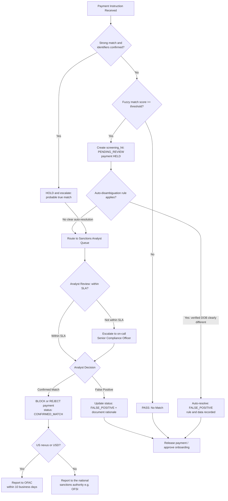

# فحص العقوبات — القوائم والمطابقة التقريبية وإدارة الإيجابيات الكاذبة

## نظرة عامة

الامتثال للعقوبات أعلى مجالات منع الجرائم المالية مخاطرة. فبينما تجلب إخفاقات KYC غرامات رقابية، تجلب مخالفات العقوبات ملاحقة جنائية. فقد دفع Standard Chartered نحو 667 مليون دولار في 2012 و1.1 مليار دولار أخرى في 2019 لسلطات أمريكية وبريطانية بسبب معاملات خرقت العقوبات على إيران ودول أخرى. ووجدت عدة قضايا ضد بنوك كبيرة في تلك الفترة ما يُسمى "تجريد الحوالات" (wire stripping): أزال موظفون عمدًا أو غيّروا الإشارات إلى الدول والأطراف المعاقبة في رسائل SWIFT حتى لا يوقف الفحص الآلي المدفوعات. والدرس الهندسي ليس مجرد أنك تحتاج نظام فحص — بل إن النظام يجب أن يقاوم التلاعب بالبيانات، ويفحص كل حقل في الدفعة قد يحدد طرفًا معاقبًا، ويعمل بسرعة تجعل الحجب الآني قبل تسوية الدفعة ممكنًا تشغيليًا. ويبني هذا الدرس بنية فحص عقوبات صناعية، ويبين ما يلزم للاقتراب من هدف طموح: فحص 1,000 اسم مقابل قائمة موحدة من 15,000 مدخل في أقل من 50 مللي ثانية.

## أهداف التعلم

- تحديد المصادر الرئيسية لقوائم العقوبات (OFAC SDN، والأمم المتحدة، والاتحاد الأوروبي، وقائمة العقوبات البريطانية، وقوائم وطنية أخرى) والالتزامات القانونية التي ينشئها كل منها للمؤسسات في ولايات قضائية مختلفة
- شرح المقايضة بين الفحص الآني والفحص المجمّع وتحديد متطلبات الزمن والإنتاجية التي تجعل الفحص الآني للمدفوعات ممكنًا
- تنفيذ أربع تقنيات لمطابقة الأسماء ومقارنتها — المطابقة الدقيقة، ومسافة Levenshtein، وSoundex، وJaro-Winkler — ومعرفة كيف تقيس الدقة (precision) والاستدعاء (recall) على بياناتك
- بناء `SanctionsScreeningService` بحد مطابقة قابل للإعداد، وتسجيل نقاط متعدد الخوارزميات، وإدارة آمنة للخيوط للقائمة في الذاكرة
- تصميم جدول `screening_hits` كسجل تدقيق غير قابل للتغيير بالحقول اللازمة لالتزامات الإبلاغ لـ OFAC
- تنفيذ سير عمل لفك الالتباس يوجّه الإيجابيات الكاذبة المحتملة إلى مراجعة بشرية دون حجب المدفوعات المشروعة إلى أجل غير مسمى
- هندسة آلية إعادة تحميل تحدّث قائمة العقوبات في الذاكرة من ملف جديد دون توقف أو فجوات في الفحص
- قياس أداء الفحص وتحسينه باستخدام اختبارات JMH للتحقق من متطلب أقل من 50 مللي ثانية

## سياق العمل

في أبريل 2019 وافقت UniCredit على دفع نحو 1.3 مليار دولار لسلطات أمريكية وفي ولاية نيويورك لتسوية مخالفات تتعلق بمدفوعات لأطراف إيرانية وأخرى معاقبة وُجّهت عبر النظام المالي الأمريكي بطرق أخفت الصلة بالعقوبات. *درس الفحص أدناه مثال مركّب من أنماط فشل شائعة، لا وصف لأنظمة UniCredit:* نظام فحص يطبق المطابقة التقريبية فقط على حقل الاسم الرئيسي في رسائل MT103 ويتجاهل سطور العنوان، وحقلي المؤسسة الآمرة ومؤسسة المستفيد، ورموز BIC — وهي بالضبط حيث تقع معلومات العقوبات غالبًا. وفشل ثانٍ شائع جدًا هو انجراف الحد: يُرفع حد المطابقة خطوة بخطوة لتقليل الإيجابيات الكاذبة (التي تستهلك وقت المحللين) حتى تبدأ الإيجابيات الحقيقية بالتسرب. والدرس الهندسي أن الإيجابيات الكاذبة والسلبيات الكاذبة ليست متساوية الكلفة: فالإيجابي الحقيقي الفائت (معالجة دفعة لطرف معاقب) قد يؤدي إلى إجراءات تنفيذية وملاحقة؛ أما الإيجابي الكاذب الذي يؤخر دفعة مشروعة يومًا فمسألة خدمة عملاء. ويجب أن تعكس معايرة الحد هذا التفاوت، ويجب اختبار كل تغيير في الحد واعتماده.

## مصادر قوائم العقوبات والالتزامات القانونية

يجب أن يوحّد نظام الفحص الإنتاجي قوائم متعددة. وتفرض كل قائمة التزامات قانونية مختلفة تتفاوت حسب مكان المؤسسة وموظفيها، وهوية الأطراف، وهل توجد مقاصة بالدولار الأمريكي (أو صلة أخرى بالدولة المصدرة).

| القائمة | الجهة المصدرة | النطاق القضائي | عاقبة المخالفة |
|------|-------------|---------------------|--------------------------|
| OFAC SDN ‏(Specially Designated Nationals) | وزارة الخزانة الأمريكية | الأشخاص الأمريكيون أينما كانوا؛ وأي شيء داخل الولايات المتحدة، بما في ذلك مقاصة الدولار | غرامة مدنية لكل مخالفة تصل إلى الأكبر من نحو 377,000 دولار (2025، معدلة بالتضخم) أو ضعف قيمة المعاملة؛ وملاحقة جنائية |
| القائمة الموحدة للأمم المتحدة | مجلس الأمن الدولي | كل الدول الأعضاء (193 دولة) | التزام سيادي؛ والقانون الجنائي الوطني |
| القائمة الموحدة للاتحاد الأوروبي | مجلس الاتحاد الأوروبي | الأعمال داخل الاتحاد، ومواطنو الاتحاد وشركاته أينما كانوا | عقوبات تحددها الدول الأعضاء، بما فيها المسؤولية الجنائية |
| قائمة العقوبات البريطانية (FCDO؛ وتنفذها OFSI) | الحكومة البريطانية | السلوك داخل المملكة المتحدة، والأشخاص والشركات البريطانية أينما كانوا | غرامة مدنية تصل إلى الأكبر من مليون جنيه أو 50% من قيمة المخالفة (مسؤولية مطلقة)؛ وملاحقة جنائية |
| نشرات الإنتربول الحمراء | الإنتربول | ليست قائمة عقوبات | استشارية فقط — غير ملزمة قانونًا للمؤسسات المالية |

> [!IMPORTANT]
> حتى لو كانت مؤسستك مسجلة خارج الولايات المتحدة، فإن أي معاملة مقومة بالدولار الأمريكي تمر عبر بنك مراسل أمريكي (عادة JPMorgan Chase أو Citibank أو Bank of New York Mellon). وتطبق هذه البنوك المراسلة فحص OFAC على كل معاملة بالدولار تعالجها، وسترفض — وربما تبلغ عن — معاملات الدولار التي ترسلها إليها إذا تضمنت أطرافًا مصنفة لدى OFAC. وعمليًا، يجب على أي مؤسسة تجري مقاصة بالدولار الامتثال لمتطلبات OFAC أينما كان تأسيسها.

أحجام القوائم تتغير باستمرار ونمت بحدة بعد تصنيفات روسيا في 2022: فقائمة OFAC SDN وحدها فيها الآن أكثر بكثير من 15,000 مدخل، وفي قائمتي الاتحاد الأوروبي والمملكة المتحدة آلاف أخرى لكل منهما، مع تداخل كبير. (ومنذ يناير 2026 صارت قائمة العقوبات البريطانية التي تنشرها FCDO المصدر البريطاني الوحيد؛ وأُلغيت قائمة OFSI الموحدة المنفصلة.) وبعد إزالة التكرار، فقائمة موحدة بعشرات الآلاف من المدخلات — لكل منها عدة أسماء بديلة — افتراض واقعي. ويستخدم هذا الدرس 15,000 مدخل في أمثلته.

## مقايضات الفحص الآني مقابل المجمّع

| البعد | آني (قبل التفويض) | مجمّع (بعد المعالجة) |
|-----------|------------------------------|------------------------|
| التوقيت | قبل تفويض الدفعة | بعد معالجة الدفعة |
| ميزانية الزمن | أقل من 100 مللي ثانية (قيد بوابة الدفع) | ساعات مقبولة |
| عاقبة التطابق | تُحجب الدفعة؛ لا تُسوّى أبدًا | قد تكون الدفعة سُوّيت؛ يلزم الاسترجاع |
| متطلب الإنتاجية | ذروة المعاملات في الثانية لنظام الدفع | حجم 24 ساعة يُعالج ليلًا |
| أثر الإيجابيات الكاذبة | تأخير يراه العميل | تراكم لدى المحللين؛ وإحراج محتمل من الاسترجاع |
| التفضيل الرقابي | مفضل بقوة للعقوبات | حد أدنى للفحوص بأثر رجعي |

الفحص الآني إلزامي لفتح حسابات العملاء الجدد ولكل تعليمة دفع منفردة. ويخدم الفحص المجمّع غرضين إضافيين: إعادة فحص قاعدة العملاء الحالية عند نشر تحديث جديد للقائمة (فالعميل النظيف عند فتح الحساب قد يظهر في مدخل جديد أُضيف بعد ستة أشهر)، والتحليل الرجعي عند إضافة مدخل بأثر رجعي بتاريخ سريان في الماضي.

> [!NOTE]
> قد تنشر OFAC تحديثات القائمة عدة مرات في اليوم خلال الأحداث الجيوسياسية النشطة. وخلال الاستجابة بالعقوبات على روسيا في فبراير–مارس 2022 نشرت السلطات في الولايات المتحدة والاتحاد الأوروبي والمملكة المتحدة تحديثات كثيرة خلال أيام، أضاف بعضها مئات المدخلات دفعة واحدة. ويجب أن تتعامل بنية إعادة التحميل لديك مع هذا التواتر دون توقف.

## خوارزميات المطابقة التقريبية للأسماء

المطابقة الدقيقة للنصوص لا تكفي لفحص العقوبات لأن الأسماء تظهر بنقل حرفي متعدد، وبعلامات ترقيم متفاوتة، وبصيغ مختصرة، أو بأجزاء معاد ترتيبها. والتقنيات التالية لبنات أساسية في أنظمة الفحص الإنتاجية. ولاحظ الخطوة الأولى في `normalise`: يجب **نقل** الأسماء المكتوبة بخطوط غير لاتينية (العربية، والسيريلية، والصينية) إلى اللاتينية قبل المقارنة — فالمرشح الذي يحذف ببساطة كل حرف غير لاتيني سيحوّل اسمًا مكتوبًا بالعربية إلى نص فارغ لا يطابق شيئًا.

```java
// NameMatchingUtils.java
public final class NameMatchingUtils {

    private NameMatchingUtils() {}

    /**
     * Levenshtein distance — counts minimum single-character edits (insert, delete, substitute)
     * to transform one string into another. Normalised to [0.0, 1.0].
     * Suitable for detecting typos and OCR errors.
     */
    public static double levenshteinSimilarity(String a, String b) {
        String s1 = normalise(a);
        String s2 = normalise(b);
        int distance = levenshteinDistance(s1, s2);
        int maxLen = Math.max(s1.length(), s2.length());
        if (maxLen == 0) return 1.0;
        return 1.0 - (double) distance / maxLen;
    }

    /**
     * Jaro-Winkler — gives higher weight to common prefix; well-calibrated for person names.
     * Returns similarity in [0.0, 1.0]; values above 0.88 are strong matches for given names.
     */
    public static double jaroWinklerSimilarity(String a, String b) {
        String s1 = normalise(a);
        String s2 = normalise(b);
        double jaro = jaroSimilarity(s1, s2);
        int prefixLen = Math.min(commonPrefixLength(s1, s2), 4);
        return jaro + (prefixLen * 0.1 * (1.0 - jaro));
    }

    /**
     * Soundex — phonetic encoding; maps name to 4-character code.
     * Two names with identical Soundex codes are likely phonetically similar.
     * Useful for English-language names; poor for non-Latin script transliterations.
     */
    public static String soundex(String name) {
        String s = normalise(name).replace(" ", "").toUpperCase(Locale.ROOT);
        if (s.isEmpty() || !Character.isLetter(s.charAt(0))) return "0000";
        StringBuilder code = new StringBuilder();
        code.append(s.charAt(0));

        Map<Character, Character> soundexMap = Map.ofEntries(
            Map.entry('B', '1'), Map.entry('F', '1'), Map.entry('P', '1'), Map.entry('V', '1'),
            Map.entry('C', '2'), Map.entry('G', '2'), Map.entry('J', '2'), Map.entry('K', '2'),
            Map.entry('Q', '2'), Map.entry('S', '2'), Map.entry('X', '2'), Map.entry('Z', '2'),
            Map.entry('D', '3'), Map.entry('T', '3'),
            Map.entry('L', '4'),
            Map.entry('M', '5'), Map.entry('N', '5'),
            Map.entry('R', '6')
        );

        char prev = soundexMap.getOrDefault(s.charAt(0), '0');
        for (int i = 1; i < s.length() && code.length() < 4; i++) {
            char c = s.charAt(i);
            char digit = soundexMap.getOrDefault(c, '0');
            if (digit != '0' && digit != prev) {
                code.append(digit);
            }
            prev = digit;
        }
        while (code.length() < 4) code.append('0');
        return code.toString();
    }

    public static String normaliseForMatch(String s) { return normalise(s); }

    /** "rashid mohammed" and "mohammed rashid" → same string. */
    public static String sortTokens(String normalised) {
        return Arrays.stream(normalised.split(" ")).sorted().collect(Collectors.joining(" "));
    }

    // ICU4J: transliterate any script to Latin, then strip accents
    private static final Transliterator TO_LATIN =
            Transliterator.getInstance("Any-Latin; Latin-ASCII");

    private static String normalise(String s) {
        if (s == null) return "";
        String latin = TO_LATIN.transliterate(s);      // e.g. Arabic/Cyrillic → Latin
        return Normalizer.normalize(latin, Normalizer.Form.NFD)
                .replaceAll("\\p{InCombiningDiacriticalMarks}+", "")
                .toLowerCase(Locale.ROOT)
                .replaceAll("[^a-z0-9\\s]", " ")       // punctuation → space, not deleted
                .replaceAll("\\s+", " ")
                .strip();
    }
}
```

**مقارنة الخوارزميات (أرقام توضيحية من مجموعة اختبار اصطناعية — قِسها على بياناتك وقائمتك قبل الاعتماد على أي منها):**

| الخوارزمية | الدقة (مجموعة اختبار SDN) | الاستدعاء (مجموعة اختبار SDN) | الزمن لكل زوج | أفضل استخدام |
|-----------|--------------------------|----------------------|-----------------|----------|
| المطابقة الدقيقة | 100% | 42% | أقل من 1 ميكروثانية | مرشح أول |
| Soundex | 71% | 78% | 2 ميكروثانية | مرشح صوتي أولي |
| Levenshtein | 83% | 85% | 15 ميكروثانية | اكتشاف الأخطاء الإملائية |
| Jaro-Winkler | 89% | 91% | 8 ميكروثانية | أسماء الأشخاص |
| مجتمعة (ensemble) | 93% | 95% | 25 ميكروثانية | الافتراضي الإنتاجي |

يشغّل النهج المجمّع المطابقة الدقيقة أولًا (الأرخص)، ثم Jaro-Winkler (الأفضل للأسماء)، ثم Levenshtein، ويأخذ **أعلى** نتيجة — فدمج النتائج بالمتوسط قد يخفض تطابقًا قويًا من خوارزمية واحدة تحت الحد. وتُقارن الأسماء أيضًا بعد ترتيب كلماتها، فيبقى "Rashid Mohammed" مطابقًا لـ "Mohammed Rashid". ولتقليل الكلفة، لا تعمل المقارنات المكلفة إلا على قائمة مرشحين مختصرة (انظر الفهرس لاحقًا في الدرس)، لا مقابل كل مدخل.

## تنفيذ SanctionsScreeningService

```java
// SanctionsScreeningService.java
@Service
@Slf4j
public class SanctionsScreeningService {

    private static final double DEFAULT_MATCH_THRESHOLD = 0.85;

    // AtomicReference for lock-free hot-reload
    private final AtomicReference<SanctionsList> activeSanctionsList = new AtomicReference<>();
    private final ScreeningHitsRepository hitsRepository;
    private final SanctionsListLoader listLoader;

    @PostConstruct
    public void init() {
        activeSanctionsList.set(listLoader.loadConsolidatedList());
        log.info("Sanctions list loaded: {} entries", activeSanctionsList.get().size());
    }

    /**
     * Screen a single name against the consolidated sanctions list.
     * Thread-safe: reads list via AtomicReference; never blocks writers.
     */
    public ScreeningResult screenName(ScreeningRequest request) {
        SanctionsList list = activeSanctionsList.get(); // snapshot — consistent during this call
        List<SanctionsMatch> matches = new ArrayList<>();

        for (SanctionsEntry entry : list.entries()) {
            double score = computeMatchScore(request.name(), entry);
            if (score >= request.threshold().orElse(DEFAULT_MATCH_THRESHOLD)) {
                matches.add(new SanctionsMatch(entry, score));
            }
        }

        matches.sort(Comparator.comparingDouble(SanctionsMatch::score).reversed());

        ScreeningResult result = ScreeningResult.builder()
                .requestId(request.requestId())
                .screenedName(request.name())
                .hits(matches)
                .listVersion(list.version())     // which list version cleared it — for audit
                .screenedAt(clock.instant())
                .build();

        if (!matches.isEmpty()) {
            persistHits(request, matches);
        }

        return result;
    }

    /**
     * Batch screen: screen multiple names against the list in a single list acquisition.
     * Significantly more efficient than N individual calls for bulk operations.
     */
    public List<ScreeningResult> screenBatch(List<ScreeningRequest> requests) {
        SanctionsList list = activeSanctionsList.get(); // single snapshot for entire batch

        return requests.parallelStream()
                .map(req -> screenAgainstList(req, list))
                .toList();
    }

    private double computeMatchScore(String queryName, SanctionsEntry entry) {
        String q = NameMatchingUtils.normaliseForMatch(queryName);
        String qSorted = NameMatchingUtils.sortTokens(q);       // "rashid mohammed" order-free
        double best = 0.0;
        // Check all name aliases stored on the entry
        for (String alias : entry.allNames()) {
            String a = NameMatchingUtils.normaliseForMatch(alias);
            if (q.equals(a)) return 1.0;                        // exact — short-circuit
            String aSorted = NameMatchingUtils.sortTokens(a);
            // Take the MAXIMUM across algorithms and token orders: averaging
            // could pull a strong single-algorithm match below the threshold
            best = Math.max(best, Math.max(
                    NameMatchingUtils.jaroWinklerSimilarity(q, a),
                    NameMatchingUtils.jaroWinklerSimilarity(qSorted, aSorted)));
            best = Math.max(best, NameMatchingUtils.levenshteinSimilarity(qSorted, aSorted));
        }
        return best;
    }

    /**
     * Hot-reload: atomically swap the active list with a freshly loaded version.
     * In-flight screening calls that already acquired the old reference complete
     * against the old list; new calls immediately use the updated list.
     */
    public void reloadSanctionsList() {
        SanctionsList newList = listLoader.loadConsolidatedList();   // fully built BEFORE the swap
        SanctionsList old = activeSanctionsList.get();
        // Sanity check: a truncated or empty download must never replace a good
        // list — that would silently turn screening off. Keep the old list and alert.
        if (newList.size() == 0 || newList.size() < old.size() * 0.9) {
            throw new SuspiciousListUpdateException(
                "New list has " + newList.size() + " entries, current has " + old.size());
        }
        activeSanctionsList.set(newList);
        log.info("Sanctions list hot-reloaded: {} entries (was {} entries, version {} → {})",
                newList.size(), old.size(), old.version(), newList.version());
        // old list will be GC'd once all in-flight calls complete
    }
}
```

يُسجَّل إصدار القائمة الذي اجتازته الدفعة لأغراض التدقيق. وفي إعادة التحميل تُبنى القائمة الجديدة بالكامل قبل التبديل، ويمنع فحص سلامة أن تحل قائمة مبتورة أو فارغة محل قائمة جيدة — لأن ذلك سيطفئ الفحص بصمت.

## مخطط تطابقات الفحص ومخطط القرار

```sql
-- screening_hits DDL
CREATE TABLE screening_hits (
    id                  BIGSERIAL PRIMARY KEY,
    hit_reference       VARCHAR(60) NOT NULL UNIQUE,  -- e.g. HIT-20240315-00001
    request_id          VARCHAR(100) NOT NULL,
    screened_entity_id  BIGINT,         -- customer_id or NULL for ad-hoc screening
    screened_name       VARCHAR(500) NOT NULL,
    screened_context    VARCHAR(50) NOT NULL,  -- ONBOARDING, PAYMENT, PERIODIC_RESCREENING
    payment_id          BIGINT,         -- NULL if not payment-related

    -- Match details
    matched_list        VARCHAR(50) NOT NULL,  -- OFAC_SDN, UN, EU, HM_TREASURY, COMBINED
    matched_entry_id    VARCHAR(100) NOT NULL, -- list provider's entry identifier
    matched_name        VARCHAR(500) NOT NULL,
    match_score         NUMERIC(5,4) NOT NULL,
    match_algorithm     VARCHAR(50) NOT NULL,
    list_version        VARCHAR(50) NOT NULL,

    -- Workflow state
    status              VARCHAR(30) NOT NULL DEFAULT 'PENDING_REVIEW'
                            CHECK (status IN (
                                'PENDING_REVIEW', 'CONFIRMED_MATCH', 'FALSE_POSITIVE',
                                'ESCALATED', 'REPORTED_TO_OFAC', 'CLOSED'
                            )),
    disposition_reason  TEXT,
    reviewed_by_user_id BIGINT,
    reviewed_at         TIMESTAMPTZ,
    escalated_at        TIMESTAMPTZ,
    report_reference    VARCHAR(100),   -- OFAC/FIU report number if filed

    -- Audit
    screened_at         TIMESTAMPTZ NOT NULL DEFAULT NOW(),
    created_at          TIMESTAMPTZ NOT NULL DEFAULT NOW(),
    updated_at          TIMESTAMPTZ NOT NULL DEFAULT NOW()
);

CREATE INDEX idx_hits_status_pending  ON screening_hits (created_at) WHERE status = 'PENDING_REVIEW';
CREATE INDEX idx_hits_entity          ON screening_hits (screened_entity_id);
CREATE INDEX idx_hits_payment         ON screening_hits (payment_id) WHERE payment_id IS NOT NULL;
```

يوضح مخطط القرار أدناه المسار الكامل من تطابق اسم إلى قرار نهائي. والمبدأ المعماري الأساسي أن تطابق الفحص يجب ألا يُهمل بصمت أبدًا — فلكل تطابق قرار قابل للتدقيق يسجله محلل مسمى أو قاعدة آلية بمبرر موثق.



> [!WARNING]
> تتطلب OFAC الإبلاغ عن الممتلكات المحجوبة والمعاملات المحجوبة خلال 10 أيام عمل، وعن المعاملات المرفوضة (حيث تكتشف صلة بالعقوبات فترفض بدل أن تحجب) خلال 10 أيام عمل أيضًا، عبر نظام OFAC للإبلاغ؛ ويقدم حائزو الممتلكات المحجوبة تقريرًا سنويًا أيضًا. وفي المملكة المتحدة يجب على الشركات الإبلاغ لـ OFSI في أقرب وقت ممكن عملي عندما تعلم أو تشتبه بمخالفة أو تحتفظ بأصول مجمدة لشخص مصنف. وعدم الإبلاغ مخالفة قائمة بذاتها، منفصلة عن المعاملة الأصلية. ويجب أن يحتوي سير عمل `screening_hits` لديك على تذكيرات آلية تصعّد إذا لم يُبلغ عن تطابق مؤكد خلال 7 أيام عمل.

## إدارة الإيجابيات الكاذبة

في فحص العقوبات الإنتاجي، تكون الغالبية العظمى من التنبيهات — عادة أكثر من 95% بكثير، وغالبًا أكثر من 99% — إيجابيات كاذبة. وهذا ليس فشلًا؛ بل نتيجة متوقعة لتشغيل فحص بحد منخفض مقابل قاعدة كبيرة من العملاء والمدفوعات. والتحدي الهندسي تقليل عبء المحللين عبر فك الالتباس الآلي دون رفع الحد إلى درجة تفوت معها الإيجابيات الحقيقية.

قواعد فك الالتباس الآلي الآمنة للتطبيق:

- **استبعاد تاريخ الميلاد:** إذا كان للشخص المفحوص تاريخ ميلاد **مُتحقق منه** وكان بعيدًا بوضوح عن كل تاريخ يذكره مدخل القائمة (فالمدخلات تذكر غالبًا عدة تواريخ، أو سنة فقط، أو نطاقًا مثل "نحو 1965")، فيُحل آليًا كإيجابي كاذب وتُسجّل البيانات المقارنة. وتاريخ الميلاد معرّف قوي.
- **اختلاف الجنسية:** إذا كانت جنسية الشخص المفحوص متحققًا منها وتختلف عن جنسية المدخل، فهذا دليل ضعيف على إيجابي كاذب — مفيد لترتيب أولويات طابور المحللين، ولا يكفي أبدًا وحده لإغلاق تنبيه (فالأشخاص المعاقبون يحملون عدة جوازات).
- **استبعاد المتوفى:** إذا حمل مدخل القائمة تاريخ وفاة وكان الشخص المفحوص عميلًا حيًا متحققًا منه، يمكن حل التطابق مع التوثيق — مع الانتباه لإساءة استخدام الهوية.
- **الأسماء البديلة الضعيفة:** تعلّم OFAC بعض الأسماء البديلة بأنها "ضعيفة" (منخفضة الجودة) — أسماء قصيرة أو شائعة جدًا. ويمكن إعطاء التطابقات على أسماء بديلة ضعيفة فقط نتيجة أقل أو اشتراط معرّف ثانٍ، بدل توليد تنبيهات كاملة. ولا تكبت أبدًا مدخلًا بالكامل لأن اسمه شائع.

```java
// AutoDisambiguationService.java
@Service
public class AutoDisambiguationService {

    public Optional<DisambiguationResult> attemptAutoDisambiguate(
            ScreeningHit hit, CustomerProfile customer, SanctionsEntry entry) {

        // Rule 1: DOB exclusion — only with a VERIFIED customer DOB, and only if
        // it is far from EVERY date/range the entry lists (several DOBs, year-only,
        // "circa" ranges are common)
        if (customer.dobVerified() && !entry.datesOfBirth().isEmpty()) {
            boolean farFromAll = entry.datesOfBirth().stream()
                .allMatch(d -> d.yearsApartFrom(customer.dateOfBirth()) > 2);
            if (farFromAll) {
                return Optional.of(DisambiguationResult.falsePositive(
                    "DOB mismatch: customer=" + customer.dateOfBirth()
                    + " entry=" + entry.datesOfBirth()));
            }
        }

        // Rule 2: Deceased exclusion
        if (entry.deceasedDate() != null
                && customer.lastTransactionDate() != null
                && customer.lastTransactionDate().isAfter(entry.deceasedDate())) {
            return Optional.of(DisambiguationResult.falsePositive(
                "SDN entry deceased " + entry.deceasedDate()
                + " but customer transacted " + customer.lastTransactionDate()));
        }

        // Rule 3: Nationality divergence — ADVISORY ONLY: lowers queue priority,
        // never closes the alert (the hit stays PENDING_REVIEW for an analyst)
        if (customer.nationality() != null && entry.nationality() != null
                && !customer.nationality().equals(entry.nationality())
                && hit.matchScore() < 0.92) {
            return Optional.of(DisambiguationResult.likelyFalsePositive(
                "Nationality mismatch and score below 0.92; recommend analyst review"));
        }

        return Optional.empty(); // Cannot auto-disambiguate; route to human
    }
}
```

## إعادة تحميل القائمة وهندسة الأداء

يوفر نمط `AtomicReference` في `SanctionsScreeningService.reloadSanctionsList()` إعادة تحميل دون أقفال. لكن لقائمة من 15,000 مدخل تُفحص في حلقة ضيقة، لا يكفي المرور الخام لتحقيق أقل من 50 مللي ثانية مع 1,000 اسم استعلام.

التحسين الأساسي بناء فهرس معكوس وقت التحميل ("blocking"). فبدل المرور على كل 15,000 مدخل لكل اسم استعلام، فهرس كل **كلمة** من كل اسم بديل تحت عدة مفاتيح — رمز Soundex الخاص بها وثلاثياتها الحرفية (trigrams) — ووقت الفحص خذ اتحاد المرشحين الموجودين تحت مفاتيح الاستعلام: عادة بضع مئات من المدخلات بدل 15,000. واستخدام أكثر من مفتاح مهم: فـ Soundex يبقي الحرف الأول كما هو، فلا يستطيع فهرس Soundex وحده أبدًا إيجاد "Gaddafi" من "Qaddafi"، أو "Usama" من "Osama"؛ ومفاتيح الثلاثيات تلتقط ذلك.

```java
// SanctionsList.java (index structure)
public record SanctionsList(
        List<SanctionsEntry> entries,
        Map<String, Set<SanctionsEntry>> tokenIndex,   // key → entries
        String version,
        Instant loadedAt) {

    public static SanctionsList build(List<SanctionsEntry> entries, String version, Clock clock) {
        Map<String, Set<SanctionsEntry>> index = new HashMap<>();
        for (SanctionsEntry entry : entries) {
            for (String name : entry.allNames()) {
                for (String key : blockingKeys(name)) {
                    index.computeIfAbsent(key, k -> new HashSet<>()).add(entry);
                }
            }
        }
        return new SanctionsList(List.copyOf(entries), Map.copyOf(index), version, clock.instant());
    }

    /** Candidate shortlist: union of entries sharing ANY blocking key. */
    public Set<SanctionsEntry> candidates(String queryName) {
        Set<SanctionsEntry> result = new HashSet<>();
        for (String key : blockingKeys(queryName)) {
            result.addAll(tokenIndex.getOrDefault(key, Set.of()));
        }
        return result;
    }

    // Per token: its Soundex code + its character trigrams. Trigrams catch
    // variants whose FIRST letter differs (Qaddafi/Gaddafi, Osama/Usama),
    // which a Soundex-only index can never find.
    private static Set<String> blockingKeys(String name) {
        Set<String> keys = new HashSet<>();
        for (String token : NameMatchingUtils.normaliseForMatch(name).split(" ")) {
            if (token.length() < 2) continue;
            keys.add("S:" + NameMatchingUtils.soundex(token));
            for (int i = 0; i + 3 <= token.length(); i++) {
                keys.add("T:" + token.substring(i, i + 3));
            }
        }
        return keys;
    }

    public int size() { return entries.size(); }
}
```

مع الفهرس، يتطلب فحص 1,000 اسم مقابل قائمة موحدة من 15,000 مدخل تقييم نحو 1,000 × 150 زوجًا مرشحًا، يستغرق كل زوج نحو 25 ميكروثانية للخوارزمية المجمعة. أي 1,000 × 150 × 25 ميكروثانية = 3.75 ثانية بخيط واحد. واستخدام `parallelStream()` على جهاز بثماني أنوية يخفض ذلك إلى أقل من 500 مللي ثانية. ولهدف أقل من 50 مللي ثانية مع 1,000 اسم تلزم تحسينات إضافية: إعطاء الثلاثيات النادرة وزنًا أعلى لتصغر القائمة المختصرة، ومرشحات رخيصة (فرق الطول، وعدد الثلاثيات المشتركة) قبل Jaro-Winkler، وتخزين نتائج أزواج الكلمات المتكررة، أو Vector API الذي ما زال قيد الاحتضان لمقارنة SIMD. وعمليًا، الزمن الأهم هو لكل دفعة — بضعة أسماء تُفحص في بضع مللي ثوانٍ — أما إعادة الفحص الجماعية فتعمل كمهمة مجمّعة.

> [!NOTE]
> تفترض ميزانية أقل من 50 مللي ثانية لـ 1,000 اسم خدمة فحص مخصصة تعمل على عتاد حديث والقائمة محفوظة كليًا في ذاكرة JVM. فإذا تطلبت بنيتك رحلة إلى قاعدة البيانات لجلب القائمة لكل دفعة، فلن تبلغ هذا الهدف. يجب أن تكون القائمة في ذاكرة العملية. ومع 15,000 مدخل بمتوسط 5 أسماء بديلة لكل مدخل من 50 حرفًا، فالأسماء الخام بضعة ميغابايتات فقط؛ ومع كلفة الكائنات والفهرس توقع عشرات الميغابايتات — وهذا ما زال ضمن ذاكرة أي نسخة إنتاجية بسهولة.

## اختبار المعرفة

**س1: يظل تنفيذ الفحص المفهرس بـ Soundex لديك يفوّت أسماء تبدأ صيغها المنقولة بأحرف مختلفة — مثل "Osama" و"Usama"، أو "Qaddafi" و"Gaddafi" و"Kadhafi". لماذا يفشل Soundex هنا، وما الحل المعماري الصحيح؟**

ج: صُمم Soundex لألقاب العائلات الإنجليزية. فهو يبقي **الحرف الأول كما هو** ويرمّز فقط الحروف الساكنة التالية، فيحصل "Osama" ‏(O250) و"Usama" ‏(U250)، أو "Qaddafi" ‏(Q310) و"Gaddafi" ‏(G310)، على رموز مختلفة ولا يقعان أبدًا في سلة الفهرس نفسها — رغم أنهما الاسم نفسه. (أما الصيغ التي تختلف لاحقًا في الكلمة فقط، مثل "Mohammed" و"Muhammad" و"Mohamed"، فكلها ترمّز إلى M530، فيتعامل معها Soundex.) والحلول المعمارية الصحيحة: (1) توحيد الأسماء وفق قواعد النقل الحرفي قبل الفهرسة، بربط الصيغ المعروفة (Q/G/K، وO/U في البداية، و"Abdul Rahman"/"Abdulrahman") بصيغة قياسية؛ (2) الفهرسة تحت عدة مفاتيح — الثلاثيات الحرفية إضافة إلى الرموز الصوتية (يتعامل Double Metaphone مع بعض الحالات أفضل من Soundex) — وأخذ اتحاد المرشحين؛ (3) تسجيل نقاط المرشحين بتشابه النصوص على الأسماء الموحدة. ويستثمر مزوّدو الفحص التجاريون كثيرًا في بيانات النقل الحرفي وصيغ الأسماء لهذا السبب بالضبط.

**س2: دفعة بقيمة 450 دولارًا إلى "Mohammed Al-Rashid" في دبي تحصل على 0.87 في مقارنة Jaro-Winkler مع مدخل في قائمة OFAC SDN باسم "Muhammad Al-Rasheed" (تاجر أسلحة سوري). ولا تستطيع خدمة فك الالتباس الآلي حلها. ومهلة المحلل ساعتان لكن الساعة 11 مساء يوم جمعة. ماذا يجب أن يفعل نظامك، وما الذي يجب ألا يحدث؟**

ج: يجب احتجاز الدفعة — لا معالجتها — حتى يُسجّل قرار. ويجب ألا تُعتمد آليًا بسبب انتهاء المهلة، ويجب ألا تُسقط بصمت. ومعماريًا: (1) يجب أن تملك بوابة الدفع حالة "احتجاز" تمنع التسوية مع الحفاظ على تعليمة الدفع؛ (2) يجب أن يحمل سجل التطابق طابع `hold_expires_at` يطلق، إذا بُلغ دون قرار، تصعيدًا إلى مسؤول امتثال كبير مناوب (لا اعتمادًا آليًا)؛ (3) قد يتلقى العميل إشعار تأخير عامًا — لا تكشف أن السبب فحص العقوبات؛ (4) يجب أن يملك مسؤول الامتثال المناوب واجهة مراجعة متاحة على الجوال. وتتوقع الجهات الرقابية ضابط فحص لا يمكن تجاوزه بالتوقيت: فالدفعة المحتجزة تبقى محتجزة، وجدول مناوبة يغطي الحالات العاجلة خارج ساعات العمل.

## التحدي العملي

1. **نفّذ اختبار أداء JMH** لدالة `SanctionsScreeningService.screenBatch()`. ولّد قائمة SDN اصطناعية من 15,000 مدخل بخمسة أسماء بديلة لكل منها، وولّد 1,000 اسم استعلام عشوائي (مزيج من أسماء لاتينية، وعربية منقولة، وصينية منقولة)، وقِس زمن p50/p95/p99. وأبلغ هل تحقق هدف أقل من 50 مللي ثانية، وإن لم يتحقق فحدد عنق الزجاجة باستخدام أداتي `-prof gc` و`-prof stack` في JMH.

2. **ابنِ آلية إعادة التحميل من البداية للنهاية.** اكتب `SanctionsListReloadJob` يستطلع مخزن كائنات متوافقًا مع S3 بحثًا عن ملف قائمة موحدة جديد (بإصدار حسب طابع وقت الرفع)، ويقارن الإصدار بالقائمة المحملة حاليًا، ولا يطلق إعادة التحميل إلا إذا اختلف الإصدار الجديد. ويجب أن تكتمل إعادة التحميل ذريًا دون نافذة قد ترى فيها استدعاءات الفحص قائمة محملة جزئيًا. واكتب اختبارًا متزامنًا يطلق 100 طلب فحص بالتوازي أثناء إعادة التحميل ويتحقق من أن أي استدعاء فحص لا يعيد خطأ أو نتيجة غير متسقة.

3. **صمم سجل تدقيق فك الالتباس ونفّذه.** يجب تسجيل كل قرار فك التباس آلي (إيجابي كاذب أو تصعيد) في `screening_hits` مع: القاعدة التي أطلقت الحل الآلي، ونقاط البيانات المقارنة (مثل تاريخ ميلاد العميل مقابل تاريخ ميلاد المدخل)، ومعرّف المحلل أو الخدمة، والطابع الزمني. واكتب `DisambiguationAuditService` تسجل ذلك، وأضف اختبار تكامل يتحقق من أن فك الالتباس الآلي باستبعاد تاريخ الميلاد ينتج صف تدقيق مكتمل الحقول.

4. **نفّذ التزام الإبلاغ لـ OFAC.** اكتب `OfacReportingService` بمهمة مجدولة (cron: `0 9 * * MON-FRI`) تستعلم `screening_hits` عن التطابقات المؤكدة ذات `status = 'CONFIRMED_MATCH'` و`report_reference IS NULL` و`screened_at < NOW() - INTERVAL '7 days'`. ولكل تطابق كهذا، ولّد مسودة تقرير (رقم المرجع، والاسم المفحوص، والمدخل المطابق، ونتيجة المطابقة، ومبلغ الدفعة إن وُجد، وتاريخ القرار)، واحفظ `report_reference`، وأرسل تنبيهًا لفريق الامتثال. وهذا نظام تذكير، لا نظام إرسال — فالإبلاغ الفعلي لـ OFAC عملية يدوية عبر بوابة OFAC، لكن الالتزام الهندسي ضمان ألا يسقط أي تطابق مؤكد من الحسابات.

<!-- KNOWLEDGE-CHECK
{
  "questions": [
    {
      "text": "يظل الفحص المفهرس بـ Soundex لديك يفوّت صيغًا منقولة تبدأ بأحرف مختلفة — مثل 'Osama' و'Usama'، أو 'Qaddafi' و'Gaddafi'. لماذا يفشل Soundex هنا؟",
      "options": [
        "‏Soundex أبطأ من أن يتعامل مع الأسماء ذات الأصل العربي",
        "‏Soundex يبقي الحرف الأول دون تغيير ويرمّز الحروف الساكنة التالية فقط، فتحصل الصيغ ذات الحرف الأول المختلف على رموز مختلفة ولا تلتقي أبدًا في سلة الفهرس نفسها",
        "هذه الأسماء أطول من حد Soundex البالغ 4 أحرف",
        "‏Soundex لا يستطيع معالجة الأسماء التي تحتوي حروف علة"
      ],
      "correct": 1,
      "explanation": "‏Soundex يبقي الحرف الأول كما هو: 'Osama' هو O250 و'Usama' هو U250؛ و'Qaddafi' هو Q310 و'Gaddafi' هو G310. فالفهرس المبني على Soundex وحده لا يقارنهما أبدًا. (أما الصيغ التي تختلف لاحقًا فقط، مثل 'Mohammed'/'Muhammad'، فكلاهما M530.) والحلول: توحيد النقل الحرفي قبل الفهرسة، وعدة مفاتيح فهرسة (ثلاثيات حرفية إضافة إلى الرموز الصوتية)، وتسجيل نقاط التشابه على القائمة المختصرة."
    },
    {
      "text": "دفعة بقيمة 450 دولارًا إلى 'Mohammed Al-Rashid' في دبي تحصل على 0.87 مقابل مدخل في قائمة OFAC SDN باسم 'Muhammad Al-Rasheed'. ولا تستطيع خدمة فك الالتباس الآلي حلها والساعة 11 مساء يوم جمعة. ما الذي يجب أن يحدث؟",
      "options": [
        "اعتماد الدفعة آليًا — فتوقيت ليلة الجمعة يجعل المهلة غير عملية",
        "إسقاط الدفعة بصمت وإبلاغ العميل بخطأ في النظام",
        "احتجاز الدفعة — لا معالجتها — حتى يُسجّل قرار؛ والتصعيد إلى مسؤول امتثال مناوب عند اقتراب المهلة",
        "معالجة الدفعة ثم تقديم SAR بعدها"
      ],
      "correct": 2,
      "explanation": "يجب احتجاز الدفعة — لا معالجتها — حتى يُسجّل قرار. ويجب ألا تُعتمد آليًا بسبب انتهاء المهلة، ويجب ألا تُسقط بصمت. ويجب أن يكون لحالة الاحتجاز انتهاء صلاحية يطلق تصعيدًا إلى مسؤول امتثال مناوب (لا اعتمادًا آليًا)، فلا يمكن تجاوز الضابط بالتوقيت."
    },
    {
      "text": "ما الميزة الأساسية لتشابه Jaro-Winkler على مسافة Levenshtein في فحص الأسماء؟",
      "options": [
        "‏Jaro-Winkler أسرع حسابًا للنصوص الطويلة",
        "‏Jaro-Winkler يعطي نتائج أعلى للنصوص التي تشترك في بادئة، وهذا قيّم في مطابقة الأسماء حيث الأحرف الأولى أكثر تمييزًا",
        "‏Jaro-Winkler يتعامل مع أحرف Unicode بينما Levenshtein لا",
        "‏Jaro-Winkler أدق في اكتشاف الاحتيال الهيكلي"
      ],
      "correct": 1,
      "explanation": "يعطي Jaro-Winkler وزنًا إضافيًا للنصوص التي تشترك في بادئة (حتى 4 أحرف). وفي مطابقة الأسماء هذا قيّم لأن الأحرف الأولى من الأسماء أكثر تمييزًا. وهو ينتج نتائج بين 0 و1، فيسهل ضبط حدود متسقة مقارنة بمقياس مسافة التحرير في Levenshtein."
    }
  ]
}
-->

<!-- PRACTICAL-CHALLENGE
{
  "title": "فحص العقوبات بالمطابقة التقريبية وإعادة التحميل",
  "difficulty": "advanced",
  "estimatedMinutes": 45,
  "tasks": [
    {
      "id": "1",
      "description": "نفّذ اختبار أداء JMH لـ `SanctionsScreeningService.screenBatch()`. ولّد قائمة SDN اصطناعية من 15,000 مدخل بخمسة أسماء بديلة لكل منها، و1,000 اسم استعلام عشوائي (مزيج لاتيني وعربي منقول وصيني منقول)، وقِس زمن p50/p95/p99. وأبلغ هل تحقق هدف أقل من 50 مللي ثانية وحدد عنق الزجاجة بأداتي `-prof gc` و`-prof stack` في JMH."
    },
    {
      "id": "2",
      "description": "ابنِ `SanctionsListReloadJob` يستطلع مخزن كائنات متوافقًا مع S3 بحثًا عن ملف قائمة موحدة جديد (بإصدار حسب طابع وقت الرفع)، ويقارن الإصدار بالقائمة المحملة، ولا يطلق إعادة تحميل ذرية إلا إذا اختلف. ويجب أن تكتمل إعادة التحميل ذريًا دون نافذة قد ترى فيها استدعاءات الفحص قائمة محملة جزئيًا. واكتب اختبارًا متزامنًا يطلق 100 طلب فحص أثناء إعادة التحميل ويتحقق من عدم وجود أخطاء أو نتائج غير متسقة."
    },
    {
      "id": "3",
      "description": "صمم `DisambiguationAuditService` ونفّذها لتسجل كل قرار فك التباس آلي في `screening_hits` مع: القاعدة التي أطلقته، ونقاط البيانات المقارنة، ومعرّف المحلل أو الخدمة، والطابع الزمني. واكتب اختبار تكامل يتحقق من أن فك الالتباس الآلي باستبعاد تاريخ الميلاد ينتج صف تدقيق مكتمل الحقول."
    },
    {
      "id": "4",
      "description": "اكتب `OfacReportingService` بمهمة مجدولة (cron: `0 9 * * MON-FRI`) تستعلم `screening_hits` عن التطابقات المؤكدة ذات `report_reference IS NULL` و`screened_at < NOW() - INTERVAL '7 days'`. ولكل منها، ولّد مسودة تقرير، واحفظ `report_reference`، ونبّه فريق الامتثال. وتأكد من ألا يسقط أي تطابق مؤكد من الحسابات."
    }
  ]
}
-->
