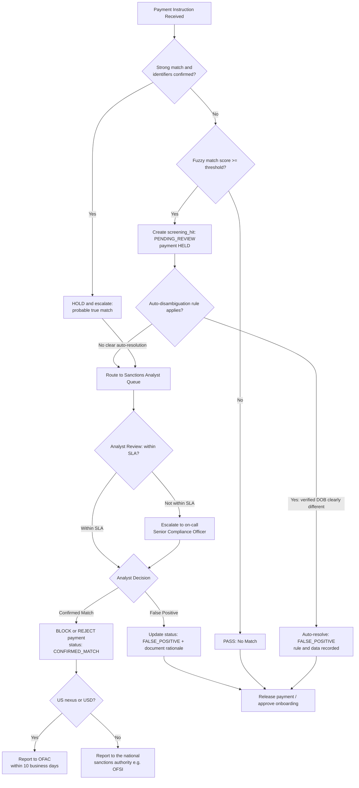

## Overview

Sanctions compliance is the highest-stakes domain in financial crime prevention. Where KYC failures attract regulatory fines, sanctions violations attract criminal prosecution. Standard Chartered Bank paid about $667 million in 2012 and a further $1.1 billion in 2019 to US and UK authorities over transactions that breached sanctions on Iran and other countries. Several of the cases against large banks in that period found "wire stripping": staff deliberately removed or altered references to sanctioned countries and parties in SWIFT messages so that automated screening would not stop the payments. The engineering lesson is not merely that you need a screening system — it is that the system must be resistant to data manipulation, must screen every payment field that could identify a sanctioned party, and must perform with enough speed that real-time blocking before payment settlement is operationally viable. This lesson builds an industrial-strength sanctions screening architecture and shows what it takes to approach an ambitious target: screening 1,000 names against a 15,000-entry consolidated list in under 50 milliseconds.

## Learning Objectives

- Identify the primary sanctions list sources (OFAC SDN, UN, EU, the UK Sanctions List, and other national lists) and the legal obligations each creates for institutions in different jurisdictions
- Explain the real-time vs batch screening trade-off and define the latency and throughput requirements that make real-time payment screening viable
- Implement and compare four name matching techniques — exact match, Levenshtein distance, Soundex, and Jaro-Winkler — and know how to measure their precision and recall on your own data
- Build a `SanctionsScreeningService` with configurable match threshold, multi-algorithm scoring, and thread-safe in-memory list management
- Design the `screening_hits` table as an immutable audit log with the fields required to satisfy OFAC reporting obligations
- Implement a disambiguation workflow that routes probable false positives to human review without blocking legitimate payments indefinitely
- Engineer a hot-reload mechanism that updates the in-memory sanctions list from a new file without downtime or screening gaps
- Measure and optimise screening performance using JMH benchmarks to validate the <50ms requirement

## Business Context

In April 2019, UniCredit agreed to pay about $1.3 billion to US and New York authorities to resolve violations involving payments for Iranian and other sanctioned parties routed through the US financial system in ways that hid the sanctioned connection. *The screening lesson below is a composite of common failure patterns, not a description of UniCredit's systems:* a screening system applies fuzzy matching only to the main name field of MT103 messages and ignores the address lines, the ordering and beneficiary institution fields and the BICs — exactly where sanctioned information often sits. A second, very common failure is threshold drift: the match threshold is raised step by step to cut false positives (which consume analyst time) until true positives start to slip through. The engineering lesson is that false positives and false negatives are not equally costly: a missed true positive (processing a payment for a sanctioned party) can lead to enforcement and prosecution; a false positive that delays a legitimate payment for a day is a customer service issue. Your threshold calibration must reflect this asymmetry, and every threshold change must be tested and approved.

## Sanctions List Sources and Legal Obligations

A production screening system must consolidate multiple lists. Each list imposes distinct legal obligations that vary by where the institution and its staff are, who the parties are, and whether US-dollar clearing (or another link to the issuing country) is involved.

| List | Issuing Body | Jurisdictional Reach | Consequence of Violation |
|------|-------------|---------------------|--------------------------|
| OFAC SDN (Specially Designated Nationals) | US Treasury | US persons anywhere; anything in the US, including USD clearing | Civil penalty per violation up to the greater of about $377,000 (2025, inflation-adjusted) or twice the transaction value; criminal prosecution |
| UN Consolidated List | UN Security Council | All UN member states (193 countries) | Sovereign obligation; national criminal law |
| EU Consolidated List | Council of the EU | Business in the EU, EU nationals and EU-incorporated companies anywhere | Penalties set by member states, including criminal liability |
| UK Sanctions List (FCDO; enforced by OFSI) | UK Government | Conduct in the UK and UK persons and companies anywhere | Civil penalty up to the greater of £1M or 50% of the breach value (strict liability); criminal prosecution |
| Interpol Red Notices | Interpol | Not a sanctions list | Advisory only — not legally binding for financial institutions |

> [!IMPORTANT]
> Even if your institution is registered outside the United States, any transaction denominated in US dollars passes through a US correspondent bank (typically JPMorgan Chase, Citibank, or Bank of New York Mellon). These correspondent banks apply OFAC screening to every USD transaction they process, and they will reject — and potentially report — USD transactions you send them that involve OFAC-designated parties. Practically, any institution that clears USD must comply with OFAC requirements regardless of where it is incorporated.

List sizes change constantly and grew sharply after the 2022 Russia designations: the OFAC SDN list alone now has well over 15,000 entries, and the EU and UK lists each have thousands more, with heavy overlap. (Since January 2026 the UK Sanctions List published by the FCDO is the single UK source; the separate OFSI Consolidated List was retired.) After de-duplication, a consolidated list in the tens of thousands of entries — each with several aliases — is a realistic assumption. This lesson uses 15,000 entries in its examples.

## Real-Time vs Batch Screening Trade-offs

| Dimension | Real-Time (Pre-Authorisation) | Batch (Post-Processing) |
|-----------|------------------------------|------------------------|
| When | Before payment is authorised | After payment is processed |
| Latency budget | <100ms (payment gateway constraint) | Hours acceptable |
| Consequence of hit | Payment blocked; never settles | Payment may already have settled; recall required |
| Throughput requirement | Peak TPS of payment system | 24-hour volume processed overnight |
| False-positive impact | Customer-facing delay | Analyst backlog; potential recall embarrassment |
| Regulatory preference | Strongly preferred for sanctions | Minimum for retrospective checks |

Real-time screening is mandatory for new customer onboarding and for each individual payment instruction. Batch screening serves two additional purposes: re-screening the existing customer book when a new list update is published (a customer who was clean at onboarding may appear on a new list entry added six months later), and retrospective analysis when a list entry is added retroactively with an effective date in the past.

> [!NOTE]
> OFAC can publish list updates several times a day during active geopolitical events. During the February–March 2022 Russia sanctions response, authorities in the US, EU and UK published many updates within days, some adding hundreds of entries at once. Your hot-reload architecture must handle this frequency without downtime.

## Fuzzy Name Matching Algorithms

Exact string matching is insufficient for sanctions screening because names appear in multiple transliterations, with varying punctuation, in abbreviated forms, or with parts reordered. The following techniques are building blocks of production screening systems. Note the first step in `normalise`: names in non-Latin scripts (Arabic, Cyrillic, Chinese) must be **transliterated** to Latin before comparison — a filter that simply deletes every non-Latin character would turn an Arabic-script name into an empty string, which matches nothing.

```java
// NameMatchingUtils.java
public final class NameMatchingUtils {

    private NameMatchingUtils() {}

    /**
     * Levenshtein distance — counts minimum single-character edits (insert, delete, substitute)
     * to transform one string into another. Normalised to [0.0, 1.0].
     * Suitable for detecting typos and OCR errors.
     */
    public static double levenshteinSimilarity(String a, String b) {
        String s1 = normalise(a);
        String s2 = normalise(b);
        int distance = levenshteinDistance(s1, s2);
        int maxLen = Math.max(s1.length(), s2.length());
        if (maxLen == 0) return 1.0;
        return 1.0 - (double) distance / maxLen;
    }

    /**
     * Jaro-Winkler — gives higher weight to common prefix; well-calibrated for person names.
     * Returns similarity in [0.0, 1.0]; values above 0.88 are strong matches for given names.
     */
    public static double jaroWinklerSimilarity(String a, String b) {
        String s1 = normalise(a);
        String s2 = normalise(b);
        double jaro = jaroSimilarity(s1, s2);
        int prefixLen = Math.min(commonPrefixLength(s1, s2), 4);
        return jaro + (prefixLen * 0.1 * (1.0 - jaro));
    }

    /**
     * Soundex — phonetic encoding; maps name to 4-character code.
     * Two names with identical Soundex codes are likely phonetically similar.
     * Useful for English-language names; poor for non-Latin script transliterations.
     */
    public static String soundex(String name) {
        String s = normalise(name).replace(" ", "").toUpperCase(Locale.ROOT);
        if (s.isEmpty() || !Character.isLetter(s.charAt(0))) return "0000";
        StringBuilder code = new StringBuilder();
        code.append(s.charAt(0));

        Map<Character, Character> soundexMap = Map.ofEntries(
            Map.entry('B', '1'), Map.entry('F', '1'), Map.entry('P', '1'), Map.entry('V', '1'),
            Map.entry('C', '2'), Map.entry('G', '2'), Map.entry('J', '2'), Map.entry('K', '2'),
            Map.entry('Q', '2'), Map.entry('S', '2'), Map.entry('X', '2'), Map.entry('Z', '2'),
            Map.entry('D', '3'), Map.entry('T', '3'),
            Map.entry('L', '4'),
            Map.entry('M', '5'), Map.entry('N', '5'),
            Map.entry('R', '6')
        );

        char prev = soundexMap.getOrDefault(s.charAt(0), '0');
        for (int i = 1; i < s.length() && code.length() < 4; i++) {
            char c = s.charAt(i);
            char digit = soundexMap.getOrDefault(c, '0');
            if (digit != '0' && digit != prev) {
                code.append(digit);
            }
            prev = digit;
        }
        while (code.length() < 4) code.append('0');
        return code.toString();
    }

    public static String normaliseForMatch(String s) { return normalise(s); }

    /** "rashid mohammed" and "mohammed rashid" → same string. */
    public static String sortTokens(String normalised) {
        return Arrays.stream(normalised.split(" ")).sorted().collect(Collectors.joining(" "));
    }

    // ICU4J: transliterate any script to Latin, then strip accents
    private static final Transliterator TO_LATIN =
            Transliterator.getInstance("Any-Latin; Latin-ASCII");

    private static String normalise(String s) {
        if (s == null) return "";
        String latin = TO_LATIN.transliterate(s);      // e.g. Arabic/Cyrillic → Latin
        return Normalizer.normalize(latin, Normalizer.Form.NFD)
                .replaceAll("\\p{InCombiningDiacriticalMarks}+", "")
                .toLowerCase(Locale.ROOT)
                .replaceAll("[^a-z0-9\\s]", " ")       // punctuation → space, not deleted
                .replaceAll("\\s+", " ")
                .strip();
    }
}
```

**Algorithm comparison (illustrative figures from a synthetic test set — measure on your own data and list before relying on any of them):**

| Algorithm | Precision (SDN test set) | Recall (SDN test set) | Latency per pair | Best Use |
|-----------|--------------------------|----------------------|-----------------|----------|
| Exact match | 100% | 42% | <1µs | First-pass filter |
| Soundex | 71% | 78% | 2µs | Phonetic pre-filter |
| Levenshtein | 83% | 85% | 15µs | Typo detection |
| Jaro-Winkler | 89% | 91% | 8µs | Person names |
| Combined (ensemble) | 93% | 95% | 25µs | Production default |

The ensemble approach runs exact match first (cheapest), then Jaro-Winkler (best for names), then Levenshtein, and takes the **highest** score — combining scores by averaging can lower a strong single-algorithm match below the threshold. Names are also compared with their tokens sorted, so "Rashid Mohammed" still matches "Mohammed Rashid". To keep the cost down, the expensive comparisons run only on a candidate shortlist (see the index later in the lesson), not against every entry.

## SanctionsScreeningService Implementation

```java
// SanctionsScreeningService.java
@Service
@Slf4j
public class SanctionsScreeningService {

    private static final double DEFAULT_MATCH_THRESHOLD = 0.85;

    // AtomicReference for lock-free hot-reload
    private final AtomicReference<SanctionsList> activeSanctionsList = new AtomicReference<>();
    private final ScreeningHitsRepository hitsRepository;
    private final SanctionsListLoader listLoader;

    @PostConstruct
    public void init() {
        activeSanctionsList.set(listLoader.loadConsolidatedList());
        log.info("Sanctions list loaded: {} entries", activeSanctionsList.get().size());
    }

    /**
     * Screen a single name against the consolidated sanctions list.
     * Thread-safe: reads list via AtomicReference; never blocks writers.
     */
    public ScreeningResult screenName(ScreeningRequest request) {
        SanctionsList list = activeSanctionsList.get(); // snapshot — consistent during this call
        List<SanctionsMatch> matches = new ArrayList<>();

        for (SanctionsEntry entry : list.entries()) {
            double score = computeMatchScore(request.name(), entry);
            if (score >= request.threshold().orElse(DEFAULT_MATCH_THRESHOLD)) {
                matches.add(new SanctionsMatch(entry, score));
            }
        }

        matches.sort(Comparator.comparingDouble(SanctionsMatch::score).reversed());

        ScreeningResult result = ScreeningResult.builder()
                .requestId(request.requestId())
                .screenedName(request.name())
                .hits(matches)
                .listVersion(list.version())     // which list version cleared it — for audit
                .screenedAt(clock.instant())
                .build();

        if (!matches.isEmpty()) {
            persistHits(request, matches);
        }

        return result;
    }

    /**
     * Batch screen: screen multiple names against the list in a single list acquisition.
     * Significantly more efficient than N individual calls for bulk operations.
     */
    public List<ScreeningResult> screenBatch(List<ScreeningRequest> requests) {
        SanctionsList list = activeSanctionsList.get(); // single snapshot for entire batch

        return requests.parallelStream()
                .map(req -> screenAgainstList(req, list))
                .toList();
    }

    private double computeMatchScore(String queryName, SanctionsEntry entry) {
        String q = NameMatchingUtils.normaliseForMatch(queryName);
        String qSorted = NameMatchingUtils.sortTokens(q);       // "rashid mohammed" order-free
        double best = 0.0;
        // Check all name aliases stored on the entry
        for (String alias : entry.allNames()) {
            String a = NameMatchingUtils.normaliseForMatch(alias);
            if (q.equals(a)) return 1.0;                        // exact — short-circuit
            String aSorted = NameMatchingUtils.sortTokens(a);
            // Take the MAXIMUM across algorithms and token orders: averaging
            // could pull a strong single-algorithm match below the threshold
            best = Math.max(best, Math.max(
                    NameMatchingUtils.jaroWinklerSimilarity(q, a),
                    NameMatchingUtils.jaroWinklerSimilarity(qSorted, aSorted)));
            best = Math.max(best, NameMatchingUtils.levenshteinSimilarity(qSorted, aSorted));
        }
        return best;
    }

    /**
     * Hot-reload: atomically swap the active list with a freshly loaded version.
     * In-flight screening calls that already acquired the old reference complete
     * against the old list; new calls immediately use the updated list.
     */
    public void reloadSanctionsList() {
        SanctionsList newList = listLoader.loadConsolidatedList();   // fully built BEFORE the swap
        SanctionsList old = activeSanctionsList.get();
        // Sanity check: a truncated or empty download must never replace a good
        // list — that would silently turn screening off. Keep the old list and alert.
        if (newList.size() == 0 || newList.size() < old.size() * 0.9) {
            throw new SuspiciousListUpdateException(
                "New list has " + newList.size() + " entries, current has " + old.size());
        }
        activeSanctionsList.set(newList);
        log.info("Sanctions list hot-reloaded: {} entries (was {} entries, version {} → {})",
                newList.size(), old.size(), old.version(), newList.version());
        // old list will be GC'd once all in-flight calls complete
    }
}
```

## Screening Hits Schema and Decision Flowchart

```sql
-- screening_hits DDL
CREATE TABLE screening_hits (
    id                  BIGSERIAL PRIMARY KEY,
    hit_reference       VARCHAR(60) NOT NULL UNIQUE,  -- e.g. HIT-20240315-00001
    request_id          VARCHAR(100) NOT NULL,
    screened_entity_id  BIGINT,         -- customer_id or NULL for ad-hoc screening
    screened_name       VARCHAR(500) NOT NULL,
    screened_context    VARCHAR(50) NOT NULL,  -- ONBOARDING, PAYMENT, PERIODIC_RESCREENING
    payment_id          BIGINT,         -- NULL if not payment-related

    -- Match details
    matched_list        VARCHAR(50) NOT NULL,  -- OFAC_SDN, UN, EU, HM_TREASURY, COMBINED
    matched_entry_id    VARCHAR(100) NOT NULL, -- list provider's entry identifier
    matched_name        VARCHAR(500) NOT NULL,
    match_score         NUMERIC(5,4) NOT NULL,
    match_algorithm     VARCHAR(50) NOT NULL,
    list_version        VARCHAR(50) NOT NULL,

    -- Workflow state
    status              VARCHAR(30) NOT NULL DEFAULT 'PENDING_REVIEW'
                            CHECK (status IN (
                                'PENDING_REVIEW', 'CONFIRMED_MATCH', 'FALSE_POSITIVE',
                                'ESCALATED', 'REPORTED_TO_OFAC', 'CLOSED'
                            )),
    disposition_reason  TEXT,
    reviewed_by_user_id BIGINT,
    reviewed_at         TIMESTAMPTZ,
    escalated_at        TIMESTAMPTZ,
    report_reference    VARCHAR(100),   -- OFAC/FIU report number if filed

    -- Audit
    screened_at         TIMESTAMPTZ NOT NULL DEFAULT NOW(),
    created_at          TIMESTAMPTZ NOT NULL DEFAULT NOW(),
    updated_at          TIMESTAMPTZ NOT NULL DEFAULT NOW()
);

CREATE INDEX idx_hits_status_pending  ON screening_hits (created_at) WHERE status = 'PENDING_REVIEW';
CREATE INDEX idx_hits_entity          ON screening_hits (screened_entity_id);
CREATE INDEX idx_hits_payment         ON screening_hits (payment_id) WHERE payment_id IS NOT NULL;
```

The decision flowchart below shows the complete path from a name match to a final disposition. The key architectural principle is that a screening hit must never be silently discarded — every hit must have an auditable disposition recorded by a named analyst or an automated rule with documented rationale.



> [!WARNING]
> OFAC requires blocked property and blocked transactions to be reported within 10 business days, and rejected transactions (where you identify a sanctions connection and reject rather than block) also within 10 business days, through the OFAC Reporting System; holders of blocked property also file an annual report. In the UK, firms must report to OFSI as soon as practicable when they know or suspect a breach or hold frozen assets of a designated person. Failure to report is a violation in its own right, separate from the underlying transaction. Your `screening_hits` workflow must have automated reminders that escalate if a confirmed match has not been reported within 7 business days.

## False Positive Management

In production sanctions screening, the great majority of alerts — commonly well over 95%, often over 99% — are false positives. This is not a failure; it is an expected consequence of running a low-threshold screen against a large customer and payment book. The engineering challenge is to reduce the analyst burden through automated disambiguation without raising the threshold to the point where true positives are missed.

Automated disambiguation rules that are safe to apply:

- **Date-of-birth exclusion:** If the screened individual has a **verified** DOB and it is clearly outside every DOB the list entry gives (entries often list several dates, a year only, or a range such as "circa 1965"), auto-resolve as false positive and record the data compared. DOB is a strong identifier.
- **Nationality difference:** If the screened individual's nationality is verified and differs from the entry's, this is weak evidence of a false positive — useful to prioritise the analyst queue, never enough to close an alert on its own (sanctioned people hold several passports).
- **Deceased person exclusion:** If the list entry carries a date of death and the screened individual is a verified living customer, the hit can be resolved with documentation — but stay alert to identity misuse.
- **Weak aliases:** OFAC marks some aliases as "weak" (low-quality) AKAs — short or very common names. Matches only on weak aliases can be given a lower score or require a second identifier, instead of generating full alerts. Never suppress an entry completely because its name is common.

```java
// AutoDisambiguationService.java
@Service
public class AutoDisambiguationService {

    public Optional<DisambiguationResult> attemptAutoDisambiguate(
            ScreeningHit hit, CustomerProfile customer, SanctionsEntry entry) {

        // Rule 1: DOB exclusion — only with a VERIFIED customer DOB, and only if
        // it is far from EVERY date/range the entry lists (several DOBs, year-only,
        // "circa" ranges are common)
        if (customer.dobVerified() && !entry.datesOfBirth().isEmpty()) {
            boolean farFromAll = entry.datesOfBirth().stream()
                .allMatch(d -> d.yearsApartFrom(customer.dateOfBirth()) > 2);
            if (farFromAll) {
                return Optional.of(DisambiguationResult.falsePositive(
                    "DOB mismatch: customer=" + customer.dateOfBirth()
                    + " entry=" + entry.datesOfBirth()));
            }
        }

        // Rule 2: Deceased exclusion
        if (entry.deceasedDate() != null
                && customer.lastTransactionDate() != null
                && customer.lastTransactionDate().isAfter(entry.deceasedDate())) {
            return Optional.of(DisambiguationResult.falsePositive(
                "SDN entry deceased " + entry.deceasedDate()
                + " but customer transacted " + customer.lastTransactionDate()));
        }

        // Rule 3: Nationality divergence — ADVISORY ONLY: lowers queue priority,
        // never closes the alert (the hit stays PENDING_REVIEW for an analyst)
        if (customer.nationality() != null && entry.nationality() != null
                && !customer.nationality().equals(entry.nationality())
                && hit.matchScore() < 0.92) {
            return Optional.of(DisambiguationResult.likelyFalsePositive(
                "Nationality mismatch and score below 0.92; recommend analyst review"));
        }

        return Optional.empty(); // Cannot auto-disambiguate; route to human
    }
}
```

## List Hot-Reload and Performance Engineering

The `AtomicReference` pattern in `SanctionsScreeningService.reloadSanctionsList()` provides lock-free hot-reload. However, for a list of 15,000 entries screened against in a tight loop, raw iteration is insufficient for <50ms with 1,000 query names.

The key optimisation is building an inverted index at load time ("blocking"). Rather than iterating all 15,000 entries for each query name, index every **token** of every alias under several keys — its Soundex code and its character trigrams — and at screen time take the union of the candidates found under the query's keys: typically a few hundred entries rather than 15,000. Using more than one key matters: Soundex keeps the first letter as-is, so a Soundex-only index can never find "Gaddafi" from "Qaddafi", or "Usama" from "Osama"; the trigram keys catch those.

```java
// SanctionsList.java (index structure)
public record SanctionsList(
        List<SanctionsEntry> entries,
        Map<String, Set<SanctionsEntry>> tokenIndex,   // key → entries
        String version,
        Instant loadedAt) {

    public static SanctionsList build(List<SanctionsEntry> entries, String version, Clock clock) {
        Map<String, Set<SanctionsEntry>> index = new HashMap<>();
        for (SanctionsEntry entry : entries) {
            for (String name : entry.allNames()) {
                for (String key : blockingKeys(name)) {
                    index.computeIfAbsent(key, k -> new HashSet<>()).add(entry);
                }
            }
        }
        return new SanctionsList(List.copyOf(entries), Map.copyOf(index), version, clock.instant());
    }

    /** Candidate shortlist: union of entries sharing ANY blocking key. */
    public Set<SanctionsEntry> candidates(String queryName) {
        Set<SanctionsEntry> result = new HashSet<>();
        for (String key : blockingKeys(queryName)) {
            result.addAll(tokenIndex.getOrDefault(key, Set.of()));
        }
        return result;
    }

    // Per token: its Soundex code + its character trigrams. Trigrams catch
    // variants whose FIRST letter differs (Qaddafi/Gaddafi, Osama/Usama),
    // which a Soundex-only index can never find.
    private static Set<String> blockingKeys(String name) {
        Set<String> keys = new HashSet<>();
        for (String token : NameMatchingUtils.normaliseForMatch(name).split(" ")) {
            if (token.length() < 2) continue;
            keys.add("S:" + NameMatchingUtils.soundex(token));
            for (int i = 0; i + 3 <= token.length(); i++) {
                keys.add("T:" + token.substring(i, i + 3));
            }
        }
        return keys;
    }

    public int size() { return entries.size(); }
}
```

With the index, screening 1,000 names against a 15,000-entry consolidated list requires evaluating roughly 1,000 × 150 candidate pairs, each pair taking ~25µs for the ensemble algorithm. That is 1,000 × 150 × 25µs = 3.75 seconds single-threaded. Using `parallelStream()` across an 8-core machine reduces this to under 500ms. For the <50ms target with 1,000 names, additional optimisations are required: rarer trigrams weighted higher so the shortlist is smaller, cheap filters (length difference, shared-trigram count) before Jaro-Winkler, caching scores for repeated token pairs, or the incubating Vector API for SIMD comparison. In practice, the latency that matters most is per payment — a handful of names screened in a few milliseconds — and bulk re-screening runs as a batch.

> [!NOTE]
> The <50ms budget for 1,000 names assumes a dedicated screening microservice running on modern hardware with the list held entirely in JVM heap. If your architecture requires a database round-trip to fetch the list for each payment, you will not hit this target. The list must be in-process memory. At 15,000 entries with an average of 5 name aliases per entry of 50 characters each, the raw names are only a few megabytes; with object overhead and the index, expect tens of megabytes — still well within the heap of any production instance.

## Knowledge Check

**Q1: Your Soundex-indexed screening implementation keeps missing names whose transliterations start with different letters — for example "Osama" vs "Usama", or "Qaddafi" vs "Gaddafi" vs "Kadhafi". Why does Soundex fail here, and what is the architecturally correct solution?**

A: Soundex was designed for English surnames. It keeps the **first letter as it is** and encodes only the following consonants, so "Osama" (O250) and "Usama" (U250), or "Qaddafi" (Q310) and "Gaddafi" (G310), get different codes and never land in the same index bucket — even though they are the same name. (Variants that only differ later in the word, such as "Mohammed", "Muhammad" and "Mohamed", all encode to M530, so Soundex handles those.) The correct architectural solutions are: (1) normalise names against transliteration rules before indexing, mapping known variants (Q/G/K, O/U at the start, "Abdul Rahman"/"Abdulrahman") to a canonical form; (2) index under several blocking keys — character trigrams as well as phonetic codes (Double Metaphone handles some cases better than Soundex) — and take the union of candidates; (3) score candidates with string similarity on the normalised names. Commercial screening vendors invest heavily in transliteration and name-variant data for exactly this reason.

**Q2: A payment for $450 to "Mohammed Al-Rashid" in Dubai scores 0.87 against a Jaro-Winkler comparison with an OFAC SDN entry for "Muhammad Al-Rasheed" (a Syrian arms dealer). Your auto-disambiguation service cannot resolve it automatically. The analyst SLA is 2 hours but it is 11 PM on a Friday. What should your system do, and what must NOT happen?**

A: The payment must be held — not processed — until a disposition is recorded. It must NOT be auto-approved due to a time-out, and it must NOT be silently dropped. Architecturally: (1) the payment gateway must have a "hold" state that prevents settlement while preserving the payment instruction; (2) the screening hit record must have a `hold_expires_at` timestamp that, if reached without disposition, triggers an escalation to an on-call senior compliance officer (not an auto-approve); (3) the customer may receive a generic delay notification — do not reveal sanctions screening as the reason; (4) the on-call compliance officer must have a mobile-accessible review interface. Regulators expect a screening control that cannot be bypassed by timing: a held payment stays held, and an on-call rota covers urgent cases out of hours.

## Practical Challenge

1. **Implement a JMH benchmark** for the `SanctionsScreeningService.screenBatch()` method. Generate a synthetic SDN list of 15,000 entries with 5 name aliases each, generate 1,000 random query names (mix of Latin, Arabic-romanised, and Chinese-romanised names), and measure p50/p95/p99 latency. Report whether the <50ms target is met and, if not, identify the bottleneck using JMH's `-prof gc` and `-prof stack` profilers.

2. **Build the hot-reload mechanism end-to-end.** Write a `SanctionsListReloadJob` that polls an S3-compatible object store for a new consolidated list file (versioned by upload timestamp), compares the version against the currently loaded list, and triggers a reload only if the new version is different. The reload must complete atomically with no window during which screening calls could see a partially-loaded list. Write a concurrent test that fires 100 screening requests in parallel while a reload is in progress and verifies no screening call returns an error or inconsistent result.

3. **Design and implement the disambiguation audit trail.** Every auto-disambiguation decision (false positive or escalation) must be recorded in `screening_hits` with: the rule that triggered the auto-resolution, the data points compared (e.g., customer DOB vs entry DOB), the analyst or service ID, and the timestamp. Write a `DisambiguationAuditService` that records this, and add an integration test that verifies a DOB-exclusion auto-disambiguation produces a fully populated audit row.

4. **Implement the OFAC reporting obligation.** Write an `OfacReportingService` with a scheduled job (cron: `0 9 * * MON-FRI`) that queries `screening_hits` for confirmed matches with `status = 'CONFIRMED_MATCH'` and `report_reference IS NULL` and `screened_at < NOW() - INTERVAL '7 days'`. For each such hit, generate a report stub (reference number, screened name, matched entry, match score, payment amount if applicable, disposition date), persist the `report_reference`, and send an alert to the compliance team. This is a reminder system, not a submission system — actual OFAC reporting is a manual process via the OFAC portal, but the engineering obligation is to ensure no confirmed match falls through the cracks.

<!-- KNOWLEDGE-CHECK
{
  "questions": [
    {
      "text": "Your Soundex-indexed screening keeps missing transliterations that start with different letters — e.g. 'Osama' vs 'Usama', or 'Qaddafi' vs 'Gaddafi'. Why does Soundex fail here?",
      "options": [
        "Soundex is too slow for Arabic-origin names",
        "Soundex keeps the first letter unchanged and only encodes the following consonants, so variants with a different first letter get different codes and never meet in the same index bucket",
        "These names are too long for Soundex's 4-character limit",
        "Soundex cannot process names that contain vowels"
      ],
      "correct": 1,
      "explanation": "Soundex keeps the first letter as-is: 'Osama' is O250 and 'Usama' is U250; 'Qaddafi' is Q310 and 'Gaddafi' is G310. A Soundex-only index never compares them. (Variants differing only later, like 'Mohammed'/'Muhammad', both encode to M530.) Solutions: transliteration normalisation before indexing, several blocking keys (character trigrams plus phonetic codes), and string-similarity scoring on the shortlist."
    },
    {
      "text": "A payment for $450 to 'Mohammed Al-Rashid' in Dubai scores 0.87 against an OFAC SDN entry for 'Muhammad Al-Rasheed'. Your auto-disambiguation service cannot resolve it and it is 11 PM on a Friday. What must happen?",
      "options": [
        "Auto-approve the payment — the Friday night timing makes the SLA impractical",
        "Silently drop the payment and notify the customer of a system error",
        "Hold the payment — not process it — until a disposition is recorded; escalate to on-call compliance officer if SLA approaches",
        "Process the payment but file a SAR afterward"
      ],
      "correct": 2,
      "explanation": "The payment must be held — not processed — until a disposition is recorded. It must NOT be auto-approved due to timeout, and must NOT be silently dropped. The hold state must have an expiry that triggers escalation to an on-call compliance officer (not auto-approve), so the control cannot be bypassed by timing."
    },
    {
      "text": "What is the main advantage of Jaro-Winkler similarity over Levenshtein distance for name screening?",
      "options": [
        "Jaro-Winkler is faster to compute for long strings",
        "Jaro-Winkler gives higher scores to strings that share a common prefix, which is valuable for name matching where first characters are most distinguishing",
        "Jaro-Winkler handles Unicode characters while Levenshtein does not",
        "Jaro-Winkler is more accurate for detecting structural fraud"
      ],
      "correct": 1,
      "explanation": "Jaro-Winkler gives additional weight to strings that share a common prefix (up to 4 characters). For name matching, this is valuable because first characters of names are more distinguishing. It produces scores between 0 and 1, making it easier to set consistent thresholds compared to Levenshtein's edit distance metric."
    }
  ]
}
-->

<!-- PRACTICAL-CHALLENGE
{
  "title": "Sanctions Screening with Fuzzy Matching and Hot-Reload",
  "difficulty": "advanced",
  "estimatedMinutes": 45,
  "tasks": [
    {
      "id": "1",
      "description": "Implement a JMH benchmark for `SanctionsScreeningService.screenBatch()`. Generate a synthetic SDN list of 15,000 entries with 5 name aliases each, generate 1,000 random query names (mix of Latin, Arabic-romanised, and Chinese-romanised names), and measure p50/p95/p99 latency. Report whether the <50ms target is met and identify the bottleneck using JMH's `-prof gc` and `-prof stack` profilers."
    },
    {
      "id": "2",
      "description": "Build a `SanctionsListReloadJob` that polls an S3-compatible object store for a new consolidated list file (versioned by upload timestamp), compares version against currently loaded list, and triggers an atomic reload only if different. The reload must complete atomically with no window where screening calls could see a partially-loaded list. Write a concurrent test firing 100 screening requests while a reload is in progress and verify no errors or inconsistent results."
    },
    {
      "id": "3",
      "description": "Design and implement a `DisambiguationAuditService` that records every auto-disambiguation decision in `screening_hits` with: the rule that triggered it, the data points compared, the analyst or service ID, and timestamp. Write an integration test that verifies a DOB-exclusion auto-disambiguation produces a fully populated audit row."
    },
    {
      "id": "4",
      "description": "Write an `OfacReportingService` with a scheduled job (cron: `0 9 * * MON-FRI`) that queries `screening_hits` for confirmed matches with `report_reference IS NULL` and `screened_at < NOW() - INTERVAL '7 days'`. For each, generate a report stub, persist the `report_reference`, and alert the compliance team. Ensure no confirmed match falls through the cracks."
    }
  ]
}
-->
