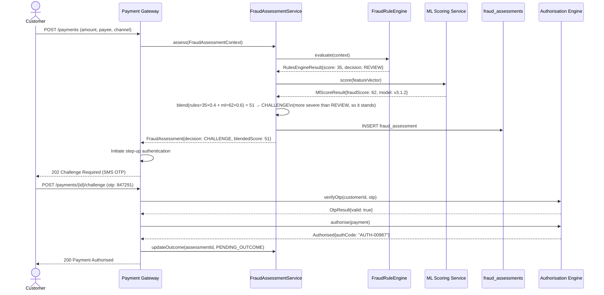

# كشف الاحتيال — القواعد ونماذج التعلم الآلي والمصادقة الإضافية

## نظرة عامة

الاحتيال أكبر مصدر منفرد للخسارة المالية لبنوك الأفراد بالأرقام المطلقة. فقد أبلغت UK Finance عن خسارة 1.17 مليار جنيه بسبب الاحتيال المصرح به وغير المصرح به في المملكة المتحدة وحدها عام 2023، منها 459.7 مليون جنيه لاحتيال الدفع الدافع المصرح به (APP) — وهي فئة لم تكن تُقاس تقريبًا قبل عقد. والتحدي الهندسي في كشف الاحتيال مختلف جذريًا عن مكافحة غسل الأموال أو الامتثال للعقوبات: فبينما يسأل فحص العقوبات "هل هذا الطرف في قائمة؟"، يسأل كشف الاحتيال "هل ينحرف نمط السلوك هذا عما هو طبيعي لهذا العميل وهذه القناة؟" وهذا السؤال يتطلب استدلالًا إحصائيًا لا بحثًا، ويجب أن يُجاب عنه ضمن ميزانية زمن تفويض الدفعة — عادة أقل من 300 مللي ثانية من منظور شبكة الدفع، وغالبًا بهدف داخلي 50 مللي ثانية لترك هامش لخطوات التفويض الأخرى. ويبني هذا الدرس بنية كشف الاحتيال كاملة: محرك قواعد قابل للتوسيع لقواعد السرعة والسلوك الحتمية، وتكامل مع خدمة تسجيل نقاط بنموذج تعلم آلي للتقييم الاحتمالي للمخاطر، وتدفق تحدٍّ يكبح الاحتيال دون حجب العملاء المشروعين.

## أهداف التعلم

- تصنيف أنماط الاحتيال الخمسة الرئيسية ذات الصلة بالأنظمة البنكية (البطاقة غير الحاضرة CNP، والاستيلاء على الحساب، وAPP، واحتيال الطرف الأول، وحسابات البغال) وشرح الإشارات التقنية التي تميز كلًا منها
- شرح المقايضة بين الكشف الآني والكشف بعد التفويض وتحديد قيود الزمن والدقة التي تحدد أي نهج يصلح لنوع احتيال معين
- تصميم `FraudRuleEngine` بواجهة `FraudRule` قابلة للتوسيع، وتسجيل نقاط موزون، وتحكم في إصدارات القواعد
- تنفيذ قواعد سرعة بجودة إنتاجية (عدد المعاملات، والقيمة، وتغير الموقع الجغرافي، وتغير الجهاز) باستخدام عدادات في Redis
- دمج خدمة خارجية لتسجيل النقاط بنموذج تعلم آلي في مسار تقييم الاحتيال مع استخراج الخصائص، ومعالجة انتهاء المهلة، وإدارة حدود النقاط
- كتابة DDL بجودة إنتاجية لجدول `fraud_assessments` يلتقط سجل تدقيق القرار كاملًا
- بناء تدفق تحدٍّ (مصادقة إضافية step-up) يقدم احتكاكًا متناسبًا مع خطر الاحتيال المقيّم دون حجب المعاملات منخفضة الخطر
- تصميم حلقة تغذية راجعة من الاستردادات (chargebacks) تغلق دورة إعادة تدريب النموذج بنتائج احتيال موسومة

## سياق العمل

*مثال مركّب (مبني على حالات APP شائعة، لا على بنك بعينه):* يتلقى مشترٍ لمنزل بريدًا إلكترونيًا يبدو أنه من محاميه، يطلب منه إرسال مبلغ إتمام الشراء إلى حساب "جديد". فيسجّل نظام الاحتيال في البنك الدفعة كمنخفضة الخطر: للعميل تاريخ طويل نظيف، ويستخدم جهازه وموقعه المعتادين، وكانت مشتريات العقارات مضبوطة لتمر باحتكاك قليل، لأن حجب عمليات الإتمام الحساسة للوقت يزعج المشترين الحقيقيين. ولا يُكتشف الاحتيال إلا بعد أيام، حين يسأل المحامي الحقيقي أين المال. والدرس الهندسي أن كل إشارة منفردة قد تكون "طبيعية" بينما المزيج شاذ: الجهاز نفسه، والموقع نفسه، وجلسة موثقة — لكن مستفيد لأول مرة، ونقل الرصيد كله تقريبًا، وحساب مستلم فُتح قبل أيام قليلة. لم تلتقطه أي قاعدة منفردة؛ أما نموذج (أو قاعدة مركبة) ينظر إلى جِدّة المستفيد وعمر الحساب المستلم والنقل حتى الصفر تقريبًا معًا فكان سيلتقطه. ومنذ أكتوبر 2024 يجب على شركات الدفع البريطانية تعويض معظم ضحايا APP (حتى 85,000 جنيه لكل مطالبة)، فصار هذا الإخفاق خسارة البنك مباشرة.

## أنماط الاحتيال في البنوك

فهم البصمات التقنية لكل نوع احتيال شرط مسبق لتصميم قواعد كشف فعالة.

| نوع الاحتيال | الوصف | الإشارات التقنية الرئيسية | متطلب الزمن |
|------------|-------------|----------------------|---------------------|
| البطاقة غير الحاضرة (CNP) | استخدام بيانات بطاقة مسروقة للشراء عبر الإنترنت | عدم تطابق الجهاز، والسرعة، وعدم تطابق عنوان الفوترة، وتخفيض 3DS | أقل من 100 مللي ثانية (3DS ضمن التدفق) |
| الاستيلاء على الحساب (ATO) | سرقة بيانات الدخول للوصول إلى الحسابات وتفريغها | جهاز جديد، وموقع غير معتاد، وتغيير كلمة المرور ثم تحويل، وشذوذ في الجلسة | أقل من 200 مللي ثانية (تسجيل الدخول) |
| الدفع الدافع المصرح به (APP) | خداع الضحية اجتماعيًا ليصرّح بتحويل | مستفيد لأول مرة، ونقل الرصيد كاملًا، وعمر حساب المستفيد، وضغط الوقت | أقل من 300 مللي ثانية (الدفع) |
| احتيال الطرف الأول | العميل يجري معاملة حقيقية ثم يعترض عليها كذبًا | تاريخ الاستردادات، ونمط المطالبات، وفئة التاجر | بعد التفويض (أيام) |
| حساب البغل (Mule) | حساب يُستخدم لاستقبال الأموال المسروقة وتمريرها | نمط الاستقبال والتمرير، ونشاط وارد مفاجئ، وتجزئة المعاملات | شبه آني (دقائق) |

> [!NOTE]
> كشف حسابات البغال مختلف معماريًا عن الأنواع الأخرى: فهو يركز على أنماط المعاملات الواردة لا خطر المدفوعات الصادرة. ويتطلب مراقبة سلوك الاستقبال عبر نوافذ زمنية من ساعات إلى أيام، لا مللي ثوانٍ. ويُعالج أفضل بمنصة تحليلات تدفقية (Kafka Streams، أو Apache Flink) لا بمسار تفويض الدفع المتزامن الذي يعالج كشف CNP وATO وAPP.

## بنية محرك القواعد

يوفر محرك القواعد قرارات احتيال حتمية قابلة للتدقيق مبنية على شروط صريحة. وهو الطبقة الأولى في منظومة كشف الاحتيال — سريع، وقابل للتفسير، ويضبطه محللو المخاطر مباشرة دون تدخل هندسي (عبر واجهة لإدارة القواعد). وتسمح واجهة `FraudRule` القابلة للتوسيع بإضافة قواعد جديدة دون تعديل نواة المحرك.

```java
// FraudRule.java
public interface FraudRule {
    /**
     * Unique identifier for this rule — used in audit trail and reporting.
     */
    String ruleId();

    /**
     * Human-readable name for analyst UIs and reporting.
     */
    String ruleName();

    /**
     * Version string — increment when rule logic changes to maintain audit trail fidelity.
     */
    String version();

    /**
     * Evaluate the rule against the given context.
     *
     * @return a RuleResult containing: fired (boolean), score contribution (0–100),
     *         and an explanation string for the audit trail.
     */
    RuleResult evaluate(FraudAssessmentContext context);

    /**
     * Whether a firing of this rule alone is sufficient to block a transaction,
     * regardless of the weighted aggregate score. Used for hard-stop rules
     * such as confirmed compromised card.
     */
    default boolean isHardStop() { return false; }
}

// VelocityRule.java — sliding-window velocity check in Redis
@Component
public class VelocityRule implements FraudRule {

    private static final String RULE_ID = "VELOCITY_TXN_COUNT_1H";
    private static final int THRESHOLD_COUNT = 10;
    private static final int SCORE_CONTRIBUTION = 45;
    private static final Duration WINDOW = Duration.ofHours(1);

    private final StringRedisTemplate redis;
    private final Clock clock;

    @Override public String ruleId()    { return RULE_ID; }
    @Override public String ruleName()  { return "Transaction count velocity (1h)"; }
    @Override public String version()   { return "1.3.0"; }

    @Override
    public RuleResult evaluate(FraudAssessmentContext ctx) {
        // A sorted set of transaction ids scored by time = a true sliding window.
        // (INCR + EXPIRE on every call would push the expiry forward forever while
        //  activity continues, so the counter would never fall back.)
        // ZADD by transaction id is idempotent: a retried assessment of the SAME
        // payment is not counted twice.
        String key = "fraud:velocity:txn:" + ctx.customerId();
        long now = clock.millis();
        redis.opsForZSet().add(key, ctx.transactionId(), now);
        redis.opsForZSet().removeRangeByScore(key, 0, now - WINDOW.toMillis());
        Long count = redis.opsForZSet().zCard(key);
        redis.expire(key, WINDOW);          // housekeeping for idle customers
        // (in production run these four commands as one Lua script / pipeline)

        if (count == null) return RuleResult.notFired(ruleId());

        if (count > THRESHOLD_COUNT) {
            return RuleResult.fired(ruleId(), SCORE_CONTRIBUTION,
                    count + " transactions in last 1h (threshold: " + THRESHOLD_COUNT + ")");
        }
        return RuleResult.notFired(ruleId());
    }
}

// GeolocationVelocityRule.java — impossible travel detection
@Component
public class GeolocationVelocityRule implements FraudRule {

    private static final String RULE_ID = "IMPOSSIBLE_TRAVEL";
    private static final double MAX_FEASIBLE_KMH = 900.0;  // commercial aviation speed
    private static final double MIN_DISTANCE_KM = 300.0;   // IP geolocation is imprecise
    private static final int SCORE_CONTRIBUTION = 40;      // VPNs cause false hits: not a hard stop

    @Override public String ruleId()   { return RULE_ID; }
    @Override public String ruleName() { return "Impossible travel velocity"; }
    @Override public String version()  { return "1.1.0"; }

    @Override
    public RuleResult evaluate(FraudAssessmentContext ctx) {
        Optional<PreviousTransaction> prevOpt = ctx.previousTransaction();
        if (prevOpt.isEmpty()) return RuleResult.notFired(ruleId());
        PreviousTransaction prev = prevOpt.get();
        if (prev.ipLocation() == null || ctx.currentIpLocation() == null) {
            return RuleResult.notFired(ruleId());
        }

        double distanceKm = haversineDistance(prev.ipLocation(), ctx.currentIpLocation());
        if (distanceKm < MIN_DISTANCE_KM) return RuleResult.notFired(ruleId());

        double hours = Duration.between(prev.authorisedAt(), ctx.requestedAt()).toSeconds() / 3600.0;
        double impliedSpeedKmh = hours <= 0 ? Double.POSITIVE_INFINITY : distanceKm / hours;

        if (impliedSpeedKmh > MAX_FEASIBLE_KMH) {
            return RuleResult.fired(ruleId(), SCORE_CONTRIBUTION,
                    String.format("%.0f km in %.2f h (%.0f km/h)", distanceKm, hours, impliedSpeedKmh));
        }
        return RuleResult.notFired(ruleId());
    }
}
```

قاعدة السرعة تستخدم مجموعة مرتبة (sorted set) من معرّفات المعاملات مرتبة بالوقت، أي نافذة منزلقة حقيقية. فاستدعاء INCR ثم EXPIRE عند كل معاملة سيدفع انتهاء الصلاحية للأمام باستمرار ما دام النشاط مستمرًا، فلا يعود العداد للانخفاض أبدًا. والإضافة بمعرّف المعاملة idempotent: فإعادة تقييم الدفعة نفسها لا تُحسب مرتين. وفي قاعدة السفر المستحيل، موقع IP غير دقيق (والشبكات الافتراضية الخاصة VPN تسبب تطابقات كاذبة)، فالقاعدة تضيف نقاطًا ولا توقف المعاملة وحدها.

## FraudRuleEngine مع تسجيل نقاط موزون

```java
// FraudRuleEngine.java
@Service
@Slf4j
public class FraudRuleEngine {

    private final List<FraudRule> rules;
    // Cached view of rule config (refreshed every few seconds) — a database
    // query per rule per payment would blow the latency budget
    private final FraudRuleConfigCache configRepo;

    public FraudRuleEngine(List<FraudRule> rules, FraudRuleConfigCache configRepo) {
        // Rules are discovered via Spring's @Component scanning
        this.rules = List.copyOf(rules);
        this.configRepo = configRepo;
    }

    public RulesEngineResult evaluate(FraudAssessmentContext context) {
        List<RuleResult> firedRules = new ArrayList<>();
        int aggregateScore = 0;

        for (FraudRule rule : rules) {
            FraudRuleConfig config = configRepo.findByRuleId(rule.ruleId())
                    .orElse(FraudRuleConfig.defaultConfig(rule.ruleId()));

            if (!config.isEnabled()) continue;

            RuleResult result;
            try {
                result = rule.evaluate(context);
            } catch (Exception e) {
                // Fail-open per rule: count it (an error spike can mean an
                // attack on a dependency) and alert if the rate rises
                log.warn("Rule {} threw exception — treating as not fired: {}",
                        rule.ruleId(), e.getMessage());
                result = RuleResult.error(rule.ruleId(), e.getMessage());
            }

            if (result.fired()) {
                firedRules.add(result);
                int weightedScore = (int) (result.scoreContribution() * config.weight());
                aggregateScore = Math.min(100, aggregateScore + weightedScore);

                if (rule.isHardStop()) {
                    log.info("Hard-stop rule fired: ruleId={}, transactionId={}",
                            rule.ruleId(), context.transactionId());
                    return RulesEngineResult.hardBlock(firedRules, aggregateScore);
                }
            }
        }

        FraudDecision decision = scoreToDecision(aggregateScore);
        return RulesEngineResult.builder()
                .decision(decision)
                .aggregateScore(aggregateScore)
                .firedRules(firedRules)
                .build();
    }

    private FraudDecision scoreToDecision(int score) {
        if (score >= 80) return FraudDecision.BLOCK;
        if (score >= 50) return FraudDecision.CHALLENGE;  // step-up auth
        if (score >= 25) return FraudDecision.REVIEW;     // flag for post-auth review
        return FraudDecision.PASS;
    }
}
```

تُقرأ إعدادات القواعد من كاش يُحدّث كل بضع ثوانٍ — فاستعلام قاعدة البيانات لكل قاعدة في كل دفعة سيتجاوز ميزانية الزمن. وخطأ القاعدة يُعامل كأنها لم تنطلق (فشل مفتوح لكل قاعدة)، لكنه يُعدّ ويُنبّه عند ارتفاع معدله، لأن ارتفاع الأخطاء قد يعني هجومًا على إحدى الاعتماديات.

> [!IMPORTANT]
> يجب أن تخضع أوزان القواعد المخزنة في `FraudRuleConfig` للتحكم في الإصدارات وإدارة التغيير. فتغيير وزن قاعدة تغيير جوهري في سياسة الاحتيال. وتستخدم مؤسسات كثيرة تقييمًا في وضع الظل: انشر قاعدة جديدة أو تغيير وزن في وضع `SHADOW` (يُقيّم دون استخدام نتيجته في القرارات) لمدة 2–4 أسابيع، وقارن قرارات الظل بالقرارات الفعلية، وراجع فرق الإيجابيات الكاذبة والسلبيات الكاذبة، ثم ارفعه إلى وضع `LIVE`. وهذا يمنع تغييرات الأوزان من رفع معدل الإيجابيات الكاذبة دون قصد وتدهور تجربة العملاء.

## تكامل تسجيل النقاط بنموذج التعلم الآلي

يوفر محرك القواعد قرارات حتمية قابلة للتفسير لكنه لا يستطيع كشف أنماط احتيال جديدة لم تُرمّز قط كقواعد صريحة. ويسجّل نموذج التعلم الآلي نقاط المعاملات بناءً على أنماط تعلمها من ملايين المعاملات التاريخية، فيلتقط مزيجات دقيقة تفوتها القواعد.

```java
// MlFraudScoringClient.java
@Component
@Slf4j
public class MlFraudScoringClient {

    private static final Duration TIMEOUT = Duration.ofMillis(80);

    private final WebClient modelClient;
    private final MeterRegistry meterRegistry;

    /** Returns an UNAVAILABLE result (no score) on timeout or error — never a fake 0. */
    public MlScoreResult score(FraudAssessmentContext context) {
        FraudFeatureVector features = extractFeatures(context);

        // Reactor's timeout() signals a TimeoutException INSIDE the pipeline;
        // block() would rethrow it wrapped, so `catch (TimeoutException e)` around
        // block() does not even compile. Handle errors in the pipeline instead.
        return modelClient.post()
                .uri("/v2/fraud-score")
                .bodyValue(features)
                .retrieve()
                .bodyToMono(MlScoreResult.class)
                .timeout(TIMEOUT)
                .onErrorResume(TimeoutException.class, e -> {
                    meterRegistry.counter("fraud.ml.timeout").increment();
                    log.warn("ML model timed out for transactionId={}", context.transactionId());
                    return Mono.just(MlScoreResult.unavailable("MODEL_TIMEOUT"));
                })
                .onErrorResume(e -> {
                    meterRegistry.counter("fraud.ml.error").increment();
                    log.error("ML model error for transactionId={}: {}",
                            context.transactionId(), e.getMessage());
                    return Mono.just(MlScoreResult.unavailable("MODEL_ERROR"));
                })
                .block();
    }

    private FraudFeatureVector extractFeatures(FraudAssessmentContext ctx) {
        return FraudFeatureVector.builder()
                // Transaction features
                .transactionAmount(ctx.amount())
                .transactionAmountZScore(ctx.amountZScoreVsHistory())   // pre-computed
                .hourOfDay(ctx.requestedAtLocal().getHour())            // customer's local time
                .dayOfWeek(ctx.requestedAtLocal().getDayOfWeek().getValue())
                .merchantCategoryCode(ctx.merchantCategoryCode())
                .isFirstTimePayee(ctx.isFirstTimePayee())
                // Account features
                .accountAgeDays(ctx.accountAgeDays())
                .avgMonthlySpend(ctx.avgMonthlySpend())
                .balanceAfterTransactionPct(ctx.balanceAfterTransactionPct())
                // Device and channel features
                .isNewDevice(ctx.isNewDevice())
                .deviceRiskScore(ctx.deviceRiskScore())
                .ipRiskScore(ctx.ipRiskScore())
                .channelType(ctx.channelType())
                // Beneficiary features
                .beneficiaryAccountAgeDays(ctx.beneficiaryAccountAgeDays())
                .isPayeeHighRiskCategory(ctx.isPayeeHighRiskCategory())
                .build();
    }
}
```

تُصدر `timeout()` في Reactor استثناء `TimeoutException` **داخل** المسار؛ و`block()` ستعيد رميه مغلّفًا، فعبارة `catch (TimeoutException e)` حول `block()` لا تُترجم أصلًا. لذلك تُعالج الأخطاء داخل المسار، وتعيد الخدمة نتيجة "غير متاح" — لا رقمًا مزيفًا هو 0.

تُدمج نقاط القواعد ونقاط النموذج في النتيجة النهائية. وهناك تفصيلان أمنيان مهمان. أولًا، إذا كان النموذج غير متاح تقرر الخدمة بالقواعد وحدها — فدمج نتيجة مزيفة هي 0 سيحوّل نتيجة قواعد 80 (BLOCK) إلى 32 (PASS) بالضبط حين يكون النموذج معطلًا، وهذا ما يريده مهاجم يُغرق النموذج بالطلبات. ثانيًا، القرار النهائي لا يكون أبدًا *أقل* شدة من قرار محرك القواعد نفسه، فلا تستطيع نتيجة نموذج منخفضة إلغاء قاعدة قوية بهدوء:

```java
// FraudAssessmentService.java
@Service
public class FraudAssessmentService {

    private static final double RULES_WEIGHT = 0.40;
    private static final double ML_WEIGHT    = 0.60;

    public FraudAssessment assess(FraudAssessmentContext context) {
        RulesEngineResult rulesResult = rulesEngine.evaluate(context);

        if (rulesResult.isHardBlock()) {
            return FraudAssessment.hardBlock(rulesResult, context.transactionId());
        }

        MlScoreResult mlResult = mlClient.score(context);

        int blendedScore = mlResult.isAvailable()
                ? (int) Math.round(rulesResult.aggregateScore() * RULES_WEIGHT
                                 + mlResult.fraudScore()         * ML_WEIGHT)
                : rulesResult.aggregateScore();     // model down → rules alone, never a fake 0

        // Never less severe than what the rules engine decided on its own
        FraudDecision finalDecision = FraudDecision.mostSevere(
                scoreToDecision(blendedScore), rulesResult.decision());

        FraudAssessment assessment = FraudAssessment.builder()
                .transactionId(context.transactionId())
                .customerId(context.customerId())
                .rulesScore(rulesResult.aggregateScore())
                .mlScore(mlResult.isAvailable() ? mlResult.fraudScore() : null)
                .mlFallbackReason(mlResult.unavailableReason())
                .blendedScore(blendedScore)
                .decision(finalDecision)
                .firedRules(rulesResult.firedRules())
                .mlModelVersion(mlResult.modelVersion())
                .assessedAt(clock.instant())
                .build();

        assessmentRepository.save(assessment);
        return assessment;
    }
}
```

## مخطط تقييمات الاحتيال

```sql
-- fraud_assessments DDL
CREATE TABLE fraud_assessments (
    id                  BIGSERIAL PRIMARY KEY,
    assessment_id       VARCHAR(60) NOT NULL UNIQUE,  -- FA-20240315-00001
    transaction_id      BIGINT NOT NULL,
    customer_id         BIGINT NOT NULL,
    channel             VARCHAR(30) NOT NULL,  -- ONLINE, MOBILE, BRANCH, API

    -- Scores
    rules_score         INTEGER NOT NULL CHECK (rules_score BETWEEN 0 AND 100),
    ml_score            INTEGER,              -- NULL if ML unavailable
    blended_score       INTEGER NOT NULL CHECK (blended_score BETWEEN 0 AND 100),

    -- Decision
    decision            VARCHAR(20) NOT NULL
                            CHECK (decision IN ('PASS', 'REVIEW', 'CHALLENGE', 'BLOCK')),
    decision_reason     VARCHAR(100),         -- human-readable summary
    hard_block          BOOLEAN NOT NULL DEFAULT FALSE,

    -- Rules detail (JSON for flexibility — avoids wide column explosion)
    fired_rules         JSONB NOT NULL DEFAULT '[]',

    -- ML model metadata
    ml_model_id         VARCHAR(50),
    ml_model_version    VARCHAR(20),
    ml_fallback_reason  VARCHAR(50),         -- MODEL_TIMEOUT, MODEL_ERROR, etc.

    -- Outcome (populated post-auth when outcome is known)
    outcome             VARCHAR(20)
                            CHECK (outcome IN ('GENUINE', 'FRAUD_CONFIRMED', 'CHARGEBACK',
                                               'CUSTOMER_DISPUTED', 'UNKNOWN')),
    outcome_updated_at  TIMESTAMPTZ,
    chargeback_id       BIGINT,

    -- Timing
    assessed_at         TIMESTAMPTZ NOT NULL DEFAULT NOW(),
    assessment_latency_ms INTEGER,           -- wall clock time for the full assessment

    created_at          TIMESTAMPTZ NOT NULL DEFAULT NOW()
);

CREATE INDEX idx_fa_transaction   ON fraud_assessments (transaction_id);
CREATE INDEX idx_fa_customer      ON fraud_assessments (customer_id, assessed_at DESC);
CREATE INDEX idx_fa_decision_block ON fraud_assessments (assessed_at)
    WHERE decision = 'BLOCK';
CREATE INDEX idx_fa_outcome_null  ON fraud_assessments (assessed_at)
    WHERE outcome IS NULL AND decision IN ('BLOCK', 'CHALLENGE');
```

## فحص الاحتيال الآني في تدفق الدفع



## تدفق التحدي والمصادقة الإضافية

يطلق قرار CHALLENGE مصادقة إضافية — احتكاكًا إضافيًا متناسبًا مع الخطر المقيّم. ويجب معايرة نوع التحدي حسب القناة ومستوى الخطر.

| النتيجة المدمجة | التحدي الموصى به | المبرر |
|--------------|----------------------|-----------|
| 50–64 | رمز OTP عبر SMS | احتكاك منخفض؛ يهزم الاحتيال الآلي؛ يكمله معظم العملاء في أقل من 60 ثانية |
| 65–79 | إعادة مصادقة بيومترية (الوجه/البصمة) | أقوى من OTP؛ يهزم احتيال تبديل شريحة SIM |
| 80+ | الحجب مع مراجعة يدوية | الخطر أعلى من أن يُترك لتحدٍّ آلي؛ يلزم قرار بشري |

> [!WARNING]
> المصادقة الإضافية في احتيال APP تطرح مفارقة: فالضحية الواقعة تحت الهندسة الاجتماعية ستكمل أي تحدٍّ تقدمه، لأنها تعتقد حقًا أن الدفعة مشروعة. وللمعاملات عالية خطر APP (مستفيد لأول مرة، ونقل الرصيد كاملًا، وعمر حساب المستفيد أقل من 30 يومًا)، فكّر في إضافة إشعار "تهدئة" — إشعار فوري أو رسالة داخل التطبيق تحذر العميل من أنماط الاحتيال الشائعة المرتبطة بخصائص المعاملة، مع تأخير 10 دقائق قبل معالجة الدفعة. وقد جعل نموذج التعويض المشروط (CRM) الطوعي "التحذيرات الفعالة" التزامًا أساسيًا؛ ومنذ أكتوبر 2024 يجعل نظام التعويض الإلزامي لدى PSR معظم خسائر APP على حساب الشركات في كل الأحوال، فصارت التحذيرات والتأخيرات تحمي مال البنك نفسه كما تحمي مال العميل.

## حلقة التغذية الراجعة من الاستردادات

تتدهور دقة نموذج الاحتيال مع الوقت لأن أنماط الاحتيال تتطور. والاستردادات (chargebacks) — نزاعات البطاقات التي تنتهي بعكس المعاملة — مصدر مهم للنتائج الموسومة، لكن ليس كل استرداد احتيالًا: فرمز السبب في نظام البطاقات يحدد هل النزاع عن احتيال أم عن شيء آخر (بضاعة لم تصل، أو مبلغ خاطئ)، ولا تصبح وسومًا للاحتيال إلا رموز أسباب الاحتيال. أما مدفوعات الحساب إلى الحساب، التي لا استردادات فيها، فتأتي وسومها من مطالبات احتيال APP المؤكدة وقرارات التعويض. وبناء حلقة التغذية الراجعة بسيط معماريًا لكنه حاسم تشغيليًا.

```java
// ChargebackFeedbackService.java
@Service
@Slf4j
public class ChargebackFeedbackService {

    @Transactional
    public void recordChargebackOutcome(ChargebackEvent event) {
        // Find the original fraud assessment for this transaction
        Optional<FraudAssessment> assessment = assessmentRepo
                .findByTransactionId(event.originalTransactionId());

        assessment.ifPresentOrElse(
            fa -> {
                // Only FRAUD reason codes are fraud labels; other disputes
                // (goods not received, duplicate charge) are not
                boolean isFraud = event.reasonCategory() == DisputeCategory.FRAUD;
                fa.setOutcome(isFraud ? FraudOutcome.FRAUD_CONFIRMED : FraudOutcome.CHARGEBACK);
                fa.setChargebackId(event.chargebackId());
                fa.setOutcomeUpdatedAt(clock.instant());
                assessmentRepo.save(fa);

                // Training event written to the OUTBOX in the same transaction —
                // publishing straight to Kafka here would be a dual write
                outbox.save(ModelTrainingEvent.builder()
                        .assessmentId(fa.getAssessmentId())
                        .transactionId(event.originalTransactionId())
                        .customerId(fa.getCustomerId())
                        .rulesScore(fa.getRulesScore())
                        .mlScore(fa.getMlScore())
                        .blendedScore(fa.getBlendedScore())
                        .fraudLabel(isFraud)
                        .eventTimestamp(clock.instant())
                        .build());

                log.info("Chargeback feedback recorded: assessmentId={}, transactionId={}, " +
                        "fraud={}, originalMlScore={}, originalDecision={}",
                        fa.getAssessmentId(), event.originalTransactionId(),
                        isFraud, fa.getMlScore(), fa.getDecision());
            },
            () -> log.warn("No fraud assessment found for chargebackTransactionId={}",
                    event.originalTransactionId())
        );
    }
}
```

يُكتب حدث التدريب في جدول الـ outbox في المعاملة نفسها — فالنشر مباشرة إلى Kafka هنا سيكون كتابة مزدوجة. ويستهلك `ModelTrainingEvent` مسار إعادة التدريب لدى فريق علوم البيانات، الذي يعمل أسبوعيًا وينتج إصدار نموذج جديد. ويستخدم مسار نشر النموذج وضع الظل (الموصوف سابقًا) قبل الرفع إلى الإنتاج. وهذا يغلق حلقة التغذية الراجعة: نتائج الاحتيال من قرارات اليوم تحسّن نموذج الغد.

> [!NOTE]
> السلبيات الكاذبة (احتيال اجتاز النظام وانتهى باسترداد) هي أثمن أمثلة التدريب لأنها تمثل الحد الذي لا يراه النموذج حاليًا. أما الإيجابيات الكاذبة (معاملات مشروعة حُجبت) فوسمها القاطع أصعب — فالمعاملة التي تحجبها ضوابط الاحتيال لا تُعالج أبدًا، فتبقى نتيجتها مجهولة. وتستخدم بعض المؤسسات عينة صغيرة "محجوزة" من المعاملات عالية النتيجة تُعالج عمدًا (دون تحدٍّ) فقط لتوليد بيانات نتائج موسومة. وهذا حقل ألغام أخلاقي ورقابي؛ ومعظمها يعتمد بدلًا من ذلك على معدلات إكمال التحدي وإشارات غير مباشرة.

## اختبار المعرفة

**س1: النتيجة المدمجة لمعاملة 48 — أقل بقليل من حد CHALLENGE البالغ 50. وأعاد نموذج التعلم الآلي نتيجة احتياطية 0 بسبب انتهاء مهلة 90 مللي ثانية تجاوزت ميزانية 80 مللي ثانية. ولو كان النموذج متاحًا وأعاد 75، لكانت النتيجة المدمجة 59 (CHALLENGE). ما الضمانات المعمارية التي يجب أن تكون لديك، وهل "الفشل المفتوح" (اعتبار انتهاء المهلة خطرًا منخفضًا) هو الافتراضي الصحيح؟**

ج: "الفشل المفتوح" عند انتهاء مهلة النموذج خيار سياسة متعمد يقدّم إتمام الدفع على منع الاحتيال حين يكون النموذج غير متاح. وهو مقبول للانقطاعات الروتينية (إعادة تشغيل قصيرة للنموذج) لكنه خطير إذا كان النموذج متدهورًا تحت هجوم احتيال (فالمهاجمون يحاولون أحيانًا إغراق نقاط النموذج لإحداث انتهاء المهلة واستغلال الفشل المفتوح). ولاحظ أيضًا أن دمج نتيجة احتياطية 0 في النتيجة هو أسوأ صور الفشل المفتوح — فهو *يخفض* النتيجة فعليًا؛ أما `FraudAssessmentService` في هذا الدرس فتقرر بالقواعد وحدها حين يكون النموذج غير متاح. ويجب أن تتضمن الضمانات المعمارية: (1) قاطع دائرة مع وضع اختبار نصف مفتوح — بعد N انتهاء مهلة متتاليًا، ارفع النتيجة الاحتياطية إلى قيمة محافظة (مثل 50 لـ CHALLENGE بدل 0) حتى تتعافى الدائرة؛ (2) تنبيهًا منفصلًا لمعدل انتهاء مهلة النموذج — إذا تجاوز 2% من المعاملات، استدعِ المناوب؛ (3) سياسة أمان قابلة للإعداد لكل قناة — فالقنوات عالية الخطر (الحوالات الدولية) قد تفشل بالحجب لا بالفتح؛ (4) تسجيل نقاط رجعي بعد التفويض — عندما يتعافى النموذج، أعد تسجيل المعاملات الحديثة التي مرت بالفشل المفتوح وعلّم التي تتجاوز الآن حد BLOCK للمراجعة اليدوية.

**س2: يخبرك محلل احتيال بأن معدل الإيجابيات الكاذبة بلغ 8% — 8 من كل 100 معاملة محجوبة مشروعة. ويريد منك رفع حد BLOCK من 80 إلى 85. اشرح تحليل المقايضة الذي ستجريه قبل هذا التغيير.**

ج: رفع الحد 5 نقاط سيخفض على الأرجح معدل الإيجابيات الكاذبة لكنه سيرفع معدل السلبيات الكاذبة. ويجب أن يحدد التحليل كميًا: (1) معدل الإيجابيات الكاذبة الحالي وحجم المدفوعات المشروعة المحجوبة (وكلفة الاحتكاك لكل حجب — خسارة القيمة الدائمة للعميل، وكلفة معالجة الشكاوى)؛ (2) معدل السلبيات الكاذبة الحالي من بيانات الاستردادات الموسومة — ما خسارة الاحتيال الفعلية لكل وحدة تغيير في الحد؛ (3) محاكاة وضع الظل — شغّل الحد الجديد 85 على التقييمات التاريخية واحسب خسارة الاحتيال الحدية مقابل خفض الإيجابيات الكاذبة الحدي؛ (4) الالتزام الرقابي — يجعل نظام التعويض الإلزامي لدى PSR احتيال APP غير المكتشف مكلفًا مباشرة للمؤسسة؛ فيجب إدخاله في نموذج الخسارة؛ (5) تحليل الشرائح — قد يكون تغيير الحد الموحد خاطئًا؛ فرفع 5 نقاط للعملاء الراسخين ذوي التاريخ الطويل ودون احتيال سابق قد يكون آمنًا، مع إبقاء حد 80 للعملاء الجدد أو القنوات عالية الخطر. والإجابة الصحيحة نادرًا ما تكون تغيير حد عامًا، بل مصفوفة حدود مقسمة حسب الشرائح.

## التحدي العملي

1. **نفّذ `DeviceFingerprintRule`** تسجّل نقاط المعاملات حسب مستوى ثقة الجهاز. فالجهاز الموثوق المعروف (مسجل منذ أكثر من 30 يومًا، واستُخدم في أكثر من 10 معاملات سابقة) يضيف 0 إلى النتيجة. والجهاز الجديد (يُرى لأول مرة في هذه الجلسة) يضيف 40. والجهاز الذي ظهر في تحقيق سابق في استيلاء على حساب يطلق إيقافًا صارمًا. واستخدم hash في Redis بمفتاح `device_fingerprint_id` لتخزين بيانات ثقة الجهاز بمدة صلاحية 90 يومًا.

2. **اكتب أداة تقييم في وضع الظل** لـ `FraudRuleEngine`. أضف `ShadowFraudRuleEngine` تقيّم القواعد المعلّمة بوضع `SHADOW` بجانب المحرك الحي دون إدخال نتائجها في القرار النهائي. وخزّن نتائج قواعد الظل في جدول منفصل `fraud_shadow_results`. واكتب استعلام ملخص أسبوعي يحسب فرق الإيجابيات الكاذبة وفرق السلبيات الكاذبة اللذين سينتجان لو رُفعت قواعد الظل إلى الوضع الحي.

3. **ابنِ مسار التحقق من متجه خصائص النموذج.** قبل إرسال `FraudFeatureVector` إلى خدمة تسجيل النقاط، تحقق من أن كل الخصائص ضمن النطاقات المتوقعة (مثل `accountAgeDays >= 0`، و`balanceAfterTransactionPct` بين -1.0 و1.0، و`amountZScore` بين -10 و10). والخصائص خارج هذه النطاقات تدل على مشاكل جودة بيانات في المصدر ويجب تعليمها بعداد مقياس `FEATURE_OUT_OF_RANGE` لكل اسم خاصية. واكتب اختبار وحدة يحقن متجه خصائص غير صالح ويتحقق من رفضه قبل إجراء استدعاء HTTP.

4. **نفّذ إشعار التهدئة لاحتيال APP.** للمعاملات ذات النتيجة بين 40 و79 حيث `isFirstTimePayee=true` و`transferPctOfBalance > 0.80` (تنقل الدفعة أكثر من 80% من الرصيد)، احتجز الدفعة 10 دقائق وأرسل للعميل إشعارًا فوريًا برسالة تحذير وخياري "تأكيد" / "إلغاء". واكتب آلة الحالة التي تنقل الدفعة من `PENDING_COOLING_OFF` إلى `COOLING_OFF_CONFIRMED` أو `COOLING_OFF_CANCELLED`، وأضف اختبار Testcontainers يتحقق من أن الدفعة المحتجزة في التهدئة تُلغى آليًا بعد نافذة 10 دقائق إذا لم يصل رد من العميل.

<!-- KNOWLEDGE-CHECK
{
  "questions": [
    {
      "text": "النتيجة المدمجة لمعاملة 48، أقل بقليل من حد CHALLENGE البالغ 50. وأعاد نموذج التعلم الآلي نتيجة احتياطية 0 بسبب انتهاء مهلة 90 مللي ثانية تجاوزت ميزانية 80 مللي ثانية. ولو كان النموذج متاحًا لكانت النتيجة 59 (CHALLENGE). هل 'الفشل المفتوح' (انتهاء المهلة = خطر منخفض) هو الافتراضي الصحيح؟",
      "options": [
        "نعم — الفشل المفتوح يعظّم إتمام الدفع وتجربة العملاء",
        "نعم — انتهاء المهلة دائمًا عابر ويصحح نفسه",
        "لا — الفشل المفتوح مقبول للانقطاعات الروتينية لكنه خطير إذا أغرق المهاجمون نقاط النموذج عمدًا؛ استخدم قاطع دائرة مع نتائج احتياطية محافظة",
        "لا — الفشل المغلق دائمًا أكثر أمانًا ويجب أن يكون الافتراضي لكل القنوات"
      ],
      "correct": 2,
      "explanation": "الفشل المفتوح يقدّم إتمام الدفع لكنه خطير إذا أغرق المهاجمون نقاط النموذج لاستغلاله — ودمج نتيجة احتياطية 0 يخفض النتيجة فعليًا. والضمانات: القرار بالقواعد وحدها (أو بقيمة افتراضية محافظة) حين يكون النموذج غير متاح؛ وقاطع دائرة؛ وتنبيه منفصل لمعدل انتهاء المهلة؛ وسياسة أمان لكل قناة (القنوات عالية الخطر تفشل بالحجب)؛ وإعادة تسجيل معاملات الفشل المفتوح عند تعافي النموذج."
    },
    {
      "text": "يريد محلل احتيال رفع حد BLOCK من 80 إلى 85 لخفض معدل الإيجابيات الكاذبة البالغ 8%. ما أهم تحليل يجب إجراؤه قبل هذا التغيير؟",
      "options": [
        "التحقق هل يتطلب تغيير الحد موافقة رقابية",
        "محاكاة وضع الظل: تشغيل الحد الجديد على البيانات التاريخية لتحديد خسارة الاحتيال الحدية مقابل خفض الإيجابيات الكاذبة الحدي، مع تحليل الشرائح",
        "استطلاع العملاء الذين حُجبوا خطأً لفهم مستوى إحباطهم",
        "التحقق هل يستخدم المنافسون قيمة الحد نفسها"
      ],
      "correct": 1,
      "explanation": "تحدد محاكاة وضع الظل على التقييمات التاريخية كميًا: خسارة الاحتيال الحدية لكل وحدة تغيير في الحد باستخدام بيانات الاستردادات الموسومة؛ وخفض الإيجابيات الكاذبة الحدي؛ وأثر الالتزام الرقابي (التعويض الإلزامي لدى PSR يجعل احتيال APP مكلفًا مباشرة)؛ وتحليل الشرائح. وتغيير الحد العام خاطئ غالبًا — ومصفوفة حدود مقسمة حسب الشرائح أنسب."
    },
    {
      "text": "ما الذي يميز احتيال الاستيلاء على الحساب (ATO) عن احتيال الدفع الدافع المصرح به (APP)؟",
      "options": [
        "‏ATO يتضمن مبالغ أكبر؛ وAPP مبالغ أصغر",
        "في ATO يسيطر المحتال على حساب الضحية ويجري المدفوعات؛ وفي APP يُخدع العميل الشرعي ليصرّح بدفعة إلى المحتال",
        "‏ATO يحدث عبر الإنترنت؛ وAPP في نقاط البيع الفعلية",
        "‏ATO يصيب الشركات؛ وAPP يصيب المستهلكين فقط"
      ],
      "correct": 1,
      "explanation": "في ATO ‏(الاستيلاء على الحساب) يخترق المحتال بيانات دخول الضحية ويسيطر على حسابه لإجراء المدفوعات. وفي احتيال APP ‏(الدفع الدافع المصرح به) يُخدع العميل الشرعي اجتماعيًا ليصرّح بدفعة إلى المحتال. واحتيال APP أصعب كشفًا لأن سلوك العميل يبدو طوعيًا، لكن نظام التعويض الإلزامي لدى PSR يجعله مكلفًا مباشرة للمؤسسة."
    }
  ]
}
-->

<!-- PRACTICAL-CHALLENGE
{
  "title": "محرك قواعد الاحتيال مع وضع الظل وتكامل التعلم الآلي",
  "difficulty": "advanced",
  "estimatedMinutes": 45,
  "tasks": [
    {
      "id": "1",
      "description": "نفّذ `DeviceFingerprintRule` تسجّل نقاط المعاملات حسب مستوى ثقة الجهاز: الجهاز الموثوق المعروف (مسجل منذ أكثر من 30 يومًا، واستُخدم في أكثر من 10 معاملات) يضيف 0؛ والجهاز الجديد (يُرى لأول مرة في هذه الجلسة) يضيف 40؛ والجهاز الذي ظهر في تحقيق ATO سابق يطلق إيقافًا صارمًا. واستخدم hash في Redis بمفتاح `device_fingerprint_id` بمدة صلاحية 90 يومًا."
    },
    {
      "id": "2",
      "description": "اكتب `ShadowFraudRuleEngine` تقيّم القواعد المعلّمة بوضع `SHADOW` بجانب المحرك الحي دون إدخال نتائجها في القرار النهائي. وخزّن نتائج قواعد الظل في جدول `fraud_shadow_results`. واكتب استعلام ملخص أسبوعي يحسب فرقي الإيجابيات الكاذبة والسلبيات الكاذبة لو رُفعت قواعد الظل إلى الوضع الحي."
    },
    {
      "id": "3",
      "description": "ابنِ مسار التحقق من متجه خصائص النموذج. قبل إرسال `FraudFeatureVector` إلى خدمة تسجيل النقاط، تحقق من أن كل الخصائص ضمن النطاقات المتوقعة (مثل `accountAgeDays >= 0`، و`balanceAfterTransactionPct` بين -1.0 و1.0). وعلّم الخصائص خارج النطاق بعداد `FEATURE_OUT_OF_RANGE` لكل اسم خاصية. واكتب اختبار وحدة يحقن متجهًا غير صالح ويتحقق من رفضه قبل استدعاء HTTP."
    },
    {
      "id": "4",
      "description": "نفّذ إشعار التهدئة لاحتيال APP للمعاملات ذات النتيجة 40-79 حيث `isFirstTimePayee=true` و`transferPctOfBalance > 0.80` (تنقل الدفعة أكثر من 80% من الرصيد). احتجز الدفعة 10 دقائق، وأرسل إشعارًا فوريًا بخياري التأكيد/الإلغاء. واكتب آلة الحالة التي تنقل `PENDING_COOLING_OFF` إلى `COOLING_OFF_CONFIRMED` أو `COOLING_OFF_CANCELLED`. وأضف اختبار Testcontainers يتحقق من الإلغاء الآلي بعد 10 دقائق دون رد من العميل."
    }
  ]
}
-->
