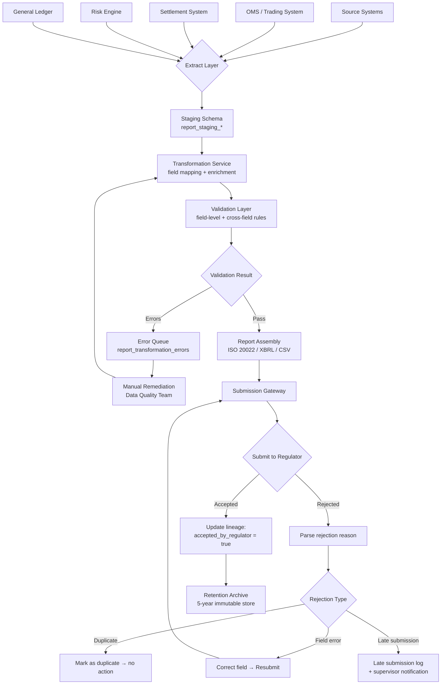

# التقارير الرقابية — تقارير المعاملات ورأس المال وتتبع أصل البيانات

## نظرة عامة

التقارير الرقابية هي العمود الفقري غير اللامع للإشراف على الأسواق المالية. فهي لا تدر إيرادات، ولا تحسّن تجربة العملاء، ولا يراها مجلس الإدارة إلا عندما تفشل. وعندما تفشل تكون العواقب شديدة: ففي 2019 فرضت FCA غرامة 34.3 مليون جنيه على Goldman Sachs International بسبب تقارير معاملات غير دقيقة أو مفقودة — نحو 220 مليون تقرير بين نوفمبر 2007 ومارس 2017 — وفي 2017 فرضت غرامة 34.5 مليون جنيه على Merrill Lynch International لعدم الإبلاغ عن نحو 68.5 مليون معاملة مشتقات متداولة في البورصة بموجب EMIR. والتحدي الهندسي في التقارير الرقابية ليس التعقيد التقني — فالخوارزميات تجميعات وتحويلات صيغ بسيطة. بل التحدي هو الصحة، والاكتمال، والقدرة على إثبات الاثنين لجهة رقابية قد تسأل، بعد سنتين، لماذا أُبلغ عن معاملة معينة بالطريقة التي أُبلغ بها. وهذا السؤال يتطلب بنية لتتبع أصل البيانات (data lineage) تستطيع إعادة بناء الحالة الدقيقة لبيانات المصدر، وقواعد التحويل، ومنطق الإبلاغ في أي لحظة تاريخية.

## أهداف التعلم

- ربط أنظمة التقارير الرقابية الرئيسية — تقارير المعاملات في MiFIR/MiFID II، وتقارير رأس المال وفق إطار بازل (COREP)، وتقارير الاحتيال في PSD2، وتقارير المشتقات في EMIR — بمتطلبات بياناتها الملموسة ومواعيد تقديمها
- تعداد الحقول الإلزامية في تقرير معاملات MiFID II وشرح تحديات مصادر البيانات لحقول مثل LEI وISIN والمعرّف الوطني للعميل
- تنفيذ `MifidReportingService` تستخرج المعاملات المؤهلة، وتحوّلها إلى XML تقرير المعاملات في ISO 20022 ‏(auth.016)، وتقدمها إلى آلية إبلاغ معتمدة (ARM)
- تصميم جدول `report_data_lineage` يسجل سلسلة المصدر الكاملة من سجل نظام المصدر حتى حقل التقرير المقدم
- شرح صيغة نسبة رأس المال CET1 وفق بازل وتنفيذ `CapitalRatioCalculator` تحسبها من بيانات الأصول المرجحة بالمخاطر
- تصميم مسار تقديم التقارير مع إعادة المحاولة، والـ idempotency، وإعادة التقديم عند الرفض
- بناء سجل تدقيق يفي بالتزام حفظ السجلات خمس سنوات بموجب المادة 25(1) من MiFIR
- شرح سير عمل التصحيح والإلغاء للتقارير المقدمة سابقًا وآثاره على عدم قابلية البيانات للتغيير

## سياق العمل

*مثال مركّب (مبني على إخفاقات إبلاغ شائعة، لا على شركة بعينها):* ينقل بنك نظام حجز المشتقات لديه. ويُنفّذ الربط من معرّفات الصفقات في النظام القديم إلى المعرّف الفريد للصفقة في EMIR ‏(UTI) بشكل خاطئ، ولأن الخطأ في جدول ربط لا يراجعه أحد بعد التشغيل، تخرج ملايين تقارير المشتقات على مدى السنوات التالية بمعرّفات UTI خاطئة. فلم تعد تقارير الأطراف المقابلة تقترن بتقارير البنك، لكن لا يلاحظ أي ضابط داخلي ذلك. لم يقصد أحد خداع أحد — كان فشلًا هندسيًا بحتًا — ومع ذلك تعامل الجهة الرقابية سنوات من الإبلاغ غير الدقيق كمخالفة جسيمة. والدرس ليس أنه يجب ألا تخطئ أبدًا؛ بل أنه يجب أن تملك ضوابط تكتشف أخطاء الربط خلال أيام لا سنوات. فنظام لتتبع أصل البيانات يتتبع تحويل معرّف الصفقة المصدر ← UTI، مع مطابقة يومية لنتائج الاقتران في مستودع الصفقات، كان سيجعل هذا الخطأ مرئيًا في الأسبوع الأول.

## مشهد التقارير الرقابية

تواجه المؤسسات المالية الخاضعة للرقابة التزامات إبلاغ عبر أنظمة متعددة في آن واحد. ولكل نظام متطلبات بيانات وتواترات تقديم وقنوات تقديم مختلفة.

| النظام | التنظيم | النطاق | التواتر | الموعد النهائي | قناة التقديم |
|--------|------------|-------|-----------|----------|--------------------|
| تقارير المعاملات | المادة 26 من MiFIR (الاتحاد الأوروبي؛ وMiFIR البريطاني مماثل) | المعاملات في أدوات متداولة في منصة أوروبية (أو أصلها الأساسي كذلك) | لكل معاملة | بنهاية يوم العمل التالي (T+1) | ARM ← السلطة الوطنية |
| كفاية رأس المال (COREP) | CRR / إطار بازل | الأموال الخاصة، ومخاطر الائتمان والسوق والتشغيل | ربع سنوي | مواعيد تقديم ثابتة بعد نحو 6 أسابيع من نهاية الربع (مثل 12 مايو) | بوابة المشرف الوطني |
| تقارير المشتقات | المادة 9 من EMIR ‏(XML وفق ISO 20022 منذ EMIR Refit، 2024) | المشتقات خارج البورصة والمتداولة فيها | لكل صفقة | T+1 | مستودع الصفقات |
| تقارير الاحتيال | المادة 96(6) من PSD2، وإرشادات EBA | إحصاءات احتيال المدفوعات | بيانات نصف سنوية | تحددها السلطة الوطنية | السلطة الوطنية ← EBA / ECB |
| التعرضات الكبيرة | المادة 394 من CRR | التعرضات ≥ 10% من رأس المال من الشريحة الأولى | ربع سنوي | مع مواعيد تقديم COREP | بوابة المشرف الوطني |

> [!IMPORTANT]
> لتقارير المعاملات في MiFIR موعد T+1 — يجب تقديم التقارير بأسرع ما يمكن وفي موعد أقصاه نهاية يوم العمل التالي. وتضع آليات ARM مواعيد قطع معالجة خاصة بها أبكر، وتحتاج الشركة وقتًا بعد التقديم لتلقي ملاحظات التحقق من ARM وإصلاح السجلات المرفوضة في اليوم نفسه. ولشركة تتداول عبر مناطق زمنية، يجب أن يعالج المسار كل معاملات اليوم السابق مبكرًا. وأي انقطاع يؤخر المعالجة المجمّعة بضع ساعات قد يخرق الموعد، فيحتاج المسار تنبيهًا آليًا إذا لم يُرسل التقديم بحلول وقت محدد (مثل 12:00 بتوقيت وسط أوروبا) وإجراءات إعادة معالجة طارئة موثقة ومختبرة.

## متطلبات تقارير المعاملات في MiFID II

يحتوي تقرير المعاملات بموجب المادة 26 ومعيار RTS 22 على 65 حقلًا إلزاميًا. وأصعب الحقول معماريًا تلك التي تتطلب ربط بيانات بين أنظمة وقت إعداد التقرير.

| الحقل | رقم الحقل في RTS 22 | تحدي المصدر |
|-------|---------------|-------------------|
| معرّف معاملة منصة التداول | 3 | يجب ملؤه من منصة التنفيذ؛ ويضيع إذا حذفه نظام إدارة الأوامر (OMS) |
| LEI للجهة المنفذة | 4 | يجب أن يكون LEI صالحًا ومجددًا كل سنة في GLEIF؛ والـ LEI المنتهي يسبب الرفض |
| تعريف المشتري / البائع | 7، 16 | ‏LEI للأشخاص الاعتباريين؛ وللأشخاص الطبيعيين معرّف وطني يعتمد نوعه على الجنسية (مثل رقم التأمين الوطني، أو رقم جواز السفر، أو رمز CONCAT كبديل) |
| تاريخ ووقت التداول | 28 | طابع وقت تنفيذ دقيق (UTC، بالدقة المطلوبة لنوع المنصة) من OMS؛ والقيم المشتقة تفشل في التدقيق |
| ISIN | 41 | يجب مزامنة بيانات الأدوات المرجعية مع FIRDS ‏(نظام البيانات المرجعية لدى ESMA) |
| مؤشر البيع على المكشوف | 62 | يتطلب بيانات مراكز ليست متاحة دائمًا وقت التداول |

```java
// MifidReportingService.java
@Service
@Slf4j
public class MifidReportingService {

    private final TransactionRepository transactionRepo;
    private final InstrumentMasterDataService instrumentService;
    private final LeiRegistryClient leiClient;
    private final ArmSubmissionClient armClient;
    private final ReportLineageService lineageService;
    private final MifidReportRepository reportRepo;
    private final Clock clock;

    /**
     * Extract all reportable transactions for the given trade date,
     * transform to MiFIR format, and submit to the ARM.
     * Idempotent: safe to call multiple times for the same date.
     *
     * NOT @Transactional: one transaction around the HTTP submission would hold
     * a connection for the whole upload, and a rollback after the ARM had
     * received the file would erase our only record of it — the next run would
     * then submit the same reports again. Each state change below commits on
     * its own (short transactions inside the repositories).
     */
    public ReportingRunResult runDailyReporting(LocalDate tradeDate) {
        log.info("Starting MiFIR daily reporting for tradeDate={}", tradeDate);

        // Idempotency guard: a run that was SUBMITTED, or whose outcome is
        // unknown, is never blindly resubmitted — its status is queried first
        Optional<MifidReportRun> existingRun = reportRepo.findLatestRunByTradeDate(tradeDate);
        if (existingRun.isPresent()) {
            MifidReportRun run = existingRun.get();
            if (run.getStatus() == ReportRunStatus.SUBMITTING) {
                return ReportingRunResult.from(armClient.queryStatus(run.getSubmissionId()));
            }
            if (run.getStatus() != ReportRunStatus.FAILED_BEFORE_SEND) {
                log.info("Trade date {} already submitted: runId={}", tradeDate, run.getId());
                return ReportingRunResult.alreadySubmitted(run);
            }
        }

        // 1. Extract eligible transactions
        List<Transaction> transactions = transactionRepo
                .findReportableTransactions(tradeDate);
        log.info("Found {} reportable transactions for tradeDate={}", transactions.size(), tradeDate);

        // 2. Transform to MiFIR report records
        List<MifidTransactionReport> reports = new ArrayList<>();
        List<TransformationError> errors = new ArrayList<>();

        for (Transaction txn : transactions) {
            try {
                MifidTransactionReport report = transform(txn);
                reports.add(report);
                lineageService.recordTransformation(txn, report);
            } catch (TransformationException e) {
                errors.add(new TransformationError(txn.getId(), e.getMessage()));
                log.error("Transformation failed for transactionId={}: {}", txn.getId(), e.getMessage());
            }
        }

        if (!errors.isEmpty()) {
            log.warn("{} transformation errors — submitting {} successful records; "
                    + "failed records queued for retry and review", errors.size(), reports.size());
            reportRepo.saveTransformationErrors(errors, tradeDate);
        }

        // 3. Generate ISO 20022 transaction report XML (auth.016)
        String xmlPayload = generateAuth016Xml(reports, tradeDate);

        // 4. Record the run BEFORE sending, with a deterministic submission id
        //    (the file name) so a resend of the same file can be recognised
        MifidReportRun run = reportRepo.saveNew(MifidReportRun.builder()
                .tradeDate(tradeDate)
                .submissionId("MIFIR-" + tradeDate + "-001")
                .recordCount(reports.size())
                .errorCount(errors.size())
                .xmlPayloadHash(sha256(xmlPayload))
                .status(ReportRunStatus.SUBMITTING)
                .build());

        ArmSubmissionResult submission = armClient.submit(xmlPayload, run.getSubmissionId());
        // RECEIVED means the ARM has the file. Record-level ACCEPTED/REJECTED
        // arrives later in the ARM's feedback file, processed separately.
        run.setStatus(submission.received() ? ReportRunStatus.RECEIVED : ReportRunStatus.SEND_FAILED);
        run.setSubmittedAt(clock.instant());
        reportRepo.save(run);

        return ReportingRunResult.from(run, errors);
    }

    private MifidTransactionReport transform(Transaction txn) {
        InstrumentDetails instrument = instrumentService
                .lookupByIsin(txn.getInstrumentIsin())
                .orElseThrow(() -> new TransformationException(
                        "ISIN not found in instrument master: " + txn.getInstrumentIsin()));

        String executingFirmLei = leiClient.lookupActiveLei(txn.getExecutingFirmId())
                .orElseThrow(() -> new TransformationException(
                        "No active LEI for firm: " + txn.getExecutingFirmId()));

        return MifidTransactionReport.builder()
                // TRN: unique and STABLE per transaction — corrections reuse it
                .transactionReferenceNumber(txn.getReportingReference())
                .executingFirmLei(executingFirmLei)
                .tradingVenueTxnId(txn.getVenueTxnId())
                .instrumentIsin(txn.getInstrumentIsin())
                .instrumentDescription(instrument.description())
                .tradingDateTime(txn.getExecutionTimestamp())     // UTC, required granularity
                .quantity(txn.getQuantity())
                .price(txn.getExecutionPrice())                   // execution, not settlement, price
                .currency(txn.getCurrency())
                .buyerId(resolveLeiOrNationalId(txn.getBuyer()))
                .sellerId(resolveLeiOrNationalId(txn.getSeller()))
                .transmittedOrder(txn.isTransmitted())
                .tradingCapacity(txn.getTradingCapacity())
                .shortSellingIndicator(txn.getShortSellingIndicator())
                .build();
    }
}
```

الخدمة ليست `@Transactional`: فمعاملة واحدة حول تقديم HTTP ستحجز اتصالًا طوال الرفع، والتراجع بعد أن تتلقى ARM الملف سيمحو سجلنا الوحيد له — فيقدم التشغيل التالي التقارير نفسها مرة أخرى. لذلك يُسجل التشغيل قبل الإرسال بمعرّف تقديم حتمي، والتشغيل ذو النتيجة المجهولة يُستعلم عن حالته ولا يُعاد تقديمه أعمى. ومعرّف TRN فريد و**ثابت** لكل معاملة — فالتصحيحات تعيد استخدامه.

## بنية تتبع أصل البيانات

تتبع أصل البيانات هو القدرة على الإجابة عن: "للحقل X في التقرير Y المقدم في التاريخ Z، من أي سجل مصدر جاءت القيمة، وأي تحويل طُبق، ومن أطلق الاستخراج؟" وتتطلب المادة 25(1) من MiFIR من الشركات حفظ سجلات أوامرها ومعاملاتها خمس سنوات، ويتوقع المشرفون أن تستطيع الشركات شرح ما أبلغت عنه وتصحيحه؛ وتتبع الأصل هو طريقة تلبية هذا التوقع عمليًا (وهو أيضًا محوري في مبادئ BCBS 239 لبيانات المخاطر).

```sql
-- report_data_lineage DDL
CREATE TABLE report_data_lineage (
    id                      BIGSERIAL PRIMARY KEY,
    lineage_id              VARCHAR(80) NOT NULL UNIQUE,  -- LIN-20240315-00001

    -- Report identification
    report_run_id           BIGINT NOT NULL,
    report_type             VARCHAR(50) NOT NULL,  -- MIFID2_TRANSACTION, EMIR_TRADE, BASEL3_CET1
    report_date             DATE NOT NULL,
    submission_id           VARCHAR(100),          -- ARM/TR submission reference

    -- Source record
    source_system           VARCHAR(100) NOT NULL,  -- e.g. OMS, SETTLEMENT_SYSTEM, RISK_ENGINE
    source_entity_type      VARCHAR(50)  NOT NULL,  -- e.g. TRANSACTION, POSITION, EXPOSURE
    source_entity_id        VARCHAR(100) NOT NULL,  -- primary key in source system
    source_record_version   BIGINT,                 -- optimistic locking version at extract time
    source_extracted_at     TIMESTAMPTZ NOT NULL,

    -- Transformation
    transformation_service  VARCHAR(100) NOT NULL,  -- service that performed transform
    transformation_version  VARCHAR(30)  NOT NULL,  -- version of transform logic (git SHA preferred)
    transformation_input_hash  VARCHAR(64),         -- SHA-256 of serialised input record
    transformation_output_hash VARCHAR(64),         -- SHA-256 of serialised output record

    -- Report field mapping (selectively recorded for high-risk fields)
    report_field_name       VARCHAR(100),
    report_field_value      TEXT,                   -- the actual value submitted
    report_field_source     TEXT,                   -- derivation expression or source field path

    -- Outcome
    accepted_by_regulator   BOOLEAN,
    regulator_error_code    VARCHAR(50),
    regulator_error_detail  TEXT,

    created_at              TIMESTAMPTZ NOT NULL DEFAULT NOW()
);

CREATE INDEX idx_lineage_run        ON report_data_lineage (report_run_id);
CREATE INDEX idx_lineage_source     ON report_data_lineage (source_system, source_entity_id);
CREATE INDEX idx_lineage_report_date ON report_data_lineage (report_date, report_type);
```

> [!NOTE]
> تخزين `source_record_version` (إصدار القفل المتفائل لسجل المصدر وقت الاستخراج) حاسم. فإذا عُدّل سجل مصدر بعد الاستخراج وقبل أن تستطيع الإجابة عن استفسار رقابي، تستطيع إثبات أي إصدار من البيانات استُخدم لتوليد التقرير بالضبط. ودون ذلك، يخلق تعديل سجل المصدر غموضًا حول هل بُني التقرير على بيانات صحيحة أم خاطئة — وهو غموض تفسره الجهات الرقابية بشكل غير مواتٍ.

## حساب نسبة رأس المال وفق بازل

المقياس الرئيسي في بازل هو نسبة رأس المال الأساسي من الشريحة الأولى (CET1)، التي تقيس أعلى رأس مال جودةً يملكه البنك نسبة إلى أصوله المرجحة بالمخاطر. والحد الأدنى في الركيزة الأولى 4.5% CET1. ويضاف فوقه متطلب الركيزة الثانية للبنك والمصد المجمّع: مصد الحفاظ على رأس المال 2.5% زائد أي مصدات مضادة للدورة الاقتصادية أو نظامية. فالأساس إذن 7.0%، والمتطلب الفعلي لبنوك كثيرة أعلى من ذلك بكثير.

صيغة نسبة CET1:

```
CET1 Ratio = CET1 Capital / Risk-Weighted Assets (RWA)
```

حيث رأس مال CET1 = الأسهم العادية + الأرباح المحتجزة + الدخل الشامل الآخر المتراكم – الاستقطاعات الرقابية (الشهرة والأصول غير الملموسة، والأصول الضريبية المؤجلة التي تعتمد على أرباح مستقبلية، وأصول صناديق التقاعد ذات المزايا المحددة، إلخ). ونسبة الرافعة المالية مختلفة: رأس المال من **الشريحة الأولى** (CET1 + الشريحة الأولى الإضافية AT1) مقسومًا على مقياس التعرض الكلي، بحد أدنى 3%.

```java
// CapitalRatioCalculator.java
@Service
public class CapitalRatioCalculator {

    /**
     * Calculate the CET1 ratio for the given reporting period.
     * RWA components cover credit risk, market risk and operational risk (under
     * CRR3 / Basel 3.1 the new standardised approach based on the business
     * indicator replaces the old basic indicator approach).
     */
    public CapitalRatioResult calculateCet1(LocalDate reportingDate) {
        CapitalComponents capital = capitalRepo.findByReportingDate(reportingDate)
                .orElseThrow(() -> new ReportingDataNotFoundException(
                        "Capital components not found for " + reportingDate));

        // CET1 Capital
        BigDecimal cet1Capital = capital.commonEquity()
                .add(capital.retainedEarnings())
                .add(capital.otherComprehensiveIncome())
                .subtract(capital.goodwillAndIntangibles())          // regulatory deduction
                .subtract(capital.deferredTaxAssetsFutureProfit())   // only DTAs relying on future profit
                .subtract(capital.definedBenefitPensionAssets())     // regulatory deduction
                .subtract(capital.otherDeductions());

        // Risk-Weighted Assets
        RwaComponents rwa = rwaRepo.findByReportingDate(reportingDate)
                .orElseThrow(() -> new ReportingDataNotFoundException(
                        "RWA components not found for " + reportingDate));

        BigDecimal totalRwa = rwa.creditRiskRwa()
                .add(rwa.marketRiskRwa())
                .add(rwa.operationalRiskRwa());

        if (totalRwa.signum() <= 0 || rwa.totalExposureMeasure().signum() <= 0) {
            throw new CapitalCalculationException("RWA or exposure measure not positive — data quality error");
        }

        BigDecimal cet1Ratio = cet1Capital
                .multiply(new BigDecimal("100"))
                .divide(totalRwa, 4, RoundingMode.HALF_UP);          // percentage

        // Leverage ratio uses TIER 1 capital (CET1 + AT1), not CET1
        BigDecimal tier1Capital = cet1Capital.add(capital.additionalTier1());
        BigDecimal leverageRatio = tier1Capital
                .multiply(new BigDecimal("100"))
                .divide(rwa.totalExposureMeasure(), 4, RoundingMode.HALF_UP);

        // The bank's own requirement: 4.5% + Pillar 2 (CET1 part) + combined buffer
        BigDecimal requirement = requirementsRepo.cet1RequirementPct(reportingDate);

        return CapitalRatioResult.builder()
                .reportingDate(reportingDate)
                .cet1Capital(cet1Capital)
                .totalRwa(totalRwa)
                .cet1Ratio(cet1Ratio)
                .leverageRatio(leverageRatio)
                .cet1RequirementPct(requirement)
                .belowCombinedBuffer(cet1Ratio.compareTo(requirement) < 0)
                .calculatedAt(clock.instant())
                .build();
    }
}
```

> [!WARNING]
> الدخول في المصد المجمّع (تحت 4.5% + الركيزة الثانية + المصدات) يطلق قيودًا آلية بموجب المادة 141 من CRD: حدودًا على توزيعات الأرباح، والمكافآت المتغيرة، وكوبونات AT1، تُحسب عبر الحد الأقصى القابل للتوزيع (MDA). ويجب أن ينبّه نظام مراقبة رأس المال المدير المالي وفريق الخزينة عندما تقترب النسبة من مصد الإدارة الذي يضعه البنك فوق ذلك المتطلب — لا عند خرقه. فبحلول الوقت الذي يبلغ فيه النظام عن خرق، يكون قد فات أوان اتخاذ إجراء تصحيحي قبل موعد التقديم.

## مسار التقارير الرقابية



## بنية تقديم التقارير: الـ Idempotency وإعادة التقديم

يجب أن تكون تقديمات التقارير الرقابية idempotent وأن تدعم تقديمات التصحيح. فتقديم التصحيح يلغي تقريرًا مقبولًا سابقًا ويستبدله بقيم مصححة. وهذا يتطلب أن يحمل كل سجل مقدم رقم مرجع معاملة (TRN) فريدًا وثابتًا `transaction_reference_number`: فالتصحيح يُرسل كإلغاء لـ TRN الأصلي يتبعه تقرير جديد بالـ TRN نفسه.

وهناك تفصيلان آخران مهمان. فاستجابة HTTP ‏2xx من ARM تعني فقط أن **الملف استُلم**؛ أما هل قُبل كل سجل فيصل لاحقًا في ملفات الملاحظات من ARM (والسلطة الوطنية)، التي يجب أن يعالجها المسار. وإعادة المحاولة بعد انتهاء مهلة يجب أن تعيد إرسال الملف نفسه بمعرّف التقديم نفسه، لتتعرف عليه ARM كتكرار بدل تحميل التقارير مرتين.

```java
// ArmSubmissionClient.java
@Component
@Slf4j
public class ArmSubmissionClient {

    private static final int MAX_RETRIES = 3;
    private static final Duration RETRY_BACKOFF = Duration.ofSeconds(30);

    /** Uploads the file. 2xx = RECEIVED; record-level results come in feedback files. */
    public ArmSubmissionResult submit(String xmlPayload, String submissionId) {
        for (int attempt = 1; attempt <= MAX_RETRIES; attempt++) {
            try {
                // The SAME submissionId (file name) on every attempt: if an earlier
                // attempt timed out after the ARM received it, the ARM sees a duplicate
                ResponseEntity<ArmResponse> response = restTemplate.exchange(
                        armProperties.getSubmissionEndpoint(),
                        HttpMethod.POST,
                        buildRequest(xmlPayload, submissionId),
                        ArmResponse.class);

                log.info("ARM received file: submissionId={}", submissionId);
                return ArmSubmissionResult.received(submissionId, response.getBody());

            } catch (HttpClientErrorException e) {
                // 4xx — do not retry; fix the payload
                log.error("ARM submission client error (non-retryable): {}", e.getResponseBodyAsString());
                return ArmSubmissionResult.sendFailed(submissionId, e.getResponseBodyAsString());
            } catch (Exception e) {
                // 5xx or network error: outcome may be unknown — retry the SAME file
                log.error("ARM submission error (attempt {}/{}): {}", attempt, MAX_RETRIES, e.getMessage());
                if (attempt == MAX_RETRIES) {
                    return ArmSubmissionResult.unknown(submissionId, e.getMessage());
                }
                sleepQuietly(RETRY_BACKOFF);
            }
        }
        return ArmSubmissionResult.unknown(submissionId, "Max retries exceeded");
    }

    public ArmSubmissionResult submitCorrection(String originalTrn, String correctedXml, String submissionId) {
        log.info("Submitting correction for originalTrn={}", originalTrn);
        // Correction = cancellation of the original TRN + a new report with the same TRN
        String correctionPayload = wrapAsCancelAndReplace(originalTrn, correctedXml);
        return submit(correctionPayload, submissionId);
    }
}
```

## سجل التدقيق والحوكمة

التزام حفظ السجلات خمس سنوات بموجب المادة 25(1) من MiFIR غير قابل للتفاوض. والأثر العملي أن كل تقرير مقدم، وكل تصحيح، وكل رفض، وكل سجل أصل يجب حفظه بصيغة غير قابلة للتغيير. و"غير قابل للتغيير" هنا يعني أكثر من "غير محذوف" — يعني كاشفًا للتلاعب: فالجهة الرقابية التي تطلب كل التقارير وسجلات الأصل لمعاملة معينة يجب أن تستطيع التحقق تشفيريًا من أن السجلات لم تُعدّل منذ التقديم.

| فترة الحفظ | التنظيم | البيانات المشمولة |
|-----------------|------------|-------------|
| 5 سنوات كحد أدنى | المادة 25(1) من MiFIR؛ والمادة 16(7) من MiFID II | سجلات الأوامر والمعاملات؛ والاتصالات المسجلة |
| 5 سنوات من انتهاء العلاقة | المادة 40 من 4AMLD | سجلات العناية الواجبة بالعملاء |
| 5 سنوات بعد انتهاء العقد | المادة 9(2) من EMIR | سجلات عقود المشتقات لدى الأطراف (وتحفظ مستودعات الصفقات التقارير 10 سنوات) |
| متاحة 5 سنوات على الأقل | المادة 434 من CRR | إفصاحات الركيزة الثالثة المنشورة |

> [!NOTE]
> عند تصميم بنية الحفظ، عامل فترات الحفظ الرقابية كحدود دنيا. فبعض الجهات الرقابية تضع قواعد تخزين مباشرة: فالقاعدة 17a-4 لدى SEC اشترطت طويلًا تخزين WORM ‏(الكتابة مرة والقراءة مرات) الذي يمنع التعديل (ومنذ 2022 تقبل أيضًا بديلًا قائمًا على سجل التدقيق). وحتى حيث لا يفرض التنظيم تخزين WORM، فاستخدامه يزيل خطر التلاعب العرضي أو المتعمد ويبسّط الاستجابة لطلبات البيانات الرقابية. وتوفر AWS S3 Object Lock، وAzure Immutable Blob Storage، وGoogle Cloud Storage Object Holds كلها ضمانات مكافئة لـ WORM في البنى السحابية.

يجب أن يتتبع سير عمل إعادة التقديم والتصحيح التاريخ الكامل لدورة حياة التقرير:

```java
// ReportLifecycleStatus represents the state machine for a submitted report
public enum ReportLifecycleStatus {
    DRAFT,              // assembled, not yet submitted
    SUBMITTING,         // HTTP call in progress (outcome unknown until confirmed)
    RECEIVED,           // ARM/TR has the file; record-level feedback pending
    ACCEPTED,           // feedback file: record accepted
    REJECTED,           // ARM/TR returned rejection code
    CORRECTION_PENDING, // error found post-acceptance; correction being prepared
    CANCELLED,          // cancellation submitted and accepted
    REPLACED,           // cancellation accepted; replacement accepted
    ARCHIVED            // past retention period; data archived/deleted per policy
}
```

## اختبار المعرفة

**س1: يعالج مسار تقارير MiFID II لديك 50,000 معاملة يوميًا. وعند 09:00 تعيد خدمة بيانات الأدوات المرجعية خطأ "الخدمة غير متاحة" لـ 200 بحث عن ISIN، فتنشأ 200 خطأ تحويل. وموعد تقديم ARM النهائي 15:00 بتوقيت وسط أوروبا. اشرح بنية الاستجابة الكاملة — ماذا يحدث لتلك السجلات الـ 200 بين 09:00 و15:00؟**

ج: يجب كتابة السجلات الـ 200 الفاشلة في `report_transformation_errors` مع الخطأ المحدد (فشل البحث عن ISIN) وطابع زمني لإعادة المحاولة. ويجب تقديم السجلات الـ 49,800 الناجحة في الموعد — فالتقديم الجزئي الذي يلتزم بالموعد للسجلات السليمة أفضل من حجز الدفعة كلها. ويجب أن تحاول مهمة إعادة المحاولة البحث عن ISIN للسجلات الـ 200 كل 15 دقيقة. فإذا تعافت خدمة البيانات المرجعية قبل 13:00، تنتج إعادة المحاولة تقديمًا ثانيًا (تكميليًا) لتلك السجلات قبل موعد 15:00، وهذا يفي بالالتزام. وإن لم تتعافَ، تُسجل السجلات كتقديمات متأخرة ويُبلغ فريق العمليات السلطة الوطنية استباقيًا. والمبدأ المعماري الأساسي أن المسار يجب ألا يحجز غالبية السجلات السليمة بانتظار حل أقلية من السجلات الخاطئة.

**س2: يكتشف محلل بيانات أنه لثلاثة أشهر في 2023، مُلئ حقل `price` في تقارير MiFID II من سعر التسوية بدل سعر التنفيذ، بسبب خطأ إعداد في خدمة التحويل. وقُدّم 45,000 تقرير بأسعار خاطئة. ما الذي يجب أن يحدث وبأي ترتيب؟**

ج: هذا خطأ إبلاغ جوهري يجب إبلاغ السلطة الوطنية به استباقيًا — لا تنتظر أن تكتشفه الجهة الرقابية. وتسلسل المعالجة: (1) جمّد أي إبلاغ إضافي من إعداد التحويل نفسه حتى يتأكد إصلاح الخطأ؛ (2) استخرج التقارير الـ 45,000 المتأثرة باستخدام جدول الأصل (استعلم بـ `transaction_version` = الإصدار سيئ الإعداد)؛ (3) أعد معالجة تلك المعاملات بمنطق التحويل المصحح لتوليد قيم تقارير مصححة؛ (4) قدّم سجلات تصحيح إلى ARM لكل تقرير من التقارير الأصلية الـ 45,000، مستخدمًا قيم TRN الأصلية للإلغاء والاستبدال؛ (5) أبلغ السلطة الوطنية كتابيًا، مرفقًا معرّفات تقديم التصحيح وشرحًا للسبب الجذري؛ (6) احتفظ بكل التقارير الأصلية المقدمة، وتقديمات التصحيح، وسجلات الأصل — لا تحذف الأصول الخاطئة؛ (7) أضف فحص جودة بيانات إلى طبقة التحقق يقارن سعر التنفيذ بسعر التسوية ويعلّم القيم الشاذة فوق تسامح قابل للإعداد. وتعامل الجهات الرقابية الإبلاغ الذاتي والتعاون بشكل مواتٍ: فـ FCA تأخذهما صراحة في الاعتبار عند تقرير هل تتخذ إجراءً تنفيذيًا وما حجم أي غرامة، بينما تُعامل الأخطاء التي تكتشفها الجهة الرقابية بنفسها بجدية أكبر.

## التحدي العملي

1. **نفّذ طبقة التحقق من التحويل.** اكتب `MifidReportValidator` يتحقق من كل حقول RTS 22 الـ 65 قبل التقديم: فحوص الحقول الإلزامية (ليست null، وبالصيغة الصحيحة)، والفحوص بين الحقول (يجب ملء LEI جهة الشراء إذا كان `tradingCapacity = DEAL`)، وفحوص البيانات المرجعية (يجب أن يوجد ISIN في FIRDS، ويجب أن يكون LEI نشطًا في سجل GLEIF). وصمم المتحقق ليعيد `ValidationReport` يسرد كل الأخطاء لكل سجل (لا يتوقف عند أول خطأ) حتى يحدد مرور تحقق واحد كل المشاكل. واكتب اختبارات وحدة تغطي 10 قواعد تحقق من الحقول على الأقل.

2. **ابنِ واجهة الاستعلام عن الأصل.** نفّذ `LineageQueryService` بدالتين: `traceReportField(submissionId, reportFieldName)` تعيد سلسلة المصدر حتى التقرير كاملة لحقل معين في تقديم معين؛ و`findReportsBySourceRecord(sourceSystem, entityId)` تعيد كل التقارير التي تضمنت بيانات مشتقة من سجل مصدر معين. ويجب أن تعمل الدالتان لسجلات يصل عمرها إلى خمس سنوات. واكتب اختبارًا ينشئ سلسلة أصل بخطوتي تحويل ويتحقق من أن الدالتين تعيدان السلسلة الصحيحة.

3. **نفّذ نظام التنبيه بالتقديم المتأخر.** اكتب مهمة مجدولة تعمل عند 11:00 و13:00 بتوقيت وسط أوروبا في كل يوم عمل. عند 11:00 تتحقق هل قُدّم تشغيل MiFID II اليومي لتاريخ تداول الأمس؛ وإن لم يُقدّم ترسل تنبيه P2 لفريق العمليات. وعند 13:00، إن لم يُقدّم بعد، ترسل تنبيه P1 لرئيس الامتثال والمدير التقني. ويجب أن تكون المهمة idempotent وألا ترسل تنبيهات مكررة إذا أُرسلت في اليوم نفسه. واكتب اختبارًا يحاكي الساعة ويتحقق من إرسال شدة التنبيه الصحيحة عند كل حد زمني.

4. **اكتب اختبار تكامل من البداية للنهاية** لتشغيل التقارير اليومي يغطي: (أ) زرع 500 معاملة في قاعدة بيانات اختبار بمزيج من أرقام ISIN صالحة وغير صالحة؛ (ب) محاكاة خدمة البيانات المرجعية لتعيد بيانات لـ 480 رقم ISIN وخطأ لـ 20؛ (ج) تشغيل `MifidReportingService.runDailyReporting()`؛ (د) التحقق من تجميع 480 سجلًا بالضبط وتقديمها؛ (هـ) التحقق من تسجيل 20 خطأ تحويل في جدول الأخطاء؛ (و) التحقق من وجود سجلات أصل لكل السجلات الـ 480 المقدمة؛ (ز) محاكاة إعادة ARM رفضًا لخمسة سجلات والتحقق من أن شيفرة معالجة الرفض تحدّث سجلات الأصل بـ `accepted_by_regulator = false` ورمز سبب الرفض.

<!-- KNOWLEDGE-CHECK
{
  "questions": [
    {
      "text": "في مسار تقارير MiFID II لديك 200 فشل في البحث عن ISIN عند 09:00. وموعد تقديم ARM النهائي 15:00 بتوقيت وسط أوروبا. ما بنية الاستجابة الصحيحة؟",
      "options": [
        "حجز الدفعة كلها حتى تُحل أرقام ISIN الـ 200 قبل التقديم",
        "تقديم السجلات الـ 49,800 الناجحة في الموعد؛ وإعادة محاولة السجلات الفاشلة كل 15 دقيقة؛ وتقديم دفعة تكميلية للسجلات المستعادة قبل 15:00",
        "إلغاء تقديم اليوم والإبلاغ عن كل الـ 50,000 كمتأخرة",
        "ملء أرقام ISIN الفاشلة آليًا بقيمة مؤقتة وتقديم الـ 50,000 كلها"
      ],
      "correct": 1,
      "explanation": "قدّم السجلات الـ 49,800 الناجحة في الموعد — فالتقديم الجزئي الذي يلتزم بالموعد للسجلات السليمة أفضل من حجز الدفعة كلها. وتذهب السجلات الفاشلة إلى `report_transformation_errors` مع طوابع إعادة المحاولة. فإذا تعافت خدمة البيانات المرجعية قبل 13:00، يفي تقديم تكميلي قبل 15:00 بالالتزام. ويجب ألا يحجز المسار الغالبية بانتظار حل الأقلية."
    },
    {
      "text": "يكتشف محلل بيانات أنه لثلاثة أشهر في 2023 مُلئ حقل `price` في تقارير MiFID II من سعر التسوية بدل سعر التنفيذ. وقُدّم 45,000 تقرير بأسعار خاطئة. ما الذي يجب أن يحدث أولًا؟",
      "options": [
        "الانتظار لمعرفة هل ستكتشف الجهة الرقابية الخطأ قبل اتخاذ أي إجراء",
        "إعادة تقديم التصحيحات بصمت دون إبلاغ الجهة الرقابية",
        "تجميد أي إبلاغ إضافي من الإعداد نفسه، ثم إبلاغ السلطة الوطنية استباقيًا وتقديم سجلات تصحيح لكل التقارير الأصلية الـ 45,000",
        "حذف الأصول الخاطئة وإعادة تقديم نسخ سليمة"
      ],
      "correct": 2,
      "explanation": "هذا خطأ إبلاغ جوهري يتطلب إبلاغ السلطة الوطنية استباقيًا — لا تنتظر أن تكتشفه الجهة الرقابية. جمّد الإبلاغ الإضافي، واستخرج التقارير المتأثرة عبر جدول الأصل، وأعد المعالجة لتوليد قيم مصححة، وقدّم تصحيحات إلغاء واستبدال بقيم TRN الأصلية، وأبلغ السلطة الوطنية كتابيًا، واحتفظ بكل الأصول. وتأخذ الجهات الرقابية الإبلاغ الذاتي والتعاون في الاعتبار عند تقرير الإجراءات التنفيذية والغرامات."
    },
    {
      "text": "ما الغرض من تتبع أصل البيانات في مسار التقارير الرقابية؟",
      "options": [
        "تحسين أداء الاستعلامات بتخزين النتائج الوسيطة مؤقتًا",
        "تتبع كل حقل مُبلغ عنه من نظام مصدره الأصلي عبر كل خطوة تحويل، لتمكين سير عمل التدقيق والتصحيح",
        "خفض تكاليف التخزين بإزالة تكرار بيانات المصدر",
        "الامتثال لمتطلبات تقليل البيانات في GDPR"
      ],
      "correct": 1,
      "explanation": "يتتبع أصل البيانات كل حقل مُبلغ عنه من نظام مصدره الأصلي عبر كل خطوة تحويل حتى القيمة المقدمة النهائية. ويمكّن من: تحديد سجلات المصدر التي ساهمت في تقديم معين؛ واستخراج كل التقارير المتأثرة بخطأ تحويل (مثلًا بالاستعلام بـ `transformation_version`)؛ وتوليد تقديمات تصحيح تشير إلى معرّفات التقارير الأصلية."
    }
  ]
}
-->

<!-- PRACTICAL-CHALLENGE
{
  "title": "مسار تقارير MiFID II مع تتبع الأصل والتنبيه بالتقديم المتأخر",
  "difficulty": "advanced",
  "estimatedMinutes": 45,
  "tasks": [
    {
      "id": "1",
      "description": "اكتب `MifidReportValidator` يتحقق من كل حقول RTS 22 الـ 65 قبل التقديم: فحوص الحقول الإلزامية، والفحوص بين الحقول (LEI جهة الشراء مطلوب عندما `tradingCapacity = DEAL`)، وفحوص البيانات المرجعية (ISIN في FIRDS، وLEI نشط في GLEIF). وأعد `ValidationReport` يسرد كل الأخطاء لكل سجل (لا يتوقف عند أول خطأ). واكتب اختبارات وحدة تغطي 10 قواعد تحقق على الأقل."
    },
    {
      "id": "2",
      "description": "نفّذ `LineageQueryService` بدالتين: `traceReportField(submissionId, reportFieldName)` تعيد سلسلة المصدر حتى التقرير كاملة لحقل معين؛ و`findReportsBySourceRecord(sourceSystem, entityId)` تعيد كل التقارير المشتقة من سجل مصدر معين. ويجب أن تعملا لسجلات عمرها حتى 5 سنوات. واكتب اختبارًا ينشئ سلسلة أصل بخطوتين ويتحقق من الدالتين."
    },
    {
      "id": "3",
      "description": "نفّذ مهمة مجدولة تعمل عند 11:00 و13:00 بتوقيت وسط أوروبا في أيام العمل. عند 11:00 تحقق هل قُدّم تشغيل MiFID II للأمس؛ وإن لم يُقدّم أرسل تنبيه P2 للعمليات. وعند 13:00، إن لم يُقدّم بعد، أرسل تنبيه P1 لرئيس الامتثال والمدير التقني. وتأكد من أن المهمة idempotent ولا ترسل تنبيهات مكررة في اليوم نفسه."
    },
    {
      "id": "4",
      "description": "اكتب اختبار تكامل من البداية للنهاية: ازرع 500 معاملة بأرقام ISIN صالحة وغير صالحة؛ وحاكِ خدمة البيانات المرجعية لتعيد بيانات لـ 480 وخطأ لـ 20؛ وشغّل `MifidReportingService.runDailyReporting()`؛ وتحقق من تقديم 480 سجلًا، وتسجيل 20 خطأ تحويل، ووجود سجلات أصل لكل الـ 480، وأن رفض ARM لخمسة سجلات يحدّث الأصل بـ `accepted_by_regulator = false`."
    }
  ]
}
-->
