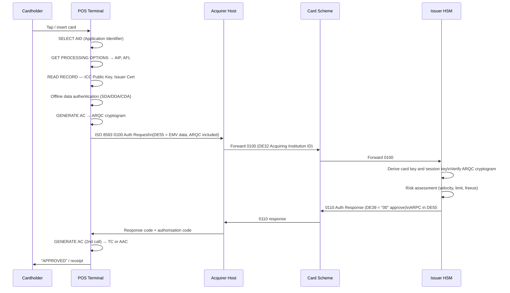

# مدفوعات البطاقات — EMV وISO 8583 والمقاصة والنزاعات

## نظرة عامة

في كل مرة يلمس فيها مستهلك بطاقته جهاز نقطة بيع، يُنفَّذ بروتوكول معقد متعدد الأطراف في أقل من ثانيتين، ينسّق إثباتًا تشفيريًا لحضور البطاقة، وقرارًا لمخاطر الائتمان، وحجزًا للأموال بين البنوك عبر أربع منظمات مستقلة على الأقل. وما زالت مدفوعات البطاقات أعلى أنظمة الدفع للأفراد حجمًا في العالم — فقد عالجت Visa وحدها نحو 213 مليار معاملة في السنة المالية 2023 — ويجب أن توفّق الأنظمة الهندسية خلفها بين متطلبات متعارضة: زمن أقل من ثانية، وسلامة تشفيرية، ومرونة دون اتصال، وتسوية متسقة في النهاية عبر دورة مقاصة T+1.

## أهداف التعلم

- ربط الأطراف الخمسة في دفعة البطاقة (حامل البطاقة، والتاجر، والبنك المحصّل، ونظام البطاقات، والبنك المصدر) وشرح الالتزامات التعاقدية لكل منها
- تتبع تفويض EMV بالشريحة والرقم السري من لمس الجهاز حتى رد البنك المصدر وفهم الكائنات التشفيرية المتبادلة في كل خطوة
- تحليل رسائل ISO 8583 وبناؤها في Java، بما في ذلك فك MTI، وتوسيع الـ bitmap، واستخراج عناصر البيانات
- تصميم بنية الرموز الشبكية (network tokens) مقابل PAN وتنفيذ `CardAuthorizationService` تولّد رموز التفويض وتتحقق منها
- شرح صيغة ملفات المقاصة ودورة التسوية T+1، بما في ذلك كيفية حساب رسوم التبادل (interchange) ومن يدفع لمن
- تنفيذ تكامل 3D Secure v2 لمعاملات البطاقة غير الحاضرة، بما يغطي التدفقات دون احتكاك مقابل التحدي ومعالجة الإعفاءات
- تحديد أكثر رموز أسباب الاستردادات شيوعًا وتصميم تدفق رد (representment) مع جمع الأدلة الداعمة
- تطبيق أنماط تقليل نطاق PCI DSS — حقول الدفع المستضافة، والترميز، والتشفير من نقطة إلى نقطة — لتقليل تعرض بيانات حاملي البطاقات في خدمة Java مصغرة

## سياق العمل

*مثال مركّب (مبني على نتائج PCI DSS شائعة، لا على شركة بعينها):* تكتشف منصة تجارة إلكترونية أن خدمة التفويض لديها كانت تكتب أرقام PAN الخام في سجلات التطبيق. وكانت السجلات تُشحن إلى مجموعة تسجيل مركزية وتُحفظ 90 يومًا، فبقيت ملايين أرقام البطاقات في نظام لم يُصمم قط لحمل بيانات حاملي البطاقات — ويستطيع كثير من المهندسين البحث فيه. والنتيجة تحقيق جنائي رقمي، وإعادة تقييم PCI طارئة، وتكاليف إعادة إصدار البطاقات، وبرامج تسوية الاختراقات لدى أنظمة البطاقات (مثل برنامج Visa لاسترداد الحسابات المخترقة GCAR) التي تحمّل البنك المحصّل تكاليف لكل بطاقة، ثم التاجر في النهاية. والسبب الجذري كائن `AuthorizationRequest` تطبع دالة `toString()` فيه كل الحقول — وهو نمط خاطئ في Java يجب على المهندسين الدفاع ضده بنشاط كلما عبرت كائنات تحمل PAN حدود الخدمات.

## أطراف منظومة مدفوعات البطاقات

يشارك خمسة أطراف في كل معاملة بطاقة. ولبعض الأزواج فقط عقود مباشرة (حامل البطاقة–البنك المصدر، والتاجر–البنك المحصّل، وكل بنك–نظام البطاقات)؛ وقواعد نظام البطاقات تربط البقية معًا.

| الطرف | الدور | العلاقة التجارية |
|---|---|---|
| حامل البطاقة | يبدأ الدفع؛ ويقدم البطاقة | عميل البنك المصدر |
| التاجر | يقبل البطاقة؛ ويوجّه عبر الجهاز | عميل البنك المحصّل |
| البنك المحصّل (Acquirer) | يعالج معاملات التاجر؛ ويتصل بنظام البطاقات | عضو مرخص في النظام |
| نظام البطاقات (Visa/MC) | يجري مقاصة المعاملات؛ ويضع القواعد؛ ويدير النزاعات | مملوك للبنوك الأعضاء أو مدرج في البورصة |
| البنك المصدر (Issuer) | يوافق أو يرفض؛ ويحتفظ بحساب حامل البطاقة | عضو مرخص في النظام |

يختلف **النموذج رباعي الأطراف** (حامل البطاقة ↔ المصدر ↔ النظام ↔ المحصّل ↔ التاجر) عن **النموذج ثلاثي الأطراف** الذي تستخدمه American Express وDiscover، حيث يكون النظام نفسه المصدر والمحصّل. ويهم هذا التمييز لأن رسوم التبادل — آلية الإيراد المهيمنة — تتدفق من المحصّل إلى المصدر في النموذج رباعي الأطراف بمعدل يحدده النظام.

> [!NOTE]
> تعمل American Express كنظام ومصدر معًا لمعظم بطاقاتها، فتحتفظ برسوم التبادل داخليًا بدل تحويلها إلى بنك منفصل. وفي الولايات المتحدة أدى ذلك إلى رسوم تاجر أعلى لـ Amex (غالبًا 2.5–3.5%) مقارنة بـ Visa/Mastercard (غالبًا 1.5–2.5% إجمالًا). وفي الاتحاد الأوروبي، رسوم التبادل على بطاقات المستهلكين محدودة بسقف 0.2% (الخصم) و0.3% (الائتمان)، فرسوم التجار هناك أقل بكثير.

## تدفق تفويض شريحة EMV

يستخدم EMV ‏(Europay وMastercard وVisa) نوعين من التشفير. **المصادقة على البيانات دون اتصال** (SDA وDDA وCDA) تستخدم شهادات المفتاح العام على الشريحة ليتحقق *الجهاز* من أصالة البطاقة. أما للتفويض عبر الاتصال، فتولّد *الشريحة* رمزًا تشفيريًا (ARQC — رمز طلب التفويض التشفيري) بمفتاح جلسة **متماثل**، ويتحقق منه البنك المصدر في وحدة HSM لديه باشتقاق المفتاح نفسه من المفتاح الفريد للبطاقة، المشتق بدوره من المفتاح الرئيسي للمصدر.



**التفويض عبر الاتصال مقابل دون اتصال** قرار يضبطه النظام والمصدر. فالتفويض دون اتصال يحدث كليًا داخل الجهاز والشريحة باستخدام عدادات مخزنة (ATC — عداد معاملات التطبيق) وحدود دون اتصال متراكمة. فإذا لم يُتجاوز حد الأرضية، وسمحت فحوص مخاطر الشريحة، ونجحت المصادقة على البيانات دون اتصال، يستطيع الجهاز الموافقة دون الاتصال بالمصدر؛ ثم تنتج الشريحة TC ‏(شهادة المعاملة) ترافق سجل المقاصة. وفي أسواق كثيرة اليوم تمر المعاملات اللاتلامسية ومعظم معاملات الشريحة عبر الاتصال على أي حال.

> [!WARNING]
> التفويض دون اتصال يخلق تعرضًا: فالمصدر لم يرَ المعاملة، فلم يستطع رفضها — حتى لو كانت البطاقة قد أُبلغ عن فقدانها أو كان الحساب فارغًا. لهذا تُبقى الحدود والعدادات المتراكمة دون اتصال على الشريحة منخفضة وتُضبط لكل منتج بطاقة.

## صيغة رسائل ISO 8583 وتحليلها في Java

ISO 8583 معيار مراسلة مالية ثنائي/نصي. وتبدأ كل رسالة بـ **مؤشر نوع الرسالة (MTI)** — 4 أرقام عشرية (تُرسل بصيغة BCD أو ASCII) — يتبعها bitmap واحد أو اثنان من 64 بتًا يحددان أيّ عناصر البيانات الـ 128 موجودة، ثم عناصر البيانات نفسها بصيغة ثنائية مضغوطة أو ASCII حسب نوع العنصر.

```java
// ISO 8583 MTI: version (1 digit), class (1 digit), function (1 digit), origin (1 digit)
// 0100 = version 0 (1987), class 1 (authorisation), function 0 (request), origin 0 (acquirer)
// 0110 = authorisation response from issuer

public record Iso8583Header(int version, int messageClass, int function, int origin) {

    public static Iso8583Header parse(byte[] mtiBytes) {
        // MTI is 4 BCD digits packed into 2 bytes
        int high = Byte.toUnsignedInt(mtiBytes[0]);
        int low  = Byte.toUnsignedInt(mtiBytes[1]);
        return new Iso8583Header(
            (high >> 4) & 0xF,
            high & 0xF,
            (low >> 4) & 0xF,
            low & 0xF
        );
    }

    public boolean isAuthRequest()   { return messageClass == 1 && function == 0; }
    public boolean isAuthResponse()  { return messageClass == 1 && function == 1; }
    public boolean isReversalRequest(){ return messageClass == 4 && function == 0; }
}
```

```java
public final class BitmapParser {

    private BitmapParser() {}

    /**
     * Parses primary (and optional secondary) 64-bit bitmaps.
     * Bit 1 of the primary bitmap set → secondary bitmap present.
     * Returns a boolean[128] where index i corresponds to data element i+1.
     */
    public static boolean[] parse(byte[] message, int offset) {
        boolean[] present = new boolean[128];
        long primary = readLong(message, offset);
        for (int i = 0; i < 64; i++) {
            present[i] = (primary & (1L << (63 - i))) != 0;
        }
        if (present[0]) { // secondary bitmap
            long secondary = readLong(message, offset + 8);
            for (int i = 0; i < 64; i++) {
                present[64 + i] = (secondary & (1L << (63 - i))) != 0;
            }
        }
        return present;
    }

    private static long readLong(byte[] data, int offset) {
        long v = 0;
        for (int i = 0; i < 8; i++) {
            v = (v << 8) | Byte.toUnsignedInt(data[offset + i]);
        }
        return v;
    }
}
```

عناصر البيانات الأساسية التي يجب أن يعرفها كل مهندس تفويض:

| DE | الاسم | الصيغة | مثال |
|---|---|---|---|
| DE2 | رقم الحساب الأساسي (PAN) | LLVAR n..19 | 4111111111111111 |
| DE3 | رمز المعالجة | n6 | 000000 (شراء) |
| DE4 | مبلغ المعاملة | n12 | 000000010000 (100.00 جنيه) |
| DE7 | تاريخ/وقت الإرسال | n10 | 1108143022 |
| DE11 | STAN ‏(رقم تتبع تدقيق النظام) | n6 | 123456 |
| DE22 | نمط الإدخال في نقطة البيع | n3 | 051 (شريحة + رقم سري) |
| DE35 | ما يعادل المسار 2 | LLVAR z..37 | — |
| DE39 | رمز الرد | an2 | 00 (موافقة) / 05 (رفض) |
| DE41 | معرّف جهاز قابل البطاقة | ans8 | TERM0001 |
| DE49 | رمز العملة | n3 | 826 (GBP) |
| DE55 | بيانات الشريحة (EMV) | LLLVAR b..255 | ARQC وبيانات TLV أخرى |

> [!IMPORTANT]
> يجب **ألا** يظهر DE2 ‏(PAN) أبدًا في سجلات التطبيق، أو مقاطع التتبع، أو تسميات المقاييس. علّم كائنات القيم التي تحمل PAN بتعليق مخصص `@Sensitive` واضبط إطار التسجيل ليحجب الحقول المعلّمة. وأعد تعريف `toString()` لتعيد تمثيلًا مقنّعًا مثل `"************1111"`. وينطبق الأمر نفسه على DE35 ‏(المسار 2) وDE52 ‏(كتلة الرقم السري) وDE55، التي لا يجوز تخزينها إطلاقًا بعد التفويض.

## بنية الترميز الشبكي

يستبدل الترميز الشبكي PAN بـ **رمز دفع (Payment Token)** — رقم بديل من نطاق BIN للرموز مقيد بنطاق: تاجر معين (طالب الرمز)، أو جهاز، أو قناة. ويصدر الرموز **مزوّدو خدمة الرموز (TSPs)** الذين تشغّلهم Visa ‏(VTS) وMastercard ‏(MDES).

```
Tokenisation actors:
  Token Requestor (merchant / wallet) ─── provision request ──▶ TSP
  TSP ──────────────────────────────────── token issued ───────▶ Token Requestor
  TSP ──────── token + TRID stored ──────────────────────────▶ Token Vault
  At authorisation:
  Merchant sends token ──▶ Acquirer ──▶ Scheme (detokenises) ──▶ Issuer sees real PAN
```

```java
public record PaymentToken(
    String token,          // 16-digit BIN-compatible surrogate PAN
    String tokenReferenceId,  // TRID linking token to real PAN at TSP
    String merchantId,
    String deviceId,
    Instant expiresAt,
    TokenDomain domain     // ECOMMERCE, INAPP, CONTACTLESS
) {
    // Much less sensitive than a PAN (useless outside its domain), but still a
    // payment credential inside it — mask it in logs too.
    // The real PAN stays in the TSP vault after provisioning.
}
```

الميزة التشغيلية الأساسية: اختراق بيانات التاجر يكشف رموزًا لا أرقام PAN. ولا يمكن استخدام الرموز خارج نطاق ربطها، فقيمتها قليلة للمهاجمين. وللرموز أيضًا **إدارة دورة حياة**: عندما يعيد المصدر إصدار بطاقة (رقم أو تاريخ انتهاء جديد)، يحدّث TSP رقم PAN خلف الرمز الموجود، فتستمر الاشتراكات المتكررة دون أن يعيد العميل إدخال بياناته.

## تنفيذ CardAuthorizationService

```java
@Service
@Slf4j
public class CardAuthorizationService {

    private final IssuerRiskEngine riskEngine;
    private final EmvCryptogramVerifier cryptogramVerifier;
    private final AuthorizationCodeGenerator codeGenerator;
    private final AuthorizationRepository repository;
    private final AccountHoldRepository holdRepository;
    private final Clock clock;

    @Transactional
    public AuthorizationResponse authorize(AuthorizationRequest request) {
        // Validate structure before any processing
        validateRequest(request);

        // Duplicate/retransmitted 0100 (same acquirer + terminal + STAN +
        // transmission time): return the ORIGINAL answer, never a second hold.
        // STAN alone is not unique — it wraps and is only unique per terminal.
        String dedupKey = request.acquirerId() + ":" + request.terminalId() + ":"
                + request.stan() + ":" + request.transmissionDateTime();
        Optional<AuthorizationRecord> previous = repository.findByDedupKey(dedupKey);
        if (previous.isPresent()) {
            return AuthorizationResponse.fromRecord(previous.get());
        }

        // Log with PAN masked — never log raw PAN
        log.info("Authorization request: stan={}, amount={}, currency={}, maskedPan={}",
            request.stan(),
            request.amount(),
            request.currencyCode(),
            maskPan(request.pan()));

        // Verify EMV cryptogram (ARQC) if chip transaction
        if (request.posEntryMode() == PosEntryMode.CHIP_PIN
                || request.posEntryMode() == PosEntryMode.CHIP_NO_PIN) {
            EmvVerificationResult emvResult = cryptogramVerifier.verify(
                request.pan(),
                request.emvData()
            );
            if (!emvResult.valid()) {
                return AuthorizationResponse.decline(request.stan(),
                    ResponseCode.DO_NOT_HONOUR, "EMV cryptogram invalid");
            }
        }

        // Issuer risk assessment: velocity, account status, fraud score
        RiskDecision risk = riskEngine.assess(request);
        if (risk.outcome() == RiskOutcome.DECLINE) {
            return AuthorizationResponse.decline(request.stan(),
                risk.responseCode(), risk.reason());
        }

        // Place the hold with a CONDITIONAL update — checking the balance first
        // and then reserving would let two concurrent authorisations both pass:
        //   UPDATE accounts SET held = held + :amt
        //   WHERE id = :id AND available_balance - held >= :amt
        if (!holdRepository.tryPlaceHold(request.accountId(), request.amountMinorUnits())) {
            return AuthorizationResponse.decline(request.stan(),
                ResponseCode.INSUFFICIENT_FUNDS, "Insufficient funds");
        }

        // Generate authorisation code and persist the record in the SAME transaction
        String authCode = codeGenerator.generate();
        AuthorizationRecord record = AuthorizationRecord.builder()
            .dedupKey(dedupKey)                 // unique constraint
            .stan(request.stan())
            .authCode(authCode)
            .maskedPan(maskPan(request.pan()))
            .amountMinorUnits(request.amountMinorUnits())
            .currencyCode(request.currencyCode())
            .terminalId(request.terminalId())
            .authorisedAt(clock.instant())
            .status(AuthorizationStatus.APPROVED)
            .build();

        repository.save(record);
        return AuthorizationResponse.approve(request.stan(), authCode,
            ResponseCode.APPROVED);
    }

    private void validateRequest(AuthorizationRequest request) {
        Objects.requireNonNull(request.pan(), "PAN required");
        if (request.amountMinorUnits() <= 0) {
            throw new InvalidAuthorizationRequestException("Amount must be positive");
        }
        if (request.pan().length() < 13 || request.pan().length() > 19
                || !LuhnCheck.isValid(request.pan())) {
            throw new InvalidAuthorizationRequestException("Invalid PAN");
        }
    }

    private static String maskPan(String pan) {
        if (pan == null || pan.length() < 10) return "****";
        // First 6 + last 4 is the most PCI DSS allows to be shown; show less if you can
        return pan.substring(0, 6) + "******" + pan.substring(pan.length() - 4);
    }
}
```

رسالة 0100 المكررة أو المعاد إرسالها (المحصّل والجهاز وSTAN ووقت الإرسال نفسها) تعيد الرد الأصلي، ولا تضع حجزًا ثانيًا أبدًا؛ فـ STAN وحده ليس فريدًا — إذ يلتف ويكون فريدًا لكل جهاز فقط. ويوضع الحجز بتحديث مشروط — فالتحقق من الرصيد أولًا ثم الحجز يسمح لتفويضين متزامنين بالنجاح كليهما.

```java
// Authorisation code (DE38): 6 characters chosen by the issuer — a reference,
// not globally unique, and never a security token on its own
@Component
public class AuthorizationCodeGenerator {

    private static final String ALPHABET = "ABCDEFGHJKLMNPQRSTUVWXYZ23456789";
    private static final SecureRandom SECURE_RANDOM = new SecureRandom();

    public String generate() {
        char[] code = new char[6];
        for (int i = 0; i < 6; i++) {
            code[i] = ALPHABET.charAt(SECURE_RANDOM.nextInt(ALPHABET.length()));
        }
        return new String(code);
    }
}
```

## المقاصة والتسوية

التفويض **يحجز** الأموال لكنه لا ينقلها. فالنقل الفعلي يحدث في عملية مجمّعة من خطوتين.

**المقاصة (عادة في اليوم نفسه أو التالي):** يرسل التجار معاملاتهم المكتملة إلى البنك المحصّل، الذي يقدم سجلات **العرض (presentment)** إلى نظام البطاقات قبل مواعيد القطع اليومية للنظام — بصيغة BASE II لدى Visa، أو ملفات مقاصة IPM لدى Mastercard (المبنية على ISO 8583، برقم MTI ‏1240). (أما أنظمة الرسالة الواحدة، الشائعة لبطاقات الخصم والصرافات الآلية، فتجمع التفويض والمقاصة في رسالة مالية واحدة 0200.)

**التسوية (عادة T+1):** يحسب نظام التسوية لدى نظام البطاقات صافي المراكز لكل عضو ويوجّه بنوك التسوية لنقل الأموال. والتسوية بين البنوك نهائية — والنزاعات اللاحقة تُعالج كمعاملات استرداد جديدة، لا بإلغاء التسوية.

```java
public record ClearingRecord(
    String rrn,                     // Retrieval Reference Number
    String authCode,
    String maskedPan,
    BigDecimal transactionAmount,
    String transactionCurrency,
    BigDecimal settlementAmount,
    String settlementCurrency,
    BigDecimal exchangeRate,
    BigDecimal interchangeFee,      // Calculated by scheme, deducted from settlement
    LocalDate transactionDate,
    LocalDate clearingDate,
    String merchantCategoryCode
) {}
```

**حساب رسوم التبادل** يحدده نظام البطاقات ويتفاوت حسب منتج البطاقة، وفئة التاجر (MCC)، والمنطقة. والصيغة المبسطة:

```
Interchange = transactionAmount × interchangeRatePercent + fixedFee

Example (Visa EU consumer credit, face-to-face):
  interchangeRatePercent = 0.30%
  fixedFee = €0.00
  For a €50 transaction: interchange = €0.15
```

```java
public class InterchangeFeeCalculator {

    private final InterchangeRateRepository rateRepository;

    public BigDecimal calculate(ClearingRecord record) {
        InterchangeRate rate = rateRepository.find(
            record.merchantCategoryCode(),
            determineCardProduct(record.maskedPan()),
            record.transactionCurrency()
        );
        BigDecimal percentFee = record.transactionAmount()
            .multiply(rate.percentageRate())
            .divide(BigDecimal.valueOf(100), 4, RoundingMode.HALF_UP);
        return percentFee.add(rate.fixedFee())
            .setScale(2, RoundingMode.HALF_UP);
    }
}
```

## 3D Secure للبطاقة غير الحاضرة

يعالج 3D Secure v2 ‏(EMV 3DS) احتيال البطاقة غير الحاضرة بمصادقة حامل البطاقة عبر البنك المصدر أثناء تدفق الدفع، دون الحاجة لإعادة توجيه في الحالة الشائعة (دون احتكاك).

توجد ثلاثة تدفقات:

| التدفق | المطلِق | تجربة المستخدم |
|---|---|---|
| دون احتكاك (Frictionless) | نتيجة مخاطر المصدر منخفضة | لا خطوة إضافية؛ مصادقة عبر بصمة الجهاز/البيانات |
| تحدٍّ (Challenge) | المصدر يطلب إثباتًا صريحًا | ‏OTP عبر SMS، أو بيومترية في تطبيق البنك، أو إدخال رقم سري |
| منفصل (Decoupled) | مصادقة غير متزامنة عبر تطبيق البنك | يصادق حامل البطاقة مستقلًا؛ ويستطلع التاجر النتيجة |

```java
public record ThreeDsAuthenticationResult(
    String transactionId,       // 3DS Server Transaction ID
    AuthenticationStatus status,  // Y=authenticated, A=attempt, C=challenge required,
                                  // N=not authenticated, R=rejected, U=unavailable
    String eci,                 // Electronic Commerce Indicator — Visa: 05 authenticated, 06 attempt
                                //                                  (Mastercard uses 02 / 01)
    String authenticationValue, // Visa CAVV / Mastercard AAV — cryptographic proof for the issuer
    String dsTransactionId
) {}
```

**إعفاءات المصادقة القوية (PSD2):** بموجب PSD2، يجوز للمصدرين ومزوّدي خدمات الدفع طلب إعفاءات من المصادقة القوية (SCA) للمعاملات منخفضة الخطر، لتقليل الاحتكاك. ومن الإعفاءات الشائعة:

- **إعفاء القيمة المنخفضة (عن بُعد):** معاملات ≤ 30 يورو، حتى يتجاوز المجموع المتراكم منذ آخر مصادقة قوية 100 يورو أو 5 معاملات متتالية
- **تحليل مخاطر المعاملة (TRA):** مسموح عندما يكون معدل احتيال البطاقات عن بُعد لدى مزوّد الخدمة تحت معدل مرجعي — 0.13% للمعاملات حتى 100 يورو، و0.06% حتى 250 يورو، و0.01% حتى 500 يورو
- **المستفيد الموثوق:** أضاف حامل البطاقة التاجر مسبقًا إلى قائمة موثوقة
- **المتكرر بالمبلغ نفسه:** الدفعات اللاحقة في سلسلة بالمبلغ نفسه للمستفيد نفسه (والمعاملات التي يبدؤها التاجر خارج نطاق المصادقة القوية أصلًا)

> [!NOTE]
> بموجب قواعد أنظمة البطاقات، تتبع مسؤولية الاحتيال من طبّق الإعفاء: فإذا طلب البنك المحصّل (نيابة عن التاجر) إعفاء TRA وقبله المصدر، يتحمل المحصّل — والتاجر عادة — خسارة الاحتيال بدل المصدر. فقيّم دائمًا معدل الاحتيال لديك قبل طلب إعفاءات TRA على نطاق واسع.

## أسباب الاستردادات وتدفق الرد

الاستردادات (chargebacks) عكس يبدؤه المصدر بطلب من حامل البطاقة. ويحدد كل نظام رموز أسباب.

| رمز السبب (Visa) | الفئة | دفاع التاجر |
|---|---|---|
| 10.1 | تحول مسؤولية EMV: بطاقة مزورة | إثبات أن البطاقة قُرئت بالشريحة (جهاز يدعم الشريحة يعيد المسؤولية إلى المصدر) |
| 10.4 | احتيال آخر — بطاقة غير حاضرة | قيمة مصادقة 3DS ‏(CAVV) |
| 11.1 | نشرة استرداد البطاقات | لا ينطبق |
| 12.6 | معالجة مكررة | دليل على معاملتين متمايزتين |
| 13.1 | بضاعة/خدمات لم تُستلم | إثبات التسليم، ورقم التتبع |
| 13.2 | معاملة متكررة ملغاة | تأكيد الإلغاء |

**الرد (Representment)** حق التاجر في الاعتراض على الاسترداد بتقديم أدلة (تُسمى "حزمة الرد") ضمن المهلة الزمنية للنظام (عادة 30 يومًا). وإذا رفض المصدر الرد، تتبعه عملية **ما قبل التحكيم** ثم **التحكيم**، ويدفع الطرف الخاسر رسوم التحكيم (نحو 500 دولار).

> [!WARNING]
> التجار (والبنوك المحصّلة لهم) الذين تتجاوز نسب نزاعاتهم واحتيالهم حدود أنظمة البطاقات يوضعون في برامج مراقبة — برنامج Visa لمراقبة المحصّلين (VAMP)، الذي حل محل VDMP/VFMP في 2025، وبرنامج Mastercard للاستردادات المفرطة. والحدود في حدود 1–1.5% من المعاملات (وتتغير مع الوقت)؛ وتتصاعد العقوبات شهريًا وقد تنتهي بفقدان التاجر القدرة على قبول البطاقات.

## اختبار المعرفة

**س1: أثناء معاملة شريحة EMV، ما هو ARQC ولماذا يهم لأمن التفويض؟**

ج: ARQC ‏(رمز طلب التفويض التشفيري) هو MAC ‏(رمز مصادقة رسالة) تولّده الشريحة بمفتاح جلسة متماثل، مشتق من المفتاح الفريد للبطاقة المخزن بأمان في الشريحة. ويغطي ARQC بيانات المعاملة (المبلغ، والعملة، والتاريخ، وATC) ولا تستطيع توليده إلا الشريحة الحقيقية — لا جهاز نسخ التقط الشريط المغناطيسي فقط. وعندما يتحقق المصدر من ARQC بنسخته من المفتاح الرئيسي للبطاقة، يثبت تشفيريًا حضور البطاقة وسلامة بيانات المعاملة معًا. وهذا يقضي على احتيال البطاقات المزورة في معاملات الشريحة، ولهذا نقل تحول مسؤولية EMV مسؤولية احتيال التزوير من المصدرين إلى التجار الذين ما زالوا يستخدمون أجهزة الشريط المغناطيسي فقط.

**س2: يريد تاجر تقليل نطاق PCI DSS لمنصة التجارة الإلكترونية لديه. ما الآليتان المعماريتان اللتان يجب أن يوصي بهما مهندس رئيسي، وأي نطاق تزيله كل منهما؟**

ج: لمنصة **تجارة إلكترونية** أكبر مكسب إبقاء بيانات البطاقة خارج خوادم التاجر كليًا: استخدم **صفحة الدفع المستضافة أو حقول الدفع المستضافة (iframes)** لدى مزوّد خدمة الدفع، فيُكتب رقم البطاقة ويُرسل مباشرة إلى المزوّد. فلا تتلقى أنظمة التاجر PAN أبدًا، وهذا قد ينقله من SAQ D ‏(المجموعة الكاملة لمتطلبات PCI DSS) نحو SAQ A أو A-EP، حسب طريقة بناء الصفحة. وثانيًا، **الترميز** — رموز شبكية (Visa VTS / Mastercard MDES) أو رموز المزوّد — لبيانات الاعتماد المخزنة: يحتفظ التاجر برمز للمدفوعات المتكررة بدل PAN، وهذا يزيل تخزين PAN من النطاق. والرمز مقيد بالتاجر والنطاق، فالاختراق لا ينتج شيئًا قابلًا للاستخدام على نطاق واسع. (وللقنوات **الحضورية** فالأداة المكافئة هي التشفير من نقطة إلى نقطة P2PE: يشفّر الجهاز بيانات البطاقة عند نقطة التفاعل، وهذا قد يقلل النطاق إلى SAQ P2PE، وهي مجموعة متطلبات أصغر بكثير.)

## التحدي العملي

1. **محلل ISO 8583:** نفّذ محللًا كاملًا `Iso8583Message` في Java يستطيع قراءة رسالة ISO 8583 ‏0100 مرمّزة بالست عشري، واستخراج MTI، وتوسيع الـ bitmap الأساسي والثانوي، وإعادة `Map<Integer, byte[]>` لعناصر البيانات الموجودة. واكتب اختبار وحدة بمتجه اختبار معروف يمر بدورة تحليل ← إعادة بناء ← تحليل ويؤكد التساوي.

2. **خدمة التفويض مع محاكاة EMV:** وسّع `CardAuthorizationService` لتتكامل مع `EmvCryptogramVerifier` محاكى. ويجب أن يقبل المتحقق ARQC بصيغة TLV من DE55، ويشتق القيمة المتوقعة باستخدام HMAC-SHA256 بمفتاح رئيسي لبطاقة اختبار، ويعيد `EmvVerificationResult.valid()` أو `EmvVerificationResult.invalid(reason)`. واكتب اختبار تكامل يرسل رسالة 0100 بـ ARQC صالح ويؤكد رمز رد 00، وآخر بمبلغ معدّل يؤكد رفضًا 05.

3. **محرك رسوم التبادل:** ابنِ `InterchangeRateRepository` مدعومًا بجدول PostgreSQL بالأعمدة `(mcc, card_product, currency, percentage_rate, fixed_fee_minor_units)`. واملأه بخمسة معدلات تبادل تمثيلية على الأقل (خصم المستهلك، وائتمان المستهلك، وائتمان الأعمال، والمستهلك المميز، وخصم البقالة MCC 5411). ونفّذ `InterchangeFeeCalculator` واختبره مقابل مصفوفة سيناريوهات، مؤكدًا دقة الرسوم حتى خانتين عشريتين.

4. **سير عمل الاستردادات:** صمم ونفّذ `ChargebackWorkflowService` تمثل دورة الحياة: `RAISED → MERCHANT_NOTIFIED → REPRESENTMENT_SUBMITTED → ACCEPTED | REJECTED → PRE_ARBITRATION → ARBITRATION`. واستخدم آلة حالة مدعومة بـ PostgreSQL (خزّن الحالة الحالية في جدول `chargeback_cases`) مع سجل أحداث في `chargeback_events`. واعرض endpoint في Spring MVC ‏`POST /chargebacks/{id}/represent` يقبل حمولة رد (نوع الدليل، والوصف، ومرجع الملف) وينقل الحالة إلى `REPRESENTMENT_SUBMITTED`، ويعيد 409 إذا فات الموعد.

<!-- KNOWLEDGE-CHECK
{
  "questions": [
    {
      "text": "أثناء معاملة شريحة EMV، ما هو ARQC ولماذا يهم لأمن التفويض؟",
      "options": [
        "هو معرّف جهاز التاجر؛ ويهم لقرارات التوجيه",
        "هو MAC تولّده الشريحة بمفتاح جلسة متماثل مشتق من المفتاح الفريد للبطاقة، ويثبت تشفيريًا حضور البطاقة وسلامة بيانات المعاملة",
        "هو رمز الشبكة الذي يحدد نظام البطاقات (Visa أو Mastercard)",
        "هو كتلة الرقم السري المشفرة المرسلة إلى المصدر للتحقق"
      ],
      "correct": 1,
      "explanation": "‏ARQC ‏(رمز طلب التفويض التشفيري) هو MAC تولّده الشريحة بمفتاح جلسة متماثل مشتق من المفتاح الفريد للبطاقة (المشتق بدوره من المفتاح الرئيسي للمصدر). ويغطي بيانات المعاملة (المبلغ، والعملة، والتاريخ، وATC) ولا تنتجه إلا الشريحة الحقيقية — لا جهاز نسخ للشريط المغناطيسي. وعندما يتحقق منه المصدر في HSM، يثبت حضور البطاقة وسلامة البيانات، فيهزم احتيال البطاقات المزورة."
    },
    {
      "text": "يريد تاجر تقليل نطاق PCI DSS لمنصة التجارة الإلكترونية لديه. ما الآليتان المعماريتان اللتان يجب أن يوصي بهما مهندس رئيسي؟",
      "options": [
        "الترميز والتشفير أثناء التخزين لبيانات البطاقات المخزنة",
        "حقول الدفع المستضافة / صفحة الدفع المستضافة (يذهب PAN مباشرة إلى مزوّد الخدمة) وترميز بيانات الاعتماد المخزنة",
        "‏HTTPS وجدار حماية تطبيقات الويب",
        "‏3D Secure والمصادقة البيومترية"
      ],
      "correct": 1,
      "explanation": "في التجارة الإلكترونية، تعني حقول الدفع المستضافة أو صفحة الدفع المستضافة أن PAN يُرسل مباشرة إلى مزوّد الخدمة ولا يصل أبدًا إلى خوادم التاجر — فينتقل التاجر من SAQ D نحو SAQ A أو A-EP. ويستبدل الترميز (رموز شبكية أو رموز المزوّد) أرقام PAN المخزنة للمدفوعات المتكررة، فيزيل تخزين PAN من النطاق. وP2PE هو الأداة المكافئة للأجهزة الحضورية."
    },
    {
      "text": "ما بنية الحقول في ISO 8583 التي تحدد أي عناصر البيانات موجودة في الرسالة؟",
      "options": [
        "مؤشر نوع الرسالة (MTI) في أول 4 بايتات",
        "الـ bitmap الأساسي والثانوي، حيث يدل موقع كل بت على وجود عنصر البيانات المقابل",
        "حقل طول الترويسة الذي يسبق كل عنصر بيانات",
        "بنية TLV ‏(وسم-طول-قيمة) في DE55"
      ],
      "correct": 1,
      "explanation": "يستخدم ISO 8583 بنية bitmap للدلالة على عناصر البيانات الموجودة. فالـ bitmap الأساسي (64 بتًا) يغطي DE1-DE64. وإذا كان البت 1 في الـ bitmap الأساسي مضبوطًا، يوجد bitmap ثانوي يغطي DE65-DE128. وكل موقع بت يقابل رقم عنصر بيانات — فإذا كان البت مضبوطًا، يكون العنصر موجودًا في جسم الرسالة."
    }
  ]
}
-->

<!-- PRACTICAL-CHALLENGE
{
  "title": "محلل ISO 8583 وخدمات مدفوعات البطاقات",
  "difficulty": "advanced",
  "estimatedMinutes": 45,
  "tasks": [
    {
      "id": "1",
      "description": "نفّذ محللًا كاملًا `Iso8583Message` في Java يقرأ رسالة ISO 8583 ‏0100 مرمّزة بالست عشري، ويستخرج MTI، ويوسّع الـ bitmap الأساسي والثانوي، ويعيد `Map<Integer, byte[]>` لعناصر البيانات الموجودة. واكتب اختبار وحدة بمتجه اختبار معروف يمر بدورة تحليل ← إعادة بناء ← تحليل ويؤكد التساوي."
    },
    {
      "id": "2",
      "description": "وسّع `CardAuthorizationService` لتتكامل مع `EmvCryptogramVerifier` محاكى يقبل ARQC بصيغة TLV من DE55، ويشتق القيمة المتوقعة باستخدام HMAC-SHA256 بمفتاح رئيسي لبطاقة اختبار، ويعيد `EmvVerificationResult.valid()` أو `EmvVerificationResult.invalid(reason)`. واكتب اختبارات تكامل لـ ARQC صالح (رمز رد 00) ومبلغ معدّل (رفض 05)."
    },
    {
      "id": "3",
      "description": "ابنِ `InterchangeRateRepository` مدعومًا بـ PostgreSQL بالأعمدة `(mcc, card_product, currency, percentage_rate, fixed_fee_minor_units)`. واملأه بخمسة معدلات تبادل تمثيلية على الأقل. ونفّذ `InterchangeFeeCalculator` واختبره مقابل مصفوفة سيناريوهات، مؤكدًا دقة الرسوم حتى خانتين عشريتين."
    },
    {
      "id": "4",
      "description": "صمم ونفّذ `ChargebackWorkflowService` تمثل دورة الحياة: `RAISED → MERCHANT_NOTIFIED → REPRESENTMENT_SUBMITTED → ACCEPTED | REJECTED → PRE_ARBITRATION → ARBITRATION`. واستخدم آلة حالة مدعومة بـ PostgreSQL مع سجل أحداث. واعرض `POST /chargebacks/{id}/represent` يقبل حمولة الرد، ويعيد 409 إذا فات الموعد."
    }
  ]
}
-->
