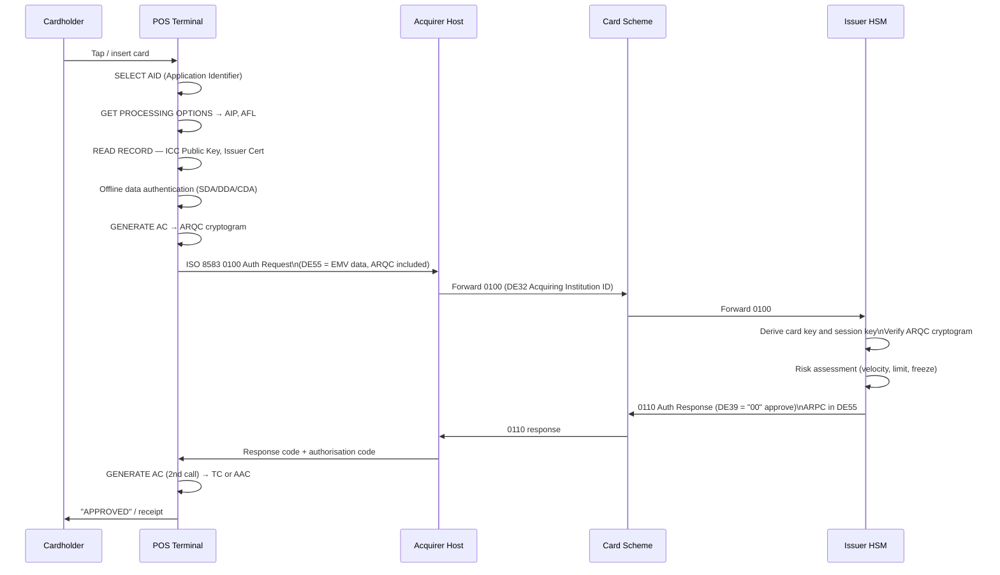

## Overview

Every time a consumer taps a card at a point-of-sale terminal, an intricate multi-party protocol executes in under two seconds, coordinating cryptographic proof-of-presence, credit-risk decisioning, and cross-bank fund reservation across a minimum of four independent organisations. Card payments remain the highest-volume retail payment rail on earth — Visa alone processed about 213 billion transactions in fiscal year 2023 — and the engineering systems behind them must reconcile the conflicting demands of sub-second latency, cryptographic integrity, offline resilience, and eventual-consistency settlement across a T+1 clearing cycle.

## Learning Objectives

- Map the five actors in a card payment (cardholder, merchant, acquirer, scheme, issuer) and explain the contractual obligations each one carries
- Trace an EMV chip-and-PIN authorisation from terminal tap through issuer response and understand the cryptographic objects exchanged at each step
- Parse and construct ISO 8583 messages in Java, including MTI decoding, bitmap expansion, and data-element extraction
- Design a network-token vs PAN architecture and implement a `CardAuthorizationService` that generates and validates authorisation codes
- Explain the clearing file format and T+1 settlement cycle, including how interchange fees are calculated and who pays whom
- Implement a 3D Secure v2 integration for card-not-present transactions, covering frictionless vs challenge flows and exemption handling
- Identify the most common chargeback reason codes and design a representment flow with supporting evidence collection
- Apply PCI DSS scope-reduction patterns — hosted payment fields, tokenisation, point-to-point encryption — to minimise cardholder data exposure in a Java microservice

## Business Context

*Composite example (based on common PCI DSS findings, not a specific company):* an e-commerce platform discovers that its authorisation service has been writing raw PANs into application logs. The logs were shipped to a central logging cluster and kept for 90 days, so millions of card numbers sat in a system that was never meant to hold cardholder data — and that many engineers could search. The result is a forensic investigation, an emergency PCI re-assessment, card re-issuance costs, and scheme compromise programmes (such as Visa's Global Compromised Account Recovery) that pass per-card costs to the acquirer and, in the end, to the merchant. The root cause was an `AuthorizationRequest` object whose `toString()` printed every field — a Java anti-pattern that engineers must actively defend against whenever PAN-bearing objects cross service boundaries.

## Card Payment Ecosystem Actors

Five parties participate in every card transaction. Only some pairs have direct contracts (cardholder–issuer, merchant–acquirer, each bank–scheme); the scheme rules bind everyone else together.

| Actor | Role | Commercial relationship |
|---|---|---|
| Cardholder | Initiates payment; presents card | Customer of issuing bank |
| Merchant | Accepts card; routes via terminal | Customer of acquiring bank |
| Acquirer | Processes merchant's transactions; connects to scheme | Licensed scheme member |
| Scheme (Visa/MC) | Clears transactions; sets rules; manages disputes | Owned by member banks or public |
| Issuer | Approves or declines; holds cardholder's account | Licensed scheme member |

The **four-party model** (cardholder ↔ issuer ↔ scheme ↔ acquirer ↔ merchant) is distinct from the **three-party model** used by American Express and Discover, where the scheme is also the issuer and acquirer. The distinction matters because interchange fees — the dominant revenue mechanism — flow from acquirer to issuer in the four-party model at a rate set by the scheme.

> [!NOTE]
> American Express operates both as scheme and issuer for most cards, which means it captures interchange internally rather than transferring it to a separate bank. In the US this has meant higher merchant fees for Amex (often 2.5–3.5%) than for Visa/Mastercard (often 1.5–2.5% blended). In the EU, interchange on consumer cards is capped at 0.2% (debit) and 0.3% (credit), so merchant fees there are much lower.

## EMV Chip Authorisation Flow

EMV (Europay, Mastercard, Visa) uses two kinds of cryptography. **Offline data authentication** (SDA, DDA, CDA) uses public-key certificates on the chip so the *terminal* can check the card is genuine. For online authorisation, the *chip* generates a cryptogram (ARQC — Authorisation Request Cryptogram) with a **symmetric** session key, and the issuer verifies it in its HSM by deriving the same key from the card's unique key, which comes from the issuer master key.



**Online vs offline authorisation** is a scheme- and issuer-configured decision. Offline authorisation occurs entirely within the terminal and chip using stored counters (ATC — Application Transaction Counter) and accumulated offline limits. If the floor limit is not exceeded, the chip's risk checks allow it and offline data authentication passes, the terminal can approve without contacting the issuer; the chip then produces a TC (Transaction Certificate) that travels with the clearing record. In many markets today, contactless and most chip transactions go online anyway.

> [!WARNING]
> Offline authorisation creates exposure: the issuer never saw the transaction, so it could not decline it — even if the card had already been reported lost or the account was empty. That is why cumulative offline limits and counters on the chip are kept low and are set per card product.

## ISO 8583 Message Format and Java Parsing

ISO 8583 is a binary/ASCII financial messaging standard. Every message begins with a **Message Type Indicator (MTI)** — 4 decimal digits (sent as BCD or ASCII) — followed by one or two 64-bit bitmaps indicating which of 128 data elements are present, then the data elements themselves in packed binary or ASCII depending on element type.

```java
// ISO 8583 MTI: version (1 digit), class (1 digit), function (1 digit), origin (1 digit)
// 0100 = version 0 (1987), class 1 (authorisation), function 0 (request), origin 0 (acquirer)
// 0110 = authorisation response from issuer

public record Iso8583Header(int version, int messageClass, int function, int origin) {

    public static Iso8583Header parse(byte[] mtiBytes) {
        // MTI is 4 BCD digits packed into 2 bytes
        int high = Byte.toUnsignedInt(mtiBytes[0]);
        int low  = Byte.toUnsignedInt(mtiBytes[1]);
        return new Iso8583Header(
            (high >> 4) & 0xF,
            high & 0xF,
            (low >> 4) & 0xF,
            low & 0xF
        );
    }

    public boolean isAuthRequest()   { return messageClass == 1 && function == 0; }
    public boolean isAuthResponse()  { return messageClass == 1 && function == 1; }
    public boolean isReversalRequest(){ return messageClass == 4 && function == 0; }
}
```

```java
public final class BitmapParser {

    private BitmapParser() {}

    /**
     * Parses primary (and optional secondary) 64-bit bitmaps.
     * Bit 1 of the primary bitmap set → secondary bitmap present.
     * Returns a boolean[128] where index i corresponds to data element i+1.
     */
    public static boolean[] parse(byte[] message, int offset) {
        boolean[] present = new boolean[128];
        long primary = readLong(message, offset);
        for (int i = 0; i < 64; i++) {
            present[i] = (primary & (1L << (63 - i))) != 0;
        }
        if (present[0]) { // secondary bitmap
            long secondary = readLong(message, offset + 8);
            for (int i = 0; i < 64; i++) {
                present[64 + i] = (secondary & (1L << (63 - i))) != 0;
            }
        }
        return present;
    }

    private static long readLong(byte[] data, int offset) {
        long v = 0;
        for (int i = 0; i < 8; i++) {
            v = (v << 8) | Byte.toUnsignedInt(data[offset + i]);
        }
        return v;
    }
}
```

Key data elements every authorisation engineer must know:

| DE | Name | Format | Example |
|---|---|---|---|
| DE2 | Primary Account Number (PAN) | LLVAR n..19 | 4111111111111111 |
| DE3 | Processing Code | n6 | 000000 (purchase) |
| DE4 | Transaction Amount | n12 | 000000010000 (£100.00) |
| DE7 | Transmission Date/Time | n10 | 1108143022 |
| DE11 | STAN (System Trace Audit Number) | n6 | 123456 |
| DE22 | POS Entry Mode | n3 | 051 (chip+PIN) |
| DE35 | Track 2 Equivalent | LLVAR z..37 | — |
| DE39 | Response Code | an2 | 00 (approve) / 05 (decline) |
| DE41 | Card Acceptor Terminal ID | ans8 | TERM0001 |
| DE49 | Currency Code | n3 | 826 (GBP) |
| DE55 | ICC Data (EMV) | LLLVAR b..255 | ARQC + other TLV data |

> [!IMPORTANT]
> DE2 (PAN) must **never** appear in application logs, tracing spans, or metrics labels. Annotate PAN-bearing value objects with a custom `@Sensitive` annotation and configure your logging framework to redact fields so annotated. Override `toString()` to return a masked representation such as `"************1111"`. The same applies to DE35 (Track 2), DE52 (PIN block) and DE55, which may never be stored after authorisation at all.

## Network Tokenisation Architecture

Network tokenisation replaces the PAN with a **Payment Token** — a surrogate number from a token BIN range that is restricted to a domain: a particular merchant (token requestor), device or channel. Tokens are issued by **Token Service Providers (TSPs)** operated by Visa (VTS) and Mastercard (MDES).

```
Tokenisation actors:
  Token Requestor (merchant / wallet) ─── provision request ──▶ TSP
  TSP ──────────────────────────────────── token issued ───────▶ Token Requestor
  TSP ──────── token + TRID stored ──────────────────────────▶ Token Vault
  At authorisation:
  Merchant sends token ──▶ Acquirer ──▶ Scheme (detokenises) ──▶ Issuer sees real PAN
```

```java
public record PaymentToken(
    String token,          // 16-digit BIN-compatible surrogate PAN
    String tokenReferenceId,  // TRID linking token to real PAN at TSP
    String merchantId,
    String deviceId,
    Instant expiresAt,
    TokenDomain domain     // ECOMMERCE, INAPP, CONTACTLESS
) {
    // Much less sensitive than a PAN (useless outside its domain), but still a
    // payment credential inside it — mask it in logs too.
    // The real PAN stays in the TSP vault after provisioning.
}
```

The key operational advantage: a merchant data breach exposes tokens, not PANs. Tokens cannot be used outside their domain binding, which makes them of little use to attackers. Tokens also have **lifecycle management**: when the issuer reissues a card (new number or expiry date), the TSP updates the PAN behind the existing token, so recurring subscriptions keep working without the customer re-entering details.

## CardAuthorizationService Implementation

```java
@Service
@Slf4j
public class CardAuthorizationService {

    private final IssuerRiskEngine riskEngine;
    private final EmvCryptogramVerifier cryptogramVerifier;
    private final AuthorizationCodeGenerator codeGenerator;
    private final AuthorizationRepository repository;
    private final AccountHoldRepository holdRepository;
    private final Clock clock;

    @Transactional
    public AuthorizationResponse authorize(AuthorizationRequest request) {
        // Validate structure before any processing
        validateRequest(request);

        // Duplicate/retransmitted 0100 (same acquirer + terminal + STAN +
        // transmission time): return the ORIGINAL answer, never a second hold.
        // STAN alone is not unique — it wraps and is only unique per terminal.
        String dedupKey = request.acquirerId() + ":" + request.terminalId() + ":"
                + request.stan() + ":" + request.transmissionDateTime();
        Optional<AuthorizationRecord> previous = repository.findByDedupKey(dedupKey);
        if (previous.isPresent()) {
            return AuthorizationResponse.fromRecord(previous.get());
        }

        // Log with PAN masked — never log raw PAN
        log.info("Authorization request: stan={}, amount={}, currency={}, maskedPan={}",
            request.stan(),
            request.amount(),
            request.currencyCode(),
            maskPan(request.pan()));

        // Verify EMV cryptogram (ARQC) if chip transaction
        if (request.posEntryMode() == PosEntryMode.CHIP_PIN
                || request.posEntryMode() == PosEntryMode.CHIP_NO_PIN) {
            EmvVerificationResult emvResult = cryptogramVerifier.verify(
                request.pan(),
                request.emvData()
            );
            if (!emvResult.valid()) {
                return AuthorizationResponse.decline(request.stan(),
                    ResponseCode.DO_NOT_HONOUR, "EMV cryptogram invalid");
            }
        }

        // Issuer risk assessment: velocity, account status, fraud score
        RiskDecision risk = riskEngine.assess(request);
        if (risk.outcome() == RiskOutcome.DECLINE) {
            return AuthorizationResponse.decline(request.stan(),
                risk.responseCode(), risk.reason());
        }

        // Place the hold with a CONDITIONAL update — checking the balance first
        // and then reserving would let two concurrent authorisations both pass:
        //   UPDATE accounts SET held = held + :amt
        //   WHERE id = :id AND available_balance - held >= :amt
        if (!holdRepository.tryPlaceHold(request.accountId(), request.amountMinorUnits())) {
            return AuthorizationResponse.decline(request.stan(),
                ResponseCode.INSUFFICIENT_FUNDS, "Insufficient funds");
        }

        // Generate authorisation code and persist the record in the SAME transaction
        String authCode = codeGenerator.generate();
        AuthorizationRecord record = AuthorizationRecord.builder()
            .dedupKey(dedupKey)                 // unique constraint
            .stan(request.stan())
            .authCode(authCode)
            .maskedPan(maskPan(request.pan()))
            .amountMinorUnits(request.amountMinorUnits())
            .currencyCode(request.currencyCode())
            .terminalId(request.terminalId())
            .authorisedAt(clock.instant())
            .status(AuthorizationStatus.APPROVED)
            .build();

        repository.save(record);
        return AuthorizationResponse.approve(request.stan(), authCode,
            ResponseCode.APPROVED);
    }

    private void validateRequest(AuthorizationRequest request) {
        Objects.requireNonNull(request.pan(), "PAN required");
        if (request.amountMinorUnits() <= 0) {
            throw new InvalidAuthorizationRequestException("Amount must be positive");
        }
        if (request.pan().length() < 13 || request.pan().length() > 19
                || !LuhnCheck.isValid(request.pan())) {
            throw new InvalidAuthorizationRequestException("Invalid PAN");
        }
    }

    private static String maskPan(String pan) {
        if (pan == null || pan.length() < 10) return "****";
        // First 6 + last 4 is the most PCI DSS allows to be shown; show less if you can
        return pan.substring(0, 6) + "******" + pan.substring(pan.length() - 4);
    }
}
```

```java
// Authorisation code (DE38): 6 characters chosen by the issuer — a reference,
// not globally unique, and never a security token on its own
@Component
public class AuthorizationCodeGenerator {

    private static final String ALPHABET = "ABCDEFGHJKLMNPQRSTUVWXYZ23456789";
    private static final SecureRandom SECURE_RANDOM = new SecureRandom();

    public String generate() {
        char[] code = new char[6];
        for (int i = 0; i < 6; i++) {
            code[i] = ALPHABET.charAt(SECURE_RANDOM.nextInt(ALPHABET.length()));
        }
        return new String(code);
    }
}
```

## Clearing and Settlement

Authorisation **reserves** funds but does not move them. Actual movement occurs in a two-step batch process.

**Clearing (usually the same or next day):** Merchants send their completed transactions to the acquirer, which submits **presentment** records to the scheme by the scheme's daily cut-offs — Visa's BASE II format, or Mastercard's IPM clearing files (ISO 8583-based, MTI 1240). (Single-message systems, common for debit and ATMs, combine authorisation and clearing in one 0200 financial message.)

**Settlement (typically T+1):** The scheme's settlement system calculates net positions for each member and instructs settlement banks to move the funds. Interbank settlement is final — later disputes are handled as new chargeback transactions, not by undoing the settlement.

```java
public record ClearingRecord(
    String rrn,                     // Retrieval Reference Number
    String authCode,
    String maskedPan,
    BigDecimal transactionAmount,
    String transactionCurrency,
    BigDecimal settlementAmount,
    String settlementCurrency,
    BigDecimal exchangeRate,
    BigDecimal interchangeFee,      // Calculated by scheme, deducted from settlement
    LocalDate transactionDate,
    LocalDate clearingDate,
    String merchantCategoryCode
) {}
```

**Interchange fee calculation** is scheme-defined and varies by card product, MCC, and region. The simplified formula is:

```
Interchange = transactionAmount × interchangeRatePercent + fixedFee

Example (Visa EU consumer credit, face-to-face):
  interchangeRatePercent = 0.30%
  fixedFee = €0.00
  For a €50 transaction: interchange = €0.15
```

```java
public class InterchangeFeeCalculator {

    private final InterchangeRateRepository rateRepository;

    public BigDecimal calculate(ClearingRecord record) {
        InterchangeRate rate = rateRepository.find(
            record.merchantCategoryCode(),
            determineCardProduct(record.maskedPan()),
            record.transactionCurrency()
        );
        BigDecimal percentFee = record.transactionAmount()
            .multiply(rate.percentageRate())
            .divide(BigDecimal.valueOf(100), 4, RoundingMode.HALF_UP);
        return percentFee.add(rate.fixedFee())
            .setScale(2, RoundingMode.HALF_UP);
    }
}
```

## 3D Secure for Card-Not-Present

3D Secure v2 (EMV 3DS) addresses card-not-present fraud by authenticating the cardholder through their issuer during the payment flow, without requiring a redirect in the common (frictionless) case.

Three flows exist:

| Flow | Trigger | User experience |
|---|---|---|
| Frictionless | Issuer's risk score is low | No additional step; authentication via device fingerprint/data |
| Challenge | Issuer requires explicit proof | OTP via SMS, biometric in banking app, or PIN entry |
| Decoupled | Asynchronous auth via banking app | Cardholder authenticates independently; merchant polls for result |

```java
public record ThreeDsAuthenticationResult(
    String transactionId,       // 3DS Server Transaction ID
    AuthenticationStatus status,  // Y=authenticated, A=attempt, C=challenge required,
                                  // N=not authenticated, R=rejected, U=unavailable
    String eci,                 // Electronic Commerce Indicator — Visa: 05 authenticated, 06 attempt
                                //                                  (Mastercard uses 02 / 01)
    String authenticationValue, // Visa CAVV / Mastercard AAV — cryptographic proof for the issuer
    String dsTransactionId
) {}
```

**SCA Exemptions (PSD2):** Under PSD2, issuers and PSPs may request SCA exemptions for low-risk transactions, reducing friction. Common exemptions:

- **Low-value exemption (remote):** transactions ≤ €30, until the cumulative total since the last SCA exceeds €100 or 5 consecutive transactions
- **Transaction risk analysis (TRA):** allowed when the PSP's remote card fraud rate is below a reference rate — 0.13% for transactions up to €100, 0.06% up to €250, 0.01% up to €500
- **Trusted beneficiary:** cardholder has pre-whitelisted the merchant
- **Recurring same-amount:** later payments in a series of the same amount to the same payee (merchant-initiated transactions are outside SCA altogether)

> [!NOTE]
> Under scheme rules, fraud liability follows whoever applied the exemption: if the acquirer (on the merchant's behalf) requests a TRA exemption and the issuer accepts it, the acquirer — and usually the merchant — carries the fraud loss instead of the issuer. Always evaluate your fraud rate before requesting TRA exemptions at scale.

## Chargeback Reasons and Representment Flow

Chargebacks are issuer-initiated reversals raised at the cardholder's request. Each scheme defines reason codes.

| Reason Code (Visa) | Category | Merchant defence |
|---|---|---|
| 10.1 | EMV Liability Shift: counterfeit | Show the card was chip-read (a chip-capable terminal shifts liability back to the issuer) |
| 10.4 | Other fraud — card absent | 3DS authentication value (CAVV) |
| 11.1 | Card Recovery Bulletin | N/A |
| 12.6 | Duplicate Processing | Evidence of two distinct transactions |
| 13.1 | Merchandise/Services Not Received | Proof of delivery, tracking number |
| 13.2 | Cancelled Recurring Transaction | Cancellation confirmation |

**Representment** is the merchant's right to dispute a chargeback by submitting evidence (called a "rebuttal packet") within the scheme's time limit (typically 30 days). If the issuer rejects the representment, a **pre-arbitration** and then **arbitration** process follows, with the losing party paying arbitration fees (~$500).

> [!WARNING]
> Merchants (and their acquirers) whose dispute and fraud ratios exceed scheme thresholds are placed in monitoring programmes — Visa's Acquirer Monitoring Program (VAMP), which replaced VDMP/VFMP in 2025, and Mastercard's Excessive Chargeback Program. Thresholds are around 1–1.5% of transactions (and change over time); penalties escalate monthly and can end with the merchant losing the ability to accept cards.

## Knowledge Check

**Q1: During an EMV chip transaction, what is the ARQC and why does it matter for authorisation security?**

A: The ARQC (Authorisation Request Cryptogram) is a MAC (Message Authentication Code) generated by the chip with a symmetric session key, derived from the card's unique key that is stored securely in the chip. The ARQC covers the transaction data (amount, currency, date, ATC) and can only be generated by the genuine chip — not by a card skimmer that only captured the magnetic stripe. When the issuer verifies the ARQC using their own copy of the card master key, it cryptographically proves both card presence and transaction data integrity. This eliminates counterfeit card fraud for chip transactions, which is why the EMV liability shift moved counterfeit fraud liability from issuers to merchants still using magnetic-stripe-only terminals.

**Q2: A merchant wants to reduce PCI DSS scope for their e-commerce platform. What two architectural mechanisms should a principal engineer recommend, and what scope does each eliminate?**

A: For an **e-commerce** platform the biggest win is to keep card data off the merchant's servers entirely: use the PSP's **hosted payment page or hosted payment fields (iframes)**, so the card number is typed into, and sent directly to, the PSP. The merchant's systems never receive the PAN, which can move it from SAQ D (the full set of PCI DSS requirements) towards SAQ A or A-EP, depending on how the page is built. Second, **tokenisation** — network tokens (Visa VTS / Mastercard MDES) or PSP tokens — for stored credentials: the merchant keeps a token for repeat and recurring payments instead of the PAN, which removes PAN storage from scope. A token is scoped to the merchant and domain, so a breach yields nothing broadly usable. (For **in-person** channels the equivalent tool is point-to-point encryption, P2PE: the terminal encrypts the card data at the point of interaction, which can reduce scope to SAQ P2PE, a much smaller set of requirements.)

## Practical Challenge

1. **ISO 8583 Parser:** Implement a complete `Iso8583Message` parser in Java that can read a hex-encoded ISO 8583 0100 message, extract the MTI, expand primary and secondary bitmaps, and return a `Map<Integer, byte[]>` of present data elements. Write a unit test using a known test vector that round-trips a parse → rebuild → parse cycle and asserts equality.

2. **Authorisation Service with EMV Stub:** Extend the `CardAuthorizationService` to integrate with a stubbed `EmvCryptogramVerifier`. The verifier should accept the ARQC TLV from DE55, derive the expected value using HMAC-SHA256 keyed on a test card master key, and return `EmvVerificationResult.valid()` or `EmvVerificationResult.invalid(reason)`. Wire up an integration test that sends an 0100 message with a valid ARQC and asserts a 00 response code, and another with a tampered amount that asserts a 05 decline.

3. **Interchange Fee Engine:** Build an `InterchangeRateRepository` backed by a PostgreSQL table with columns `(mcc, card_product, currency, percentage_rate, fixed_fee_minor_units)`. Populate it with at least five representative interchange rates (consumer debit, consumer credit, business credit, premium consumer, MCC 5411 grocery discount). Implement `InterchangeFeeCalculator` and test it against a matrix of scenarios, asserting fee accuracy to two decimal places.

4. **Chargeback Workflow:** Design and implement a `ChargebackWorkflowService` that models the lifecycle: `RAISED → MERCHANT_NOTIFIED → REPRESENTMENT_SUBMITTED → ACCEPTED | REJECTED → PRE_ARBITRATION → ARBITRATION`. Use a PostgreSQL-backed state machine (store current state in a `chargeback_cases` table) with an event log in `chargeback_events`. Expose a Spring MVC endpoint `POST /chargebacks/{id}/represent` that accepts a representment payload (evidence type, description, file reference) and transitions the case to `REPRESENTMENT_SUBMITTED`, returning 409 if the deadline has passed.

<!-- KNOWLEDGE-CHECK
{
  "questions": [
    {
      "text": "During an EMV chip transaction, what is the ARQC and why does it matter for authorisation security?",
      "options": [
        "It is the merchant's terminal identifier; it matters for routing decisions",
        "It is a MAC generated by the chip with a symmetric session key derived from the card's unique key, cryptographically proving card presence and transaction data integrity",
        "It is the network code that identifies the card scheme (Visa or Mastercard)",
        "It is the encrypted PIN block sent to the issuer for verification"
      ],
      "correct": 1,
      "explanation": "The ARQC (Authorisation Request Cryptogram) is a MAC generated by the chip with a symmetric session key derived from the card's unique key (itself derived from the issuer master key). It covers transaction data (amount, currency, date, ATC) and can only be produced by the genuine chip — not by a skimmer that copied the magnetic stripe. When the issuer verifies it in its HSM, it proves card presence and data integrity, which defeats counterfeit card fraud."
    },
    {
      "text": "A merchant wants to reduce PCI DSS scope for their e-commerce platform. What two architectural mechanisms should a principal engineer recommend?",
      "options": [
        "Tokenisation and encryption at rest for stored card data",
        "Hosted payment fields / hosted payment page (the PAN goes straight to the PSP) and tokenisation of stored credentials",
        "HTTPS and a Web Application Firewall",
        "3D Secure and biometric authentication"
      ],
      "correct": 1,
      "explanation": "For e-commerce, hosted payment fields or a hosted payment page mean the PAN is sent directly to the PSP and never reaches the merchant's servers — moving the merchant from SAQ D towards SAQ A or A-EP. Tokenisation (network tokens or PSP tokens) replaces stored PANs for repeat and recurring payments, removing PAN storage from scope. P2PE is the equivalent tool for in-person terminals."
    },
    {
      "text": "What is the ISO 8583 field structure that determines which data elements are present in a message?",
      "options": [
        "The Message Type Indicator (MTI) in the first 4 bytes",
        "The primary and secondary bitmaps, where each bit position indicates whether the corresponding data element is present",
        "The header length field preceding each data element",
        "The TLV (Tag-Length-Value) structure in DE55"
      ],
      "correct": 1,
      "explanation": "ISO 8583 uses a bitmap structure to indicate which data elements are present. The primary bitmap (64 bits) covers DE1-DE64. If bit 1 of the primary bitmap is set, a secondary bitmap is present covering DE65-DE128. Each bit position in the bitmap corresponds to a data element number — if the bit is set, that element is present in the message body."
    }
  ]
}
-->

<!-- PRACTICAL-CHALLENGE
{
  "title": "ISO 8583 Parser and Card Payment Services",
  "difficulty": "advanced",
  "estimatedMinutes": 45,
  "tasks": [
    {
      "id": "1",
      "description": "Implement a complete `Iso8583Message` parser in Java that reads a hex-encoded ISO 8583 0100 message, extracts the MTI, expands primary and secondary bitmaps, and returns a `Map<Integer, byte[]>` of present data elements. Write a unit test using a known test vector that round-trips a parse → rebuild → parse cycle and asserts equality."
    },
    {
      "id": "2",
      "description": "Extend `CardAuthorizationService` to integrate with a stubbed `EmvCryptogramVerifier` that accepts the ARQC TLV from DE55, derives the expected value using HMAC-SHA256 keyed on a test card master key, and returns `EmvVerificationResult.valid()` or `EmvVerificationResult.invalid(reason)`. Write integration tests for a valid ARQC (00 response code) and a tampered amount (05 decline)."
    },
    {
      "id": "3",
      "description": "Build an `InterchangeRateRepository` backed by PostgreSQL with columns `(mcc, card_product, currency, percentage_rate, fixed_fee_minor_units)`. Populate with at least five representative interchange rates. Implement `InterchangeFeeCalculator` and test against a matrix of scenarios, asserting fee accuracy to two decimal places."
    },
    {
      "id": "4",
      "description": "Design and implement a `ChargebackWorkflowService` modelling the lifecycle: `RAISED → MERCHANT_NOTIFIED → REPRESENTMENT_SUBMITTED → ACCEPTED | REJECTED → PRE_ARBITRATION → ARBITRATION`. Use PostgreSQL-backed state machine with event log. Expose `POST /chargebacks/{id}/represent` accepting representment payload, returning 409 if the deadline has passed."
    }
  ]
}
-->
