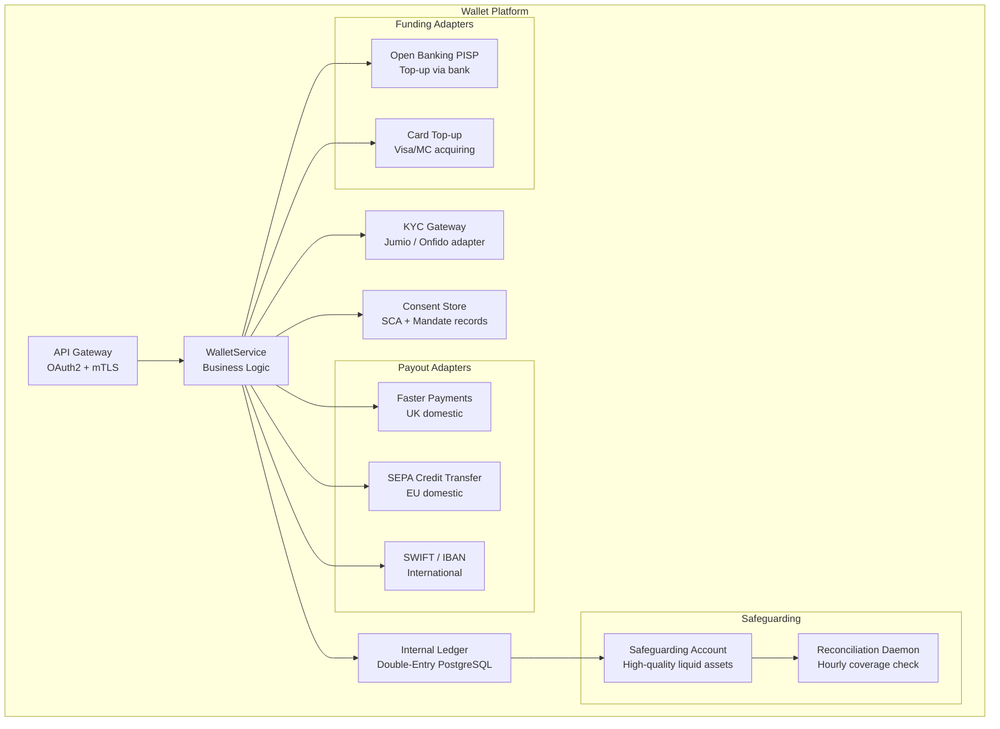

# المحافظ الرقمية — النقود الإلكترونية والحماية والتحويلات

## نظرة عامة

تحولت المحافظ الرقمية من ميزات للراحة إلى بنية مالية حرجة: فأكبر المحافظ تحتفظ بعشرات مليارات الدولارات من أموال العملاء لعشرات الملايين منهم، وأكبر المنصات الآسيوية تعالج مئات آلاف المعاملات في الثانية في ذروة مهرجانات التسوق. والتحدي الهندسي ليس السرعة أساسًا — فالدفتر الداخلي للمحفظة نطاق محدود نسبيًا — بل الامتثال الرقابي في كل طبقة من المنظومة. فاختيار الشكل القانوني (مؤسسة نقود إلكترونية، أو مؤسسة دفع، أو بنك) يحدد قواعد الحماية (safeguarding) المنطبقة، والمعاملات المسموح بها، ومتطلبات رأس المال التي تقيّد ميزات المنتج.

## أهداف التعلم

- التمييز بين النقود الإلكترونية (EMD2)، وأدوات القيمة المخزنة، والبطاقات المدفوعة مسبقًا، والحسابات البنكية، وشرح الآثار الهندسية لكل تصنيف
- وصف إطاري EMD2 / PSD2 الأوروبيين (اللذين سيُدمجان قريبًا في PSD3 ولائحة خدمات الدفع) وتراخيص تحويل الأموال في الولايات الأمريكية، وربط الالتزامات الرقابية بالقيود المعمارية
- تصميم المكونات الخمسة الأساسية لمنصة محفظة: الدفتر، ومحوّل التمويل، ومحوّل الصرف، وبوابة KYC، ومخزن الموافقات
- تنفيذ `WalletService` بدفتر قيد مزدوج داخلي، وتجريد لمصادر التمويل، ودلالات تحويل idempotent
- نمذجة تدفقات إدخال المال (الشحن بتحويل بنكي وبالبطاقة) وإخراجه (السحب إلى البنك) كآلات حالة صريحة مع معاملات تعويضية
- تنفيذ فصل الأموال المتوافق مع الحماية باستخدام حساب حماية مخصص لكل عملة وعملية مطابقة خلفية
- تنفيذ تحويلات P2P ذرية بين المحافظ باستخدام أقفال صفوف مرتبة، وتحديثات مشروطة، ودلالات إعادة محاولة آمنة
- دمج محفظة مع مسارات PISP في الخدمات المصرفية المفتوحة للشحن من البنك، واستبدال رسوم قبول البطاقات النسبية برسوم ثابتة صغيرة لكل تحويل

## سياق العمل

*مثال مركّب (مبني على إخفاقات حماية في المملكة المتحدة، لا على شركة بعينها):* احتفظت مؤسسة نقود إلكترونية (EMI) بنقود العملاء الإلكترونية وأموال تشغيلها في الحساب البنكي نفسه، خلافًا لقواعد الحماية في لوائح النقود الإلكترونية 2011. ولم يلاحظ أحد، لأن مطابقة الحماية كانت جدول بيانات يدويًا شهريًا. وعندما أخطرها بنكها بإغلاق الحساب، لم تستطع الشركة إثبات أن 100% من نقودها الإلكترونية القائمة مغطاة بأموال منفصلة — كان هناك عجز بالملايين. فمنعتها FCA من إصدار نقود إلكترونية جديدة، ودخلت الشركة الإعسار، وانتظر العملاء أشهرًا لاسترداد أموالهم، ناقصًا تكاليف المصفّين. وقادت حالات كهذه FCA إلى تشديد القواعد: فمنذ مايو 2026 يجب على شركات الدفع والنقود الإلكترونية البريطانية مطابقة الأموال المحمية كل يوم عمل، وتقديم تقارير حماية شهرية، وإجراء تدقيق حماية سنوي. والدرس الهندسي: يجب أن تكون مطابقة الحماية آلية، وتعمل في كل دورة تسوية، وتنبّه فورًا عندما تنخفض التغطية تحت 100.00%. ولا يمكن أن تكون تمرينًا ماليًا يدويًا شهريًا.

## النقود الإلكترونية مقابل القيمة المخزنة مقابل الحساب البنكي

هذه الأدوات متمايزة قانونيًا ولها عواقب هندسية مختلفة جدًا.

| الأداة | النظام الرقابي | الفصل مطلوب | تحمل فائدة | ضمان الودائع |
|---|---|---|---|---|
| النقود الإلكترونية (الاتحاد الأوروبي) | EMD2 + النقل الوطني | نعم — حماية 100% | لا (يحظرها EMD2) | لا (ليست ضمن FSCS/DGS) |
| بطاقة مدفوعة مسبقًا (الولايات المتحدة) | ترخيص الولاية + Reg E لدى CFPB ‏(قاعدة البطاقات المدفوعة مسبقًا) | يتفاوت حسب الولاية ("الاستثمارات المسموحة") | عمومًا لا | لا (ما لم تُحفظ "لصالح" المستخدمين في بنك مؤمَّن) |
| حساب جارٍ بنكي | ترخيص بنكي (CRR/CRD) | لا ينطبق (احتياطي جزئي) | نعم | نعم (FSCS البريطاني 120 ألف جنيه منذ ديسمبر 2025؛ وDGS الأوروبي 100 ألف يورو) |
| قيمة مخزنة بحلقة مغلقة | استثناء الشبكة المحدودة | لا | لا | لا |

> [!IMPORTANT]
> يسمح استثناء الشبكة المحدودة (المادة 3(k) من PSD2، المطبقة على النقود الإلكترونية عبر المادة 1(4) من EMD2) لبطاقات الهدايا وبطاقات المتاجر وبطاقات النقل والأدوات المشابهة بالعمل دون ترخيص EMI فقط إذا أمكن استخدامها ضمن شبكة محدودة من التجار أو لنطاق محدود جدًا من السلع والخدمات. وعندما تتجاوز قيمة المعاملات مليون يورو في 12 شهرًا، يجب على المزوّد إخطار الجهة الرقابية، التي تقرر هل ما زال الاستثناء منطبقًا. و"محفظة الولاء" التي تستمر في إضافة تجار قد تعبر إلى النقود الإلكترونية المنظمة دون أن يلاحظ المشغّل، فتنشأ مسؤولية امتثال.

**النقود الإلكترونية** هي النموذج المهيمن للمحافظ متعددة الأغراض (Revolut وWise وMonese). وتُرخّص مؤسسة النقود الإلكترونية من بنك مركزي أو جهة رقابة مالية، ويجب أن تحتفظ بـ 100% من التزامات النقود الإلكترونية القائمة في أموال محمية (أصول سائلة عالية الجودة — سندات حكومية، أو ودائع لدى البنك المركزي، أو حسابات بنكية منفصلة)، ولا يجوز لها دفع فائدة على الأرصدة.

## الأساس الرقابي والقيود المعمارية

يرتبط النظام الرقابي مباشرة بقرارات تصميم النظام:

| القيد | EMD2 (مؤسسة نقود إلكترونية أوروبية) | محوّل أموال أمريكي |
|---|---|---|
| الحماية | حماية 100% وفق المادة 7 من EMD2 | "استثمارات مسموحة" وفق قانون الولاية |
| مكافحة غسل الأموال/KYC | توجيهات AML (ولائحة AMLR من 2027) | قانون BSA والتزامات SAR لدى FinCEN |
| الحدود دون KYC كامل | عناية واجبة مبسطة فقط ضمن حدود ضيقة (AMLD5: مثلًا 150 يورو شهريًا، و50 يورو للدفعات عن بُعد) | تستخدم قواعد FinCEN للوصول المدفوع مسبقًا حد 1,000 دولار يوميًا؛ وفوقه يُطبق تحديد هوية العميل |
| عبر الحدود | جواز المرور (passporting) في المنطقة الاقتصادية الأوروبية (لا إلى المملكة المتحدة منذ بريكست) | ترخيص في كل ولاية تقريبًا (أو ترخيص بنكي)؛ ويوحّد قانون تحديث تحويل الأموال كثيرًا من قواعد الولايات |
| حماية البيانات | GDPR — النقل خارج المنطقة الاقتصادية الأوروبية يتطلب قرار كفاية أو ضمانات (لا إقامة صارمة للبيانات) | لا قانون فيدرالي؛ وقوانين ولايات مثل CCPA في كاليفورنيا |

```java
// Wallet legal entity type drives which rules apply at runtime
public enum WalletRegime {
    EU_EMI,           // Electronic Money Institution — EMD2 + PSD2
    UK_EMI,           // Post-Brexit UK FCA-regulated EMI
    US_MTL,           // US Money Services Business with state MTLs
    CLOSED_LOOP,      // Exempt stored-value (gift cards etc.)
    BANK_ACCOUNT      // Full banking licence
}

public record WalletAccount(
    UUID accountId,
    UUID customerId,
    WalletRegime regime,
    Currency currency,
    BigDecimal balance,          // Cached projection of the ledger; never negative for client funds
    KycLevel kycLevel,           // NONE, BASIC, FULL — drives transaction limits
    boolean safeguardingEnabled,
    Instant createdAt,
    Instant lastUpdated
) {}
```

## مكونات بنية المحفظة



**الدفتر** هو مصدر الحقيقة المعتمد — نظام محاسبة بالقيد المزدوج (انظر المسار 5، الدرس 1) بقيود يومية غير قابلة للتغيير. وكل رصيد مشتق من مجموع القيود المرحّلة، ولا يُخزّن أبدًا كحقل قابل للتعديل دون إمكانية اشتقاقه من الدفتر.

**محوّلات التمويل** تجرّد آليات إدخال المال إلى المحفظة. وكل محوّل ينفذ واجهة `FundingSource` مشتركة لكن بملفات زمن وكلفة مختلفة جدًا: فالتحويلات البنكية عبر الخدمات المصرفية المفتوحة تُسوّى في ثوانٍ وبرسوم ثابتة صغيرة؛ والشحن بالبطاقة فوري لكنه يحمل رسوم قبول نسبية (التبادل ونظام البطاقات والبنك المحصّل معًا)، ويمكن استرداده (chargeback).

**بوابة KYC** تفرض حدود المعاملات حسب مستوى KYC وتوجّه فحوص العناية الواجبة المعززة للعملاء ذوي القيمة العالية إلى طوابير المراجعة اليدوية.

## تنفيذ WalletService

```java
@Service
@Slf4j
public class WalletService {

    private final WalletAccountRepository walletRepo;
    private final LedgerService ledger;
    private final FundingSourceRegistry fundingSources;
    private final PayoutAdapterRegistry payoutAdapters;
    private final KycLimitEnforcer kycEnforcer;
    private final IdempotencyRepository idempotencyRepo;

    /**
     * Atomically transfers value between two wallet accounts within the same platform.
     * Locks both rows with SELECT FOR UPDATE in a CONSISTENT order (smaller UUID
     * first) to prevent deadlocks between A→B and B→A transfers. With ordered
     * row locks, READ COMMITTED is enough; SERIALIZABLE would add serialization
     * failures that every caller must retry.
     */
    @Transactional(isolation = Isolation.READ_COMMITTED)
    public TransferResult transfer(TransferRequest request) {
        // Claim the idempotency key IN THIS TRANSACTION (unique constraint):
        // a duplicate request gets the stored result instead of a second transfer
        Optional<TransferResult> previous = idempotencyRepo.claimOrGetResult(request.idempotencyKey());
        if (previous.isPresent()) {
            return previous.get();
        }
        if (request.sourceAccountId().equals(request.targetAccountId())) {
            throw new InvalidTransferException("Source and target are the same account");
        }

        // Lock in canonical order, whatever the transfer direction
        UUID first  = min(request.sourceAccountId(), request.targetAccountId());
        UUID second = max(request.sourceAccountId(), request.targetAccountId());
        Map<UUID, WalletAccount> locked = walletRepo.findAllByIdForUpdateOrdered(List.of(first, second));
        WalletAccount source = locked.get(request.sourceAccountId());
        WalletAccount target = locked.get(request.targetAccountId());
        if (source == null || target == null) {
            throw new AccountNotFoundException(request.sourceAccountId(), request.targetAccountId());
        }
        if (!source.currency().equals(target.currency())) {
            throw new InvalidTransferException("Currency mismatch — use the FX conversion flow");
        }

        kycEnforcer.checkTransferLimit(source, request.amount());

        if (source.balance().compareTo(request.amount()) < 0) {
            throw new InsufficientFundsException(source.accountId(), request.amount());
        }

        // Double-entry: one journal with a debit and a credit — atomic in the
        // same transaction; the ledger updates both cached balances
        JournalEntry journal = ledger.post(JournalEntry.of(request.reference(), source.currency(),
            Debit.of(source.accountId(), request.amount(), "P2P transfer out"),
            Credit.of(target.accountId(), request.amount(), "P2P transfer in")));

        log.info("P2P transfer complete: ref={}, amount={} {}",
            request.reference(), request.amount(), source.currency());

        TransferResult result = TransferResult.success(journal.journalId());
        idempotencyRepo.storeResult(request.idempotencyKey(), result);
        return result;
    }
}
```

> [!NOTE]
> ترتيب الأقفال حاسم لمنع الجمود. فعند الحصول على أقفال صفوف لحسابي محفظة في آن واحد، اقفل دائمًا الحساب ذا UUID الأصغر معجميًا أولًا. ودون ترتيب ثابت، سيتجمد تحويلان متزامنان باتجاهين متعاكسين (A←B وB←A) عند الحصول على القفل الثاني. ومع أقفال الصفوف المرتبة يكفي مستوى العزل READ COMMITTED؛ أما SERIALIZABLE فيضيف أخطاء تسلسل يجب أن يعيد كل مستدعٍ محاولتها.

## تدفقات إدخال المال وإخراجه

**إدخال المال عبر PISP في الخدمات المصرفية المفتوحة** (الشحن بتحويل بنكي):

```java
public FundInResult fundInViaBankTransfer(FundInRequest request) {
    // Step 1: Create pending ledger entry (funds not yet available)
    String pendingRef = ledger.createPendingCredit(
        request.walletAccountId(),
        request.amount(),
        request.currency(),
        "PENDING_OB_TOPUP"
    );

    // Step 2: Initiate payment via PISP — asynchronous
    OpenBankingPaymentOrder order = pisp.initiatePayment(
        OpenBankingPaymentOrder.builder()
            .amount(request.amount())
            .currency(request.currency())
            .creditorAccount(safeguardingAccount.iban(request.currency()))
            .creditorReference(pendingRef)       // Used for reconciliation
            .debtorAccount(request.linkedBankAccount())
            .build()
    );

    // Step 3: Return immediately — funds arrive via webhook on settlement
    return FundInResult.pending(pendingRef, order.consentUrl());
}

// Called when the SAFEGUARDING BANK confirms the money has arrived (bank
// statement / account webhook) — not when the PISP order status says "completed",
// which can come before the funds are actually in the account
@Transactional
public void onFundsReceivedInSafeguardingAccount(String creditorReference, BigDecimal receivedAmount) {
    // Idempotent: webhooks are delivered at least once — a second delivery
    // for an already-confirmed reference does nothing
    if (ledger.isPendingCreditConfirmed(creditorReference)) {
        return;
    }
    // Credit what actually ARRIVED (it may differ from what was requested)
    ledger.confirmPendingCredit(creditorReference, receivedAmount);
    safeguardingReconciliation.recordReceipt(creditorReference, receivedAmount);
}
```

يُضاف المال للمحفظة عندما **يؤكد بنك الحماية** وصوله (كشف حساب / webhook للحساب) — لا عندما تقول حالة أمر PISP "مكتمل"، فقد تأتي قبل أن يكون المال فعلًا في الحساب. والمعالج idempotent لأن الـ webhooks تُسلَّم مرة واحدة على الأقل، ويُضاف ما **وصل** فعلًا.

**إخراج المال عبر Faster Payments:**

```java
// Step 1 — ONE database transaction: debit the wallet AND record the payout
// instruction (outbox). Either both happen or neither does.
@Transactional
public PayoutResult requestPayout(PayoutRequest request) {
    String payoutId = UUID.randomUUID().toString();
    ledger.debitForPayout(request.walletAccountId(), request.amount(), payoutId);
    payoutOutbox.save(PayoutInstruction.pending(payoutId, request));
    return PayoutResult.accepted(payoutId);
}

// Step 2 — a dispatcher sends pending instructions to the rail (outside the
// database transaction) and records the outcome
public void dispatch(PayoutInstruction instruction) {
    PayoutAdapter adapter = payoutAdapters.forCurrency(instruction.currency());
    try {
        // payoutId doubles as the end-to-end id, so a resend is recognisable
        PaymentResult result = adapter.send(instruction.toPaymentInstruction());
        ledger.confirmPayout(instruction.payoutId(), result.networkReference());

    } catch (PaymentRejectedException ex) {
        // DEFINITE rejection (e.g. invalid account): safe to reverse the debit
        ledger.reverseDebit(instruction.payoutId(), "PAYOUT_REJECTED: " + ex.getRailErrorCode());
        log.warn("Payout rejected, debit reversed: payoutId={}", instruction.payoutId());

    } catch (PaymentTimeoutException ex) {
        // UNKNOWN outcome: the money may have left. Reversing now could pay the
        // customer twice. Mark it and query the rail for the real status.
        payoutOutbox.markUnknown(instruction.payoutId());
        statusChecker.scheduleQuery(instruction.payoutId());
    }
}
```

> [!WARNING]
> لا يمكن أن تكون الدفعة الخارجية جزءًا من معاملة قاعدة بيانات أبدًا، فلا "ترسل الدفعة ثم تخصم من الدفتر" أبدًا. فإذا خرجت الدفعة ثم ضاع الخصم (تعطل بين العمليتين)، يغادر المال حساب الحماية دون خصم في الدفتر — عجز في الحماية. اخصم أولًا وسجّل تعليمة الصرف في المعاملة **نفسها** (outbox)، وأرسل بعد ذلك، ولا تعكس إلا عند رفض **قاطع**، وعامل انتهاء المهلة كنتيجة مجهولة حتى يؤكد المسار الحالة.

## التزامات الحماية

بموجب المادة 7 من EMD2 (التي تطبق طرق الحماية في المادة 10 من PSD2)، وفي المملكة المتحدة بموجب اللوائح 20–22 من لوائح النقود الإلكترونية 2011 مع قواعد CASS 15 لدى FCA (منذ مايو 2026)، يجب على مؤسسة النقود الإلكترونية حماية الأموال المستلمة مقابل النقود الإلكترونية بحيث تكون مغطاة بالكامل في كل الأوقات. وطرق الحماية المقبولة:

1. **الفصل:** أموال محفوظة في حساب حماية مخصص لدى مؤسسة ائتمان (أو مستثمرة في أصول آمنة وسائلة ومنخفضة المخاطر توافق عليها الجهة الرقابية)، معزولة عن أموال الشركة الخاصة.
2. **التأمين أو الضمان:** وثيقة أو ضمان من شركة تأمين أو بنك خارج مجموعة الشركة يغطي المبلغ كاملًا (أقل شيوعًا عمليًا).

```java
@Scheduled(cron = "0 */1 * * * *")  // Every 1 minute
public void reconcileSafeguarding() {
    for (Currency currency : supportedCurrencies) {
        BigDecimal emoneyLiability = ledger.totalClientBalances(currency);   // incl. pending credits
        BigDecimal safeguardingBalance = safeguardingAccountClient.balance(currency);
        if (emoneyLiability.signum() == 0) {
            continue;                                   // nothing to cover; avoid divide-by-zero
        }

        BigDecimal coverageRatio = safeguardingBalance
            .divide(emoneyLiability, 6, RoundingMode.DOWN);

        safeguardingMetrics.record(currency, coverageRatio, emoneyLiability, safeguardingBalance);

        if (coverageRatio.compareTo(MINIMUM_COVERAGE_RATIO) < 0) {
            // 100% = BigDecimal.ONE; alert if coverage drops even £0.01 below
            String message = String.format(
                "SAFEGUARDING BREACH: currency=%s, liability=%s, safeguarded=%s, ratio=%s",
                currency, emoneyLiability, safeguardingBalance, coverageRatio);
            alertingService.criticalAlert("SAFEGUARDING_BREACH", message);
            // Also raise incident automatically — this is regulatory non-compliance
            incidentService.raise(IncidentSeverity.P0, "SAFEGUARDING_COVERAGE", message);
        }
    }
}

private static final BigDecimal MINIMUM_COVERAGE_RATIO = BigDecimal.ONE; // 100%
```

## الترميز للمدفوعات المتكررة

عندما يحفظ العميل محفظته كمصدر تمويل لمدفوعات متكررة (مثل فوترة الاشتراكات)، يخزن التاجر **رمز تفويض (mandate token)** بدل بيانات اعتماد الحساب. وهذا يتبع نموذج المصادقة القوية للعملاء (SCA) في PSD2: فالدفعة الأولى تتطلب مصادقة صريحة من العميل (تحدي SCA)، والدفعات اللاحقة قد تتأهل لإعفاء المتكرر.

```java
public record RecurringMandate(
    UUID mandateId,
    UUID walletAccountId,
    String merchantId,
    BigDecimal maxAmountPerCharge,
    Currency currency,
    MandateFrequency frequency,     // WEEKLY, MONTHLY, ON_DEMAND
    Instant firstPaymentAuthAt,     // When initial SCA was performed
    Instant expiresAt,
    MandateStatus status            // ACTIVE, SUSPENDED, CANCELLED
) {}
```

> [!NOTE]
> بموجب قواعد المصادقة القوية (المادة 97 من PSD2 والمادة 14 من المعايير الفنية RTS)، فسلسلة المعاملات المتكررة **بالمبلغ نفسه** للمستفيد نفسه لا تحتاج المصادقة القوية إلا للدفعة الأولى. وإذا تغير المبلغ، تلزم المصادقة القوية مجددًا. أما الدفعات التي يبدؤها التاجر بموجب تفويض وافق عليه العميل بمصادقة قوية (المعاملات التي يبدؤها التاجر) فهي خارج نطاق المصادقة القوية أصلًا، وهكذا تُعالج الاشتراكات المتغيرة عادة.

## ذرية تحويلات P2P بين المحافظ

ضمان الأمان الأساسي أن المال لا يمكن أن يظهر أو يختفي: فيجب الحفاظ على مجموع أرصدة المحافظ عبر المنصة في كل تحويل. وهذا يتطلب أن يُكتب قيدا الخصم والإضافة في معاملة ACID واحدة، وأن يُقفل فحص الدفتر وتحديثات الرصيد ضد التعديل المتزامن.

```sql
-- Ordered row locks + a conditional debit: READ COMMITTED is enough
BEGIN;

-- Lock both accounts in consistent order (smaller UUID first)
SELECT account_id, balance FROM wallet_accounts
WHERE account_id IN (:sourceId, :targetId)
ORDER BY account_id
FOR UPDATE;

-- Conditional debit: 0 rows updated = insufficient funds → ROLLBACK
UPDATE wallet_accounts SET balance = balance - :amount
WHERE account_id = :sourceId AND balance >= :amount;

UPDATE wallet_accounts SET balance = balance + :amount
WHERE account_id = :targetId;

-- One journal, two entries (debit + credit) that sum to zero
INSERT INTO ledger_entries (entry_id, journal_id, account_id, entry_type, amount, currency, reference, created_at)
VALUES (gen_random_uuid(), :journalId, :sourceId, 'DEBIT',  :amount, :currency, :reference, NOW()),
       (gen_random_uuid(), :journalId, :targetId, 'CREDIT', :amount, :currency, :reference, NOW());

COMMIT;
```

## التشغيل البيني مع مسارات الخدمات المصرفية المفتوحة

تستطيع المحافظ التكامل مع بنية الخدمات المصرفية المفتوحة كمزوّد طرف ثالث (TPP) وكوجهة. فالمحفظة التي تعمل كـ PISP تستطيع بدء تحويلات بنكية نيابة عن مستخدميها إلى مستفيدين خارجيين بكلفة أقل من مدفوعات البطاقات. والمحفظة التي تعمل كوجهة تستطيع تلقي دفعات بنكية تُضاف مباشرة إلى حساب الحماية لديها.

| نمط التكامل | الكلفة على التاجر | الزمن | حالة الاستخدام |
|---|---|---|---|
| الشحن بالبطاقة (Visa/MC) | رسوم نسبية (التبادل + نظام البطاقات + المحصّل)، غالبًا نحو 1–2% | فوري | شحن طارئ |
| الشحن عبر PISP | رسوم ثابتة صغيرة (مثل 0.10–0.25 جنيه) | ثوانٍ (FPS) | شحن منتظم |
| الشحن عبر SEPA CT | رسوم ثابتة صغيرة | اليوم التالي (SEPA Instant: أقل من 10 ثوانٍ) | مستخدمو الاتحاد الأوروبي |
| الشحن عبر SWIFT | 5–25 دولارًا رسوم مراسلين | 1–3 أيام عمل | دولي |

## اختبار المعرفة

**س1: تحتفظ مؤسسة نقود إلكترونية بأرصدة النقود الإلكترونية للعملاء في حساب واحد متعدد العملات لدى بنك من الفئة الأولى. ويلاحظ فريق العمليات أن نسبة تغطية الحماية للجنيه تنخفض إلى 97% لفترة قصيرة أثناء معالجة نهاية اليوم. ما السبب الجذري الأرجح وكيف يجب أن تمنعه البنية؟**

ج: السبب الجذري الأرجح عدم تطابق توقيت بين وقت إضافة المال للمحافظ (فور تأكيد تسوية دفعة PISP) ووقت وصول الأموال الواردة المقابلة فعلًا إلى حساب الحماية. فإذا أضافت المنصة المال للمحافظ بمجرد انتقال حالة أمر دفع PISP إلى `AcceptedSettlementCompleted`، لكن الأموال الفعلية تصل إلى حساب الحماية بعد 60–90 ثانية عبر دورة التسوية بين البنوك، توجد نافذة عابرة تتجاوز فيها الالتزامات الأصول. والإصلاح المعماري من جزأين: أولًا، أضف المال للمحافظ فقط بعد تأكيد الدفعة الواردة على مستوى حساب الحماية (استخدم webhook البنك أو استطلاع كشف الحساب)، لا على مستوى حالة أمر دفع PISP؛ ثانيًا، احتفظ بالإضافات المعلقة في حالة `PENDING` منفصلة في الدفتر تُدرج في حساب الحماية لكنها غير متاحة للإنفاق بعد، لضمان حساب نسبة الحماية دائمًا بشكل محافظ.

**س2: لماذا لا تستطيع محفظة رقمية مبنية على ترخيص مؤسسة نقود إلكترونية دفع فائدة على أرصدة العملاء، وما العواقب الهندسية لهذا القيد؟**

ج: تحظر المادة 12 من EMD2 على مؤسسات النقود الإلكترونية دفع فائدة على النقود الإلكترونية أو تقديم أي منفعة مرتبطة بمدة احتفاظ العميل بها، لأن ذلك سيحوّل النقود الإلكترونية فعليًا إلى قبول ودائع (نشاط بنكي يتطلب ترخيصًا بنكيًا كاملًا). والعواقب الهندسية كبيرة: يجب ألا يطبق دفتر المحفظة أي قيود إضافة دورية على حسابات العملاء، ويجب تتبع أي استرداد نقدي أو مكافآت مكتسبة من الإنفاق كمنتج منفصل (مثل نظام نقاط مكافآت) لا يُستحق مباشرة في رصيد المحفظة، ويجب أن توجّه أي ميزة "حصّالات ادخار" الأموال إلى بنك شريك (يملك ترخيصًا بنكيًا) بدل الاحتفاظ بها في ميزانية مؤسسة النقود الإلكترونية نفسها. وهذا يتطلب نوع كيان إضافيًا في الدفتر لتمثيل الأموال "الموضوعة خارجيًا" خارج ميزانية المؤسسة مع بقائها متاحة للعميل.

## التحدي العملي

1. **عملية مطابقة الحماية الخلفية:** نفّذ `SafeguardingReconciliationService` كمهمة Spring مجدولة تعمل كل 5 دقائق. ويجب أن تستعلم المجموع الكلي لأرصدة محافظ العملاء لكل عملة من الدفتر، وتقارنه بالرصيد الذي يبلغ عنه `SafeguardingAccountClient` محاكى، وتحسب نسبة التغطية، وتصدر مقياس Prometheus ‏`wallet_safeguarding_coverage_ratio{currency="GBP"}`. واكتب اختبارًا يحقن سيناريو يكون فيه رصيد الحماية أقل بـ 5,000 جنيه من مجموع أرصدة العملاء ويؤكد استدعاء `alertingService.criticalAlert()` بالشدة `SAFEGUARDING_BREACH`.

2. **تحويل P2P مع منع الجمود:** نفّذ دالة `WalletService.transfer()` باستخدام JDBC مع `SELECT ... FOR UPDATE` صريح وترتيب أقفال ثابت. واكتب اختبارًا متزامنًا بعشرة خيوط، ينفذ كل منها تحويلًا عشوائيًا بين الحسابات A وB وC في آن واحد. وأكد أنه بعد اكتمال كل التحويلات يساوي مجموع الأرصدة الثلاثة المجموع الأولي (حفظ القيمة)، وأنه لا تنتشر استثناءات جمود إلى المستدعين (يجب أن تُعاد المحاولة داخليًا حتى 3 مرات).

3. **آلة حالة إدخال المال:** نمذج تدفق إدخال المال كـ `FundInStateMachine` بالحالات `INITIATED → CONSENT_GRANTED → PAYMENT_SUBMITTED → SETTLEMENT_PENDING → CREDITED | FAILED`. ونفّذ انتقالات الحالة كدوال، واحفظ الحالة الحالية في PostgreSQL، واربط معالج webhook يقود `PAYMENT_SUBMITTED → SETTLEMENT_PENDING → CREDITED`. واكتب اختبار تكامل بمحوّل PISP محاكى يحاكي تسوية متأخرة (تصل بعد ثانيتين من البدء).

4. **فارض حدود KYC:** نفّذ `KycLimitEnforcer` بثلاثة مستويات KYC توضيحية (الحدود الحقيقية تأتي من سياسة AML لديك): NONE ‏(150 جنيهًا للمعاملة، و2500 جنيه مدى الحياة)، وBASIC ‏(1000 جنيه للمعاملة، و10000 جنيه شهريًا)، وFULL ‏(50000 جنيه للمعاملة، دون حد). ويجب أن يتتبع الفارض المبالغ المتراكمة باستعلام نافذة متحركة على جدول الدفتر ويرمي `KycLimitExceededException` برسالة توضح الهامش المتبقي. واختبر كل حالات الحدود (عند الحد بالضبط، وتحته بقرش، وفوقه بقرش) لكل مستوى.

<!-- KNOWLEDGE-CHECK
{
  "questions": [
    {
      "text": "تحتفظ مؤسسة نقود إلكترونية بأرصدة النقود الإلكترونية للعملاء في حساب حماية. وتنخفض نسبة تغطية الحماية إلى 97% لفترة قصيرة أثناء معالجة نهاية اليوم. ما السبب الجذري الأرجح؟",
      "options": [
        "المؤسسة تدفع فائدة على أرصدة النقود الإلكترونية بشكل غير قانوني",
        "عدم تطابق توقيت بين وقت إضافة المال للمحافظ عند تأكيد تسوية PISP ووقت وصول الأموال فعلًا إلى حساب الحماية",
        "تجاوز حدود مستويات KYC، والمعاملات المعلقة تؤخر التسوية",
        "محوّل PISP يقرّب مبالغ العملات بشكل خاطئ"
      ],
      "correct": 1,
      "explanation": "إذا أُضيف المال للمحافظ عند انتقال حالة أمر دفع PISP إلى AcceptedSettlementCompleted، لكن الأموال تصل إلى حساب الحماية بعد 60-90 ثانية عبر دورة التسوية بين البنوك، توجد نافذة عابرة تتجاوز فيها الالتزامات الأصول. والإصلاح إضافة المال للمحافظ فقط بعد تأكيد الدفعة الواردة على مستوى حساب الحماية."
    },
    {
      "text": "لماذا تحظر المادة 12 من EMD2 على مؤسسات النقود الإلكترونية دفع فائدة على أرصدة العملاء، وما العاقبة الهندسية الأساسية؟",
      "options": [
        "حسابات الفائدة أعقد من أن تتحملها أنظمة الدفاتر الآنية",
        "دفع الفائدة يحوّل النقود الإلكترونية إلى قبول ودائع، وهذا يتطلب ترخيصًا بنكيًا كاملًا؛ فيجب ألا يطبق الدفتر أبدًا قيود إضافة دورية على حسابات العملاء",
        "مدفوعات الفائدة تخالف متطلبات المصادقة القوية في PSD2",
        "لا تستطيع مؤسسات النقود الإلكترونية الاحتفاظ بأموال العملاء أكثر من 24 ساعة، فيستحيل استحقاق الفائدة"
      ],
      "correct": 1,
      "explanation": "تحظر المادة 12 من EMD2 الفائدة لأنها ستحوّل النقود الإلكترونية فعليًا إلى قبول ودائع (نشاط بنكي يتطلب ترخيصًا بنكيًا كاملًا). والعاقبة الهندسية أن دفتر المحفظة يجب ألا يطبق أي قيود إضافة دورية على حسابات العملاء، ويجب تتبع أي مكافآت كمنتج منفصل لا يُستحق مباشرة في رصيد المحفظة."
    },
    {
      "text": "تستخدم خدمة تحويل P2P بين المحافظ SELECT FOR UPDATE دون ترتيب أقفال ثابت. يريد الخيط 1 التحويل من الحساب A إلى الحساب B، ويريد الخيط 2 التحويل من B إلى A. ما النتيجة المرجحة؟",
      "options": [
        "يفشل الخيط 2 فورًا بخطأ رصيد غير كافٍ",
        "ينجح التحويلان لأن PostgreSQL يكتشف الجمود آليًا",
        "يحدث جمود: الخيط 1 يمسك قفل A وينتظر B، والخيط 2 يمسك قفل B وينتظر A",
        "ينجح الخيط 1؛ ويُوضع الخيط 2 في طابور وينفذ بعد التزام الخيط 1"
      ],
      "correct": 2,
      "explanation": "دون ترتيب أقفال ثابت، تنشئ معاملتان تحصلان على الأقفال بترتيبين متعاكسين دورة جمود. فالخيط 1 يقفل A وينتظر B؛ والخيط 2 يقفل B وينتظر A. والإصلاح ترتيب أقفال قياسي — رتّب دائمًا معرّفات الحسابات قبل الحصول على الأقفال ليحصل عليها كل الخيوط بالترتيب نفسه."
    }
  ]
}
-->

<!-- PRACTICAL-CHALLENGE
{
  "title": "بناء البنية الأساسية للمحفظة الرقمية",
  "difficulty": "advanced",
  "estimatedMinutes": 60,
  "tasks": [
    {"id": "1", "description": "نفّذ SafeguardingReconciliationService كمهمة Spring ‏@Scheduled (كل 5 دقائق) تستعلم مجموع أرصدة العملاء لكل عملة، وتقارنه بمحاكاة SafeguardingAccountClient، وتحسب نسبة التغطية، وتصدر مقياس Prometheus. واكتب اختبارًا يؤكد استدعاء criticalAlert() عندما تنخفض التغطية تحت 100%."},
    {"id": "2", "description": "نفّذ WalletService.transfer() باستخدام JDBC مع SELECT FOR UPDATE وترتيب أقفال ثابت. واكتب اختبارًا متزامنًا بعشرة خيوط تنفذ تحويلات عشوائية بين الحسابات A وB وC، مؤكدًا حفظ القيمة وعدم انتشار استثناءات جمود إلى المستدعين."},
    {"id": "3", "description": "نمذج تدفق إدخال المال كـ FundInStateMachine بالحالات INITIATED وCONSENT_GRANTED وPAYMENT_SUBMITTED وSETTLEMENT_PENDING وCREDITED وFAILED. واحفظ الحالة في PostgreSQL واربط معالج webhook يقود انتقالات التسوية. واكتب اختبار تكامل يحاكي تسوية متأخرة."},
    {"id": "4", "description": "نفّذ KycLimitEnforcer بالمستويات NONE وBASIC وFULL يفرض حدودًا لكل معاملة ولنافذة متحركة عبر استعلامات الدفتر. وارمِ KycLimitExceededException مع الهامش المتبقي. واختبر كل حالات الحدود (عند الحد بالضبط، وتحته بقرش، وفوقه بقرش) لكل مستوى."}
  ]
}
-->
