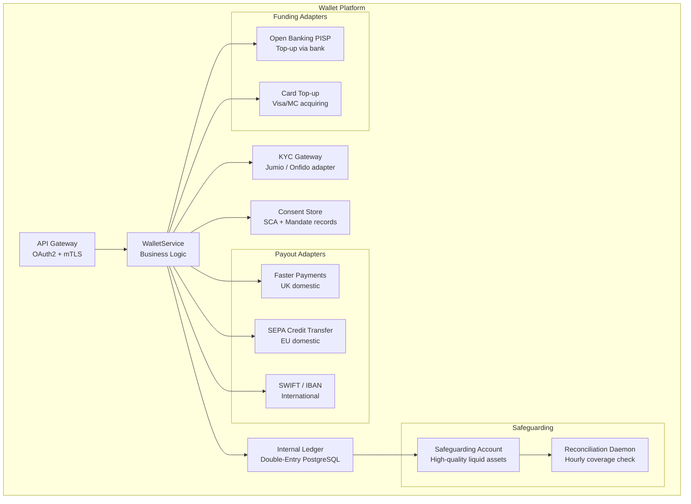

## Overview

Digital wallets have matured from convenience features into critical financial infrastructure: the largest wallets hold tens of billions of dollars of customer money for tens of millions of customers, and the biggest Asian platforms handle hundreds of thousands of transactions per second at shopping-festival peaks. The engineering challenge is not primarily one of velocity — the internal ledger of a wallet is a relatively constrained domain — but of regulatory compliance at every layer of the stack. The choice of legal structure (e-money institution, payment institution, or bank) determines which safeguarding rules apply, which transactions are permissible, and which capital requirements constrain product features.

## Learning Objectives

- Distinguish between e-money (EMD2), stored-value instruments, prepaid cards, and bank accounts and explain the engineering implications of each classification
- Describe the EU EMD2 / PSD2 (soon to be merged into PSD3 and the Payment Services Regulation) and US state money transmitter licence frameworks and map regulatory obligations to architectural constraints
- Design the five core components of a wallet platform: ledger, funding adapter, payout adapter, KYC gateway, and consent store
- Implement a `WalletService` with an internal double-entry ledger, funding source abstraction, and idempotent transfer semantics
- Model fund-in (bank transfer top-up and card top-up) and fund-out (bank withdrawal) flows as explicit state machines with compensating transactions
- Implement safeguarding-compliant fund segregation using a designated safeguarding account per currency and a reconciliation daemon
- Execute atomic wallet-to-wallet P2P transfers using ordered row locks, conditional updates and safe retry semantics
- Integrate a wallet with open banking PISP rails for bank-funded top-ups, replacing a percentage card acceptance fee with a small fixed fee per transfer

## Business Context

*Composite example (based on UK safeguarding failures, not a specific firm):* an e-money institution (EMI) kept client e-money and its own operating money in the same bank account, contrary to the safeguarding rules in the Electronic Money Regulations 2011. Nobody noticed, because safeguarding reconciliation was a manual monthly spreadsheet. When its bank gave notice to close the account, the firm could not show that 100% of its outstanding e-money was covered by segregated funds — there was a shortfall of millions. The FCA stopped it from issuing new e-money, the firm entered insolvency, and customers waited months to get their money back, minus the administrators' costs. Cases like this led the FCA to tighten the rules: since May 2026 UK payment and e-money firms must reconcile safeguarded funds every business day, file monthly safeguarding returns and have an annual safeguarding audit. The engineering lesson: safeguarding reconciliation must be automated, run on every settlement cycle, and alert immediately when coverage falls below 100.00%. It cannot be a manual monthly finance exercise.

## E-Money vs Stored-Value vs Bank Account

These three instruments are legally distinct and carry very different engineering consequences.

| Instrument | Regulatory regime | Segregation required | Interest bearing | Deposit guarantee |
|---|---|---|---|---|
| E-Money (EU) | EMD2 + national transposition | Yes — 100% safeguarding | No (prohibited by EMD2) | No (not FSCS/DGS) |
| Prepaid card (US) | State MTL + CFPB Reg E (Prepaid Rule) | Varies by state ("permissible investments") | Generally no | No (unless held "for the benefit of" users at an insured bank) |
| Bank current account | Banking licence (CRR/CRD) | N/A (fractional reserve) | Yes | Yes (UK FSCS £120k since December 2025; EU DGS €100k) |
| Closed-loop stored value | Limited network exclusion | No | No | No |

> [!IMPORTANT]
> The limited network exclusion (PSD2 Art. 3(k), applied to e-money through EMD2 Art. 1(4)) lets gift cards, store cards, transport cards and similar instruments operate without an EMI licence only if they can be used within a limited network of merchants or for a very limited range of goods and services. Once the value of transactions exceeds €1 million in 12 months, the provider must notify the regulator, which decides whether the exclusion still applies. A "loyalty wallet" that keeps adding merchants can cross into regulated e-money without the operator noticing, creating compliance liability.

**E-money** is the dominant model for general-purpose wallets (Revolut, Wise, Monese). An EMI is authorised by a central bank or financial regulator, must hold 100% of outstanding e-money liabilities in safeguarded funds (high-quality liquid assets — government bonds, central bank deposits, or segregated bank accounts), and cannot pay interest on balances.

## Regulatory Basis and Architectural Constraints

The regulatory regime maps directly to system design decisions:

| Constraint | EMD2 (EU EMI) | US Money Transmitter |
|---|---|---|
| Safeguarding | 100% safeguarded per EMD2 Art. 7 | "Permissible investments" per state law |
| AML/KYC | AML directives (AMLR from 2027) | BSA + FinCEN SAR obligations |
| Limits without full KYC | Simplified due diligence only within tight limits (AMLD5: e.g. €150 per month, €50 for remote payments) | FinCEN prepaid access rules use a $1,000-per-day threshold; above it, customer identification applies |
| Cross-border | Passporting in the EEA (not to the UK since Brexit) | A licence in almost every state (or a bank charter); the Money Transmission Modernization Act harmonises many state rules |
| Data protection | GDPR — transfers outside the EEA need an adequacy decision or safeguards (not strict residency) | No federal law; state laws such as California's CCPA |

```java
// Wallet legal entity type drives which rules apply at runtime
public enum WalletRegime {
    EU_EMI,           // Electronic Money Institution — EMD2 + PSD2
    UK_EMI,           // Post-Brexit UK FCA-regulated EMI
    US_MTL,           // US Money Services Business with state MTLs
    CLOSED_LOOP,      // Exempt stored-value (gift cards etc.)
    BANK_ACCOUNT      // Full banking licence
}

public record WalletAccount(
    UUID accountId,
    UUID customerId,
    WalletRegime regime,
    Currency currency,
    BigDecimal balance,          // Cached projection of the ledger; never negative for client funds
    KycLevel kycLevel,           // NONE, BASIC, FULL — drives transaction limits
    boolean safeguardingEnabled,
    Instant createdAt,
    Instant lastUpdated
) {}
```

## Wallet Architecture Components



**Ledger** is the authoritative source of truth — a double-entry accounting system (see Track 5, Lesson 1) with immutable journal entries. Every balance is derived from the sum of posted entries, never stored as a mutable field without derivability from the ledger.

**Funding adapters** abstract the mechanics of getting money into the wallet. Each adapter implements a common `FundingSource` interface but has very different latency and cost profiles: open banking bank transfers settle in seconds and cost a small fixed fee; card top-ups are instantaneous but carry percentage-based acceptance fees (interchange, scheme and acquirer fees together), and can be charged back.

**KYC gateway** enforces transaction limits based on KYC level and routes enhanced due diligence checks for high-value customers to manual review queues.

## WalletService Implementation

```java
@Service
@Slf4j
public class WalletService {

    private final WalletAccountRepository walletRepo;
    private final LedgerService ledger;
    private final FundingSourceRegistry fundingSources;
    private final PayoutAdapterRegistry payoutAdapters;
    private final KycLimitEnforcer kycEnforcer;
    private final IdempotencyRepository idempotencyRepo;

    /**
     * Atomically transfers value between two wallet accounts within the same platform.
     * Locks both rows with SELECT FOR UPDATE in a CONSISTENT order (smaller UUID
     * first) to prevent deadlocks between A→B and B→A transfers. With ordered
     * row locks, READ COMMITTED is enough; SERIALIZABLE would add serialization
     * failures that every caller must retry.
     */
    @Transactional(isolation = Isolation.READ_COMMITTED)
    public TransferResult transfer(TransferRequest request) {
        // Claim the idempotency key IN THIS TRANSACTION (unique constraint):
        // a duplicate request gets the stored result instead of a second transfer
        Optional<TransferResult> previous = idempotencyRepo.claimOrGetResult(request.idempotencyKey());
        if (previous.isPresent()) {
            return previous.get();
        }
        if (request.sourceAccountId().equals(request.targetAccountId())) {
            throw new InvalidTransferException("Source and target are the same account");
        }

        // Lock in canonical order, whatever the transfer direction
        UUID first  = min(request.sourceAccountId(), request.targetAccountId());
        UUID second = max(request.sourceAccountId(), request.targetAccountId());
        Map<UUID, WalletAccount> locked = walletRepo.findAllByIdForUpdateOrdered(List.of(first, second));
        WalletAccount source = locked.get(request.sourceAccountId());
        WalletAccount target = locked.get(request.targetAccountId());
        if (source == null || target == null) {
            throw new AccountNotFoundException(request.sourceAccountId(), request.targetAccountId());
        }
        if (!source.currency().equals(target.currency())) {
            throw new InvalidTransferException("Currency mismatch — use the FX conversion flow");
        }

        kycEnforcer.checkTransferLimit(source, request.amount());

        if (source.balance().compareTo(request.amount()) < 0) {
            throw new InsufficientFundsException(source.accountId(), request.amount());
        }

        // Double-entry: one journal with a debit and a credit — atomic in the
        // same transaction; the ledger updates both cached balances
        JournalEntry journal = ledger.post(JournalEntry.of(request.reference(), source.currency(),
            Debit.of(source.accountId(), request.amount(), "P2P transfer out"),
            Credit.of(target.accountId(), request.amount(), "P2P transfer in")));

        log.info("P2P transfer complete: ref={}, amount={} {}",
            request.reference(), request.amount(), source.currency());

        TransferResult result = TransferResult.success(journal.journalId());
        idempotencyRepo.storeResult(request.idempotencyKey(), result);
        return result;
    }
}
```

> [!NOTE]
> Lock ordering is critical for deadlock prevention. When acquiring row-level locks on two wallet accounts simultaneously, always lock the account with the lexicographically smaller UUID first. Without consistent ordering, two concurrent transfers in opposite directions (A→B and B→A) will deadlock on the second lock acquisition.

## Fund-In and Fund-Out Flows

**Fund-in via open banking PISP** (bank transfer top-up):

```java
public FundInResult fundInViaBankTransfer(FundInRequest request) {
    // Step 1: Create pending ledger entry (funds not yet available)
    String pendingRef = ledger.createPendingCredit(
        request.walletAccountId(),
        request.amount(),
        request.currency(),
        "PENDING_OB_TOPUP"
    );

    // Step 2: Initiate payment via PISP — asynchronous
    OpenBankingPaymentOrder order = pisp.initiatePayment(
        OpenBankingPaymentOrder.builder()
            .amount(request.amount())
            .currency(request.currency())
            .creditorAccount(safeguardingAccount.iban(request.currency()))
            .creditorReference(pendingRef)       // Used for reconciliation
            .debtorAccount(request.linkedBankAccount())
            .build()
    );

    // Step 3: Return immediately — funds arrive via webhook on settlement
    return FundInResult.pending(pendingRef, order.consentUrl());
}

// Called when the SAFEGUARDING BANK confirms the money has arrived (bank
// statement / account webhook) — not when the PISP order status says "completed",
// which can come before the funds are actually in the account
@Transactional
public void onFundsReceivedInSafeguardingAccount(String creditorReference, BigDecimal receivedAmount) {
    // Idempotent: webhooks are delivered at least once — a second delivery
    // for an already-confirmed reference does nothing
    if (ledger.isPendingCreditConfirmed(creditorReference)) {
        return;
    }
    // Credit what actually ARRIVED (it may differ from what was requested)
    ledger.confirmPendingCredit(creditorReference, receivedAmount);
    safeguardingReconciliation.recordReceipt(creditorReference, receivedAmount);
}
```

**Fund-out via Faster Payments:**

```java
// Step 1 — ONE database transaction: debit the wallet AND record the payout
// instruction (outbox). Either both happen or neither does.
@Transactional
public PayoutResult requestPayout(PayoutRequest request) {
    String payoutId = UUID.randomUUID().toString();
    ledger.debitForPayout(request.walletAccountId(), request.amount(), payoutId);
    payoutOutbox.save(PayoutInstruction.pending(payoutId, request));
    return PayoutResult.accepted(payoutId);
}

// Step 2 — a dispatcher sends pending instructions to the rail (outside the
// database transaction) and records the outcome
public void dispatch(PayoutInstruction instruction) {
    PayoutAdapter adapter = payoutAdapters.forCurrency(instruction.currency());
    try {
        // payoutId doubles as the end-to-end id, so a resend is recognisable
        PaymentResult result = adapter.send(instruction.toPaymentInstruction());
        ledger.confirmPayout(instruction.payoutId(), result.networkReference());

    } catch (PaymentRejectedException ex) {
        // DEFINITE rejection (e.g. invalid account): safe to reverse the debit
        ledger.reverseDebit(instruction.payoutId(), "PAYOUT_REJECTED: " + ex.getRailErrorCode());
        log.warn("Payout rejected, debit reversed: payoutId={}", instruction.payoutId());

    } catch (PaymentTimeoutException ex) {
        // UNKNOWN outcome: the money may have left. Reversing now could pay the
        // customer twice. Mark it and query the rail for the real status.
        payoutOutbox.markUnknown(instruction.payoutId());
        statusChecker.scheduleQuery(instruction.payoutId());
    }
}
```

> [!WARNING]
> An external payment can never be part of a database transaction, so never "send the payment, then debit the ledger". If the payment goes out and the debit is then lost (a crash between the two), money leaves the safeguarding account without a ledger debit — a safeguarding shortfall. Debit first and record the payout instruction in the **same** transaction (outbox), send afterwards, reverse only on a **definite** rejection, and treat a timeout as unknown until the rail confirms the status.

## Safeguarding Obligations

Under EMD2 Article 7 (which applies the PSD2 Article 10 safeguarding methods) and, in the UK, regulations 20–22 of the Electronic Money Regulations 2011 together with the FCA's CASS 15 rules (since May 2026), an EMI must safeguard funds received in exchange for e-money so that they are fully covered at all times. Acceptable safeguarding methods are:

1. **Segregation:** Funds held in a designated safeguarding account with a credit institution (or invested in secure, liquid, low-risk assets approved by the regulator), ring-fenced from the firm's own money.
2. **Insurance or guarantee:** A policy or guarantee from an insurer or bank outside the firm's group covering the full amount (less common in practice).

```java
@Scheduled(cron = "0 */1 * * * *")  // Every 1 minute
public void reconcileSafeguarding() {
    for (Currency currency : supportedCurrencies) {
        BigDecimal emoneyLiability = ledger.totalClientBalances(currency);   // incl. pending credits
        BigDecimal safeguardingBalance = safeguardingAccountClient.balance(currency);
        if (emoneyLiability.signum() == 0) {
            continue;                                   // nothing to cover; avoid divide-by-zero
        }

        BigDecimal coverageRatio = safeguardingBalance
            .divide(emoneyLiability, 6, RoundingMode.DOWN);

        safeguardingMetrics.record(currency, coverageRatio, emoneyLiability, safeguardingBalance);

        if (coverageRatio.compareTo(MINIMUM_COVERAGE_RATIO) < 0) {
            // 100% = BigDecimal.ONE; alert if coverage drops even £0.01 below
            String message = String.format(
                "SAFEGUARDING BREACH: currency=%s, liability=%s, safeguarded=%s, ratio=%s",
                currency, emoneyLiability, safeguardingBalance, coverageRatio);
            alertingService.criticalAlert("SAFEGUARDING_BREACH", message);
            // Also raise incident automatically — this is regulatory non-compliance
            incidentService.raise(IncidentSeverity.P0, "SAFEGUARDING_COVERAGE", message);
        }
    }
}

private static final BigDecimal MINIMUM_COVERAGE_RATIO = BigDecimal.ONE; // 100%
```

## Tokenisation for Recurring Payments

When a customer saves their wallet as a funding source for recurring payments (e.g., subscription billing), the merchant stores a **mandate token** rather than account credentials. This follows the PSD2 Strong Customer Authentication (SCA) model: the first payment requires explicit customer authentication (SCA challenge), and subsequent payments may qualify for the recurring exemption.

```java
public record RecurringMandate(
    UUID mandateId,
    UUID walletAccountId,
    String merchantId,
    BigDecimal maxAmountPerCharge,
    Currency currency,
    MandateFrequency frequency,     // WEEKLY, MONTHLY, ON_DEMAND
    Instant firstPaymentAuthAt,     // When initial SCA was performed
    Instant expiresAt,
    MandateStatus status            // ACTIVE, SUSPENDED, CANCELLED
) {}
```

> [!NOTE]
> Under the SCA rules (PSD2 Article 97 and the RTS, Article 14), a series of recurring transactions of the **same amount** to the same payee needs SCA only for the first payment. If the amount changes, SCA is needed again. Payments that the merchant initiates under a mandate the customer agreed with SCA (merchant-initiated transactions) are outside SCA altogether, which is how variable subscriptions are usually handled.

## Wallet-to-Wallet P2P Transfer Atomicity

The key safety guarantee is that money cannot appear or disappear: total wallet balances across the platform must be conserved across every transfer. This requires that the debit and credit journal entries are written in a single ACID transaction and that the ledger check and balance updates are locked against concurrent modification.

```sql
-- Ordered row locks + a conditional debit: READ COMMITTED is enough
BEGIN;

-- Lock both accounts in consistent order (smaller UUID first)
SELECT account_id, balance FROM wallet_accounts
WHERE account_id IN (:sourceId, :targetId)
ORDER BY account_id
FOR UPDATE;

-- Conditional debit: 0 rows updated = insufficient funds → ROLLBACK
UPDATE wallet_accounts SET balance = balance - :amount
WHERE account_id = :sourceId AND balance >= :amount;

UPDATE wallet_accounts SET balance = balance + :amount
WHERE account_id = :targetId;

-- One journal, two entries (debit + credit) that sum to zero
INSERT INTO ledger_entries (entry_id, journal_id, account_id, entry_type, amount, currency, reference, created_at)
VALUES (gen_random_uuid(), :journalId, :sourceId, 'DEBIT',  :amount, :currency, :reference, NOW()),
       (gen_random_uuid(), :journalId, :targetId, 'CREDIT', :amount, :currency, :reference, NOW());

COMMIT;
```

## Interoperability with Open Banking Rails

Wallets can integrate with open banking infrastructure as both TPP (Third Party Provider) and as a destination. A wallet acting as PISP can initiate bank transfers on behalf of its users to external beneficiaries at lower cost than card payments. A wallet acting as a destination can receive bank push payments credited directly to its safeguarding account.

| Integration pattern | Cost to merchant | Latency | Use case |
|---|---|---|---|
| Card top-up (Visa/MC) | Percentage fee (interchange + scheme + acquirer), often around 1–2% | Immediate | Emergency top-up |
| Open Banking PISP top-up | Small fixed fee (e.g. £0.10–0.25) | Seconds (FPS) | Regular top-up |
| SEPA CT top-up | Small fixed fee | Next day (SEPA Instant: under 10s) | EU users |
| SWIFT top-up | $5-25 correspondent fees | 1-3 business days | International |

## Knowledge Check

**Q1: An EMI holds client e-money balances in a single multi-currency account with a tier-1 bank. The operations team notices the safeguarding coverage ratio for GBP drops to 97% briefly during end-of-day processing. What is the most likely root cause and how should the architecture prevent it?**

A: The most likely root cause is a timing mismatch between when wallets are credited (immediately upon open banking PISP settlement confirmation) and when the corresponding inbound funds actually clear into the safeguarding account. If the platform credits wallets as soon as the PISP payment order status transitions to `AcceptedSettlementCompleted`, but the actual funds arrive in the safeguarding account 60-90 seconds later via the interbank settlement cycle, there is a transient window where liabilities exceed assets. The architectural fix has two parts: first, credit wallets only after the inbound payment is confirmed at the safeguarding account level (use the bank's webhook or polling the account statement), not at the PISP payment order status level; second, hold pending credits in a separate `PENDING` ledger state that is included in the safeguarding calculation but not yet available for spending, ensuring the safeguarding ratio is always computed conservatively.

**Q2: Why can a digital wallet built on an EMI licence not pay interest on customer balances, and what are the engineering consequences of this restriction?**

A: EMD2 Article 12 prohibits EMIs from paying interest on e-money or providing any benefit related to the length of time the customer holds the e-money, because this would effectively convert the e-money into deposit-taking (a banking activity requiring a full banking licence). The engineering consequences are significant: the wallet ledger must not apply any periodic credit entries to customer accounts, any cashback or rewards earned on spending must be tracked as a separate product (e.g., a rewards points system) and not accrued directly into the wallet balance, and any "savings pots" features must route funds to a partner bank (which holds a banking licence) rather than holding them on the EMI's own balance sheet. This requires an additional ledger entity type to represent "externally placed" funds that are off the EMI's balance sheet while remaining accessible to the customer.

## Practical Challenge

1. **Safeguarding Reconciliation Daemon:** Implement the `SafeguardingReconciliationService` as a Spring scheduled task that runs every 5 minutes. It should query the total sum of all client wallet balances per currency from the ledger, compare against the balance reported by a stubbed `SafeguardingAccountClient`, compute a coverage ratio, and emit a Prometheus metric `wallet_safeguarding_coverage_ratio{currency="GBP"}`. Write a test that injects a scenario where the safeguarding balance is £5,000 less than the total client balances and asserts that `alertingService.criticalAlert()` is called with severity `SAFEGUARDING_BREACH`.

2. **P2P Transfer with Deadlock Prevention:** Implement the `WalletService.transfer()` method using JDBC with explicit `SELECT ... FOR UPDATE` and consistent lock ordering. Write a concurrent test using 10 threads, each executing a random transfer between accounts A, B, and C simultaneously. Assert that after all transfers complete, the sum of all three balances equals the initial total (conservation of value), and that no deadlock exceptions propagate to callers (they should retry internally up to 3 times).

3. **Fund-In State Machine:** Model the fund-in flow as a `FundInStateMachine` with states `INITIATED → CONSENT_GRANTED → PAYMENT_SUBMITTED → SETTLEMENT_PENDING → CREDITED | FAILED`. Implement state transitions as methods, persist the current state to PostgreSQL, and wire up a webhook handler that drives `PAYMENT_SUBMITTED → SETTLEMENT_PENDING → CREDITED`. Write an integration test with a stubbed PISP adapter that simulates a delayed settlement (arriving 2 seconds after initiation).

4. **KYC Limit Enforcer:** Implement `KycLimitEnforcer` with three illustrative KYC tiers (real limits come from your AML policy): NONE (£150/transaction, £2500 lifetime), BASIC (£1000/transaction, £10000/month), FULL (£50000/transaction, unlimited). The enforcer must track cumulative amounts using a rolling window query on the ledger table and throw `KycLimitExceededException` with a message indicating how much headroom remains. Test all boundary conditions (exactly at limit, 1p below, 1p above) for each tier.

<!-- KNOWLEDGE-CHECK
{
  "questions": [
    {
      "text": "An EMI holds client e-money balances in a safeguarding account. The safeguarding coverage ratio briefly drops to 97% during end-of-day processing. What is the most likely root cause?",
      "options": [
        "The EMI is illegally paying interest on e-money balances",
        "A timing mismatch between when wallets are credited upon PISP settlement confirmation and when funds actually clear into the safeguarding account",
        "The KYC tier limits were exceeded and pending transactions are holding up settlement",
        "The open banking PISP adapter is rounding currency amounts incorrectly"
      ],
      "correct": 1,
      "explanation": "If wallets are credited when the PISP payment order status transitions to AcceptedSettlementCompleted, but funds arrive in the safeguarding account 60-90 seconds later via the interbank settlement cycle, there is a transient window where liabilities exceed assets. The fix is to credit wallets only after the inbound payment is confirmed at the safeguarding account level."
    },
    {
      "text": "Why does EMD2 Article 12 prohibit EMIs from paying interest on customer balances, and what is the primary engineering consequence?",
      "options": [
        "Interest calculations are too complex for real-time ledger systems",
        "Paying interest converts e-money into deposit-taking, which requires a full banking licence; the ledger must never apply periodic credit entries to customer accounts",
        "Interest payments violate PSD2 strong customer authentication requirements",
        "EMIs cannot hold customer funds for more than 24 hours, making interest accrual impossible"
      ],
      "correct": 1,
      "explanation": "EMD2 Article 12 prohibits interest because it would effectively convert e-money into deposit-taking (a banking activity requiring a full banking licence). The engineering consequence is that the wallet ledger must not apply any periodic credit entries to customer accounts, and any rewards must be tracked as a separate product not accrued directly into the wallet balance."
    },
    {
      "text": "A wallet P2P transfer service uses SELECT FOR UPDATE without consistent lock ordering. Thread 1 wants to transfer from Account A to Account B, and Thread 2 wants to transfer from Account B to Account A. What is the likely outcome?",
      "options": [
        "Thread 2 fails immediately with an insufficient funds error",
        "Both transfers succeed because PostgreSQL detects the deadlock automatically",
        "A deadlock occurs: Thread 1 holds lock on A waiting for B, Thread 2 holds lock on B waiting for A",
        "Thread 1 succeeds; Thread 2 is queued and executes after Thread 1 commits"
      ],
      "correct": 2,
      "explanation": "Without consistent lock ordering, two transactions acquiring locks in opposite orders create a deadlock cycle. Thread 1 locks A and waits for B; Thread 2 locks B and waits for A. The fix is canonical lock ordering — always sort account IDs before acquiring locks so all threads acquire them in the same order."
    }
  ]
}
-->

<!-- PRACTICAL-CHALLENGE
{
  "title": "Build Core Digital Wallet Infrastructure",
  "difficulty": "advanced",
  "estimatedMinutes": 60,
  "tasks": [
    {"id": "1", "description": "Implement SafeguardingReconciliationService as a Spring @Scheduled task (every 5 minutes) that queries total client balances per currency, compares against a SafeguardingAccountClient stub, computes a coverage ratio, and emits a Prometheus metric. Write a test asserting criticalAlert() is called when coverage falls below 100%."},
    {"id": "2", "description": "Implement WalletService.transfer() using JDBC with SELECT FOR UPDATE and consistent lock ordering. Write a concurrent test with 10 threads executing random transfers between accounts A, B, C, asserting value is conserved and no deadlock exceptions propagate to callers."},
    {"id": "3", "description": "Model the fund-in flow as a FundInStateMachine with states INITIATED, CONSENT_GRANTED, PAYMENT_SUBMITTED, SETTLEMENT_PENDING, CREDITED, FAILED. Persist state to PostgreSQL and wire up a webhook handler driving the settlement transitions. Write an integration test simulating delayed settlement."},
    {"id": "4", "description": "Implement KycLimitEnforcer with tiers NONE, BASIC, FULL enforcing per-transaction and rolling window limits via ledger queries. Throw KycLimitExceededException with remaining headroom. Test all boundary conditions (exactly at limit, 1p below, 1p above) for each tier."}
  ]
}
-->

