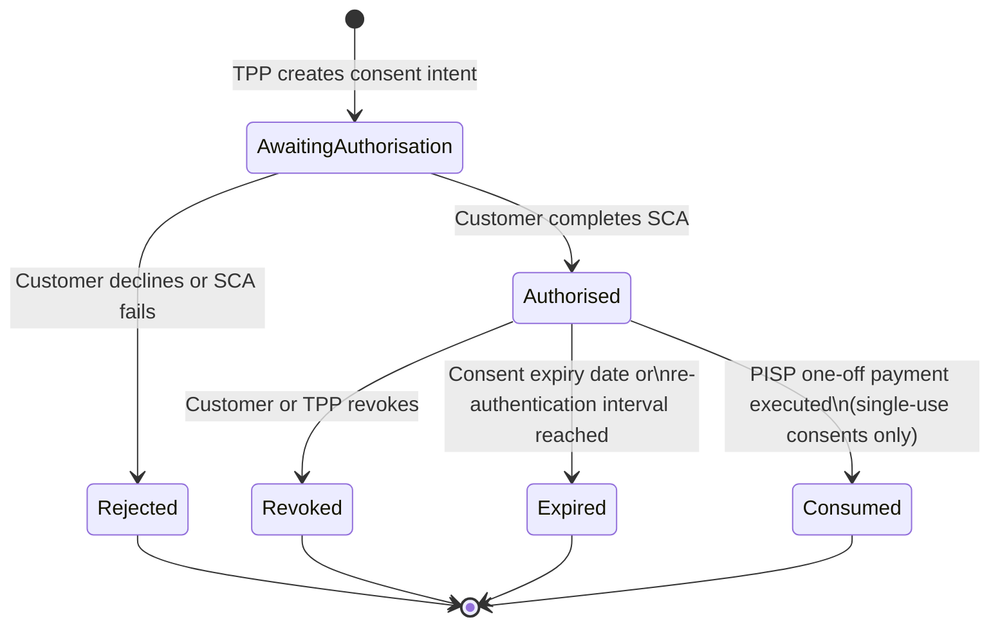

# الخدمات المصرفية المفتوحة — الموافقات وFAPI والمصادقة القوية

## نظرة عامة

تُلزم الخدمات المصرفية المفتوحة المؤسسات المالية بإتاحة بيانات حسابات العملاء وإمكانات بدء المدفوعات لأطراف ثالثة خاضعة للرقابة عبر واجهات API موحدة — وهذا يغيّر جذريًا البنية التنافسية للخدمات المصرفية للأفراد. وبحلول 2025 كان في المنظومة البريطانية أكثر من 10 ملايين مستخدم، وتعالج أكثر بكثير من مليار استدعاء API شهريًا. وللفرق الهندسية التي تبني بنية API في جانب البنك (مزوّدو خدمات الدفع الذين يديرون الحسابات — ASPSPs) والتكاملات في جانب الطرف الثالث (TPP)، يطرح هذا المجال مجموعة مميزة من التحديات: إدارة الموافقات كمورد أساسي ذي حالة، والهوية التشفيرية عبر الشهادات (eIDAS في الاتحاد الأوروبي، وشهادات Open Banking في المملكة المتحدة) بدل مفاتيح API المشتركة، وملف الأمان FAPI ‏(Financial-grade API) الذي يمد OAuth2 ليلبي نماذج التهديد الخاصة بالبنوك.

## أهداف التعلم

- تعريف أدوار الأطراف الثالثة الثلاثة في PSD2 ‏(AISP وPISP وCBPII) وربط صلاحياتها بنقاط API ونطاقات البيانات المحددة التي يحتاجها كل منها
- نمذجة دورة حياة الموافقة (بانتظار التفويض، ومفوَّضة، ومرفوضة، وملغاة، ومنتهية، ومستهلكة) كآلة حالة وتنفيذها كـ `ConsentService` مدعومة بـ PostgreSQL
- مقارنة معايير Open Banking UK وBerlin Group NextGenPSD2 وCDR الأسترالي من حيث نموذج البيانات، وتدفق التفويض، ودلالات الموافقة
- تنفيذ تدفق تفويض OAuth2 + FAPI 2.0 بما في ذلك PAR ‏(طلب التفويض المدفوع) ورموز الوصول المربوطة بـ DPoP
- بناء `AccountInformationController` تعرض الأرصدة والمعاملات مع التحقق الصحيح من نطاق الموافقة
- تنفيذ `PaymentInitiationController` بدلالات idempotency صارمة وتوجيه للمدفوعات المحلية والدولية
- تطبيق منطق إعفاءات المصادقة القوية لتقليل الاحتكاك غير الضروري، مع تتبع معدلات تطبيق الإعفاءات في مقاييس Prometheus
- ضبط مصادقة العميل عبر mTLS بشهادة eIDAS QWAC ‏(الاتحاد الأوروبي) أو شهادة Open Banking ‏(المملكة المتحدة) والتحقق منها مقابل مخزن الثقة للنظام (مثل Open Banking Directory)

## سياق العمل

*مثال مركّب (مبني على عيوب تنفيذ شائعة في الخدمات المصرفية المفتوحة، لا على بنك بعينه):* تجد مراجعة داخلية لدى أحد البنوك (ASPSP) ثلاث مشاكل في واجهة الخدمات المصرفية المفتوحة لديه. فوصول الطرف الثالث ظل يعمل بعد وقت طويل من النقطة التي كان يجب فيها على العميل إعادة المصادقة؛ ولم يُراجع الوصول عندما أبلغ العميل عن اختراق بيانات دخوله وأعاد تعيين كلمة المرور؛ وأعادت واجهة معلومات الحساب معاملات خارج النطاق الزمني الذي وافق عليه العميل. وللثلاث سبب جذري واحد: نُمذجت الموافقة كعلم على حساب المستخدم بدل كيان مستقل ذي حالة ودورة حياة خاصة. فعندما تغيرت بيانات الدخول، لم ينظر شيء إلى العلم. وعندما مرت فترة إعادة المصادقة، لم ينهِه شيء. وعندما نُفذ استعلام المعاملات، لم يفحص التواريخ المطلوبة مقابل الموافقة. ونمذجة الموافقة ككيان نطاق أساسي — بانتقالات حالة صريحة، وفرض انتهاء الصلاحية، والتحقق من النطاق في كل استدعاء API — تمنع المشاكل الثلاث.

## أدوار PSD2: AISP وPISP وCBPII

يعرّف PSD2 ثلاث فئات من مزوّدي خدمات الدفع من الأطراف الثالثة، لكل منها صلاحيات مختلفة:

| الدور | الاسم الكامل | الإجراءات المسموحة | البيانات المتاحة |
|---|---|---|---|
| AISP | مزوّد خدمة معلومات الحساب | قراءة الأرصدة والمعاملات وبيانات الحساب | بيانات الحساب فقط — لا بدء مدفوعات |
| PISP | مزوّد خدمة بدء الدفع | بدء مدفوعات من حساب العميل | يؤكد البدء فقط؛ لا وصول للأرصدة/المعاملات |
| CBPII | مُصدر أداة دفع قائمة على البطاقة | فحص توفر الأموال قبل تفويض البطاقة | تأكيد الرصيد فقط (نعم/لا) — لا مبالغ |

قد يحمل طرف ثالث واحد التراخيص الثلاثة. والصلاحيات تراكمية لكن معزولة النطاق: فموافقة AISP لا تمنح حقوق بدء مدفوعات؛ ولا يستطيع PISP الوصول إلى تاريخ المعاملات ما لم يحمل أيضًا موافقة AISP ممنوحة على حدة.

> [!NOTE]
> بموجب المادة 68(5) من PSD2، يجوز للبنك (ASPSP) رفض وصول طرف ثالث لـ "أسباب مبررة موضوعيًا وموثقة حسب الأصول تتعلق بوصول غير مصرح به أو احتيالي"، لكن يجب أن يُعلم العميل ويبلغ السلطة المختصة بالحادث فورًا. لذلك يُنصح بشدة بنظام آلي لكشف شذوذ الأطراف الثالثة (معدلات طلب غير معتادة، وأنماط وصول خارج ساعات العمل) يستطيع تعليق وصول الطرف الثالث، وتسجيل الأدلة، وبدء الإبلاغ الرقابي. ولاحظ أيضًا المادة 36(5) من المعايير الفنية RTS: دون أن يطلب العميل ذلك بنشاط، لا يجوز لـ AISP الوصول إلى بيانات الحساب أكثر من أربع مرات في 24 ساعة (ما لم يُتفق على غير ذلك).

## دورة حياة الموافقة



يجب حفظ كل انتقال مع طابع زمني والفاعل (العميل، أو الطرف الثالث، أو نظام البنك) للتدقيق. ويجب أن تطلق الأحداث الأمنية — مثل إبلاغ العميل عن اختراق بيانات دخوله — مراجعة للموافقات النشطة بدل تجاهلها.

مدة استمرار الوصول دون أن يعيد العميل المصادقة لدى البنك تعتمد على الولاية القضائية. ففي الاتحاد الأوروبي تتطلب المعايير الفنية المعدلة (منذ 2023) المصادقة القوية لدى البنك لوصول AIS عبر AISP مرة كل **180 يومًا** على الأقل. وفي المملكة المتحدة، منذ 2022، يعيد **الطرف الثالث** تأكيد موافقة العميل كل 90 يومًا ولم يعد البنك ملزمًا بتطبيق المصادقة القوية مجددًا. فاجعل هذه الفترة إعدادًا، لا ثابتًا مثبتًا في الشيفرة.

لحالة `AwaitingAuthorisation` مهلة خاصة (عادة 15–30 دقيقة): فإذا لم يكمل العميل المصادقة القوية خلال النافذة، تُهمل نية الموافقة.

## تنفيذ ConsentService

```java
@Service
@Slf4j
public class ConsentService {

    private final ConsentRepository consentRepo;
    private final Clock clock;

    /**
     * Creates a consent intent (AwaitingAuthorisation).
     * Returns a consentId that the TPP embeds in the OAuth2 authorisation request.
     */
    @Transactional
    public Consent createConsentIntent(ConsentRequest request) {
        validateScopes(request.scopes(), request.tppRole());

        Consent consent = Consent.builder()
            .consentId(UUID.randomUUID().toString())
            .tppId(request.tppId())
            .customerId(null)              // Not yet known — customer hasn't authenticated
            .scopes(request.scopes())
            .permissions(request.permissions())
            .fromDate(request.fromDate())
            .toDate(request.toDate())
            .expirationDateTime(request.expirationDateTime())
            .status(ConsentStatus.AWAITING_AUTHORISATION)
            .createdAt(clock.instant())
            .intentExpiresAt(clock.instant().plus(Duration.ofMinutes(15)))
            .build();

        return consentRepo.save(consent);
    }

    /**
     * Customer has completed SCA — transition to Authorised.
     * Called by the ASPSP's authorisation server after successful authentication.
     */
    @Transactional
    public Consent authorise(String consentId, String customerId) {
        Consent consent = getConsentOrThrow(consentId);

        if (consent.status() != ConsentStatus.AWAITING_AUTHORISATION) {
            throw new InvalidConsentStateException(consentId, consent.status(),
                ConsentStatus.AWAITING_AUTHORISATION);
        }
        if (clock.instant().isAfter(consent.intentExpiresAt())) {
            throw new ConsentIntentExpiredException(consentId);
        }

        // Compute actual expiry: min(requested expiry, now + re-authentication
        // interval for this jurisdiction — e.g. 180 days in the EU since 2023)
        Instant maxExpiry = clock.instant().plus(jurisdictionPolicy.reauthenticationInterval());
        Instant effectiveExpiry = consent.expirationDateTime() != null
            ? consent.expirationDateTime().isBefore(maxExpiry)
                ? consent.expirationDateTime() : maxExpiry
            : maxExpiry;

        return consentRepo.save(consent.toBuilder()
            .customerId(customerId)
            .status(ConsentStatus.AUTHORISED)
            .authorisedAt(clock.instant())
            .effectiveExpiresAt(effectiveExpiry)
            .build());
    }

    /**
     * Revoke an existing consent. Any party (customer, TPP, or ASPSP) may revoke.
     */
    @Transactional
    public void revoke(String consentId, RevocationActor actor, String reason) {
        Consent consent = getConsentOrThrow(consentId);
        if (!consent.isRevocable()) {
            throw new InvalidConsentStateException(consentId, consent.status(), null);
        }
        consentRepo.save(consent.toBuilder()
            .status(ConsentStatus.REVOKED)
            .revokedAt(clock.instant())
            .revokedBy(actor)
            .revocationReason(reason)
            .build());
        log.info("Consent revoked: consentId={}, actor={}, reason={}", consentId, actor, reason);
    }

    /**
     * Verifies that an active consent covers the requested permission and date range.
     * Called by API controllers before returning any data.
     */
    public void verifyActive(String consentId, Permission requiredPermission,
                              LocalDate queryFromDate, LocalDate queryToDate) {
        Consent consent = getConsentOrThrow(consentId);

        if (consent.status() != ConsentStatus.AUTHORISED) {
            throw new ConsentNotActiveException(consentId, consent.status());
        }
        if (clock.instant().isAfter(consent.effectiveExpiresAt())) {
            // Expire lazily on access
            consentRepo.save(consent.toBuilder().status(ConsentStatus.EXPIRED).build());
            throw new ConsentExpiredException(consentId);
        }
        if (!consent.permissions().contains(requiredPermission)) {
            throw new InsufficientConsentPermissionsException(consentId, requiredPermission);
        }
        // BOTH ends of the requested range must lie inside the consented range
        if (queryFromDate != null && consent.fromDate() != null
                && queryFromDate.isBefore(consent.fromDate())) {
            throw new ConsentDateRangeViolationException(consentId, queryFromDate, consent.fromDate());
        }
        if (queryToDate != null && consent.toDate() != null
                && queryToDate.isAfter(consent.toDate())) {
            throw new ConsentDateRangeViolationException(consentId, queryToDate, consent.toDate());
        }
    }

    private Consent getConsentOrThrow(String consentId) {
        return consentRepo.findById(consentId)
            .orElseThrow(() -> new ConsentNotFoundException(consentId));
    }
}
```

يجب أن يقع طرفا النطاق الزمني المطلوب **كلاهما** داخل النطاق الموافق عليه.

## OAuth2 وملف الأمان FAPI 2.0

FAPI ‏(Financial-grade API) ملف من OpenID Foundation يمد OAuth2 بمتطلبات أمان إضافية للوصول إلى واجهات API عالية القيمة.

| المتطلب | OAuth2 العادي | FAPI 1.0 Advanced | FAPI 2.0 |
|---|---|---|---|
| مصادقة العميل | client_secret ‏(basic/post) | private_key_jwt أو mTLS | private_key_jwt أو mTLS |
| طلب التفويض | سلسلة الاستعلام | JAR ‏(كائن طلب موقّع)، أو PAR | PAR مطلوب (JAR اختياري) |
| ربط الرمز | لا شيء (bearer) | رموز مربوطة بـ mTLS | مقيدة بالمرسل: mTLS أو DPoP |
| عنوان إعادة التوجيه | مسجل مسبقًا | مسجل مسبقًا + تطابق تام | مسجل مسبقًا + تطابق تام |
| PKCE | موصى به | مطلوب مع PAR | مطلوب (S256) |
| الحماية من CSRF | `state` موصى به | `state` مطلوب | PKCE (دون اشتراط `state` منفصل) |

**طلبات التفويض المدفوعة (PAR):** بدل إرسال معاملات التفويض في عنوان إعادة توجيه المتصفح (فتظهر في سجل المتصفح وسجلات الخوادم)، يرسلها PAR مباشرة إلى خادم التفويض في طلب POST عبر قناة خلفية، فيعيد مرجع `request_uri` معتمًا يُستخدم في إعادة توجيه المتصفح.

```java
// FAPI 2.0 PAR request (back-channel, server-to-server)
@PostMapping("/as/par")
public ParResponse pushedAuthorisationRequest(
        @RequestHeader(value = "DPoP", required = false) String dpopProof,  // if DPoP is used
        @RequestBody MultiValueMap<String, String> params,
        HttpServletRequest httpRequest) {

    // Authenticate the client: mTLS certificate (eIDAS QWAC / OB certificate)
    // or private_key_jwt client assertion
    X509Certificate clientCert = extractAndVerifyClientCertificate(httpRequest);
    String tppId = certificateValidator.validateAndExtract(clientCert).organisationId();

    // Validate signed JWT request object (JAR), if the profile uses one
    JwtClaimsSet claims = jarValidator.validate(params.getFirst("request"),
        tppPublicKeyResolver.resolve(tppId));

    String consentId = claims.getClaim("consentId");
    Consent consent = consentService.getConsentOrThrow(consentId);   // must exist...
    if (!consent.tppId().equals(tppId)) {                            // ...and belong to THIS TPP
        throw new InvalidRequestObjectException("Consent belongs to another TPP");
    }

    // Short-lived, ONE-TIME request_uri (RFC 9126 format)
    String requestUri = "urn:ietf:params:oauth:request_uri:" + UUID.randomUUID();
    parStore.storeOneTime(requestUri, claims, Duration.ofSeconds(60));

    return new ParResponse(requestUri, 60);
}
```

يجب أن توجد الموافقة **وأن تخص هذا الطرف الثالث نفسه**. والـ `request_uri` قصير العمر ويُستخدم **مرة واحدة** (بصيغة RFC 9126).

> [!IMPORTANT]
> يجب فحص شهادات العملاء — eIDAS QWAC في الاتحاد الأوروبي؛ وفي المملكة المتحدة شهادات Open Banking الصادرة عبر Open Banking Directory (إذ لم تعد شهادات eIDAS معترفًا بها هناك بعد بريكست) — بحثًا عن الإلغاء باستمرار، لا عند الانضمام فقط، ويجب فحص **حالة ترخيص** الطرف الثالث في السجل أيضًا: فقد يُسحب ترخيص طرف ثالث بينما شهادته ما زالت صالحة تقنيًا. وخزّن ردود OCSP مؤقتًا للأداء، لكن لا تتجاوز أبدًا فترة صلاحيتها. واستجب لشهادة ملغاة أو طرف ثالث شُطب من السجل بخطأ واضح ومحدد بدل 401 عام.

## AccountInformationController

```java
@RestController
@RequestMapping("/open-banking/v3.1/aisp")
public class AccountInformationController {

    private final ConsentService consentService;
    private final AccountService accountService;
    private final TransactionService transactionService;

    @GetMapping("/accounts")
    public ResponseEntity<OBReadAccount6> getAccounts(
            @RequestAttribute("consentId") String consentId,
            @RequestAttribute("customerId") String customerId) {

        consentService.verifyActive(consentId, Permission.READ_ACCOUNTS_BASIC, null, null);

        List<Account> accounts = accountService.findByCustomer(customerId);
        OBReadAccount6 response = accountMapper.toOBReadAccount6(accounts);
        return ResponseEntity.ok(response);
    }

    @GetMapping("/accounts/{accountId}/transactions")
    public ResponseEntity<OBReadTransaction6> getTransactions(
            @PathVariable String accountId,
            @RequestParam(required = false) @DateTimeFormat(iso = ISO.DATE) LocalDate fromBookingDate,
            @RequestParam(required = false) @DateTimeFormat(iso = ISO.DATE) LocalDate toBookingDate,
            @RequestAttribute("consentId") String consentId,
            @RequestAttribute("customerId") String customerId) {

        // Verify consent covers this permission and date range
        consentService.verifyActive(consentId, Permission.READ_TRANSACTIONS_DETAIL,
            fromBookingDate, toBookingDate);

        // Verify the account belongs to the consenting customer AND was one of
        // the accounts the customer selected when granting this consent
        accountService.verifyOwnership(accountId, customerId);
        consentService.verifyAccountInConsent(consentId, accountId);

        // No dates given → default to the consented range, never "everything"
        DateRange range = consentService.clampToConsent(consentId, fromBookingDate, toBookingDate);
        List<Transaction> transactions = transactionService.find(
            accountId, range.from(), range.to());

        return ResponseEntity.ok(transactionMapper.toOBReadTransaction6(transactions));
    }
}
```

تحقق من أن الحساب يخص العميل الموافق **ومن أنه** أحد الحسابات التي اختارها العميل عند منح هذه الموافقة. وإذا لم تُعطَ تواريخ، فالافتراضي هو النطاق الموافق عليه، لا "كل شيء" أبدًا.

## المصادقة القوية للعملاء والإعفاءات

تتطلب المصادقة القوية (SCA) عاملين مستقلين على الأقل من فئتين مختلفتين: شيء تعرفه (رقم سري/كلمة مرور)، وشيء تملكه (جهاز/بطاقة)، وشيء أنت هو (بيومتري). وتحدد المعايير الفنية عدة إعفاءات يجوز فيها تخطي المصادقة القوية. ولاحظ من يقرر: لدفعة تبدأ عبر PISP، فالبنك (**ASPSP**، بنك الدافع) هو من يطبق الإعفاء أو يرفضه — ولا يستطيع PISP فرض إعفاء. لذلك يعمل المقيّم أدناه في جانب البنك.

```java
public class ScaExemptionEvaluator {

    private final TransactionRiskAssessor riskAssessor;
    private final TrustedBeneficiaryRegistry trustedBeneficiaries;
    private final ExemptionMetrics metrics;

    public ScaExemptionResult evaluate(PaymentInitiationRequest request) {
        // Low-value (remote) exemption: single ≤ €30, until cumulative > €100
        // or 5 consecutive transactions since the last SCA
        if (request.amount().compareTo(LOW_VALUE_THRESHOLD) <= 0
                && !lowValueCumulativeExceeded(request.psuId())) {
            metrics.increment("low_value_exemption_applied");
            return ScaExemptionResult.exempt(ExemptionType.LOW_VALUE);
        }

        // Trusted beneficiary: PSU has added this payee to their trusted list
        // (creating or changing that list itself requires SCA)
        if (trustedBeneficiaries.isTrusted(request.psuId(), request.creditorIban())) {
            metrics.increment("trusted_beneficiary_exemption_applied");
            return ScaExemptionResult.exempt(ExemptionType.TRUSTED_BENEFICIARY);
        }

        // TRA exemption for CREDIT TRANSFERS: this PSP's fraud rate must be
        // below the reference rate for the amount band —
        //   ≤ €100: 0.015%;  ≤ €250: 0.01%;  ≤ €500: 0.005%
        // (card payments use 0.13% / 0.06% / 0.01%), AND the real-time risk
        // analysis must find no abnormal signals for this payment
        TransactionRiskScore riskScore = riskAssessor.score(request);
        if (request.amount().compareTo(TRA_MAX_AMOUNT) <= 0       // €500
                && fraudRateWithinThreshold(request.amount())
                && riskScore.isLow()) {
            metrics.increment("tra_exemption_applied");
            return ScaExemptionResult.exempt(ExemptionType.TRANSACTION_RISK_ANALYSIS);
        }

        return ScaExemptionResult.scaRequired();
    }
}
```

## PaymentInitiationController مع الـ Idempotency

```java
@RestController
@RequestMapping("/open-banking/v3.1/pisp")
public class PaymentInitiationController {

    private final ConsentService consentService;
    private final PaymentInitiationService paymentService;
    private final IdempotencyRepository idempotencyRepo;

    @PostMapping("/domestic-payments")
    public ResponseEntity<OBWriteDomesticResponse5> createDomesticPayment(
            @RequestHeader("x-idempotency-key") String idempotencyKey,
            @RequestBody OBWriteDomestic2 request,
            @RequestAttribute("tppId") String tppId,
            @RequestAttribute("consentId") String consentId,
            @RequestAttribute("customerId") String customerId) {

        // Idempotency FIRST — a single-use consent is CONSUMED by the first
        // payment, so checking the consent first would reject a legitimate retry.
        // Claim the key atomically with a hash of the payload
        // (INSERT ... ON CONFLICT DO NOTHING), scoped to this TPP.
        String payloadHash = sha256(canonicalJson(request));
        IdempotencyClaim claim = idempotencyRepo.claim(tppId, idempotencyKey, payloadHash);
        if (claim.isExisting()) {
            if (!claim.payloadHash().equals(payloadHash)) {
                // Same key, different payment → never process, never replay
                throw new IdempotencyPayloadMismatchException(idempotencyKey);   // HTTP 422
            }
            if (claim.isInProgress()) {
                throw new RequestInProgressException(idempotencyKey);           // HTTP 409, retry later
            }
            log.info("Idempotent response returned: key={}", idempotencyKey);
            return ResponseEntity.status(201).body(claim.storedResponse(OBWriteDomesticResponse5.class));
        }

        consentService.verifyActive(consentId, Permission.CREATE_DOMESTIC_PAYMENT, null, null);

        // Validate that payment data matches the consent
        validatePaymentMatchesConsent(request, consentId);

        PaymentInitiationResult result = paymentService.initiate(
            mapToInternalRequest(request, customerId, consentId));

        OBWriteDomesticResponse5 response = responseMapper.map(result);

        // Store the response against the claimed key (kept for the idempotency window)
        idempotencyRepo.complete(tppId, idempotencyKey, response);

        return ResponseEntity.status(201).body(response);
    }

    private void validatePaymentMatchesConsent(OBWriteDomestic2 payment, String consentId) {
        // The payment's Initiation block must EXACTLY match the consented one:
        // amount, currency, creditor account, reference. Any deviation is rejected.
        Consent consent = consentService.getConsentOrThrow(consentId);
        if (!payment.getData().getConsentId().equals(consentId)) {
            throw new PaymentConsentMismatchException("ConsentId mismatch");
        }
        if (!payment.getData().getInitiation().equals(consent.paymentInitiation())) {
            throw new PaymentConsentMismatchException("Initiation does not match consent");
        }
    }
}
```

يُفحص الـ idempotency **أولًا** — لأن الموافقة أحادية الاستخدام **تُستهلك** بالدفعة الأولى، ففحص الموافقة أولًا سيرفض إعادة محاولة مشروعة. ويُحجز المفتاح ذريًا مع تجزئة (hash) للحمولة، بنطاق هذا الطرف الثالث. ويجب أن يطابق قسم Initiation في الدفعة القسم الموافق عليه **تمامًا**: المبلغ، والعملة، وحساب المستفيد، والمرجع.

> [!WARNING]
> يجب التحقق من مفاتيح الـ idempotency لبدء المدفوعات بتطابق الحمولة التام — لا بوجود المفتاح فقط. فإذا أرسل طرف ثالث مفتاح idempotency نفسه بمبلغ دفعة مختلف (خلل أو محاولة احتيال)، يجب أن يعيد البنك HTTP 422 ‏`PAYLOAD_MISMATCH` بدل معالجة الطلب الثاني أو إعادة الرد المخزن للأول. وهذا يمنع فئة من الهجمات تُستخدم فيها دفعة منخفضة القيمة لتأسيس مفتاح idempotency، ثم يُعاد استخدامه بمبلغ عالٍ.

## شهادات eIDAS وmTLS

```java
@Component
public class EidasCertificateValidator {

    private final OpenBankingDirectoryClient directoryClient;

    /**
     * Validates that the client's TLS certificate is (EU / eIDAS variant):
     * 1. A valid eIDAS QWAC (Qualified Website Authentication Certificate)
     * 2. Issued by a qualified trust service provider on the EU trusted lists
     * 3. Not revoked (checked via OCSP)
     * 4. Carries an organisationIdentifier matching an authorised TPP, and PSD2
     *    roles (in the QCStatement) that allow the API being called
     */
    public TppIdentity validateAndExtract(X509Certificate cert) {
        // Check certificate policy OID for QWAC (0.4.0.194112.1.4)
        verifyQwacPolicyOid(cert);

        // Extract organisationIdentifier from the subject DN (OID 2.5.4.97);
        // PSD2 roles (PSP_AI, PSP_PI, ...) come from the QCStatement
        String orgId = extractOrganisationId(cert);

        // OCSP check against issuing CA
        OcspResult ocsp = performOcspCheck(cert);
        if (ocsp.status() == OcspStatus.REVOKED) {
            throw new CertificateRevokedException(orgId, ocsp.revocationTime());
        }

        // Verify TPP is registered and active in OB Directory
        TppRegistration tpp = directoryClient.lookupTpp(orgId)
            .orElseThrow(() -> new UnregisteredTppException(orgId));

        if (!tpp.isActive()) {
            throw new TppNotActiveException(orgId, tpp.status());
        }

        return new TppIdentity(orgId, tpp.name(), tpp.roles(), cert.getNotAfter().toInstant());
    }
}
```

## تحديد معدل API لكل طرف ثالث

يجب تحديد معدل وصول كل طرف ثالث إلى API بشكل مستقل لمنع طرف ثالث واحد سيئ السلوك أو مخترق من التأثير على توفر البنك لكل الأطراف الأخرى.

```java
@Component
public class TppRateLimiter {

    // Limits are the ASPSP's own fairness and capacity settings — they must
    // protect availability without obstructing TPPs. Load them from config
    // (per TPP and per API category), not hard-coded constants.
    private final RateLimitProperties limits;
    private final RateLimiterRegistry registry;  // Resilience4j — per node; use a
                                                 // shared store (e.g. Redis) for a cluster-wide limit

    public void checkLimit(String tppId, ApiEndpointType endpointType) {
        String limiterKey = tppId + ":" + endpointType.category();
        RateLimiter limiter = registry.rateLimiter(limiterKey, () ->
            buildConfig(tppId, endpointType));

        if (!limiter.acquirePermission()) {
            throw new TppRateLimitExceededException(tppId, endpointType,
                limiter.getMetrics().getAvailablePermissions());
        }
    }

    private RateLimiterConfig buildConfig(String tppId, ApiEndpointType type) {
        int rpm = limits.requestsPerMinute(tppId, type.category());
        return RateLimiterConfig.custom()
            .limitForPeriod(rpm)
            .limitRefreshPeriod(Duration.ofMinutes(1))
            .timeoutDuration(Duration.ZERO)   // Fail fast — do not queue
            .build();
    }
}
```

الحدود إعدادات العدالة والسعة الخاصة بالبنك — يجب أن تحمي التوفر دون عرقلة الأطراف الثالثة. فحمّلها من الإعدادات (لكل طرف ثالث ولكل فئة API)، لا ثوابت مثبتة. ومحدّد Resilience4j يعمل لكل عقدة؛ فاستخدم مخزنًا مشتركًا (مثل Redis) لحد على مستوى المجموعة.

## مقارنة Open Banking UK وBerlin Group وCDR

| البعد | Open Banking UK | Berlin Group NextGenPSD2 | CDR الأسترالي |
|---|---|---|---|
| الإلزام | أمر CMA لعام 2017 (9 بنوك) | المعايير الفنية لـ PSD2 (كل بنوك الاتحاد) | قانون حق بيانات المستهلك 2019 |
| جهة المعيار | Open Banking Ltd | Berlin Group | هيئة معايير البيانات (الخزانة) |
| التفويض | إعادة توجيه (بما فيها من تطبيق إلى تطبيق) ومنفصل | إعادة توجيه، أو مضمّن، أو منفصل، أو OAuth | إعادة توجيه |
| واجهة الموافقة | يستضيفها البنك | يستضيفها البنك | يستضيفها البنك |
| نموذج البيانات | مخطط OB UK ‏(v3.1 / v4) | مخطط NextGenPSD2 ‏(مبني على ISO 20022) | مخطط CDR المصرفي |
| أنواع المدفوعات | محلية (FPS)، ومجدولة، وأوامر دائمة، ودولية | SEPA CT / SEPA Instant | لم تكن ضمن نطاق CDR الأصلي (جاء بدء الإجراءات لاحقًا) |
| تجديد الوصول | الطرف الثالث يعيد تأكيد الموافقة كل 90 يومًا | مصادقة قوية لدى البنك مرة كل 180 يومًا على الأقل (منذ 2023) | موافقة حتى 12 شهرًا |
| الاعتماد | سجل FCA + OB Directory | سجل السلطة الوطنية + eIDAS | اعتماد ACCC |

## اختبار المعرفة

**س1: يقدم PISP طلب بدء دفعة بمفتاح idempotency ‏`pay-abc-001`. وينجح الطلب وتدخل الدفعة حالة `AcceptedSettlementInProcess`. وبعد خمس دقائق يعيد الطرف الثالث نفسه التقديم بالمفتاح `pay-abc-001` لكن بمبلغ دفعة مضاعف. ماذا يجب أن يعيد البنك ولماذا؟**

ج: يجب أن يعيد البنك HTTP 422 Unprocessable Entity برمز الخطأ `PAYLOAD_MISMATCH` (أو ما يعادله وفق مواصفة Open Banking المنفذة). فالـ idempotency في واجهات الدفع تعني أن المفتاح نفسه يضمن عدم معالجة الدفعة نفسها مرتين — ولا تعني أن المفتاح يمكن إعادة استخدامه لتقديم دفعة مختلفة. وعندما يُعاد استخدام مفتاح بحمولة مختلفة، فهذا يدل إما على خلل لدى الطرف الثالث أو على نمط احتيال (تأسيس مفتاح بدفعة منخفضة القيمة، ثم محاولة إعادة استخدامه لدفعة عالية القيمة). ويجب أن يقارن البنك تجزئة جسم الطلب الجديد بالتجزئة المخزنة للمفتاح ويرفض أي عدم تطابق. ويجب ألا يعالج الدفعة الجديدة ويجب ألا يعيد الرد المخزن للدفعة الأصلية، لأن ذلك سيعطي الطرف الثالث انطباعًا خاطئًا عن الدفعة التي نُفذت.

**س2: اشرح الفرق بين PAR ‏(طلب التفويض المدفوع) وطلب تفويض OAuth2 القياسي، ولماذا يُلزم FAPI 2.0 بـ PAR في الخدمات المصرفية المفتوحة.**

ج: في طلب تفويض OAuth2 القياسي، يضمّن العميل معاملات التفويض (معرّف العميل، والنطاق، وstate، وتحدي PKCE، وعنوان إعادة التوجيه) في عنوان إعادة توجيه المتصفح إلى خادم التفويض. وهذا يعني أن المعاملات تمر عبر المتصفح — فتظهر في سجل المتصفح، وقد تسجلها خوادم وسيطة، وتراها إضافات المتصفح. وفي OAuth2 القياسي هذه مقايضة مقبولة. أما في FAPI 2.0 للخدمات المصرفية المفتوحة، فيتطلب PAR من العميل أولًا إرسال معاملات التفويض بطلب POST مباشرة إلى نقطة PAR في خادم التفويض عبر قناة خلفية مع مصادقة العميل، فيتلقى `request_uri` معتمًا في الرد. ثم لا تحتوي إعادة توجيه المتصفح إلى خادم التفويض إلا على هذا المرجع قصير العمر. وهذا يعني أن المعاملات الحساسة (بما فيها JAR الموقّع الذي يحتوي تفاصيل الدفع أو نطاق موافقة الحساب) لا تمر أبدًا عبر المتصفح. ويمكّن PAR أيضًا خادم التفويض من التحقق من الطلب قبل إعادة توجيه العميل، فيعيد الأخطاء فورًا في القناة الخلفية بدل إعادة توجيه عبر المتصفح قد تُراقب أو يُتلاعب بها.

## التحدي العملي

1. **‏ConsentService مع آلة الحالة:** نفّذ `ConsentService` كاملة بما في ذلك كل انتقالات الحالة، وسقف إعادة مصادقة قابل للإعداد في `authorise()` ‏(180 يومًا لملف الاتحاد الأوروبي)، واكتشاف الانتهاء الكسول في `verifyActive()`. واستخدم مستودعًا مدعومًا بـ PostgreSQL بجدول `consents` وجدول `consent_audit_log` يسجل كل انتقال حالة مع الفاعل والطابع الزمني والسبب. واكتب اختبارات تكامل تغطي: إنشاء موافقة ← تفويضها ← انتهاؤها بعد 181 يومًا بملف الاتحاد الأوروبي (باستخدام `TestClock`)؛ وإنشاء موافقة ← إلغاؤها من العميل ← استدعاء API لاحق يعيد `ConsentNotActive`؛ وإنشاء موافقة ← انتهاء النية بعد 15 دقيقة دون تفويض.

2. **نقطة PAR في FAPI 2.0:** نفّذ نقطة `/as/par` بمصادقة العميل عبر mTLS، والتحقق من JAR ‏(كائن طلب JWT موقّع)، ومخزن PAR في الذاكرة بمدة صلاحية 10 دقائق. ويجب التحقق من JAR بالمفتاح العام المسجل للطرف الثالث (المسترجع من `TppKeystore` محاكى). واكتب اختبارًا يستخدم زوج مفاتيح RSA حقيقيًا يولّد JAR موقّعًا صالحًا ويؤكد إعادة `request_uri`، واختبارًا آخر بتوقيع JWT معدّل يؤكد HTTP 400 ‏`INVALID_REQUEST_OBJECT`.

3. **اختبار تكامل محدّد المعدل:** اضبط محددات معدل Resilience4j لمجموعة من ثلاثة أطراف ثالثة اختبارية بحد AIS قدره 10 طلبات في الدقيقة. واكتب اختبارًا يطلق 15 طلبًا سريعًا من TPP-1 ويؤكد أن الطلبات 11–15 تتلقى `TppRateLimitExceededException`. وأطلق بالتزامن 10 طلبات من TPP-2 وأكد نجاحها كلها (حدود الأطراف مستقلة). وتحقق من أنه بعد تقديم `TestClock` ستين ثانية يستطيع TPP-1 تقديم طلبات مجددًا.

4. **التوافق مع Berlin Group NextGenPSD2:** ابحث في واجهة معلومات الحساب في Berlin Group NextGenPSD2 الإصدار 1.3 ‏(GET `/v1/accounts/{account-id}/transactions`) ونفّذ متحكمًا ثانيًا بجانب `AccountInformationController` يقدم البيانات الأساسية نفسها بمخطط JSON الخاص بـ NextGenPSD2. ويجب أن يتشارك المتحكمان `ConsentService` و`TransactionService` نفسيهما مع استخدام محوّلات مخطط منفصلة. واكتب اختبار عقد باستخدام ملف عقد مستهلك Pact يتحقق من أن بنية رد JSON تطابق مواصفة NextGenPSD2.

<!-- KNOWLEDGE-CHECK
{
  "questions": [
    {
      "text": "يقدم PISP طلب بدء دفعة بمفتاح idempotency ‏`pay-abc-001`. وينجح الطلب. وبعد خمس دقائق يعيد الطرف الثالث نفسه التقديم بالمفتاح نفسه لكن بمبلغ دفعة مضاعف. ماذا يجب أن يعيد البنك؟",
      "options": [
        "‏HTTP 200 مع الرد المخزن من الطلب الأول",
        "‏HTTP 422 Unprocessable Entity برمز الخطأ `PAYLOAD_MISMATCH` — لا يمكن إعادة استخدام مفتاح الـ idempotency بحمولة مختلفة",
        "‏HTTP 409 Conflict — توجد دفعة بهذا المفتاح بالفعل",
        "‏HTTP 201 Created — معالجة الدفعة الجديدة كطلب جديد"
      ],
      "correct": 1,
      "explanation": "يجب أن يعيد البنك HTTP 422 مع `PAYLOAD_MISMATCH`. فالـ idempotency تضمن عدم معالجة الدفعة نفسها مرتين — ولا تسمح بإعادة استخدام المفتاح لدفعة مختلفة. ويجب أن يقارن البنك تجزئة الطلب الجديد بالتجزئة المخزنة ويرفض أي عدم تطابق. ويجب ألا يعالج الدفعة الجديدة ولا يعيد الرد المخزن للأصلية."
    },
    {
      "text": "ما الفرق الأساسي بين PAR ‏(طلب التفويض المدفوع) وطلب تفويض OAuth2 القياسي، ولماذا يُلزم FAPI 2.0 بـ PAR؟",
      "options": [
        "‏PAR أسرع لأنه يلغي إعادة توجيه المتصفح كليًا",
        "يتطلب PAR من العميل أولًا إرسال معاملات التفويض بطلب POST مباشرة إلى خادم التفويض عبر قناة خلفية، فيتلقى `request_uri` معتمًا، فلا تمر المعاملات الحساسة أبدًا عبر المتصفح",
        "يضيف PAR عامل مصادقة ثانيًا للعميل",
        "يستبدل PAR رموز OAuth2 بمصادقة قائمة على الشهادات"
      ],
      "correct": 1,
      "explanation": "في OAuth2 القياسي تمر معاملات التفويض عبر إعادة توجيه المتصفح — فتظهر في سجل المتصفح وسجلات الوكلاء وإضافات المتصفح. وفي PAR ضمن FAPI 2.0 يرسل العميل المعاملات مباشرة إلى خادم التفويض عبر قناة خلفية، فلا يتلقى إلا `request_uri` معتمًا. ولا تحتوي إعادة توجيه المتصفح إلا على هذا المرجع، فلا تمر المعاملات الحساسة (بما فيها JAR الموقّع بتفاصيل الدفع) عبر المتصفح أبدًا."
    },
    {
      "text": "بموجب المعايير الفنية الأوروبية المعدلة (السارية منذ 2023)، كم مرة يجب أن يعيد العميل المصادقة القوية لدى بنكه لاستمرار الوصول إلى معلومات الحساب عبر AISP؟",
      "options": [
        "كل 30 يومًا",
        "كل 90 يومًا",
        "مرة كل 180 يومًا على الأقل",
        "أبدًا — الموافقة تستمر حتى إلغائها"
      ],
      "correct": 2,
      "explanation": "مدّت اللائحة المفوضة (EU) 2022/2360 فترة إعادة المصادقة لوصول AIS عبر AISP من 90 إلى 180 يومًا وجعلت الإعفاء إلزاميًا على البنوك. وسلكت المملكة المتحدة طريقًا مختلفًا: فمنذ 2022 يعيد الطرف الثالث تأكيد الموافقة مع العميل كل 90 يومًا ولا يطبق البنك المصادقة القوية مجددًا. فاجعل الفترة إعدادًا خاصًا بالولاية القضائية في `ConsentService.authorise()`."
    }
  ]
}
-->

<!-- PRACTICAL-CHALLENGE
{
  "title": "إدارة الموافقات في الخدمات المصرفية المفتوحة وPAR في FAPI 2.0",
  "difficulty": "advanced",
  "estimatedMinutes": 45,
  "tasks": [
    {
      "id": "1",
      "description": "نفّذ `ConsentService` كاملة بما في ذلك كل انتقالات الحالة، وسقف إعادة مصادقة قابل للإعداد في `authorise()` ‏(180 يومًا لملف الاتحاد الأوروبي)، واكتشاف الانتهاء الكسول في `verifyActive()`. واستخدم مستودعًا مدعومًا بـ PostgreSQL بجدولي `consents` و`consent_audit_log`. واكتب اختبارات تكامل تغطي: الانتهاء بعد 181 يومًا عبر `TestClock`؛ وإلغاء العميل؛ وانتهاء النية بعد 15 دقيقة دون تفويض."
    },
    {
      "id": "2",
      "description": "نفّذ نقطة `/as/par` بمصادقة العميل عبر mTLS، والتحقق من JAR ‏(كائن طلب JWT موقّع)، ومخزن PAR في الذاكرة بمدة صلاحية 10 دقائق. وتحقق من JAR بالمفتاح العام المسجل للطرف الثالث من `TppKeystore` محاكى. واكتب اختبارات لـ JAR موقّع صالح يعيد `request_uri` وتوقيع JWT معدّل يعيد HTTP 400 ‏`INVALID_REQUEST_OBJECT`."
    },
    {
      "id": "3",
      "description": "اضبط محددات معدل Resilience4j لثلاثة أطراف ثالثة اختبارية بحد AIS قدره 10 طلبات في الدقيقة. واكتب اختبارًا يطلق 15 طلبًا سريعًا من TPP-1 ويؤكد أن الطلبات 11-15 تتلقى `TppRateLimitExceededException`. وأطلق بالتزامن 10 طلبات من TPP-2 وأكد نجاحها كلها (الحدود مستقلة). وتحقق من أنه بعد تقديم `TestClock` ستين ثانية يستطيع TPP-1 تقديم طلبات مجددًا."
    },
    {
      "id": "4",
      "description": "ابحث في واجهة معلومات الحساب في Berlin Group NextGenPSD2 الإصدار 1.3 ونفّذ متحكمًا ثانيًا بجانب `AccountInformationController` يقدم البيانات نفسها بمخطط JSON الخاص بـ NextGenPSD2. وشارك `ConsentService` و`TransactionService` نفسيهما مع محوّلات مخطط منفصلة. واكتب اختبار عقد Pact يتحقق من بنية رد JSON."
    }
  ]
}
-->
