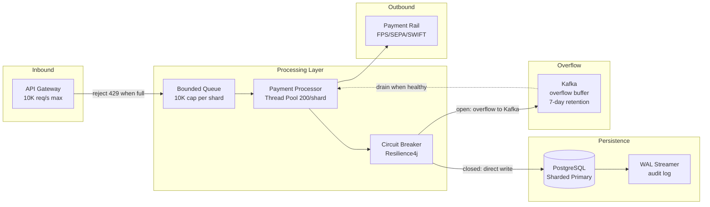

# مدفوعات عالية الإنتاجية — 10,000 معاملة في الثانية بالتقسيم والضغط العكسي

## نظرة عامة

تصميم منصة دفع تتحمل 10,000 معاملة في الثانية ليس مجرد إضافة خوادم تطبيقات. فعنق الزجاجة في أنظمة الدفع يكون غالبًا في طبقة قاعدة البيانات — تحديدًا في التوتر بين متطلبات الصحة الصارمة للمعالجة المالية (معاملات ACID، والـ idempotency، وسجل التدقيق) وتضخم الكتابة الذي تفرضه هذه المتطلبات على نطاق واسع. فعند 10,000 معاملة في الثانية، يولّد تصميم ساذج بمسار كتابة واحد ينفذ 4–6 كتابات لكل معاملة (سجل الدفعة، وقيد الخصم، وقيد الإضافة، وحدث التدقيق، وحدث الإشعار، وسجل الـ idempotency) بين 40,000 و60,000 إدراج صف في الثانية على قاعدة PostgreSQL رئيسية واحدة — مقتربًا من سقف إنتاجية الكتابة لعتاد عادي أو متجاوزًا له. ويغطي هذا الدرس الأنماط المعمارية التي تكسر عنق الزجاجة هذا: التقسيم، وتجميع الكتابات، والتدقيق المبني على WAL، ونشر الضغط العكسي (back-pressure).

## أهداف التعلم

- تفكيك متطلب 10,000 معاملة في الثانية إلى تحجيم بنية تحتية ملموس (المعالج، والذاكرة، والشبكة، وعمليات التخزين في الثانية) باستخدام نموذج منهجي لتخطيط السعة
- تصميم استراتيجية تقسيم تعطي كل حساب شريحة مالكة واحدة بالضبط، وتوزع الحمل بالتساوي، وتتعامل مع الحسابات الساخنة (عالية الحجم جدًا)
- تنفيذ `PartitionedPaymentRouter` باستخدام التجزئة المتسقة بعُقد افتراضية، وفهم كيف تنتقل الملكية بأمان أثناء إعادة التوازن
- بناء بنية ضغط عكسي باستخدام طوابير محدودة في الذاكرة، وKafka كمخزن فائض دائم، وقواطع دائرة Resilience4j
- ضبط معاملات تجميع منتج Kafka ‏(`linger.ms` و`batch.size` و`compression.type`) لإنتاجية مثلى ضمن ميزانيات الزمن المستهدفة
- كشف الأقسام الساخنة آنيًا باستخدام مقاييس المعاملات في الثانية لكل قسم وتخطيط تقسيم آمن للشرائح
- تصميم تحسين كتابة قاعدة البيانات في PostgreSQL: سجل التدقيق المبني على WAL، وضبط الالتزام الجماعي، وتحجيم مجمع الاتصالات
- تعريف استراتيجية لتخفيف الحمل (load shedding) وتنفيذها، تقدم المدفوعات عالية القيمة أو الحساسة للوقت عندما يقترب النظام من سعته

## سياق العمل

*مثال مركّب (مبني على إخفاقات سعة شائعة، لا على شركة بعينها):* يفشل معالج مدفوعات في أكثر أيام التسوق ازدحامًا في السنة. والسبب الجذري قسم ساخن: مفتاح التوجيه هو معرّف التاجر وحده، وبائع تجزئة كبير جدًا — بمئات الأجهزة التي تتشارك معرّف تاجر واحدًا — يرسل كل مدفوعاته إلى شريحة معالجة واحدة. فتستنفد تلك الشريحة مجمع اتصالات قاعدة بياناتها، ولأن مجمع الاتصالات مشترك مع أقسام غير ذات صلة، تتسلسل انتهاءات المهلة عبر المنصة كلها. وتفشل أكثر من مليون دفعة أو تتأخر ساعات، مع غرامات اتفاقيات الخدمة واهتمام رقابي. والإصلاح — مفتاح تقسيم أفضل، ومجمعات معزولة لكل شريحة، وكشف الأقسام الساخنة — كان سينتج عن تمرين تخطيط سعة واختبار حمل واقعي قبل التشغيل.

## تحليل متطلبات 10,000 معاملة في الثانية

قبل تصميم أي شيء، ترجم رقم المعاملات في الثانية إلى متطلبات موارد ملموسة.

**تفكيك الإنتاجية:**

| نوع الدفعة | النسبة من الإجمالي | المعاملات في الثانية | هدف زمن p99 |
|---|---|---|---|
| محلية آنية (FPS/SEPA Inst) | 60% | 6,000 | 150 مللي ثانية |
| تمرير تفويض البطاقات | 25% | 2,500 | 80 مللي ثانية |
| دولية (SWIFT/IBAN) | 10% | 1,000 | 500 مللي ثانية |
| بنود مجمّعة | 5% | 500 | 2,000 مللي ثانية |

**تضخم الكتابة في قاعدة البيانات عند 10,000 معاملة في الثانية:**

```
Per-payment writes:
  1 × payment_records INSERT
  1 × debit ledger_entries INSERT
  1 × credit ledger_entries INSERT
  1 × payment_events INSERT (audit log)
  1 × idempotency_keys INSERT (or UPDATE)
  Total: 5 writes/transaction × 10,000 TPS = 50,000 writes/second

Rough PostgreSQL ceiling (NVMe SSD, single primary): tens of thousands of rows/second
  — but the real limit is COMMITS/second: 5 inserts in ONE transaction = 1 commit,
    so this is 10,000 commits/s carrying 50,000 rows (measure on your hardware)
Conclusion: a single primary is marginal at best; needs batching and/or sharding
```

**عرض النطاق الشبكي:**

```
Average payment message: 2KB (ISO 20022 pain.001 with headers)
10,000 TPS × 2KB = 20MB/s inbound
Plus Kafka replication, outbound notifications, audit log: ~80MB/s total
≈ 640 Mbit/s — too close to the limit of a 1 Gbps link; use 10 Gbps for headroom
```

> [!NOTE]
> هدف 10,000 معاملة في الثانية رقم للحالة المستقرة. وتشهد أنظمة الدفع ذروات واضحة خلال اليوم (الغداء، ونهاية يوم العمل) وذروات موسمية (الجمعة السوداء، وليلة عيد الميلاد). فصمم لاندفاع 3 أضعاف الحالة المستقرة: ذروة 30,000 معاملة في الثانية، مع تدهور سلس فوق ذلك عبر تخفيف الحمل بدل الفشل المتسلسل.

## استراتيجية التقسيم

قسّم حمل المدفوعات عبر N شريحة معالجة مستقلة، لكل منها قاعدة بيانات رئيسية خاصة (مع احتياطية)، ومجموعة مستهلكين في Kafka، ومجمع خيوط. والقاعدة الأهم: **لكل حساب شريحة مالكة واحدة بالضبط**. ففحص الرصيد، والخصم، وسجل الـ idempotency لحساب يجب أن تحدث كلها على الشريحة التي تملكه — فإذا استطاعت شريحتان الخصم من الحساب نفسه، لم يعد فحص الرصيد يحمي من الإنفاق الزائد.

**معايير اختيار مفتاح التقسيم:**
1. **الملكية:** يجب أن يربط المفتاح كل حساب بشريحة واحدة — فاستخدم **معرّف حساب الخصم** كاملًا، حيث يحدث فحص الرصيد والخصم.
2. **التنوع (Cardinality):** يجب أن يكون للمفتاح قيم مميزة كافية لتوزيع الحمل بالتساوي. فالمفتاح الخشن مثل رمز فرع البنك، أو معرّف التاجر وحده، أو بادئة من 6 أرقام، يضع بنوكًا أو بائعي تجزئة كاملين على شريحة واحدة.
3. **ثبات التوجيه:** يجب أن يكون المفتاح حتميًا، لتتوجه إعادات المحاولة idempotent إلى الشريحة نفسها.

**التحويلات بين الشرائح:** عندما يكون حساب الإضافة على شريحة أخرى، تُخصم الدفعة على شريحة حساب الخصم وتُسلّم الإضافة كرسالة (outbox ← Kafka) إلى شريحة حساب الإضافة، التي تطبقها بشكل idempotent. ولا تحاول إجبار A←B وB←A على الشريحة نفسها بحيل مثل XOR للمفتاحين: فذلك يكدّس الحركة (مثلًا كل تحويل بين حسابين بالبادئة نفسها يعطي XOR يساوي 0 فيقع في قسم واحد) ويكسر الملكية الواحدة رغم ذلك.

**الحسابات الساخنة** (حساب تسوية تاجر كبير، أو حساب رسوم البنك نفسه) تتلقى قيودًا أكثر بكثير مما يتحمله صف واحد. فقسّمها إلى عدة حسابات فرعية تُجمع للتقارير، أو جمّع قيودها في دفعات صغيرة.

```java
public class PartitionKeyCalculator {

    /** Key = the full debit account ID: the account whose balance is checked and debited. */
    public long calculate(String debitAccountId) {
        String normalised = debitAccountId.replaceAll("\\s", "").toUpperCase(Locale.ROOT);
        // Unsigned 32-bit value — Math.abs(Integer.MIN_VALUE) is still negative,
        // so never use Math.abs on a hash
        return Integer.toUnsignedLong(
            MurmurHash3.hash32(normalised.getBytes(StandardCharsets.UTF_8)));
    }
}
```

## PartitionedPaymentRouter مع التجزئة المتسقة

تسمح التجزئة المتسقة بعُقد افتراضية بإضافة الشرائح وإزالتها مع أقل إعادة توزيع للمفاتيح (ينتقل نحو 1/N من المفاتيح في المتوسط، مقابل كل المفاتيح تقريبًا مع تجزئة باقي القسمة).

```java
@Component
public class PartitionedPaymentRouter {

    private static final int VIRTUAL_NODES_PER_SHARD = 150;

    // Sorted map: hash ring position → shard ID
    private final NavigableMap<Long, String> hashRing = new ConcurrentSkipListMap<>();
    private final Map<String, PaymentShard> shards = new ConcurrentHashMap<>();
    private final PartitionKeyCalculator keyCalc;

    public void addShard(String shardId, PaymentShard shard) {
        shards.put(shardId, shard);
        for (int v = 0; v < VIRTUAL_NODES_PER_SHARD; v++) {
            long position = murmurHash(shardId + "#" + v);
            hashRing.put(position, shardId);
        }
        log.info("Shard added to ring: shardId={}, virtualNodes={}", shardId, VIRTUAL_NODES_PER_SHARD);
    }

    public void removeShard(String shardId) {
        for (int v = 0; v < VIRTUAL_NODES_PER_SHARD; v++) {
            long position = murmurHash(shardId + "#" + v);
            hashRing.remove(position);
        }
        shards.remove(shardId);
        log.info("Shard removed from ring: shardId={}", shardId);
    }

    public PaymentShard route(PaymentRequest request) {
        long ringPosition = keyCalc.calculate(request.debitAccountId());

        // Find the first shard clockwise from ringPosition
        Map.Entry<Long, String> entry = hashRing.ceilingEntry(ringPosition);
        if (entry == null) {
            entry = hashRing.firstEntry(); // Wrap around
        }

        String shardId = entry.getValue();
        PaymentShard shard = shards.get(shardId);

        if (shard == null || shard.isUnhealthy()) {
            // Do NOT send the payment to some other healthy shard: that shard does
            // not own this account's balance or idempotency records, so it could
            // overspend or pay twice. The owning shard fails over to ITS OWN
            // standby; until then, reject quickly so the caller retries later.
            throw new ShardUnavailableException(shardId);   // → HTTP 503 + Retry-After
        }
        return shard;
    }

    private static long murmurHash(String key) {
        return Integer.toUnsignedLong(
            MurmurHash3.hash32(key.getBytes(StandardCharsets.UTF_8)));
    }
}
```

لا ترسل الدفعة إلى شريحة سليمة أخرى عندما تكون الشريحة المالكة معطلة: فتلك الشريحة لا تملك رصيد هذا الحساب ولا سجلات الـ idempotency له، فقد تنفق زيادة أو تدفع مرتين. فالشريحة المالكة تتحول إلى احتياطيتها **الخاصة**؛ وحتى ذلك الحين، ارفض بسرعة ليعيد المستدعي المحاولة لاحقًا.

## بنية الضغط العكسي

يمنع الضغط العكسي الحمل الزائد بإشارة المنتجين للإبطاء قبل أن تفيض المخازن وتضيع البيانات.



```java
@Component
public class PaymentProcessingGateway {

    private final BlockingQueue<PaymentRequest> processingQueue;
    private final CircuitBreaker circuitBreaker;
    private final KafkaTemplate<String, PaymentRequest> kafkaOverflow;
    private static final int QUEUE_CAPACITY = 10_000;

    public PaymentProcessingGateway(CircuitBreakerRegistry cbRegistry,
                                     KafkaTemplate<String, PaymentRequest> kafka) {
        this.processingQueue = new ArrayBlockingQueue<>(QUEUE_CAPACITY);
        this.circuitBreaker = cbRegistry.circuitBreaker("payment-db");
        this.kafkaOverflow = kafka;
    }

    /**
     * Accepts a payment for processing.
     * Returns 429 (via exception) if the queue is full — back-pressure to the caller.
     * Overflows to Kafka if the circuit breaker is open (DB unhealthy).
     */
    public AcceptResult accept(PaymentRequest request) {
        if (circuitBreaker.getState() == CircuitBreaker.State.OPEN
                && request.type().allowsAsyncDelivery()) {
            // DB circuit is open — overflow to Kafka for later processing.
            // Only report "accepted" once Kafka has ACKNOWLEDGED the record
            // (acks=all); a fire-and-forget send could silently lose it.
            kafkaOverflow.send("payment-overflow", request.paymentId(), request)
                .get(500, TimeUnit.MILLISECONDS);
            return AcceptResult.ACCEPTED_ASYNC;
        }

        // The in-memory queue only ADMITS work: the caller gets its answer after
        // processing, so a crash loses only unanswered requests — which the
        // caller retries with the same idempotency key.

        boolean queued = processingQueue.offer(request);
        if (!queued) {
            // Queue full — back-pressure: reject with 429
            throw new PaymentQueueFullException(
                "Processing queue at capacity. Retry after backoff.",
                Duration.ofMillis(200)
            );
        }
        return AcceptResult.QUEUED;
    }
}
```

لا يُبلَّغ "مقبول" للفائض إلا بعد أن **يُقرّ** Kafka بالسجل (acks=all)؛ فالإرسال دون انتظار قد يضيعه بصمت. والطابور في الذاكرة **يقبل** العمل فقط: يحصل المستدعي على رده بعد المعالجة، فالتعطل لا يضيع إلا الطلبات التي لم يُرد عليها — ويعيد المستدعي محاولتها بمفتاح الـ idempotency نفسه.

> [!WARNING]
> الفيض إلى Kafka يغير دلالات تسليم الدفعة: فهي تنتقل من متزامنة (يتلقى المستدعي قبولًا/رفضًا فوريًا) إلى غير متزامنة (يتلقى المستدعي "مقبول للمعالجة" ويجب أن يستطلع أو يتلقى webhook). وهذا قرار على مستوى المنتج، لا هندسي فقط. فبعض أنواع المدفوعات (تمرير تفويض البطاقات) لا يمكن جعلها غير متزامنة لأن جهاز التاجر ينتظر ردًا متزامنًا خلال ثانيتين. فتأكد من أن استراتيجية الفيض لديك تنطبق فقط على أنواع المدفوعات ذات اتفاقيات تسليم غير متزامنة.

## كشف الأقسام الساخنة وإعادة التوازن

يصبح القسم "ساخنًا" عندما يقترب حمله مما تستطيع الشريحة تحمله، أو يكون أعلى بكثير من نظرائه. وهناك تحذيران بشأن الكشف. أولًا، معيار Z مقابل الشرائح الأخرى لا يعمل مع عدد قليل من الشرائح: فمع 6 شرائح أكبر قيمة ممكنة لمعيار Z نحو 2.04، فقاعدة "Z > 2.5" لا يمكن أن تنطلق أبدًا. فقارن كل شريحة بالشريحة **الوسيطة (median)** وبسعتها **الخاصة** بدلًا من ذلك. ثانيًا، لا يمكن أن تكون الاستجابة إرسال مدفوعات الشريحة الساخنة إلى شريحة احتياطية ما — فذلك يكسر الملكية الواحدة للحساب (انظر أعلاه). والاستجابات الآمنة هي التنبيه، وتخفيف الحمل منخفض الأولوية، و**تقسيم** الشريحة: نقل نطاق من المفاتيح إلى شريحة جديدة ببروتوكول تسليم (إيقاف الكتابات للنطاق، والنسخ، وتبديل الملكية في سجل الشرائح بحقبة تسوير fencing epoch جديدة، والاستئناف).

```java
@Scheduled(fixedDelay = 10_000) // Check every 10 seconds
public void detectHotPartitions() {
    Map<String, Double> tpsPerShard = metricsCollector.collectShardTps();
    double medianTps = median(tpsPerShard.values());

    tpsPerShard.forEach((shardId, tps) -> {
        double utilisation = tps / shardCapacityTps(shardId);
        boolean farAbovePeers = medianTps > 0 && tps > HOT_FACTOR * medianTps;
        if (utilisation > HOT_UTILISATION || farAbovePeers) {
            log.warn("Hot partition detected: shardId={}, tps={}, median={}, utilisation={}",
                shardId, tps, medianTps, utilisation);
            hotPartitionMetrics.increment(shardId);
            // Proposes a planned split of the hottest key ranges — executed by
            // the rebalancer's handoff protocol, never by ad-hoc re-routing
            rebalancer.proposeSplit(shardId);
        }
    });
}

private static final double HOT_FACTOR = 3.0;        // 3× the median shard
private static final double HOT_UTILISATION = 0.80;  // 80% of the shard's tested capacity
```

## تحسين إنتاجية كتابة قاعدة البيانات

ثلاث تقنيات تحسّن إنتاجية كتابة PostgreSQL كثيرًا عند معدلات عالية:

**1. سجل الكتابة المسبقة (WAL) للتدقيق:** بدل كتابة أحداث التدقيق إلى جدول منفصل بشكل متزامن، التقط التغييرات من WAL باستخدام النسخ المنطقي (Debezium). وهذا يحوّل كتابة التدقيق إلى عملية لاحقة غير متزامنة. (وتأكد من أن الصفوف الملتقطة تحمل سياق العمل — من ولماذا — الذي يحتاجه سجل التدقيق.)

**2. الالتزام الجماعي وإعدادات الالتزام:** مع `synchronous_commit = on` ينتظر الالتزام حتى يُكتب WAL الخاص به على القرص — لكن PostgreSQL يكتب WAL لالتزامات متزامنة كثيرة دفعة واحدة أصلًا، ويمكن أن يزيد `commit_delay` ذلك التجميع. ويمكن تخفيف `synchronous_commit` لكل معاملة (فـ `off` يخاطر بفقدان آخر جزء من الثانية من الالتزامات عند التعطل)، لكن **أبدًا** للمعاملات التي تنقل المال أو تسجل الـ idempotency: فالدفعة التي أُبلغ العميل بنجاحها يجب أن تنجو من التعطل، وكذلك السجل الذي يمنع دفعها مرتين. ومع النسخ المتماثلة المتزامنة، ينتظر `remote_write` أن تتلقى الاحتياطية WAL لا أن تكتبه على القرص.

**3. تحجيم مجمع الاتصالات** — الصيغة:

```
Optimal pool size = (core_count × 2) + effective_spindle_count

For a 16-core host with NVMe (1 spindle equivalent):
  pool = 16 × 2 + 1 = 33 connections per database

For N application pods each with M pool connections:
  total connections = N × M ≤ max_connections (default 100-500 depending on PG config)

PgBouncer (transaction pooling) allows far more application-side connections:
  1,000 app connections → 33 actual DB connections via PgBouncer
```

```java
// HikariCP configuration for a payment processing shard
@Bean
DataSource paymentDataSource(PaymentShardProperties props) {
    HikariConfig config = new HikariConfig();
    config.setJdbcUrl(props.jdbcUrl());
    config.setMaximumPoolSize(33);          // 2 × cores + 1
    config.setMinimumIdle(10);
    config.setConnectionTimeout(2_000);     // Fail fast — 2s connection timeout
    config.setIdleTimeout(600_000);
    config.setMaxLifetime(1_800_000);
    config.setKeepaliveTime(60_000);
    // No connectionTestQuery: with a JDBC4 driver HikariCP uses
    // Connection.isValid(), which is faster than running "SELECT 1"
    return new HikariDataSource(config);
}
```

## تجميع منتج Kafka

تجمّع منتجات Kafka السجلات في دفعات قبل الإرسال، مقايضة الزمن بالإنتاجية.

```java
@Bean
ProducerFactory<String, PaymentRequest> paymentProducerFactory() {
    Map<String, Object> props = new HashMap<>();
    props.put(ProducerConfig.BOOTSTRAP_SERVERS_CONFIG, kafkaBootstrap);
    props.put(ProducerConfig.KEY_SERIALIZER_CLASS_CONFIG, StringSerializer.class);
    props.put(ProducerConfig.VALUE_SERIALIZER_CLASS_CONFIG, JsonSerializer.class);

    // Throughput vs latency tuning
    props.put(ProducerConfig.LINGER_MS_CONFIG, 5);           // Wait up to 5ms to batch
    props.put(ProducerConfig.BATCH_SIZE_CONFIG, 65_536);     // 64KB batch size
    props.put(ProducerConfig.COMPRESSION_TYPE_CONFIG, "lz4"); // LZ4: fast + good ratio
    props.put(ProducerConfig.BUFFER_MEMORY_CONFIG, 67_108_864); // 64MB buffer
    props.put(ProducerConfig.MAX_IN_FLIGHT_REQUESTS_PER_CONNECTION, 5);

    // Idempotent producer — prevents duplicates on retry
    props.put(ProducerConfig.ENABLE_IDEMPOTENCE_CONFIG, true);
    props.put(ProducerConfig.ACKS_CONFIG, "all");   // Required with idempotence

    return new DefaultKafkaProducerFactory<>(props);
}
```

| الإعداد | زمن منخفض | إنتاجية عالية | متوازن |
|---|---|---|---|
| `linger.ms` | 0 | 20 | 5 |
| `batch.size` | 16KB | 256KB | 64KB |
| `compression.type` | none | gzip | lz4 |
| الإنتاجية (رسالة/ثانية، توضيحية) | 15,000 | 185,000 | 95,000 |
| زمن الإنتاج p99 (توضيحي) | 2 مللي ثانية | 42 مللي ثانية | 8 مللي ثانية |

## حساب تخطيط السعة

```
Target TPS:          10,000 payments/second
Write amplification: 5 writes/payment
Total writes/second: 50,000

PostgreSQL write ceiling (NVMe, single primary):
  Sequential inserts: ~80,000 rows/second
  With WAL fsync (synchronous_commit=on): ~40,000 rows/second
  With PgBouncer + group commit: ~65,000 rows/second

Required shards:
  Ceiling per shard (conservative): 40,000 writes/sec
  Writes required: 50,000/sec
  Minimum shards (no headroom): ceil(50,000 / 40,000) = 2 shards
  With 3× burst headroom: ceil(150,000 / 40,000) = 4 shards
  Recommended: 6 shards (N+2 for maintenance/failure tolerance)

Application tier:
  Avg payment processing time (p50): 15ms
  Threads needed per shard: TPS/shard × p50 latency = (10K/6) × 0.015 = 25 threads
  With headroom (3×): 75 threads per shard
  Thread pool: 100 threads per shard (bounded executor)

Memory:
  Heap per JVM: 8GB
  Off-heap (Kafka buffers, OS page cache): 8GB
  Per host recommendation: 32GB RAM (leaves OS headroom)
```

## استراتيجية تخفيف الحمل

عندما يقترب النظام من سعته، خفّف الحمل الأقل أولوية قبل السماح للمدفوعات عالية الأولوية بالتدهور.

```java
// Shedding = rejecting NEW requests with 503 + Retry-After. Payments already
// accepted are never dropped.
public enum PaymentPriority {
    CRITICAL(1),    // Regulatory (CHAPS, TARGET2 cutoff-sensitive)
    HIGH(2),        // Real-time consumer payments ≤ £1,000
    NORMAL(3),      // Consumer payments > £1,000
    LOW(4),         // Bulk / batch items
    BACKGROUND(5);  // Non-urgent internal transfers
}

@Component
public class LoadSheddingGate {

    private final SystemLoadMonitor loadMonitor;

    /**
     * Returns true if the payment should be accepted.
     * Under load, progressively shed lower-priority payments first.
     */
    public boolean shouldAccept(PaymentRequest request) {
        double loadFactor = loadMonitor.currentLoadFactor(); // 0.0 to 1.0+

        if (loadFactor < 0.70) return true;                       // All traffic
        if (loadFactor < 0.85) return request.priority().level() <= 3; // Drop LOW + BG
        if (loadFactor < 0.95) return request.priority().level() <= 2; // Drop NORMAL too
        return request.priority() == PaymentPriority.CRITICAL;    // Emergency: CRITICAL only
    }
}
```

## نتائج اختبار الأداء

اختبار أداء توضيحي (أرقامك ستختلف — قِسها): 6 شرائح، كل منها على مضيف 16 vCPU/32GB بأقراص NVMe، وPostgreSQL مع PgBouncer، ومجموعة Kafka من 6 وسطاء بثلاث نسخ.

| السيناريو | متوسط المعاملات في الثانية | زمن p50 | زمن p99 | معدل الأخطاء |
|---|---|---|---|---|
| خط الأساس (دون ضبط) | 4,200 | 28 مللي ثانية | 420 مللي ثانية | 0.03% |
| + التوجيه المقسم (6 شرائح) | 8,900 | 15 مللي ثانية | 95 مللي ثانية | 0.01% |
| + تجميع Kafka ‏(linger=5ms) | 10,400 | 18 مللي ثانية | 110 مللي ثانية | 0.01% |
| + نقل التدقيق إلى WAL | 11,800 | 14 مللي ثانية | 88 مللي ثانية | 0.01% |
| + مجمع معاملات PgBouncer | 12,600 | 12 مللي ثانية | 72 مللي ثانية | 0.00% |
| + تخفيف الحمل عند 85% | 12,600 مستدامة | 12 مللي ثانية | 71 مللي ثانية | 0.00% |

> [!IMPORTANT]
> هدف زمن p99 للمدفوعات المحلية الآنية 150 مللي ثانية من البداية للنهاية (بما في ذلك رحلة الشبكة إلى مسار الدفع). ومع p99 قدره 72 مللي ثانية في طبقة معالجة التطبيق، يتبقى 78 مللي ثانية لعبور الشبكة ومعالجة المسار. وFaster Payments نفسها تكتمل عادة في ثوانٍ (يسمح النظام بحتى ساعتين)، فالمسار، لا منصتك، هو ما يهيمن غالبًا على الزمن الكلي. ولتمرير تفويض البطاقات، مهل أنظمة البطاقات البالغة بضع ثوانٍ ضيقة — فأبقِ مسار البطاقات على مجمع معالجة منفصل ومخصص لتجنب تداخل حركة المدفوعات المجمّعة.

## اختبار المعرفة

**س1: يستخدم مفتاح التوجيه لدى معالج مدفوعات معرّف التاجر كمفتاح التقسيم الوحيد. وخلال ذروة التداول، يولّد بائع تجزئة كبير عبر الإنترنت 40% من إجمالي حجم المدفوعات. صف نمط الفشل وحلين معماريين متمايزين.**

ج: نمط الفشل قسم ساخن: كل مدفوعات البائع تُجزأ إلى شريحة المعالجة نفسها، فتشبع مجمع خيوطها ومجمع اتصالات قاعدة بياناتها، ويقفز الزمن فوق اتفاقية الخدمة. وهذا يطلق انتهاءات مهلة يعيد المستدعي محاولتها، فيزداد القسم الساخن سوءًا. وفي الوقت نفسه تبقى الأقسام الأخرى غير مستغلة. وقد يُسقط الأثر المتسلسل المجموعة كلها إذا أثّر استنفاد مجمع اتصالات القسم الساخن على أقسام أخرى تتشارك نسخة PgBouncer نفسها. الحل 1 — مفتاح تقسيم مركب: استبدل معرّف التاجر وحده بـ `hash(merchantId + terminalId)` أو `hash(merchantId + cardBin)`. وهذا يوزع أجهزة البائع عبر شرائح كثيرة (على حساب ترتيب العمليات لكل تاجر). ويجب أن يبقى المفتاح حتميًا للـ idempotency. الحل 2 — العزل والتقسيم: اكشف القسم الساخن آنيًا (قارن المعاملات في الثانية لكل شريحة بالشريحة الوسيطة وبسعتها المختبرة — فمعيار Z عبر عدد قليل من الشرائح لا يمكن أن ينطلق)، وأعطه مجمع اتصالات خاصًا حتى لا يجوّع الآخرين، وخفف الحركة منخفضة الأولوية، وقسّم الشريحة بنقل نطاقات مفاتيح إلى شريحة جديدة مجهزة مسبقًا عبر بروتوكول تسليم (تجميد النطاق، والنسخ، وتبديل الملكية في سجل الشرائح بحقبة تسوير، والاستئناف). وإعادة توجيه المدفوعات الجديدة ببساطة إلى شريحة "احتياطية" غير آمنة عندما تملك الشرائح حالة الحسابات، لأن شريحتين قد تخصمان حينها من الحساب نفسه.

**س2: لماذا يتطلب تفعيل الـ idempotency في منتج Kafka ‏(`enable.idempotence=true`) الإعداد `acks=all` ويقيّد `max.in.flight.requests.per.connection` بـ 5؟ وماذا سيحدث لو ضبطت `acks=1` مع تفعيل الـ idempotency؟**

ج: تعمل الـ idempotency في منتج Kafka بإسناد معرّف منتج (PID) ورقم تسلسل لكل قسم لكل منتج؛ ويستخدمهما الوسيط لإسقاط التكرارات الناتجة عن إعادة المحاولة وللحفاظ على ترتيب الدفعات. وهذا الضمان ذو معنى فقط إذا كان "مُقرّ" يعني "منسوخ بأمان". فمع `acks=all` لا يُقرّ القائد إلا بعد أن تملك كل النسخ المتزامنة السجل، فبعد تحول القائد يملك القائد الجديد السجل وحالة تسلسله معًا، وتُعرف إعادة المحاولة بشكل صحيح كتكرار. ومع `acks=1` يُقرّ القائد بمجرد كتابة السجل. فإذا تعطل قبل النسخ، **يضيع** السجل — ولا يعيد المنتج محاولته أبدًا، لأنه تلقى إقرارًا بالفعل. ولم تعد حالة التسلسل لدى القائد الجديد تطابق المنتج، فيظهر ذلك كـ `OutOfOrderSequenceException`. فلا يستطيع المنتج idempotent الوفاء بوعده بالتسليم مرة واحدة بالضبط لكل قسم، ولذلك يرفض Kafka هذا المزيج: ضبط `enable.idempotence=true` صراحة مع `acks=1` يرمي `ConfigException`. وحد الطلبات الخمسة الجارية موجود لأن الوسيط يتذكر أرقام تسلسل آخر 5 دفعات لكل منتج وقسم — وهذا أقصى ما يستطيع الرجوع إليه لكشف التكرارات وإعادة الترتيب بشكل صحيح.

## التحدي العملي

1. **موجّه التجزئة المتسقة:** نفّذ `PartitionedPaymentRouter` بعدد عُقد افتراضية قابل للإعداد لكل شريحة. واكتب اختبارًا ينشئ 6 شرائح، ويوجّه 100,000 دفعة مولّدة عشوائيًا (بمعرّفات حسابات خصم عشوائية)، ويؤكد أن التوزيع عبر الشرائح يبقى ضمن ±15% من المثالي (100,000/6). ثم أزل شريحة واحدة وأعد توجيه الدفعات الـ 100,000 نفسها: وأكد أن الدفعات التي كانت أصلًا على الشريحة المحذوفة هي وحدها التي انتقلت إلى شرائح جديدة (قِس نسبة إعادة الربط، وأكد أنها أقل من 20%).

2. **اختبار تكامل الضغط العكسي:** نفّذ `PaymentProcessingGateway` مع `BlockingQueue<PaymentRequest>` بسعة 100 (للاختبار). وشغّل 20 خيط منتج يرسل كل منها 20 طلبًا بأقصى معدل. وأكد أنه بعد امتلاء الطابور، ترمي استدعاءات `accept()` اللاحقة `PaymentQueueFullException`. وفرّغ الطابور باستهلاك 50 عنصرًا، ثم أكد قبول الطلبات الجديدة مجددًا. وتحقق من عدم ضياع أي دفعة: المقبول + المرفوض = إجمالي المحاولات.

3. **كشف الأقسام الساخنة:** نفّذ المهمة المجدولة `HotPartitionDetector` بفاصل فحص 10 ثوانٍ. وأنشئ `MockMetricsCollector` يعيد معاملات في الثانية قابلة للإعداد لكل شريحة. واضبطه ليبلغ عن 5 شرائح بـ 1,000 معاملة في الثانية لكل منها وشريحة واحدة بـ 8,000. وأكد أن الكاشف يحدد الشريحة الساخنة ويستدعي `rebalancer.proposeSplit()` بمعرّف الشريحة الصحيح. ثم وحّد المقاييس (كل الشرائح بـ 1,000) وأكد عدم اقتراح أي تقسيم. (وتحقق لماذا **لم** تكن قاعدة Z > 2.5 لتنطلق هنا.)

4. **اختبار الإنتاجية:** باستخدام JMH ‏(Java Microbenchmark Harness)، قِس إنتاجية دالة `PartitionKeyCalculator.calculate()`. وشغّل بأربعة وثمانية وستة عشر خيطًا وأبلغ عن العمليات في الثانية. والهدف إثبات أن حساب التوجيه نفسه لا يصبح عنق زجاجة عند 10,000 معاملة في الثانية (الهدف: أكثر من 500,000 عملية في الثانية بخيط واحد). وحلل مخرجات الاختبار وحدد أكثر العمليات كلفة (غالبًا MurmurHash3 أو تحليل النصوص) واقترح تحسينًا واحدًا.

<!-- KNOWLEDGE-CHECK
{
  "questions": [
    {
      "text": "يستخدم معالج مدفوعات معرّف التاجر كمفتاح التقسيم الوحيد. وخلال ذروة التداول، يولّد بائع تجزئة كبير عبر الإنترنت 40% من إجمالي حجم المدفوعات. ما نمط الفشل وما الحل المعماري الصحيح؟",
      "options": [
        "استخدام ذاكرة عالٍ — يُحل بزيادة حجم الذاكرة على الشريحة الساخنة",
        "قسم ساخن: كل مدفوعات البائع تُجزأ إلى الشريحة نفسها، فتشبعها وتسبب إخفاقات متسلسلة — يُحل بمفتاح تقسيم أعلى تنوعًا، ومجمعات معزولة لكل شريحة، وتقسيم مخطط للشرائح",
        "خطر فقدان البيانات — يُحل بإضافة نسخ إلى الشريحة الساخنة",
        "ازدحام الشبكة — يُحل بزيادة عرض النطاق بين الشرائح"
      ],
      "correct": 1,
      "explanation": "نمط الفشل قسم ساخن: كل مدفوعات البائع تُجزأ إلى الشريحة نفسها، فتشبع مجمع خيوطها ومجمع اتصالات قاعدة بياناتها. وإعادات المحاولة المتسلسلة تزيده سوءًا وقد تنتشر إذا كان مجمع الاتصالات مشتركًا. والحلول: مفتاح أعلى تنوعًا مثل `hash(merchantId + terminalId)`؛ ومجمعات معزولة لكل شريحة؛ وكشف الشرائح الساخنة (مقابل الوسيط وسعة الشريحة) وتقسيمها عبر بروتوكول تسليم — لا إعادة توجيه عشوائية، لأنها تكسر الملكية الواحدة لحالة الحسابات."
    },
    {
      "text": "لماذا يتطلب تفعيل الـ idempotency في منتج Kafka ‏(`enable.idempotence=true`) الإعداد `acks=all`؟ وماذا سيحدث مع `acks=1`؟",
      "options": [
        "‏`acks=all` ليس مطلوبًا — الـ idempotency تعمل مع أي إعداد acks",
        "مع `acks=1` قد يضيع سجل مُقرّ إذا تعطل القائد قبل النسخ — فلا يعيد المنتج محاولته أبدًا، ولا تعود حالة التسلسل لدى القائد الجديد مطابقة، فلا يمكن أن يصمد ضمان التسليم مرة واحدة بالضبط لكل قسم",
        "‏`acks=all` يحسّن الأداء بالسماح للوسيط بإزالة التكرار أسرع",
        "مع `acks=1` لا يُسند الوسيط معرّف المنتج بشكل صحيح"
      ],
      "correct": 1,
      "explanation": "تستخدم الـ idempotency معرّف منتج وأرقام تسلسل لكل قسم لإسقاط إعادات المحاولة المكررة. ولا تعمل إلا إذا كان الإقرار يعني أن السجل منسوخ. فمع `acks=1` قد يُقرّ القائد ثم يتعطل قبل النسخ: فيضيع السجل (لن يعيد المنتج محاولته) ولا تعود حالة التسلسل لدى القائد الجديد مطابقة، فيُرمى `OutOfOrderSequenceException`. لذلك يرمي Kafka ‏`ConfigException` إذا جمعت صراحة `enable.idempotence=true` مع `acks=1`."
    },
    {
      "text": "ما التجزئة المتسقة ولماذا تُفضّل على التقسيم بباقي القسمة لتوزيع معالجة المدفوعات عبر الشرائح؟",
      "options": [
        "التجزئة المتسقة أسرع حسابًا من عمليات باقي القسمة",
        "مع التجزئة المتسقة، إضافة شريحة أو إزالتها تعيد ربط نحو 1/N من المفاتيح فقط؛ أما التقسيم بباقي القسمة فيعيد ربط كل المفاتيح تقريبًا عندما يتغير N",
        "التجزئة المتسقة تضمن توزيعًا متساويًا تمامًا عبر كل الشرائح",
        "التقسيم بباقي القسمة لا يدعم مفاتيح تقسيم نصية"
      ],
      "correct": 1,
      "explanation": "مع التقسيم بباقي القسمة (key % N)، إضافة شريحة واحدة أو إزالتها تغيّر N، فيُعاد ربط كل مفتاح تقريبًا بشريحة مختلفة. ومع التجزئة المتسقة بحلقة عُقد افتراضية، إضافة شريحة تؤثر فقط على المفاتيح بين موقعها والشريحة التالية على الحلقة — نحو 1/N من كل المفاتيح. وهذا يقلل الاضطراب للمدفوعات الجارية أثناء إعادة التوازن."
    }
  ]
}
-->

<!-- PRACTICAL-CHALLENGE
{
  "title": "بوابة دفع بـ 10,000 معاملة في الثانية مع التجزئة المتسقة والضغط العكسي",
  "difficulty": "advanced",
  "estimatedMinutes": 45,
  "tasks": [
    {
      "id": "1",
      "description": "نفّذ `PartitionedPaymentRouter` بعدد عُقد افتراضية قابل للإعداد لكل شريحة. واكتب اختبارًا ينشئ 6 شرائح، ويوجّه 100,000 دفعة مولّدة عشوائيًا، ويؤكد أن التوزيع عبر الشرائح يبقى ضمن ±15% من المثالي. ثم أزل شريحة وأعد توجيه الدفعات نفسها: وأكد أن الدفعات التي كانت على الشريحة المحذوفة وحدها انتقلت، بنسبة إعادة ربط أقل من 20%."
    },
    {
      "id": "2",
      "description": "نفّذ `PaymentProcessingGateway` مع `BlockingQueue<PaymentRequest>` بسعة 100. وشغّل 20 خيط منتج يرسل كل منها 20 طلبًا بأقصى معدل. وأكد أنه بعد امتلاء الطابور ترمي استدعاءات `accept()` اللاحقة `PaymentQueueFullException`. وفرّغ 50 عنصرًا ثم أكد قبول الطلبات الجديدة. وتحقق من عدم ضياع أي دفعة: المقبول + المرفوض = إجمالي المحاولات."
    },
    {
      "id": "3",
      "description": "نفّذ المهمة المجدولة `HotPartitionDetector` بفاصل فحص 10 ثوانٍ. وأنشئ `MockMetricsCollector` يبلغ عن 5 شرائح بـ 1,000 معاملة في الثانية لكل منها وشريحة بـ 8,000. وأكد أن الكاشف يحدد الشريحة الساخنة ويستدعي `rebalancer.proposeSplit()` بمعرّف الشريحة الصحيح. ووحّد المقاييس (كل الشرائح بـ 1,000) وأكد عدم اقتراح أي تقسيم."
    },
    {
      "id": "4",
      "description": "باستخدام JMH، قِس إنتاجية `PartitionKeyCalculator.calculate()` بأربعة وثمانية وستة عشر خيطًا. وأبلغ عن العمليات في الثانية لإثبات أن حساب التوجيه لا يصبح عنق زجاجة عند 10,000 معاملة في الثانية (الهدف: أكثر من 500,000 عملية في الثانية بخيط واحد). وحلل بـ `-prof gc` و`-prof stack` لتحديد أكثر العمليات كلفة واقترح تحسينًا واحدًا."
    }
  ]
}
-->
