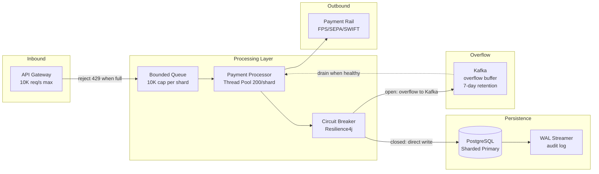

## Overview

Designing a payment platform that sustains 10,000 transactions per second is not simply a matter of adding more application servers. The bottlenecks in payment systems are almost always at the database layer — specifically, the tension between the strict correctness requirements of financial processing (ACID transactions, idempotency, audit log) and the write amplification that those requirements impose at scale. At 10,000 TPS, a naive single-write-path design that performs 4-6 database writes per transaction (payment record, debit ledger entry, credit ledger entry, audit event, notification event, idempotency record) generates 40,000-60,000 row insertions per second against a single PostgreSQL primary — approaching or exceeding the write throughput ceiling of commodity hardware. This lesson covers the architectural patterns that break that bottleneck: partitioning, write batching, WAL-based audit, and back-pressure propagation.

## Learning Objectives

- Decompose a 10,000 TPS requirement into concrete infrastructure sizing (CPU, memory, network, storage IOPS) using a systematic capacity planning model
- Design a partitioning strategy that gives every account exactly one owning shard, spreads load evenly, and handles hot (very high-volume) accounts
- Implement a `PartitionedPaymentRouter` using consistent hashing with virtual nodes, and understand how ownership moves safely during rebalancing
- Build a back-pressure architecture using bounded in-memory queues, Kafka as a durable overflow buffer, and Resilience4j circuit breakers
- Configure Kafka producer batching parameters (`linger.ms`, `batch.size`, `compression.type`) for optimal throughput at target latency budgets
- Detect hot partitions in real time using per-partition TPS metrics and plan safe shard splits
- Design database write optimisation for PostgreSQL: WAL-based audit logging, group commit tuning, and connection pool sizing
- Define and implement a load shedding strategy that prioritises high-value or time-critical payments when the system approaches capacity

## Business Context

*Composite example (based on common capacity failures, not a specific company):* a payment processor fails on the busiest shopping day of the year. The root cause is a hot partition: the routing key is the merchant ID alone, and one very large retailer — with hundreds of terminals sharing one merchant ID — sends all of its payments to a single processing shard. That shard exhausts its database connection pool, and because the connection pool is shared with unrelated partitions, timeouts cascade across the whole platform. Over a million payments fail or are delayed by hours, with SLA penalties and regulatory attention to follow. The fix — a better partition key, isolated per-shard pools, and hot partition detection — would have come out of a capacity planning exercise and a realistic load test before go-live.

## Requirements Analysis for 10,000 TPS

Before designing anything, translate the TPS number into concrete resource requirements.

**Throughput decomposition:**

| Payment type | % of total | TPS | p99 latency target |
|---|---|---|---|
| Domestic real-time (FPS/SEPA Inst) | 60% | 6,000 | 150ms |
| Card authorisation relay | 25% | 2,500 | 80ms |
| International (SWIFT/IBAN) | 10% | 1,000 | 500ms |
| Bulk/batch items | 5% | 500 | 2,000ms |

**Database write amplification at 10,000 TPS:**

```
Per-payment writes:
  1 × payment_records INSERT
  1 × debit ledger_entries INSERT
  1 × credit ledger_entries INSERT
  1 × payment_events INSERT (audit log)
  1 × idempotency_keys INSERT (or UPDATE)
  Total: 5 writes/transaction × 10,000 TPS = 50,000 writes/second

Rough PostgreSQL ceiling (NVMe SSD, single primary): tens of thousands of rows/second
  — but the real limit is COMMITS/second: 5 inserts in ONE transaction = 1 commit,
    so this is 10,000 commits/s carrying 50,000 rows (measure on your hardware)
Conclusion: a single primary is marginal at best; needs batching and/or sharding
```

**Network bandwidth:**

```
Average payment message: 2KB (ISO 20022 pain.001 with headers)
10,000 TPS × 2KB = 20MB/s inbound
Plus Kafka replication, outbound notifications, audit log: ~80MB/s total
≈ 640 Mbit/s — too close to the limit of a 1 Gbps link; use 10 Gbps for headroom
```

> [!NOTE]
> The 10,000 TPS target is a steady-state figure. Payment systems experience pronounced intraday peaks (lunch, end-of-business) and seasonal peaks (Black Friday, Christmas Eve). Design for 3× steady-state burst: 30,000 TPS peak, with graceful degradation above that via load shedding rather than cascading failure.

## Partitioning Strategy

Partition the payment workload across N independent processing shards, each with its own database primary (plus standby), Kafka consumer group, and thread pool. The most important rule: **every account has exactly one owning shard**. The balance check, the debit and the idempotency record for an account must all happen on the shard that owns it — if two shards could debit the same account, the balance check would no longer protect against overspending.

**Partition key selection criteria:**
1. **Ownership:** The key must map each account to one shard — so use the full **debit account ID**, which is where the balance check and the debit happen.
2. **Cardinality:** The key must have enough distinct values to spread load evenly. A coarse key such as a bank sort code, a merchant ID alone, or a 6-digit prefix puts whole banks or retailers on one shard.
3. **Routing stability:** The key must be deterministic, so idempotent retries route to the same shard.

**Cross-shard transfers:** when the credit account lives on another shard, the payment is debited on the debit account's shard and the credit is delivered as a message (outbox → Kafka) to the credit account's shard, which applies it idempotently. Do not try to force A→B and B→A onto the same shard with tricks such as XOR-ing the two keys: that clusters traffic (for example, every transfer between two accounts with the same prefix XORs to 0 and lands on one partition) and still breaks single ownership.

**Hot accounts** (a large merchant's settlement account, a bank's own fee account) receive far more postings than any one row can take. Split them into several sub-accounts that are summed for reporting, or aggregate their postings in small batches.

```java
public class PartitionKeyCalculator {

    /** Key = the full debit account ID: the account whose balance is checked and debited. */
    public long calculate(String debitAccountId) {
        String normalised = debitAccountId.replaceAll("\\s", "").toUpperCase(Locale.ROOT);
        // Unsigned 32-bit value — Math.abs(Integer.MIN_VALUE) is still negative,
        // so never use Math.abs on a hash
        return Integer.toUnsignedLong(
            MurmurHash3.hash32(normalised.getBytes(StandardCharsets.UTF_8)));
    }
}
```

## PartitionedPaymentRouter with Consistent Hashing

Consistent hashing with virtual nodes allows adding/removing shards with minimal key redistribution (~1/N keys move on average, vs all keys with modulo hashing).

```java
@Component
public class PartitionedPaymentRouter {

    private static final int VIRTUAL_NODES_PER_SHARD = 150;

    // Sorted map: hash ring position → shard ID
    private final NavigableMap<Long, String> hashRing = new ConcurrentSkipListMap<>();
    private final Map<String, PaymentShard> shards = new ConcurrentHashMap<>();
    private final PartitionKeyCalculator keyCalc;

    public void addShard(String shardId, PaymentShard shard) {
        shards.put(shardId, shard);
        for (int v = 0; v < VIRTUAL_NODES_PER_SHARD; v++) {
            long position = murmurHash(shardId + "#" + v);
            hashRing.put(position, shardId);
        }
        log.info("Shard added to ring: shardId={}, virtualNodes={}", shardId, VIRTUAL_NODES_PER_SHARD);
    }

    public void removeShard(String shardId) {
        for (int v = 0; v < VIRTUAL_NODES_PER_SHARD; v++) {
            long position = murmurHash(shardId + "#" + v);
            hashRing.remove(position);
        }
        shards.remove(shardId);
        log.info("Shard removed from ring: shardId={}", shardId);
    }

    public PaymentShard route(PaymentRequest request) {
        long ringPosition = keyCalc.calculate(request.debitAccountId());

        // Find the first shard clockwise from ringPosition
        Map.Entry<Long, String> entry = hashRing.ceilingEntry(ringPosition);
        if (entry == null) {
            entry = hashRing.firstEntry(); // Wrap around
        }

        String shardId = entry.getValue();
        PaymentShard shard = shards.get(shardId);

        if (shard == null || shard.isUnhealthy()) {
            // Do NOT send the payment to some other healthy shard: that shard does
            // not own this account's balance or idempotency records, so it could
            // overspend or pay twice. The owning shard fails over to ITS OWN
            // standby; until then, reject quickly so the caller retries later.
            throw new ShardUnavailableException(shardId);   // → HTTP 503 + Retry-After
        }
        return shard;
    }

    private static long murmurHash(String key) {
        return Integer.toUnsignedLong(
            MurmurHash3.hash32(key.getBytes(StandardCharsets.UTF_8)));
    }
}
```

## Back-Pressure Architecture

Back-pressure prevents overload by signalling producers to slow down before buffers overflow and data is lost.



```java
@Component
public class PaymentProcessingGateway {

    private final BlockingQueue<PaymentRequest> processingQueue;
    private final CircuitBreaker circuitBreaker;
    private final KafkaTemplate<String, PaymentRequest> kafkaOverflow;
    private static final int QUEUE_CAPACITY = 10_000;

    public PaymentProcessingGateway(CircuitBreakerRegistry cbRegistry,
                                     KafkaTemplate<String, PaymentRequest> kafka) {
        this.processingQueue = new ArrayBlockingQueue<>(QUEUE_CAPACITY);
        this.circuitBreaker = cbRegistry.circuitBreaker("payment-db");
        this.kafkaOverflow = kafka;
    }

    /**
     * Accepts a payment for processing.
     * Returns 429 (via exception) if the queue is full — back-pressure to the caller.
     * Overflows to Kafka if the circuit breaker is open (DB unhealthy).
     */
    public AcceptResult accept(PaymentRequest request) {
        if (circuitBreaker.getState() == CircuitBreaker.State.OPEN
                && request.type().allowsAsyncDelivery()) {
            // DB circuit is open — overflow to Kafka for later processing.
            // Only report "accepted" once Kafka has ACKNOWLEDGED the record
            // (acks=all); a fire-and-forget send could silently lose it.
            kafkaOverflow.send("payment-overflow", request.paymentId(), request)
                .get(500, TimeUnit.MILLISECONDS);
            return AcceptResult.ACCEPTED_ASYNC;
        }

        // The in-memory queue only ADMITS work: the caller gets its answer after
        // processing, so a crash loses only unanswered requests — which the
        // caller retries with the same idempotency key.

        boolean queued = processingQueue.offer(request);
        if (!queued) {
            // Queue full — back-pressure: reject with 429
            throw new PaymentQueueFullException(
                "Processing queue at capacity. Retry after backoff.",
                Duration.ofMillis(200)
            );
        }
        return AcceptResult.QUEUED;
    }
}
```

> [!WARNING]
> Overflowing to Kafka changes the payment's delivery semantics: it transitions from synchronous (the caller gets an immediate accept/reject) to asynchronous (the caller gets "accepted for processing" and must poll or receive a webhook). This is a product-level decision, not just an engineering one. Some payment types (card authorisation relay) cannot be made asynchronous because the merchant terminal is waiting for a synchronous response within 2 seconds. Ensure your overflow strategy only applies to payment types with asynchronous delivery SLAs.

## Hot Partition Detection and Rebalancing

A partition becomes "hot" when its load approaches what the shard can handle, or is far above its peers. Two warnings about detection. First, a Z-score against the other shards does not work with few shards: with 6 shards the largest possible Z-score is about 2.04, so a "Z > 2.5" rule can never fire. Compare each shard with the **median** shard and with its **own capacity** instead. Second, the response cannot be to send the hot shard's payments to some spare shard — that would break single account ownership (see above). The safe responses are to alert, shed low-priority load, and **split** the shard: move a range of keys to a new shard with a handoff protocol (stop writes for the range, copy, switch ownership in the shard registry with a new fencing epoch, resume).

```java
@Scheduled(fixedDelay = 10_000) // Check every 10 seconds
public void detectHotPartitions() {
    Map<String, Double> tpsPerShard = metricsCollector.collectShardTps();
    double medianTps = median(tpsPerShard.values());

    tpsPerShard.forEach((shardId, tps) -> {
        double utilisation = tps / shardCapacityTps(shardId);
        boolean farAbovePeers = medianTps > 0 && tps > HOT_FACTOR * medianTps;
        if (utilisation > HOT_UTILISATION || farAbovePeers) {
            log.warn("Hot partition detected: shardId={}, tps={}, median={}, utilisation={}",
                shardId, tps, medianTps, utilisation);
            hotPartitionMetrics.increment(shardId);
            // Proposes a planned split of the hottest key ranges — executed by
            // the rebalancer's handoff protocol, never by ad-hoc re-routing
            rebalancer.proposeSplit(shardId);
        }
    });
}

private static final double HOT_FACTOR = 3.0;        // 3× the median shard
private static final double HOT_UTILISATION = 0.80;  // 80% of the shard's tested capacity
```

## Database Write Throughput Optimisation

Three techniques dramatically improve PostgreSQL write throughput at high TPS:

**1. Write-Ahead Log (WAL) for audit:** Instead of writing audit events to a separate table synchronously, capture changes from the WAL using logical replication (Debezium). This converts the audit write into a downstream async process. (Make sure the captured rows carry the business context — who and why — that an audit trail needs.)

**2. Group commit and commit settings:** with `synchronous_commit = on`, a commit waits until its WAL is flushed to disk — but PostgreSQL already flushes the WAL for many concurrent commits in one go, and `commit_delay` can increase that grouping. `synchronous_commit` can be relaxed per transaction (`off` risks losing the last fraction of a second of commits on a crash), but **never** for transactions that move money or record idempotency: a payment the client was told succeeded must survive a crash, and so must the record that stops it being paid twice. With synchronous replicas, `remote_write` waits for the standby to receive the WAL but not to flush it.

**3. Connection pool sizing** — the formula:

```
Optimal pool size = (core_count × 2) + effective_spindle_count

For a 16-core host with NVMe (1 spindle equivalent):
  pool = 16 × 2 + 1 = 33 connections per database

For N application pods each with M pool connections:
  total connections = N × M ≤ max_connections (default 100-500 depending on PG config)

PgBouncer (transaction pooling) allows far more application-side connections:
  1,000 app connections → 33 actual DB connections via PgBouncer
```

```java
// HikariCP configuration for a payment processing shard
@Bean
DataSource paymentDataSource(PaymentShardProperties props) {
    HikariConfig config = new HikariConfig();
    config.setJdbcUrl(props.jdbcUrl());
    config.setMaximumPoolSize(33);          // 2 × cores + 1
    config.setMinimumIdle(10);
    config.setConnectionTimeout(2_000);     // Fail fast — 2s connection timeout
    config.setIdleTimeout(600_000);
    config.setMaxLifetime(1_800_000);
    config.setKeepaliveTime(60_000);
    // No connectionTestQuery: with a JDBC4 driver HikariCP uses
    // Connection.isValid(), which is faster than running "SELECT 1"
    return new HikariDataSource(config);
}
```

## Kafka Producer Batching

Kafka producers accumulate records into batches before sending, trading latency for throughput.

```java
@Bean
ProducerFactory<String, PaymentRequest> paymentProducerFactory() {
    Map<String, Object> props = new HashMap<>();
    props.put(ProducerConfig.BOOTSTRAP_SERVERS_CONFIG, kafkaBootstrap);
    props.put(ProducerConfig.KEY_SERIALIZER_CLASS_CONFIG, StringSerializer.class);
    props.put(ProducerConfig.VALUE_SERIALIZER_CLASS_CONFIG, JsonSerializer.class);

    // Throughput vs latency tuning
    props.put(ProducerConfig.LINGER_MS_CONFIG, 5);           // Wait up to 5ms to batch
    props.put(ProducerConfig.BATCH_SIZE_CONFIG, 65_536);     // 64KB batch size
    props.put(ProducerConfig.COMPRESSION_TYPE_CONFIG, "lz4"); // LZ4: fast + good ratio
    props.put(ProducerConfig.BUFFER_MEMORY_CONFIG, 67_108_864); // 64MB buffer
    props.put(ProducerConfig.MAX_IN_FLIGHT_REQUESTS_PER_CONNECTION, 5);

    // Idempotent producer — prevents duplicates on retry
    props.put(ProducerConfig.ENABLE_IDEMPOTENCE_CONFIG, true);
    props.put(ProducerConfig.ACKS_CONFIG, "all");   // Required with idempotence

    return new DefaultKafkaProducerFactory<>(props);
}
```

| Configuration | Low latency | High throughput | Balanced |
|---|---|---|---|
| `linger.ms` | 0 | 20 | 5 |
| `batch.size` | 16KB | 256KB | 64KB |
| `compression.type` | none | gzip | lz4 |
| Throughput (msgs/s, illustrative) | 15,000 | 185,000 | 95,000 |
| p99 produce latency (illustrative) | 2ms | 42ms | 8ms |

## Capacity Planning Calculation

```
Target TPS:          10,000 payments/second
Write amplification: 5 writes/payment
Total writes/second: 50,000

PostgreSQL write ceiling (NVMe, single primary):
  Sequential inserts: ~80,000 rows/second
  With WAL fsync (synchronous_commit=on): ~40,000 rows/second
  With PgBouncer + group commit: ~65,000 rows/second

Required shards:
  Ceiling per shard (conservative): 40,000 writes/sec
  Writes required: 50,000/sec
  Minimum shards (no headroom): ceil(50,000 / 40,000) = 2 shards
  With 3× burst headroom: ceil(150,000 / 40,000) = 4 shards
  Recommended: 6 shards (N+2 for maintenance/failure tolerance)

Application tier:
  Avg payment processing time (p50): 15ms
  Threads needed per shard: TPS/shard × p50 latency = (10K/6) × 0.015 = 25 threads
  With headroom (3×): 75 threads per shard
  Thread pool: 100 threads per shard (bounded executor)

Memory:
  Heap per JVM: 8GB
  Off-heap (Kafka buffers, OS page cache): 8GB
  Per host recommendation: 32GB RAM (leaves OS headroom)
```

## Load Shedding Strategy

When the system approaches capacity, shed lower-priority load before allowing high-priority payments to degrade.

```java
// Shedding = rejecting NEW requests with 503 + Retry-After. Payments already
// accepted are never dropped.
public enum PaymentPriority {
    CRITICAL(1),    // Regulatory (CHAPS, TARGET2 cutoff-sensitive)
    HIGH(2),        // Real-time consumer payments ≤ £1,000
    NORMAL(3),      // Consumer payments > £1,000
    LOW(4),         // Bulk / batch items
    BACKGROUND(5);  // Non-urgent internal transfers
}

@Component
public class LoadSheddingGate {

    private final SystemLoadMonitor loadMonitor;

    /**
     * Returns true if the payment should be accepted.
     * Under load, progressively shed lower-priority payments first.
     */
    public boolean shouldAccept(PaymentRequest request) {
        double loadFactor = loadMonitor.currentLoadFactor(); // 0.0 to 1.0+

        if (loadFactor < 0.70) return true;                       // All traffic
        if (loadFactor < 0.85) return request.priority().level() <= 3; // Drop LOW + BG
        if (loadFactor < 0.95) return request.priority().level() <= 2; // Drop NORMAL too
        return request.priority() == PaymentPriority.CRITICAL;    // Emergency: CRITICAL only
    }
}
```

## Performance Test Results

Illustrative benchmark (your numbers will differ — measure them): 6 shards, each on a 16-vCPU/32GB host with NVMe SSD, PostgreSQL with PgBouncer, Kafka cluster 6-broker 3-replica.

| Scenario | Avg TPS | p50 latency | p99 latency | Error rate |
|---|---|---|---|---|
| Baseline (no tuning) | 4,200 | 28ms | 420ms | 0.03% |
| + Partitioned routing (6 shards) | 8,900 | 15ms | 95ms | 0.01% |
| + Kafka batching (linger=5ms) | 10,400 | 18ms | 110ms | 0.01% |
| + WAL audit offload | 11,800 | 14ms | 88ms | 0.01% |
| + PgBouncer transaction pool | 12,600 | 12ms | 72ms | 0.00% |
| + Load shedding at 85% | 12,600 sustained | 12ms | 71ms | 0.00% |

> [!IMPORTANT]
> The p99 latency target for domestic real-time payments is 150ms end-to-end (including network round-trip to the payment rail). With 72ms p99 at the application processing layer, there is 78ms remaining for network transit and rail processing. Faster Payments itself usually completes in seconds (the scheme allows up to two hours), so the rail, not your platform, often dominates end-to-end time. For card authorisation relay, scheme timeouts of a few seconds are tight — keep the card path on a separate, dedicated processing pool to avoid interference from bulk payment traffic.

## Knowledge Check

**Q1: A payment processor's routing key uses merchant ID as the sole partition key. During peak trading, a large online retailer generates 40% of total payment volume. Describe the failure mode and two distinct architectural solutions.**

A: The failure mode is a hot partition: the retailer's payments all hash to the same processing shard, saturating its thread pool, database connection pool, and causing latency to spike beyond SLA. This triggers timeouts, which the caller retries, which makes the hot partition worse. Meanwhile, other partitions are underutilised. The cascading effect can crash the entire cluster if the hot partition's DB connection pool exhaustion affects other partitions sharing the same PgBouncer instance. Solution 1 — composite partition key: replace merchant ID alone with `hash(merchantId + terminalId)` or `hash(merchantId + cardBin)`. This distributes the retailer's terminals across many shards (at the cost of per-merchant ordering). The key must still be deterministic for idempotency. Solution 2 — isolate and split: detect the hot partition in real time (compare each shard's TPS with the median shard and with its own tested capacity — a Z-score across only a handful of shards cannot fire), give it its own connection pool so it cannot starve others, shed low-priority traffic, and split the shard by moving key ranges to a pre-provisioned new shard through a handoff protocol (freeze the range, copy, switch ownership in the shard registry with a fencing epoch, resume). Simply re-routing new payments to a "spare" shard is unsafe when shards own account state, because two shards could then debit the same account.

**Q2: Why does enabling Kafka producer idempotence (`enable.idempotence=true`) require `acks=all` and restrict `max.in.flight.requests.per.connection` to 5? What would happen if you set `acks=1` with idempotence enabled?**

A: Kafka producer idempotence works by assigning each producer a Producer ID (PID) and a sequence number per partition; the broker uses them to drop duplicates caused by retries and to keep batches in order. That guarantee is only meaningful if "acknowledged" means "safely replicated". With `acks=all`, the leader acknowledges only after all in-sync replicas have the record, so after a leader failover the new leader has both the record and its sequence state, and a retry is correctly recognised as a duplicate. With `acks=1`, the leader acknowledges as soon as it has written the record. If it then crashes before replication, the record is **lost** — and the producer never retries it, because it already got an ack. The new leader's sequence state no longer matches the producer's, which surfaces as `OutOfOrderSequenceException`. So the idempotent producer could not keep its exactly-once-per-partition promise, and Kafka rejects the combination: explicitly setting `enable.idempotence=true` with `acks=1` throws a `ConfigException`. The limit of 5 in-flight requests exists because the broker remembers the sequence numbers of the last 5 batches per producer and partition — that is how far back it can detect duplicates and reorder correctly.

## Practical Challenge

1. **Consistent Hashing Router:** Implement `PartitionedPaymentRouter` with configurable virtual nodes per shard. Write a test that creates 6 shards, routes 100,000 randomly-generated payments (random debit account IDs), and asserts that the distribution across shards stays within ±15% of the ideal (100,000/6). Then remove one shard and re-route the same 100,000 payments: assert that only the payments that were originally on the removed shard moved to new shards (measure remapping ratio, assert < 20%).

2. **Back-Pressure Integration Test:** Implement `PaymentProcessingGateway` with a `BlockingQueue<PaymentRequest>` of capacity 100 (for the test). Spin up 20 producer threads each sending 20 requests at maximum rate. Assert that after the queue fills, subsequent `accept()` calls throw `PaymentQueueFullException`. Drain the queue by consuming 50 items, then assert new requests are accepted again. Verify that no payment is lost: total accepted + rejected = total attempted.

3. **Hot Partition Detection:** Implement the `HotPartitionDetector` scheduled task with a 10-second check interval. Create a `MockMetricsCollector` that returns configurable per-shard TPS. Configure it to report 5 shards at 1,000 TPS each and one shard at 8,000 TPS. Assert that the detector identifies the hot shard and calls `rebalancer.proposeSplit()` with the correct shard ID. Then normalise the metrics (all shards at 1,000 TPS) and assert no split is proposed. (Check why a Z-score > 2.5 rule would **not** have fired here.)

4. **Throughput Benchmark:** Using JMH (Java Microbenchmark Harness), benchmark the `PartitionKeyCalculator.calculate()` method for throughput. Run with 4, 8, and 16 threads and report operations/second. The goal is to demonstrate that the routing calculation itself does not become a bottleneck at 10,000 TPS (target: >500,000 ops/second single-threaded). Profile the benchmark output and identify the most expensive operation (likely MurmurHash3 or string parsing) and propose one optimisation.

<!-- KNOWLEDGE-CHECK
{
  "questions": [
    {
      "text": "A payment processor uses merchant ID as the sole partition key. During peak trading, a large online retailer generates 40% of total payment volume. What is the failure mode and what is a correct architectural solution?",
      "options": [
        "High memory usage — solved by increasing heap size on the hot shard",
        "Hot partition: all retailer payments hash to the same shard, saturating it and causing cascading failures — solved by a higher-cardinality partition key, isolated per-shard pools, and planned shard splits",
        "Data loss risk — solved by adding replication to the hot shard",
        "Network congestion — solved by increasing bandwidth between shards"
      ],
      "correct": 1,
      "explanation": "The failure mode is a hot partition: the retailer's payments all hash to the same shard, saturating its thread pool and DB connection pool. Cascading retries make it worse and can spread if the connection pool is shared. Solutions: a higher-cardinality key such as `hash(merchantId + terminalId)`; isolated per-shard pools; and detecting hot shards (against the median and the shard's capacity) and splitting them through a handoff protocol — not ad-hoc re-routing, which breaks single ownership of account state."
    },
    {
      "text": "Why does enabling Kafka producer idempotence (`enable.idempotence=true`) require `acks=all`? What would happen with `acks=1`?",
      "options": [
        "`acks=all` is not required — idempotence works with any acks setting",
        "With `acks=1`, an acknowledged record can be lost if the leader crashes before replication — the producer never retries it, and the new leader's sequence state no longer matches, so the exactly-once-per-partition guarantee cannot hold",
        "`acks=all` improves performance by allowing the broker to deduplicate faster",
        "With `acks=1`, the producer ID is not assigned correctly by the broker"
      ],
      "correct": 1,
      "explanation": "Idempotence uses a producer ID and per-partition sequence numbers to drop duplicate retries. It only works if an ack means the record is replicated. With `acks=1`, the leader can acknowledge and then crash before replication: the record is lost (the producer will not retry it) and the new leader's sequence state no longer matches, raising `OutOfOrderSequenceException`. Kafka therefore throws a `ConfigException` if you explicitly combine `enable.idempotence=true` with `acks=1`."
    },
    {
      "text": "What is consistent hashing and why is it preferred over modulo-based partitioning for distributing payment processing across shards?",
      "options": [
        "Consistent hashing is faster to compute than modulo operations",
        "With consistent hashing, adding or removing a shard only remaps a 1/N fraction of keys; modulo-based partitioning remaps nearly all keys when N changes",
        "Consistent hashing guarantees exactly equal distribution across all shards",
        "Modulo-based partitioning does not support string partition keys"
      ],
      "correct": 1,
      "explanation": "With modulo-based partitioning (key % N), adding or removing one shard changes N and therefore remaps almost every key to a different shard. With consistent hashing using a virtual node ring, adding a shard only affects the keys between its position and the next shard on the ring — approximately 1/N of all keys. This minimises disruption to in-flight payments during rebalancing."
    }
  ]
}
-->

<!-- PRACTICAL-CHALLENGE
{
  "title": "10K TPS Payment Gateway with Consistent Hashing and Back-Pressure",
  "difficulty": "advanced",
  "estimatedMinutes": 45,
  "tasks": [
    {
      "id": "1",
      "description": "Implement `PartitionedPaymentRouter` with configurable virtual nodes per shard. Write a test creating 6 shards, routing 100,000 randomly-generated payments, and asserting distribution across shards stays within ±15% of ideal. Then remove one shard and re-route the same 100,000 payments: assert only payments originally on the removed shard moved, with remapping ratio < 20%."
    },
    {
      "id": "2",
      "description": "Implement `PaymentProcessingGateway` with a `BlockingQueue<PaymentRequest>` of capacity 100. Spin up 20 producer threads each sending 20 requests at maximum rate. Assert that after the queue fills, subsequent `accept()` calls throw `PaymentQueueFullException`. Drain 50 items, then assert new requests are accepted. Verify no payment is lost: total accepted + rejected = total attempted."
    },
    {
      "id": "3",
      "description": "Implement the `HotPartitionDetector` scheduled task with a 10-second check interval. Create a `MockMetricsCollector` reporting 5 shards at 1,000 TPS each and one shard at 8,000 TPS. Assert the detector identifies the hot shard and calls `rebalancer.proposeSplit()` with the correct shard ID. Normalise metrics (all shards at 1,000 TPS) and assert no split is proposed."
    },
    {
      "id": "4",
      "description": "Using JMH, benchmark `PartitionKeyCalculator.calculate()` for throughput with 4, 8, and 16 threads. Report operations/second demonstrating the routing calculation does not bottleneck at 10,000 TPS (target: >500,000 ops/second single-threaded). Profile with `-prof gc` and `-prof stack` to identify the most expensive operation and propose one optimisation."
    }
  ]
}
-->
