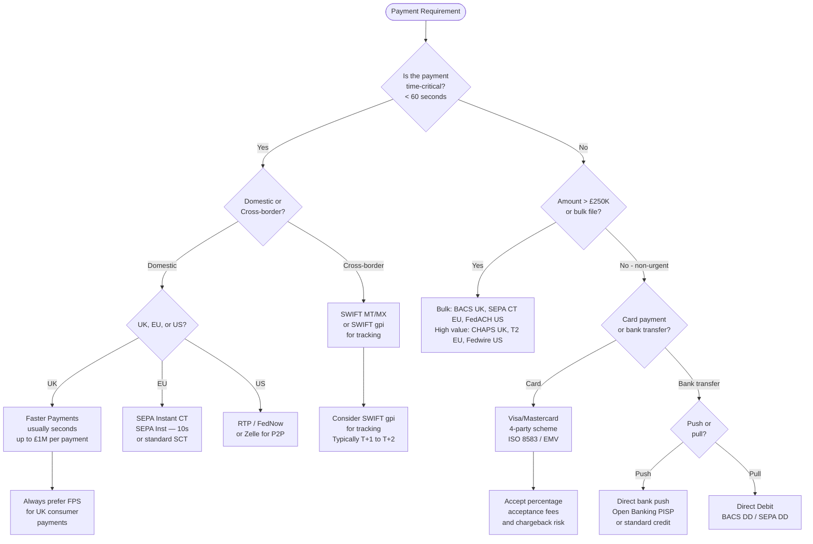
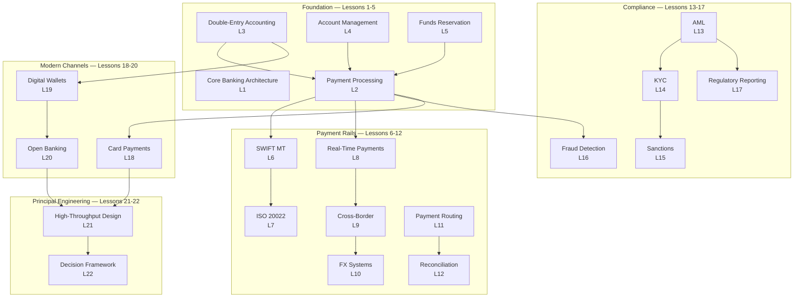

# إطار القرار للأنظمة البنكية — المقايضات والبناء أو الشراء ومراجعة التصميم

## نظرة عامة

يشغل المهندس الرئيسي (principal engineer) في شركة بنكية أو شركة مدفوعات تقاطعًا نادرًا: عميقًا بما يكفي في المنظومة التقنية ليفهم لماذا يهم تخصيص ذاكرة واعٍ بـ NUMA بزمن 50 ميكروثانية في خدمة تفويض البطاقات، وقريبًا بما يكفي من العمل ليعرف أن جواب "هل نبني نظامنا البنكي الأساسي بأنفسنا؟" هو "لا" في معظم الأحيان. والقرارات التي تحدد البنية التقنية للبنك — أي مسارات الدفع تُربط، وهل يُبنى كشف الاحتيال أم يُشترى، وكيف يُهيكل نموذج بيانات متعدد الولايات القضائية — غير قابلة للعكس على المدى الزمني لمسيرة هندسية نموذجية. واتخاذها بشكل صحيح يتطلب عملية قرار منظمة توازن بين الصحة، والتوفر، والزمن، والكلفة، والامتثال الرقابي في آن واحد، دون أن تسمح لأي بعد منفرد بالهيمنة افتراضيًا.

## أهداف التعلم

- شرح التوترات الأساسية الأربعة في بنية الأنظمة البنكية (الصحة مقابل التوفر، والزمن مقابل الكلفة، والمرونة مقابل الارتباط بالمورّد، والسرعة مقابل الامتثال) واستخدامها لتأطير أي قرار تقني
- تطبيق إطار منظم من خمسة أسئلة لتقييم أي قرار تصميم في الأنظمة البنكية قبل تخصيص الموارد
- اختيار نظام الدفع المناسب (دفع آني، ودفعات مجمّعة ACH/BACS، وSWIFT، والبطاقات) لحالة استخدام معينة باستخدام مخطط قرار صريح
- تقييم قرارات البناء أو الشراء لمكونات النظام البنكي الأساسي باستخدام نموذج الكلفة الإجمالية للملكية الذي يشمل الامتثال الرقابي، والعبء التشغيلي، وكلفة الخروج
- تحديد أخطر خمسة أنماط خاطئة في تصميم الأنظمة البنكية وشرح نمط الفشل المحدد الذي ينتجه كل منها
- تطبيق قائمة مراجعة التصميم للمهندس الرئيسي على بنية نظام بنكي مقترحة، وتحديد الثغرات عبر أبعاد الصحة والامتثال والتشغيلية وقابلية التوسع
- شرح كيف تتجمع دروس المسار 4 الاثنان والعشرون في نموذج ذهني كامل للبنية التحتية البنكية
- صياغة سجل قرار معماري (ADR) لاختيار نظام دفع يوثق صراحة المقايضات والقيود ومبررات القرار

## سياق العمل

في أبريل 2018 نقل بنك TSB في المملكة المتحدة نحو 5 ملايين عميل إلى منصة بنكية أساسية جديدة في عطلة نهاية أسبوع واحدة. ففشلت الخدمات المصرفية عبر الإنترنت والجوال؛ وتأثر نحو 1.9 مليون عميل، ولم يستطع كثيرون الوصول إلى أموالهم أو إجراء مدفوعات، واستمرت المشاكل أسابيع لبعضهم. ووجدت المراجعة المستقلة التي تلت ذلك (2019) أن المنصة لم تكن جاهزة وأن الاختبار وفحوص الجاهزية كانت غير كافية. وكان النقل تحويلًا من نوع "الانفجار الكبير" (big bang) — كل العملاء وكل حالة التطبيق دفعة واحدة — بدل نهج مرحلي قابل للعكس، ولم تُوزن مخاطر هذا الاختيار بصرامة كافية. وفي ديسمبر 2022 فرضت FCA وPRA على TSB غرامة إجمالية قدرها 48.65 مليون جنيه. والدرس ليس أن المهندسين كانوا غير أكفاء؛ بل هو منهجي: القرارات المعمارية عالية العواقب وغير القابلة للعكس تحتاج عملية رسمية تجعل المقايضات واحتمال الفشل وكلفة الفشل صريحة قبل تثبيتها.

## التوتر الأساسي في الأنظمة البنكية

يقع كل قرار معماري في الأنظمة البنكية عند تقاطع أربع قوى متنافسة:

```
Correctness ◄──────────────────────────► Availability
     │          Banking systems live        │
     │          in this space               │
     ▼                                      ▼
   Latency ◄──────────────────────────► Cost
```

**الصحة مقابل التوفر (تقاطع CAP):** تتطلب الأنظمة البنكية اتساقًا قويًا لإدارة الأرصدة — فيجب ألا يرى العميل أبدًا مالًا أكثر مما يملك، ويجب ألا ينجح سحبان متزامنان كلاهما. لكن الاتساق القوي (العزل القابل للتسلسل، والنسخ المتزامن) يقلل التوفر: فإذا تعذر الوصول إلى قاعدة البيانات الرئيسية، يجب أن يرفض النظام المعاملات بدل السماح بعدم الاتساق. وهذه هي المقايضة الصحيحة للأنظمة المالية (يجب أن تفضل معاملة مرفوضة على إنفاق مزدوج)، لكنها يجب أن تكون اختيارًا واعيًا، لا مصادفة.

**الزمن مقابل الكلفة:** تتطلب معالجة الدفع بأقل من 100 مللي ثانية بنية مكلفة — أقراص NVMe، وذاكرة تخزين مؤقت، ونسخ متزامن إلى مناطق احتياطية. وتخفيف الزمن إلى 2–5 ثوانٍ (مقبول لأنواع مدفوعات كثيرة) يتيح بنية أرخص، ومعالجة مجمّعة، وتنوعًا جغرافيًا للتعافي من الكوارث. ويجب أن يحدد الاختيارَ اتفاقيةُ الخدمة لمسار الدفع، لا "اجعلها سريعة" افتراضيًا.

**المرونة مقابل الارتباط بالمورّد:** البناء على نظام بنكي أساسي من طرف ثالث (Temenos T24، وFIS، وFinastra) يشتري 20 عامًا من الامتثال الرقابي واكتمال الميزات لكنه يخلق اعتمادًا عميقًا على خارطة طريق المورّد وتسعيره واستقرار واجهاته. والبناء داخليًا يمنح التحكم لكنه يتطلب فريقًا يستطيع صيانة نظام بتعقيد مماثل وتطويره إلى ما لا نهاية.

**السرعة مقابل الامتثال:** تضيف المتطلبات الرقابية (PSD2، وAML، وGDPR، وPCI DSS، والترخيص المحلي) وقتًا وقيودًا وكلفة إلى كل قرار معماري. والفرق التي تعامل الامتثال كتدقيق في الخطوة الأخيرة ستكتشف أن بنيتها تتطلب إعادة تصميم. أما الفرق التي تبني المتطلبات الرقابية في نماذج بياناتها وتصاميم واجهاتها الأولية فتطلق أسرع — فمراجعة الامتثال تأكيد، لا إعادة عمل.

## إطار القرار لاختيار نظام الدفع



| النظام | السرعة | الكلفة | القابلية للعكس | يُستخدم عندما |
|---|---|---|---|---|
| FPS (المملكة المتحدة) | ثوانٍ عادة | بنسات | غير قابل للإلغاء بعد الإرسال (ينطبق تعويض احتيال APP) | P2P للمستهلكين، وبنود الرواتب العاجلة |
| SEPA Inst | أقل من 10 ثوانٍ | مثل SCT القياسي (قاعدة أوروبية) | غير قابل للإلغاء | آني للمستهلكين/الشركات في الاتحاد الأوروبي |
| BACS (المملكة المتحدة) | دورة 3 أيام | بنسات | يمكن استرجاعه قبل المعالجة؛ والخصم المباشر مشمول بضمان الخصم المباشر | الرواتب، ومدفوعات الموردين |
| CHAPS (المملكة المتحدة) | اليوم نفسه، آنيًا | عشرات الجنيهات (رسوم البنك) | غير قابل للإلغاء | العقارات، ومدفوعات الشركات عالية القيمة |
| SWIFT (دولي) | غالبًا اليوم نفسه؛ حتى T+2 | 5–25 دولارًا + رسوم المراسلين | الاسترجاع ممكن فقط بموافقة المستلم | مدفوعات الشركات العابرة للحدود |
| Visa/MC | تفويض في ثوانٍ، تسوية نحو T+1 | رسوم نسبية | استردادات لأشهر | التجزئة، والمدفوعات عبر الإنترنت |
| PISP في الخدمات المصرفية المفتوحة | ثوانٍ (عبر FPS) | رسوم ثابتة صغيرة | غير قابل للإلغاء | التجارة الإلكترونية الممولة من البنك |

## البناء أو الشراء للمكونات الأساسية

```java
// The build vs buy decision should be formalised as a structured evaluation
public record BuildVsBuyAnalysis(
    String component,
    long buildYearOneGbp,      // Cost to build year 1 (staff + infra)
    long buildOperationalCostYr,// Annual operational cost years 2+
    long buySaasAnnualCost,     // SaaS licence / per-transaction cost annualised
    long exitCostIfBuy,         // Cost to switch away from vendor in year 5
    long regulatoryRiskIfBuild, // Estimated cost of regulatory non-compliance if built wrong
    String recommendation
) {}
```

أرقام تقريبية توضيحية — يجب أن تحسب كل مؤسسة حالتها الخاصة:

| المكون | كلفة البناء (السنة 1) | الشراء (SaaS سنويًا) | التوصية |
|---|---|---|---|
| النظام البنكي الأساسي | 10–50 مليون جنيه | 500 ألف–5 ملايين جنيه | **شراء** — أكثر من 20 عامًا من الامتثال الرقابي |
| الدفتر / القيد المزدوج | 500 ألف–2 مليون جنيه | 50–200 ألف جنيه | **بناء** — عامل تميز استراتيجي، ومجال مفهوم جيدًا |
| مراقبة معاملات AML | 3–10 ملايين جنيه | 200–800 ألف جنيه | **شراء** — المخاطر الرقابية لبنائه خطأً جسيمة |
| موجّه المدفوعات | 500 ألف–2 مليون جنيه | 100–400 ألف جنيه | **بناء** — زمن المسار الحرج، وزمن المورّد لا يمكن التحكم فيه |
| التحقق من مستندات KYC | 2–8 ملايين جنيه | 50–500 ألف جنيه | **شراء** — نماذج التعلم الآلي للتحقق من الهوية تحتاج بيانات ضخمة |
| محرك أسعار الصرف | 300 ألف–مليون جنيه | 20–100 ألف جنيه | **بناء** — مباشر؛ وخطر الارتباط بالمورّد مرتفع |
| تسجيل نقاط الاحتيال | 5–20 مليون جنيه | 300 ألف–مليون جنيه | **شراء** (مبكرًا) ← **بناء** (على نطاق واسع، مع ميزة البيانات) |
| معالجة إصدار البطاقات | 20–80 مليون جنيه | 1–10 ملايين جنيه | **شراء** — اعتماد أنظمة البطاقات وحده يستغرق أشهرًا كثيرة |

> [!IMPORTANT]
> توصية "البناء" للدفتر لا تعني بناء نظام محاسبة عام الأغراض. بل تعني بناء دفتر قيد مزدوج ضيق ومحدد الغرض يخدم أنواع مدفوعاتك ونموذج عملاتك. ولحظة تحاول بناء نظام محاسبة عام يتعامل أيضًا مع حسابات دفتر الأستاذ العام، وجداول الإهلاك، والتوحيد متعدد الكيانات، فأنت تعيد بناء برمجيات محاسبة تجارية وينقلب قرار الشراء بشكل حاسم.

## قيود إقامة البيانات والولاية القضائية الرقابية

يجب أن تفي الأنظمة البنكية متعددة الولايات القضائية بمتطلبات إقامة البيانات التي تقيّد أين يمكن تخزين البيانات ومعالجتها ونسخها.

| الولاية القضائية | التنظيم | قيد البيانات الشخصية | قيد السجلات المالية |
|---|---|---|---|
| الاتحاد الأوروبي | المواد 44–49 من GDPR | النقل خارج المنطقة الاقتصادية الأوروبية يحتاج قرار كفاية أو ضمانات (SCCs وBCRs) | 5–10 سنوات (قواعد AML والمحاسبة والقطاع؛ تتفاوت حسب الدولة العضو) |
| المملكة المتحدة | UK GDPR + FCA SYSC | النقل يحتاج لوائح كفاية بريطانية أو ضمانات (IDTA) | من 5 سنوات (MLR) إلى 6 سنوات (قانون الشركات / HMRC) عادة |
| الهند | قانون DPDP لعام 2023 | النقل مسموح إلا إلى دول تقيدها الحكومة؛ وقد تكون قواعد القطاعات أشد | RBI: يجب تخزين بيانات أنظمة الدفع في الهند فقط |
| الصين | PIPL + DSL | تصدير البيانات الشخصية و"المهمة" يحتاج أساسًا قانونيًا (تقييم أمني، أو عقد قياسي، أو شهادة) | بيانات الدفع تبقى داخل البلد |
| الولايات المتحدة | لا قانون فيدرالي عام | قوانين الولايات (مثل CCPA) + قوانين القطاعات | BSA: خمس سنوات كحد أدنى |

```java
public record DataResidencyPolicy(
    String jurisdiction,
    boolean personalDataMayLeaveWithoutSafeguards,
    List<String> adequacyDestinations,  // ISO 3166-1 alpha-2 country codes
    int financialRecordRetentionYears,
    boolean replicationToDisasterRecoveryAllowed,
    String regulatoryBasis
) {
    // All 30 EEA countries (EU 27 + Iceland, Liechtenstein, Norway)
    static final List<String> EEA = List.of(
        "AT","BE","BG","HR","CY","CZ","DK","EE","FI","FR","DE","GR","HU","IE","IT",
        "LV","LT","LU","MT","NL","PL","PT","RO","SK","SI","ES","SE","IS","LI","NO");

    public static final DataResidencyPolicy EU_GDPR = new DataResidencyPolicy(
        "EU", false,
        concat(EEA,
               // A SUBSET of EU adequacy decisions — check the Commission's
               // current list; the US is covered only for companies certified
               // under the EU-US Data Privacy Framework
               List.of("GB", "CH", "JP", "CA", "NZ", "KR", "IL")),
        10, true, "GDPR Art 44, Regulation (EU) 2016/679"
    );
}
```

> [!WARNING]
> تحمل مخالفات إقامة البيانات عقوبات شديدة: غرامات GDPR تصل إلى 4% من الإيرادات السنوية العالمية، إضافة إلى لوم رقابي قد يطلق مراجعة للترخيص البنكي. ونسخ البيانات الشخصية لعملاء الاتحاد الأوروبي إلى منطقة خارج المنطقة الاقتصادية الأوروبية للتعافي من الكوارث — دون قرار كفاية أو ضمانات مثل SCCs أو BCRs، مع تقييم أثر النقل — خطأ هندسي شائع. فاستشر مسؤول حماية البيانات (DPO) قبل اتخاذ أي قرار معماري بالنسخ بين المناطق.

## قائمة الأسئلة الخمسة للبنية

قبل الموافقة على أي تصميم مهم لنظام بنكي، يجب أن يستطيع المهندس الرئيسي الإجابة عن هذه الأسئلة الخمسة إيجابيًا:

**1. ما الذي ينكسر أولًا عند 10 أضعاف الحمل؟**
حدد عنق الزجاجة (غالبًا قاعدة البيانات أو استدعاء خارجي متزامن) وتأكد من أنه إما يتوسع بسلاسة أو يفشل بطريقة محكومة ومراقبة. وإذا لم تستطع الإجابة عن هذا السؤال من المبادئ الأولى، فالتصميم يحتاج مزيدًا من نمذجة السعة قبل الموافقة.

**2. كيف تكتشف الإخفاقات الجزئية وتتعافى منها؟**
في الأنظمة الموزعة، الإخفاقات الجزئية (خدمة لاحقة تقبل طلبًا لكنها لا تعالجه) أخطر من الإخفاقات الكلية (التي تطلق قواطع الدائرة). فيجب أن يكون لكل استدعاء خارجي نتيجة قابلة للملاحظة — إما نجاح، أو فشل صريح، أو انتهاء مهلة يُعامل كنتيجة مجهولة تُستعلم حالتها قبل أي تعويض. و"أطلق وانسَ" (fire and forget) في الأنظمة المالية نمط خاطئ.

**3. أين حدود الـ idempotency؟**
يجب أن تكون كل عملية تغيير idempotent — فتقديم العملية نفسها مرتين يجب أن ينتج النتيجة نفسها كتقديمها مرة. وحدد أين تدخل مفاتيح الـ idempotency إلى نظامك وتخرج منه، وتأكد من أن كل معالج عند الحدود يخزن المفتاح قبل تنفيذ الأثر الجانبي، ويعيد النتيجة المخزنة عند إعادة المحاولة.

**4. أي التزامات رقابية ترتبط بهذا المكون؟**
قبل كتابة سطر شيفرة، عدّد: أي عناصر البيانات بيانات شخصية (حقوق أصحاب البيانات في GDPR)، وأي المعاملات تتطلب فحص AML، وأي تفاعلات العملاء تتطلب حفظ سجل التدقيق، وأي نقاط API تتطلب المصادقة القوية. فهذه ليست ميزات تُضاف لاحقًا — بل قيود تشكّل نموذج البيانات.

**5. ما خطة التعافي من الكوارث وهل اختبرتها؟**
حدد هدف زمن التعافي (RTO) وهدف نقطة التعافي (RPO) للمكون، ثم تحقق من أن البنية تستطيع الوفاء بهما. وفي أنظمة الدفع، يكون RPO للمدفوعات الملتزمة صفرًا فعليًا (نسخ متزامن)، ويجب أن يقع RTO ضمن **حد تحمل الأثر (impact tolerance)** الذي وضعته الشركة للخدمة التجارية المهمة — إذ تتطلب قواعد المرونة التشغيلية البريطانية أن تستطيع الشركات البقاء ضمن هذه الحدود في سيناريوهات شديدة لكن معقولة. ووثّق دليل التشغيل، وأجرِ تمرين هندسة فوضى يختبر مسار التعافي الفعلي، لا نظريًا.

```java
// Encode the checklist as a formal ADR template in code
public record ArchitectureDecisionRecord(
    String id,              // ADR-005
    String title,
    LocalDate date,
    List<String> deciders,
    String context,         // Why is this decision needed?
    List<String> options,   // What alternatives were considered?
    String decision,        // What was decided?
    String rationale,       // Why this option?
    List<String> consequences, // What does this make harder?
    String bottleneckAt10x,
    String partialFailureRecovery,
    String idempotencyBoundary,
    String regulatoryObligations,
    String disasterRecoveryPlan
) {}
```

## الأنماط الخاطئة في الأنظمة البنكية

| النمط الخاطئ | الوصف | نمط الفشل |
|---|---|---|
| استدعاء خارجي متزامن في مسار الدفع | استدعاء خدمة AML أو مسجّل احتيال بشكل متزامن مع إبقاء معاملة قاعدة بيانات مفتوحة | قفزة زمن في الخدمة الخارجية تستنفد مجمع اتصالات قاعدة البيانات؛ فشل متسلسل |
| رصيد بالقراءة ثم التعديل ثم الكتابة | قراءة الرصيد إلى التطبيق، وحساب القيمة الجديدة، وكتابتها (`SET balance = :newBalance`)، دون قيد دفتر خلف التغيير | الطلبات المتزامنة تكتب فوق بعضها (تحديثات ضائعة، وسحب على المكشوف)؛ والأرصدة تنجرف دون طريقة لإثباتها |
| غياب الـ idempotency عند حدود API | لا مفتاح idempotency على نقاط بدء الدفع | انتهاءات مهلة الشبكة تسبب مدفوعات مكررة عند إعادة المحاولة؛ وشكاوى العملاء؛ ومخالفة رقابية |
| النقل بالانفجار الكبير | نقل كل البيانات وتحويل كل الحركة في آن واحد | نقطة وحيدة غير قابلة للعكس؛ أي خلل يسبب انقطاعًا كاملًا؛ فشل على نمط TSB |
| الحذف الناعم للسجلات المالية | استخدام أعلام `deleted_at` "لحذف" قيود الدفتر أو سجلات التدقيق | مخالفة رقابية (يجب أن تكون السجلات المالية غير قابلة للتغيير ومحفوظة)؛ وتوتر مع GDPR |
| معالجة ضمنية للعملة | تخزين المبالغ كفاصلة عائمة (`double` أو `float`) دون عملة صريحة | أخطاء تقريب IEEE 754 تتراكم؛ و0.1 + 0.2 ≠ 0.3 في الفاصلة العائمة الثنائية |
| تجاهل المنطقة الزمنية في التسوية | استخدام `LocalDateTime` لطوابع التسوية دون منطقة زمنية صريحة | أوقات قطع التسوية دائمًا في منطقة زمنية محددة (UTC أو التوقيت المحلي للسوق)؛ والتواريخ دون منطقة تسبب معالجة في اليوم الخطأ حول انتقالات التوقيت الصيفي |

> [!NOTE]
> نمط "الرصيد بالقراءة ثم التعديل ثم الكتابة" هو أكثر الأسباب الجذرية شيوعًا لمشاكل سلامة البيانات المالية في الأنظمة التي بُنيت أصلًا دون معرفة بالمجال البنكي. ويلزم إصلاحان منفصلان. **للتزامن**، يجب أن يكون فحص الرصيد والتغيير خطوة ذرية واحدة لكل حساب: تحديث مشروط (`UPDATE accounts SET balance = balance - :amount WHERE id = :id AND balance >= :amount`، وهو آمن) أو قفل صف (`SELECT ... FOR UPDATE`). **وللسلامة**، يجب أن يأتي كل تغيير من قيود يومية بالقيد المزدوج غير قابلة للتغيير، فيكون أي رصيد مخزن مجرد ذاكرة مؤقتة يمكن إعادة حسابها ومطابقتها. وإذا رأيت `SET balance = :newBalance` بقيمة محسوبة في شيفرة التطبيق، فهذه حادثة إنتاج تنتظر الحدوث.

## التزامات الاستجابة للحوادث الرقابية

تخضع الأنظمة البنكية لالتزامات إلزامية للإبلاغ عن الحوادث لها آثار معمارية مباشرة. ويجب أن يضمن المهندس الرئيسي أن يستطيع النظام إنتاج الأدلة التي تطلبها الجهات الرقابية ضمن المهل المحددة.

| الجهة الرقابية | الولاية القضائية | نوع الحادث | الموعد النهائي للإبلاغ | البيانات المطلوبة |
|---|---|---|---|---|
| FCA / PRA | المملكة المتحدة | حادث تشغيلي أو أمني جوهري | فورًا (المبدأ 11 / SUP 15)؛ وقواعد إبلاغ مخصصة عن الحوادث يجري إدخالها تدريجيًا | العملاء والخدمات المتأثرة، والمدة، والسبب الجذري، والمعالجة |
| السلطة الوطنية بموجب DORA | الاتحاد الأوروبي (منذ يناير 2025؛ يحل محل إبلاغ الحوادث في PSD2) | حادث جوهري متعلق بتقنية المعلومات والاتصالات | أولي خلال 4 ساعات من التصنيف (وخلال 24 ساعة من الاكتشاف)؛ ومرحلي خلال 72 ساعة؛ ونهائي خلال شهر | العملاء والمعاملات المتأثرة، والمدة، وفقدان البيانات، والأثر الاقتصادي |
| ICO / هيئة حماية البيانات الأوروبية | المملكة المتحدة / الاتحاد الأوروبي | اختراق بيانات شخصية | خلال 72 ساعة من العلم به (GDPR) | فئات وعدد الأشخاص والسجلات المتأثرة، والعواقب المحتملة |
| Visa / Mastercard | عالمي | اختراق بيانات البطاقات | فورًا عند الاشتباه، وفق قواعد النظام | العدد التقديري لأرقام PAN، ونافذة الاختراق، والمحقق الجنائي المكلف |

```java
// Every payment system component should expose a structured incident evidence endpoint
@RestController
@RequestMapping("/internal/incident-evidence")
@PreAuthorize("hasRole('INCIDENT_RESPONDER')")
public class IncidentEvidenceController {

    private final LedgerService ledger;
    private final AuditLogService auditLog;
    private final PaymentRepository payments;

    /**
     * Returns all data needed for a regulatory incident report within
     * a given time window. Designed to respond within 30 seconds even
     * at 7 years' data depth (uses pre-built audit indexes).
     */
    @GetMapping("/payment-impact")
    public IncidentImpactReport getPaymentImpact(
            @RequestParam Instant from,
            @RequestParam Instant to,
            @RequestParam(required = false) String paymentType) {

        long affectedPayments = payments.countInWindow(from, to, paymentType);
        Map<String, BigDecimal> totalValueByCurrency =
            payments.sumValueByCurrencyInWindow(from, to, paymentType); // never add GBP to EUR
        long affectedCustomers = payments.countDistinctCustomers(from, to, paymentType);
        // (a sample of 1,000 ids is for investigation — its size is NOT the count)
        List<String> affectedCustomerSample = payments.sampleCustomerIds(from, to, 1000);

        return new IncidentImpactReport(
            from, to,
            affectedPayments,
            totalValueByCurrency,
            affectedCustomers,
            affectedCustomerSample,
            auditLog.firstPage(from, to)    // paginated — a window can hold millions of rows
        );
    }
}
```

لا يُستخدم حجم عينة المعرّفات (1,000) كعدد للعملاء المتأثرين — فالعدد يُحسب بـ `countDistinctCustomers`. ولا تُجمع القيم بعملات مختلفة معًا أبدًا، ويُعاد سجل التدقيق مقسمًا إلى صفحات لأن النافذة قد تحتوي ملايين الصفوف.

> [!IMPORTANT]
> يجب أن يكون `IncidentEvidenceController` متاحًا حتى أثناء الحادث — وهذا يعني أنه يجب ألا يتشارك البنية مع المكون المتأثر. فاستضفه على خدمة منفصلة وصغيرة تستعلم النسخ المقروءة أو مخزن تدقيق زمني معزول معماريًا عن مسار معالجة المدفوعات. فإذا كان سجل التدقيق لديك على قاعدة البيانات نفسها المعطلة، فلن تستطيع إنتاج الأدلة التي تطلبها الجهة الرقابية.

## قائمة مراجعة التصميم للمهندس الرئيسي

عند مراجعة بنية مقترحة لنظام بنكي، افحص كل بعد:

**الصحة:**
- [ ] كل تغييرات الرصيد تأتي من قيود دفتر بالقيد المزدوج؛ وأي رصيد مخزن ذاكرة مؤقتة تُحدّث ذريًا في المعاملة نفسها (لا قراءة ثم تعديل ثم كتابة)
- [ ] المعاملات تستخدم مستوى عزل مناسبًا (SERIALIZABLE أو SELECT FOR UPDATE)
- [ ] كل الاستدعاءات الخارجية idempotent بمفاتيح idempotency من جانب العميل
- [ ] توجد معاملات تعويضية لكل عملية متعددة الخطوات غير ذرية
- [ ] الحساب المالي يستخدم `BigDecimal` بأنماط تقريب صريحة في كل مكان

**الامتثال:**
- [ ] البيانات الشخصية مصنفة (PII/غير PII) في نموذج البيانات؛ وفترات الحفظ محددة
- [ ] نقاط فحص AML محددة؛ ويوجد سير عمل لتقديم تقارير الاشتباه
- [ ] سجل التدقيق يغطي كل الأحداث المؤثرة في الرصيد؛ والسجل غير قابل للتغيير ومحفوظ لأطول فترة منطبقة (غالبًا 5–10 سنوات)
- [ ] متطلبات المصادقة القوية محددة لكل النقاط المواجهة لمزوّدي خدمات الدفع
- [ ] قيود إقامة البيانات مرسومة لكل عنصر بيانات

**التشغيلية:**
- [ ] تسجيل منظم بمعرّفات ربط (معرّف الدفعة، ومعرّف العميل، ومعرّف التتبع) في كل المسارات
- [ ] مقاييس Prometheus للمعاملات في الثانية، وزمن p99، ومعدل الأخطاء، وعمق الطابور لكل قسم
- [ ] قواطع دائرة على كل الاستدعاءات الخارجية مع لوحات تُظهر حالة الفتح/الإغلاق
- [ ] مقاييس مجمع اتصالات قاعدة البيانات معروضة؛ وتنبيه عند استنفاد المجمع
- [ ] يوجد دليل تشغيل لأهم 5 سيناريوهات فشل؛ واختُبر آخر مرة خلال 90 يومًا

**قابلية التوسع:**
- [ ] خطة السعة للحالة المستقرة ولذروة 3 أضعاف موثقة
- [ ] مفتاح التقسيم محلل لخطر الأقسام الساخنة (مدرج تكراري لتوزيع المفاتيح)
- [ ] تضخم الكتابة في قاعدة البيانات محسوب؛ ومسار الكتابة مختبر تحت الحمل
- [ ] تأخر مستهلكي Kafka مراقب؛ وزمن تعافي مجموعة المستهلكين مقدّر
- [ ] استراتيجية تخفيف الحمل محددة ومنفذة

## خلاصة المسار 4: نموذج ذهني كامل للبنية البنكية

تتجمع دروس المسار 4 الاثنان والعشرون في بنية معرفية متعددة الطبقات:



**النموذج الذهني في فقرة واحدة:**

البنك في جوهره مشغّل دفتر (الدرسان 3 و4) يستقبل الأموال ويصرفها عبر مسارات الدفع (الدروس 6–12). ويجب أن يكون الدفتر صحيحًا تحت التزامن (الحجوزات، والقفل لكل حساب أو التحديثات المشروطة، والـ idempotency — الدرس 5). وتمتد طبقات الامتثال (AML، وKYC، والعقوبات، والاحتيال — الدروس 13–16) عبر مسار الدفع، فتضيف زمن قرار يجب أن يكون محدودًا ومحسوبًا في نموذج السعة. وقنوات التجزئة الحديثة — مدفوعات البطاقات (الدرس 18)، والمحافظ الرقمية (الدرس 19)، وواجهات الخدمات المصرفية المفتوحة (الدرس 20) — هي في جوهرها محوّلات بروتوكول محددة جيدًا فوق البنية الأساسية نفسها للدفتر وتوجيه المدفوعات. وعلى نطاق واسع (الدرس 21)، يكون عنق الزجاجة غالبًا مسار الكتابة إلى الدفتر، ويُعالج بالتقسيم مع ملكية واحدة لكل حساب، والضغط العكسي، والتحكم المنضبط في تضخم الكتابة. وإطار القرار (الدرس 22) هو المهارة العليا: معرفة أي أنماط الدروس تنطبق على مشكلة معينة، والقدرة على شرح المقايضة بوضوح كافٍ ليتخذ صاحب المصلحة في العمل قرارًا مستنيرًا.

## اختبار المعرفة

**س1: تبني شركة ناشئة في التقنية المالية منتج مدفوعات عابرة للحدود يستهدف الشركات الصغيرة والمتوسطة. وتقيّم: (أ) الاتصال المباشر بـ SWIFT كمشارك مباشر، (ب) الشراكة مع بنك مراسل للوصول إلى SWIFT، (ج) البناء على مسار عملة مستقرة/عملات مشفرة. طبّق إطار الأسئلة الخمسة للتوصية بنهج.**

ج: بتطبيق إطار الأسئلة الخمسة: (1) ما الذي ينكسر أولًا عند 10 أضعاف؟ للمشاركة المباشرة في SWIFT، التعقيد التشغيلي — فـ SWIFT تتطلب عمليات دفع على مدار الساعة، وبنية HSM، وامتثالًا لمعايير ISO 15022/20022 على مستوى يتطلب عادة فريقًا من 10 متخصصين أو أكثر. وعند 10 أضعاف الحجم لا يتوسع هذا الفريق، فعنق الزجاجة السعة التشغيلية لا التقنية. ولنموذج البنك المراسل، حدود المعدل وأوقات القطع لدى المراسل. ولمسارات العملات المشفرة، القبول الرقابي في دولة الوجهة. (2) التعافي من الإخفاق الجزئي: توفر SWIFT gpi تتبعًا من البداية للنهاية وتستطيع تحديد المدفوعات العالقة في شبكة المراسلين. أما تسويات العملات المشفرة فغير قابلة للعكس دون سبيل للمعالجة عند الفشل. (3) حدود الـ idempotency: المرجع UETR ‏(Unique End-to-end Transaction Reference) يعرّف الدفعة من البداية للنهاية — ولّده مرة واحدة، قبل الإرسال الأول، وأعد استخدامه في كل إعادة محاولة واستفسار، لتُعرف إعادة الإرسال وتُتتبع بدل دفعها مرتين. (4) الالتزامات الرقابية: المشاركة المباشرة في SWIFT تتطلب عادة ترخيصًا بنكيًا أو ترخيص مؤسسة دفع كاملًا؛ وقد يكون ترتيب المراسلة ممكنًا بترخيص أضيق. ومسارات العملات المشفرة تواجه وضعًا رقابيًا غير مؤكد في معظم أسواق الشركات الصغيرة والمتوسطة المستهدفة. (5) التعافي من الكوارث: توفر البنوك المراسلة مرونة مدمجة (يمكن تبديل المراسلين)؛ وتوفر مسار العملات المشفرة يعتمد على شبكة البلوكتشين. والتوصية لشركة ناشئة في مرحلة مبكرة: الخيار (ب)، بنك مراسل يدعم SWIFT gpi. فهذا يوفر أسرع طريق للامتثال الرقابي، والتجربة الأكثر ألفة لعملاء الشركات الصغيرة والمتوسطة، وأوضح نموذج للتعافي من الفشل. وابنِ نحو المشاركة المباشرة في SWIFT كهدف لسنتين إلى ثلاث بمجرد أن يبرر الحجم الاستثمار التشغيلي.

**س2: صف بالتفصيل نمط "الرصيد القابل للتعديل المشترك" الخاطئ — تحديدًا نمط فشل التزامن على مستوى SQL — واشرح ما الذي يحله دفتر القيد المزدوج بالأرصدة المشتقة وما الذي لا يحله.**

ج: النمط الخاطئ هو **القراءة ثم التعديل ثم الكتابة**: يقرأ التطبيق الرصيد (`SELECT balance ...`)، ويفحص ويحسب القيمة الجديدة في الشيفرة، ثم يكتبها (`UPDATE accounts SET balance = :newBalance ...`). وتحت READ COMMITTED، قد يقرأ سحبان متزامنان بـ 50 و80 جنيهًا كلاهما 100 جنيه، وينجحان في الفحص كلاهما، ويكتبان كلاهما — فتفوز الكتابة الأخيرة، فيضيع خصم ببساطة (أو، مع تحديثات نسبية بعد فحص منفصل، يصبح الحساب -30 جنيهًا). وهنا مشكلتان مختلفتان تحتاجان إصلاحين مختلفين. **التزامن:** يجب أن يكون الفحص والتغيير خطوة ذرية واحدة لكل حساب. فعبارة شرطية واحدة — `UPDATE accounts SET balance = balance - :amount WHERE id = :id AND balance >= :amount` — آمنة: فقاعدة البيانات تعيد فحص الشرط على أحدث نسخة من الصف، وتحديث 0 صفوف يعني رصيدًا غير كافٍ. وقفل الصف (`SELECT ... FOR UPDATE`) قبل الفحص يعمل أيضًا. **السلامة:** الرصيد المخزن تجميع مكرر؛ فإذا أفسده خلل أو تعديل يدوي أو تعطل، لا شيء يستطيع إثبات ما يجب أن يكون. ودفتر القيد المزدوج بقيود يومية غير قابلة للتغيير يحل *هذه* المشكلة: فكل تغيير قيد، ويمكن دائمًا إعادة حساب الرصيد كمجموع القيود، ويمكن فحص الثابت (مجموع المدين = مجموع الدائن) باستمرار. ولاحظ أن الدفتر وحده لا يزيل السباق: فقد تقرأ معاملتان `SUM(entries) = 100` جنيه وتدرجان قيد خصم كلتاهما (write skew). لذلك تجمع أنظمة الإنتاج بين الاثنين — قيود للإضافة فقط من أجل السلامة، وتسلسل لكل حساب (قفل أو تحديث مشروط على صف رصيد مخزن في المعاملة نفسها) من أجل فحص الرصيد.

## التحدي العملي

1. **سجل القرار المعماري:** اكتب ADR رسميًا لقرار اختيار نظام الدفع لمنتج بريطاني جديد لصرف رواتب الشركات. ويجب أن يدفع المنتج لـ 50,000 موظف في آن واحد في آخر يوم عمل من كل شهر، بمدفوعات فردية بين 800 و25,000 جنيه. واستخدم قالب ADR من هذا الدرس (بملء حقول قائمة الأسئلة الخمسة كلها)، وقيّم ثلاثة أنظمة على الأقل (BACS وCHAPS وFPS)، ووثق لماذا الاختيار النهائي BACS مع FPS كبديل للبنود الفاشلة. وضمّن سجل مخاطر مع وسائل التخفيف.

2. **نموذج الكلفة الإجمالية للبناء أو الشراء:** نفّذ `BuildVsBuyAnalyzer` في Java يأخذ كمدخلات: كلفة البناء في السنة الأولى، وكلفة التشغيل السنوية للبناء، وكلفة SaaS السنوية للشراء، وكلفة الخروج من المورّد في السنة الخامسة، ومعدل الخصم. ويجب أن يحسب صافي القيمة الحالية للخيارين على أفق 5 سنوات ويخرج توصية مع سنة التعادل. واختبره بسيناريو مراقبة AML من جدول الدرس وتحقق من أنه يوصي بـ "الشراء" وفق افتراضات الكلفة المعطاة. ثم أوجد نقطة التقاطع حيث يصبح البناء أرخص وأكد أن سنة التعادل محسوبة بشكل صحيح.

3. **كاشف الأنماط الخاطئة:** اكتب أداة تحليل ثابت (باستخدام JavaParser أو زائر AST بسيط قائم على التعابير النمطية) تفحص قاعدة شيفرة Java وتعلّم: (أ) أي نص SQL يضبط الرصيد بقيمة محسوبة في شيفرة التطبيق، مثل `UPDATE ... SET balance = ?` أو `SET balance = :newBalance` (نمط القراءة ثم التعديل ثم الكتابة — أما `SET balance = balance - ? WHERE ... AND balance >= ?` النسبي المشروط فسليم)، (ب) أي دوال `@Transactional` تحتوي استدعاءات عميل HTTP أو إرسالات منتج Kafka داخل حدود المعاملة (إدخال/إخراج داخل المعاملة)، (ج) أي دالة اسمها `delete*` في مستودع يعمل على كيانات تحتوي أسماء أصنافها الكلمات `Ledger` أو `Entry` أو `Transaction` أو `Audit` (حذف سجلات مالية). وشغّلها على قاعدة شيفرة نموذجية تحتوي مثالًا واحدًا لكل نمط خاطئ وأكد تعليم الثلاثة.

4. **محاكاة مراجعة التصميم:** بالنظر إلى وصف النظام التالي، طبّق قائمة مراجعة التصميم للمهندس الرئيسي وأنتج مراجعة مكتوبة تحدد ثغرة واحدة على الأقل في كل من الأبعاد الأربعة (الصحة، والامتثال، والتشغيلية، وقابلية التوسع): "خدمة جديدة لبدء الدفع تخزن أرصدة الحسابات في ذاكرة Redis المؤقتة، وتحدّثها من PostgreSQL كل 30 ثانية. وعند بدء دفعة، تفحص رصيد Redis، وتخصم المبلغ، وتكتب سجل الدفعة في PostgreSQL، وترسل حدث Kafka. ولا يوجد مفتاح idempotency على نقطة البدء. وتُخزن السجلات في ElasticSearch وتُدوّر بعد 30 يومًا." ولكل ثغرة محددة، اكتب توصية معالجة ملموسة واحدة بدقة تكفي لتنفيذها في سبرنت.

<!-- KNOWLEDGE-CHECK
{
  "questions": [
    {
      "text": "يجب أن يدفع منتج بريطاني جديد لصرف رواتب الشركات لـ 50,000 موظف في آن واحد في آخر يوم عمل من كل شهر. وتتراوح المدفوعات الفردية بين 800 و25,000 جنيه. أي نظام دفع يجب أن يكون الاختيار الأساسي، ولماذا؟",
      "options": [
        "‏CHAPS — يوفر تسوية في اليوم نفسه لكل المبالغ دون حد أعلى",
        "‏BACS — يدعم تقديم الملفات المجمّعة، ومصمم لأحجام الرواتب، وكلفته لكل معاملة أقل من CHAPS أو FPS",
        "‏FPS — يوفر تسوية فورية وهو إلزامي لكل المدفوعات البريطانية فوق 10,000 جنيه",
        "‏SWIFT — هو الأكثر موثوقية للمدفوعات عالية القيمة بين البنوك البريطانية"
      ],
      "correct": 1,
      "explanation": "صُمم BACS لصرف الرواتب المجمّع: فهو يقبل التقديمات المجمّعة بالملفات، وتستخدمه تقريبًا كل جهات معالجة الرواتب البريطانية، وكلفته لكل معاملة أقل بكثير من CHAPS. ودورة تسويته ذات أيام العمل الثلاثة مقبولة للرواتب المجدولة. وFPS مناسب كبديل لبنود BACS الفاشلة التي تتطلب إعادة محاولة في اليوم نفسه."
    },
    {
      "text": "يقترح فريق تخزين أرصدة الحسابات في ذاكرة Redis المؤقتة تُحدّث كل 30 ثانية وفحص الرصيد المخزن قبل الخصم. ما خطر الصحة الأساسي؟",
      "options": [
        "لا يستطيع Redis تخزين القيم العشرية بدقة للمبالغ المالية",
        "نافذة القِدم البالغة 30 ثانية تعني أن المدفوعات قد تُعتمد مقابل رصيد قديم، فتسمح بالسحب على المكشوف أو الإنفاق المزدوج ضمن مدة الصلاحية",
        "لا يدعم Redis أنماط الـ idempotency المطلوبة لبدء الدفع",
        "تخزين الأرصدة مؤقتًا يخالف متطلبات PCI-DSS لتخزين بيانات حاملي البطاقات"
      ],
      "correct": 1,
      "explanation": "ذاكرة رصيد مؤقتة قديمة بـ 30 ثانية تعني أن أي معاملة تعدّل الرصيد خلال تلك النافذة غير مرئية لفحوص الدفع اللاحقة. فقد تنجح دفعتان متزامنتان في فحص الرصيد مقابل قيمة مخزنة قديمة، وتخصمان من قاعدة البيانات كلتاهما، وتتجاوزان معًا الرصيد الفعلي. ويجب إجراء فحص الرصيد المعتمد مقابل قاعدة البيانات بقفل مناسب."
    },
    {
      "text": "عند تقييم قرار البناء أو الشراء لنظام مراقبة AML، أي عامل يرجّح بقوة شراء حل من مورّد على البناء داخليًا؟",
      "options": [
        "المورّد يوفر API — ودمج أي API بسيط مهما كان تعقيد المجال",
        "المجال الرقابي (قواعد مراقبة المعاملات، ومكتبات الأنماط، وسير عمل تقديم تقارير الاشتباه) يتطلب معرفة متخصصة عميقة يفتقر إليها الفريق الداخلي وسيستغرق تطويرها سنوات",
        "بناء نظام AML مستحيل تقنيًا دون خوارزميات المورّد المملوكة",
        "الشراء دائمًا أرخص من البناء لأنظمة الامتثال المالي"
      ],
      "correct": 1,
      "explanation": "تتطلب مراقبة AML معرفة متخصصة عميقة: قواعد مراقبة المعاملات، ومكتبات الأنماط، وسير عمل تقديم تقارير الاشتباه، والتحديثات الرقابية المستمرة. واكتساب الخبرة لبناء ذلك بشكل صحيح وصيانتها مكلف. وتكاليف البناء للمجالات الرقابية المتخصصة تُقدّر بأقل من حقيقتها دائمًا تقريبًا لأن فجوة المعرفة بالمجال لا تظهر إلا بعد عدة سنوات من التكرار."
    }
  ]
}
-->

<!-- PRACTICAL-CHALLENGE
{
  "title": "تطبيق إطار القرار للأنظمة البنكية",
  "difficulty": "advanced",
  "estimatedMinutes": 60,
  "tasks": [
    {"id": "1", "description": "اكتب سجل قرار معماري رسميًا لاختيار نظام الدفع لمنتج بريطاني لصرف رواتب الشركات يدفع لـ 50,000 موظف شهريًا. وقيّم BACS وCHAPS وFPS. ووثق لماذا BACS أساسي مع FPS كبديل، بملء حقول قائمة الأسئلة الخمسة في ADR كلها وتضمين سجل مخاطر مع وسائل التخفيف."},
    {"id": "2", "description": "نفّذ BuildVsBuyAnalyzer في Java يأخذ كلفة البناء في السنة الأولى، وكلفة التشغيل السنوية للبناء، وكلفة SaaS السنوية للشراء، وكلفة الخروج من المورّد، ومعدل الخصم كمدخلات. واحسب صافي القيمة الحالية للخيارين على 5 سنوات، وأخرج توصية مع سنة التعادل. واختبره بسيناريو مراقبة AML وأوجد نقطة التقاطع حيث يصبح البناء أرخص."},
    {"id": "3", "description": "اكتب أداة تحليل ثابت (باستخدام JavaParser أو زائر AST قائم على التعابير النمطية) تعلّم: (أ) SQL يضبط الرصيد بقيمة محسوبة في شيفرة التطبيق (مثل SET balance = :newBalance — قراءة ثم تعديل ثم كتابة)، (ب) دوال @Transactional تحتوي استدعاءات عميل HTTP أو إرسالات Kafka، (ج) دوال delete* في مستودعات Ledger/Entry/Transaction/Audit. واختبرها على شيفرة نموذجية بمثال واحد لكل نمط خاطئ."},
    {"id": "4", "description": "طبّق قائمة مراجعة التصميم للمهندس الرئيسي على التصميم التالي وحدد ثغرة واحدة لكل بعد (الصحة، والامتثال، والتشغيلية، وقابلية التوسع): خدمة دفع تخزن الأرصدة في Redis (صلاحية 30 ثانية)، وتفحص Redis قبل الخصم، وتكتب إلى PostgreSQL، وترسل حدث Kafka، دون مفتاح idempotency على نقطة البدء، مع تدوير السجلات بعد 30 يومًا."}
  ]
}
-->
