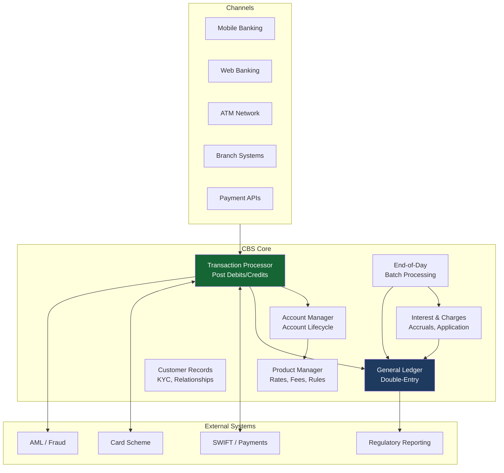
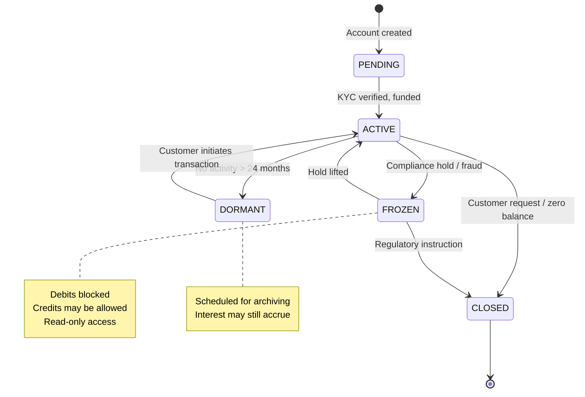
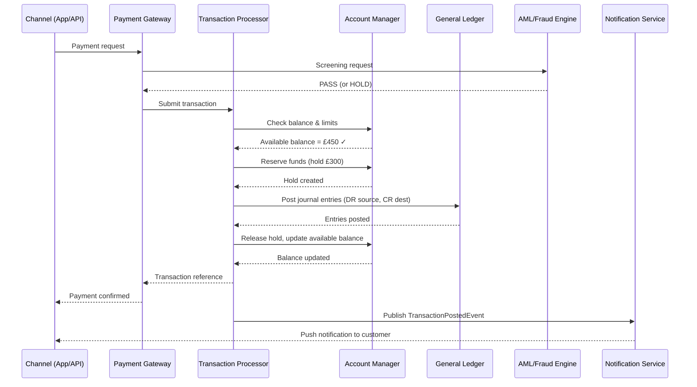
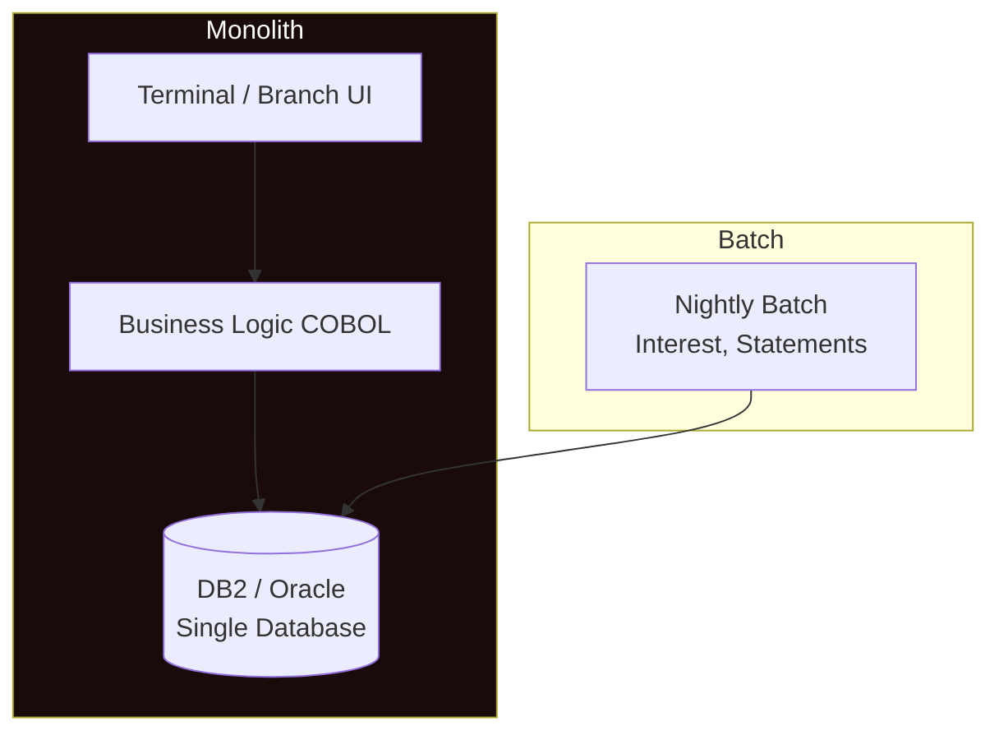
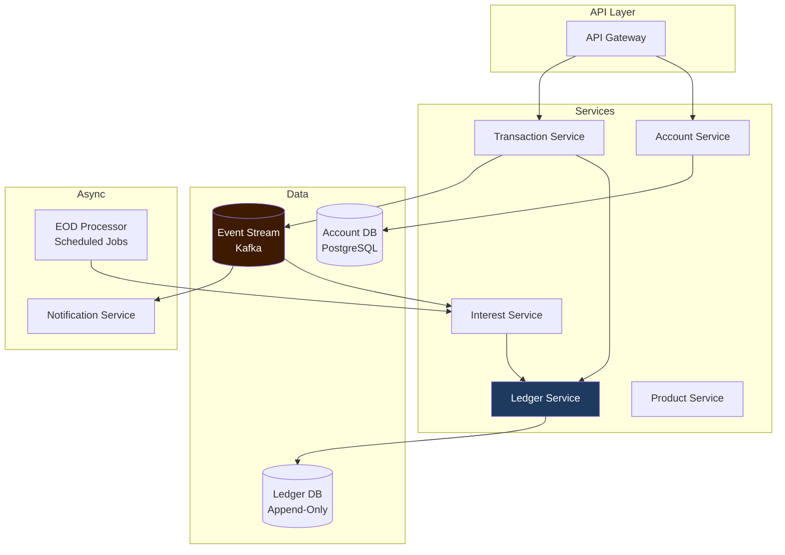

## Overview

The **core banking system (CBS)** is the operational backbone of every bank. It is the system of record for accounts, balances, and transactions — the single authoritative source of financial truth. Every channel (mobile banking, branch, ATM, payment API) ultimately reads from and writes to the core banking system.

Understanding core banking architecture is a prerequisite for designing every other system covered in this track: payment processors, reconciliation engines, AML systems, and open banking APIs all sit in front of or alongside the CBS. Getting this mental model right enables you to design correct integrations, understand data flows, and reason about failure scenarios across the entire banking technology stack.

## Learning Objectives

By the end of this lesson you will be able to:

- Describe the major components of a core banking system and their responsibilities
- Explain the system-of-record principle and its architectural implications
- Describe the account model: account types, structure, and state machine
- Trace a payment transaction through the CBS processing pipeline
- Explain the settlement cycle and its impact on balance availability
- Compare monolithic legacy CBS architecture with modern cloud-native alternatives
- Identify integration patterns between the CBS and surrounding systems

## Business Context

A challenger bank is migrating from a legacy monolithic CBS (a 1990s COBOL-based system running on-premise) to a cloud-native architecture. The Principal Engineer leading the migration must understand what the legacy system does, which components must be rebuilt, and which can be replaced with modern equivalents.

The migration must maintain zero financial data loss, continuous availability, and regulatory compliance throughout. Understanding the core banking architecture is the prerequisite for designing the migration strategy.

## What Is a Core Banking System?

A core banking system is the **central nervous system** of a bank. It manages:

| Capability | Description |
|---|---|
| **Account management** | Creation, maintenance, and lifecycle of all account types |
| **General ledger** | Double-entry bookkeeping for all financial movements |
| **Transaction processing** | Posting debits and credits to accounts |
| **Interest and charges** | Calculation and application of interest, fees, and charges |
| **Customer data** | Relationship between customers and their accounts |
| **Product parameters** | Interest rates, fee schedules, overdraft limits |
| **Date management** | Business day calculation, end-of-day processing, settlement cycles |
| **Regulatory reporting** | Data for prudential and conduct regulators |

The CBS is not a payment gateway, a fraud detection engine, or a customer-facing application — those systems are built *around* the CBS. The CBS is the persistent truth that all those systems rely on.

## CBS Component Architecture



> [!NOTE]
> In legacy monolithic systems, all these components are often a single application with a single database. In modern cloud-native architectures, they are separated into microservices with event-driven integration. The logical component model is the same — the deployment topology changes.

## The Account Model

An **account** is the fundamental unit of the core banking system. Every financial relationship is expressed as one or more accounts.

### Account Structure

```java17
// Core account entity — simplified from production schema
@Entity
@Table(name = "accounts")
public class Account {

    @Id
    private String accountNumber;        // e.g. "12345678" or "GB29NWBK60161331926819"

    private String customerId;           // Link to customer record
    private String productCode;          // "CURRENT_01", "SAVINGS_02", "LOAN_MORT"
    private String currency;             // ISO 4217 — "GBP", "USD", "EUR"

    @Enumerated(EnumType.STRING)
    private AccountStatus status;        // PENDING, ACTIVE, FROZEN, DORMANT, CLOSED

    // Balances — several types tracked simultaneously
    private long ledgerBalance;          // Book balance — posted transactions
    private long availableBalance;       // Ledger balance - holds/reservations
    private long pendingCredits;         // Incoming funds not yet settled
    private long pendingDebits;          // Outgoing funds not yet settled

    private long overdraftLimit;         // Authorised overdraft in minor units
    private String sortCode;             // UK routing: "60-16-13"
    private String iban;                 // International: "GB29NWBK..."

    private LocalDate openedDate;
    private LocalDate closedDate;
    private Instant lastTransactionAt;
    private Instant lastUpdatedAt;
    private long version;                // Optimistic locking
}
```

### Account Types

| Type | Description | Balance Semantics |
|---|---|---|
| **Current Account** | Day-to-day transactional account | Liability; customer owns balance |
| **Savings Account** | Interest-bearing deposit | Liability; restricted withdrawal |
| **Loan Account** | Credit extended to customer | Asset; customer owes balance |
| **Credit Card** | Revolving credit | Asset (outstanding) + Liability (payments received) |
| **Nostro Account** | Bank's account at another bank | Asset; held for correspondent banking |
| **Vostro Account** | Another bank's account at this bank | Liability |
| **Suspense Account** | Temporary holding; must clear to £0 by EOD | Internal |
| **Settlement Account** | Used during payment clearing | Internal |

### Account Status State Machine



## Transaction Processing Pipeline

A payment transaction flows through several stages before it is considered final. Understanding this pipeline is essential for integrating with the CBS correctly.



### Transaction States

| State | Meaning | Balance Impact |
|---|---|---|
| **RECEIVED** | Gateway accepted; validation pending | None |
| **AUTHORISED** | Funds confirmed; AML passed | Available balance reduced (hold) |
| **CLEARING** | Sent to payment scheme; awaiting settlement | Pending debit created |
| **SETTLED** | Funds actually moved; interbank settled | Ledger balance updated |
| **REVERSED** | Transaction undone; compensating entry posted | All effects reversed |
| **DECLINED** | Rejected (insufficient funds, AML, limit) | No change |

> [!IMPORTANT]
> **Available balance** and **ledger balance** are different. The ledger balance reflects all posted transactions. The available balance deducts pending holds and pending debits that have not yet settled. A customer with a £500 ledger balance and £200 in pending card authorisations has an available balance of £300. Always check available balance before allowing a withdrawal.

## Settlement Cycle

**Settlement** is the process by which interbank payments are finally and irrevocably transferred. Most payment schemes settle in cycles rather than instantly.

### BACS (UK Automated Clearing) — 3-Day Settlement

```mermaid
gantt
    title BACS Settlement Cycle (Day D = submission)
    dateFormat  D
    axisFormat  Day %d

    section Bank A (Payer)
    Funds debited from available balance  :done, 1, 1d
    Transaction enters CLEARING state     :done, 1, 1d
    Interbank settlement completes        :done, 3, 1d
    Ledger balance updated                :done, 3, 1d

    section Bank B (Payee)
    Pending credit created                :active, 1, 2d
    Funds confirmed available             :done, 3, 1d
```



### Real-Time Gross Settlement (RTGS) — Immediate

The Bank of England's RTGS system (CHAPS in the UK) settles each payment individually and immediately. Each payment is irrevocably settled within seconds. No batching, no netting, no overnight risk.

```java17
// Different balance update strategies per payment type
public enum PaymentSettlementType {
    IMMEDIATE,     // CHAPS, SEPA Instant — update ledger balance immediately
    SAME_DAY,      // FPS (Faster Payments) — typically seconds to minutes
    NEXT_DAY,      // BACS Day 1
    THREE_DAY      // BACS Day 3
}

@Service
public class BalanceUpdateService {

    public void applySettlement(Transaction tx, PaymentSettlementType type) {
        switch (type) {
            case IMMEDIATE -> {
                // Post journal entry and update ledger balance immediately
                ledgerService.postTransfer(tx.getSourceId(), tx.getDestId(),
                                           tx.getAmount(), tx.getCurrency());
            }
            case SAME_DAY, NEXT_DAY, THREE_DAY -> {
                // Create pending entry — ledger balance updated at settlement
                pendingEntryService.createPending(tx, type.getSettlementDay());
            }
        }
    }
}
```

## Modern vs Legacy CBS Architecture

### Legacy Monolithic Architecture



**Legacy characteristics:**
- Single database shared by all functions
- Nightly batch windows (1–4 AM) for interest accrual, statements, and reporting
- Expensive vendor licences (Temenos T24, Oracle FLEXCUBE, Finastra Fusion)
- Difficult to extend without vendor involvement
- Proven, battle-tested reliability over decades

### Cloud-Native Architecture



**Cloud-native characteristics:**
- Independent deployable services with separate databases
- Event-driven architecture — `TransactionPostedEvent`, `AccountStatusChangedEvent`
- Continuous availability — no nightly batch windows (interest calculated in-stream or on-demand)
- Self-managed PostgreSQL or cloud RDS instead of DB2
- Higher engineering complexity but lower total cost of ownership at scale

## Java CBS Integration Patterns

```java17
// Java 17 — Account inquiry via CBS client
@Service
public class CoreBankingClient {

    private final RestTemplate restTemplate;
    private final CircuitBreaker circuitBreaker;

    public AccountSummary getAccountSummary(String accountId) {
        return circuitBreaker.executeSupplier(() ->
            restTemplate.getForObject(
                "/cbs/accounts/{id}/summary",
                AccountSummary.class,
                accountId
            )
        );
    }

    // Post a transaction to the CBS ledger
    // Idempotency key prevents duplicates on retry
    public TransactionReference postTransaction(PostTransactionRequest request) {
        return circuitBreaker.executeSupplier(() ->
            restTemplate.postForObject(
                "/cbs/transactions",
                request,
                TransactionReference.class
            )
        );
    }
}
```

```java21
// Java 21 — Account model using records
public record AccountSummary(
    String accountNumber,
    String accountType,
    String currency,
    long ledgerBalance,
    long availableBalance,
    long pendingCredits,
    long pendingDebits,
    AccountStatus status,
    Instant lastUpdatedAt
) {
    // Convenience method — computed from components
    public boolean canDebit(long amount) {
        return status == AccountStatus.ACTIVE && availableBalance >= amount;
    }

    public boolean isOverdrawn() {
        return ledgerBalance < 0;
    }
}

// Pattern matching on account status
public String getStatusDescription(AccountSummary account) {
    return switch (account.status()) {
        case ACTIVE  -> "Active — available to transact";
        case FROZEN  -> "Frozen — contact your bank";
        case DORMANT -> "Dormant — reactivate by visiting a branch";
        case PENDING -> "Pending — KYC verification in progress";
        case CLOSED  -> "Closed";
    };
}
```

## End-of-Day Processing

Every core banking system performs end-of-day (EOD) batch processing. This is a legacy of batch-era computing that persists in modern systems because some calculations are inherently point-in-time (interest accrual, statement generation).

```java17
// EOD processing orchestrator
@Service
public class EndOfDayProcessor {

    // Triggered at business day close — often 11:59 PM local time or configurable
    @Scheduled(cron = "0 59 23 * * MON-FRI")
    @Transactional
    public void runEndOfDay() {
        log.info("EOD processing started for business date: {}", businessCalendar.today());

        // Step 1: Freeze intraday processing (some banks do, some don't)
        transactionGateway.enterEndOfDayMode();

        try {
            // Step 2: Accrue interest on all interest-bearing accounts
            interestAccrualService.accrueAll(businessCalendar.today());

            // Step 3: Apply charges on accounts due today
            chargesService.applyDueCharges(businessCalendar.today());

            // Step 4: Settle outstanding BACS/SEPA batches
            settlementService.settleOutstandingBatches(businessCalendar.today());

            // Step 5: Generate statements for accounts due statements
            statementService.generateDueStatements(businessCalendar.today());

            // Step 6: Trial balance check — total debits must equal credits
            trialBalanceService.assertBalance(businessCalendar.today());

            // Step 7: Advance to next business date
            businessCalendar.advanceToNextBusinessDay();

        } finally {
            // Always exit EOD mode — even if steps fail
            transactionGateway.exitEndOfDayMode();
        }

        log.info("EOD processing complete. Next business day: {}", businessCalendar.today());
    }
}
```

---

<!-- KNOWLEDGE-CHECK [
  {
    "id": "kc-cba-01",
    "question": "A customer has a ledger balance of £800 and £300 in pending card authorisations. They attempt to withdraw £600. Should the CBS approve or decline?",
    "options": [
      "Approve — the ledger balance of £800 covers the £600 withdrawal",
      "Decline — the available balance is £500 (£800 - £300 pending), which is less than £600",
      "Approve with an overdraft flag — the net debit will be covered when the pending transactions settle",
      "Decline — card authorisations must settle before any withdrawal is permitted"
    ],
    "correct": 1,
    "explanation": "Available balance = ledger balance - holds/pending debits = £800 - £300 = £500. The withdrawal of £600 exceeds the available balance of £500. Approving it would create a potential overdraft when the card transactions settle. The CBS must check available balance, not ledger balance, for withdrawal decisions."
  },
  {
    "id": "kc-cba-02",
    "question": "In the CBS account model, a customer's £2,000 current account balance appears as a liability on the bank's balance sheet. Why?",
    "options": [
      "Because current accounts earn interest, making them a cost to the bank",
      "Because the bank owes the customer £2,000 — it is an obligation to repay",
      "Because current accounts are classified as liabilities for tax purposes",
      "Because the account balance has not yet been invested"
    ],
    "correct": 1,
    "explanation": "The accounting equation defines liabilities as amounts owed to others. When a customer deposits £2,000, the bank takes possession of £2,000 in cash (asset) but simultaneously creates an obligation to repay that £2,000 on demand (liability). The customer's balance is the bank's debt to the customer."
  },
  {
    "id": "kc-cba-03",
    "question": "A BACS payment is submitted on Monday. The receiving customer sees funds in their account on Wednesday. What is the technical term for the Monday-to-Wednesday gap?",
    "options": [
      "Clearing delay — the payment is pending clearance from the payer's bank",
      "Settlement cycle — the 3-day interbank settlement period for BACS",
      "Authorisation hold — the funds are reserved but not yet accessible",
      "Float — the period during which the bank earns interest on both accounts simultaneously"
    ],
    "correct": 1,
    "explanation": "BACS (Bankers' Automated Clearing Service) has a 3-business-day settlement cycle. Day 1: submission. Day 2: validation and interchange. Day 3: settlement and credit to beneficiary. This is the settlement cycle — the time between payment initiation and final irrevocable interbank settlement."
  },
  {
    "id": "kc-cba-04",
    "question": "In a cloud-native core banking architecture, when a Transaction Service posts a debit, it publishes a TransactionPostedEvent to Kafka. What is the key advantage of this event-driven approach over a synchronous direct call to the Interest Service?",
    "options": [
      "Kafka is faster than a direct HTTP call in all scenarios",
      "The Transaction Service does not need to wait for Interest Service availability — temporal decoupling",
      "Interest calculations must be performed before the transaction completes",
      "Kafka prevents duplicate transaction posting automatically"
    ],
    "correct": 1,
    "explanation": "Temporal decoupling is the key benefit. The Transaction Service publishes the event and continues. The Interest Service can be down, slow, or redeploying — the event is buffered in Kafka and processed when the Interest Service recovers. A synchronous call would fail if Interest Service is unavailable, potentially blocking the entire transaction pipeline."
  }
] -->

---

<!-- PRACTICAL-CHALLENGE {
  "id": "pc-core-banking-arch",
  "title": "Core Banking Architecture: Account and Transaction Design",
  "description": "Design data models and service interactions for a simplified core banking system.",
  "tasks": [
    {
      "id": "pc-cba-01",
      "description": "Design the SQL schema for a minimal CBS account table supporting: current accounts, savings accounts, and loan accounts in multiple currencies. Include all balance fields (ledger, available, pending) and the status enum."
    },
    {
      "id": "pc-cba-02",
      "description": "Draw the transaction state machine for a BACS payment: from RECEIVED through to SETTLED or DECLINED, noting which state transitions update the ledger balance vs the available balance."
    },
    {
      "id": "pc-cba-03",
      "description": "Implement a Java method `canProcessDebit(Account account, long amount)` that checks all conditions: account status is ACTIVE, available balance >= amount, and the debit does not exceed the account's overdraft limit."
    },
    {
      "id": "pc-cba-04",
      "description": "Explain why the nightly EOD batch trial balance check (`total debits = total credits`) is a critical safety control, and what failure scenario it would detect."
    },
    {
      "id": "pc-cba-05",
      "description": "A legacy CBS sends a synchronous HTTP callback when a CHAPS payment settles (sometimes 15–30 seconds after submission). Design the integration pattern to handle this latency without blocking the mobile app response."
    }
  ]
} -->
