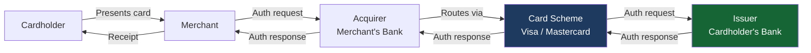
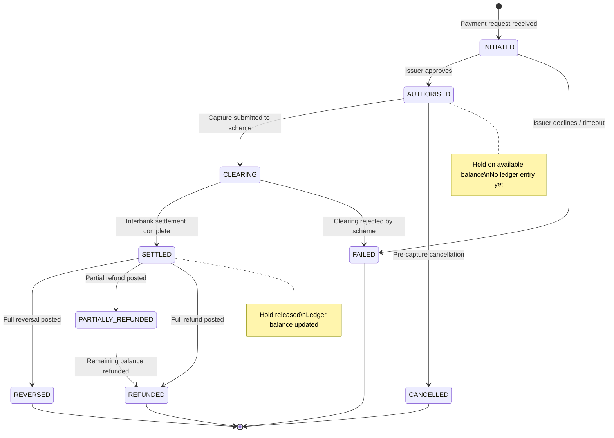
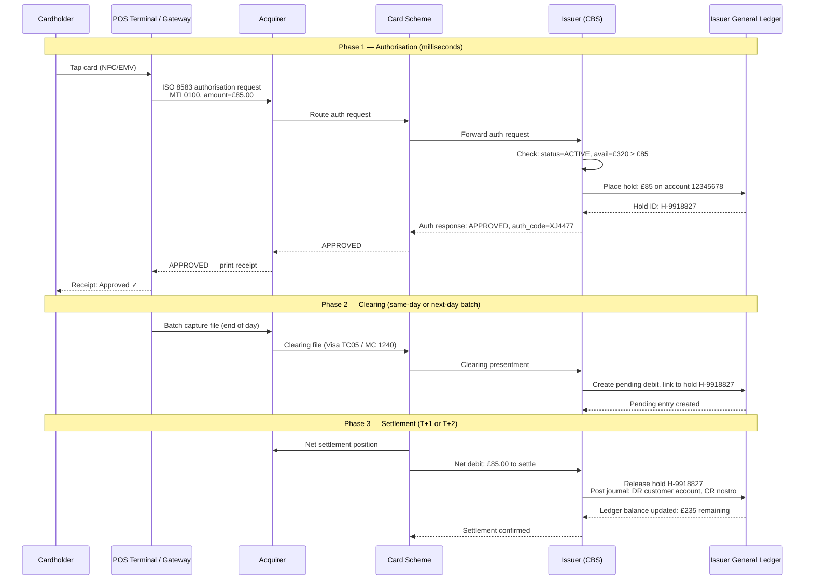
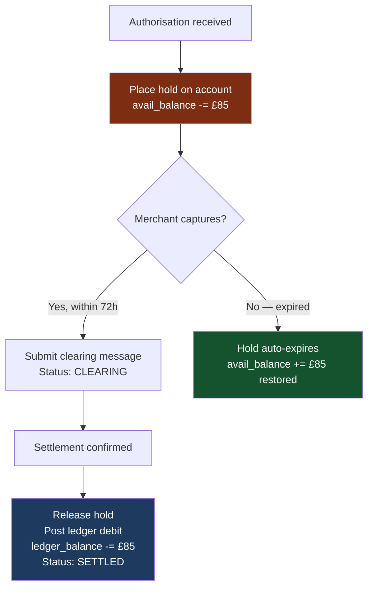

Payment processing sits at the intersection of the core banking system and the external payment schemes that move money between banks. Every card swipe, contactless tap, or online checkout triggers a precisely choreographed sequence of messages spanning merchants, acquirers, card schemes, and issuing banks — often completing the visible authorisation in under 300 milliseconds while the actual money movement takes days. Understanding where authorisation ends and settlement begins, and what happens in between, is the foundation of every payment integration you will ever build.

## Learning Objectives

By the end of this lesson you will be able to:

- Distinguish authorisation, clearing, and settlement as distinct technical and financial phases
- Describe the roles of acquirer, issuer, and card scheme in a four-party model
- Trace a card payment end-to-end through the full lifecycle with timing at each stage
- Implement a `PaymentProcessor` service with correct status transition guards
- Explain the hold-and-release mechanism and its impact on available balance
- Compare T+0, T+1, and T+2 settlement cycles and their cash-flow implications
- Design reversal and refund flows as compensating journal entries
- Identify the failure modes at each stage and design for idempotent recovery

## Business Context

In November 2021, a major UK neobank suffered a £12 million operational loss when their payment processor failed to correctly distinguish between authorised-but-not-settled transactions and declined transactions during a database failover. When the system came back online, it replayed 47,000 authorisation messages — but the deduplication key had been stored in the failed node's in-memory cache rather than the database. The result: 47,000 customers were double-debited. The bank spent three weeks issuing refunds, fielded 190,000 support contacts, and paid £4.3 million in compensation plus a £1.9 million FCA fine for systems inadequacy. The root cause was a missing idempotency key column in the `payments` table and a state machine that did not validate prior states before transitions.

## Authorisation, Clearing, and Settlement: Three Different Things

Engineers new to payments routinely conflate these three terms. They are distinct financial and technical phases with different timing, different participants, and different system implications.

| Phase | What Happens | Who Is Involved | Time to Complete | Balance Impact |
|---|---|---|---|---|
| **Authorisation** | Issuer approves or declines the transaction | Merchant → Acquirer → Scheme → Issuer | Milliseconds to seconds | Available balance reduced (hold placed) |
| **Clearing** | Transaction details exchanged between banks | Acquirer → Scheme → Issuer | Same day to next day | Pending debit created |
| **Settlement** | Actual funds moved between banks | Central bank / scheme settlement | T+0 to T+2 | Ledger balance updated |

> [!IMPORTANT]
> Authorisation is a **promise**, not a payment. The issuer promises to pay the acquirer if the merchant submits a valid clearing message. Settlement is the actual transfer of funds. A transaction can be authorised but never cleared (the merchant never submits the capture), in which case the hold expires and the funds are released — no money ever moves.

### The Four-Party Model



- **Cardholder** — the individual making the payment
- **Merchant** — the business accepting payment; pays acquirer fees
- **Acquirer** — the bank that processes card payments on behalf of the merchant; bears settlement risk
- **Card Scheme** — Visa, Mastercard, Amex; sets rules, routes messages, manages clearing files; earns interchange
- **Issuer** — the bank that issued the card to the cardholder; approves/declines; bears credit/fraud risk

## Payment State Machine

A payment progresses through a well-defined set of states. Illegal transitions (e.g., going directly from `INITIATED` to `SETTLED` without clearing) indicate a system defect and must be rejected.



```java17
public enum PaymentStatus {
    INITIATED,
    AUTHORISED,
    CLEARING,
    SETTLED,
    CANCELLED,
    FAILED,
    REVERSED,
    PARTIALLY_REFUNDED,
    REFUNDED;

    // Allowed transitions — enforced before every status update
    private static final Map<PaymentStatus, Set<PaymentStatus>> ALLOWED_TRANSITIONS =
        Map.of(
            INITIATED,           Set.of(AUTHORISED, FAILED),
            AUTHORISED,          Set.of(CLEARING, CANCELLED),
            CLEARING,            Set.of(SETTLED, FAILED),
            SETTLED,             Set.of(REVERSED, REFUNDED, PARTIALLY_REFUNDED),
            PARTIALLY_REFUNDED,  Set.of(REFUNDED),
            CANCELLED,           Set.of(),
            FAILED,              Set.of(),
            REVERSED,            Set.of(),
            REFUNDED,            Set.of()
        );

    public boolean canTransitionTo(PaymentStatus next) {
        return ALLOWED_TRANSITIONS.getOrDefault(this, Set.of()).contains(next);
    }
}
```

## Card Payment End-to-End Sequence



## PaymentProcessor Service Implementation

```java17
@Service
@Transactional
public class PaymentProcessor {

    private final PaymentRepository paymentRepository;
    private final AccountHoldService holdService;
    private final LedgerService ledgerService;
    private final SchemeGateway schemeGateway;
    private final ApplicationEventPublisher eventPublisher;

    /**
     * Step 1: Authorise — check funds, place hold, record authorisation.
     * Idempotent: second call with same idempotencyKey returns existing payment.
     */
    public PaymentAuthorisationResult authorise(AuthorisationRequest request) {
        // Idempotency check — prevents duplicate processing on retry
        return paymentRepository.findByIdempotencyKey(request.idempotencyKey())
            .map(existing -> PaymentAuthorisationResult.alreadyProcessed(existing))
            .orElseGet(() -> processNewAuthorisation(request));
    }

    private PaymentAuthorisationResult processNewAuthorisation(AuthorisationRequest req) {
        Payment payment = Payment.builder()
            .id(UUID.randomUUID().toString())
            .idempotencyKey(req.idempotencyKey())
            .accountId(req.accountId())
            .amountMinorUnits(req.amountMinorUnits())
            .currency(req.currency())
            .merchantId(req.merchantId())
            .status(PaymentStatus.INITIATED)
            .createdAt(Instant.now())
            .build();

        paymentRepository.save(payment);

        // Place hold — reduces available balance immediately
        HoldReference hold = holdService.place(
            req.accountId(),
            req.amountMinorUnits(),
            req.currency(),
            payment.getId(),
            HoldReason.CARD_AUTHORISATION,
            Instant.now().plus(Duration.ofHours(72)) // Pre-auth expires in 72h
        );

        payment.setHoldId(hold.holdId());
        payment.transitionTo(PaymentStatus.AUTHORISED);
        payment.setAuthorisedAt(Instant.now());
        paymentRepository.save(payment);

        eventPublisher.publishEvent(new PaymentAuthorisedEvent(payment.getId(),
            req.accountId(), req.amountMinorUnits(), req.currency()));

        return PaymentAuthorisationResult.approved(payment.getId(), hold.holdId());
    }

    /**
     * Step 2: Capture/Clear — submit to scheme. Transitions AUTHORISED → CLEARING.
     */
    public void capture(String paymentId) {
        Payment payment = paymentRepository.findByIdOrThrow(paymentId);

        if (!payment.getStatus().canTransitionTo(PaymentStatus.CLEARING)) {
            throw new IllegalStateTransitionException(payment.getStatus(), PaymentStatus.CLEARING);
        }

        schemeGateway.submitClearingMessage(payment);
        payment.transitionTo(PaymentStatus.CLEARING);
        payment.setClearingSubmittedAt(Instant.now());
        paymentRepository.save(payment);
    }

    /**
     * Step 3: Settle — called by settlement reconciliation job. Transitions CLEARING → SETTLED.
     * Releases hold and posts ledger entries.
     */
    public void settle(String paymentId, SettlementReference settlementRef) {
        Payment payment = paymentRepository.findByIdOrThrow(paymentId);

        if (!payment.getStatus().canTransitionTo(PaymentStatus.SETTLED)) {
            throw new IllegalStateTransitionException(payment.getStatus(), PaymentStatus.SETTLED);
        }

        // Release hold — no longer needed after settlement
        holdService.release(payment.getHoldId());

        // Post definitive ledger entries
        ledgerService.postDebit(
            payment.getAccountId(),
            payment.getAmountMinorUnits(),
            payment.getCurrency(),
            "SETTLEMENT:" + settlementRef.referenceId(),
            payment.getId()
        );

        payment.transitionTo(PaymentStatus.SETTLED);
        payment.setSettledAt(Instant.now());
        payment.setSettlementReference(settlementRef.referenceId());
        paymentRepository.save(payment);

        eventPublisher.publishEvent(new PaymentSettledEvent(payment.getId(),
            payment.getAccountId(), payment.getAmountMinorUnits()));
    }
}
```

> [!WARNING]
> Never update the ledger balance at authorisation time for card payments. The hold on available balance is sufficient. Only post the definitive ledger entry at settlement. If you debit the ledger at authorisation and the merchant never captures, you must post a compensating credit — creating unnecessary accounting noise and risk of inconsistency.

## Hold-and-Release Flow

The hold mechanism is what allows available balance to reflect pending card authorisations without touching the ledger. It is a reservation system layered on top of the ledger.



```java17
// Payment entity — balance impact summary at each state
public record PaymentBalanceImpact(
    PaymentStatus status,
    long availableBalanceDelta,  // Negative = reduction
    long ledgerBalanceDelta       // Negative = reduction
) {
    public static PaymentBalanceImpact forStatus(PaymentStatus status, long amount) {
        return switch (status) {
            case AUTHORISED          -> new PaymentBalanceImpact(status, -amount, 0);
            case CANCELLED           -> new PaymentBalanceImpact(status, +amount, 0);  // Hold released
            case SETTLED             -> new PaymentBalanceImpact(status, 0, -amount);  // Hold→Ledger
            case REVERSED, REFUNDED  -> new PaymentBalanceImpact(status, 0, +amount);  // Credit back
            default                  -> new PaymentBalanceImpact(status, 0, 0);
        };
    }
}
```

## Settlement Timing: T+0, T+1, and T+2

Settlement timing varies dramatically by payment scheme. This has real cash-flow consequences for merchants and systemic risk implications for banks.

| Scheme | Settlement Cycle | Mechanism | Finality |
|---|---|---|---|
| **CHAPS (UK)** | T+0 (same day, intraday) | RTGS — individual settlement | Irrevocable |
| **Faster Payments (UK)** | T+0 (seconds) | Deferred net settlement (DNS) | Near-immediate |
| **Visa / Mastercard (UK)** | T+1 (next business day) | Net settlement via VICS / MCCS | End of day |
| **BACS (UK)** | T+3 | Deferred net settlement | Day 3 |
| **SEPA Credit Transfer** | T+1 (or instant via SCT Inst) | DNS or RTGS | Day 1 / instant |
| **ACH (US)** | T+1 to T+2 | Batch DNS | Day 1–2 |

> [!NOTE]
> "T+1" means the next **business** day. A Visa payment authorised on a Friday evening settles on Monday. The merchant's acquirer does not receive funds until Monday. This creates multi-day counterparty exposure — the scheme guarantees payment, but the guarantee spans a weekend.

```java17
// Settlement timing calculator
public enum PaymentScheme {
    CHAPS, FASTER_PAYMENTS, VISA, MASTERCARD, BACS, SEPA_CT, SEPA_INST, ACH_US;

    public LocalDate expectedSettlementDate(LocalDate submissionDate, BusinessCalendar cal) {
        return switch (this) {
            case CHAPS, FASTER_PAYMENTS, SEPA_INST -> submissionDate; // T+0
            case VISA, MASTERCARD, SEPA_CT         -> cal.addBusinessDays(submissionDate, 1); // T+1
            case ACH_US                            -> cal.addBusinessDays(submissionDate, 2); // T+2
            case BACS                              -> cal.addBusinessDays(submissionDate, 3); // T+3
        };
    }
}
```

## Reversals and Refunds

A **reversal** undoes an authorisation before it settles. A **refund** returns money after settlement. Both require posting compensating journal entries — they cannot simply delete the original transaction.

```java17
@Service
@Transactional
public class PaymentReversalService {

    private final PaymentRepository paymentRepository;
    private final AccountHoldService holdService;
    private final LedgerService ledgerService;

    /**
     * Pre-settlement reversal — only valid when status is AUTHORISED or CLEARING.
     * Releases hold; no ledger entry needed (none was posted at authorisation).
     */
    public void reverse(String paymentId, String reason) {
        Payment payment = paymentRepository.findByIdOrThrow(paymentId);

        if (!Set.of(PaymentStatus.AUTHORISED, PaymentStatus.CLEARING)
                .contains(payment.getStatus())) {
            throw new InvalidOperationException(
                "Cannot reverse payment in status: " + payment.getStatus() +
                ". Use refund() for settled payments.");
        }

        holdService.release(payment.getHoldId());

        payment.transitionTo(PaymentStatus.REVERSED);
        payment.setReversedAt(Instant.now());
        payment.setReversalReason(reason);
        paymentRepository.save(payment);
    }

    /**
     * Post-settlement refund — only valid when status is SETTLED or PARTIALLY_REFUNDED.
     * Posts a credit journal entry — the original debit remains for audit trail.
     */
    public RefundResult refund(String paymentId, long refundAmountMinorUnits, String reason) {
        Payment payment = paymentRepository.findByIdOrThrow(paymentId);

        long alreadyRefunded = payment.getTotalRefundedMinorUnits();
        long maxRefundable   = payment.getAmountMinorUnits() - alreadyRefunded;

        if (refundAmountMinorUnits > maxRefundable) {
            throw new InvalidOperationException(
                "Refund amount %d exceeds refundable amount %d"
                    .formatted(refundAmountMinorUnits, maxRefundable));
        }

        // Credit the customer's account
        ledgerService.postCredit(
            payment.getAccountId(),
            refundAmountMinorUnits,
            payment.getCurrency(),
            "REFUND:ORIG:" + paymentId,
            UUID.randomUUID().toString()
        );

        payment.addRefund(refundAmountMinorUnits, reason, Instant.now());

        PaymentStatus nextStatus = (payment.getTotalRefundedMinorUnits() == payment.getAmountMinorUnits())
            ? PaymentStatus.REFUNDED
            : PaymentStatus.PARTIALLY_REFUNDED;

        payment.transitionTo(nextStatus);
        paymentRepository.save(payment);

        return new RefundResult(paymentId, refundAmountMinorUnits, nextStatus);
    }
}
```

> [!IMPORTANT]
> Never delete or update the original payment record when processing a refund. The original debit and the compensating credit are separate journal entries — both must remain in the ledger for audit trail, reconciliation, and regulatory reporting. Regulators require the full chain of entries, not a net zero.

---

<!-- KNOWLEDGE-CHECK [
  {
    "id": "kc-pp-01",
    "question": "A customer authorises a £120 payment at a hotel (pre-authorisation). Three days later the hotel charges £95 at checkout. What happens to the remaining £25?",
    "options": [
      "The £25 is permanently lost — pre-authorisations must match the final amount exactly",
      "The original £120 hold expires; the hotel submits a new clearing message for £95; a £95 hold is then placed",
      "The original £120 hold is released at settlement; a £95 debit posts to the ledger; available balance is restored by £25",
      "The hotel must issue a £25 refund before the settlement can process"
    ],
    "correct": 2,
    "explanation": "In a hotel pre-auth flow: the £120 hold reduces available balance immediately. When the hotel submits the final charge of £95, settlement releases the full £120 hold and posts a definitive ledger debit of £95. The customer's available balance is restored by £25 (the difference between the hold and the settled amount). The hold was always a maximum reservation — settlement determines the actual amount."
  },
  {
    "id": "kc-pp-02",
    "question": "A merchant disputes a Visa transaction settled two days ago. Your fraud team determines the dispute is valid. Should you use a reversal or a refund, and why?",
    "options": [
      "Reversal — it undoes the original transaction cleanly with no extra accounting entries",
      "Refund — the payment has already settled; you must post a compensating credit entry",
      "Either — they are functionally equivalent once a payment has settled",
      "Neither — settled transactions can only be disputed via the card scheme chargeback process"
    ],
    "correct": 1,
    "explanation": "A reversal is only valid before settlement (status AUTHORISED or CLEARING). Once a payment is SETTLED, the ledger entry is final. The correct mechanism is a refund, which posts a compensating credit entry to the customer's account. Both the original debit and the credit remain in the ledger for audit purposes. The net effect is zero, but the trail of both entries is preserved."
  }
] -->

---

<!-- PRACTICAL-CHALLENGE {
  "id": "pc-payment-processing",
  "title": "Payment Processing: State Machine and Settlement Design",
  "description": "Implement the core components of a card payment processor with correct state transitions and balance management.",
  "tasks": [
    {
      "id": "pc-pp-01",
      "description": "Design a SQL schema for a `payments` table that captures: idempotency_key, status, amount_minor_units, currency, account_id, hold_id (FK), settlement_reference, and all timestamp fields (created, authorised, clearing_submitted, settled, reversed). Add a check constraint ensuring amount_minor_units > 0."
    },
    {
      "id": "pc-pp-02",
      "description": "Implement the `PaymentStatus.canTransitionTo(PaymentStatus next)` method as a Java 17 enum with the full allowed-transitions map. Write a unit test that verifies: AUTHORISED → CLEARING is allowed; SETTLED → AUTHORISED is rejected; FAILED → SETTLED is rejected."
    },
    {
      "id": "pc-pp-03",
      "description": "Extend the `PaymentProcessor.authorise()` method to handle the case where the account has insufficient available balance. It should return a `PaymentAuthorisationResult.declined(reason)` rather than throwing an exception, and must NOT create a payment record or place a hold."
    },
    {
      "id": "pc-pp-04",
      "description": "Design a settlement reconciliation job that processes a batch settlement file from the card scheme. For each settled payment reference in the file: look up the payment, call settle(), and handle three edge cases: (a) payment not found, (b) payment already settled (idempotent), (c) payment in FAILED status."
    }
  ]
} -->
