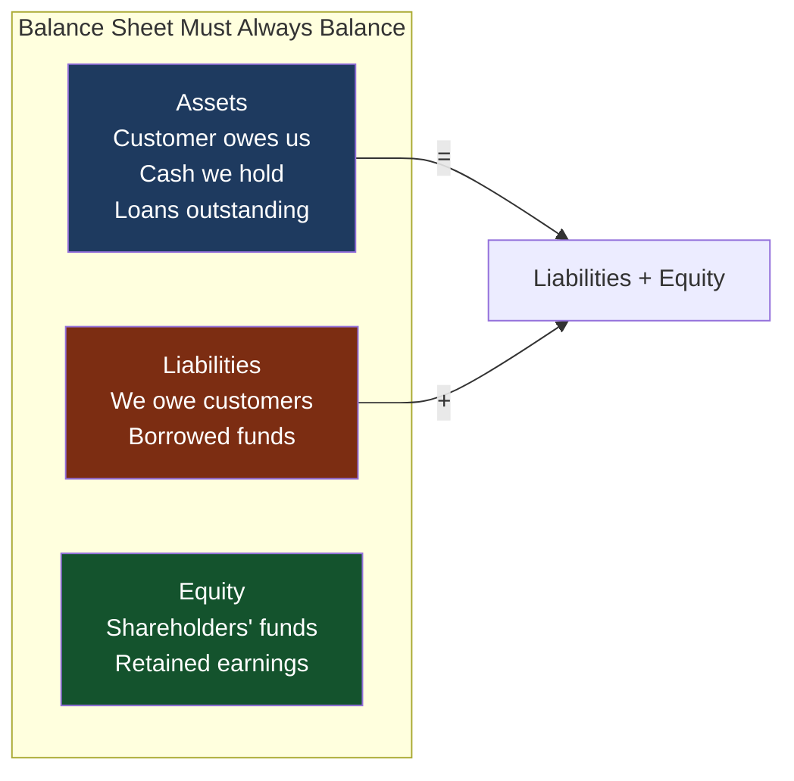

Every financial system built on top of a core banking system ultimately writes to a general ledger. The general ledger is not a database table — it is an accounting structure governed by rules that have been unchanged since Luca Pacioli formalised them in 1494. Those rules — double-entry bookkeeping — are what make a financial system verifiable: any error that creates or destroys value leaves a mathematical trace. As a Principal Engineer designing banking systems, you must understand double-entry deeply enough to review schema designs, audit service implementations, and immediately identify when a proposed change will violate the invariant that the sum of all debits must always equal the sum of all credits.

## Learning Objectives

By the end of this lesson you will be able to:

- Explain the accounting equation and why it must hold at all times in a financial system
- Correctly apply debit and credit rules to asset, liability, equity, income, and expense accounts
- Design a journal entry and chart-of-accounts SQL schema that enforces balanced entries at the database level
- Implement a `JournalEntryService` that posts balanced journal entries atomically with optimistic locking
- Write a trial balance SQL query and explain what it proves
- Implement a Java balance invariant checker that runs as an end-of-day safety control
- Explain why integer (long) arithmetic in minor currency units is mandatory and what goes wrong with floating-point

## Business Context

In 2012, a European payments startup raised Series B funding on the strength of reported customer balances totalling €47 million. During due diligence, their new CFO ran a trial balance query for the first time in company history. The query returned a €340,000 discrepancy — total credits exceeded total debits by that amount. Investigation revealed that a junior engineer had implemented refunds as a "balance adjustment" that credited the customer's account without posting a corresponding debit anywhere. Over 18 months, 1,247 refunds had been processed this way, each creating €0 to €850 of phantom money. The startup's real customer balance was €46.66 million — not €47 million. The Series B closed at a valuation €2.1 million lower than expected, and the engineer's shortcut cost the founding team roughly €630,000 in dilution. A properly implemented `JournalEntryService` that rejected unbalanced entries would have caught the first occurrence.

## The Accounting Equation

The entire edifice of financial accounting rests on one equation:

```
Assets = Liabilities + Equity
```

In a bank this is always true:

- **Assets**: Cash held, loans to customers, interbank deposits, securities
- **Liabilities**: Customer deposits, borrowings from other banks
- **Equity**: Shareholders' funds, retained earnings

Every transaction preserves this equation by touching at least two accounts simultaneously. This is what "double-entry" means: every debit has a corresponding credit of equal value.



### T-Account Mechanics

A T-account is the visual representation of an account's debit and credit sides:

```
              Customer Current Account (Liability)
              ┌─────────────────┬─────────────────┐
              │     DEBIT       │     CREDIT       │
              ├─────────────────┼─────────────────┤
              │ Withdrawals     │ Deposits         │
              │ Card payments   │ Incoming xfers   │
              │ Bank charges    │ Interest paid    │
              ├─────────────────┼─────────────────┤
              │ Total Debits    │ Total Credits    │
              │ Decreases       │ Increases        │
              └─────────────────┴─────────────────┘
              Normal balance side: CREDIT (liability)
```

## Debit and Credit Rules by Account Type

This table is the most important thing to memorise. The same words "debit" and "credit" have opposite effects depending on the account type:

| Account Type | Normal Balance | Debit Effect | Credit Effect | Example Accounts |
|---|---|---|---|---|
| **Asset** | Debit | Increases | Decreases | Cash, Loans, Nostro accounts |
| **Liability** | Credit | Decreases | Increases | Customer deposits, Borrowings |
| **Equity** | Credit | Decreases | Increases | Share capital, Retained earnings |
| **Income / Revenue** | Credit | Decreases | Increases | Interest income, Fee income |
| **Expense** | Debit | Increases | Decreases | Interest expense, Staff costs |

> [!WARNING]
> The mnemonic "debit means increase" is **wrong for most account types**. Debit increases assets and expenses. Debit *decreases* liabilities, equity, and income accounts. Many engineers make this mistake and produce inverted ledgers.

### A Concrete Example: Customer Deposit

A customer deposits £500 cash:

```
Entry: Customer Deposits £500
─────────────────────────────────────────────────────
DR  Cash / Nostro Account         £500   (Asset ↑)
CR  Customer Current Account      £500   (Liability ↑)
─────────────────────────────────────────────────────
Net effect: Total debits = Total credits = £500 ✓
```

A customer withdraws £200:

```
Entry: Customer Withdraws £200
─────────────────────────────────────────────────────
DR  Customer Current Account      £200   (Liability ↓)
CR  Cash / Nostro Account         £200   (Asset ↓)
─────────────────────────────────────────────────────
Net effect: Total debits = Total credits = £200 ✓
```

## Chart of Accounts Schema

The chart of accounts (COA) defines every account the general ledger knows about. It is hierarchical: account categories → account groups → individual accounts.

```sql
-- Chart of accounts hierarchy
CREATE TABLE account_categories (
    id          SERIAL PRIMARY KEY,
    code        VARCHAR(10)  NOT NULL UNIQUE,  -- 'ASSET', 'LIABILITY', 'EQUITY', 'INCOME', 'EXPENSE'
    name        VARCHAR(100) NOT NULL,
    normal_balance  VARCHAR(6) NOT NULL        -- 'DEBIT' or 'CREDIT'
        CHECK (normal_balance IN ('DEBIT', 'CREDIT'))
);

CREATE TABLE chart_of_accounts (
    id              SERIAL PRIMARY KEY,
    account_code    VARCHAR(20)   NOT NULL UNIQUE,  -- e.g. '1001', '2001.001'
    account_name    VARCHAR(200)  NOT NULL,
    category_id     INT           NOT NULL REFERENCES account_categories(id),
    parent_code     VARCHAR(20)   REFERENCES chart_of_accounts(account_code),
    currency        CHAR(3)       NOT NULL DEFAULT 'GBP',
    is_active       BOOLEAN       NOT NULL DEFAULT TRUE,
    allows_manual   BOOLEAN       NOT NULL DEFAULT FALSE,  -- Can manual journals post here?
    description     TEXT,
    created_at      TIMESTAMPTZ   NOT NULL DEFAULT now()
);

-- Seed account categories
INSERT INTO account_categories (code, name, normal_balance) VALUES
  ('ASSET',     'Assets',              'DEBIT'),
  ('LIABILITY', 'Liabilities',         'CREDIT'),
  ('EQUITY',    'Equity',              'CREDIT'),
  ('INCOME',    'Income / Revenue',    'CREDIT'),
  ('EXPENSE',   'Expenses',            'DEBIT');

-- Example chart of accounts entries
INSERT INTO chart_of_accounts (account_code, account_name, category_id, currency) VALUES
  ('1000',      'Cash and Central Bank Reserves',         1, 'GBP'),
  ('1001',      'Nostro — Bank of England Settlement',    1, 'GBP'),
  ('1100',      'Loans to Customers',                     1, 'GBP'),
  ('2000',      'Customer Deposits — Current Accounts',   2, 'GBP'),
  ('2001',      'Customer Deposits — Savings Accounts',   2, 'GBP'),
  ('2100',      'Interbank Borrowings',                   2, 'GBP'),
  ('3000',      'Share Capital',                          3, 'GBP'),
  ('3100',      'Retained Earnings',                      3, 'GBP'),
  ('4000',      'Interest Income',                        4, 'GBP'),
  ('4100',      'Fee and Commission Income',              4, 'GBP'),
  ('5000',      'Interest Expense',                       5, 'GBP'),
  ('5100',      'Operating Expenses',                     5, 'GBP'),
  ('9000',      'Suspense Account',                       2, 'GBP');  -- Must net to 0 by EOD
```

## Journal Entry Schema DDL

A journal entry consists of a header (the transaction) and two or more lines (the debits and credits). The schema must enforce that entries are balanced.

```sql
-- Journal entry header
CREATE TABLE journal_entries (
    id              UUID         PRIMARY KEY DEFAULT gen_random_uuid(),
    reference       VARCHAR(100) NOT NULL UNIQUE,  -- Human-readable ref: 'JNL-2026-001234'
    description     TEXT         NOT NULL,
    business_date   DATE         NOT NULL,
    entry_type      VARCHAR(50)  NOT NULL,  -- 'PAYMENT', 'REFUND', 'INTEREST', 'FEE', 'MANUAL'
    source_system   VARCHAR(50)  NOT NULL,  -- 'PAYMENT_PROCESSOR', 'INTEREST_ENGINE', etc.
    source_ref      VARCHAR(100),           -- e.g. payment ID, interest batch ID
    status          VARCHAR(20)  NOT NULL DEFAULT 'POSTED'
        CHECK (status IN ('PENDING', 'POSTED', 'REVERSED')),
    reversal_of     UUID         REFERENCES journal_entries(id),
    posted_by       VARCHAR(100) NOT NULL,
    posted_at       TIMESTAMPTZ  NOT NULL DEFAULT now(),
    created_at      TIMESTAMPTZ  NOT NULL DEFAULT now()
);

-- Journal entry lines — each line is one debit or credit leg
CREATE TABLE journal_entry_lines (
    id              BIGSERIAL    PRIMARY KEY,
    journal_id      UUID         NOT NULL REFERENCES journal_entries(id),
    line_number     SMALLINT     NOT NULL,
    account_code    VARCHAR(20)  NOT NULL REFERENCES chart_of_accounts(account_code),
    side            CHAR(2)      NOT NULL CHECK (side IN ('DR', 'CR')),
    amount          BIGINT       NOT NULL CHECK (amount > 0),  -- Minor units; always positive
    currency        CHAR(3)      NOT NULL,
    description     TEXT,
    UNIQUE (journal_id, line_number)
);

-- Database-level constraint: sum of DR lines must equal sum of CR lines
-- Enforced in application layer (database constraint would require triggers)
-- Index for balance queries
CREATE INDEX idx_jel_account_date
    ON journal_entry_lines (account_code, currency)
    INCLUDE (side, amount);

CREATE INDEX idx_je_business_date ON journal_entries (business_date);
CREATE INDEX idx_je_source_ref    ON journal_entries (source_ref) WHERE source_ref IS NOT NULL;
```

> [!NOTE]
> Amounts on journal entry lines are always **positive** `BIGINT` values. The `side` column (`DR`/`CR`) carries the sign semantics. This avoids the ambiguity of negative numbers in accounting systems — a negative debit is not the same as a positive credit in all contexts.

## JournalEntryService — Atomic Balanced Posting

```java17
@Service
@Transactional(isolation = Isolation.READ_COMMITTED)
public class JournalEntryService {

    private final JournalEntryRepository journalRepo;
    private final JournalEntryLineRepository lineRepo;
    private final ChartOfAccountsRepository coaRepo;

    /**
     * Post a journal entry atomically. Validates:
     * 1. All account codes exist and are active
     * 2. At least two lines (one DR, one CR)
     * 3. Sum of DR amounts == Sum of CR amounts (balanced)
     * 4. All lines use the same currency
     * Throws InvalidJournalEntryException on any violation.
     */
    public JournalEntry post(PostJournalEntryCommand cmd) {
        validateEntry(cmd);

        JournalEntry entry = JournalEntry.builder()
            .id(UUID.randomUUID())
            .reference(generateReference(cmd.businessDate()))
            .description(cmd.description())
            .businessDate(cmd.businessDate())
            .entryType(cmd.entryType())
            .sourceSystem(cmd.sourceSystem())
            .sourceRef(cmd.sourceRef())
            .status(JournalStatus.POSTED)
            .postedBy(cmd.postedBy())
            .postedAt(Instant.now())
            .build();

        journalRepo.save(entry);

        List<JournalEntryLine> lines = new ArrayList<>();
        for (int i = 0; i < cmd.lines().size(); i++) {
            PostJournalEntryCommand.Line l = cmd.lines().get(i);
            lines.add(JournalEntryLine.builder()
                .journalId(entry.getId())
                .lineNumber(i + 1)
                .accountCode(l.accountCode())
                .side(l.side())
                .amount(l.amountMinorUnits())
                .currency(l.currency())
                .description(l.description())
                .build());
        }
        lineRepo.saveAll(lines);

        return entry;
    }

    private void validateEntry(PostJournalEntryCommand cmd) {
        if (cmd.lines().size() < 2) {
            throw new InvalidJournalEntryException("Journal entry must have at least 2 lines");
        }

        // All currencies must match
        Set<String> currencies = cmd.lines().stream()
            .map(PostJournalEntryCommand.Line::currency)
            .collect(Collectors.toSet());
        if (currencies.size() > 1) {
            throw new InvalidJournalEntryException(
                "Multi-currency entries not supported. Use separate entries per currency. Found: " + currencies);
        }

        // All account codes must exist and be active
        cmd.lines().forEach(line -> {
            ChartOfAccount coa = coaRepo.findByCode(line.accountCode())
                .orElseThrow(() -> new InvalidJournalEntryException(
                    "Unknown account code: " + line.accountCode()));
            if (!coa.isActive()) {
                throw new InvalidJournalEntryException(
                    "Account is not active: " + line.accountCode());
            }
        });

        // The critical invariant: sum(DR) must equal sum(CR)
        long totalDebits = cmd.lines().stream()
            .filter(l -> l.side() == Side.DR)
            .mapToLong(PostJournalEntryCommand.Line::amountMinorUnits)
            .sum();

        long totalCredits = cmd.lines().stream()
            .filter(l -> l.side() == Side.CR)
            .mapToLong(PostJournalEntryCommand.Line::amountMinorUnits)
            .sum();

        if (totalDebits != totalCredits) {
            throw new InvalidJournalEntryException(
                "Entry is unbalanced: DR total=%d, CR total=%d, difference=%d"
                    .formatted(totalDebits, totalCredits, totalDebits - totalCredits));
        }
    }

    /**
     * Post a reversal of an existing entry. Creates mirror-image lines (DR↔CR swapped).
     */
    public JournalEntry reverse(UUID originalEntryId, String reason, String reversedBy) {
        JournalEntry original = journalRepo.findByIdOrThrow(originalEntryId);

        if (original.getStatus() != JournalStatus.POSTED) {
            throw new InvalidOperationException(
                "Can only reverse POSTED entries; current status: " + original.getStatus());
        }

        List<JournalEntryLine> originalLines = lineRepo.findByJournalId(originalEntryId);

        // Build reversal command — swap DR and CR on every line
        List<PostJournalEntryCommand.Line> reversalLines = originalLines.stream()
            .map(l -> new PostJournalEntryCommand.Line(
                l.getAccountCode(),
                l.getSide() == Side.DR ? Side.CR : Side.DR,  // Swap sides
                l.getAmount(),
                l.getCurrency(),
                "REVERSAL: " + l.getDescription()))
            .toList();

        PostJournalEntryCommand reversalCmd = PostJournalEntryCommand.builder()
            .description("Reversal of " + original.getReference() + ": " + reason)
            .businessDate(LocalDate.now())
            .entryType(original.getEntryType())
            .sourceSystem(original.getSourceSystem())
            .sourceRef("REV:" + original.getSourceRef())
            .postedBy(reversedBy)
            .lines(reversalLines)
            .build();

        JournalEntry reversal = post(reversalCmd);

        original.setStatus(JournalStatus.REVERSED);
        original.setReversalOf(null); // original is not a reversal
        journalRepo.save(original);

        return reversal;
    }
}
```

## Trial Balance Query

The trial balance proves that the general ledger is in balance — total debits equal total credits across all accounts.

```sql
-- Trial balance for a given business date (cumulative from inception to that date)
-- For each account: net balance = sum(DR amounts) - sum(CR amounts)
-- If normal balance is DEBIT, a positive net = debit balance (expected for assets/expenses)
-- Sum of ALL account net balances (accounting for normal balance direction) must = 0

WITH account_balances AS (
    SELECT
        coa.account_code,
        coa.account_name,
        ac.code                                        AS category,
        ac.normal_balance,
        SUM(CASE WHEN jel.side = 'DR' THEN jel.amount ELSE 0 END) AS total_debits,
        SUM(CASE WHEN jel.side = 'CR' THEN jel.amount ELSE 0 END) AS total_credits,
        SUM(CASE WHEN jel.side = 'DR' THEN jel.amount ELSE -jel.amount END) AS net_balance
    FROM chart_of_accounts coa
    JOIN account_categories ac ON coa.category_id = ac.id
    LEFT JOIN journal_entry_lines jel ON jel.account_code = coa.account_code
    LEFT JOIN journal_entries je ON je.id = jel.journal_id
        AND je.status = 'POSTED'
        AND je.business_date <= :asOfDate
    WHERE coa.is_active = TRUE
      AND coa.currency = :currency
    GROUP BY coa.account_code, coa.account_name, ac.code, ac.normal_balance
)
SELECT
    account_code,
    account_name,
    category,
    total_debits,
    total_credits,
    net_balance,
    CASE normal_balance
        WHEN 'DEBIT'  THEN net_balance           -- Assets/Expenses: DR balance is positive
        WHEN 'CREDIT' THEN -net_balance           -- Liabilities/Equity/Income: CR balance is positive
    END AS normal_direction_balance
FROM account_balances
ORDER BY account_code;

-- Summary row — this must be zero for the ledger to balance
-- SELECT SUM(total_debits) - SUM(total_credits) AS imbalance FROM account_balances;
-- If imbalance != 0, there is a bug in the posting code.
```

## Balance Invariant Check in Java

```java17
@Service
public class LedgerIntegrityService {

    private final JdbcTemplate jdbc;
    private final AlertService alertService;

    /**
     * Run at end-of-day. If the ledger is unbalanced, this is a P0 incident.
     * The imbalance means money was created or destroyed somewhere in the system.
     */
    @Scheduled(cron = "0 0 23 * * MON-FRI")
    public void runEndOfDayBalanceCheck() {
        LocalDate today = LocalDate.now();

        Map<String, Long> results = jdbc.queryForMap(
            """
            SELECT
              SUM(CASE WHEN side = 'DR' THEN amount ELSE 0 END) AS total_dr,
              SUM(CASE WHEN side = 'CR' THEN amount ELSE 0 END) AS total_cr
            FROM journal_entry_lines jel
            JOIN journal_entries je ON je.id = jel.journal_id
            WHERE je.status = 'POSTED'
              AND je.business_date <= ?
              AND jel.currency = 'GBP'
            """,
            today
        );

        long totalDr = (Long) results.get("total_dr");
        long totalCr = (Long) results.get("total_cr");
        long imbalance = totalDr - totalCr;

        if (imbalance != 0) {
            // This is a critical financial integrity failure
            alertService.raiseCriticalAlert(LedgerImbalanceAlert.builder()
                .businessDate(today)
                .totalDebits(totalDr)
                .totalCredits(totalCr)
                .imbalanceMinorUnits(imbalance)
                .detectedAt(Instant.now())
                .severity(AlertSeverity.P0)
                .message("LEDGER IMBALANCE DETECTED: %,d pence. Immediate investigation required."
                    .formatted(Math.abs(imbalance)))
                .build());

            // Do NOT throw here — allow the alert to propagate; throwing would mask the alert
            log.error("CRITICAL: Ledger imbalance of {} pence detected for business date {}",
                imbalance, today);
        } else {
            log.info("Ledger balance check PASSED for {}. Total DR=CR={} pence", today, totalDr);
        }
    }
}
```

```java21
// Java 21 record for a trial balance line — immutable value type
public record TrialBalanceLine(
    String accountCode,
    String accountName,
    String category,
    String normalBalance,
    long totalDebits,
    long totalCredits,
    long netBalance
) {
    public boolean isBalanced() {
        return totalDebits == totalCredits;
    }

    // Format as pounds and pence for display
    public String formattedNetBalance() {
        long absNet = Math.abs(netBalance);
        return "£%,d.%02d %s".formatted(
            absNet / 100,
            absNet % 100,
            netBalance < 0 ? "CR" : "DR"
        );
    }
}
```

## Integer Arithmetic for Money

> [!IMPORTANT]
> **Never use `double` or `float` for monetary amounts.** IEEE 754 floating-point cannot represent many decimal fractions exactly. `0.1 + 0.2` in floating-point arithmetic equals `0.30000000000000004`, not `0.3`. In a system posting millions of transactions per day, these rounding errors accumulate. Use `long` in minor currency units (pence, cents, fils) throughout the entire stack.

```java17
// WRONG — never do this
double amount = 1.10;  // Cannot be represented exactly in IEEE 754
double fee    = 0.05;
double total  = amount + fee;  // May be 1.1499999... or 1.1500000001...

// CORRECT — always store and compute in minor units (pence)
long amountPence = 110;  // £1.10 = 110 pence
long feePence    = 5;    // £0.05 = 5 pence
long totalPence  = amountPence + feePence;  // = 115 pence, exactly

// Use BigDecimal only when you need decimal display or percentage calculations
// and always convert back to long (pence) before persisting
BigDecimal interestRate  = new BigDecimal("0.025");  // 2.5%
BigDecimal balancePounds = new BigDecimal(totalPence).divide(new BigDecimal("100"));
BigDecimal interestPounds = balancePounds.multiply(interestRate)
    .setScale(2, RoundingMode.HALF_UP);  // Always specify rounding mode explicitly
long interestPence = interestPounds.multiply(new BigDecimal("100")).longValueExact();
```

---

<!-- KNOWLEDGE-CHECK [
  {
    "id": "kc-dea-01",
    "question": "A bank receives a £1,000 deposit from a customer. Which journal entry is correct?",
    "options": [
      "DR Customer Account £1,000 / CR Cash £1,000",
      "DR Cash £1,000 / CR Customer Account £1,000",
      "CR Cash £1,000 / DR Revenue £1,000",
      "DR Customer Account £1,000 / CR Revenue £1,000"
    ],
    "correct": 1,
    "explanation": "Cash is an asset — it increases with a debit. The customer deposit account is a liability (the bank owes the customer) — it increases with a credit. So: DR Cash (asset increases) / CR Customer Account (liability increases). The bank now has £1,000 more cash (asset up) and owes the customer £1,000 more (liability up). Both sides of the accounting equation grow equally."
  },
  {
    "id": "kc-dea-02",
    "question": "Your trial balance query shows total debits = £4,820,113 and total credits = £4,820,250, an imbalance of £137. What does this definitively prove?",
    "options": [
      "A £137 rounding error exists somewhere in the interest calculation engine",
      "An unbalanced journal entry was posted somewhere — money was created or destroyed in the system",
      "The trial balance query has a bug — the figures should be compared net of suspense accounts",
      "A pending settlement of £137 has not yet cleared from the suspense account"
    ],
    "correct": 1,
    "explanation": "A trial balance imbalance proves that at least one journal entry was posted without the debit and credit sides being equal. This is not a rounding error or a pending settlement — pending items that are correctly journalised (DR suspense / CR settlement account) still balance. An imbalance means the fundamental constraint of double-entry accounting was violated: some posting code created or destroyed value without a corresponding counter-entry. This is a P0 financial integrity incident."
  }
] -->

---

<!-- PRACTICAL-CHALLENGE {
  "id": "pc-double-entry",
  "title": "Double-Entry Accounting: Ledger Implementation",
  "description": "Build the core journal entry components for a general ledger service.",
  "tasks": [
    {
      "id": "pc-dea-01",
      "description": "Using the schema provided, write the SQL INSERT statements to record a customer payment of £250 from account 2000 (Customer Deposits) to settle a bank fee: DR Customer Deposits (2000) £250, CR Fee Income (4100) £250. Write a follow-up SELECT to verify the entry is balanced."
    },
    {
      "id": "pc-dea-02",
      "description": "Extend the `JournalEntryService.post()` method to also check that manual journal entries (entryType='MANUAL') can only post to accounts where chart_of_accounts.allows_manual = true. Any line posting to a system-only account should throw an InvalidJournalEntryException with a descriptive message."
    },
    {
      "id": "pc-dea-03",
      "description": "Write a Java 17 `BalanceCalculator` class with a method `calculateAccountBalance(String accountCode, LocalDate asOfDate)` that returns the account's running balance in minor units. It must correctly handle the account's normal_balance direction (DEBIT accounts: DR minus CR; CREDIT accounts: CR minus DR)."
    },
    {
      "id": "pc-dea-04",
      "description": "Write a SQL query that finds all journal entries posted in the last 7 days where the entry is unbalanced (sum of DR lines != sum of CR lines). This query should never return rows in a correctly functioning system — if it does, it identifies specific broken entries for investigation."
    }
  ]
} -->
