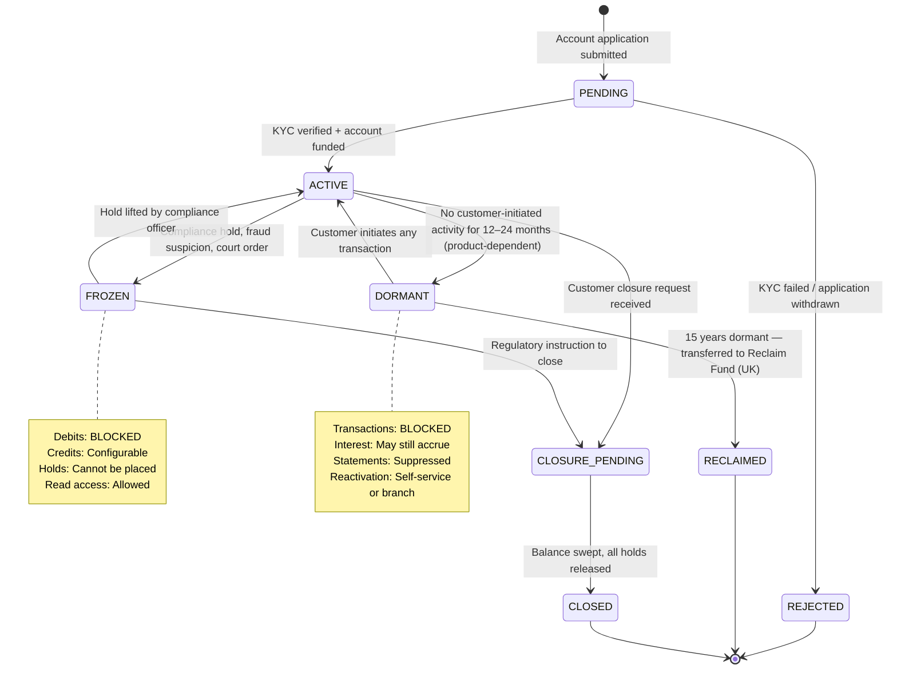
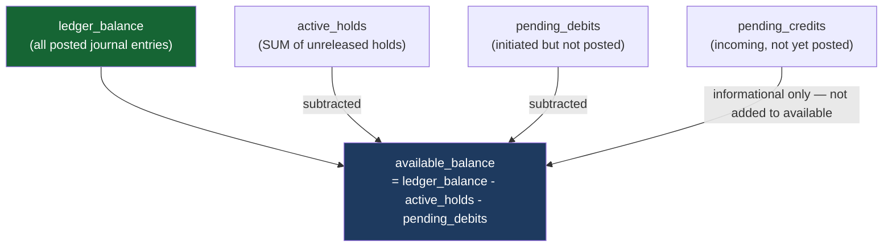

The account is the atom of the banking system — every customer relationship, every financial obligation, and every regulatory requirement ultimately resolves to an account record with a status, a balance, and a set of permitted operations. While Lesson 1 introduced the account concept in the context of core banking architecture, this lesson examines account management in full depth: how different account types encode different financial relationships, how the account state machine protects both the customer and the bank from invalid operations, and what the lifecycle from opening to closure looks like in production Java code backed by a correctly modelled database.

## Learning Objectives

By the end of this lesson you will be able to:

- Classify bank account types and explain the financial and regulatory distinctions between them
- Implement an account state machine with correct transition guards and audit logging
- Design an account entity SQL schema that separates ledger balance from available balance
- Implement an `AccountLifecycleService` with methods for activation, freezing, dormancy, and closure
- Explain the UK regulatory requirements for dormant accounts and implement the detection query
- Design a balance sweep procedure for account closure that leaves no stranded funds
- Explain why `available_balance` and `ledger_balance` are stored as separate columns rather than computed on the fly

## Business Context

In 2019, the UK's Financial Conduct Authority fined a tier-2 bank £76 million for failures in its account dormancy management. The bank had failed to correctly identify and transfer dormant customer balances to the Reclaim Fund under the Dormant Bank and Building Society Accounts Act 2008. An audit found 340,000 accounts that had exceeded 15 years of inactivity without being classified as dormant — the bank's account lifecycle system had a defect where accounts transitioned to `DORMANT` status correctly, but the downstream job that checked "has this been dormant for 15 years and been reported to Reclaim Fund?" was filtering on `updated_at` (which was updated whenever interest was auto-applied) rather than `last_customer_initiated_transaction_at`. Interest accrual every month was resetting the inactivity clock. The fix required a schema change — adding `last_customer_initiated_at` as a separate column — and a backfill of 2.1 million rows.

## Account Type Taxonomy

Not all accounts are alike. The account type encodes the financial relationship between the bank and the customer — including which side of the balance sheet the account appears on, who owes whom, and what operations are permitted.

| Account Type | Balance Sheet | Normal Balance | Bank Owes Customer? | Typical Use |
|---|---|---|---|---|
| **Current Account** | Liability | Credit | Yes | Day-to-day transactions, salary, bills |
| **Savings Account** | Liability | Credit | Yes | Interest-bearing deposit; withdrawal limits |
| **Fixed-Term Deposit** | Liability | Credit | Yes | Locked for term; penalty for early withdrawal |
| **Loan Account** | Asset | Debit | No — customer owes bank | Mortgage, personal loan, overdraft |
| **Credit Card Account** | Asset | Debit | No | Revolving credit; statement balance owed |
| **Nostro Account** | Asset | Debit | N/A | Bank's account held at another bank |
| **Vostro Account** | Liability | Credit | Yes (to other bank) | Another bank's account held here |
| **Suspense Account** | Either | Either | N/A | Temporary holding; must clear by EOD |
| **Internal / Expense** | Expense/Income | Varies | N/A | P&L tracking, fee collection |

> [!NOTE]
> A nostro account ("ours" in Italian) and a vostro account ("yours") describe the **same** correspondent banking relationship from opposite perspectives. When Bank A holds funds at Bank B for settlement, Bank A calls it a nostro account; Bank B calls the same account a vostro account. This distinction matters when designing cross-border payment systems where both banks need to reconcile the same relationship.

## Account State Machine



> [!WARNING]
> The transition from `DORMANT` to `ACTIVE` must be gated — it should require the customer to verify their identity (online authentication or branch visit), not just any system event. If interest accrual auto-posts and that reactivates the account, inactivity tracking is broken — which is exactly the defect that cost the bank in the Business Context above.

## Account Entity Schema DDL

```sql
CREATE TYPE account_type AS ENUM (
    'CURRENT', 'SAVINGS', 'FIXED_DEPOSIT', 'LOAN', 'CREDIT_CARD',
    'NOSTRO', 'VOSTRO', 'SUSPENSE', 'INTERNAL'
);

CREATE TYPE account_status AS ENUM (
    'PENDING', 'ACTIVE', 'FROZEN', 'DORMANT',
    'CLOSURE_PENDING', 'REJECTED', 'RECLAIMED', 'CLOSED'
);

CREATE TABLE accounts (
    id                              UUID            PRIMARY KEY DEFAULT gen_random_uuid(),
    account_number                  VARCHAR(20)     NOT NULL UNIQUE,
    iban                            VARCHAR(34),    -- ISO 13616: 'GB29NWBK60161331926819'
    sort_code                       CHAR(8),        -- UK: '60-16-13'
    customer_id                     UUID,           -- NULL for internal/nostro accounts
    product_code                    VARCHAR(50)     NOT NULL,  -- 'CURRENT_STANDARD', 'SAVINGS_FLEX'
    account_type                    account_type    NOT NULL,
    currency                        CHAR(3)         NOT NULL,  -- ISO 4217

    -- Status
    status                          account_status  NOT NULL DEFAULT 'PENDING',

    -- Balances — stored as minor units (pence/cents). Never floats.
    ledger_balance                  BIGINT          NOT NULL DEFAULT 0,
    available_balance               BIGINT          NOT NULL DEFAULT 0,
    pending_credits                 BIGINT          NOT NULL DEFAULT 0,
    pending_debits                  BIGINT          NOT NULL DEFAULT 0,

    -- Limits
    overdraft_limit                 BIGINT          NOT NULL DEFAULT 0,
    daily_debit_limit               BIGINT,         -- NULL = no limit
    single_transaction_limit        BIGINT,

    -- Lifecycle timestamps
    opened_at                       TIMESTAMPTZ,
    activated_at                    TIMESTAMPTZ,
    frozen_at                       TIMESTAMPTZ,
    frozen_reason                   TEXT,
    dormant_at                      TIMESTAMPTZ,

    -- Critical: separate from dormant_at — do NOT use updated_at for dormancy
    last_customer_initiated_at      TIMESTAMPTZ,    -- Updated only by customer actions
    last_system_activity_at         TIMESTAMPTZ,    -- Updated by system (interest, fees)

    closed_at                       TIMESTAMPTZ,
    closure_reason                  TEXT,

    -- Audit
    created_at                      TIMESTAMPTZ     NOT NULL DEFAULT now(),
    updated_at                      TIMESTAMPTZ     NOT NULL DEFAULT now(),
    version                         BIGINT          NOT NULL DEFAULT 0,  -- Optimistic locking

    -- Constraints
    CONSTRAINT chk_ledger_balance_loan
        CHECK (account_type != 'LOAN' OR ledger_balance >= 0),
    CONSTRAINT chk_available_lte_ledger_plus_overdraft
        CHECK (available_balance >= -(overdraft_limit)),
    CONSTRAINT chk_pending_non_negative
        CHECK (pending_credits >= 0 AND pending_debits >= 0)
);

-- Account lifecycle event audit trail
CREATE TABLE account_status_history (
    id              BIGSERIAL       PRIMARY KEY,
    account_id      UUID            NOT NULL REFERENCES accounts(id),
    from_status     account_status,
    to_status       account_status  NOT NULL,
    changed_at      TIMESTAMPTZ     NOT NULL DEFAULT now(),
    changed_by      VARCHAR(100)    NOT NULL,  -- User ID or system name
    reason          TEXT,
    reference_id    VARCHAR(100)    -- e.g., compliance case ID, court order ref
);

CREATE INDEX idx_accounts_customer ON accounts (customer_id) WHERE customer_id IS NOT NULL;
CREATE INDEX idx_accounts_status   ON accounts (status);
CREATE INDEX idx_accounts_dormancy ON accounts (last_customer_initiated_at)
    WHERE status = 'ACTIVE';
```

## AccountLifecycleService

```java17
@Service
@Transactional
public class AccountLifecycleService {

    private final AccountRepository accountRepository;
    private final AccountStatusHistoryRepository historyRepository;
    private final ApplicationEventPublisher eventPublisher;

    private static final Map<AccountStatus, Set<AccountStatus>> ALLOWED_TRANSITIONS =
        Map.of(
            AccountStatus.PENDING,          Set.of(AccountStatus.ACTIVE, AccountStatus.REJECTED),
            AccountStatus.ACTIVE,           Set.of(AccountStatus.FROZEN, AccountStatus.DORMANT,
                                                   AccountStatus.CLOSURE_PENDING),
            AccountStatus.FROZEN,           Set.of(AccountStatus.ACTIVE, AccountStatus.CLOSURE_PENDING),
            AccountStatus.DORMANT,          Set.of(AccountStatus.ACTIVE, AccountStatus.RECLAIMED),
            AccountStatus.CLOSURE_PENDING,  Set.of(AccountStatus.CLOSED),
            AccountStatus.REJECTED,         Set.of(),
            AccountStatus.RECLAIMED,        Set.of(),
            AccountStatus.CLOSED,           Set.of()
        );

    /**
     * Activate a PENDING account. Requires: KYC passed, initial deposit verified.
     */
    public Account activate(UUID accountId, String activatedBy) {
        Account account = accountRepository.findByIdWithLock(accountId);
        transitionStatus(account, AccountStatus.ACTIVE, activatedBy,
            "KYC verified and account funded", null);
        account.setActivatedAt(Instant.now());
        account.setLastCustomerInitiatedAt(Instant.now());
        return accountRepository.save(account);
    }

    /**
     * Freeze an account. Debits are immediately blocked.
     * @param reason  Human-readable reason (shown to compliance, not customer)
     * @param caseRef Compliance case reference number
     */
    public Account freeze(UUID accountId, String frozenBy, String reason, String caseRef) {
        Account account = accountRepository.findByIdWithLock(accountId);

        if (account.getStatus() != AccountStatus.ACTIVE) {
            throw new InvalidStateTransitionException(
                "Can only freeze ACTIVE accounts; current status: " + account.getStatus());
        }

        transitionStatus(account, AccountStatus.FROZEN, frozenBy, reason, caseRef);
        account.setFrozenAt(Instant.now());
        account.setFrozenReason(reason);

        return accountRepository.save(account);
    }

    /**
     * Unfreeze a frozen account. Requires authorisation from compliance officer.
     */
    public Account unfreeze(UUID accountId, String unfrozenBy, String reason, String caseRef) {
        Account account = accountRepository.findByIdWithLock(accountId);

        if (account.getStatus() != AccountStatus.FROZEN) {
            throw new InvalidStateTransitionException(
                "Can only unfreeze FROZEN accounts; current status: " + account.getStatus());
        }

        transitionStatus(account, AccountStatus.ACTIVE, unfrozenBy, reason, caseRef);
        account.setFrozenAt(null);
        account.setFrozenReason(null);

        return accountRepository.save(account);
    }

    /**
     * Mark an account dormant.
     * Called by the dormancy detection job — NOT by customer actions.
     * Customer-initiated transactions update last_customer_initiated_at and prevent this.
     */
    public Account markDormant(UUID accountId, String reason) {
        Account account = accountRepository.findByIdWithLock(accountId);

        if (account.getStatus() != AccountStatus.ACTIVE) {
            return account; // Idempotent — no-op if not active
        }

        transitionStatus(account, AccountStatus.DORMANT, "SYSTEM:DORMANCY_JOB", reason, null);
        account.setDormantAt(Instant.now());

        return accountRepository.save(account);
    }

    /**
     * Reactivate a dormant account.
     * MUST be called only after customer identity verification — not by system events.
     */
    public Account reactivateFromDormancy(UUID accountId, String reactivatedBy) {
        Account account = accountRepository.findByIdWithLock(accountId);

        if (account.getStatus() != AccountStatus.DORMANT) {
            throw new InvalidStateTransitionException(
                "Can only reactivate DORMANT accounts; current status: " + account.getStatus());
        }

        transitionStatus(account, AccountStatus.ACTIVE, reactivatedBy,
            "Customer identity verified — dormancy lifted", null);
        account.setDormantAt(null);
        account.setLastCustomerInitiatedAt(Instant.now());  // Reset inactivity clock

        return accountRepository.save(account);
    }

    /**
     * Initiate closure. Validates: no active holds, balance ready for sweep.
     */
    public Account initiateClosureRequest(UUID accountId, String requestedBy, String reason) {
        Account account = accountRepository.findByIdWithLock(accountId);

        if (!Set.of(AccountStatus.ACTIVE, AccountStatus.FROZEN).contains(account.getStatus())) {
            throw new InvalidStateTransitionException(
                "Cannot initiate closure for account in status: " + account.getStatus());
        }

        // Cannot close while active holds exist
        long activeHoldCount = holdRepository.countActiveHoldsByAccountId(accountId);
        if (activeHoldCount > 0) {
            throw new ActiveHoldsException(
                "Cannot close account with %d active hold(s). Release holds first."
                    .formatted(activeHoldCount));
        }

        transitionStatus(account, AccountStatus.CLOSURE_PENDING, requestedBy, reason, null);
        return accountRepository.save(account);
    }

    /**
     * Complete closure with balance sweep to destination account.
     * Posts a journal entry moving the remaining balance before marking CLOSED.
     */
    public Account close(UUID accountId, UUID sweepDestinationAccountId,
                         String closedBy, String reason) {
        Account account = accountRepository.findByIdWithLock(accountId);

        if (account.getStatus() != AccountStatus.CLOSURE_PENDING) {
            throw new InvalidStateTransitionException(
                "Account must be in CLOSURE_PENDING status; current: " + account.getStatus());
        }

        // Sweep remaining balance if non-zero
        if (account.getLedgerBalance() != 0) {
            sweepBalance(account, sweepDestinationAccountId, closedBy);
        }

        transitionStatus(account, AccountStatus.CLOSED, closedBy, reason, null);
        account.setClosedAt(Instant.now());
        account.setClosureReason(reason);
        account.setLedgerBalance(0);
        account.setAvailableBalance(0);

        Account closed = accountRepository.save(account);
        eventPublisher.publishEvent(new AccountClosedEvent(accountId, closedBy, reason));
        return closed;
    }

    private void transitionStatus(Account account, AccountStatus to,
                                   String changedBy, String reason, String refId) {
        AccountStatus from = account.getStatus();
        Set<AccountStatus> allowed = ALLOWED_TRANSITIONS.getOrDefault(from, Set.of());

        if (!allowed.contains(to)) {
            throw new InvalidStateTransitionException(
                "Invalid transition: %s → %s. Allowed from %s: %s"
                    .formatted(from, to, from, allowed));
        }

        account.setStatus(to);
        account.setUpdatedAt(Instant.now());

        historyRepository.save(AccountStatusHistory.builder()
            .accountId(account.getId())
            .fromStatus(from)
            .toStatus(to)
            .changedBy(changedBy)
            .reason(reason)
            .referenceId(refId)
            .changedAt(Instant.now())
            .build());
    }
}
```

## Regulatory Dormancy Detection

Under the UK Dormant Bank and Building Society Accounts Act 2008, accounts with no customer-initiated activity for 15 years must be reported and balances transferred to the Reclaim Fund. The dormancy detection job must use the correct inactivity field.

```java17
@Service
public class DormancyDetectionService {

    private final AccountRepository accountRepository;
    private final AccountLifecycleService lifecycleService;

    // Run nightly — identify accounts that have crossed the inactivity threshold
    @Scheduled(cron = "0 30 1 * * *")
    public void detectAndMarkDormantAccounts() {
        // Product-defined inactivity thresholds:
        // Current accounts: 24 months; Savings: 12 months
        LocalDateTime currentThreshold  = LocalDateTime.now().minusMonths(24);
        LocalDateTime savingsThreshold  = LocalDateTime.now().minusMonths(12);

        // Fetch accounts eligible for dormancy — those with no customer activity since threshold
        // Note: last_customer_initiated_at, NOT last_system_activity_at or updated_at
        List<Account> eligible = accountRepository.findDormancyCandidates(
            currentThreshold, savingsThreshold);

        log.info("Dormancy check: {} accounts eligible for dormancy marking", eligible.size());

        for (Account account : eligible) {
            try {
                lifecycleService.markDormant(account.getId(),
                    "No customer-initiated activity since " +
                    account.getLastCustomerInitiatedAt());
            } catch (Exception e) {
                log.error("Failed to mark account {} dormant: {}", account.getId(), e.getMessage());
            }
        }
    }
}
```

```sql
-- Repository query: find candidates for dormancy
-- Uses last_customer_initiated_at — NOT updated_at or last_system_activity_at
SELECT a.id, a.account_number, a.account_type, a.last_customer_initiated_at
FROM accounts a
WHERE a.status = 'ACTIVE'
  AND (
      (a.account_type = 'CURRENT'  AND a.last_customer_initiated_at < :currentThreshold)
   OR (a.account_type = 'SAVINGS'  AND a.last_customer_initiated_at < :savingsThreshold)
  )
ORDER BY a.last_customer_initiated_at ASC;

-- Find accounts that have been DORMANT for 15 years — Reclaim Fund candidates
SELECT a.id, a.account_number, a.ledger_balance, a.dormant_at
FROM accounts a
WHERE a.status = 'DORMANT'
  AND a.dormant_at < now() - INTERVAL '15 years'
  AND a.ledger_balance > 0
ORDER BY a.dormant_at ASC;
```

## Available Balance vs Ledger Balance

This distinction trips up engineers unfamiliar with banking systems. The rule: **always store both**.



| Field | Definition | When Updated | Used For |
|---|---|---|---|
| `ledger_balance` | Sum of all posted journal entries | At settlement / journal posting | Regulatory reporting, statements, interest calculations |
| `available_balance` | Ledger balance minus active holds and pending debits | At hold placement, hold release, settlement | Authorising new payments and withdrawals |
| `pending_credits` | Inbound funds not yet settled | At payment receipt | Informational display to customer |
| `pending_debits` | Outbound funds not yet settled | At payment initiation | Input to available_balance calculation |

> [!IMPORTANT]
> `available_balance` should be stored as a denormalised column, not computed on each transaction request. Computing it dynamically from `SUM(journal_entry_lines)` minus `SUM(active_holds)` for every authorisation request is too slow at scale. Update it atomically in the same transaction as hold placement and release, using optimistic locking (`version` column) to prevent concurrent modification.

```java17
// Atomic available balance update — called when placing or releasing a hold
@Transactional(isolation = Isolation.SERIALIZABLE)
public void updateAvailableBalance(UUID accountId, long delta) {
    // Optimistic lock: fail if another thread modified the account since we read it
    int updated = jdbc.update("""
        UPDATE accounts
        SET available_balance = available_balance + ?,
            updated_at = now(),
            version = version + 1
        WHERE id = ?
          AND available_balance + ? >= -(overdraft_limit)
        """,
        delta, accountId, delta
    );

    if (updated == 0) {
        // Either insufficient funds or concurrent modification — re-read to determine which
        Account account = accountRepository.findById(accountId).orElseThrow();
        long projectedBalance = account.getAvailableBalance() + delta;
        if (projectedBalance < -account.getOverdraftLimit()) {
            throw new InsufficientFundsException(accountId, delta, account.getAvailableBalance(),
                account.getOverdraftLimit());
        }
        throw new OptimisticLockException("Concurrent modification on account " + accountId);
    }
}
```

---

<!-- KNOWLEDGE-CHECK [
  {
    "id": "kc-am-01",
    "question": "A dormant account detection job uses `updated_at` to find inactive accounts. The bank auto-applies monthly interest to all savings accounts. What is the consequence of this implementation?",
    "options": [
      "No consequence — interest application proves the account is still economically active",
      "The dormancy clock is never triggered — updated_at resets every month, so accounts never qualify for dormancy status",
      "The job runs correctly but produces false positives for accounts without interest",
      "Interest application updates updated_at, resetting the inactivity period to zero every month — genuinely inactive accounts never reach the dormancy threshold"
    ],
    "correct": 3,
    "explanation": "If dormancy detection uses updated_at and the system auto-applies interest monthly, then updated_at is refreshed every month for every interest-bearing account — even those with no customer-initiated activity in years. The dormancy threshold is never reached. The correct field is last_customer_initiated_at, which is updated only when the customer deliberately acts: logging in and transacting, making a payment, withdrawing funds. System-generated events (interest, fees) must not update this field."
  },
  {
    "id": "kc-am-02",
    "question": "A customer has a current account with ledger_balance = £600, two active holds of £100 each, and an overdraft limit of £200. What is the maximum additional hold the system should permit to place?",
    "options": [
      "£600 — the full ledger balance",
      "£400 — ledger balance minus existing holds",
      "£600 — existing holds plus the overdraft limit",
      "£400 available_balance plus £200 overdraft = £600 maximum additional hold permitted"
    ],
    "correct": 3,
    "explanation": "available_balance = ledger_balance - active_holds = £600 - £200 = £400. The overdraft limit extends the available capacity by £200. So maximum new hold = available_balance + overdraft_limit = £400 + £200 = £600. After placing a £600 hold, available_balance would be £400 - £600 = -£200, which is exactly at the overdraft limit boundary. Any amount exceeding this would breach the overdraft limit."
  }
] -->

---

<!-- PRACTICAL-CHALLENGE {
  "id": "pc-account-management",
  "title": "Account Management: Lifecycle and Balance Design",
  "description": "Implement account lifecycle controls and balance management for a production banking system.",
  "tasks": [
    {
      "id": "pc-am-01",
      "description": "Add a database migration to the accounts table that adds the last_customer_initiated_at column (separate from updated_at). Write the trigger or application-layer logic specification that ensures this column is updated ONLY when a customer-initiated action occurs — not when the system posts interest, fees, or holds."
    },
    {
      "id": "pc-am-02",
      "description": "Implement the full ALLOWED_TRANSITIONS map in AccountLifecycleService as a Java 17 enum with a canTransitionTo() method. Write a parameterised JUnit 5 test that validates: (a) every transition in the map is allowed, (b) CLOSED → ACTIVE is rejected, (c) DORMANT → FROZEN is rejected."
    },
    {
      "id": "pc-am-03",
      "description": "Design the `sweepBalance()` private method inside AccountLifecycleService. It should: post a journal entry debiting the closing account and crediting the destination account for the full ledger_balance; set both ledger_balance and available_balance to 0 on the source account; and throw if the destination account is CLOSED or FROZEN."
    },
    {
      "id": "pc-am-04",
      "description": "Write an integration test for AccountLifecycleService.freeze() that verifies: the account status transitions to FROZEN; a row is inserted into account_status_history with the correct from/to status and reason; and a subsequent call to place a hold on the frozen account throws an appropriate exception."
    }
  ]
} -->
