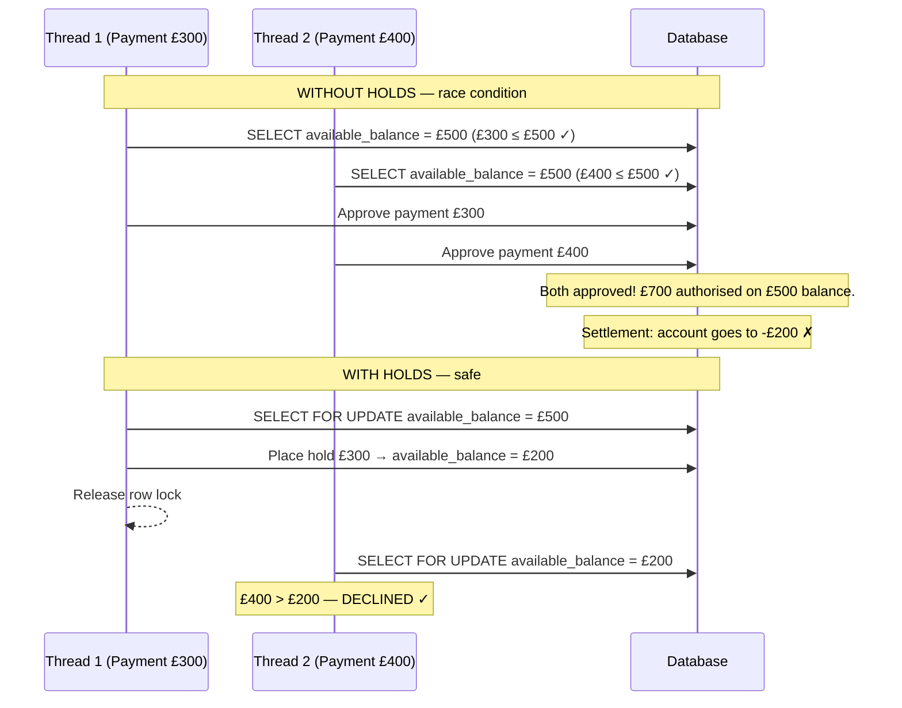
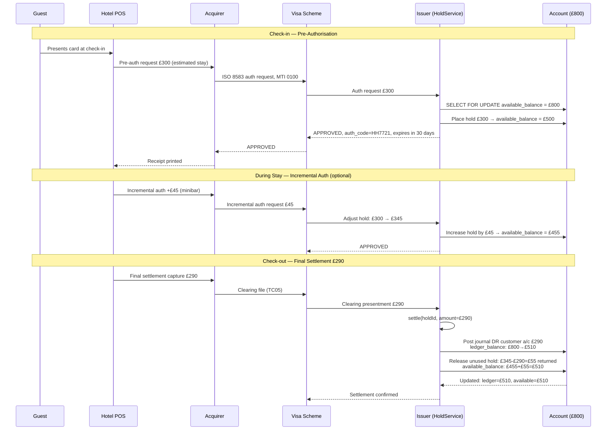

Funds reservation — the act of earmarking money for a pending obligation before the funds actually leave the account — is the mechanism that bridges the gap between the moment a payment is authorised and the moment it settles. Without holds, two concurrent authorisations for a customer with a £500 balance could each see £500 available and both approve, leaving the account £500 overdrawn when both settle. This lesson examines the holds system in full technical detail: schema design, the atomic `place()` and `settle()` operations, hold expiry, partial settlement patterns, and the interactions between holds and overdraft limits that make available balance calculation surprisingly complex.

## Learning Objectives

By the end of this lesson you will be able to:

- Explain the race condition that holds are designed to prevent and why database transactions alone are insufficient
- Design the `account_holds` schema with expiry, reason, and status columns
- Write the SQL query that computes available balance as `ledger_balance - SUM(active_holds)`
- Implement `HoldService.place()` and `HoldService.settle()` as atomic operations using optimistic locking
- Implement a hold expiry background job with safe partial-failure handling
- Handle partial settlement — where a pre-auth for £120 settles for £95
- Trace a hotel card pre-auth flow end-to-end using a Mermaid sequence diagram
- Explain how overdraft limits interact with the holds system

## Business Context

In 2017, a UK prepaid card issuer experienced a £2.3 million operational loss over a 72-hour weekend period. Their card authorisation service approved transactions by checking `ledger_balance >= amount`. On Friday afternoon, a customer with a £200 balance received their monthly salary of £1,500 — bringing their balance to £1,700. Between Saturday morning and Sunday evening, the customer made 23 card transactions totalling £1,650. Each transaction was approved against the current ledger balance — but the system processed all 23 authorisations concurrently without holds. Because each authorisation checked the same £1,700 starting balance rather than reserving funds atomically, all 23 were approved. When settlement ran on Monday morning, 11 transactions were funded normally; the remaining 12 — totalling £890 — resulted in forced debit balances the prepaid issuer had to absorb. The root cause: checking ledger balance without atomic hold placement is not thread-safe. The fix was an `account_holds` table with `SELECT FOR UPDATE` locking.

## Why Holds Exist: The Pre-Auth Race Condition

Consider two concurrent card payments against an account with £500 available:



The `SELECT FOR UPDATE` acquires a row-level lock for the duration of the hold placement transaction. No other transaction can read or modify the account row until the hold is committed. This serialises concurrent authorisations and eliminates the race.

> [!IMPORTANT]
> `SELECT FOR UPDATE` is the correct tool here, not application-level locking or optimistic locking (`version` column). Optimistic locking retries on conflict — but a retry would re-read the already-reduced balance and correctly decline. However, under high concurrency, optimistic lock retries create thundering-herd retries. For hold placement, pessimistic locking (`SELECT FOR UPDATE`) is preferred because holds are short-lived (milliseconds) and contention on a single account is rare in practice.

## account_holds Schema DDL

```sql
CREATE TYPE hold_status AS ENUM ('ACTIVE', 'SETTLED', 'RELEASED', 'EXPIRED', 'PARTIALLY_SETTLED');

CREATE TYPE hold_reason AS ENUM (
    'CARD_AUTHORISATION',
    'WIRE_TRANSFER_PENDING',
    'DIRECT_DEBIT_PENDING',
    'COMPLIANCE_FREEZE',
    'MERCHANT_PRE_AUTH',
    'HOTEL_PRE_AUTH',
    'CAR_RENTAL_PRE_AUTH'
);

CREATE TABLE account_holds (
    id                  UUID            PRIMARY KEY DEFAULT gen_random_uuid(),
    account_id          UUID            NOT NULL REFERENCES accounts(id),
    payment_id          VARCHAR(100),   -- FK to payments table (nullable for compliance holds)
    hold_reason         hold_reason     NOT NULL,
    status              hold_status     NOT NULL DEFAULT 'ACTIVE',

    -- Amounts — always in minor units
    original_amount     BIGINT          NOT NULL CHECK (original_amount > 0),
    remaining_amount    BIGINT          NOT NULL CHECK (remaining_amount >= 0),
    settled_amount      BIGINT          NOT NULL DEFAULT 0 CHECK (settled_amount >= 0),
    currency            CHAR(3)         NOT NULL,

    -- Expiry — holds must not live forever
    expires_at          TIMESTAMPTZ     NOT NULL,  -- Authorisation validity window
    created_at          TIMESTAMPTZ     NOT NULL DEFAULT now(),
    updated_at          TIMESTAMPTZ     NOT NULL DEFAULT now(),

    -- Settlement tracking
    settled_at          TIMESTAMPTZ,
    settlement_ref      VARCHAR(100),   -- Scheme settlement reference

    -- Who placed/released this hold
    placed_by           VARCHAR(100)    NOT NULL,
    released_by         VARCHAR(100),
    release_reason      TEXT,

    version             BIGINT          NOT NULL DEFAULT 0,  -- Optimistic locking

    CONSTRAINT chk_amounts_consistent
        CHECK (settled_amount + remaining_amount <= original_amount),
    CONSTRAINT chk_settled_has_ref
        CHECK (status != 'SETTLED' OR settlement_ref IS NOT NULL)
);

-- Index for available balance calculation — the hot path
CREATE INDEX idx_holds_account_active
    ON account_holds (account_id, currency)
    WHERE status = 'ACTIVE';

-- Index for expiry job
CREATE INDEX idx_holds_expiry
    ON account_holds (expires_at)
    WHERE status = 'ACTIVE';
```

## Available Balance SQL with Active Holds

The canonical available balance calculation. This should match the denormalised `available_balance` column on the `accounts` table — if they diverge, there is a bug.

```sql
-- Available balance for a single account
-- This is the source of truth; the denormalised column is a performance optimisation
SELECT
    a.id,
    a.account_number,
    a.ledger_balance,
    a.overdraft_limit,
    COALESCE(SUM(h.remaining_amount), 0)              AS total_active_holds,
    a.ledger_balance
        - COALESCE(SUM(h.remaining_amount), 0)        AS computed_available_balance,
    a.available_balance                               AS stored_available_balance,
    -- These should always match; a discrepancy is a data integrity alert
    a.available_balance = (
        a.ledger_balance - COALESCE(SUM(h.remaining_amount), 0)
    )                                                 AS balances_consistent
FROM accounts a
LEFT JOIN account_holds h
    ON h.account_id = a.id
   AND h.status = 'ACTIVE'
   AND h.currency = a.currency
   AND h.expires_at > now()   -- Exclude logically expired holds even if job hasn't run yet
WHERE a.id = :accountId
GROUP BY a.id, a.account_number, a.ledger_balance, a.overdraft_limit, a.available_balance;
```

> [!NOTE]
> The `expires_at > now()` filter in the available balance query is a safety net. Even if the expiry background job is delayed (e.g., a weekend with no batch run), expired holds should not reduce available balance. This creates a brief inconsistency between the query and the `available_balance` column — the reconciliation job corrects it when it runs.

## HoldService — Place and Settle

```java17
@Service
public class HoldService {

    private final AccountRepository accountRepository;
    private final AccountHoldRepository holdRepository;
    private final JournalEntryService journalEntryService;

    /**
     * Place a hold on an account atomically.
     * Uses SELECT FOR UPDATE to prevent concurrent over-authorisation.
     * Updates available_balance in the same transaction.
     *
     * @throws InsufficientFundsException if available balance + overdraft would be exceeded
     * @throws AccountNotEligibleException if account is FROZEN, DORMANT, or CLOSED
     */
    @Transactional(isolation = Isolation.READ_COMMITTED)
    public HoldReference place(PlaceHoldCommand cmd) {
        // Acquire row lock — serialises concurrent holds on the same account
        Account account = accountRepository.findByIdForUpdate(cmd.accountId());

        validateAccountEligibleForHold(account);

        long maxPermittedHold = account.getAvailableBalance() + account.getOverdraftLimit();
        if (cmd.amountMinorUnits() > maxPermittedHold) {
            throw new InsufficientFundsException(
                "Requested hold of %d exceeds available capacity of %d (available=%d, overdraft=%d)"
                    .formatted(cmd.amountMinorUnits(), maxPermittedHold,
                        account.getAvailableBalance(), account.getOverdraftLimit()));
        }

        AccountHold hold = AccountHold.builder()
            .id(UUID.randomUUID())
            .accountId(cmd.accountId())
            .paymentId(cmd.paymentId())
            .holdReason(cmd.reason())
            .status(HoldStatus.ACTIVE)
            .originalAmount(cmd.amountMinorUnits())
            .remainingAmount(cmd.amountMinorUnits())
            .settledAmount(0L)
            .currency(cmd.currency())
            .expiresAt(cmd.expiresAt())
            .placedBy(cmd.placedBy())
            .createdAt(Instant.now())
            .build();

        holdRepository.save(hold);

        // Update available_balance atomically in the same transaction
        account.setAvailableBalance(account.getAvailableBalance() - cmd.amountMinorUnits());
        account.setUpdatedAt(Instant.now());
        accountRepository.save(account);

        return new HoldReference(hold.getId(), cmd.amountMinorUnits(), cmd.expiresAt());
    }

    /**
     * Settle a hold — releases the hold and posts definitive ledger journal entries.
     * Supports partial settlement: a hotel pre-auth for £120 settling for £95.
     */
    @Transactional(isolation = Isolation.READ_COMMITTED)
    public SettlementResult settle(SettleHoldCommand cmd) {
        AccountHold hold = holdRepository.findByIdForUpdate(cmd.holdId());

        if (hold.getStatus() != HoldStatus.ACTIVE
                && hold.getStatus() != HoldStatus.PARTIALLY_SETTLED) {
            throw new InvalidHoldStateException(
                "Cannot settle hold in status: " + hold.getStatus() +
                ". Must be ACTIVE or PARTIALLY_SETTLED.");
        }

        if (cmd.settleAmountMinorUnits() > hold.getRemainingAmount()) {
            throw new InvalidOperationException(
                "Settlement amount %d exceeds remaining hold amount %d"
                    .formatted(cmd.settleAmountMinorUnits(), hold.getRemainingAmount()));
        }

        Account account = accountRepository.findByIdForUpdate(cmd.accountId());

        // Post ledger journal entry for the settled amount
        journalEntryService.post(PostJournalEntryCommand.builder()
            .description("Card settlement: " + hold.getPaymentId())
            .businessDate(LocalDate.now())
            .entryType(EntryType.PAYMENT)
            .sourceSystem("HOLD_SETTLEMENT")
            .sourceRef(hold.getId().toString())
            .postedBy("SYSTEM:SETTLEMENT_JOB")
            .lines(List.of(
                new PostJournalEntryCommand.Line(
                    "2000", Side.DR, cmd.settleAmountMinorUnits(), cmd.currency(),
                    "Card payment settlement"),
                new PostJournalEntryCommand.Line(
                    "1001", Side.CR, cmd.settleAmountMinorUnits(), cmd.currency(),
                    "Nostro settlement")
            ))
            .build());

        long previousRemaining = hold.getRemainingAmount();
        hold.setSettledAmount(hold.getSettledAmount() + cmd.settleAmountMinorUnits());
        hold.setRemainingAmount(hold.getRemainingAmount() - cmd.settleAmountMinorUnits());
        hold.setSettledAt(Instant.now());
        hold.setSettlementRef(cmd.settlementReference());

        boolean fullySettled = hold.getRemainingAmount() == 0;
        hold.setStatus(fullySettled ? HoldStatus.SETTLED : HoldStatus.PARTIALLY_SETTLED);
        holdRepository.save(hold);

        // Ledger balance decreases by settled amount (journal entry already posted)
        // Available balance: the hold was already reducing available_balance.
        // Remaining hold still reduces it; released portion restores it.
        long releasedFromHold = previousRemaining - hold.getRemainingAmount();
        // settled amount moved from "hold" to "ledger debit" — net: available_balance unchanged
        // but ledger_balance decreases
        account.setLedgerBalance(account.getLedgerBalance() - cmd.settleAmountMinorUnits());
        // If partial: remaining hold still active. If full: restore remaining hold to available.
        if (fullySettled) {
            // No remaining hold — the previously reserved available balance stays consumed (now a ledger debit)
            // But the hold-portion that wasn't settled (if partial pre-auth) is released
            long unusedHoldAmount = hold.getOriginalAmount() - hold.getSettledAmount();
            if (unusedHoldAmount > 0) {
                account.setAvailableBalance(account.getAvailableBalance() + unusedHoldAmount);
            }
        }
        accountRepository.save(account);

        return new SettlementResult(hold.getId(), cmd.settleAmountMinorUnits(), hold.getStatus());
    }

    /**
     * Release a hold without settlement (e.g., cancelled authorisation, expired hold).
     * Restores available_balance; does NOT post any ledger entry.
     */
    @Transactional(isolation = Isolation.READ_COMMITTED)
    public void release(UUID holdId, String releasedBy, String reason) {
        AccountHold hold = holdRepository.findByIdForUpdate(holdId);

        if (!Set.of(HoldStatus.ACTIVE, HoldStatus.PARTIALLY_SETTLED).contains(hold.getStatus())) {
            throw new InvalidHoldStateException(
                "Cannot release hold in status: " + hold.getStatus());
        }

        Account account = accountRepository.findByIdForUpdate(hold.getAccountId());

        // Restore the remaining (unreleased) hold amount to available balance
        account.setAvailableBalance(account.getAvailableBalance() + hold.getRemainingAmount());
        account.setUpdatedAt(Instant.now());
        accountRepository.save(account);

        hold.setStatus(HoldStatus.RELEASED);
        hold.setReleasedBy(releasedBy);
        hold.setReleaseReason(reason);
        hold.setRemainingAmount(0L);
        hold.setUpdatedAt(Instant.now());
        holdRepository.save(hold);
    }

    private void validateAccountEligibleForHold(Account account) {
        if (!Set.of(AccountStatus.ACTIVE).contains(account.getStatus())) {
            throw new AccountNotEligibleException(
                "Cannot place hold on account in status: " + account.getStatus() +
                ". Account must be ACTIVE.");
        }
    }
}
```

## Hold Expiry Background Job

Pre-authorisations have a maximum validity window (Visa: 7 days for most merchants; 30 days for hotels and car rentals). After expiry, the hold must be released — the funds should return to the customer's available balance.

```java17
@Service
public class HoldExpiryJob {

    private final AccountHoldRepository holdRepository;
    private final HoldService holdService;

    // Run every 15 minutes — expired holds should not block funds for long
    @Scheduled(fixedDelay = 15, timeUnit = TimeUnit.MINUTES)
    public void expireStaleHolds() {
        List<AccountHold> expired = holdRepository.findExpiredActiveHolds(Instant.now());

        if (expired.isEmpty()) {
            return;
        }

        log.info("Hold expiry job: processing {} expired holds", expired.size());

        int successCount = 0;
        int failureCount = 0;

        for (AccountHold hold : expired) {
            try {
                holdService.release(hold.getId(), "SYSTEM:EXPIRY_JOB",
                    "Hold expired at " + hold.getExpiresAt());
                successCount++;
            } catch (InvalidHoldStateException e) {
                // Hold was already settled/released by another process — safe to skip
                log.debug("Hold {} already in terminal state: {}", hold.getId(), e.getMessage());
                successCount++; // Idempotent success
            } catch (Exception e) {
                failureCount++;
                log.error("Failed to expire hold {}: {}", hold.getId(), e.getMessage(), e);
                // Continue processing remaining holds — do not let one failure block others
            }
        }

        log.info("Hold expiry job complete: {} released, {} failed", successCount, failureCount);

        if (failureCount > 0) {
            alertService.raiseWarning("HoldExpiryJob: %d holds failed to expire".formatted(failureCount));
        }
    }
}
```

```sql
-- Query used by the expiry job
SELECT *
FROM account_holds
WHERE status IN ('ACTIVE', 'PARTIALLY_SETTLED')
  AND expires_at <= :now
ORDER BY expires_at ASC
LIMIT 500;  -- Process in batches to avoid long-running transactions
```

## Card Pre-Auth Flow: Hotel Scenario



## Partial Settlement

Hotels, car rentals, and petrol stations routinely settle for different amounts than the original authorisation. The `settle()` method must handle this correctly.

```java21
// Java 21 — partial settlement result using records
public record PartialSettlementSummary(
    UUID holdId,
    long originalHoldAmount,
    long totalSettled,
    long remainingOnHold,
    HoldStatus currentStatus,
    Optional<Instant> expectedFinalSettlementBy
) {
    public boolean isFullySettled() {
        return currentStatus == HoldStatus.SETTLED;
    }

    public long unusedHoldAmount() {
        return originalHoldAmount - totalSettled - remainingOnHold;
    }

    // For customer display: "£29.50 of £34.00 reserved has been charged"
    public String customerSummary() {
        return "£%,.2f of £%,.2f reserved has been charged".formatted(
            totalSettled  / 100.0,
            originalHoldAmount / 100.0
        );
    }
}

// Partial settlement flow for car rental: pre-auth £500, settle £312 and £88 separately
public PartialSettlementSummary processCarRentalSettlement(
        UUID holdId, UUID accountId,
        long firstInstalment, long secondInstalment,
        String settlementRef) {

    // First partial settlement
    holdService.settle(SettleHoldCommand.of(holdId, accountId, firstInstalment,
        "GBP", settlementRef + "-1"));

    // Second partial settlement — finalises the hold
    SettlementResult final = holdService.settle(SettleHoldCommand.of(holdId, accountId,
        secondInstalment, "GBP", settlementRef + "-2"));

    AccountHold hold = holdRepository.findById(holdId).orElseThrow();
    return new PartialSettlementSummary(
        holdId,
        hold.getOriginalAmount(),
        hold.getSettledAmount(),
        hold.getRemainingAmount(),
        hold.getStatus(),
        Optional.empty()
    );
}
```

## Overdraft Limit Interaction with Holds

The overdraft limit extends the ceiling below which available balance can fall. This interaction must be modelled precisely.

| Account State | Ledger Balance | Active Holds | Overdraft Limit | Available Balance | Can Place £50 Hold? |
|---|---|---|---|---|---|
| Normal | £500 | £0 | £0 | £500 | Yes (£500 remaining) |
| With hold | £500 | £200 | £0 | £300 | Yes (£300 remaining) |
| Near limit | £500 | £450 | £0 | £50 | Yes (exactly £50) |
| At limit | £500 | £500 | £0 | £0 | No — would go negative |
| With overdraft | £100 | £50 | £200 | £250 | Yes (£250 remaining) |
| Overdraft in use | £50 | £200 | £200 | £50 | Yes (£50 remaining within overdraft) |
| Overdraft maxed | £50 | £250 | £200 | £0 | No — would exceed overdraft ceiling |

```java17
// Overdraft-aware capacity check
public long getMaxPlaceableHold(Account account) {
    // Effective capacity = available_balance + overdraft_limit
    // available_balance may already be negative if currently in overdraft
    return account.getAvailableBalance() + account.getOverdraftLimit();
    // Note: available_balance = ledger_balance - sum(active_holds)
    // So: maxPlaceable = ledger_balance - sum(active_holds) + overdraft_limit
}

// In HoldService.place() — the capacity check
long capacity = getMaxPlaceableHold(account);
if (cmd.amountMinorUnits() > capacity) {
    throw new InsufficientFundsException(
        "Cannot place hold of %d. Available capacity: %d (available=%d, overdraft=%d)"
            .formatted(cmd.amountMinorUnits(), capacity,
                account.getAvailableBalance(), account.getOverdraftLimit()));
}
```

> [!WARNING]
> When a hold is placed on an account that is already using its overdraft (available_balance < 0), releasing that hold must correctly restore available_balance — even past zero and into positive territory. The release logic must simply add `hold.remainingAmount` to `available_balance` without any lower-bound clamp. Clamping at zero would silently destroy the customer's available balance.

---

<!-- KNOWLEDGE-CHECK [
  {
    "id": "kc-fr-01",
    "question": "An account has ledger_balance = £600, two active holds of £150 each (total £300), and an overdraft_limit = £100. What is the maximum additional hold that can be placed?",
    "options": [
      "£600 — the full ledger balance",
      "£300 — the remaining available balance",
      "£400 — the available balance plus the overdraft limit",
      "£100 — only the overdraft limit can be used for additional holds"
    ],
    "correct": 2,
    "explanation": "available_balance = ledger_balance - active_holds = £600 - £300 = £300. The overdraft extends capacity by £100. So maximum additional hold = available_balance + overdraft_limit = £300 + £100 = £400. If a £400 hold were placed, available_balance would drop to £300 - £400 = -£100, which is exactly at the overdraft limit boundary (ledger_balance £600 - total_holds £700 = -£100, within the -£100 overdraft ceiling)."
  },
  {
    "id": "kc-fr-02",
    "question": "A hold expiry job runs and expires a hold for £80. The account's available_balance is currently -£30 (account is in overdraft). After the hold is released, what should available_balance be?",
    "options": [
      "£0 — available_balance cannot be negative after a hold release",
      "-£110 — releasing a hold on an overdrawn account makes it more overdrawn",
      "£50 — available_balance = -£30 + £80 = £50",
      "£80 — the overdraft is cleared first, then the remainder is applied"
    ],
    "correct": 2,
    "explanation": "Hold release simply adds the remaining hold amount back to available_balance: -£30 + £80 = £50. There is no special logic for overdrafts — the hold was reducing available_balance when it was placed, and releasing it restores that reduction. The account is now £50 in positive available territory. Clamping to £0 or applying any other floor would be wrong — it would lose the customer's £50 of capacity."
  }
] -->

---

<!-- PRACTICAL-CHALLENGE {
  "id": "pc-funds-reservation",
  "title": "Funds Reservation: Hold System Implementation",
  "description": "Build the holds management system including atomic placement, settlement, and expiry.",
  "tasks": [
    {
      "id": "pc-fr-01",
      "description": "Using the account_holds DDL provided, write the SQL for a `findExpiredActiveHolds` repository method that returns up to 500 holds with status IN ('ACTIVE', 'PARTIALLY_SETTLED') and expires_at <= now(), ordered by expires_at ASC. Add a covering index that makes this query efficient."
    },
    {
      "id": "pc-fr-02",
      "description": "Implement HoldService.place() as a Spring @Transactional method that uses SELECT FOR UPDATE. Write a concurrent integration test that launches two threads simultaneously, each attempting to place a hold that would individually succeed but together would exceed the account's capacity. Verify that exactly one succeeds and one receives InsufficientFundsException."
    },
    {
      "id": "pc-fr-03",
      "description": "Implement the partial settlement scenario for a hotel: (1) place a hold for £200 at check-in; (2) call settle() for £180 at checkout; (3) verify that the remaining £20 of the hold is released and restored to available_balance; (4) verify the ledger_balance decreased by exactly £180. Write this as a Spring integration test with assertions on all four balance fields."
    },
    {
      "id": "pc-fr-04",
      "description": "Design a reconciliation query that detects inconsistencies between the denormalised available_balance column and the computed available balance (ledger_balance minus SUM of active holds). The query should return any account where the two values differ by more than 0, along with the magnitude of the discrepancy. Explain when this discrepancy could legitimately occur transiently and how you would handle it."
    }
  ]
} -->
