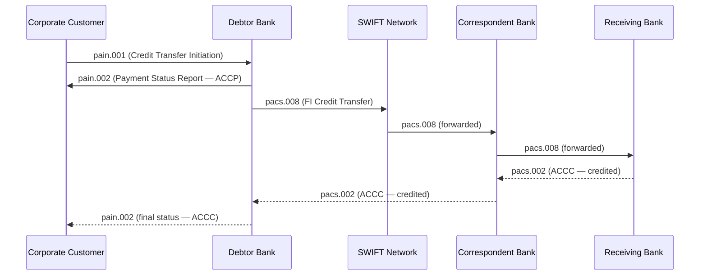

ISO 20022 is the global financial industry standard for electronic data interchange between financial institutions. Where SWIFT MT messages are plain-text, tag-delimited telegrams designed for the 1970s telex era, ISO 20022 (also called MX) uses structured XML with formally defined schemas, rich data elements, and a universal data dictionary that spans payments, securities, trade finance, cards, and foreign exchange. The migration from MT to ISO 20022 is the most significant change to global payment infrastructure in 40 years — SWIFT's CBPR+ (Cross-Border Payments and Reporting Plus) coexistence period runs until November 2025, after which MX is mandatory for cross-border payments. Every engineer in fintech must be fluent in MX message construction, JAXB parsing, schema validation, and the subtle data-loss risks of MT-to-MX translation.

## Learning Objectives

- Navigate the ISO 20022 message catalogue and locate the correct message for a given business function (pain, pacs, camt, reda families)
- Read and construct a pain.001.001.11 (CustomerCreditTransferInitiation) XML document with mandatory and commonly required elements
- Parse a pacs.008.001.10 (FIToFICustomerCreditTransfer) using JAXB-generated classes and extract payment-critical fields
- Apply CBPR+ mandatory field rules on top of base ISO 20022 schema constraints to validate cross-border messages
- Map MT103 fields to their pacs.008 equivalents and identify which MT103 data elements have no structural counterpart in MX
- Implement an `Iso20022MessageValidator` using JAXB and supplementary business rule validation
- Explain the truncation problem — why migrating free-text MT fields to structured MX elements causes data loss — and design a strategy to handle it
- Articulate the rich data benefits of ISO 20022: LEI, purpose codes, structured address, and regulatory reporting improvements

## Business Context

In November 2023, a G-SIB's payment operations centre processed 2.1 million cross-border payment instructions on the first day of their ISO 20022 coexistence go-live. By end-of-day, 94,000 messages (4.5% of volume) had been auto-rejected by their outbound MX validation layer. Investigation revealed three root causes: (1) 61,000 messages had debtor addresses stored in a single free-text `AddressLine` element rather than the structured `StreetName` / `BuildingNumber` / `PostCode` / `TownName` breakdown required by CBPR+; (2) 23,000 messages had creditor agent BICs that were 8-character codes, but the pacs.008 `BICFI` element required the full 11-character form; (3) 10,000 messages had remittance information exceeding the 140-character structured reference limit due to naive concatenation during MT70 migration. The incident cost $1.3 million in same-day repair operations and caused the bank to request a 30-day exemption from SWIFT. This lesson teaches you to build an MX pipeline that never reaches production with these categories of error.

## ISO 20022 Message Catalogue Overview

ISO 20022 messages are grouped into **business domains** (called areas), each with a code prefix:

| Prefix | Domain | Key Messages |
|--------|--------|--------------|
| `pain` | Payments Initiation | pain.001, pain.002, pain.007, pain.008 |
| `pacs` | Payments Clearing and Settlement | pacs.002, pacs.004, pacs.008, pacs.009 |
| `camt` | Cash Management | camt.052, camt.053, camt.054, camt.056 |
| `reda` | Reference Data | reda.001–004 (party, account, instrument) |
| `fxtr` | Foreign Exchange Trade | fxtr.008, fxtr.014 |
| `auth` | Authorities (Regulatory) | auth.001, auth.002 |

A message identifier has the form `<domain>.<message-set>.<variant>.<version>`:
- `pacs.008.001.10` — Payments Clearing/Settlement (pacs), message set 008 (FI credit transfer), variant 001 (standard), version 10

> [!NOTE]
> CBPR+ does not use the latest versions of every message. SWIFT publishes a specific CBPR+ Usage Guideline that restricts the allowed version per message type. As of 2024, cross-border payments use pacs.008.001.10, pacs.002.001.14, and camt.056.001.11. Always check the CBPR+ annex before implementing a new message type — using the wrong version causes immediate rejection at SWIFT's validation gateway.

The **flow** for a customer-initiated cross-border payment is:



## pain.001 Customer Credit Transfer Initiation

pain.001 is sent by a corporate customer (or a retail banking application) to its bank instructing one or more credit transfers. The document wraps one `CstmrCdtTrfInitn` root element.

A representative XML for a single EUR payment:

```xml
<?xml version="1.0" encoding="UTF-8"?>
<Document xmlns="urn:iso:std:iso:20022:tech:xsd:pain.001.001.11">
  <CstmrCdtTrfInitn>
    <GrpHdr>
      <MsgId>MSGID-20241101-0001</MsgId>
      <CreDtTm>2024-11-01T09:00:00Z</CreDtTm>
      <NbOfTxs>1</NbOfTxs>
      <CtrlSum>50000.00</CtrlSum>
      <InitgPty>
        <Nm>ACME EXPORTS GMBH</Nm>
        <Id>
          <OrgId>
            <LEI>5493001KJTIIGC8Y1R12</LEI>
          </OrgId>
        </Id>
      </InitgPty>
    </GrpHdr>
    <PmtInf>
      <PmtInfId>PMTINF-20241101-0001</PmtInfId>
      <PmtMtd>TRF</PmtMtd>
      <NbOfTxs>1</NbOfTxs>
      <CtrlSum>50000.00</CtrlSum>
      <PmtTpInf>
        <SvcLvl><Cd>SEPA</Cd></SvcLvl>
        <CtgyPurp><Cd>SUPP</Cd></CtgyPurp>
      </PmtTpInf>
      <ReqdExctnDt><Dt>2024-11-01</Dt></ReqdExctnDt>
      <Dbtr>
        <Nm>ACME EXPORTS GMBH</Nm>
        <PstlAdr>
          <StrtNm>Mainzer Landstrasse</StrtNm>
          <BldgNb>50</BldgNb>
          <PstCd>60325</PstCd>
          <TwnNm>Frankfurt am Main</TwnNm>
          <Ctry>DE</Ctry>
        </PstlAdr>
      </Dbtr>
      <DbtrAcct>
        <Id><IBAN>DE89370400440532013000</IBAN></Id>
        <Ccy>EUR</Ccy>
      </DbtrAcct>
      <DbtrAgt>
        <FinInstnId><BICFI>DEUTDEDBXXX</BICFI></FinInstnId>
      </DbtrAgt>
      <CdtTrfTxInf>
        <PmtId>
          <InstrId>INSTRREF-001</InstrId>
          <EndToEndId>E2E-ACME-INV-891</EndToEndId>
          <UETR>550e8400-e29b-41d4-a716-446655440000</UETR>
        </PmtId>
        <Amt>
          <InstdAmt Ccy="EUR">50000.00</InstdAmt>
        </Amt>
        <CdtrAgt>
          <FinInstnId><BICFI>BOFAUS3NXXX</BICFI></FinInstnId>
        </CdtrAgt>
        <Cdtr>
          <Nm>WIDGETS INC</Nm>
          <PstlAdr>
            <StrtNm>Broadway</StrtNm>
            <BldgNb>1</BldgNb>
            <PstCd>10004</PstCd>
            <TwnNm>New York</TwnNm>
            <CtrySubDvsn>NY</CtrySubDvsn>
            <Ctry>US</Ctry>
          </PstlAdr>
        </Cdtr>
        <CdtrAcct>
          <Id><Othr><Id>123456789</Id></Othr></Id>
        </CdtrAcct>
        <RmtInf>
          <Strd>
            <CdtrRefInf>
              <Tp>
                <CdOrPrtry><Cd>SCOR</Cd></CdOrPrtry>
              </Tp>
              <Ref>INV-2024-00891</Ref>
            </CdtrRefInf>
          </Strd>
        </RmtInf>
      </CdtTrfTxInf>
    </PmtInf>
  </CstmrCdtTrfInitn>
</Document>
```

> [!IMPORTANT]
> The `BICFI` element in ISO 20022 always requires the **11-character BIC** (8-character BIC padded with `XXX` for head office). The MT format allowed 8-character BICs freely. During MT-to-MX migration, you must normalize all 8-character BICs by appending `XXX` before populating BICFI fields. Failure to do so causes schema validation failures that reject otherwise valid payments.

## pacs.008 Financial Institution Credit Transfer

pacs.008 is the interbank message equivalent of MT103 — it carries the payment instruction between financial institutions through the clearing network. Where pain.001 may batch many transactions in one envelope, pacs.008 carries exactly **one transaction** per document in CBPR+ (the `NbOfTxs` control must equal 1).

Key elements and their MT103 equivalents:

| pacs.008 Element | XPath | MT103 Field | Notes |
|-----------------|-------|-------------|-------|
| `MsgId` | GrpHdr/MsgId | Block 1 Session/Seq | Unique per message |
| `EndToEndId` | CdtTrfTxInf/PmtId/EndToEndId | Field 20 (TRN) | Preserved end-to-end |
| `UETR` | CdtTrfTxInf/PmtId/UETR | Block 3 / Tag 121 | UUID v4, GPI tracker |
| `IntrBkSttlmAmt` | CdtTrfTxInf/IntrBkSttlmAmt | Field 32A Amount | Interbank settlement |
| `IntrBkSttlmDt` | CdtTrfTxInf/IntrBkSttlmDt | Field 32A Date | Settlement date |
| `Dbtr` | CdtTrfTxInf/Dbtr | Field 50 (Ordering Customer) | Structured |
| `DbtrAcct` | CdtTrfTxInf/DbtrAcct | Field 50 Account | IBAN or Othr |
| `DbtrAgt` | CdtTrfTxInf/DbtrAgt | Field 52A | Debtor's bank BIC |
| `CdtrAgt` | CdtTrfTxInf/CdtrAgt | Field 57A | Creditor's bank BIC |
| `Cdtr` | CdtTrfTxInf/Cdtr | Field 59 (Beneficiary) | Structured |
| `CdtrAcct` | CdtTrfTxInf/CdtrAcct | Field 59 Account | IBAN or Othr |
| `InstrForCdtrAgt` | CdtTrfTxInf/InstrForCdtrAgt | Field 72 | Instruction codes |
| `RmtInf` | CdtTrfTxInf/RmtInf | Field 70 | Structured or unstructured |
| `ChrgBr` | CdtTrfTxInf/ChrgBr | Field 71A | CRED/DEBT/SHAR |

## JAXB Parsing with Generated Classes

The recommended approach is to generate Java classes from the official ISO 20022 XSD schemas and parse with JAXB. The pacs.008 schema is available from the ISO 20022 catalogue.

```java
import com.swift.cbpr.pacs008.Document;
import com.swift.cbpr.pacs008.FIToFICustomerCreditTransferV10;
import com.swift.cbpr.pacs008.CreditTransferTransaction62;
import com.swift.cbpr.pacs008.GroupHeader96;

import jakarta.xml.bind.JAXBContext;
import jakarta.xml.bind.JAXBException;
import jakarta.xml.bind.Unmarshaller;
import javax.xml.transform.stream.StreamSource;
import javax.xml.validation.Schema;
import javax.xml.validation.SchemaFactory;
import java.io.StringReader;
import java.math.BigDecimal;

public class Pacs008Parser {

    private final JAXBContext jaxbContext;
    private final Schema validationSchema;

    public Pacs008Parser() throws JAXBException, SAXException {
        this.jaxbContext = JAXBContext.newInstance(Document.class);
        SchemaFactory sf = SchemaFactory.newInstance(XMLConstants.W3C_XML_SCHEMA_NS_URI);
        this.validationSchema = sf.newSchema(
            getClass().getResource("/schemas/pacs.008.001.10.xsd"));
    }

    public ParsedPacs008 parse(String xml) throws JAXBException {
        Unmarshaller unmarshaller = jaxbContext.createUnmarshaller();
        unmarshaller.setSchema(validationSchema); // schema validation on parse
        unmarshaller.setEventHandler(event -> {
            if (event.getSeverity() == ValidationEvent.ERROR ||
                event.getSeverity() == ValidationEvent.FATAL_ERROR) {
                throw new Iso20022ValidationException(
                    "Schema violation at " + event.getLocator() + ": " + event.getMessage());
            }
            return true;
        });

        Document doc = (Document) unmarshaller.unmarshal(new StringReader(xml));
        return extractPayment(doc);
    }

    private ParsedPacs008 extractPayment(Document doc) {
        FIToFICustomerCreditTransferV10 msg = doc.getFIToFICstmrCdtTrf();
        GroupHeader96 hdr = msg.getGrpHdr();
        CreditTransferTransaction62 tx = msg.getCdtTrfTxInf().get(0); // CBPR+ = 1 tx

        return ParsedPacs008.builder()
                .messageId(hdr.getMsgId())
                .creationDateTime(hdr.getCreDtTm().toGregorianCalendar().toZonedDateTime())
                .endToEndId(tx.getPmtId().getEndToEndId())
                .uetr(tx.getPmtId().getUETR())
                .settlementAmount(tx.getIntrBkSttlmAmt().getValue())
                .settlementCurrency(tx.getIntrBkSttlmAmt().getCcy())
                .settlementDate(tx.getIntrBkSttlmDt().toGregorianCalendar()
                        .toZonedDateTime().toLocalDate())
                .debtorName(tx.getDbtr().getNm())
                .debtorBic(tx.getDbtrAgt().getFinInstnId().getBICFI())
                .creditorName(tx.getCdtr().getNm())
                .creditorBic(tx.getCdtrAgt().getFinInstnId().getBICFI())
                .creditorAccount(extractCreditorAccount(tx))
                .chargeBearer(tx.getChrgBr().value())
                .remittanceInfo(extractRemittance(tx))
                .build();
    }

    private String extractCreditorAccount(CreditTransferTransaction62 tx) {
        var acct = tx.getCdtrAcct().getId();
        if (acct.getIBAN() != null) return acct.getIBAN();
        if (acct.getOthr() != null) return acct.getOthr().getId();
        return null;
    }

    private String extractRemittance(CreditTransferTransaction62 tx) {
        var rmt = tx.getRmtInf();
        if (rmt == null) return null;
        if (!rmt.getUstrd().isEmpty()) return String.join(" ", rmt.getUstrd());
        if (!rmt.getStrd().isEmpty()) {
            return rmt.getStrd().stream()
                    .map(s -> s.getCdtrRefInf().getRef())
                    .findFirst().orElse(null);
        }
        return null;
    }
}
```

## Iso20022MessageValidator with CBPR+ Rules

Schema validation catches structural errors, but CBPR+ imposes **business rule constraints** beyond what XSD can express. These include:

- `UETR` must be a valid UUID v4 (regex-checkable)
- `NbOfTxs` must equal 1 for CBPR+ pacs.008
- `IntrBkSttlmAmt` currency must match `CdtTrfTxInf/InstdAmt` currency (or a cross-currency flag must be set)
- Debtor and creditor structured addresses must have `Ctry` populated
- `BICFI` must be an 11-character code (8-char BIC + XXX suffix)
- Remittance unstructured text must not exceed 140 characters total

```java
public class Iso20022MessageValidator {

    private static final Pattern UUID_V4 =
        Pattern.compile("^[0-9a-f]{8}-[0-9a-f]{4}-4[0-9a-f]{3}-[89ab][0-9a-f]{3}-[0-9a-f]{12}$",
                        Pattern.CASE_INSENSITIVE);
    private static final Pattern BIC_11 =
        Pattern.compile("^[A-Z]{4}[A-Z]{2}[A-Z0-9]{2}[A-Z0-9]{3}$");

    public ValidationResult validateCbprPacs008(ParsedPacs008 msg) {
        List<ValidationError> errors = new ArrayList<>();

        // UETR must be UUID v4
        if (msg.uetr() == null || !UUID_V4.matcher(msg.uetr()).matches()) {
            errors.add(new ValidationError("UETR", "Must be a valid UUID v4; got: " + msg.uetr()));
        }

        // BIC validation
        validateBic(msg.debtorBic(), "DebtorAgt/BICFI", errors);
        validateBic(msg.creditorBic(), "CdtrAgt/BICFI", errors);

        // Settlement amount must be positive
        if (msg.settlementAmount().compareTo(BigDecimal.ZERO) <= 0) {
            errors.add(new ValidationError("IntrBkSttlmAmt",
                "Settlement amount must be positive; got: " + msg.settlementAmount()));
        }

        // Remittance unstructured text 140-char limit
        if (msg.remittanceInfo() != null && msg.remittanceInfo().length() > 140) {
            errors.add(new ValidationError("RmtInf/Ustrd",
                "Unstructured remittance exceeds 140 chars: length=" + msg.remittanceInfo().length()));
        }

        // Settlement date cannot be in the past by more than 1 business day
        LocalDate earliest = BusinessCalendar.minusBusinessDays(LocalDate.now(), 1);
        if (msg.settlementDate().isBefore(earliest)) {
            errors.add(new ValidationError("IntrBkSttlmDt",
                "Settlement date " + msg.settlementDate() + " is too far in the past"));
        }

        return errors.isEmpty()
            ? ValidationResult.valid()
            : ValidationResult.invalid(errors);
    }

    private void validateBic(String bic, String path, List<ValidationError> errors) {
        if (bic == null || !BIC_11.matcher(bic).matches()) {
            errors.add(new ValidationError(path,
                "Must be 11-character BICFI; got: " + bic +
                " — append XXX if 8-character BIC"));
        }
    }
}
```

> [!WARNING]
> JAXB schema validation and business rule validation serve different purposes. Schema validation rejects structurally malformed XML. Business rule validation rejects semantically invalid content that is structurally legal XML. Run both layers in sequence, and ensure schema validation errors are reported with XPath location details so the sending system can target repairs precisely.

## MT-to-MX Migration: Truncation Problem

The MT format has a field 70 (Remittance Information) limited to 4 lines × 35 characters = 140 characters. ISO 20022 unstructured remittance also allows 140 characters in CBPR+. This seems equivalent, but in practice migrating banks discover several truncation scenarios:

| MT Source | MT Limit | MX Target | MX Limit | Risk |
|-----------|----------|-----------|----------|------|
| Field 70 (4×35) | 140 chars | RmtInf/Ustrd | 140 chars | None if content fits |
| Field 72 (6×35) | 210 chars | InstrForCdtrAgt | 140 chars | **Truncation** |
| Field 50K Name + Address | 4×35 | Dbtr/Nm | 140 chars | Usually safe |
| Field 50K Name + Address | 4×35 | Dbtr/PstlAdr | Structured | **Split required** |
| Field 59 Name + Address | 4×35 | Cdtr/PstlAdr | Structured | **Split required** |

The most dangerous case is **address splitting**. The MT103 field 50K can carry an address like:

```
ACME EXPORTS GMBH
MAINZER LANDSTRASSE 50
60325 FRANKFURT AM MAIN
GERMANY
```

In pacs.008, this must be split into `StrtNm`, `BldgNb`, `PstCd`, `TwnNm`, `Ctry`. Naive migration systems put all four lines into `AddressLine` (an unstructured fallback element), which CBPR+ prohibits for cross-border payments after the coexistence deadline.

```java
public class AddressParser {

    // Heuristic address parser for migrating MT free-text addresses to structured MX
    public StructuredAddress parse(List<String> mtAddressLines) {
        if (mtAddressLines == null || mtAddressLines.isEmpty()) {
            return StructuredAddress.unknown();
        }
        // Line 0: usually name (already captured in Nm element — skip)
        // Line 1: street + building
        // Line 2: postcode + town
        // Line 3: country (ISO 2-char or free text)
        String street = mtAddressLines.size() > 1 ? mtAddressLines.get(1).trim() : "";
        String postcodeTown = mtAddressLines.size() > 2 ? mtAddressLines.get(2).trim() : "";
        String countryLine = mtAddressLines.size() > 3 ? mtAddressLines.get(3).trim() : "";

        return StructuredAddress.builder()
                .streetName(extractStreetName(street))
                .buildingNumber(extractBuildingNumber(street))
                .postCode(extractPostCode(postcodeTown))
                .townName(extractTownName(postcodeTown))
                .country(CountryCodeNormalizer.toIso2(countryLine))
                .build();
    }

    // Falls back to unstructured AddressLine if heuristics fail
    public boolean isStructuredParseable(List<String> lines) {
        if (lines == null || lines.size() < 3) return false;
        String postcodeTown = lines.get(2).trim();
        return postcodeTown.matches(".*\\d{4,6}.*"); // has a numeric postcode segment
    }
}
```

> [!IMPORTANT]
> Never silently truncate remittance information during MT-to-MX migration. Truncated remittance causes reconciliation failures at the beneficiary side. When the full text cannot be migrated, the payment should be **flagged for manual enrichment** or held until the originator provides structured data. Auto-truncation is a silent data corruption.

## Rich Data Benefits

ISO 20022's structured data model delivers concrete operational and regulatory improvements:

**Legal Entity Identifier (LEI):** The `OrgId/LEI` element carries the 20-character ISO 17442 LEI. This allows banks to unambiguously identify corporate customers, enabling automated sanctions screening without name-matching heuristics.

**Purpose Codes:** The `CtgyPurp/Cd` element carries a standardized purpose (e.g., `SUPP` = supplier payment, `SALA` = salary, `TAXS` = tax payment). These codes feed regulatory reporting directly without manual classification.

**Structured Addresses:** Machine-readable addresses eliminate the ambiguity of free-text MT fields and directly feed KYC and AML systems without NLP processing.

**Charge Bearer Codes:** `ChrgBr` values (`CRED`, `DEBT`, `SHAR`, `SLEV`) are more precise than MT71A's three codes and align with SEPA scheme rules automatically.

**Ultimate Debtor / Ultimate Creditor:** pacs.008 supports `UltmtDbtr` and `UltmtCdtr` elements, enabling payment-on-behalf-of scenarios that required workarounds in the MT world.

## Knowledge Check

**Q1: During CBPR+ validation, your validator rejects a pacs.008 with error "BICFI must be 11 characters" for the value `BOFAUS3N`. The original MT103 field 57A contained `BOFAUS3N` (8 characters). What is the correct remediation and why must it not simply be a matter of appending random characters?**

A: The correct remediation is to append `XXX` to form `BOFAUS3NXXX`. The convention in SWIFT BIC standards is that a BIC without a branch code (8-character form) refers to the institution's head office or principal office. The placeholder `XXX` explicitly denotes head office, and this convention is universally recognised by SWIFT routing tables. Appending anything other than `XXX` would create a branch code that likely does not exist in the BIC directory, causing routing failures at the receiving institution's gateway. The fix must be applied during the MT ingestion / normalization step, not at serialization time, so that all downstream processing works with canonical 11-character BICs throughout.

**Q2: A pain.001 message arrives with `NbOfTxs` = 3 and `CtrlSum` = 150000.00, but the sum of the three `InstdAmt` elements is 148500.00. How should your validation layer respond, and what is the risk of silently accepting this discrepancy?**

A: The validator must reject the message with a pain.002 status of `RJCT` and reason code `AM10` (InvalidControlSum). The `NbOfTxs` and `CtrlSum` are integrity check fields — they allow the receiving bank to detect truncated or corrupted messages without parsing every transaction element. If you silently accept a control sum mismatch, you risk processing an incomplete message (one transaction may have been dropped in transit), crediting the wrong total amount, and creating a reconciliation discrepancy that may not surface for days. The gap of €1,500 is large enough to trigger a material reconciliation break in any nostro account.

## Practical Challenge

1. **JAXB code generation and parsing:** Configure the Maven `jaxb2-maven-plugin` to generate Java classes from the official pacs.008.001.10 XSD (available from the ISO 20022 catalogue). Write a `Pacs008RoundtripTest` that: deserializes a sample pacs.008 XML, asserts that the UETR, settlement amount, debtor BIC, and creditor IBAN are correctly extracted, then re-serializes the parsed object back to XML and asserts the output is schema-valid. Use `xmlunit-core` for the XML comparison.

2. **MT103-to-pacs.008 translator:** Implement a `Mt103ToPacs008Translator` that accepts a `ParsedMt103` (from Lesson 6) and produces a `Document` (pacs.008 JAXB object). The translator must: normalize 8-character BICs to 11 characters; parse the MT50K address lines into structured `PstlAdr`; map the `ChargeBearer` enum to the ISO 20022 `ChargeBearerType3Code`; and populate the UETR from the MT103 Block 3 tag 121 if present, or generate a new UUID v4 if absent.

3. **CBPR+ compliance checker:** Extend `Iso20022MessageValidator` with five additional CBPR+ rules: (a) `EndToEndId` must not be `NOTPROVIDED`; (b) `IntrBkSttlmDt` must not be a weekend or TARGET2 holiday; (c) `Cdtr/PstlAdr/Ctry` must be a valid ISO 3166-1 alpha-2 code; (d) if `InstdAmt` currency differs from `IntrBkSttlmAmt` currency, `XchgRate` must be populated; (e) `RmtInf` must have either `Ustrd` or `Strd` but not both. Write JUnit 5 parameterized tests for each rule covering a valid case and at least two invalid cases.

4. **Migration dry-run tool:** Build a command-line tool (Spring Boot `CommandLineRunner`) that reads a folder of MT103 messages, runs each through the MT103-to-pacs.008 translator, then runs the pacs.008 through schema validation and CBPR+ business rule validation. Output a CSV report with columns: `filename`, `trn`, `schema_valid` (Y/N), `cbpr_valid` (Y/N), `error_count`, `errors` (pipe-delimited). Run the tool against 100 synthetic MT103 messages and ensure your translator achieves 100% schema validity and at least 95% CBPR+ validity before any manual address enrichment.

<!-- KNOWLEDGE-CHECK
{
  "questions": [
    {
      "text": "During CBPR+ validation, your validator rejects a pacs.008 with error 'BICFI must be 11 characters' for the value `BOFAUS3N`. The original MT103 field 57A contained `BOFAUS3N` (8 characters). What is the correct remediation?",
      "options": [
        "Append any 3 characters to reach 11 characters",
        "Append `XXX` to form `BOFAUS3NXXX`, applied during MT ingestion/normalization",
        "Reject the payment as the BIC is invalid",
        "Truncate to 8 characters and bypass the CBPR+ validator"
      ],
      "correct": 1,
      "explanation": "The convention is that a BIC without a branch code (8-character form) refers to the institution's head office. The placeholder `XXX` explicitly denotes head office and is universally recognised. The fix must be applied during MT ingestion/normalization so all downstream processing works with canonical 11-character BICs."
    },
    {
      "text": "A pain.001 message arrives with `NbOfTxs` = 3 and `CtrlSum` = 150000.00, but the sum of three `InstdAmt` elements is 148500.00. How should your validation layer respond?",
      "options": [
        "Accept and process — the control sum is advisory only",
        "Accept and log a warning for reconciliation",
        "Reject with pain.002 status `RJCT` and reason code `AM10` (InvalidControlSum)",
        "Accept but set a flag for manual review"
      ],
      "correct": 2,
      "explanation": "The validator must reject with pain.002 `RJCT` and reason `AM10`. `NbOfTxs` and `CtrlSum` are integrity check fields — silent acceptance risks processing an incomplete message where a transaction may have been dropped in transit, creating reconciliation discrepancies."
    },
    {
      "text": "What is the purpose of the `EndToEndId` field in ISO 20022 pacs.008, and what value is explicitly prohibited under CBPR+?",
      "options": [
        "It identifies the settlement agent; `UNKNOWN` is prohibited",
        "It is the debtor's account number; empty strings are prohibited",
        "It is the end-to-end reference assigned by the originating party; `NOTPROVIDED` is prohibited",
        "It is the scheme transaction ID; duplicates are prohibited"
      ],
      "correct": 2,
      "explanation": "The `EndToEndId` is the end-to-end reference assigned by the originating party and must flow unchanged through the entire payment chain. Under CBPR+ rules, the value `NOTPROVIDED` is explicitly prohibited — every payment must have a meaningful end-to-end reference for traceability."
    }
  ]
}
-->

<!-- PRACTICAL-CHALLENGE
{
  "title": "ISO 20022 Parser, Translator, and CBPR+ Compliance",
  "difficulty": "advanced",
  "estimatedMinutes": 45,
  "tasks": [
    {
      "id": "1",
      "description": "Configure the Maven `jaxb2-maven-plugin` to generate Java classes from the official pacs.008.001.10 XSD. Write a `Pacs008RoundtripTest` that deserializes a sample pacs.008 XML, asserts UETR, settlement amount, debtor BIC, and creditor IBAN are correctly extracted, then re-serializes and asserts the output is schema-valid using `xmlunit-core`."
    },
    {
      "id": "2",
      "description": "Implement a `Mt103ToPacs008Translator` that accepts a `ParsedMt103` and produces a pacs.008 JAXB object. Normalize 8-character BICs to 11 characters, parse MT50K address lines into structured `PstlAdr`, map the `ChargeBearer` enum to `ChargeBearerType3Code`, and populate UETR from Block 3 tag 121 or generate a new UUID v4 if absent."
    },
    {
      "id": "3",
      "description": "Extend `Iso20022MessageValidator` with five CBPR+ rules: `EndToEndId` must not be `NOTPROVIDED`; `IntrBkSttlmDt` must not be a weekend or TARGET2 holiday; `Cdtr/PstlAdr/Ctry` must be valid ISO 3166-1 alpha-2; if `InstdAmt` currency differs from `IntrBkSttlmAmt` currency, `XchgRate` must be populated; `RmtInf` must have `Ustrd` or `Strd` but not both. Write JUnit 5 parameterized tests for each rule."
    },
    {
      "id": "4",
      "description": "Build a Spring Boot `CommandLineRunner` migration dry-run tool that reads a folder of MT103 messages, translates each to pacs.008, validates schema and CBPR+ rules, and outputs a CSV report with columns: filename, trn, schema_valid, cbpr_valid, error_count, errors. Achieve 100% schema validity and at least 95% CBPR+ validity across 100 synthetic messages."
    }
  ]
}
-->
