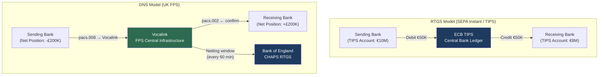
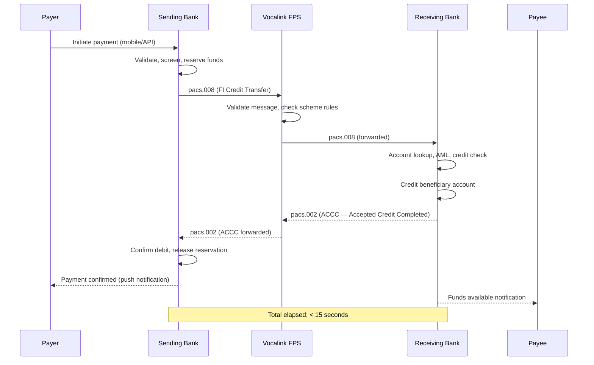

Real-time payments (RTP) have fundamentally changed consumer and business expectations: a payment that once took three days via BACS or one day via ACH now settles permanently in under 10 seconds around the clock, every day of the year. For the engineers building the systems that deliver this capability, real-time is not a marketing claim — it is a hard engineering constraint. Every network hop, every database round trip, every AML rule evaluation, and every account validation call must fit inside a strict latency budget. Schemes like UK Faster Payments (FPS), SEPA Instant Credit Transfer (SCT Inst), US RTP, and Brazil's PIX impose irrevocable credit that cannot be recalled once confirmed. Getting the architecture wrong means either refusing legitimate payments (high timeout rates, poor availability) or crediting fraud-induced payments that can never be recovered.

## Learning Objectives

- Compare the technical characteristics of UK FPS, SEPA Instant, US RTP, and Brazil PIX across latency, availability, value limits, and settlement model
- Explain what must happen inside a bank's systems within a 20-second payment window and why each step competes for time
- Distinguish real-time gross settlement (RTGS) from deferred net settlement (DNS) and explain which model each RTP scheme uses
- Implement a `FasterPaymentsGateway` class with a configurable per-request timeout, circuit breaker, and fallback to a slower payment rail
- Build a latency budget allocator that partitions the total scheme SLA across internal processing stages
- Explain why irrevocability is a design constraint, not just a business rule, and how it drives fraud architecture decisions
- Map pacs.008 fields to FPS ISO 20022 message requirements and implement scheme-specific validation
- Identify the participation requirements a bank must meet to connect to a real-time scheme and their engineering implications

## Business Context

In March 2024, a mid-tier UK bank's FPS gateway experienced a 47-minute degradation during which 98% of outbound Faster Payments were timing out at the scheme boundary. The root cause was a Redis cluster failover that caused the idempotency-key lookup to degrade from 2ms to 1,800ms per call. This single hop consumed the entire 15-second internal timeout budget, causing the gateway to return a timeout response to customers — but critically, some of those payments had already been forwarded to the scheme and were being processed. When engineers restarted the service, 2,340 payments were submitted a second time. Because the gateway had not properly set the pacs.028 (payment status request) deduplication tracking, 1,180 of those duplicate submissions resulted in double credits to beneficiaries. The total exposure was £4.2 million. The recovery involved three weeks of bilateral negotiations with counterparty banks and voluntary recovery requests to beneficiary customers. The incident was a direct consequence of not designing the latency budget with failure modes in mind: idempotency checks must be on the fastest possible path, not on a shared cache with a 30-second timeout.

## Real-Time Payment Scheme Comparison

| Feature | UK FPS | SEPA Instant (SCT Inst) | US RTP (TCH) | Brazil PIX |
|---------|--------|------------------------|--------------|------------|
| Launched | 2008 | 2017 | 2017 | 2020 |
| Availability | 24/7/365 | 24/7/365 | 24/7/365 | 24/7/365 |
| Scheme SLA | 15 seconds | 10 seconds | 10 seconds | 10 seconds |
| Max transaction | £1,000,000 | €100,000 | $1,000,000 | No limit (BRL) |
| Settlement model | Deferred net | TIPS (RTGS) | RTGS (TCH) | SPI (central bank RTGS) |
| Message standard | ISO 20022 | ISO 20022 | ISO 20022 | PIX (ISO 20022 derived) |
| Participation | Via direct or agency | Via TIPS or EBA STEP2-T | Direct or via aggregator | Mandatory for large banks |
| Irrevocable? | Yes | Yes | Yes | Yes |
| Alias/proxy support | Confirmation of Payee (CoP) | IBAN only | No native alias | PIX Keys (CPF/email/phone) |
| Recall mechanism | IBAN credit recall (2024) | SCT Inst recall | RTP Request for Return | PIX devolution (90 days) |

> [!NOTE]
> SEPA Instant settles via the ECB's TIPS (TARGET Instant Payment Settlement) infrastructure using real-time RTGS, meaning each payment settles in central bank money immediately. UK FPS uses deferred net settlement — positions are netted throughout the day and settled in CHAPS. This distinction matters for liquidity: a bank on TIPS must pre-fund a TIPS account; a bank on FPS must manage intraday net positions within agreed bilateral limits.

## The 20-Second Rule

The "20-second rule" (we use 15s for FPS specifically) refers to the total wall-clock time from when the payer's bank receives the payment instruction to when the beneficiary's bank has confirmed credit. Inside that window, the following must complete:

```mermaid
gantt
    title Faster Payments 15-Second Latency Budget (Sending Bank)
    dateFormat X
    axisFormat %Ss

    section Validation
    Schema & business rule validation :a1, 0, 1s
    Duplicate / idempotency check     :a2, 1, 2s

    section Screening
    Sanctions screening               :a3, 2, 4s
    Fraud scoring                     :a4, 4, 6s

    section Funds
    Account debit & funds reservation :a5, 6, 7s

    section Scheme
    Scheme submission (pacs.008)      :a6, 7, 9s
    Receiving bank processing         :a7, 9, 13s
    pacs.002 confirmation received    :a8, 13, 14s

    section Response
    Customer notification             :a9, 14, 15s
```



Each of those stages is a potential source of latency that engineers must control. A database round-trip that takes 50ms in isolation is acceptable; 10 database round-trips in series = 500ms, which is a material fraction of the budget.

The main latency contributors:

| Stage | Typical Target | Risk |
|-------|---------------|------|
| Input validation | < 5ms | Regex/JAXB overhead |
| Idempotency check | < 10ms | Cache miss → DB round trip |
| Sanctions screening | < 500ms | External service call |
| Fraud scoring | < 300ms | ML model inference |
| Account lookup + debit | < 50ms | DB lock contention |
| Scheme network round-trip | < 3s | SWIFT/Vocalink hop |
| Receiving bank processing | < 5s | External, uncontrollable |
| Confirmation + notify | < 100ms | Async notification |

> [!WARNING]
> Sanctions screening is the most dangerous latency wildcard. A synchronous call to an external screening service with a 2-second average and a p99 of 8 seconds will blow the entire scheme SLA on its own. Screening must be pre-computed (batch screening of known parties overnight) with a fast path for first-time counterparties. Never put a synchronous external HTTP call on the critical path of a real-time payment without a circuit breaker with a timeout well below 1 second.

## Interbank Settlement Model

**Real-Time Gross Settlement (RTGS):** Each payment settles individually and immediately in central bank money. The sending bank's TIPS/SPI account is debited and the receiving bank's account is credited atomically. There is no credit risk between banks. Requires pre-funded liquidity.

**Deferred Net Settlement (DNS):** Payments flow in real time to beneficiaries, but the interbank settlement (netting of positions) happens at pre-defined windows (e.g., every hour in FPS via CHAPS). Banks have bilateral net credit limits — if Bank A's net position against Bank B exceeds the limit, further payments are blocked. This model requires careful intraday liquidity monitoring.



## FasterPaymentsGateway Implementation

A production-grade FPS gateway must handle scheme timeouts, idempotency, circuit breaking, and fallback gracefully:

```java
import io.github.resilience4j.circuitbreaker.CircuitBreaker;
import io.github.resilience4j.circuitbreaker.CircuitBreakerConfig;
import io.github.resilience4j.timelimiter.TimeLimiter;
import io.github.resilience4j.timelimiter.TimeLimiterConfig;

import java.time.Duration;
import java.util.concurrent.CompletableFuture;
import java.util.concurrent.TimeoutException;

@Service
public class FasterPaymentsGateway {

    private static final Duration SCHEME_TIMEOUT  = Duration.ofSeconds(13);
    private static final Duration INTERNAL_BUDGET = Duration.ofSeconds(15);

    private final VocalinkSchemeClient schemeClient;
    private final IdempotencyStore idempotencyStore;
    private final BacsPaymentFallback bacsFallback;
    private final CircuitBreaker circuitBreaker;
    private final TimeLimiter timeLimiter;

    public FasterPaymentsGateway(VocalinkSchemeClient schemeClient,
                                  IdempotencyStore idempotencyStore,
                                  BacsPaymentFallback bacsFallback) {
        this.schemeClient    = schemeClient;
        this.idempotencyStore = idempotencyStore;
        this.bacsFallback    = bacsFallback;

        CircuitBreakerConfig cbConfig = CircuitBreakerConfig.custom()
                .failureRateThreshold(50)
                .waitDurationInOpenState(Duration.ofSeconds(30))
                .slidingWindowSize(20)
                .recordExceptions(SchemeTimeoutException.class, SchemeUnavailableException.class)
                .build();
        this.circuitBreaker = CircuitBreaker.of("fps-scheme", cbConfig);

        TimeLimiterConfig tlConfig = TimeLimiterConfig.custom()
                .timeoutDuration(SCHEME_TIMEOUT)
                .cancelRunningFuture(true)
                .build();
        this.timeLimiter = TimeLimiter.of("fps-timeout", tlConfig);
    }

    public PaymentResult submitPayment(FpsPaymentRequest request) {
        // Step 1: idempotency check — must be fastest possible path
        IdempotencyResult idempotency = idempotencyStore.checkAndReserve(request.endToEndId());
        if (idempotency.alreadyProcessed()) {
            return idempotency.previousResult();
        }

        // Step 2: attempt via scheme with circuit breaker + timeout
        try {
            PaymentResult result = circuitBreaker.executeCallable(
                () -> timeLimiter.executeFutureSupplier(
                    () -> CompletableFuture.supplyAsync(
                        () -> schemeClient.submit(buildPacs008(request))
                    )
                )
            );
            idempotencyStore.recordResult(request.endToEndId(), result);
            return result;

        } catch (TimeoutException ex) {
            // Scheme timeout — payment MAY have been received by scheme
            // We must NOT resubmit without querying status first
            log.warn("FPS scheme timeout for E2EId={}, querying status before fallback",
                     request.endToEndId());

            PaymentStatus status = querySchemeStatus(request.endToEndId());
            if (status == PaymentStatus.ACCC) {
                // Already credited — return success, do not fallback
                PaymentResult recovered = PaymentResult.alreadyCredited(request.endToEndId());
                idempotencyStore.recordResult(request.endToEndId(), recovered);
                return recovered;
            }
            return fallbackToBacs(request);

        } catch (CircuitBreakerOpenException ex) {
            log.warn("FPS circuit breaker open — routing to fallback rail");
            return fallbackToBacs(request);

        } catch (SchemeRejectionException ex) {
            // Permanent rejection — do not fallback, return error to customer
            PaymentResult rejection = PaymentResult.schemeRejected(ex.getReasonCode());
            idempotencyStore.recordResult(request.endToEndId(), rejection);
            return rejection;
        }
    }

    private PaymentResult fallbackToBacs(FpsPaymentRequest request) {
        // Notify customer that RTP is unavailable; offer BACS (T+1)
        log.info("Falling back to BACS for E2EId={}", request.endToEndId());
        return bacsFallback.submit(request);
    }

    private PaymentStatus querySchemeStatus(String endToEndId) {
        try {
            Pacs028StatusRequest statusReq = Pacs028StatusRequest.forEndToEndId(endToEndId);
            Pacs002StatusResponse response = schemeClient.requestStatus(statusReq);
            return mapStatusCode(response.getTxSts());
        } catch (Exception e) {
            log.error("Status query failed for E2EId={}", endToEndId, e);
            return PaymentStatus.UNKNOWN;
        }
    }
}
```

> [!NOTE]
> The fallback to BACS is a customer experience decision, not a technical requirement. Many schemes require the bank to inform the customer synchronously that the real-time payment could not be processed, then offer alternatives. Never silently resubmit a timed-out real-time payment as BACS without customer consent — the customer may have already retried manually, leading to a duplicate.

## End-to-End Faster Payments Sequence



## Irrevocability and Fraud Implications

Once a pacs.002 with status `ACCC` is received, the payment **cannot be unilaterally reversed**. This is a fundamental scheme rule, not a technical limitation. It means:

1. **Fraud must be stopped before submission.** Post-submission fraud controls (chargebacks, recalls) exist as bilateral negotiation processes (UK: CoP recall, SEPA: recall via camt.056), not guaranteed reversal mechanisms.

2. **Authorised push payment (APP) fraud** is the dominant threat model. The payer is tricked into authorising a legitimate payment to a fraudster-controlled account. By the time the payer reports fraud, the money has moved onward and the receiving bank may have no funds to return.

3. **Account validation (Confirmation of Payee / CoP)** at submission time is therefore a mandatory engineering control in UK FPS. The sending bank must confirm that the account name matches the account number before allowing the payment. SEPA Instant has the IBAN name check in development; PIX has alias-based verification.

```java
public class ConfirmationOfPayeeService {

    private final CopRegistryClient copClient;

    public CopResult verify(String sortCode, String accountNumber, String intendedName) {
        CopResponse response = copClient.verify(CopRequest.of(sortCode, accountNumber, intendedName));

        return switch (response.getMatchResult()) {
            case EXACT_MATCH       -> CopResult.proceed(MatchLevel.EXACT);
            case CLOSE_MATCH       -> CopResult.proceedWithWarning(MatchLevel.CLOSE,
                                        response.getActualName());
            case NO_MATCH          -> CopResult.block("Name does not match account holder");
            case BUSINESS_MATCH    -> CopResult.proceed(MatchLevel.BUSINESS);
            case ACCOUNT_NOT_FOUND -> CopResult.block("Account not found in CoP registry");
            case UNAVAILABLE       -> CopResult.continueWithoutVerification(); // degraded mode
        };
    }
}
```

> [!IMPORTANT]
> When CoP returns `UNAVAILABLE` (the registry service is down), UK FPS rules permit proceeding without verification, but your system **must log this as a degraded check** and flag the payment for enhanced post-settlement monitoring. Never treat CoP unavailability as a silent pass — it must be an observable event in your monitoring stack.

## ISO 20022 pacs.008 for FPS

FPS adopted ISO 20022 in 2023 as part of the New Payments Architecture (NPA) programme. FPS-specific mandatory fields beyond base pacs.008 CBPR+ requirements:

| Element | FPS Requirement | Notes |
|---------|----------------|-------|
| `PmtTpInf/LclInstrm/Cd` | `FPS` | Identifies FPS as the scheme |
| `EndToEndId` | Must not be `NOTPROVIDED` | Scheme enforced |
| `Dbtr/PstlAdr/Ctry` | Mandatory | GB for domestic |
| `DbtrAcct/Id/Othr/SchmeNm/Cd` | `BBAN` for sort code / account | UK account format |
| `CdtrAcct/Id/Othr/SchmeNm/Cd` | `BBAN` | UK account format |
| `SttlmMtd` | `CLRG` | Clearing (Vocalink) settlement |
| `IntrBkSttlmAmt Ccy` | `GBP` | FPS is GBP only |

A Java builder for FPS-compliant pacs.008:

```java
public class FpsPacs008Builder {

    public Document build(FpsPaymentRequest req) {
        Document doc = new Document();
        FIToFICustomerCreditTransferV10 msg = new FIToFICustomerCreditTransferV10();

        // Group header
        GroupHeader96 hdr = new GroupHeader96();
        hdr.setMsgId(req.messageId());
        hdr.setCreDtTm(toXmlGregorianCalendar(OffsetDateTime.now()));
        hdr.setNbOfTxs("1");
        hdr.setCtrlSum(req.amount());
        SettlementInstruction11 sttlm = new SettlementInstruction11();
        sttlm.setSttlmMtd(SettlementMethod1Code.CLRG);
        hdr.setSttlmInf(sttlm);
        msg.setGrpHdr(hdr);

        // Credit transfer transaction
        CreditTransferTransaction62 tx = new CreditTransferTransaction62();
        PaymentIdentification7 pmtId = new PaymentIdentification7();
        pmtId.setInstrId(req.instructionId());
        pmtId.setEndToEndId(req.endToEndId());
        pmtId.setUETR(req.uetr());
        tx.setPmtId(pmtId);

        // FPS local instrument
        PaymentTypeInformation28 pmtTp = new PaymentTypeInformation28();
        LocalInstrument2Choice lcl = new LocalInstrument2Choice();
        lcl.setCd("FPS");
        pmtTp.setLclInstrm(lcl);
        tx.setPmtTpInf(pmtTp);

        // Settlement amount in GBP
        ActiveCurrencyAndAmount amt = new ActiveCurrencyAndAmount();
        amt.setCcy("GBP");
        amt.setValue(req.amount());
        tx.setIntrBkSttlmAmt(amt);
        tx.setIntrBkSttlmDt(toXmlGregorianCalendar(req.settlementDate()));

        tx.setChrgBr(ChargeBearerType3Code.SLEV); // FPS: service level charges

        // Debtor
        tx.setDbtr(buildParty(req.debtorName(), "GB"));
        tx.setDbtrAcct(buildUkAccount(req.debtorSortCode(), req.debtorAccountNumber()));
        tx.setDbtrAgt(buildAgent(req.debtorBic()));

        // Creditor
        tx.setCdtr(buildParty(req.creditorName(), "GB"));
        tx.setCdtrAcct(buildUkAccount(req.creditorSortCode(), req.creditorAccountNumber()));
        tx.setCdtrAgt(buildAgent(req.creditorBic()));

        msg.getCdtTrfTxInf().add(tx);
        doc.setFIToFICstmrCdtTrf(msg);
        return doc;
    }

    private CashAccount40 buildUkAccount(String sortCode, String accountNumber) {
        CashAccount40 acct = new CashAccount40();
        AccountIdentification4Choice id = new AccountIdentification4Choice();
        GenericAccountIdentification1 othr = new GenericAccountIdentification1();
        othr.setId(sortCode + accountNumber); // 6-digit sort code + 8-digit account
        GenericFinancialIdentification1 schme = new GenericFinancialIdentification1();
        schme.setCd("BBAN");
        // set scheme name
        id.setOthr(othr);
        acct.setId(id);
        return acct;
    }
}
```

## Latency Budget Breakdown

Latency budget management is an architectural discipline. The total SLA (15s for FPS) must be allocated across every component on the critical path, with margin for variance:

| Component | Budget Allocation | p50 Target | p99 Target | Failure Mode |
|-----------|------------------|------------|------------|--------------|
| Input parsing + validation | 50ms | 5ms | 30ms | Reject immediately |
| Idempotency check (Redis) | 20ms | 2ms | 15ms | DB fallback (100ms) |
| Sanctions pre-screening | 500ms | 100ms | 400ms | Block on cache miss |
| Fraud real-time scoring | 400ms | 150ms | 350ms | Use cached score if stale < 5min |
| Account debit + DB write | 100ms | 20ms | 80ms | Retry once then fail |
| Scheme network (send) | 500ms | 200ms | 450ms | — |
| Scheme processing + receive bank | 7,000ms | 3,000ms | 6,500ms | External — uncontrollable |
| pacs.002 parse + confirm | 50ms | 5ms | 30ms | — |
| Customer notification | 200ms | 50ms | 150ms | Async — non-blocking |
| **Total (serial critical path)** | **~9s** | — | — | 6s margin for jitter |

Maintaining p99 within budget requires: connection pooling on all external calls, pre-warmed JVM (no cold start on critical path), Redis sentinel or cluster with no single point of failure, and async customer notification (do not block on push notification delivery).

## Knowledge Check

**Q1: Your FPS gateway has a 13-second timeout for the scheme round-trip. A payment times out at second 13 and you have no pacs.002 response. Your fallback logic immediately submits the same payment to BACS. The next day you discover the FPS payment was processed successfully — the pacs.002 was delivered at second 13.5, after your timeout fired. What is the customer impact and what engineering control would have prevented it?**

A: The customer received a double payment: the beneficiary was credited once via FPS (£X) and once via BACS (£X). The debtor was debited twice. The engineering control that prevents this is a **status inquiry before fallback**: on FPS timeout, the gateway must issue a pacs.028 (Payment Status Request) to Vocalink and wait for a pacs.002 response before deciding to fallback. If pacs.002 returns `ACCC`, suppress the fallback entirely. Only if status is `RJCT` or if the status request itself times out should a fallback be considered — and in the latter case, the payment should be held for manual review rather than auto-routed to another rail. Additionally, the idempotency store must record the original FPS endToEndId as "in-flight" so that any BACS submission with the same reference is rejected as a duplicate.

**Q2: A receiving bank's FPS processing takes 8 seconds on average but spikes to 14 seconds at p99 during peak hours. The scheme SLA is 15 seconds total. The sending bank consumes 4 seconds on its own processing. Is this arrangement within SLA, and what can the sending bank do if it regularly observes 15-second total round-trip times even when its own processing is 3 seconds?**

A: The arrangement is at risk. 4 seconds (sending bank) + 8 seconds average (receiving bank) = 12 seconds, leaving only 3 seconds for scheme routing overhead. At p99, 4 + 14 = 18 seconds, which exceeds the 15-second SLA. The sending bank cannot control the receiving bank's internal processing, but it can: (1) monitor per-counterparty latency and report persistent SLA breaches to the scheme operator (Vocalink), which has the authority to sanction non-compliant participants; (2) adjust its own processing budget dynamically — if scheme routing overhead is known to be low, the sending bank can trade some of its 4-second budget for scheme monitoring; (3) pre-emptively alert customers when paying to known slow counterparties that the payment may exceed the standard SLA. Ultimately, scheme SLA compliance is a bilateral obligation enforced by the scheme operator, not achievable by one participant alone.

## Practical Challenge

1. **Latency instrumentation:** Instrument `FasterPaymentsGateway` with Micrometer timers for each processing stage (validation, idempotency check, sanctions, fraud, account debit, scheme call). Configure a `LatencyBudgetMonitor` that fires a `LATENCY_BUDGET_EXCEEDED` alert if the scheme call stage exceeds its 500ms allocation, and a `TOTAL_SLA_BREACH` alert if the full payment round-trip exceeds 14 seconds (1 second below scheme SLA). Write a test using `MockClock` and `Mockito` that simulates each stage taking its p99 value and asserts that alerts are triggered correctly.

2. **Idempotency store:** Implement `RedisIdempotencyStore` using Spring Data Redis. The store must: atomically set a key (endToEndId → `IN_FLIGHT`) with a 30-second TTL using `SET NX EX`; on completion, update the key to the final result with a 24-hour TTL; on cache miss (Redis unavailable), fall back to a PostgreSQL table with an advisory lock. Write an integration test using Testcontainers (Redis + PostgreSQL) that verifies that two concurrent submissions of the same endToEndId result in exactly one scheme call.

3. **Confirmation of Payee integration:** Build a `CopEnrichedPaymentValidator` that wraps `ConfirmationOfPayeeService` and enforces the following policy: `EXACT_MATCH` → proceed; `CLOSE_MATCH` → proceed but require explicit customer confirmation flag in the request; `NO_MATCH` → reject with reason code `ACMT03` (account name mismatch); `UNAVAILABLE` → proceed but set `degradedCopCheck=true` on the payment record. Write parameterized JUnit 5 tests for all five `MatchLevel` values.

4. **FPS scheme simulator:** Build a lightweight Spring Boot test server that exposes a `/fps/submit` endpoint accepting pacs.008 XML and returning a pacs.002 XML response. The simulator should: validate the pacs.008 schema; return `ACCC` for valid payments within a configurable delay (default 2s); return `RJCT` with reason `AC01` (invalid account) for accounts ending in `9999`; return a timeout (delayed response beyond 13s) for payments with `EndToEndId` starting with `TIMEOUT-`. Use this simulator in an integration test suite for `FasterPaymentsGateway` to validate the timeout, circuit breaker, and fallback flows without connecting to Vocalink.

<!-- KNOWLEDGE-CHECK
{
  "questions": [
    {
      "text": "Your FPS gateway times out at 13 seconds with no pacs.002 response, then immediately submits the same payment to BACS. The next day you discover the FPS payment was processed successfully — the pacs.002 arrived at 13.5 seconds. What was the customer impact?",
      "options": [
        "No impact — BACS would detect the duplicate and reject it",
        "The customer was debited twice and the beneficiary was credited twice",
        "The FPS payment was automatically reversed when the BACS payment settled",
        "The BACS payment was rejected due to insufficient funds"
      ],
      "correct": 1,
      "explanation": "The customer received a double payment: the beneficiary was credited once via FPS and once via BACS. The debtor was debited twice. The correct control is to issue a pacs.028 (Payment Status Request) on FPS timeout before deciding to fallback, only falling back if status is `RJCT` or if the status request itself times out."
    },
    {
      "text": "What is the total FPS scheme SLA for a payment, and what does it mean for a sending bank that itself consumes 4 seconds of processing?",
      "options": [
        "30 seconds total; the sending bank has 26 seconds remaining",
        "15 seconds total; only 11 seconds remain for scheme routing and receiving bank processing",
        "5 seconds total; the sending bank is already over its budget",
        "60 seconds total; there is plenty of headroom"
      ],
      "correct": 1,
      "explanation": "The FPS scheme SLA is 15 seconds total. With the sending bank consuming 4 seconds, only 11 seconds remain for scheme routing overhead and the receiving bank's internal processing. At p99, a receiving bank taking 14 seconds would cause total round-trip of 4 + 14 = 18 seconds, breaching the SLA."
    },
    {
      "text": "What does the Confirmation of Payee (CoP) service return when the name provided matches the account holder's name exactly?",
      "options": [
        "PARTIAL_MATCH",
        "EXACT_MATCH",
        "VERIFIED",
        "NAME_CONFIRMED"
      ],
      "correct": 1,
      "explanation": "CoP returns `EXACT_MATCH` when the name provided by the payer matches the name registered to the account exactly. The five possible results are: EXACT_MATCH (proceed), CLOSE_MATCH (require confirmation), NO_MATCH (reject with ACMT03), UNAVAILABLE (proceed with degraded flag), and ACCOUNT_DOES_NOT_EXIST."
    }
  ]
}
-->

<!-- PRACTICAL-CHALLENGE
{
  "title": "FPS Gateway Latency Instrumentation and Idempotency",
  "difficulty": "advanced",
  "estimatedMinutes": 45,
  "tasks": [
    {
      "id": "1",
      "description": "Instrument `FasterPaymentsGateway` with Micrometer timers for each processing stage (validation, idempotency check, sanctions, fraud, account debit, scheme call). Configure a `LatencyBudgetMonitor` that fires `LATENCY_BUDGET_EXCEEDED` if the scheme call stage exceeds 500ms and `TOTAL_SLA_BREACH` if the full round-trip exceeds 14 seconds. Write a test using `MockClock` and `Mockito` that simulates each stage at its p99 value."
    },
    {
      "id": "2",
      "description": "Implement `RedisIdempotencyStore` using Spring Data Redis. Atomically set a key (endToEndId → `IN_FLIGHT`) with a 30-second TTL using `SET NX EX`; on completion, update with final result and 24-hour TTL; on Redis unavailable, fall back to PostgreSQL with advisory lock. Write an integration test using Testcontainers (Redis + PostgreSQL) verifying two concurrent submissions result in exactly one scheme call."
    },
    {
      "id": "3",
      "description": "Build a `CopEnrichedPaymentValidator` wrapping `ConfirmationOfPayeeService` enforcing: `EXACT_MATCH` → proceed; `CLOSE_MATCH` → proceed but require explicit customer confirmation flag; `NO_MATCH` → reject with `ACMT03`; `UNAVAILABLE` → proceed with `degradedCopCheck=true`. Write parameterized JUnit 5 tests for all five `MatchLevel` values."
    },
    {
      "id": "4",
      "description": "Build a lightweight Spring Boot FPS scheme simulator that exposes `/fps/submit` accepting pacs.008 XML and returning pacs.002. Return `ACCC` after a configurable delay (default 2s), `RJCT` with `AC01` for accounts ending in `9999`, and a timeout for `EndToEndId` starting with `TIMEOUT-`. Use in integration tests to validate timeout, circuit breaker, and fallback flows."
    }
  ]
}
-->
