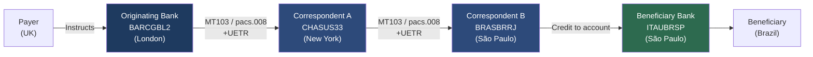
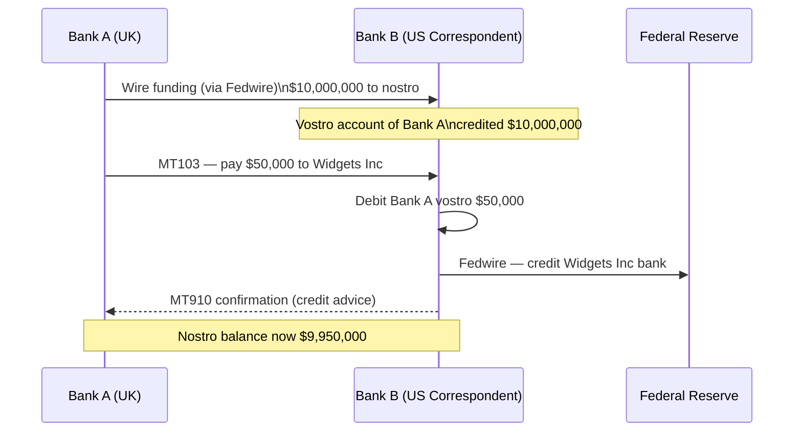
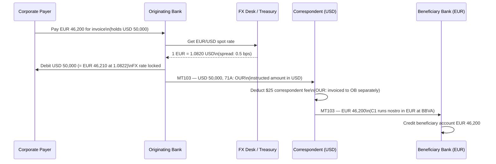
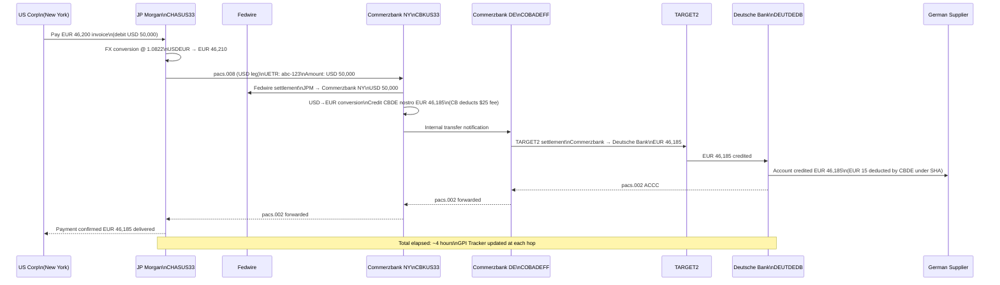
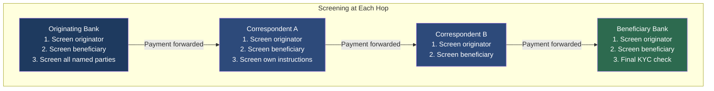

Cross-border payments — moving money from an account in one country to an account in another — are among the most complex operations in finance. Unlike domestic payments that run on a single clearing infrastructure, international transfers traverse chains of banks connected by bilateral correspondent relationships, each applying its own fees, exchange rates, and compliance controls. Despite representing only a fraction of total payment volume, cross-border payments generate a disproportionate share of operational complexity, regulatory scrutiny, and customer complaints. The G20 roadmap targets cross-border payments that are faster than 1 hour (by 2027), cheaper than 1% of transaction value (by 2030), more transparent (real-time tracking), and more accessible to unbanked populations. Engineers building the systems that process these payments must understand the full chain: from correspondent routing selection through nostro account management, FX conversion, charge deduction, to sanctions screening at every node.

## Learning Objectives

- Trace a cross-border payment through a multi-leg correspondent banking chain and identify what each participant does
- Explain the difference between nostro and vostro accounts and describe how netting reduces liquidity requirements
- Extract the UETR from a SWIFT GPI message, query the GPI Tracker, and interpret the g4c status fields to determine whether a payment has been credited within SLA
- Calculate the net beneficiary amount for each of the three charge-bearer options (SHA, OUR, BEN) given a correspondent fee schedule
- Identify where in the payment chain FX conversion typically occurs and explain the spread and rate-fixing mechanics
- Implement a `CorrespondentPaymentRouter` that selects the optimal routing path given correspondent relationships, fee schedules, and latency data
- Explain why SEPA can bypass the correspondent chain for intra-EU EUR payments and calculate the cost saving
- Describe the layered sanctions screening model (originator bank, correspondent, beneficiary bank) and the engineering implication of a mid-chain match

## Business Context

In Q2 2023, a European mid-market bank analysed its cross-border payment cost structure following a client complaint campaign. The bank processed 180,000 USD-denominated cross-border payments per month on behalf of SME clients. Average transaction value was €22,000. The bank discovered that 34% of payments were routing through three correspondent hops when two hops were technically available — because the routing table had not been updated for 18 months and several bilateral corridors established with two new correspondent partners had never been activated in the payment engine. The three-hop route charged $45–$55 per payment in correspondent fees; the two-hop route charged $18–$24. The unnecessary overpayment was costing clients approximately $4.3 million per year in excess charges, and the bank was absorbing $1.1 million of that to stay competitive on advertised FX rates. Additionally, 2,100 payments per month were arriving at beneficiaries with deductions that customers had not expected (SHA charges applied mid-chain by intermediaries), triggering 800–900 manual customer service enquiries per month at a cost of $65 per enquiry. This lesson teaches you to build a routing engine and charge calculator that makes these costs visible and controllable.

## Correspondent Banking Chain

A **correspondent banking relationship** is a contractual arrangement under which Bank A (the respondent) uses Bank B (the correspondent) to access financial services in markets where Bank A has no direct presence. The correspondent typically holds funds on behalf of the respondent in a nostro/vostro account structure.

For a payment from a UK company to a beneficiary in Brazil, the chain might be:



Each hop involves:
1. Receipt of the payment instruction (MT103 or pacs.008)
2. Sanctions screening of originator, beneficiary, and all named parties
3. Deduction of correspondent charges (unless OUR was specified)
4. Possibly FX conversion (if running in a different currency corridor)
5. Forwarding the instruction to the next hop or crediting the final account
6. Updating the GPI Tracker with the new status

> [!NOTE]
> The number of hops in a corridor is determined by the existence of bilateral correspondent relationships and central bank access rules. Direct USD clearing requires membership of CHIPS (US) or Fedwire. Direct EUR clearing requires access to TARGET2/TIPS or EBA EURO1/STEP2. Banks without direct access must route through a correspondent that has it. Acquiring direct access is expensive (minimum reserve requirements, compliance infrastructure, local legal entity) — many smaller banks rationally remain indirect participants.

## Nostro and Vostro Account Mechanics

**Nostro account:** An account held by Bank A at Bank B in Bank B's home currency. From Bank A's perspective: "our money held at your bank." Bank A uses this to fund outbound payments in that currency without foreign exchange at the time of each payment.

**Vostro account:** The same account from Bank B's perspective: "your money held at our bank."

The funding cycle:



**Netting** reduces the amount of pre-funding required. If Bank A sends 500 payments per day averaging $20,000 each = $10M outbound, but also receives $8M inbound through the same corridor, only the $2M net needs to be settled. Banks manage nostro accounts actively, sweeping excess balances and topping up when balances fall below minimum thresholds.

A Java nostro balance manager:

```java
@Service
public class NostroBalanceManager {

    private static final BigDecimal MINIMUM_BUFFER_MULTIPLIER = new BigDecimal("1.20");

    private final NostroAccountRepository nostroRepo;
    private final FundingTransferService fundingService;
    private final AlertService alertService;

    public FundingDecision checkAndFund(String nostroAccountId, BigDecimal paymentAmount) {
        NostroAccount account = nostroRepo.findById(nostroAccountId)
            .orElseThrow(() -> new NostroAccountNotFoundException(nostroAccountId));

        BigDecimal availableBalance  = account.getBalance().subtract(account.getReservedAmount());
        BigDecimal minimumRequired   = account.getDailyThreshold().multiply(MINIMUM_BUFFER_MULTIPLIER);

        if (availableBalance.compareTo(paymentAmount) < 0) {
            alertService.criticalAlert("NOSTRO_INSUFFICIENT_FUNDS",
                Map.of("account", nostroAccountId,
                       "available", availableBalance,
                       "required", paymentAmount));
            return FundingDecision.INSUFFICIENT;
        }

        BigDecimal postPaymentBalance = availableBalance.subtract(paymentAmount);
        if (postPaymentBalance.compareTo(minimumRequired) < 0) {
            // Trigger pre-emptive top-up — do not block payment
            BigDecimal topUpAmount = account.getStandardTopUpAmount();
            fundingService.scheduleTopUp(nostroAccountId, topUpAmount, Urgency.SAME_DAY);
            alertService.info("NOSTRO_TOPUP_TRIGGERED",
                Map.of("account", nostroAccountId, "topUpAmount", topUpAmount));
        }

        return FundingDecision.PROCEED;
    }
}
```

## SWIFT GPI and UETR Tracking

SWIFT GPI is an overlay service on the existing SWIFT MT/MX network. Every GPI payment carries a **UETR (Unique End-to-end Transaction Reference)** — a UUID v4 — that travels unchanged through the entire correspondent chain. Each bank in the chain is contractually required to update the **GPI Tracker** within defined SLA windows.

GPI status codes:

| Code | Meaning | Action Required |
|------|---------|----------------|
| `ACSP` | Accepted, Settlement in Process | None — payment in transit |
| `ACCC` | Accepted, Credit Completed | Payment delivered — final state |
| `RJCT` | Rejected | Investigate reason code, return funds |
| `PDNG` | Pending | Awaiting compliance clearance |
| `PART` | Partial | Partial credit (rare, bilateral agreement) |

GPI also carries **g4c (gpi for corporates) fields** that expose tracking data to corporate customers via their bank's APIs — balance of charges deducted so far, FX rates applied, and the name of each bank that processed the payment.

```java
@Service
public class GpiPaymentTracker {

    private final SwiftTrackerApiClient trackerClient;
    private final PaymentRepository paymentRepo;

    public TrackingReport getTrackingReport(String uetr) {
        GpiTrackerResponse response = trackerClient.getTransaction(uetr);

        List<ProcessingStep> steps = response.getTransactionStatusDetails()
            .stream()
            .sorted(Comparator.comparing(GpiStatusDetail::getStatusTimestamp))
            .map(detail -> ProcessingStep.builder()
                .bankBic(detail.getFromBic())
                .status(detail.getTransactionStatus())
                .statusTimestamp(detail.getStatusTimestamp())
                .chargesDeducted(detail.getChargesInformation() != null
                    ? detail.getChargesInformation().stream()
                        .map(c -> new ChargeDeduction(c.getCurrency(), c.getAmount()))
                        .toList()
                    : List.of())
                .fxRate(detail.getExchangeRate())
                .build())
            .toList();

        boolean withinSla = isWithinGpiSla(steps);
        return new TrackingReport(uetr, steps, withinSla);
    }

    private boolean isWithinGpiSla(List<ProcessingStep> steps) {
        // GPI SLA: credited within business day for 75% of payments, within 30 min for 25%
        return steps.stream()
            .filter(s -> "ACCC".equals(s.status()))
            .findFirst()
            .map(s -> {
                ProcessingStep firstStep = steps.get(0);
                Duration elapsed = Duration.between(
                    firstStep.statusTimestamp(), s.statusTimestamp());
                return elapsed.toHours() < 24;
            })
            .orElse(false);
    }

    public void markSlaBreached(String uetr, String lastKnownBic) {
        paymentRepo.updateStatus(uetr, PaymentStatus.SLA_BREACHED);
        alertService.escalate("GPI_SLA_BREACH",
            Map.of("uetr", uetr, "lastKnownBic", lastKnownBic));
    }
}
```

> [!IMPORTANT]
> GPI SLA compliance is monitored by SWIFT, and consistent SLA breaches can result in a bank's GPI member status being reviewed. If your bank is a correspondent that frequently processes inbound GPI payments late, this damages your correspondent relationships. Build monitoring that tracks your p50 and p99 GPI processing times by currency corridor and alerts when either metric degrades.

## Charge Deduction: SHA, OUR, BEN

The charge-bearer instruction in field 71A (MT103) or `ChrgBr` (pacs.008) determines who absorbs correspondent fees across the chain:

| Code | MT103 | pacs.008 | Meaning |
|------|-------|----------|---------|
| SHA | 71A: SHA | SHAR | Sending bank charges borne by sender; intermediary and receiving bank charges borne by beneficiary (amount reduced) |
| OUR | 71A: OUR | DEBT | All charges borne by sender; beneficiary receives full instructed amount |
| BEN | 71A: BEN | CRED | All charges borne by beneficiary (unusual in practice) |

Under SHA (the most common), the beneficiary receives the instructed amount **minus** any charges deducted by correspondents along the chain. This can surprise beneficiaries who expect the full invoice amount.

```java
public class CorrespondentChargeCalculator {

    private final CorrespondentFeeScheduleRepository feeRepo;

    public ChargeCalculationResult calculate(PaymentInstruction payment,
                                              List<String> correspondentChain) {
        BigDecimal instructedAmount  = payment.getAmount();
        BigDecimal totalCharges      = BigDecimal.ZERO;
        List<ChargeDeduction> deductions = new ArrayList<>();

        for (String correspondentBic : correspondentChain) {
            CorrespondentFeeSchedule schedule = feeRepo.findByBic(correspondentBic)
                .orElseThrow(() -> new UnknownCorrespondentException(correspondentBic));

            BigDecimal fee = calculateFee(schedule, instructedAmount, payment.getCurrency());

            if (payment.getChargeBearer() == ChargeBearer.SHARED) {
                // SHA: each correspondent deducts from the payment amount
                totalCharges = totalCharges.add(fee);
                deductions.add(new ChargeDeduction(correspondentBic, fee, payment.getCurrency()));

            } else if (payment.getChargeBearer() == ChargeBearer.SENDER) {
                // OUR: correspondent invoices the sender's bank separately; amount unchanged
                deductions.add(new ChargeDeduction(correspondentBic, fee, payment.getCurrency(),
                                                    ChargeRoute.INVOICE_SENDER));
            }
            // BEN: same as SHA but sender's bank charges also added to deductions
        }

        BigDecimal beneficiaryAmount = payment.getChargeBearer() == ChargeBearer.SHARED
            ? instructedAmount.subtract(totalCharges)
            : instructedAmount;

        return new ChargeCalculationResult(instructedAmount, beneficiaryAmount, totalCharges, deductions);
    }

    private BigDecimal calculateFee(CorrespondentFeeSchedule schedule,
                                    BigDecimal amount, String currency) {
        // Typically: flat fee + percentage, with min/max caps
        BigDecimal percentageFee = amount.multiply(schedule.getPercentageRate())
            .setScale(2, RoundingMode.HALF_UP);
        BigDecimal totalFee = schedule.getFlatFee().add(percentageFee);
        return totalFee.max(schedule.getMinFee()).min(schedule.getMaxFee());
    }
}
```

## FX Conversion in the Payment Chain

Foreign exchange conversion can happen at different points in a cross-border payment chain:

1. **At the originating bank:** The sending customer's bank converts at the time of instruction. The customer sees the FX rate upfront. Simplest model for the customer.

2. **At the beneficiary bank:** The receiving bank converts when crediting the final account. The rate is not known at initiation, creating uncertainty for the beneficiary. Common in developing market corridors.

3. **At a correspondent:** A USD-correspondent receiving a GBP instruction converts to USD before forwarding. The FX spread is embedded in the correspondent's conversion and may not be disclosed transparently.

The **FX rate lifecycle** in a cross-border payment:



> [!WARNING]
> When a correspondent converts currency mid-chain, the **fx rate and spread are not disclosed** to the originating bank or customer unless SWIFT GPI g4c fields are populated. Under SHA, the FX conversion by an intermediary can result in a beneficiary receiving significantly less than expected if the correspondent uses an unfavourable rate. Regulators (EBA for EU, FCA for UK) require payment service providers to disclose all costs and exchange rates before execution. Build your charge calculation layer to consume GPI g4c fields and surface mid-chain FX rates in your pre-payment fee disclosure.

## CorrespondentPaymentRouter

A routing engine selects the optimal chain of correspondents for a given payment based on currency corridor, registered bilateral relationships, fee schedules, and latency SLAs:

```java
@Service
public class CorrespondentPaymentRouter {

    private final CorrespondentRelationshipRepository relationships;
    private final CorrespondentFeeScheduleRepository fees;
    private final CorrespondentLatencyRepository latency;

    public RoutingResult route(PaymentInstruction payment) {
        String sourceCurrency   = payment.getDebtorCurrency();
        String targetCurrency   = payment.getCreditorCurrency();
        String targetCountry    = payment.getCreditorCountry();

        // Check for SEPA eligibility first (cheapest path)
        if (isSepaEligible(sourceCurrency, targetCurrency, targetCountry)) {
            return RoutingResult.sepa(buildSepaInstruction(payment));
        }

        List<CorrespondentChain> candidates = relationships
            .findChainsForCorridor(sourceCurrency, targetCurrency, targetCountry);

        if (candidates.isEmpty()) {
            throw new NoCorrespondentRouteException(
                "No correspondent route for " + sourceCurrency + " → " +
                targetCurrency + " to " + targetCountry);
        }

        // Score each candidate chain
        CorrespondentChain optimal = candidates.stream()
            .map(chain -> new ScoredChain(chain, scoreChain(chain, payment)))
            .min(Comparator.comparingDouble(ScoredChain::score))
            .map(ScoredChain::chain)
            .orElseThrow();

        return RoutingResult.correspondent(optimal, buildRoutingHeaders(payment, optimal));
    }

    private double scoreChain(CorrespondentChain chain, PaymentInstruction payment) {
        // Weighted score: lower is better
        double totalFeeUsd = chain.getHops().stream()
            .mapToDouble(hop -> estimateFeeUsd(hop, payment.getAmount(), payment.getDebtorCurrency()))
            .sum();

        double p99LatencySeconds = chain.getHops().stream()
            .mapToDouble(hop -> latency.getP99LatencySeconds(hop.getBic()))
            .sum();

        double hopCountPenalty = chain.getHops().size() * 10.0; // prefer fewer hops

        double feesWeight    = 0.60;
        double latencyWeight = 0.30;
        double hopWeight     = 0.10;

        return (totalFeeUsd   * feesWeight) +
               (p99LatencySeconds * latencyWeight * 5) +
               (hopCountPenalty  * hopWeight);
    }

    private boolean isSepaEligible(String srcCcy, String tgtCcy, String tgtCountry) {
        return "EUR".equals(srcCcy) && "EUR".equals(tgtCcy) &&
               SepaCountries.SEPA_ZONE.contains(tgtCountry);
    }
}
```

## Three-Leg USD → EUR Cross-Border Payment

A complete trace of a USD-to-EUR payment from a US corporate to a German supplier:



## SEPA for Intra-EU Payments

The Single Euro Payments Area (SEPA) created a unified payment infrastructure for EUR transactions across 36 European countries. For intra-EU EUR payments, SEPA eliminates the need for a correspondent chain entirely:

| Feature | Via Correspondent | Via SEPA SCT |
|---------|------------------|-------------|
| Number of hops | 2–4 | 1 (direct) |
| Typical fees | $15–$45 | €0.00–€0.50 |
| Settlement | Same/next day | T+1 (SCT) or <10s (SCT Inst) |
| Transparency | Limited (no GPI on old MT) | End-to-end pacs.002 |
| Coverage | 200+ countries | 36 SEPA countries, EUR only |

The routing engine must check SEPA eligibility before considering correspondent chains. For a EUR payment from France to Poland, SEPA SCT Instant is cheaper, faster, and more transparent than any correspondent chain.

```java
public class SepaEligibilityChecker {

    private static final Set<String> SEPA_COUNTRIES = Set.of(
        "AT","BE","BG","CY","CZ","DE","DK","EE","ES","FI","FR","GR","HR","HU",
        "IE","IT","LT","LU","LV","MT","NL","PL","PT","RO","SE","SI","SK",
        "IS","LI","NO","CH","GB","MC","SM","VA","AD"
    );

    public SepaEligibility check(PaymentInstruction payment) {
        if (!"EUR".equals(payment.getCreditorCurrency())) {
            return SepaEligibility.NOT_ELIGIBLE_CURRENCY;
        }
        if (!SEPA_COUNTRIES.contains(payment.getCreditorCountry())) {
            return SepaEligibility.NOT_ELIGIBLE_COUNTRY;
        }
        if (!isValidIban(payment.getCreditorAccount())) {
            return SepaEligibility.NOT_ELIGIBLE_NO_IBAN;
        }
        // Check creditor BIC is reachable on STEP2 / TIPS
        if (!sepaReachabilityRegistry.isReachable(payment.getCreditorBic())) {
            return SepaEligibility.NOT_ELIGIBLE_NOT_REACHABLE;
        }
        return payment.isUrgent()
            ? SepaEligibility.ELIGIBLE_INSTANT
            : SepaEligibility.ELIGIBLE_STANDARD;
    }
}
```

## Sanctions Screening at Each Hop

Every bank in the correspondent chain independently screens the payment against sanctions lists (OFAC, EU, UN, UK HMT). This creates a multi-layer screening architecture with important engineering implications:



A match at any hop triggers a **hold** on the payment. The holding bank must freeze funds, file a Suspicious Activity Report (SAR) or equivalent, and notify the sending bank (via MT299 / camt.056) that the payment cannot proceed. The originating bank must then:

1. Notify the payer that the payment is blocked
2. Return the funds (if already debited)
3. Avoid "tipping off" the subject of the screening match (a legal prohibition in most jurisdictions)

```java
@Service
public class SanctionsScreeningService {

    private final SanctionsListRepository sanctionsRepo;
    private final FuzzyNameMatcher nameMatcher;
    private final AuditLogger auditLogger;

    public ScreeningResult screen(PaymentInstruction payment) {
        List<ScreeningEntity> entitiesToScreen = List.of(
            ScreeningEntity.of(payment.getDebtorName(), payment.getDebtorCountry(), EntityType.PARTY),
            ScreeningEntity.of(payment.getCreditorName(), payment.getCreditorCountry(), EntityType.PARTY),
            ScreeningEntity.ofAccount(payment.getCreditorAccount(), payment.getCreditorCountry())
        );

        for (ScreeningEntity entity : entitiesToScreen) {
            List<SanctionsMatch> matches = sanctionsRepo.search(entity.getName())
                .stream()
                .filter(candidate -> nameMatcher.score(entity.getName(), candidate.getName()) > 0.85)
                .filter(candidate -> countryMatches(entity.getCountry(), candidate.getJurisdiction()))
                .toList();

            if (!matches.isEmpty()) {
                auditLogger.logHit(payment.getUetr(), entity, matches);
                return ScreeningResult.hit(entity, matches, ScreeningAction.HOLD_FOR_REVIEW);
            }
        }

        auditLogger.logClear(payment.getUetr(), entitiesToScreen.size());
        return ScreeningResult.clear();
    }

    private boolean countryMatches(String paymentCountry, String sanctionJurisdiction) {
        // "GLOBAL" sanctions apply regardless of country
        if ("GLOBAL".equals(sanctionJurisdiction)) return true;
        return sanctionJurisdiction.equals(paymentCountry);
    }
}
```

> [!WARNING]
> Sanctions screening false positives — legitimate payments flagged due to name similarity — are costly and damage customer relationships. A match threshold of 0.85 on fuzzy name matching will produce false positives for common names in certain languages (e.g., "Mohammed", "Wang"). Build a **whitelist/trusted counterparty registry** for pre-screened relationships and a **human review workflow** for fuzzy matches that fall in the 0.75–0.95 range. Auto-block only clear exact matches or confirmed list hits.

## Knowledge Check

**Q1: A corporate customer requests a USD 100,000 payment to a beneficiary in India with charge bearer SHA. Your correspondent fee schedule shows: Correspondent A (US) = $30 flat + 0.02%, Correspondent B (UAE) = $20 flat + 0.015%, and the Indian beneficiary bank charges INR 500 (approximately $6). What amount does the beneficiary receive in USD, and what is the total charge deducted?**

A: Correspondent A fee = $30 + ($100,000 × 0.0002) = $30 + $20 = $50. Remaining after A = $99,950. Correspondent B fee = $20 + ($99,950 × 0.00015) = $20 + $15 = $35. Remaining after B = $99,915. Indian beneficiary bank deducts $6 equivalent. Final beneficiary amount ≈ $99,909. Total charges = $50 + $35 + $6 = $91. Under SHA, the beneficiary receives $99,909 instead of the expected $100,000. If the payment purpose was to settle a $100,000 invoice exactly, the customer either needs to instruct OUR (sender pays all charges — additional cost to sender) or top up the instructed amount to approximately $100,100 to absorb expected SHA deductions.

**Q2: Your `CorrespondentPaymentRouter` selects a 2-hop chain for a USD→SGD payment. The payment is submitted via SWIFT, and after 6 hours the GPI Tracker shows status `ACSP` with the last-updating bank being Correspondent A. What does `ACSP` mean, and what actions should your system take at the 6-hour and 24-hour marks?**

A: `ACSP` (Accepted, Settlement in Process) means the payment has been accepted by at least one bank in the chain but has not yet been credited to the beneficiary's account — it is still in transit. At the 6-hour mark, the system should: (1) check whether this latency is within the expected p95 for the USD→SGD corridor (which may legitimately take 6–12 hours); (2) emit a monitoring alert if the GPI SLA for the corridor specifies delivery within 4 hours; (3) make the current status visible to the customer via the tracking API so they are not calling customer service. At the 24-hour mark, the GPI global SLA (business-day delivery) has been breached. The system must: (1) escalate to the payment operations team; (2) trigger a GPI tracer request (gSRP) to the last-known bank (Correspondent A) requesting an update; (3) notify the customer that the payment is delayed and provide an estimated resolution time; (4) log the SLA breach for monthly scheme performance reporting.

## Practical Challenge

1. **CorrespondentPaymentRouter with fee optimisation:** Extend `CorrespondentPaymentRouter` to load correspondent chains and fee schedules from a YAML configuration file at startup. The router must support: corridors defined by `sourceCurrency`, `targetCurrency`, `targetCountryPattern` (regex); fee schedules with `flatFee`, `percentageRate`, `minFee`, `maxFee`, `currency`; and a maximum hop count constraint (default 3). Write unit tests that verify: (a) SEPA-eligible EUR→EUR payments always route via SEPA; (b) a 2-hop route with total fees of $40 is preferred over a 3-hop route with total fees of $38 when hop-count penalty weight is 0.15; (c) a `NoCorrespondentRouteException` is thrown for a currency corridor with no registered chains.

2. **GPI tracking poller with SLA enforcement:** Implement a `GpiSlaMonitor` Spring `@Scheduled` bean that runs every 15 minutes. It must: query all payments with status `ACSP` older than 2 hours; for each, call the GPI Tracker API; update status to `ACCC` or `RJCT` if the tracker confirms completion; emit a `GPI_SLA_WARNING` alert for payments between 4 and 24 hours old; emit a `GPI_SLA_BREACH` alert and trigger a tracer request for payments over 24 hours old. Ensure the job acquires a distributed lock (use Redisson or Spring Integration `JdbcLockRegistry`) to prevent duplicate tracer requests when running on multiple nodes.

3. **Charge transparency report:** Build a `ChargeTransparencyService` that, given a `PaymentInstruction` and a resolved `CorrespondentChain`, produces a `FeeDisclosure` object conforming to EU Payment Services Directive (PSD2) pre-payment disclosure requirements. The disclosure must include: instructed amount, all individual correspondent fees (amount and currency), FX rate if applicable, expected beneficiary amount, and total cost as a percentage of the instructed amount. Write a test that verifies the total fee percentage is calculated correctly for a 3-hop USD→EUR payment.

4. **Sanctions screening with false positive management:** Extend `SanctionsScreeningService` with a `TrustedCounterpartyRegistry` that stores pre-cleared counterparty pairs (debtorBic, creditorAccountHash). For pre-cleared pairs, bypass fuzzy name matching and perform only exact list lookups. Write an integration test using Testcontainers (PostgreSQL for the registry + a mock sanctions API) that verifies: (a) a pre-cleared counterparty bypasses fuzzy matching; (b) a new counterparty with a name similarity score of 0.90 is routed to the human review queue rather than auto-blocked; (c) an exact OFAC SDN list match always triggers a hard block regardless of counterparty registry status.

<!-- KNOWLEDGE-CHECK
{
  "questions": [
    {
      "text": "A USD 100,000 payment has charge bearer SHA. Correspondent A charges $30 flat + 0.02%, Correspondent B charges $20 flat + 0.015%, and the Indian beneficiary bank charges $6 equivalent. What does the beneficiary receive?",
      "options": [
        "$100,000 exactly — SHA means the sender pays all charges",
        "$99,909 approximately — each correspondent deducts from the payment amount",
        "$99,970 — only the flat fees are deducted",
        "$100,000 minus $6 = $99,994"
      ],
      "correct": 1,
      "explanation": "Under SHA, correspondent fees are deducted from the payment amount in transit. Correspondent A: $30 + ($100,000 × 0.0002) = $50, leaving $99,950. Correspondent B: $20 + ($99,950 × 0.00015) = $35, leaving $99,915. Beneficiary bank: $6, leaving ~$99,909. Total charges = $91."
    },
    {
      "text": "Your `CorrespondentPaymentRouter` selects a 2-hop chain for a USD→SGD payment. After 6 hours the GPI Tracker shows status `ACSP` with the last-updating bank being Correspondent A. What does `ACSP` mean?",
      "options": [
        "Accepted, Settlement Processed — the payment has been credited to the beneficiary",
        "Accepted, Settlement in Process — the payment is in transit and not yet credited",
        "Acknowledged, Scheme Processing — the payment is queued at the scheme",
        "Alert, Suspicious Payment — the payment is under compliance review"
      ],
      "correct": 1,
      "explanation": "`ACSP` (Accepted, Settlement in Process) means the payment has been accepted by at least one bank in the chain but has not yet been credited to the beneficiary's account — it is still in transit. At the 24-hour mark, the GPI global SLA (business-day delivery) has been breached and a gSRP tracer request must be initiated."
    },
    {
      "text": "Under the OUR charge bearer instruction, who pays the correspondent banking fees?",
      "options": [
        "The beneficiary pays all fees from the received amount",
        "Each correspondent deducts its own fee from the payment in transit",
        "The sender pays all fees; the beneficiary receives the full instructed amount",
        "Fees are split equally between sender and beneficiary"
      ],
      "correct": 2,
      "explanation": "Under OUR, the sender pays all charges — their bank collects all correspondent fees upfront and the beneficiary receives the full instructed amount. This contrasts with SHA (each party pays their own bank's fees, so amounts are deducted in transit) and BEN (beneficiary pays all fees, maximum deduction from their received amount)."
    }
  ]
}
-->

<!-- PRACTICAL-CHALLENGE
{
  "title": "Correspondent Banking Router and GPI SLA Monitoring",
  "difficulty": "advanced",
  "estimatedMinutes": 45,
  "tasks": [
    {
      "id": "1",
      "description": "Extend `CorrespondentPaymentRouter` to load correspondent chains and fee schedules from a YAML configuration file at startup. Support corridors by `sourceCurrency`, `targetCurrency`, `targetCountryPattern` (regex); fee schedules with `flatFee`, `percentageRate`, `minFee`, `maxFee`; and a maximum hop count constraint. Verify SEPA routing, hop-count vs fee-cost tradeoffs, and `NoCorrespondentRouteException` for unregistered corridors."
    },
    {
      "id": "2",
      "description": "Implement a `GpiSlaMonitor` Spring `@Scheduled` bean running every 15 minutes. Query all ACSP payments older than 2 hours, update status from GPI Tracker, emit `GPI_SLA_WARNING` for payments 4-24 hours old, emit `GPI_SLA_BREACH` and trigger a tracer request for payments over 24 hours old. Use Redisson or Spring Integration `JdbcLockRegistry` to prevent duplicate tracer requests across nodes."
    },
    {
      "id": "3",
      "description": "Build a `ChargeTransparencyService` that, given a `PaymentInstruction` and resolved `CorrespondentChain`, produces a `FeeDisclosure` conforming to PSD2 pre-payment disclosure requirements. Include instructed amount, all individual correspondent fees, FX rate if applicable, expected beneficiary amount, and total cost as a percentage. Verify correct fee percentage calculation for a 3-hop USD→EUR payment."
    },
    {
      "id": "4",
      "description": "Extend `SanctionsScreeningService` with a `TrustedCounterpartyRegistry` storing pre-cleared counterparty pairs. For pre-cleared pairs, bypass fuzzy matching and perform only exact list lookups. Write an integration test verifying: pre-cleared counterparty bypasses fuzzy matching; similarity score 0.90 routes to human review; exact OFAC SDN match always triggers hard block regardless of registry status."
    }
  ]
}
-->
