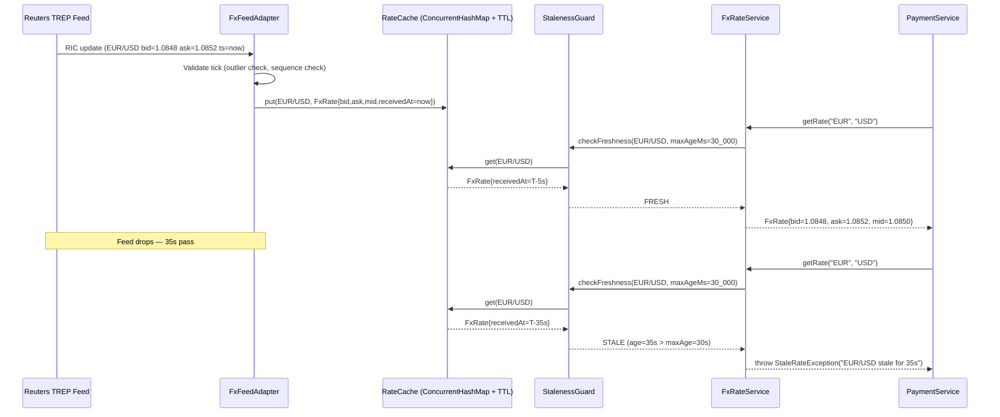

Foreign exchange is the largest financial market on earth, turning over approximately **$7.5 trillion per day** (BIS 2022). Every bank that holds multi-currency accounts, processes cross-border payments, or issues cards used abroad operates an FX system — yet FX systems are among the most precision-critical and operationally complex components in a banking technology stack. A single floating-point rounding error compounded across millions of daily conversions can cost a bank hundreds of thousands of pounds; a stale rate served to a customer ten seconds after a market event can generate instant, unhedged exposure. This lesson builds the engineering knowledge required to design FX systems that are correct, low-latency, and operationally safe.

## Learning Objectives

By the end of this lesson you will be able to:

- Distinguish spot, forward, mid, bid, and ask rates and explain when each is applied in a banking context
- Design an FX rate feed architecture that ingests from Reuters or Bloomberg, caches with TTL, and detects stale rates
- Implement `FxRateService` in Java with rate expiry, stale-rate guards, and thread-safe caching
- Explain why `double` and `float` are categorically unsuitable for FX arithmetic and use `BigDecimal` correctly
- Implement FX conversion atomicity: rate lock, conversion, and dual-currency ledger entries in a single transaction
- Calculate FX P&L, mark-to-market open positions, and enforce exposure limits
- Apply bid/ask spread and customer markup to derive retail FX rates from interbank mid rates
- Describe how treasury teams hedge open FX positions and what engineering systems support that workflow

## Business Context

In March 2018, TSB Bank's botched core-banking migration left 1.9 million customers locked out of accounts for weeks. Less publicised but financially more damaging: a European retail bank's FX system served a cached USD/GBP rate that was 47 minutes stale during a flash crash triggered by algorithmic trading. In those 47 minutes, 14,000 customers executed currency conversions at a rate 1.3% worse than the live market. The bank absorbed the difference — £2.3 million in a single afternoon — because its SLA promised "live interbank rates." The root cause was a rate-feed consumer that silently swallowed a Reuters TREP connection timeout and continued serving the last cached rate without raising an alert or circuit-breaking the conversion endpoint.

This incident defines the engineering requirements for this lesson: FX rate feeds must have explicit freshness contracts, every rate lookup must check staleness before use, and the conversion path must be atomic or not proceed at all.

## FX Rate Types and Market Conventions

The interbank FX market operates on a continuous bid/offer model. Understanding each rate type is mandatory before writing a single line of FX code.

| Rate Type | Definition | Engineering Use |
|---|---|---|
| **Spot rate** | Delivery in T+2 business days at current market price | Real-time conversion pricing |
| **Mid rate** | Arithmetic mean of bid and ask | P&L mark-to-market, internal book transfers |
| **Bid rate** | Price at which the market maker buys the base currency | Customer sells base currency |
| **Ask rate** | Price at which the market maker sells the base currency | Customer buys base currency |
| **Forward rate** | Agreed rate for future delivery, derived from spot + interest rate differential | FX forward contracts, treasury hedging |
| **Customer rate** | Mid or bid/ask + bank markup | Retail and SME conversions |

Currency pairs follow the convention `BASE/QUOTE`: EUR/USD = 1.0850 means 1 EUR buys 1.0850 USD. The base currency is always 1 unit; the quote currency moves. This convention must be encoded explicitly in every model class — a direction error inverts the conversion formula and has caused production incidents.

> [!IMPORTANT]
> Never store a rate without its direction. Always store the currency pair as `base`/`quote` with the rate meaning "one unit of `base` = `rate` units of `quote`". Storing a bare `BigDecimal` rate with no direction metadata is a critical design defect.

## FX Rate Feed Architecture

Production FX systems consume rates from one or more market data vendors (Reuters Refinitiv TREP, Bloomberg B-PIPE, or CME direct feeds) via persistent TCP connections using vendor-specific protocols. The feed architecture must handle connection failures, rate spikes (outlier detection), and feed switchover without serving stale rates.



The rate cache is a `ConcurrentHashMap<CurrencyPair, TimestampedRate>`. The staleness guard checks `Instant.now().toEpochMilli() - rate.receivedAt().toEpochMilli() > maxAgeMillis` on every read. This check must happen inside the service, not in the caller.

> [!WARNING]
> Do not rely on cache TTL eviction to enforce rate freshness. TTL eviction removes the entry — which causes a cache miss, not a staleness error. A missing entry can silently fall through to a secondary lookup or return null, which is worse than a stale rate. Always retain the entry and check age explicitly.

## FxRateService Implementation

The service layer wraps the rate cache, enforces freshness, provides inverse rate derivation, and exposes a rate-lock mechanism for atomic conversions.

```java
@Service
public class FxRateService {

    private static final Logger log = LoggerFactory.getLogger(FxRateService.class);

    private final RateCache rateCache;
    private final RateLockRepository rateLockRepository;
    private final MeterRegistry meterRegistry;

    // Maximum age in milliseconds before a rate is considered stale
    private static final long MAX_RATE_AGE_MS = 30_000L;
    // Lock validity window — customer must complete conversion within this window
    private static final long RATE_LOCK_DURATION_MS = 15_000L;

    public FxRateService(RateCache rateCache,
                         RateLockRepository rateLockRepository,
                         MeterRegistry meterRegistry) {
        this.rateCache = rateCache;
        this.rateLockRepository = rateLockRepository;
        this.meterRegistry = meterRegistry;
    }

    /**
     * Returns the live FxRate for a currency pair.
     * Throws StaleRateException if the cached rate exceeds MAX_RATE_AGE_MS.
     * Derives inverse rates (e.g. USD/EUR from EUR/USD) automatically.
     */
    public FxRate getRate(String baseCurrency, String quoteCurrency) {
        CurrencyPair directPair = CurrencyPair.of(baseCurrency, quoteCurrency);
        CurrencyPair inversePair = CurrencyPair.of(quoteCurrency, baseCurrency);

        TimestampedRate cached = rateCache.get(directPair);
        if (cached == null) {
            // Attempt inverse derivation
            cached = rateCache.get(inversePair);
            if (cached == null) {
                meterRegistry.counter("fx.rate.miss",
                    "pair", directPair.toString()).increment();
                throw new RateNotFoundException(
                    "No rate available for " + directPair + " or its inverse");
            }
            cached = cached.invert(); // 1/rate with bid/ask swap
        }

        long ageMs = Duration.between(cached.receivedAt(), Instant.now()).toMillis();
        if (ageMs > MAX_RATE_AGE_MS) {
            meterRegistry.counter("fx.rate.stale",
                "pair", directPair.toString()).increment();
            throw new StaleRateException(
                String.format("Rate for %s is stale: age=%dms maxAge=%dms",
                    directPair, ageMs, MAX_RATE_AGE_MS));
        }

        meterRegistry.timer("fx.rate.age.ms",
            "pair", directPair.toString()).record(ageMs, TimeUnit.MILLISECONDS);
        return cached.toFxRate();
    }

    /**
     * Locks a rate for a specific amount for RATE_LOCK_DURATION_MS.
     * Returns a RateLock token the caller must present when executing conversion.
     * This prevents rate slippage between quote and execution.
     */
    @Transactional
    public RateLock lockRate(String baseCurrency, String quoteCurrency,
                             BigDecimal baseAmount, String customerId) {
        FxRate rate = getRate(baseCurrency, quoteCurrency);
        BigDecimal customerRate = applyMarkup(rate.mid(), baseCurrency, quoteCurrency);
        BigDecimal quoteAmount = baseAmount.multiply(customerRate)
            .setScale(2, RoundingMode.HALF_UP);

        RateLock lock = RateLock.builder()
            .lockId(UUID.randomUUID().toString())
            .customerId(customerId)
            .baseCurrency(baseCurrency)
            .quoteCurrency(quoteCurrency)
            .baseAmount(baseAmount)
            .quoteAmount(quoteAmount)
            .lockedRate(customerRate)
            .lockedAt(Instant.now())
            .expiresAt(Instant.now().plusMillis(RATE_LOCK_DURATION_MS))
            .status(RateLockStatus.ACTIVE)
            .build();

        rateLockRepository.save(lock);
        log.info("Rate locked: lockId={} pair={}/{} rate={} baseAmount={} quoteAmount={}",
            lock.lockId(), baseCurrency, quoteCurrency, customerRate,
            baseAmount, quoteAmount);
        return lock;
    }

    /**
     * Applies bank markup to mid rate to derive customer rate.
     * Markup is loaded from configuration per currency pair tier.
     */
    BigDecimal applyMarkup(BigDecimal midRate, String base, String quote) {
        BigDecimal markupBps = markupConfig.getMarkupBps(base, quote); // e.g. 150 bps
        BigDecimal markupFactor = markupBps
            .divide(BigDecimal.valueOf(10_000), 10, RoundingMode.HALF_UP);
        // Customer buys quote: add spread to mid (they receive less quote)
        return midRate.subtract(midRate.multiply(markupFactor))
            .setScale(6, RoundingMode.HALF_UP);
    }
}
```

## BigDecimal Precision for FX Calculations

Using `double` or `float` for monetary or FX arithmetic is a category error, not a style issue. IEEE 754 floating-point cannot represent most decimal fractions exactly. At FX volumes, the error is not theoretical.

```java
// CATASTROPHIC — never do this
double eurUsd = 1.0850;
double amount = 1_000_000.00;
double converted = amount * eurUsd;
System.out.println(converted); // 1085000.0000000002 — not 1085000.00

// CORRECT
BigDecimal rate = new BigDecimal("1.0850");     // Always use String constructor
BigDecimal amountBD = new BigDecimal("1000000.00");
BigDecimal result = amountBD.multiply(rate)
    .setScale(2, RoundingMode.HALF_UP);
System.out.println(result); // 1085000.00
```

> [!NOTE]
> Always use the `BigDecimal(String)` constructor, never `BigDecimal(double)`. `new BigDecimal(1.0850)` produces `1.08499999999999996447286321199...` because it faithfully represents the double's actual binary value. `new BigDecimal("1.0850")` produces exactly `1.0850`.

FX rates require a scale of at least 6 decimal places (e.g. USD/JPY can be `149.8523`). Intermediate calculations should carry 10 decimal places of scale and round only at the final output step.

```java
// Correct scale management for FX conversion
public BigDecimal convert(BigDecimal amount, BigDecimal rate) {
    return amount
        .multiply(rate)                          // carry full precision during multiply
        .setScale(2, RoundingMode.HALF_UP);      // round to currency minor units at output
}

// Cross-rate derivation: EUR/JPY from EUR/USD and USD/JPY
public BigDecimal deriveCrossRate(BigDecimal eurUsd, BigDecimal usdJpy) {
    return eurUsd
        .multiply(usdJpy)
        .setScale(6, RoundingMode.HALF_UP);
}
```

| Type | 1,000,000 × 1.0850 | Error | Verdict |
|---|---|---|---|
| `double` | 1085000.0000000002 | +0.0002 | **Never use** |
| `float` | 1084999.875 | -0.125 | **Never use** |
| `BigDecimal` | 1085000.00 | 0 | Use this |

## FX Conversion Atomicity

An FX conversion involves at minimum four database writes: debit the source currency account, credit the destination currency account, debit the FX suspense account (source currency), and credit the FX suspense account (destination currency). These four writes must be atomic. Any partial commit leaves the books out of balance.

```java
@Transactional(isolation = Isolation.READ_COMMITTED, rollbackFor = Exception.class)
public FxConversionResult executeConversion(String rateLockId, String customerId) {
    // 1. Validate and consume the rate lock
    RateLock lock = rateLockRepository.findByLockIdAndStatus(
        rateLockId, RateLockStatus.ACTIVE)
        .orElseThrow(() -> new InvalidRateLockException(
            "Lock not found or already consumed: " + rateLockId));

    if (Instant.now().isAfter(lock.expiresAt())) {
        lock.expire();
        rateLockRepository.save(lock);
        throw new RateLockExpiredException(
            "Rate lock expired at " + lock.expiresAt());
    }

    // 2. Debit source account (e.g. GBP account)
    Account sourceAccount = accountRepository
        .findByCustomerIdAndCurrencyForUpdate(customerId, lock.baseCurrency())
        .orElseThrow(() -> new AccountNotFoundException(
            customerId + "/" + lock.baseCurrency()));

    if (sourceAccount.availableBalance().compareTo(lock.baseAmount()) < 0) {
        throw new InsufficientFundsException(
            "Available: " + sourceAccount.availableBalance() +
            " Required: " + lock.baseAmount());
    }

    sourceAccount.debit(lock.baseAmount());
    accountRepository.save(sourceAccount);

    // 3. Credit destination account (e.g. EUR account)
    Account destAccount = accountRepository
        .findByCustomerIdAndCurrencyForUpdate(customerId, lock.quoteCurrency())
        .orElseThrow(() -> new AccountNotFoundException(
            customerId + "/" + lock.quoteCurrency()));

    destAccount.credit(lock.quoteAmount());
    accountRepository.save(destAccount);

    // 4. Write FX trade record for P&L and exposure tracking
    FxTrade trade = FxTrade.builder()
        .tradeId(UUID.randomUUID().toString())
        .customerId(customerId)
        .rateLockId(rateLockId)
        .baseCurrency(lock.baseCurrency())
        .quoteCurrency(lock.quoteCurrency())
        .baseAmount(lock.baseAmount())
        .quoteAmount(lock.quoteAmount())
        .rate(lock.lockedRate())
        .tradedAt(Instant.now())
        .build();
    fxTradeRepository.save(trade);

    // 5. Mark lock as consumed
    lock.consume(trade.tradeId());
    rateLockRepository.save(lock);

    return FxConversionResult.success(trade);
}
```

> [!IMPORTANT]
> Always acquire account row locks (`SELECT ... FOR UPDATE`) in a consistent, deterministic order — always debit before credit — to prevent deadlocks when two concurrent conversions involve the same currency pair in opposite directions.

## FX P&L and Open Exposure Tracking

The bank accumulates open FX exposure whenever it converts customer currency without immediately hedging in the interbank market. Open exposure must be tracked in real time and compared against treasury-approved limits.

```sql
-- fx_rates: canonical store of ingested interbank rates
CREATE TABLE fx_rates (
    id              BIGSERIAL PRIMARY KEY,
    base_currency   CHAR(3)        NOT NULL,
    quote_currency  CHAR(3)        NOT NULL,
    bid_rate        NUMERIC(18, 8) NOT NULL,
    ask_rate        NUMERIC(18, 8) NOT NULL,
    mid_rate        NUMERIC(18, 8) NOT NULL,
    source          VARCHAR(20)    NOT NULL,  -- 'REUTERS', 'BLOOMBERG', 'MANUAL'
    received_at     TIMESTAMPTZ    NOT NULL,
    created_at      TIMESTAMPTZ    NOT NULL DEFAULT NOW(),
    CONSTRAINT uq_fx_rate_pair_ts UNIQUE (base_currency, quote_currency, received_at)
);

CREATE INDEX idx_fx_rates_pair_time
    ON fx_rates (base_currency, quote_currency, received_at DESC);

-- fx_trades: each executed customer conversion
CREATE TABLE fx_trades (
    trade_id        UUID           PRIMARY KEY,
    customer_id     VARCHAR(36)    NOT NULL,
    base_currency   CHAR(3)        NOT NULL,
    quote_currency  CHAR(3)        NOT NULL,
    base_amount     NUMERIC(18, 2) NOT NULL,
    quote_amount    NUMERIC(18, 2) NOT NULL,
    customer_rate   NUMERIC(18, 8) NOT NULL,
    mid_rate        NUMERIC(18, 8) NOT NULL,  -- rate at time of trade for P&L
    hedge_trade_id  UUID,                      -- linked interbank hedge if any
    traded_at       TIMESTAMPTZ    NOT NULL DEFAULT NOW()
);
```

Net open exposure in a given currency can be calculated with a simple aggregation:

```sql
-- Open USD exposure (sum of unhedged USD legs from all FX trades today)
SELECT
    base_currency,
    SUM(base_amount) FILTER (WHERE hedge_trade_id IS NULL) AS unhedged_base_amount,
    COUNT(*) FILTER (WHERE hedge_trade_id IS NULL)          AS unhedged_trade_count
FROM fx_trades
WHERE traded_at >= CURRENT_DATE
GROUP BY base_currency
ORDER BY unhedged_base_amount DESC;
```

> [!WARNING]
> Open FX exposure is a regulatory capital requirement (Basel III market risk framework). Systems that allow exposure to exceed approved treasury limits without blocking new trades create direct regulatory risk. Exposure limits must be enforced synchronously in the conversion path, not in a background job.

## Rate Markup and Customer Rate Calculation

The interbank mid rate is the bank's cost price. Customer rates include a spread that covers the bank's cost of hedging, operational overhead, and profit margin. Markup is typically expressed in basis points (bps) where 1 bps = 0.01%.

```java
public record MarkupConfig(
    BigDecimal retailMarkupBps,      // e.g. 150 bps for retail
    BigDecimal smeMarkupBps,         // e.g. 80 bps for SME
    BigDecimal corporateMarkupBps    // e.g. 30 bps for corporate
) {}

// Customer rate = mid rate × (1 - markup/10000) for buy, × (1 + markup/10000) for sell
public BigDecimal customerBuyRate(BigDecimal mid, BigDecimal markupBps) {
    // Customer buys base currency (e.g. buys EUR, sells GBP)
    // Bank sells EUR to customer at a rate worse than mid → customer pays more GBP
    BigDecimal markupFactor = markupBps.divide(
        BigDecimal.valueOf(10_000), 10, RoundingMode.HALF_UP);
    return mid.add(mid.multiply(markupFactor))
        .setScale(6, RoundingMode.HALF_UP);
}

public BigDecimal customerSellRate(BigDecimal mid, BigDecimal markupBps) {
    // Customer sells base currency (e.g. sells EUR, buys GBP)
    // Bank buys EUR from customer at a rate worse than mid → customer receives less GBP
    BigDecimal markupFactor = markupBps.divide(
        BigDecimal.valueOf(10_000), 10, RoundingMode.HALF_UP);
    return mid.subtract(mid.multiply(markupFactor))
        .setScale(6, RoundingMode.HALF_UP);
}
```

For a retail customer with 150 bps markup and EUR/GBP mid = 0.8560:

- Customer sell rate (customer sells EUR) = 0.8560 × (1 − 0.0150) = **0.8432**
- Customer buy rate (customer buys EUR) = 0.8560 × (1 + 0.0150) = **0.8689**

## Hedging and FX Exposure Limits

Treasury hedges the bank's accumulated open FX position by executing offsetting trades in the interbank market. Engineering systems must expose real-time exposure data and support automated hedging triggers.

```java
@Scheduled(fixedDelayString = "${fx.hedge.check.interval.ms:60000}")
@Transactional
public void evaluateHedgeTriggers() {
    Map<String, BigDecimal> exposures = fxExposureRepository.getOpenExposures();

    for (Map.Entry<String, BigDecimal> entry : exposures.entrySet()) {
        String currency = entry.getKey();
        BigDecimal openAmount = entry.getValue();
        BigDecimal limit = limitConfig.getHedgeTriggerLimit(currency);

        if (openAmount.abs().compareTo(limit) > 0) {
            log.warn("FX exposure limit breached: currency={} open={} limit={}",
                currency, openAmount, limit);
            meterRegistry.gauge("fx.exposure.breach",
                Tags.of("currency", currency), openAmount.doubleValue());

            // Raise hedge request to treasury system
            HedgeRequest hedgeRequest = HedgeRequest.builder()
                .currency(currency)
                .amount(openAmount)
                .requestedAt(Instant.now())
                .build();
            treasuryGateway.submitHedgeRequest(hedgeRequest);
        }
    }
}
```

> [!NOTE]
> Hedging at every trade is operationally impractical. Banks typically net all customer FX trades over a period (e.g. one minute) and hedge the net position in a single interbank trade. The hedging frequency is a business decision driven by market volatility, operational capacity, and risk appetite.

## Knowledge Check

**Q1: Why is using `double` for FX arithmetic a critical defect rather than a minor coding style issue?**

A: IEEE 754 `double` cannot exactly represent most decimal fractions. The error per individual operation is small (~10⁻¹⁵) but compounds at the transaction volumes of a bank (millions of daily FX conversions). At 150 bps markup on £10 billion of daily FX volume, a systematic rounding error of even 0.0001 represents £10,000 per day. More critically, inconsistency between the amount quoted to a customer and the amount posted to the ledger can cause irreconcilable breaks in the nostro reconciliation and trigger regulatory reporting obligations. `BigDecimal` with explicit scale and `RoundingMode` is the only correct type for financial arithmetic.

**Q2: A customer requests a EUR/USD conversion and the most recent rate in the cache is 42 seconds old with a configured `MAX_RATE_AGE_MS` of 30,000. What should the system do, and why?**

A: The system must throw a `StaleRateException` and reject the conversion request. It must not serve the stale rate. The reason is twofold: (1) in 42 seconds during a volatile session, EUR/USD can move 30–50 pips (0.0030–0.0050), creating instant unhedged exposure for the bank if it converts at a 42-second-old rate and then hedges at the current market rate; (2) the bank's customer disclosure obligations under MiFID II require that rates shown to customers reflect current market conditions. The correct operational response is for the system to alert the feed monitoring pipeline, attempt a secondary feed switchover, and either serve a live rate from the backup feed or return an error to the client instructing it to retry.

## Practical Challenge

1. **Rate feed health monitor:** Implement a `FxFeedHealthMonitor` class that tracks per-pair `receivedAt` timestamps and publishes a Micrometer gauge `fx.rate.age.seconds` for each active currency pair. Add an alert that fires a `RateFeedDegradedEvent` when any pair exceeds 20 seconds without an update. Write a unit test using a fixed clock that verifies the alert fires at exactly 20 seconds.

2. **Inverse rate derivation:** `FxRateService.getRate("USD", "EUR")` should work even if only EUR/USD is in the cache, by computing the inverse rate with bid/ask swap (inverse bid = 1/original ask, inverse ask = 1/original bid). Implement this with correct `BigDecimal` arithmetic, ensuring scale is set to 8 decimal places with `HALF_UP` rounding. Write a parameterised test verifying bid/ask inversion for three currency pairs.

3. **Atomic conversion integration test:** Using a Spring Boot test with an embedded PostgreSQL (Testcontainers), write an integration test that (a) creates a rate lock, (b) deliberately expires it by advancing a mock clock past `expiresAt`, and (c) verifies that calling `executeConversion` with the expired lock throws `RateLockExpiredException` and that neither the debit nor the credit was written to the accounts table.

4. **Exposure limit enforcement:** Implement a `FxExposureGuard` that is called synchronously inside `executeConversion` before writing any ledger entries. It should load the current open exposure for the trade's base currency from the database, add the new trade's base amount, and throw `ExposureLimitBreachException` if the result would exceed the configured limit. Write a test that verifies the exception is thrown at the breach boundary and that the accounts remain unchanged.

<!-- KNOWLEDGE-CHECK
{
  "questions": [
    {
      "text": "Why is using `double` for FX arithmetic a critical defect rather than a minor coding style issue?",
      "options": [
        "It is only a style issue — the precision difference is negligible for financial calculations",
        "IEEE 754 `double` cannot exactly represent most decimal fractions, compounding errors at banking transaction volumes and causing irreconcilable nostro breaks",
        "It causes performance issues but not correctness issues",
        "It only matters for currencies with more than 2 decimal places"
      ],
      "correct": 1,
      "explanation": "IEEE 754 `double` cannot exactly represent most decimal fractions. At millions of daily FX conversions, compounding rounding errors can represent tens of thousands of dollars per day in systematic drift and cause irreconcilable nostro reconciliation breaks. `BigDecimal` with explicit scale and `RoundingMode` is the only correct type for financial arithmetic."
    },
    {
      "text": "A customer requests EUR/USD conversion and the most recent rate in cache is 42 seconds old with `MAX_RATE_AGE_MS` of 30,000. What should the system do?",
      "options": [
        "Serve the stale rate — 42 seconds is close enough to 30 seconds",
        "Apply a spread penalty to compensate for the staleness",
        "Throw a `StaleRateException` and reject the conversion request",
        "Log a warning but proceed with the conversion"
      ],
      "correct": 2,
      "explanation": "The system must throw `StaleRateException` and reject the conversion. In 42 seconds during volatile sessions, EUR/USD can move 30-50 pips, creating instant unhedged exposure. MiFID II also requires rates shown to customers to reflect current market conditions. The correct response is to alert the feed monitoring pipeline and attempt a secondary feed switchover."
    },
    {
      "text": "When deriving an inverse rate (e.g., USD/EUR from EUR/USD), how should bid and ask be transformed?",
      "options": [
        "Inverse bid = 1/original bid, inverse ask = 1/original ask",
        "Inverse bid = 1/original ask, inverse ask = 1/original bid",
        "Inverse bid = original ask, inverse ask = original bid",
        "The inverse rate uses the mid-price only, bid/ask are not applicable"
      ],
      "correct": 1,
      "explanation": "When inverting a rate, bid and ask are swapped: inverse bid = 1/original ask, inverse ask = 1/original bid. This is because the market maker's bid for one direction is their ask for the inverse direction. The calculation must use `BigDecimal` with scale set to 8 decimal places with `HALF_UP` rounding."
    }
  ]
}
-->

<!-- PRACTICAL-CHALLENGE
{
  "title": "FX Rate Service with Staleness Detection and Exposure Control",
  "difficulty": "advanced",
  "estimatedMinutes": 45,
  "tasks": [
    {
      "id": "1",
      "description": "Implement a `FxFeedHealthMonitor` class that tracks per-pair `receivedAt` timestamps and publishes a Micrometer gauge `fx.rate.age.seconds` for each active currency pair. Add an alert that fires a `RateFeedDegradedEvent` when any pair exceeds 20 seconds without an update. Write a unit test using a fixed clock that verifies the alert fires at exactly 20 seconds."
    },
    {
      "id": "2",
      "description": "Implement `FxRateService.getRate('USD', 'EUR')` to work even if only EUR/USD is in cache, by computing the inverse rate with bid/ask swap (inverse bid = 1/original ask, inverse ask = 1/original bid). Use `BigDecimal` with scale 8 and `HALF_UP` rounding. Write a parameterised test verifying bid/ask inversion for three currency pairs."
    },
    {
      "id": "3",
      "description": "Using Spring Boot with Testcontainers (embedded PostgreSQL), write an integration test that: (a) creates a rate lock, (b) deliberately expires it by advancing a mock clock past `expiresAt`, and (c) verifies that calling `executeConversion` with the expired lock throws `RateLockExpiredException` and that neither the debit nor the credit was written to the accounts table."
    },
    {
      "id": "4",
      "description": "Implement a `FxExposureGuard` called synchronously inside `executeConversion` before writing ledger entries. Load the current open exposure for the trade's base currency, add the new trade's base amount, and throw `ExposureLimitBreachException` if it would exceed the configured limit. Write a test that verifies the exception at the breach boundary and that accounts remain unchanged."
    }
  ]
}
-->

