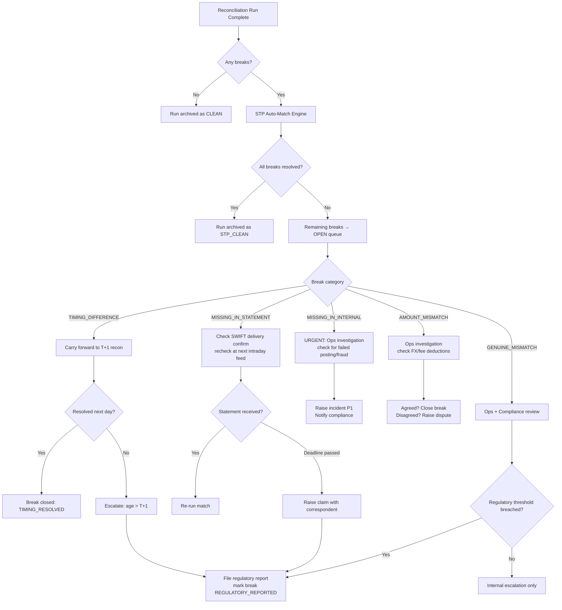

Reconciliation is the operational immune system of a bank. It is the process by which a bank continuously verifies that its internal records agree with the external world — that what the core banking system believes happened at a correspondent bank actually happened, that what a card processor reports it settled matches the internal transaction ledger, and that client money held in segregated accounts equals what clients are owed to the penny. When reconciliation works invisibly, nothing is broken. When it surfaces a break, something has gone wrong with real financial consequence: an erroneous debit, a failed settlement, a duplicate payment, or fraud. The engineering challenge is to make reconciliation fast enough to catch breaks on the same day they occur, automated enough to process millions of records without manual intervention, and precise enough that every unexplained difference triggers an investigation before it compounds.

## Learning Objectives

By the end of this lesson you will be able to:

- Describe the hierarchy of reconciliation types in a bank and explain the purpose of each
- Explain nostro reconciliation: how an MT940 bank statement is matched against the internal nostro ledger
- Implement `NostroReconciliationJob` using a SQL FULL OUTER JOIN to identify unmatched records on both sides
- Categorise reconciliation breaks into timing differences, genuine mismatches, missing entries, and duplicates
- Design the `reconciliation_breaks` schema with a workflow state machine for break lifecycle management
- Implement STP (straight-through processing) auto-match rules to maximise automated resolution rates
- Describe the day-end cut-off, the T+1 tolerance window, and their operational implications
- Explain the regulatory obligations for reporting unresolved reconciliation breaks

## Business Context

In 2012, Knight Capital Group deployed a new trading system without properly decommissioning legacy code. Within 45 minutes, the system had executed 4 million erroneous trades, accumulating a $7.2 billion gross position that was directionally wrong. The firm lost $440 million — roughly four times its annual profit — in one morning. While this is primarily a trading incident, the reconciliation failure is equally instructive: the internal position reconciliation system was not running in real time. It ran at end-of-day. Had a reconciliation system been comparing internal position records to exchange confirmations every minute, the divergence would have been visible within seconds. The firm might have been able to liquidate before catastrophic losses accumulated.

This lesson addresses the financial-industry version of that problem: nostro reconciliation that detects breaks within hours of occurrence, not days, and a break management workflow that routes each break to the right resolution path without requiring a human to triage thousands of records manually.

## Reconciliation Types Hierarchy

Banks operate multiple concurrent reconciliation processes. Each type targets a different relationship between internal records and an external source of truth.

| Type | Internal Source | External Source | Frequency | Regulatory Driver |
|---|---|---|---|---|
| **Nostro reconciliation** | Internal nostro ledger | Correspondent bank MT940 statement | Daily (intraday for SWIFT members) | Basel III operational risk |
| **Card processor reconciliation** | Internal card transaction log | Processor settlement file (Visa/Mastercard) | Daily post-settlement | PCI-DSS, card scheme rules |
| **Inter-company reconciliation** | Entity A general ledger | Entity B general ledger | Daily / monthly | IFRS consolidation |
| **Client money reconciliation** | Client money ledger | Segregated bank account statement | Daily | FCA CASS 7 |
| **Custodian reconciliation** | Internal securities position | Custodian position report | Daily | FCA SYSC 6, EMIR |

> [!IMPORTANT]
> Client money reconciliation (CASS 7) has the strictest regulatory deadline: any shortfall in a segregated client money account must be topped up **the same business day** it is identified. An unresolved client money break that persists overnight triggers a mandatory FCA notification within 10 business days. Engineering systems must prioritise client money breaks above all other reconciliation types.

## Nostro Reconciliation and MT940 Matching

A **nostro account** is a bank's account held at a correspondent bank in a foreign currency (from the Latin "nostro" — ours). The correspondent bank sends an MT940 SWIFT message (Customer Statement Message) containing the opening balance, all transactions posted during the day, and the closing balance. The internal nostro ledger must match this statement exactly.

The matching challenge: the correspondent bank may use a different reference number, truncate the payment details, or post credits and debits in different batches throughout the day. STP matching must handle all these cases.

```sql
-- NostroReconciliationJob core query
-- Left side: internal nostro ledger entries for today
-- Right side: MT940 statement entries received from correspondent
-- FULL OUTER JOIN surfaces entries present on only one side (breaks)
SELECT
    i.internal_ref,
    i.amount               AS internal_amount,
    i.credit_debit_flag    AS internal_cd,
    i.value_date           AS internal_value_date,
    i.narrative            AS internal_narrative,
    s.statement_ref,
    s.amount               AS statement_amount,
    s.credit_debit_flag    AS statement_cd,
    s.value_date           AS statement_value_date,
    s.narrative            AS statement_narrative,
    CASE
        WHEN i.internal_ref IS NULL THEN 'MISSING_IN_INTERNAL'
        WHEN s.statement_ref IS NULL THEN 'MISSING_IN_STATEMENT'
        WHEN i.amount <> s.amount THEN 'AMOUNT_MISMATCH'
        WHEN i.value_date <> s.value_date THEN 'DATE_MISMATCH'
        ELSE 'MATCHED'
    END AS match_status
FROM internal_nostro_entries i
FULL OUTER JOIN statement_entries s
    ON (
        -- Primary match: exact internal reference
        i.internal_ref = s.statement_ref
        OR
        -- Secondary match: amount + value date + credit/debit flag
        (   i.amount = s.amount
        AND i.value_date = s.value_date
        AND i.credit_debit_flag = s.credit_debit_flag
        AND i.already_matched IS FALSE
        AND s.already_matched IS FALSE
        )
    )
WHERE i.nostro_account_id = :nostroAccountId
  AND (i.value_date = :reconciliationDate OR i.value_date IS NULL)
  AND (s.value_date = :reconciliationDate OR s.value_date IS NULL);
```

> [!NOTE]
> The secondary match (amount + date + credit/debit flag) can produce false positives when multiple payments for the same amount settle on the same day. Use an `already_matched` flag and process matches in a deterministic order (highest-confidence first) to prevent one-to-many false matches.

## NostroReconciliationJob Implementation

```java
@Component
public class NostroReconciliationJob {

    private static final Logger log = LoggerFactory.getLogger(NostroReconciliationJob.class);

    private final NostroReconciliationRepository repo;
    private final BreakRepository breakRepo;
    private final AutoMatchEngine autoMatchEngine;
    private final MeterRegistry meterRegistry;

    @Transactional
    public ReconciliationRunResult reconcile(String nostroAccountId,
                                             LocalDate reconciliationDate) {
        log.info("Starting nostro reconciliation: account={} date={}",
            nostroAccountId, reconciliationDate);

        List<ReconciledEntry> entries = repo.runFullOuterJoin(
            nostroAccountId, reconciliationDate);

        int matched = 0, broken = 0;
        List<ReconciliationBreak> newBreaks = new ArrayList<>();

        for (ReconciledEntry entry : entries) {
            if (entry.matchStatus() == MatchStatus.MATCHED) {
                markMatched(entry);
                matched++;
            } else {
                BreakCategory category = categoriseBreak(entry);
                ReconciliationBreak brk = ReconciliationBreak.builder()
                    .breakId(UUID.randomUUID().toString())
                    .nostroAccountId(nostroAccountId)
                    .reconciliationDate(reconciliationDate)
                    .internalRef(entry.internalRef())
                    .statementRef(entry.statementRef())
                    .internalAmount(entry.internalAmount())
                    .statementAmount(entry.statementAmount())
                    .breakCategory(category)
                    .breakStatus(BreakStatus.OPEN)
                    .detectedAt(Instant.now())
                    .build();

                newBreaks.add(brk);
                broken++;
            }
        }

        // STP auto-match pass: attempt to auto-resolve timing differences
        int autoResolved = autoMatchEngine.process(newBreaks, reconciliationDate);

        breakRepo.saveAll(newBreaks);
        meterRegistry.counter("recon.breaks.detected",
            "account", nostroAccountId).increment(broken);
        meterRegistry.counter("recon.breaks.auto_resolved",
            "account", nostroAccountId).increment(autoResolved);

        log.info("Reconciliation complete: account={} date={} matched={} broken={} autoResolved={}",
            nostroAccountId, reconciliationDate, matched, broken, autoResolved);

        return new ReconciliationRunResult(matched, broken, autoResolved,
            broken - autoResolved);
    }

    private BreakCategory categoriseBreak(ReconciledEntry entry) {
        if (entry.internalRef() == null) return BreakCategory.MISSING_IN_INTERNAL;
        if (entry.statementRef() == null) return BreakCategory.MISSING_IN_STATEMENT;
        if (!entry.internalAmount().equals(entry.statementAmount()))
            return BreakCategory.AMOUNT_MISMATCH;
        if (!entry.internalValueDate().equals(entry.statementValueDate()))
            return BreakCategory.TIMING_DIFFERENCE;
        return BreakCategory.GENUINE_MISMATCH;
    }
}
```

## Break Categorisation and Schema

Each break has a category that determines its auto-resolution eligibility and investigation pathway.

| Category | Description | Auto-Resolvable? | Typical Cause |
|---|---|---|---|
| `TIMING_DIFFERENCE` | Entry exists on both sides but with different value dates | Yes — if within T+1 tolerance | Intraday vs end-of-day posting timing |
| `MISSING_IN_STATEMENT` | Internal ledger has entry; correspondent statement does not | Conditional — if payment confirmed sent | Intraday statement cut, delayed posting |
| `MISSING_IN_INTERNAL` | Statement has entry; internal ledger does not | No — requires investigation | Failed payment posting, correspondent error, fraud |
| `AMOUNT_MISMATCH` | Same reference on both sides, different amounts | No — always requires investigation | FX conversion error, fees deducted at correspondent |
| `GENUINE_MISMATCH` | References match but multiple fields differ | No — always requires investigation | Erroneous transaction, fraud |
| `DUPLICATE` | Same entry appears twice on one side | No — always requires investigation | System duplication, double-posting |

```sql
-- reconciliation_breaks: schema DDL
CREATE TABLE reconciliation_breaks (
    break_id              UUID           PRIMARY KEY,
    nostro_account_id     VARCHAR(50)    NOT NULL,
    reconciliation_date   DATE           NOT NULL,
    break_category        VARCHAR(30)    NOT NULL,  -- see BreakCategory enum
    break_status          VARCHAR(20)    NOT NULL DEFAULT 'OPEN',
    internal_ref          VARCHAR(100),
    statement_ref         VARCHAR(100),
    internal_amount       NUMERIC(18, 2),
    statement_amount      NUMERIC(18, 2),
    amount_difference     NUMERIC(18, 2) GENERATED ALWAYS AS
                          (COALESCE(internal_amount, 0) - COALESCE(statement_amount, 0))
                          STORED,
    internal_value_date   DATE,
    statement_value_date  DATE,
    auto_resolution_rule  VARCHAR(100),   -- which STP rule resolved it, if any
    resolved_at           TIMESTAMPTZ,
    resolved_by           VARCHAR(100),   -- system user ID or 'AUTO_STP'
    resolution_notes      TEXT,
    escalated_at          TIMESTAMPTZ,    -- set when escalated to ops team
    regulatory_reported   BOOLEAN        NOT NULL DEFAULT FALSE,
    detected_at           TIMESTAMPTZ    NOT NULL DEFAULT NOW(),
    updated_at            TIMESTAMPTZ    NOT NULL DEFAULT NOW()
);

CREATE INDEX idx_recon_breaks_account_date
    ON reconciliation_breaks (nostro_account_id, reconciliation_date, break_status);

CREATE INDEX idx_recon_breaks_open_category
    ON reconciliation_breaks (break_status, break_category, detected_at)
    WHERE break_status = 'OPEN';
```

## STP Auto-Match Rules

Straight-through processing rules allow the reconciliation engine to automatically close breaks without human intervention. Each rule is a predicate evaluated against a `ReconciliationBreak`. Rules are ordered by confidence — a break resolved by a high-confidence rule requires no further review.

```java
public interface AutoMatchRule {
    String ruleName();
    int confidenceScore();  // 0-100; below 70 requires manual review
    boolean matches(ReconciliationBreak brk, LocalDate reconDate);
    AutoResolutionAction resolve(ReconciliationBreak brk);
}

@Component
public class TimingDifferenceRule implements AutoMatchRule {

    @Override
    public String ruleName() { return "TIMING_DIFFERENCE_T1"; }

    @Override
    public int confidenceScore() { return 95; }

    @Override
    public boolean matches(ReconciliationBreak brk, LocalDate reconDate) {
        return brk.breakCategory() == BreakCategory.TIMING_DIFFERENCE
            && brk.internalAmount().compareTo(brk.statementAmount()) == 0
            && brk.internalValueDate() != null
            && brk.statementValueDate() != null
            && Math.abs(ChronoUnit.DAYS.between(
                brk.internalValueDate(), brk.statementValueDate())) <= 1;
    }

    @Override
    public AutoResolutionAction resolve(ReconciliationBreak brk) {
        // The entry will appear on the following day's statement — carry forward
        return AutoResolutionAction.builder()
            .action(ResolutionAction.CARRY_FORWARD)
            .newStatus(BreakStatus.TIMING_CARRY_FORWARD)
            .carryForwardDate(brk.statementValueDate())
            .build();
    }
}
```

## Break Resolution Workflow



> [!WARNING]
> `MISSING_IN_INTERNAL` breaks — where the correspondent bank's statement shows a debit that the internal ledger does not — must be treated as **P1 incidents**. They indicate either a failed payment posting (operational error) or an unauthorised transaction (fraud). They must never be aged beyond same-day without an active investigation and compliance notification.

## Day-End Cut-Off and Regulatory Reporting

The day-end cut-off is the point after which the reconciliation job freezes its view of the nostro ledger and statement entries for a given date. Any entries received after cut-off are assigned to the following business day's reconciliation run.

```java
@Scheduled(cron = "0 0 23 * * MON-FRI", zone = "Europe/London")
public void runDayEndReconciliation() {
    LocalDate today = LocalDate.now(ZoneId.of("Europe/London"));
    List<String> nostroAccounts = nostroAccountRepository.findAllActiveAccountIds();

    for (String accountId : nostroAccounts) {
        try {
            ReconciliationRunResult result = reconciliationJob.reconcile(accountId, today);
            if (result.unresolvedBreaks() > 0) {
                checkRegulatoryReportingThresholds(accountId, today, result);
            }
        } catch (Exception ex) {
            log.error("Day-end reconciliation failed: account={}", accountId, ex);
            alertingService.raiseCriticalAlert(
                "DAY_END_RECON_FAILED", accountId, ex.getMessage());
        }
    }
}

private void checkRegulatoryReportingThresholds(String accountId,
                                                 LocalDate date,
                                                 ReconciliationRunResult result) {
    BigDecimal unresolvedValue = breakRepo.sumUnresolvedAmount(accountId, date);
    BigDecimal threshold = regulatoryConfig.getReportingThreshold(accountId);

    if (unresolvedValue.compareTo(threshold) > 0) {
        log.warn("Regulatory reporting threshold breached: account={} unresolvedValue={} threshold={}",
            accountId, unresolvedValue, threshold);
        regulatoryReporter.flagForReport(accountId, date, unresolvedValue,
            RegulatoryReportType.OPERATIONAL_RISK_BREAK);
    }
}
```

Unresolved nostro breaks that persist beyond T+1 must be reported in the bank's operational risk framework under Basel III. For client money accounts, the regulatory deadline is same-day notification to the FCA if the shortfall exceeds the threshold defined in CASS 7.

> [!NOTE]
> The T+1 tolerance window is not a grace period for inaction. It exists specifically for timing differences — entries that crossed midnight between the internal posting and the correspondent posting. All other break categories (amount mismatch, missing in internal, genuine mismatch) must be investigated from the moment they are detected, regardless of the tolerance window.

## Knowledge Check

**Q1: The FULL OUTER JOIN in `NostroReconciliationJob` is unusual — most application code uses LEFT or INNER JOINs. Why is FULL OUTER JOIN essential for reconciliation, and what would happen if you used a LEFT JOIN instead?**

A: A FULL OUTER JOIN returns all rows from both the internal ledger and the external statement, joining where a match exists and returning `NULL` on the non-matching side where no match is found. This is essential because reconciliation must detect breaks in both directions simultaneously: entries that exist internally but not on the statement (potential posting errors or timing differences) and entries that exist on the statement but not internally (potential missed postings or fraud). A LEFT JOIN would return all internal entries with their matched statement counterparts — but it would completely omit statement entries that have no internal counterpart (the `MISSING_IN_INTERNAL` category). These are precisely the highest-risk breaks: the correspondent bank has posted a debit that the bank's own system has no record of, which could indicate an unauthorised transaction. A LEFT JOIN would silently make those entries invisible.

**Q2: Explain why `TIMING_DIFFERENCE` breaks are the safest to auto-resolve with an STP rule, while `MISSING_IN_INTERNAL` breaks must always trigger a manual investigation. What could go wrong if you applied the same auto-resolution logic to both?**

A: A `TIMING_DIFFERENCE` break is characterised by the same amount, the same reference, and the same credit/debit direction appearing on both sides — only the value date differs by one business day. This is a well-understood operational pattern: intraday payment postings sometimes cross a day boundary between the internal book cut and the correspondent's statement cut. The risk of misclassification is low because all three matching criteria (amount, reference, direction) are confirmed. A `MISSING_IN_INTERNAL` break has only one side: the statement has an entry with no internal counterpart at all. There is no matching internal reference to verify against. Auto-resolving it would mean the system marks it as "carry forward" or "explained" without anyone verifying what the correspondent bank's debit actually represents. If that debit is an unauthorised withdrawal, the auto-resolution conceals fraud. If it is a correspondent bank error, the auto-resolution forfeits the bank's right to dispute it within the dispute window. Both outcomes are unacceptable.

## Practical Challenge

1. **MT940 parser:** Implement a `Mt940Parser` that reads an MT940 SWIFT message string and produces a list of `StatementEntry` objects. The parser must handle the `:61:` transaction field (value date, credit/debit code, amount, reference) and the `:86:` narrative field. Write tests for three MT940 messages: a simple credit, a debit with a correspondent reference different from the internal reference, and a message with an intraday final balance (`:62F:` field).

2. **Auto-match engine ordering:** `AutoMatchEngine.process()` should evaluate rules in descending `confidenceScore` order and stop evaluating further rules for a break once one rule matches (short-circuit). Implement this using a sorted list of `AutoMatchRule` beans injected by Spring. Write a test that verifies that a break matching both a 95-confidence rule and a 70-confidence rule is resolved by the 95-confidence rule.

3. **Break ageing dashboard query:** Write a SQL query that returns, for a given nostro account, the count and total amount of open breaks grouped by `break_category` and age bucket (`< 1 day`, `1–2 days`, `2–5 days`, `> 5 days`). Use `NOW() - detected_at` to calculate age. The result should be ordered by age bucket descending so that the oldest breaks appear first.

4. **Regulatory threshold alerting test:** Write an integration test using Testcontainers (PostgreSQL) that seeds five `MISSING_IN_INTERNAL` breaks totalling £600,000 for a nostro account whose regulatory threshold is configured at £500,000. Verify that `checkRegulatoryReportingThresholds()` calls `regulatoryReporter.flagForReport()` exactly once with the correct account ID, date, and report type. Verify that for a seeded amount of £400,000 (below threshold), `flagForReport()` is not called.

<!-- KNOWLEDGE-CHECK
{
  "questions": [
    {
      "text": "A FULL OUTER JOIN is used in the NostroReconciliationJob reconciliation query. What would be missed if a LEFT JOIN were used instead?",
      "options": [
        "Internal entries that have no matching statement entry",
        "Statement entries that have no matching internal entry",
        "Entries where the value date differs by one business day",
        "Entries where the reference field is null"
      ],
      "correct": 1,
      "explanation": "A LEFT JOIN returns all internal entries and their matched statement counterparts, but completely omits statement entries with no internal counterpart. These MISSING_IN_INTERNAL breaks are the highest-risk category — they could represent unauthorised transactions. A FULL OUTER JOIN is required to detect breaks in both directions simultaneously."
    },
    {
      "text": "Which reconciliation break category is safest to auto-resolve using an STP rule, and why?",
      "options": [
        "MISSING_IN_INTERNAL — the statement always takes precedence over internal records",
        "AMOUNT_MISMATCH — small differences are likely rounding errors",
        "TIMING_DIFFERENCE — same amount, reference, and direction confirmed on both sides, only value date differs by one business day",
        "GENUINE_MISMATCH — both sides agree the entry is wrong"
      ],
      "correct": 2,
      "explanation": "TIMING_DIFFERENCE breaks have all three matching criteria confirmed (amount, reference, direction) — only the value date differs by one business day due to posting cut-off timing. The risk of misclassification is low. MISSING_IN_INTERNAL breaks must always trigger manual investigation because auto-resolution could conceal fraud or forfeit dispute rights."
    },
    {
      "text": "What is the purpose of the T+1 tolerance window in nostro reconciliation?",
      "options": [
        "It gives engineers time to fix bugs before regulators notice discrepancies",
        "It allows timing differences — entries where posting crossed midnight between internal and correspondent cut-off — to resolve without raising a break",
        "It defers all break investigations to the next business day",
        "It is a Basel III grace period during which no regulatory reporting is required"
      ],
      "correct": 1,
      "explanation": "The T+1 tolerance window exists specifically for timing differences — entries that crossed midnight between the internal posting and the correspondent posting. It is not a grace period for inaction; all other break categories (amount mismatch, missing in internal, genuine mismatch) must be investigated immediately regardless of the window."
    }
  ]
}
-->

<!-- PRACTICAL-CHALLENGE
{
  "title": "Build a Production Nostro Reconciliation Engine",
  "difficulty": "advanced",
  "estimatedMinutes": 60,
  "tasks": [
    {"id": "1", "description": "Implement an MT940Parser that reads an MT940 SWIFT message string and produces a list of StatementEntry objects, handling the :61: transaction field and :86: narrative field. Write tests for a simple credit, a debit with a differing correspondent reference, and a message with a final balance field."},
    {"id": "2", "description": "Implement AutoMatchEngine.process() with rules evaluated in descending confidenceScore order, short-circuiting once a rule matches. Inject rules as a sorted list of AutoMatchRule beans via Spring."},
    {"id": "3", "description": "Write a SQL query that returns open breaks for a given nostro account grouped by break_category and age bucket (< 1 day, 1-2 days, 2-5 days, > 5 days), ordered by age bucket descending."},
    {"id": "4", "description": "Write an integration test using Testcontainers (PostgreSQL) that seeds MISSING_IN_INTERNAL breaks totalling £600,000 for a nostro account with a £500,000 regulatory threshold, and asserts that regulatoryReporter.flagForReport() is called exactly once with the correct arguments."}
  ]
}
-->

