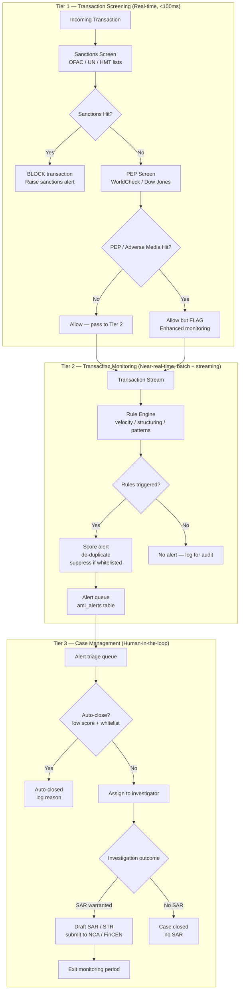
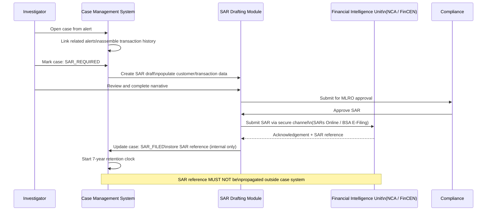

Money laundering moves an estimated **$800 billion to $2 trillion** through the global financial system every year (UNODC). Banks are the primary gatekeepers against this flow, and regulators have made clear that gatekeeper failures carry existential consequences: Danske Bank paid €2 billion in fines over its Estonian branch money-laundering scandal; Westpac paid AUD 1.3 billion for 23 million breaches of AML/CTF law. The engineering systems that detect, alert, and report suspicious activity are therefore not compliance overhead — they are core risk infrastructure. Building them poorly creates regulatory liability; building them well is a competitive differentiator because it enables the bank to serve higher-risk customer segments safely. This lesson covers the full architecture: from regulatory framework to alert pipeline to SAR filing workflow.

## Learning Objectives

By the end of this lesson you will be able to:

- Describe the FATF 40 Recommendations and 6AMLD and explain their direct engineering implications
- Design a three-tier AML architecture (transaction screening, transaction monitoring, case management)
- Implement rule-based monitoring: velocity checks, structuring detection, and unusual-pattern SQL queries
- Build an `AmlRuleEngine` with configurable, database-driven rule definitions evaluated at runtime
- Explain alert scoring, de-duplication, and suppression, and implement each in Java
- Describe the SAR/STR filing workflow from alert generation to submission to the financial intelligence unit
- Design the `aml_alerts` and `aml_cases` schemas with appropriate state machines and audit trails
- Explain the tipping-off prohibition and its implications for system design and code documentation
- Describe PEP/adverse media screening integration and ML model risk management

## Business Context

In 2021, FinCEN (the US Financial Crimes Enforcement Network) published the FinCEN Files — 2,100 leaked Suspicious Activity Reports. Analysis revealed that five global banks had collectively processed over $2 trillion in suspicious transactions between 1999 and 2017, filing SARs for many of them while continuing to process the same flows. The scandal exposed a systemic failure not in the SAR filing system itself, but in the **case management layer**: alerts were being generated, SARs were being filed, but no one was aggregating the alerts across customer relationships, correspondent relationships, and time horizons to identify the network. The engineering lesson is that alert volume without case intelligence is not AML — it is paperwork. Effective AML systems must link alerts to cases, cases to entities, and entities to networks.

## AML Regulatory Framework

The FATF (Financial Action Task Force) 40 Recommendations are the global standard. They require banks to implement Know Your Customer (KYC), ongoing transaction monitoring, and reporting of suspicious transactions to the national financial intelligence unit (FIU).

| Regulation | Jurisdiction | Key Engineering Requirements |
|---|---|---|
| **FATF 40 Recommendations** | Global (190 countries) | Risk-based approach; transaction monitoring; STR reporting |
| **6AMLD (EU)** | EU member states | Predicate offences for ML expanded to 22; criminal liability for legal persons |
| **Bank Secrecy Act / FinCEN** | USA | SAR filing within 30/60 days; CTR for cash >$10,000 |
| **POCA 2002 / MLR 2017** | UK | SAR filing via UKFIU; NCA consent procedure; penalties for tipping off |
| **AML/CTF Act 2006** | Australia | AUSTRAC reporting; 100-point ID check |

> [!IMPORTANT]
> The **tipping-off prohibition** (UK POCA s.333A, EU 6AMLD Article 39) makes it a criminal offence — up to two years' imprisonment — to inform a customer or any third party that a SAR has been filed, or that an investigation is underway. This prohibition has direct engineering implications: SAR status must never appear in customer-facing APIs, mobile app responses, account freeze notifications, or any log file that an employee without AML authorisation could read. SAR data must be stored in a system with strict access control, completely isolated from customer-facing systems.
> <!-- SYSTEM DESIGN NOTE: Never surface SAR filing status, alert IDs, or case IDs in any
>      customer-visible API endpoint, message, or notification. Access to aml_alerts and
>      aml_cases tables requires the AML_INVESTIGATOR role. Standard application service
>      accounts must not have SELECT on these tables. -->

## Three-Tier AML Architecture



## Rule-Based Transaction Monitoring

Rule-based monitoring evaluates every transaction (or batch of transactions) against a configurable set of patterns associated with known money laundering typologies.

### Velocity Check (High-frequency low-value transfers)

```sql
-- Velocity rule: >10 outbound transfers totalling >£5,000 in 24 hours
-- Flags potential smurfing (structuring to avoid reporting thresholds)
SELECT
    account_id,
    COUNT(*)                    AS transfer_count,
    SUM(amount)                 AS total_amount,
    MIN(created_at)             AS window_start,
    MAX(created_at)             AS window_end,
    ARRAY_AGG(transaction_id)   AS transaction_ids
FROM transactions
WHERE transaction_type = 'OUTBOUND_TRANSFER'
  AND created_at >= NOW() - INTERVAL '24 hours'
  AND status = 'COMPLETED'
GROUP BY account_id
HAVING COUNT(*) > 10
   AND SUM(amount) > 5000
ORDER BY total_amount DESC;
```

### Structuring Detection (Transactions just below reporting threshold)

```sql
-- Structuring rule: multiple cash deposits each just below £10,000
-- in a 7-day window (classic "smurfing" to avoid CTR/SAR triggers)
SELECT
    account_id,
    COUNT(*)        AS deposit_count,
    SUM(amount)     AS total_deposited,
    MAX(amount)     AS largest_single_deposit,
    MIN(amount)     AS smallest_single_deposit
FROM transactions
WHERE transaction_type IN ('CASH_DEPOSIT', 'BRANCH_DEPOSIT')
  AND amount BETWEEN 7000 AND 9999.99
  AND created_at >= NOW() - INTERVAL '7 days'
GROUP BY account_id
HAVING COUNT(*) >= 3
ORDER BY total_deposited DESC;
```

### Round-Trip Detection (Funds that leave and return rapidly)

```sql
-- Round-trip detection: funds leave account and return via different path
-- within 48 hours — potential layering typology
WITH outbound AS (
    SELECT account_id, amount, created_at, counterparty_account_id
    FROM transactions
    WHERE transaction_type = 'OUTBOUND_TRANSFER'
      AND created_at >= NOW() - INTERVAL '48 hours'
),
inbound AS (
    SELECT account_id, amount, created_at, counterparty_account_id
    FROM transactions
    WHERE transaction_type = 'INBOUND_TRANSFER'
      AND created_at >= NOW() - INTERVAL '48 hours'
)
SELECT
    o.account_id,
    o.amount                             AS outbound_amount,
    i.amount                             AS inbound_amount,
    o.created_at                         AS outbound_at,
    i.created_at                         AS inbound_at,
    EXTRACT(EPOCH FROM (i.created_at - o.created_at))/3600 AS hours_gap
FROM outbound o
JOIN inbound i
    ON o.account_id = i.account_id
    AND ABS(o.amount - i.amount) / o.amount < 0.05  -- within 5% of original amount
    AND i.created_at > o.created_at
    AND o.counterparty_account_id <> i.counterparty_account_id  -- different route back
ORDER BY hours_gap;
```

> [!NOTE]
> Rule-based monitoring produces false positives. A business with high transaction volume (a money service business, a payroll provider) may legitimately trigger every velocity rule every day. The suppression and whitelist system (Tier 2 alert de-duplication) must be able to mark known legitimate patterns as expected for specific customer segments, while still alerting if those patterns deviate from baseline.

## AmlRuleEngine Implementation

The rule engine evaluates a configurable set of rules against incoming transaction events. Rules are stored in the database to allow compliance teams to adjust thresholds without a code deployment.

```java
// Rule definition — stored in aml_rule_definitions table
public record AmlRuleDefinition(
    String ruleId,
    String ruleName,
    String typology,            // e.g. "STRUCTURING", "VELOCITY", "ROUND_TRIP"
    Map<String, Object> params, // threshold values loaded from DB
    int baseAlertScore,         // 1-100
    boolean enabled
) {}

@Service
public class AmlRuleEngine {

    private static final Logger log = LoggerFactory.getLogger(AmlRuleEngine.class);

    private final AmlRuleDefinitionRepository ruleRepo;
    private final AmlAlertRepository alertRepo;
    private final AlertDeduplicator deduplicator;
    private final MeterRegistry meterRegistry;

    // Rules are refreshed from DB every 5 minutes to pick up compliance updates
    @Cacheable(value = "aml-rules", unless = "#result.isEmpty()")
    public List<AmlRuleDefinition> getEnabledRules() {
        return ruleRepo.findAllByEnabledTrue();
    }

    @Async("amlRuleExecutor")
    @Transactional(propagation = Propagation.REQUIRES_NEW)
    public CompletableFuture<List<AmlAlert>> evaluate(TransactionEvent event) {
        List<AmlAlert> generatedAlerts = new ArrayList<>();

        for (AmlRuleDefinition rule : getEnabledRules()) {
            try {
                RuleEvaluationResult result = evaluateRule(rule, event);
                if (result.triggered()) {
                    AmlAlert alert = buildAlert(rule, event, result);
                    if (!deduplicator.isDuplicate(alert)) {
                        alertRepo.save(alert);
                        generatedAlerts.add(alert);
                        meterRegistry.counter("aml.alerts.generated",
                            "rule", rule.ruleId(),
                            "typology", rule.typology()).increment();
                        log.info("AML alert generated: alertId={} ruleId={} customerId={} score={}",
                            alert.alertId(), rule.ruleId(),
                            event.customerId(), alert.score());
                    }
                }
            } catch (Exception ex) {
                // Rule evaluation failures must NOT fail the transaction
                // Log and continue to next rule
                log.error("AML rule evaluation failed: ruleId={} eventId={}",
                    rule.ruleId(), event.transactionId(), ex);
                meterRegistry.counter("aml.rule.errors",
                    "rule", rule.ruleId()).increment();
            }
        }
        return CompletableFuture.completedFuture(generatedAlerts);
    }

    private AmlAlert buildAlert(AmlRuleDefinition rule,
                                 TransactionEvent event,
                                 RuleEvaluationResult result) {
        int adjustedScore = adjustScore(rule.baseAlertScore(), event);
        return AmlAlert.builder()
            .alertId(UUID.randomUUID().toString())
            .ruleId(rule.ruleId())
            .typology(rule.typology())
            .customerId(event.customerId())
            .accountId(event.accountId())
            .triggeringTransactionId(event.transactionId())
            .relatedTransactionIds(result.relatedTransactionIds())
            .score(adjustedScore)
            .status(AlertStatus.OPEN)
            .detectedAt(Instant.now())
            .build();
    }

    private int adjustScore(int baseScore, TransactionEvent event) {
        int score = baseScore;
        // Boost score for PEP customers
        if (event.customerRiskRating() == RiskRating.HIGH) score += 15;
        // Boost score for high-risk jurisdictions
        if (event.destinationCountryRisk() == JurisdictionRisk.HIGH) score += 10;
        // Reduce score for long-established customers with clean history
        if (event.customerTenureYears() > 5 && event.historicalAlertCount() == 0) score -= 10;
        return Math.min(100, Math.max(1, score));
    }
}
```

## Alert Scoring and De-duplication

A high-volume transaction monitoring system can generate millions of alerts per day. Without de-duplication and scoring, investigators are overwhelmed with noise.

```java
@Component
public class AlertDeduplicator {

    private static final Duration DEDUP_WINDOW = Duration.ofHours(24);

    private final AmlAlertRepository alertRepo;

    /**
     * Returns true if a materially identical alert already exists in the
     * deduplication window (same customer, same rule, same typology).
     * Prevents alert storms when a single account triggers the same rule
     * repeatedly in a short window.
     */
    public boolean isDuplicate(AmlAlert newAlert) {
        return alertRepo.existsByCustomerIdAndRuleIdAndStatusInAndDetectedAtAfter(
            newAlert.customerId(),
            newAlert.ruleId(),
            List.of(AlertStatus.OPEN, AlertStatus.UNDER_INVESTIGATION),
            Instant.now().minus(DEDUP_WINDOW)
        );
    }
}
```

Alerts are scored from 1 to 100. Score bands map to triage priority:

| Score Band | Priority | Expected SLA | Action |
|---|---|---|---|
| 85–100 | P1 — CRITICAL | 2 hours | Immediate investigator assignment |
| 70–84 | P2 — HIGH | 24 hours | Same-day investigator assignment |
| 50–69 | P3 — MEDIUM | 5 business days | Queue for investigation |
| 20–49 | P4 — LOW | 30 days | Auto-close if no escalation |
| 1–19 | P5 — NOISE | Auto-close | Closed with reason `LOW_SCORE` |

## SAR/STR Filing Workflow



## AML Schema DDL

```sql
-- aml_alerts: individual alerts generated by rule engine
CREATE TABLE aml_alerts (
    alert_id                    UUID           PRIMARY KEY,
    rule_id                     VARCHAR(50)    NOT NULL,
    typology                    VARCHAR(50)    NOT NULL,
    customer_id                 VARCHAR(36)    NOT NULL,
    account_id                  VARCHAR(36)    NOT NULL,
    triggering_transaction_id   UUID           NOT NULL,
    related_transaction_ids     UUID[]         NOT NULL DEFAULT '{}',
    score                       SMALLINT       NOT NULL CHECK (score BETWEEN 1 AND 100),
    status                      VARCHAR(30)    NOT NULL DEFAULT 'OPEN',
    -- status: OPEN | UNDER_INVESTIGATION | AUTO_CLOSED | ESCALATED_TO_CASE | CLOSED_NO_SAR
    case_id                     UUID,          -- set when escalated to aml_cases
    assigned_to                 VARCHAR(100),
    detected_at                 TIMESTAMPTZ    NOT NULL DEFAULT NOW(),
    updated_at                  TIMESTAMPTZ    NOT NULL DEFAULT NOW(),
    closed_at                   TIMESTAMPTZ,
    close_reason                VARCHAR(100)
);

-- Index for investigator triage queue: open alerts ordered by score descending
CREATE INDEX idx_aml_alerts_triage
    ON aml_alerts (status, score DESC, detected_at)
    WHERE status = 'OPEN';

-- aml_cases: investigation cases aggregating one or more alerts
CREATE TABLE aml_cases (
    case_id             UUID           PRIMARY KEY,
    customer_id         VARCHAR(36)    NOT NULL,
    case_status         VARCHAR(30)    NOT NULL DEFAULT 'OPEN',
    -- status: OPEN | UNDER_INVESTIGATION | PENDING_MLRO | SAR_REQUIRED |
    --         SAR_DRAFTED | SAR_FILED | CLOSED_NO_SAR | CLOSED_POST_SAR
    risk_rating         VARCHAR(10)    NOT NULL,  -- LOW | MEDIUM | HIGH | CRITICAL
    assigned_to         VARCHAR(100),
    mlro_assigned_to    VARCHAR(100),
    opened_at           TIMESTAMPTZ    NOT NULL DEFAULT NOW(),
    sar_required        BOOLEAN        NOT NULL DEFAULT FALSE,
    sar_filed_at        TIMESTAMPTZ,
    -- SAR reference is stored here but must NEVER be returned via any API
    -- accessible to non-AML-authorised personnel (tipping-off prohibition)
    sar_reference       VARCHAR(50),
    closed_at           TIMESTAMPTZ,
    close_reason        TEXT,
    retention_expires_at TIMESTAMPTZ  -- 7 years from SAR filing or case close
);

CREATE INDEX idx_aml_cases_customer
    ON aml_cases (customer_id, case_status, opened_at DESC);
```

> [!WARNING]
> The `sar_reference` and `sar_filed_at` columns in `aml_cases` must never be returned by any API endpoint that could be called by customer service agents, mobile banking backends, or any system accessible to the customer. These columns are accessed only by the AML investigation application under the `AML_INVESTIGATOR` role. Row-level security (PostgreSQL RLS) or application-layer access control must enforce this boundary.

## PEP and Adverse Media Screening Integration

Politically Exposed Persons (PEPs) and customers with adverse media coverage require enhanced due diligence. PEP status is not static — it must be re-screened periodically and on transaction events.

```java
@Service
public class PepScreeningService {

    private final WorldCheckClient worldCheckClient;
    private final AmlAlertRepository alertRepo;
    private final CustomerRiskRepository customerRiskRepo;

    public ScreeningResult screen(String customerId, String fullName,
                                   LocalDate dateOfBirth, String nationality) {
        WorldCheckResponse response = worldCheckClient.search(
            WorldCheckQuery.builder()
                .name(fullName)
                .dateOfBirth(dateOfBirth)
                .nationality(nationality)
                .build()
        );

        if (response.hasPepMatch() || response.hasAdverseMediaMatch()) {
            customerRiskRepo.updateRiskRating(customerId, RiskRating.HIGH);

            if (response.hasSanctionsMatch()) {
                // Sanctions hit: block all transactions — Tier 1 hard stop
                return ScreeningResult.sanctionsHit(response.matchedListEntries());
            }

            if (response.hasPepMatch()) {
                // PEP: allow but apply enhanced due diligence and monitoring
                return ScreeningResult.pepHit(response.pepCategory(),
                    response.matchedListEntries());
            }

            return ScreeningResult.adverseMediaHit(response.matchedListEntries());
        }

        return ScreeningResult.clean();
    }
}
```

## Model Risk Management for ML-Based Monitoring

Many banks augment rule-based monitoring with ML models (gradient boosting, neural networks) that detect anomalous patterns not captured by explicit rules. ML models in AML introduce specific governance requirements under SR 11-7 (US) and PRA SS3/18 (UK).

| Risk | Description | Mitigation |
|---|---|---|
| **Model drift** | Customer behaviour changes; model's training data becomes unrepresentative | Monthly performance monitoring; alert rate and false positive rate tracking |
| **Explainability** | Regulator requires explanation of why a SAR was filed | SHAP values or LIME required for every ML alert; rule-based "translation" of model output |
| **Training data bias** | Model trained on historical SARs over-flags historically monitored demographics | Fairness testing; hold-out validation across customer segments |
| **Adversarial adaptation** | Sophisticated launderers detect and adapt around ML patterns | Model version rotation; ensemble diversity |

> [!IMPORTANT]
> ML models in AML cannot replace human judgment in SAR filing decisions. Under POCA 2002 and FinCEN regulations, the MLRO (Money Laundering Reporting Officer) bears personal criminal liability for SAR filing decisions. ML models can prioritise and score alerts, but the SAR filing decision must always involve a human investigator and MLRO approval. Document this constraint in every ML model card and in the AML system architecture decision record.

## Knowledge Check

**Q1: Why must AML rule evaluation failures (exceptions thrown during rule processing) not cause the payment transaction to fail? What is the correct engineering pattern?**

A: If AML rule evaluation failure caused the payment transaction to fail, a bug in the AML system would become a denial-of-service attack on the bank's payment processing — every payment would fail until the AML system was fixed. This is unacceptable from an availability perspective. The correct pattern is to separate the payment processing transaction from the AML evaluation: payment processing commits to the database immediately; AML evaluation runs asynchronously (or in a separate `REQUIRES_NEW` transaction) after the payment is committed. Rule evaluation errors are logged, metered, and trigger an operational alert, but they do not roll back the payment. The trade-off is that in the rare case of a prolonged AML system outage, some transactions may be evaluated late — this is acceptable and preferable to blocking payments. The bank must have a documented procedure for reviewing transactions that were not evaluated during an outage period.

**Q2: Explain the tipping-off prohibition and describe three specific system design decisions that enforce it in a banking technology stack.**

A: The tipping-off prohibition (POCA 2002 s.333A; 6AMLD Article 39) makes it a criminal offence to inform a person who is the subject of a SAR, or any third party, that a SAR has been filed or that a suspicious activity investigation is underway. The purpose is to prevent subjects from destroying evidence or moving funds before law enforcement can act. Three system design decisions that enforce it: (1) **API isolation** — the `aml_cases` and `aml_alerts` tables must not be joined in any query executed by a customer-facing service; SAR status and case IDs must never appear in any API response returned to the customer or to customer service agents; (2) **Role-based data access** — PostgreSQL row-level security or application-layer access control must restrict `SELECT` on `sar_reference` and `sar_filed_at` to users with the `AML_INVESTIGATOR` role; application service accounts used by payment APIs must not have this role; (3) **Account restriction optics** — if an account is restricted due to an AML investigation, the customer-facing message must state a generic reason ("account under review") and must not reference a SAR, an alert ID, or an investigation case number.

## Practical Challenge

1. **Rule definition hot-reload:** `AmlRuleEngine.getEnabledRules()` is cached with Spring `@Cacheable`. Add a `@CacheEvict` endpoint (admin-only, requires `ROLE_AML_ADMIN`) that invalidates the cache and forces a reload from the database. Write a test that (a) loads rules from the DB, (b) updates a rule's threshold in the DB, (c) calls the evict endpoint, and (d) verifies that the next call to `getEnabledRules()` returns the updated threshold.

2. **Structuring detection backtest:** Implement a `StructuringDetector` that runs the structuring SQL query (cash deposits between £7,000 and £9,999.99 in a 7-day window) as a Spring `@Scheduled` job every 15 minutes. Write an integration test using Testcontainers that seeds 4 qualifying deposits for one customer and 2 qualifying deposits for another, and verifies that only the first customer triggers an alert (threshold: 3+ deposits).

3. **Alert de-duplication window test:** `AlertDeduplicator.isDuplicate()` uses a 24-hour window. Write a test using a fixed clock that creates an open alert at T=0 for `(customerId=CUST1, ruleId=VEL_001)`, then verifies: (a) a new alert for the same customer and rule at T=12h is a duplicate; (b) the same alert at T=25h is NOT a duplicate (window has expired); (c) a new alert for `(customerId=CUST1, ruleId=STRUCT_001)` at T=12h is NOT a duplicate (different rule).

4. **Tipping-off access control test:** Write a Spring Security integration test that verifies: (a) a user with `ROLE_AML_INVESTIGATOR` can call `GET /internal/aml/cases/{caseId}` and receives the full case including `sarReference`; (b) a user with `ROLE_CUSTOMER_SERVICE` calling the same endpoint receives a 403 Forbidden; (c) the customer-facing account status endpoint `GET /api/accounts/{accountId}/status` never includes any field named `alertId`, `caseId`, or `sarReference` regardless of the calling user's role.

<!-- KNOWLEDGE-CHECK
{
  "questions": [
    {
      "text": "Why must AML rule evaluation failures (exceptions thrown during rule processing) not cause the payment transaction to fail?",
      "options": [
        "AML rules are advisory only and have no legal weight",
        "A bug in the AML system would become a denial-of-service attack on payment processing; the correct pattern separates payment processing from AML evaluation",
        "AML evaluation is too slow to run synchronously with payments",
        "Payment transactions are isolated from AML by database design"
      ],
      "correct": 1,
      "explanation": "If AML rule evaluation failure caused the payment to fail, a bug in the AML system would block every payment until fixed. Payment processing must commit immediately; AML evaluation runs asynchronously in a separate `REQUIRES_NEW` transaction. Rule errors are logged and metered but do not roll back the payment."
    },
    {
      "text": "The tipping-off prohibition (POCA 2002 s.333A) makes it a criminal offence to do what?",
      "options": [
        "File a SAR without sufficient evidence",
        "Delay filing a SAR beyond 7 days",
        "Inform a person who is the subject of a SAR, or any third party, that a SAR has been filed or an investigation is underway",
        "Share SAR information between financial institutions without a court order"
      ],
      "correct": 2,
      "explanation": "The tipping-off prohibition makes it a criminal offence to inform a person who is the subject of a SAR, or any third party, that a SAR has been filed or that a suspicious activity investigation is underway. The purpose is to prevent subjects from destroying evidence or moving funds before law enforcement can act."
    },
    {
      "text": "An AML rule detects structuring: 3+ cash deposits between £7,000 and £9,999.99 within a 7-day rolling window. A customer has 2 qualifying deposits. What action should the system take?",
      "options": [
        "Create an alert immediately — the threshold is 2 deposits",
        "Take no action — the threshold is not met",
        "Block the customer's account as a precaution",
        "File an automatic SAR with the NCA"
      ],
      "correct": 1,
      "explanation": "The structuring detection threshold is 3+ deposits, so with only 2 deposits the threshold is not met and no alert should be created. The rule engine should continue monitoring and only create an alert when the third qualifying deposit occurs within the 7-day rolling window."
    }
  ]
}
-->

<!-- PRACTICAL-CHALLENGE
{
  "title": "AML Rule Engine with Hot-Reload and Deduplication",
  "difficulty": "advanced",
  "estimatedMinutes": 45,
  "tasks": [
    {
      "id": "1",
      "description": "Add a `@CacheEvict` endpoint (admin-only, requires `ROLE_AML_ADMIN`) to `AmlRuleEngine.getEnabledRules()` that invalidates the `@Cacheable` cache and forces a reload from the database. Write a test that: (a) loads rules from DB, (b) updates a rule's threshold in DB, (c) calls the evict endpoint, and (d) verifies the next call returns the updated threshold."
    },
    {
      "id": "2",
      "description": "Implement a `StructuringDetector` running the structuring SQL query (cash deposits between £7,000 and £9,999.99 in a 7-day window) as a Spring `@Scheduled` job every 15 minutes. Write an integration test using Testcontainers seeding 4 qualifying deposits for one customer and 2 for another, verifying only the first customer triggers an alert (threshold: 3+ deposits)."
    },
    {
      "id": "3",
      "description": "Write a test using a fixed clock for `AlertDeduplicator.isDuplicate()` with a 24-hour window that verifies: (a) alert for same customer and rule at T=12h is a duplicate; (b) same alert at T=25h is NOT a duplicate (window expired); (c) alert for same customer but different rule at T=12h is NOT a duplicate."
    },
    {
      "id": "4",
      "description": "Write a Spring Security integration test verifying tipping-off access control: (a) `ROLE_AML_INVESTIGATOR` can call `GET /internal/aml/cases/{caseId}` and receives the full case including `sarReference`; (b) `ROLE_CUSTOMER_SERVICE` calling the same endpoint receives 403; (c) the customer-facing account status endpoint never includes `alertId`, `caseId`, or `sarReference` regardless of caller's role."
    }
  ]
}
-->

