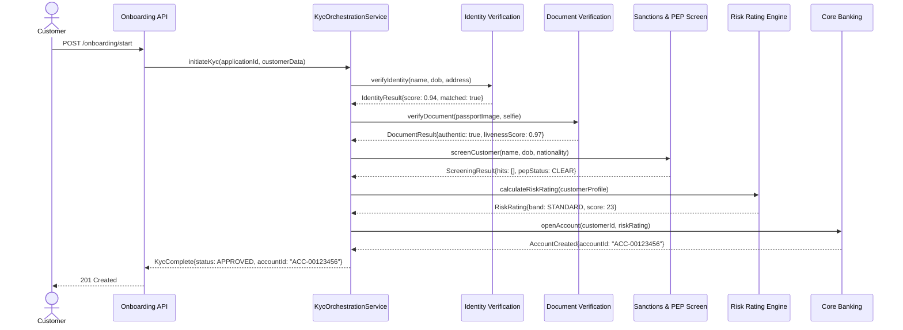

Know Your Customer (KYC) is the cornerstone obligation of financial crime compliance. Every regulated financial institution must be able to answer a deceptively simple question before opening an account: who is this person, are they who they claim to be, what risk do they pose, and is their intended use of the product consistent with legitimate activity? Getting that answer wrong in either direction costs real money — HSBC paid $1.9 billion in a 2012 US Department of Justice settlement for systematic KYC failures, and ING Bank N.V. paid €775 million in 2018 after Dutch prosecutors found 100,000 customer files were never updated for periods exceeding five years. Getting it wrong in the other direction — rejecting legitimate customers through excessive friction — cost UK challenger banks an estimated 35% application abandonment rate in 2023 according to Callsign research. As a senior engineer building onboarding systems, you sit at the intersection of regulatory obligation and commercial imperative.

## Learning Objectives

- Explain the three-tier CDD/EDD/SDD framework and the risk factors that determine which tier applies to a given customer
- Map the FATF 40 Recommendations and EU AML Directives (4AMLD through 6AMLD) to concrete technical requirements in an onboarding system
- Design a saga-based `KycOrchestrationService` that coordinates identity verification, document checking, PEP/sanctions screening, and risk rating as compensatable steps
- Write production-quality DDL for a `customer_risk_ratings` table that captures the full audit trail required by regulators
- Implement a risk scoring model that weights jurisdiction, occupation, product type, and behavioural signals into a numeric risk band
- Resolve Ultimate Beneficial Owner (UBO) hierarchies for corporate customers and store the resulting ownership graph
- Design periodic review triggers that honour time-based, event-based, and threshold-based reassessment obligations
- Reason through the conflict between GDPR right-to-erasure obligations and AML data-retention mandates

## Business Context

In March 2022, Santander UK was fined £107.7 million by the Financial Conduct Authority for anti-money laundering failures affecting 560,000 business customers over a five-year period. The root cause was not a failure to collect data — customer documents were gathered — but a failure of the systems that processed and maintained that data. Automated onboarding workflows could not handle the edge cases that make up the long tail of real customer populations: dual nationality, name transliteration from Arabic or Chinese scripts, shell company ownership chains that reached 14 layers deep, and customers whose risk profile changed significantly after the initial risk rating was locked. The engineering team had built a monolithic onboarding service that wrote a final `risk_tier` value to the customer record and never revisited it. Regulators described this as a "broken" approach to ongoing due diligence. The fine calculation was roughly £192 per affected customer — a number that becomes brutally instructive when you realise that building a proper periodic review system would have cost a fraction of that.

## Regulatory Framework: FATF and EU AML Directives

The Financial Action Task Force (FATF) is the inter-governmental body that sets the global standard for anti-money laundering (AML) and counter-terrorist financing (CTF). Its 40 Recommendations, first issued in 1990 and substantially revised in 2012, define the risk-based approach that all national AML regimes must implement. Recommendation 10 defines Customer Due Diligence. Recommendation 12 defines Enhanced Due Diligence for Politically Exposed Persons. Recommendation 15, added in the 2023 revision, explicitly addresses virtual assets and obligated parties must apply CDD to crypto-asset service providers.

The EU has transposed FATF obligations through successive AML Directives. Each directive tightened requirements that have direct architectural implications.

| Directive | Year | Key Engineering Impact |
|-----------|------|------------------------|
| 4AMLD | 2017 | Risk-based approach made mandatory; UBO register introduced |
| 5AMLD | 2020 | Virtual currency platforms brought in scope; UBO registers made public |
| 6AMLD | 2021 | 22 predicate offences harmonised; criminal liability extended to legal persons; 4-year minimum custodial sentence |
| AML Package 2024 | 2027 (target) | Single EU AML Authority (AMLA) with direct supervisory powers; €10,000 cash payment limit |

> [!IMPORTANT]
> The 2024 EU AML Package creates a new supranational regulator (AMLA) with direct supervisory powers over the highest-risk institutions. Data-sharing architectures must be designed today to accommodate regulatory data requests that bypass national FIUs. This is not a future concern — AMLA begins operations in 2025 with full supervisory scope by 2027.

## CDD, EDD, and SDD Tiers

The risk-based approach requires that the intensity of due diligence be proportionate to the assessed risk. This produces three tiers that your onboarding pipeline must route customers through.

**Standard CDD** applies to the majority of retail customers. It requires identity verification (name, date of birth, address), document verification (passport or national ID), and understanding of the purpose and intended nature of the business relationship.

**Enhanced Due Diligence (EDD)** applies when risk factors are present. Mandatory EDD triggers include: Politically Exposed Persons (PEPs) and their family members or close associates; customers from FATF high-risk or monitored jurisdictions (grey/black list); correspondent banking relationships; and any customer or transaction the institution's own risk assessment deems high-risk. EDD requires obtaining additional information on source of funds, source of wealth, senior management approval for onboarding, and enhanced ongoing monitoring.

**Simplified Due Diligence (SDD)** may apply where risk is demonstrably low: regulated financial institutions, listed companies on recognised exchanges, government bodies. SDD permits reduced verification frequency and documentation depth, but it is not an exemption from CDD — it is a calibrated reduction.

> [!NOTE]
> SDD is a risk-proportionate reduction, not a free pass. Under 5AMLD Article 15, firms must still document the rationale for applying SDD and monitor the relationship for signals that would escalate it to Standard or Enhanced CDD. A customer who qualifies for SDD at onboarding may require EDD within 90 days if transaction behaviour is inconsistent with the stated purpose.

## Onboarding Pipeline Architecture

The digital onboarding pipeline is a multi-step process where each step has external dependencies (identity providers, document verification APIs, sanctions lists, PEP databases) and each step can fail independently. The saga pattern is the correct architectural choice: each step has a compensating transaction, and the orchestrator maintains the overall state machine.



The saga orchestrator must handle the failure modes at each step. If document verification fails after identity verification has succeeded, the compensating transaction cancels the identity verification reservation and marks the application as `PENDING_MANUAL_REVIEW` rather than `REJECTED` — a critical distinction because the customer may simply have submitted a low-quality photograph.

```java
// KycOrchestrationService.java
@Service
@Slf4j
public class KycOrchestrationService {

    private final KycApplicationRepository applicationRepo;
    private final IdentityVerificationClient idvClient;
    private final DocumentVerificationClient docClient;
    private final SanctionsScreeningClient sanctionsClient;
    private final RiskRatingEngine riskEngine;
    private final CoreBankingClient coreBankingClient;
    private final ApplicationEventPublisher eventPublisher;

    @Transactional
    public KycResult orchestrate(KycApplication application) {
        log.info("Starting KYC orchestration for applicationId={}", application.getId());
        updateStatus(application, KycStatus.IDENTITY_VERIFICATION_IN_PROGRESS);

        // Step 1: Identity Verification
        IdentityVerificationResult idvResult;
        try {
            idvResult = idvClient.verify(IdentityVerificationRequest.from(application));
        } catch (IdentityVerificationException e) {
            return failApplication(application, KycFailureReason.IDV_PROVIDER_ERROR, e);
        }

        if (idvResult.score() < 0.85) {
            return requireManualReview(application, "IDV score below threshold: " + idvResult.score());
        }

        updateStatus(application, KycStatus.DOCUMENT_VERIFICATION_IN_PROGRESS);

        // Step 2: Document Verification
        DocumentVerificationResult docResult;
        try {
            docResult = docClient.verify(DocumentVerificationRequest.from(application));
        } catch (DocumentVerificationException e) {
            // compensate: nothing to undo for IDV in this model
            return failApplication(application, KycFailureReason.DOC_PROVIDER_ERROR, e);
        }

        if (!docResult.authentic() || docResult.livenessScore() < 0.90) {
            return rejectApplication(application, KycFailureReason.DOCUMENT_NOT_AUTHENTIC);
        }

        updateStatus(application, KycStatus.SANCTIONS_SCREENING_IN_PROGRESS);

        // Step 3: Sanctions and PEP Screening
        ScreeningResult screeningResult = sanctionsClient.screen(ScreeningRequest.from(application));

        if (screeningResult.hasBlockingHit()) {
            return blockApplication(application, screeningResult);
        }

        boolean requiresEdd = screeningResult.pepStatus() != PepStatus.CLEAR
                || isHighRiskJurisdiction(application.getNationality())
                || application.getProductType().requiresEdd();

        updateStatus(application, KycStatus.RISK_RATING_IN_PROGRESS);

        // Step 4: Risk Rating
        RiskRatingInput ratingInput = RiskRatingInput.builder()
                .customerId(application.getCustomerId())
                .jurisdiction(application.getNationality())
                .occupation(application.getOccupation())
                .productType(application.getProductType())
                .pepStatus(screeningResult.pepStatus())
                .idvScore(idvResult.score())
                .requiresEdd(requiresEdd)
                .build();

        CustomerRiskRating riskRating = riskEngine.calculate(ratingInput);
        persistRiskRating(riskRating);

        if (riskRating.band() == RiskBand.HIGH && !riskRating.seniorManagerApproved()) {
            return awaitSeniorApproval(application, riskRating);
        }

        updateStatus(application, KycStatus.ACCOUNT_OPENING_IN_PROGRESS);

        // Step 5: Account Opening
        AccountCreationResult accountResult = coreBankingClient.openAccount(
                AccountCreationRequest.builder()
                        .customerId(application.getCustomerId())
                        .riskRatingId(riskRating.id())
                        .cddTier(requiresEdd ? CddTier.ENHANCED : CddTier.STANDARD)
                        .build()
        );

        updateStatus(application, KycStatus.COMPLETED);
        eventPublisher.publishEvent(new KycCompletedEvent(application.getId(), accountResult.accountId()));

        return KycResult.approved(accountResult.accountId(), riskRating);
    }

    private KycResult blockApplication(KycApplication application, ScreeningResult result) {
        application.setStatus(KycStatus.BLOCKED);
        application.setBlockedReason("SANCTIONS_HIT: " + result.highestMatchScore());
        applicationRepo.save(application);
        // OFAC reporting obligation — do NOT notify customer of the reason
        eventPublisher.publishEvent(new SanctionsBlockEvent(application.getId(), result));
        return KycResult.blocked();
    }
}
```

> [!WARNING]
> When an application is blocked due to a sanctions hit, you must NOT inform the customer that the reason is a sanctions match. This is "tipping off" and is a criminal offence under the Proceeds of Crime Act 2002 (UK) and equivalent legislation in most jurisdictions. The application should be declined with a neutral message. All communication about the block must go through your compliance team and legal counsel.

## Customer Risk Rating Schema and Service

The `customer_risk_ratings` table is an append-only audit log. You never update a risk rating row — you create a new one and set the previous row's `superseded_at` timestamp. This is a regulatory requirement: regulators must be able to reconstruct the customer's risk profile at any point in time.

```sql
-- customer_risk_ratings DDL
CREATE TABLE customer_risk_ratings (
    id                      BIGSERIAL PRIMARY KEY,
    customer_id             BIGINT NOT NULL,
    rating_reference        VARCHAR(50) NOT NULL UNIQUE,  -- e.g. CRR-20240315-00001
    risk_score              INTEGER NOT NULL CHECK (risk_score BETWEEN 0 AND 100),
    risk_band               VARCHAR(20) NOT NULL CHECK (risk_band IN ('LOW', 'STANDARD', 'HIGH', 'VERY_HIGH')),
    cdd_tier                VARCHAR(20) NOT NULL CHECK (cdd_tier IN ('SIMPLIFIED', 'STANDARD', 'ENHANCED')),

    -- Scoring factors (stored for reproducibility)
    jurisdiction_score      INTEGER NOT NULL,
    occupation_score        INTEGER NOT NULL,
    product_score           INTEGER NOT NULL,
    pep_score               INTEGER NOT NULL DEFAULT 0,
    behaviour_score         INTEGER NOT NULL DEFAULT 0,

    -- Metadata
    rating_reason           VARCHAR(100) NOT NULL,  -- INITIAL_ONBOARDING, PERIODIC_REVIEW, EVENT_TRIGGERED, MANUAL_OVERRIDE
    rated_by_user_id        BIGINT,                 -- NULL for automated ratings
    rated_by_service        VARCHAR(100),           -- service name for automated ratings
    senior_manager_approved BOOLEAN NOT NULL DEFAULT FALSE,
    senior_manager_id       BIGINT,
    approval_timestamp      TIMESTAMPTZ,

    -- Lifecycle
    effective_from          TIMESTAMPTZ NOT NULL DEFAULT NOW(),
    superseded_at           TIMESTAMPTZ,            -- NULL = current rating
    next_review_due         DATE NOT NULL,

    created_at              TIMESTAMPTZ NOT NULL DEFAULT NOW(),

    CONSTRAINT fk_customer FOREIGN KEY (customer_id) REFERENCES customers(id)
);

CREATE INDEX idx_crr_customer_current
    ON customer_risk_ratings (customer_id)
    WHERE superseded_at IS NULL;

CREATE INDEX idx_crr_next_review
    ON customer_risk_ratings (next_review_due)
    WHERE superseded_at IS NULL;

-- Prevent more than one current rating per customer
CREATE UNIQUE INDEX idx_crr_customer_active
    ON customer_risk_ratings (customer_id)
    WHERE superseded_at IS NULL;
```

The risk scoring model weights four primary factors. Scores are summed and mapped to a band. The model must be version-controlled: changing the weights is a material change that must be documented and approved by the MLRO (Money Laundering Reporting Officer).

```java
// RiskRatingEngine.java
@Component
public class RiskRatingEngine {

    // Weights must be approved by MLRO — do not change without change management sign-off
    private static final int JURISDICTION_WEIGHT    = 35;
    private static final int OCCUPATION_WEIGHT      = 25;
    private static final int PRODUCT_WEIGHT         = 20;
    private static final int BEHAVIOUR_WEIGHT       = 20;

    private static final Map<String, Integer> JURISDICTION_SCORES = Map.of(
        "FATF_HIGH_RISK",   100,
        "FATF_MONITORED",    75,
        "EU_THIRD_COUNTRY",  50,
        "EEA",               10,
        "UK",                 5
    );

    public CustomerRiskRating calculate(RiskRatingInput input) {
        int jurisdictionScore = resolveJurisdictionScore(input.jurisdiction());
        int occupationScore   = resolveOccupationScore(input.occupation());
        int productScore      = resolveProductScore(input.productType());
        int pepScore          = input.pepStatus() == PepStatus.CLEAR ? 0 : 40;

        // Composite score: weighted average across factors (0–100 scale each)
        double raw = (jurisdictionScore * JURISDICTION_WEIGHT
                    + occupationScore   * OCCUPATION_WEIGHT
                    + productScore      * PRODUCT_WEIGHT
                    + pepScore          * 10)   // PEP is an additive modifier
                   / 100.0;

        int finalScore = Math.min(100, (int) Math.round(raw) + input.behaviourAdjustment());
        RiskBand band  = scoreToBand(finalScore);

        Date nextReview = calculateNextReview(band);

        return CustomerRiskRating.builder()
                .customerId(input.customerId())
                .riskScore(finalScore)
                .riskBand(band)
                .cddTier(band == RiskBand.LOW ? CddTier.SIMPLIFIED
                        : band == RiskBand.HIGH || band == RiskBand.VERY_HIGH ? CddTier.ENHANCED
                        : CddTier.STANDARD)
                .jurisdictionScore(jurisdictionScore)
                .occupationScore(occupationScore)
                .productScore(productScore)
                .pepScore(pepScore)
                .nextReviewDue(nextReview)
                .build();
    }

    private RiskBand scoreToBand(int score) {
        if (score <= 25)  return RiskBand.LOW;
        if (score <= 55)  return RiskBand.STANDARD;
        if (score <= 80)  return RiskBand.HIGH;
        return RiskBand.VERY_HIGH;
    }

    private Date calculateNextReview(RiskBand band) {
        return switch (band) {
            case LOW       -> LocalDate.now().plusYears(3);
            case STANDARD  -> LocalDate.now().plusYears(1);
            case HIGH      -> LocalDate.now().plusMonths(6);
            case VERY_HIGH -> LocalDate.now().plusMonths(3);
        };
    }
}
```

## UBO Resolution for Corporate Customers

The EU's 4AMLD introduced mandatory Ultimate Beneficial Owner (UBO) registers, requiring firms to identify every natural person who owns or controls more than 25% of a corporate customer. In practice, ownership structures involve multiple layers of holding companies, trusts, and partnerships, and the 25% threshold must be applied by aggregating direct and indirect holdings.

```java
// UboResolutionService.java
@Service
public class UboResolutionService {

    private static final BigDecimal UBO_THRESHOLD = new BigDecimal("0.25");
    private static final int MAX_RESOLUTION_DEPTH = 15; // regulatory limit per FCA guidance

    public List<UboRecord> resolveUbos(String legalEntityId) {
        Map<String, BigDecimal> effectiveOwnership = new HashMap<>();
        resolveRecursive(legalEntityId, BigDecimal.ONE, effectiveOwnership, 0, new HashSet<>());

        return effectiveOwnership.entrySet().stream()
                .filter(e -> e.getKey().startsWith("PERSON:"))  // only natural persons
                .filter(e -> e.getValue().compareTo(UBO_THRESHOLD) >= 0)
                .map(e -> buildUboRecord(e.getKey(), e.getValue()))
                .toList();
    }

    private void resolveRecursive(String entityId, BigDecimal parentShare,
                                  Map<String, BigDecimal> accumulated,
                                  int depth, Set<String> visited) {
        if (depth > MAX_RESOLUTION_DEPTH) {
            throw new UboResolutionException(
                "Ownership chain exceeds maximum depth " + MAX_RESOLUTION_DEPTH
                + " at entity " + entityId + ". Manual review required.");
        }
        if (visited.contains(entityId)) {
            // Circular ownership — flag for manual review
            throw new CircularOwnershipException(entityId);
        }

        visited.add(entityId);
        List<OwnershipRecord> owners = ownershipRepo.findDirectOwners(entityId);

        for (OwnershipRecord owner : owners) {
            BigDecimal effectiveShare = parentShare.multiply(owner.ownershipPercentage())
                    .divide(new BigDecimal("100"), 10, RoundingMode.HALF_UP);

            String ownerId = owner.ownerType() == OwnerType.PERSON
                    ? "PERSON:" + owner.ownerId()
                    : "ENTITY:" + owner.ownerId();

            accumulated.merge(ownerId, effectiveShare, BigDecimal::add);

            if (owner.ownerType() == OwnerType.LEGAL_ENTITY) {
                resolveRecursive(owner.ownerId(), effectiveShare, accumulated,
                        depth + 1, new HashSet<>(visited));
            }
        }
    }
}
```

> [!NOTE]
> The 25% threshold is a regulatory floor, not a ceiling. Many institutions apply a 10% threshold for high-risk customers or for customers in sectors prone to beneficial ownership abuse (gambling, real estate, money services). Your UBO_THRESHOLD constant should be configurable per customer segment, not hardcoded as a global value.

## Periodic Review and Data Retention

Ongoing due diligence is not optional. FATF Recommendation 10(d) requires firms to ensure that documents, data, and information collected under CDD are kept up to date and relevant. The `idx_crr_next_review` index on the `customer_risk_ratings` table enables a scheduled job to identify overdue reviews.

```java
// PeriodicReviewScheduler.java
@Component
@Slf4j
public class PeriodicReviewScheduler {

    @Scheduled(cron = "0 0 6 * * MON-FRI")  // 06:00 every business day
    @Transactional
    public void triggerDueReviews() {
        LocalDate reviewCutoff = LocalDate.now().plusDays(14); // 14-day lead time
        List<CustomerRiskRating> dueRatings =
                ratingRepo.findCurrentRatingsDueBy(reviewCutoff);

        log.info("Periodic review: found {} customers due for review by {}",
                dueRatings.size(), reviewCutoff);

        dueRatings.forEach(rating -> {
            reviewWorkflowService.createReviewTask(
                    ReviewTaskRequest.builder()
                            .customerId(rating.getCustomerId())
                            .ratingId(rating.getId())
                            .reviewType(ReviewType.PERIODIC)
                            .dueDate(rating.getNextReviewDue())
                            .priority(rating.getRiskBand().reviewPriority())
                            .build()
            );
        });
    }
}
```

**The GDPR Right-to-Erasure Conflict.** Under GDPR Article 17, data subjects have the right to erasure. Under AML regulations (e.g., 4AMLD Article 40, UK MLR 2017 Regulation 40), firms must retain customer due diligence records for a minimum of five years after the business relationship ends, and up to ten years where there are grounds for suspicion. These two obligations are in direct conflict.

The resolution is well-established in legal guidance but rarely implemented correctly in systems:

1. GDPR Article 17(3)(b) explicitly exempts erasure where retention is necessary for compliance with a legal obligation. AML retention obligations qualify.
2. The correct response to a right-to-erasure request from a former customer is not deletion but **pseudonymisation with access restriction**: replace direct identifiers (name, national ID, address) with a pseudonym, retain the transaction and CDD records in a restricted-access archive, and log the pseudonymisation event in an auditable record. Full deletion may occur only after the AML retention period expires.
3. Your data model must distinguish between **personally identifiable data** (subject to erasure) and **compliance record data** (subject to retention). These should be stored in separate tables or separate schemas with different retention policies from day one.

## Knowledge Check

**Q1: A customer opens a standard current account and later begins receiving large irregular wire transfers from a FATF grey-list jurisdiction. The initial risk rating was STANDARD. What should happen architecturally, and why is a purely time-based periodic review schedule insufficient here?**

A: The system should implement event-triggered review in addition to time-based review. Transaction monitoring systems detecting anomalous behaviour (high-value unusual transfers, geographical risk change) should emit events consumed by the KYC service. The KYC service must be capable of elevating the risk rating outside the normal review schedule and triggering EDD for a currently STANDARD customer. A purely time-based schedule would leave a STANDARD customer at the wrong risk tier for up to twelve months before the next annual review. The `customer_risk_ratings` table's append-only design supports this — a new row is inserted with `rating_reason = 'EVENT_TRIGGERED'` without destroying the original assessment.

**Q2: Your `UboResolutionService` throws a `CircularOwnershipException`. What does this represent in the real world, and what should your system do next?**

A: Circular ownership (Company A owns Company B, which owns Company A) is a red flag associated with deliberate obfuscation of beneficial ownership. Legitimate corporate structures do not contain ownership cycles. The correct response is to: (1) prevent the application from proceeding automatically; (2) route it to a specialist analyst for manual investigation; (3) consider filing a Suspicious Activity Report (SAR) with the relevant Financial Intelligence Unit (FIU) if the circular structure appears deliberate; and (4) document the full investigation in the customer's compliance file regardless of the outcome.

## Practical Challenge

1. **Extend the risk scoring model** to add a `sourceOfFunds` factor. Cash-intensive businesses (restaurants, car washes, pawnbrokers) should score 70 on this dimension; salaried employment 10; self-employment 30. Integrate the new factor into `RiskRatingEngine` with a weight of 15, re-normalise the existing weights so they still sum to 100, and add a unit test covering the boundary between STANDARD and HIGH bands.

2. **Implement the supersede-and-insert pattern** for risk rating updates. Write a `RiskRatingRepository` method `supersedeCurrent(customerId, newRating)` that opens a transaction, sets `superseded_at = NOW()` on the current active row, inserts the new rating row, and asserts the unique partial index still holds after the operation. Test this with a concurrent update scenario using two threads.

3. **Build the GDPR pseudonymisation handler.** Write a `GdprErasureService` that accepts a `customerId`, verifies whether the AML retention period has expired (using `account_closed_at + 5 years`), and either: (a) performs pseudonymisation if still within the retention window — replacing name, national ID number, and address with deterministic pseudonyms derived from a secret key — or (b) performs hard deletion if the retention period has elapsed. The pseudonymisation must be reversible by compliance officers with the correct key.

4. **Write a Testcontainers integration test** that runs the full `KycOrchestrationService.orchestrate()` flow against a real PostgreSQL instance. Mock the external IDV, document, and sanctions clients with WireMock. Verify that: a PEP customer routes to `CddTier.ENHANCED`; a sanctions-hit customer results in `KycStatus.BLOCKED` and publishes a `SanctionsBlockEvent`; and a failed document verification results in `KycStatus.PENDING_MANUAL_REVIEW` rather than `REJECTED`.

<!-- KNOWLEDGE-CHECK
{
  "questions": [
    {
      "text": "A customer opens a standard current account and later begins receiving large irregular wire transfers from a FATF grey-list jurisdiction. The initial risk rating was STANDARD. What should happen architecturally?",
      "options": [
        "Wait for the next annual periodic review to assess the new risk",
        "Automatically upgrade to EDD based on transaction volume alone",
        "Block the account immediately pending investigation",
        "Implement event-triggered review that elevates risk rating outside the normal review schedule when anomalous behaviour is detected"
      ],
      "correct": 3,
      "explanation": "The system must implement event-triggered review in addition to time-based review. Transaction monitoring detecting anomalous behaviour should emit events consumed by the KYC service, which can elevate risk rating outside the normal schedule. A purely time-based schedule leaves a customer at the wrong risk tier for up to 12 months."
    },
    {
      "text": "Your `UboResolutionService` throws a `CircularOwnershipException`. What does this represent in the real world?",
      "options": [
        "A technical bug in the graph traversal algorithm",
        "A common corporate holding structure where parent companies cross-own each other",
        "A red flag for deliberate obfuscation of beneficial ownership, associated with money laundering",
        "An ownership structure requiring manual verification of foreign entities"
      ],
      "correct": 2,
      "explanation": "Circular ownership (Company A owns Company B, which owns Company A) is a red flag for deliberate obfuscation of beneficial ownership. Legitimate corporate structures do not contain ownership cycles. The correct response is to prevent automatic processing, route to specialist analyst, consider filing a SAR, and document the investigation."
    },
    {
      "text": "What is the conflict between GDPR right-to-erasure and AML record retention requirements?",
      "options": [
        "There is no conflict — GDPR exempts financial data from erasure requirements",
        "GDPR requires immediate deletion on request, but AML regulations require customer records to be kept for 5 years after account closure",
        "AML regulations require deletion after 2 years, which conflicts with GDPR's 7-year minimum",
        "GDPR and AML both require 5-year retention with no conflict"
      ],
      "correct": 1,
      "explanation": "GDPR's right-to-erasure is in direct tension with AML regulations that require customer records to be kept for 5 years after account closure (and potentially longer if proceedings are ongoing). The technical solution is pseudonymisation during the AML retention window — replacing PII with deterministic pseudonyms — and hard deletion only after the retention period has elapsed."
    }
  ]
}
-->

<!-- PRACTICAL-CHALLENGE
{
  "title": "KYC Orchestration with Risk Scoring and GDPR Compliance",
  "difficulty": "advanced",
  "estimatedMinutes": 45,
  "tasks": [
    {
      "id": "1",
      "description": "Extend the risk scoring model to add a `sourceOfFunds` factor. Cash-intensive businesses score 70, salaried employment 10, self-employment 30. Integrate into `RiskRatingEngine` with weight 15, re-normalise existing weights to sum to 100, and add a unit test covering the boundary between STANDARD and HIGH risk bands."
    },
    {
      "id": "2",
      "description": "Write a `RiskRatingRepository` method `supersedeCurrent(customerId, newRating)` that opens a transaction, sets `superseded_at = NOW()` on the current active row, inserts the new rating row, and asserts the unique partial index still holds. Test with a concurrent update scenario using two threads."
    },
    {
      "id": "3",
      "description": "Write a `GdprErasureService` that accepts a `customerId`, verifies whether the AML retention period has expired (`account_closed_at + 5 years`), and either: (a) performs pseudonymisation replacing name, national ID, and address with deterministic secret-key-derived pseudonyms (reversible by compliance officers); or (b) performs hard deletion if the retention period has elapsed."
    },
    {
      "id": "4",
      "description": "Write a Testcontainers integration test running the full `KycOrchestrationService.orchestrate()` flow against real PostgreSQL. Mock IDV, document, and sanctions clients with WireMock. Verify: PEP customer routes to `CddTier.ENHANCED`; sanctions-hit customer results in `KycStatus.BLOCKED` and publishes `SanctionsBlockEvent`; failed document verification results in `KycStatus.PENDING_MANUAL_REVIEW` rather than `REJECTED`."
    }
  ]
}
-->
