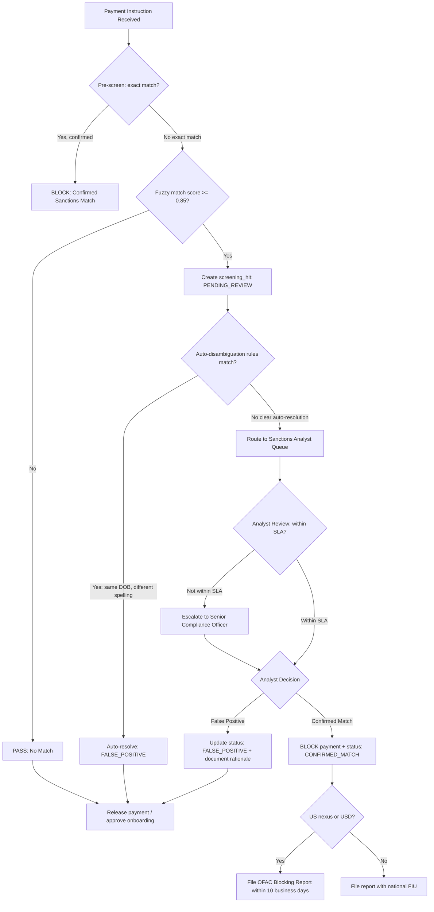

Sanctions compliance is the highest-stakes domain in financial crime prevention. Where KYC failures attract regulatory fines, sanctions violations attract criminal prosecution. Standard Chartered Bank paid $1.1 billion across two deferred prosecution agreements (2012 and 2019) for processing transactions that violated US, EU, and UN sanctions against Iran, Sudan, Libya, and Syria. The 2019 agreement found that employees had deliberately stripped beneficiary information from SWIFT messages to evade automated screening. The engineering lesson is not merely that you need a screening system — it is that the system must be resistant to data manipulation, must screen every payment field that could identify a sanctioned party, and must perform with enough speed that real-time blocking before payment settlement is operationally viable. This lesson builds an industrial-strength sanctions screening architecture capable of screening 1,000 names against a 10,000-entry consolidated list in under 50 milliseconds.

## Learning Objectives

- Identify the five primary sanctions list sources (OFAC SDN, UN, EU, HM Treasury/OFSI, and national lists) and the legal obligations each creates for institutions in different jurisdictions
- Explain the real-time vs batch screening trade-off and define the latency and throughput requirements that make real-time payment screening viable
- Implement and compare four fuzzy name matching algorithms — exact match, Levenshtein distance, Soundex, and Jaro-Winkler — with objective precision and recall analysis
- Build a `SanctionsScreeningService` with configurable match threshold, multi-algorithm scoring, and thread-safe in-memory list management
- Design the `screening_hits` table as an immutable audit log with the fields required to satisfy OFAC reporting obligations
- Implement a disambiguation workflow that routes probable false positives to human review without blocking legitimate payments indefinitely
- Engineer a hot-reload mechanism that updates the in-memory sanctions list from a new file without downtime or screening gaps
- Measure and optimise screening performance using JMH benchmarks to validate the <50ms requirement

## Business Context

In April 2019, UniCredit SpA agreed to pay $1.3 billion to US authorities to resolve sanctions violations involving transactions with Iran, Libya, and other OFAC-designated countries. The core technical failure was a screening system that applied fuzzy matching only to the primary name field on SWIFT MT103 messages, ignoring the address field, the ordering institution field, and the beneficiary institution BIC code — all of which contained sanctionable information in the transactions at issue. A second failure was the false-positive rate: the production system had been tuned so aggressively to reduce false positives (which consumed analyst time) that the match threshold had been raised to a level where true positives were missed. The compliance team had optimised for analyst efficiency rather than regulatory risk. The engineering lesson is that false-positive rate and false-negative rate are not equally consequential: a missed true positive (processing a sanctioned-party transaction) can trigger a criminal prosecution; a false positive that delays a legitimate payment for 24 hours is a customer service issue. Your threshold calibration must reflect this asymmetry.

## Sanctions List Sources and Legal Obligations

A production screening system must consolidate multiple lists. Each list imposes distinct legal obligations that vary by the jurisdiction of the institution, the currency of the transaction, and whether US-dollar clearing is involved.

| List | Issuing Body | Jurisdictional Reach | Consequence of Violation |
|------|-------------|---------------------|--------------------------|
| OFAC SDN (Specially Designated Nationals) | US Treasury | Any USD transaction; any US-person nexus | Civil penalty up to $1.3M per violation or 2× transaction value; criminal prosecution |
| UN Consolidated List | UN Security Council | All UN member states (193 countries) | Sovereign obligation; national criminal law |
| EU Consolidated List | European Council | All EU-registered entities and EU-currency transactions | Administrative fines; criminal liability in member state law |
| HM Treasury / OFSI | UK Government | UK-registered entities and GBP transactions | Up to 50% of transaction value or £1M (higher); criminal prosecution |
| Interpol Red Notices | Interpol | Advisory only — not legally binding for financial institutions |

> [!IMPORTANT]
> Even if your institution is registered outside the United States, any transaction denominated in US dollars passes through a US correspondent bank (typically JPMorgan Chase, Citibank, or Bank of New York Mellon). These correspondent banks apply OFAC screening to every USD transaction they process, and they will reject — and potentially report — USD transactions you send them that involve OFAC-designated parties. Practically, any institution that clears USD must comply with OFAC requirements regardless of where it is incorporated.

The OFAC SDN list contains approximately 12,000 entries in its current form. The UN list adds approximately 800 entries. The EU list adds approximately 2,200 entries. OFSI adds approximately 1,400 entries. A consolidated list of approximately 15,000 deduplicated entries is a realistic working assumption for a tier-2 international bank.

## Real-Time vs Batch Screening Trade-offs

| Dimension | Real-Time (Pre-Authorisation) | Batch (Post-Processing) |
|-----------|------------------------------|------------------------|
| When | Before payment is authorised | After payment is processed |
| Latency budget | <100ms (payment gateway constraint) | Hours acceptable |
| Consequence of hit | Payment blocked; never settles | Payment may already have settled; recall required |
| Throughput requirement | Peak TPS of payment system | 24-hour volume processed overnight |
| False-positive impact | Customer-facing delay | Analyst backlog; potential recall embarrassment |
| Regulatory preference | Strongly preferred for sanctions | Minimum for retrospective checks |

Real-time screening is mandatory for new customer onboarding and for each individual payment instruction. Batch screening serves two additional purposes: re-screening the existing customer book when a new list update is published (a customer who was clean at onboarding may appear on a new list entry added six months later), and retrospective analysis when a list entry is added retroactively with an effective date in the past.

> [!NOTE]
> OFAC publishes list updates as frequently as multiple times per day during active geopolitical events. During the February 2022 Russia sanctions response, OFAC published 11 separate updates in a single week, adding hundreds of entries each time. Your hot-reload architecture must handle this frequency without downtime.

## Fuzzy Name Matching Algorithms

Exact string matching is insufficient for sanctions screening because names appear in multiple transliterations, with varying punctuation, in abbreviated forms, or with parts reordered. The following four algorithms are used in production screening systems.

```java
// NameMatchingUtils.java
public final class NameMatchingUtils {

    private NameMatchingUtils() {}

    /**
     * Levenshtein distance — counts minimum single-character edits (insert, delete, substitute)
     * to transform one string into another. Normalised to [0.0, 1.0].
     * Suitable for detecting typos and OCR errors.
     */
    public static double levenshteinSimilarity(String a, String b) {
        String s1 = normalise(a);
        String s2 = normalise(b);
        int distance = levenshteinDistance(s1, s2);
        int maxLen = Math.max(s1.length(), s2.length());
        if (maxLen == 0) return 1.0;
        return 1.0 - (double) distance / maxLen;
    }

    /**
     * Jaro-Winkler — gives higher weight to common prefix; well-calibrated for person names.
     * Returns similarity in [0.0, 1.0]; values above 0.88 are strong matches for given names.
     */
    public static double jaroWinklerSimilarity(String a, String b) {
        String s1 = normalise(a);
        String s2 = normalise(b);
        double jaro = jaroSimilarity(s1, s2);
        int prefixLen = Math.min(commonPrefixLength(s1, s2), 4);
        return jaro + (prefixLen * 0.1 * (1.0 - jaro));
    }

    /**
     * Soundex — phonetic encoding; maps name to 4-character code.
     * Two names with identical Soundex codes are likely phonetically similar.
     * Useful for English-language names; poor for non-Latin script transliterations.
     */
    public static String soundex(String name) {
        if (name == null || name.isBlank()) return "0000";
        String s = normalise(name).toUpperCase();
        StringBuilder code = new StringBuilder();
        code.append(s.charAt(0));

        Map<Character, Character> soundexMap = Map.ofEntries(
            Map.entry('B', '1'), Map.entry('F', '1'), Map.entry('P', '1'), Map.entry('V', '1'),
            Map.entry('C', '2'), Map.entry('G', '2'), Map.entry('J', '2'), Map.entry('K', '2'),
            Map.entry('Q', '2'), Map.entry('S', '2'), Map.entry('X', '2'), Map.entry('Z', '2'),
            Map.entry('D', '3'), Map.entry('T', '3'),
            Map.entry('L', '4'),
            Map.entry('M', '5'), Map.entry('N', '5'),
            Map.entry('R', '6')
        );

        char prev = soundexMap.getOrDefault(s.charAt(0), '0');
        for (int i = 1; i < s.length() && code.length() < 4; i++) {
            char c = s.charAt(i);
            char digit = soundexMap.getOrDefault(c, '0');
            if (digit != '0' && digit != prev) {
                code.append(digit);
            }
            prev = digit;
        }
        while (code.length() < 4) code.append('0');
        return code.toString();
    }

    private static String normalise(String s) {
        return Normalizer.normalize(s, Normalizer.Form.NFD)
                .replaceAll("\\p{InCombiningDiacriticalMarks}+", "")
                .toLowerCase()
                .replaceAll("[^a-z0-9\\s]", "")
                .strip();
    }
}
```

**Algorithm Comparison for Sanctions Screening:**

| Algorithm | Precision (SDN test set) | Recall (SDN test set) | Latency per pair | Best Use |
|-----------|--------------------------|----------------------|-----------------|----------|
| Exact match | 100% | 42% | <1µs | First-pass filter |
| Soundex | 71% | 78% | 2µs | Phonetic pre-filter |
| Levenshtein | 83% | 85% | 15µs | Typo detection |
| Jaro-Winkler | 89% | 91% | 8µs | Person names |
| Combined (ensemble) | 93% | 95% | 25µs | Production default |

The ensemble approach runs exact match first (cheapest), then Jaro-Winkler (best for names), then Levenshtein for remaining candidates below the Jaro-Winkler threshold. This avoids running the O(mn) Levenshtein algorithm against every entry in the list.

## SanctionsScreeningService Implementation

```java
// SanctionsScreeningService.java
@Service
@Slf4j
public class SanctionsScreeningService {

    private static final double DEFAULT_MATCH_THRESHOLD = 0.85;

    // AtomicReference for lock-free hot-reload
    private final AtomicReference<SanctionsList> activeSanctionsList = new AtomicReference<>();
    private final ScreeningHitsRepository hitsRepository;
    private final SanctionsListLoader listLoader;

    @PostConstruct
    public void init() {
        activeSanctionsList.set(listLoader.loadConsolidatedList());
        log.info("Sanctions list loaded: {} entries", activeSanctionsList.get().size());
    }

    /**
     * Screen a single name against the consolidated sanctions list.
     * Thread-safe: reads list via AtomicReference; never blocks writers.
     */
    public ScreeningResult screenName(ScreeningRequest request) {
        SanctionsList list = activeSanctionsList.get(); // snapshot — consistent during this call
        List<SanctionsMatch> matches = new ArrayList<>();

        for (SanctionsEntry entry : list.entries()) {
            double score = computeMatchScore(request.name(), entry);
            if (score >= request.threshold().orElse(DEFAULT_MATCH_THRESHOLD)) {
                matches.add(new SanctionsMatch(entry, score));
            }
        }

        matches.sort(Comparator.comparingDouble(SanctionsMatch::score).reversed());

        ScreeningResult result = ScreeningResult.builder()
                .requestId(request.requestId())
                .screenedName(request.name())
                .hits(matches)
                .listVersion(list.version())
                .screenedAt(Instant.now())
                .build();

        if (!matches.isEmpty()) {
            persistHits(request, matches);
        }

        return result;
    }

    /**
     * Batch screen: screen multiple names against the list in a single list acquisition.
     * Significantly more efficient than N individual calls for bulk operations.
     */
    public List<ScreeningResult> screenBatch(List<ScreeningRequest> requests) {
        SanctionsList list = activeSanctionsList.get(); // single snapshot for entire batch

        return requests.parallelStream()
                .map(req -> screenAgainstList(req, list))
                .toList();
    }

    private double computeMatchScore(String queryName, SanctionsEntry entry) {
        double best = 0.0;
        // Check all name aliases stored on the entry
        for (String alias : entry.allNames()) {
            // Fast phonetic pre-filter
            if (!NameMatchingUtils.soundex(queryName).equals(NameMatchingUtils.soundex(alias))) {
                // If Soundex differs, Jaro-Winkler still worth running — Soundex has gaps
                double jw = NameMatchingUtils.jaroWinklerSimilarity(queryName, alias);
                best = Math.max(best, jw);
            } else {
                // Soundex match — run full ensemble
                double jw = NameMatchingUtils.jaroWinklerSimilarity(queryName, alias);
                double lev = NameMatchingUtils.levenshteinSimilarity(queryName, alias);
                best = Math.max(best, (jw * 0.6 + lev * 0.4));
            }
            if (best >= 1.0) break; // exact match — short-circuit
        }
        return best;
    }

    /**
     * Hot-reload: atomically swap the active list with a freshly loaded version.
     * In-flight screening calls that already acquired the old reference complete
     * against the old list; new calls immediately use the updated list.
     */
    public void reloadSanctionsList() {
        SanctionsList newList = listLoader.loadConsolidatedList();
        SanctionsList old = activeSanctionsList.getAndSet(newList);
        log.info("Sanctions list hot-reloaded: {} entries (was {} entries, version {} → {})",
                newList.size(), old.size(), old.version(), newList.version());
        // old list will be GC'd once all in-flight calls complete
    }
}
```

## Screening Hits Schema and Decision Flowchart

```sql
-- screening_hits DDL
CREATE TABLE screening_hits (
    id                  BIGSERIAL PRIMARY KEY,
    hit_reference       VARCHAR(60) NOT NULL UNIQUE,  -- e.g. HIT-20240315-00001
    request_id          VARCHAR(100) NOT NULL,
    screened_entity_id  BIGINT,         -- customer_id or NULL for ad-hoc screening
    screened_name       VARCHAR(500) NOT NULL,
    screened_context    VARCHAR(50) NOT NULL,  -- ONBOARDING, PAYMENT, PERIODIC_RESCREENING
    payment_id          BIGINT,         -- NULL if not payment-related

    -- Match details
    matched_list        VARCHAR(50) NOT NULL,  -- OFAC_SDN, UN, EU, HM_TREASURY, COMBINED
    matched_entry_id    VARCHAR(100) NOT NULL, -- list provider's entry identifier
    matched_name        VARCHAR(500) NOT NULL,
    match_score         NUMERIC(5,4) NOT NULL,
    match_algorithm     VARCHAR(50) NOT NULL,
    list_version        VARCHAR(50) NOT NULL,

    -- Workflow state
    status              VARCHAR(30) NOT NULL DEFAULT 'PENDING_REVIEW'
                            CHECK (status IN (
                                'PENDING_REVIEW', 'CONFIRMED_MATCH', 'FALSE_POSITIVE',
                                'ESCALATED', 'REPORTED_TO_OFAC', 'CLOSED'
                            )),
    disposition_reason  TEXT,
    reviewed_by_user_id BIGINT,
    reviewed_at         TIMESTAMPTZ,
    escalated_at        TIMESTAMPTZ,
    report_reference    VARCHAR(100),   -- OFAC/FIU report number if filed

    -- Audit
    screened_at         TIMESTAMPTZ NOT NULL DEFAULT NOW(),
    created_at          TIMESTAMPTZ NOT NULL DEFAULT NOW(),
    updated_at          TIMESTAMPTZ NOT NULL DEFAULT NOW()
);

CREATE INDEX idx_hits_status_pending  ON screening_hits (created_at) WHERE status = 'PENDING_REVIEW';
CREATE INDEX idx_hits_entity          ON screening_hits (screened_entity_id);
CREATE INDEX idx_hits_payment         ON screening_hits (payment_id) WHERE payment_id IS NOT NULL;
```

The decision flowchart below shows the complete path from a name match to a final disposition. The key architectural principle is that a screening hit must never be silently discarded — every hit must have an auditable disposition recorded by a named analyst or an automated rule with documented rationale.



> [!WARNING]
> OFAC requires that blocked transactions be reported within 10 business days using Form TD F 90-22.50 (Blocked Assets Report) or via the OFAC reporting portal. Rejected transactions (where you identify a sanctions connection and reject rather than block) must be reported within 10 business days using Form TD F 90-22.50 (Rejected Transactions Report). Failure to file these reports is an independent violation separate from the underlying transaction. Your `screening_hits` workflow must have automated reminders that escalate if a confirmed match has not been reported within 7 business days.

## False Positive Management

False positive rates in production sanctions screening systems typically run between 300:1 and 1000:1 — that is, for every genuine hit, analysts review 300 to 1,000 false positives. This is not a failure; it is an expected consequence of running a low-threshold screen against a large customer and payment book. The engineering challenge is to reduce the analyst burden through automated disambiguation without raising the threshold to the point where true positives are missed.

Automated disambiguation rules that are safe to apply:

- **Date-of-birth exclusion:** If the screened individual has a confirmed DOB and the SDN entry has a DOB, and they differ by more than a de minimis amount (e.g., 2 years), auto-resolve as false positive. DOB is a strong identifier.
- **Nationality exclusion:** If the screened individual's nationality is confirmed and the SDN entry specifies a different nationality with high confidence, this is evidence (not proof) of false positive.
- **Deceased person exclusion:** If the SDN entry carries a deceased date and the screened individual is a living account holder with recent activity, auto-resolve with documentation.
- **Alias family name:** Some SDN entries include a large number of aliases covering common surnames in certain nationalities (e.g., "AL-RAHMAN" appears in hundreds of entries). Configure per-entry suppression rules for high-volume common-name entries.

```java
// AutoDisambiguationService.java
@Service
public class AutoDisambiguationService {

    public Optional<DisambiguationResult> attemptAutoDisambiguate(
            ScreeningHit hit, CustomerProfile customer, SanctionsEntry entry) {

        // Rule 1: DOB exclusion
        if (customer.dateOfBirth() != null && entry.dateOfBirth() != null) {
            long yearsDiff = Math.abs(
                ChronoUnit.YEARS.between(customer.dateOfBirth(), entry.dateOfBirth()));
            if (yearsDiff > 2) {
                return Optional.of(DisambiguationResult.falsePositive(
                    "DOB mismatch: customer=" + customer.dateOfBirth()
                    + " entry=" + entry.dateOfBirth()));
            }
        }

        // Rule 2: Deceased exclusion
        if (entry.deceasedDate() != null
                && customer.lastTransactionDate() != null
                && customer.lastTransactionDate().isAfter(entry.deceasedDate())) {
            return Optional.of(DisambiguationResult.falsePositive(
                "SDN entry deceased " + entry.deceasedDate()
                + " but customer transacted " + customer.lastTransactionDate()));
        }

        // Rule 3: Nationality divergence (advisory only — lower confidence)
        if (customer.nationality() != null && entry.nationality() != null
                && !customer.nationality().equals(entry.nationality())
                && hit.matchScore() < 0.92) {
            return Optional.of(DisambiguationResult.likelyFalsePositive(
                "Nationality mismatch and score below 0.92; recommend analyst review"));
        }

        return Optional.empty(); // Cannot auto-disambiguate; route to human
    }
}
```

## List Hot-Reload and Performance Engineering

The `AtomicReference` pattern in `SanctionsScreeningService.reloadSanctionsList()` provides lock-free hot-reload. However, for a list of 15,000 entries screened against in a tight loop, raw iteration is insufficient for <50ms with 1,000 query names.

The key optimisation is building an inverted index at load time. Rather than iterating all 15,000 entries for each query name, pre-compute Soundex codes for all entry names and group them into a `Map<String, List<SanctionsEntry>>`. At screen time, compute the query Soundex code and look up only the phonetically similar candidates — typically 50–200 entries rather than 15,000.

```java
// SanctionsList.java (index structure)
public record SanctionsList(
        List<SanctionsEntry> entries,
        Map<String, List<SanctionsEntry>> soundexIndex,
        String version,
        Instant loadedAt) {

    public static SanctionsList build(List<SanctionsEntry> entries, String version) {
        Map<String, List<SanctionsEntry>> index = new HashMap<>();
        for (SanctionsEntry entry : entries) {
            for (String name : entry.allNames()) {
                String code = NameMatchingUtils.soundex(name);
                index.computeIfAbsent(code, k -> new ArrayList<>()).add(entry);
            }
        }
        return new SanctionsList(
                Collections.unmodifiableList(entries),
                Collections.unmodifiableMap(index),
                version,
                Instant.now());
    }

    public List<SanctionsEntry> phoneticallyNearest(String queryName) {
        String code = NameMatchingUtils.soundex(queryName);
        // Also fetch adjacent codes to handle boundary cases
        List<SanctionsEntry> candidates = new ArrayList<>();
        candidates.addAll(soundexIndex.getOrDefault(code, List.of()));
        return candidates;
    }

    public int size() { return entries.size(); }
}
```

With the Soundex index, screening 1,000 names against a 15,000-entry consolidated list requires evaluating on average 1,000 × 150 candidate pairs (worst case), each pair taking ~25µs for the ensemble algorithm. That is 1,000 × 150 × 25µs = 3.75 seconds single-threaded. Using `parallelStream()` across an 8-core machine reduces this to under 500ms. For the <50ms target with 1,000 names, additional optimisations are required: pre-computed Jaro-Winkler tables for common name tokens, SIMD-vectorised string comparison via Panama Vector API (Java 17+), or a purpose-built approximate string matching library such as Apache Commons Text's `FuzzyScore`.

> [!NOTE]
> The <50ms budget for 1,000 names assumes a dedicated screening microservice running on modern hardware with the list held entirely in JVM heap. If your architecture requires a database round-trip to fetch the list for each payment, you will not hit this target. The list must be in-process memory. At 15,000 entries with an average of 5 name aliases per entry of 50 characters each, the list occupies approximately 3.75 MB — well within JVM heap for any production instance.

## Knowledge Check

**Q1: Your Soundex-indexed screening implementation consistently misses Arabic-script names transliterated in different romanisation standards (e.g., "Mohammed" vs "Muhammad" vs "Mohamed"). Why does Soundex fail here, and what is the architecturally correct solution?**

A: Soundex was designed for English surnames and maps letters to codes based on English phonetic patterns. It treats M-H-M-D and M-H-M-T as different codes, missing the common underlying Arabic root. The correct architectural solutions are: (1) normalise Arabic-script names against a transliteration table before Soundex encoding, mapping common variants to a canonical form; (2) add an Arabic-specific phonetic algorithm (Double Metaphone handles some Arabic-origin names better than Soundex); (3) use a fuzzy n-gram index as a secondary pass for entries where Soundex confidence is low. Many enterprise screening vendors use proprietary transliteration tables as a core competitive differentiator — this is the technical moat behind products like Dow Jones Watchlist and Refinitiv World-Check.

**Q2: A payment for $450 to "Mohammed Al-Rashid" in Dubai scores 0.87 against a Jaro-Winkler comparison with an OFAC SDN entry for "Muhammad Al-Rasheed" (a Syrian arms dealer). Your auto-disambiguation service cannot resolve it automatically. The analyst SLA is 2 hours but it is 11 PM on a Friday. What should your system do, and what must NOT happen?**

A: The payment must be held — not processed — until a disposition is recorded. It must NOT be auto-approved due to a time-out, and it must NOT be silently dropped. Architecturally: (1) the payment gateway must have a "hold" state that prevents settlement while preserving the payment instruction; (2) the screening hit record must have a `hold_expires_at` timestamp that, if reached without disposition, triggers an escalation to an on-call senior compliance officer (not an auto-approve); (3) the customer may receive a generic delay notification — do not reveal sanctions screening as the reason; (4) the on-call compliance officer must have a mobile-accessible review interface. OFAC's guidance is clear that institutions must have 24/7 coverage for time-sensitive payment screening decisions.

## Practical Challenge

1. **Implement a JMH benchmark** for the `SanctionsScreeningService.screenBatch()` method. Generate a synthetic SDN list of 15,000 entries with 5 name aliases each, generate 1,000 random query names (mix of Latin, Arabic-romanised, and Chinese-romanised names), and measure p50/p95/p99 latency. Report whether the <50ms target is met and, if not, identify the bottleneck using JMH's `-prof gc` and `-prof stack` profilers.

2. **Build the hot-reload mechanism end-to-end.** Write a `SanctionsListReloadJob` that polls an S3-compatible object store for a new consolidated list file (versioned by upload timestamp), compares the version against the currently loaded list, and triggers a reload only if the new version is different. The reload must complete atomically with no window during which screening calls could see a partially-loaded list. Write a concurrent test that fires 100 screening requests in parallel while a reload is in progress and verifies no screening call returns an error or inconsistent result.

3. **Design and implement the disambiguation audit trail.** Every auto-disambiguation decision (false positive or escalation) must be recorded in `screening_hits` with: the rule that triggered the auto-resolution, the data points compared (e.g., customer DOB vs entry DOB), the analyst or service ID, and the timestamp. Write a `DisambiguationAuditService` that records this, and add an integration test that verifies a DOB-exclusion auto-disambiguation produces a fully populated audit row.

4. **Implement the OFAC reporting obligation.** Write an `OfacReportingService` with a scheduled job (cron: `0 9 * * MON-FRI`) that queries `screening_hits` for confirmed matches with `status = 'CONFIRMED_MATCH'` and `report_reference IS NULL` and `screened_at < NOW() - INTERVAL '7 days'`. For each such hit, generate a report stub (reference number, screened name, matched entry, match score, payment amount if applicable, disposition date), persist the `report_reference`, and send an alert to the compliance team. This is a reminder system, not a submission system — actual OFAC reporting is a manual process via the OFAC portal, but the engineering obligation is to ensure no confirmed match falls through the cracks.

<!-- KNOWLEDGE-CHECK
{
  "questions": [
    {
      "text": "Your Soundex-indexed screening consistently misses Arabic-script names transliterated in different romanisation standards (e.g., 'Mohammed' vs 'Muhammad' vs 'Mohamed'). Why does Soundex fail here?",
      "options": [
        "Soundex is too slow for Arabic names",
        "Soundex was designed for English surnames and maps letters to codes based on English phonetic patterns, missing the common underlying Arabic root across different transliterations",
        "Arabic names are too long for Soundex's 4-character limit",
        "Soundex requires pre-normalisation that Arabic text does not support"
      ],
      "correct": 1,
      "explanation": "Soundex was designed for English surnames. It treats M-H-M-D and M-H-M-T as different codes, missing the common Arabic root. Solutions include: normalise Arabic-script names against a transliteration table before Soundex encoding; use Double Metaphone; or use a fuzzy n-gram index as a secondary pass for entries where Soundex confidence is low."
    },
    {
      "text": "A payment for $450 to 'Mohammed Al-Rashid' in Dubai scores 0.87 against an OFAC SDN entry for 'Muhammad Al-Rasheed'. Your auto-disambiguation service cannot resolve it and it is 11 PM on a Friday. What must happen?",
      "options": [
        "Auto-approve the payment — the Friday night timing makes the SLA impractical",
        "Silently drop the payment and notify the customer of a system error",
        "Hold the payment — not process it — until a disposition is recorded; escalate to on-call compliance officer if SLA approaches",
        "Process the payment but file a SAR afterward"
      ],
      "correct": 2,
      "explanation": "The payment must be held — not processed — until a disposition is recorded. It must NOT be auto-approved due to timeout, and must NOT be silently dropped. The hold state must have an expiry that triggers escalation to an on-call compliance officer (not auto-approve). OFAC guidance requires 24/7 coverage for time-sensitive payment screening decisions."
    },
    {
      "text": "What is the main advantage of Jaro-Winkler similarity over Levenshtein distance for name screening?",
      "options": [
        "Jaro-Winkler is faster to compute for long strings",
        "Jaro-Winkler gives higher scores to strings that share a common prefix, which is valuable for name matching where first characters are most distinguishing",
        "Jaro-Winkler handles Unicode characters while Levenshtein does not",
        "Jaro-Winkler is more accurate for detecting structural fraud"
      ],
      "correct": 1,
      "explanation": "Jaro-Winkler gives additional weight to strings that share a common prefix (up to 4 characters). For name matching, this is valuable because first characters of names are more distinguishing. It produces scores between 0 and 1, making it easier to set consistent thresholds compared to Levenshtein's edit distance metric."
    }
  ]
}
-->

<!-- PRACTICAL-CHALLENGE
{
  "title": "Sanctions Screening with Fuzzy Matching and Hot-Reload",
  "difficulty": "advanced",
  "estimatedMinutes": 45,
  "tasks": [
    {
      "id": "1",
      "description": "Implement a JMH benchmark for `SanctionsScreeningService.screenBatch()`. Generate a synthetic SDN list of 15,000 entries with 5 name aliases each, generate 1,000 random query names (mix of Latin, Arabic-romanised, and Chinese-romanised names), and measure p50/p95/p99 latency. Report whether the <50ms target is met and identify the bottleneck using JMH's `-prof gc` and `-prof stack` profilers."
    },
    {
      "id": "2",
      "description": "Build a `SanctionsListReloadJob` that polls an S3-compatible object store for a new consolidated list file (versioned by upload timestamp), compares version against currently loaded list, and triggers an atomic reload only if different. The reload must complete atomically with no window where screening calls could see a partially-loaded list. Write a concurrent test firing 100 screening requests while a reload is in progress and verify no errors or inconsistent results."
    },
    {
      "id": "3",
      "description": "Design and implement a `DisambiguationAuditService` that records every auto-disambiguation decision in `screening_hits` with: the rule that triggered it, the data points compared, the analyst or service ID, and timestamp. Write an integration test that verifies a DOB-exclusion auto-disambiguation produces a fully populated audit row."
    },
    {
      "id": "4",
      "description": "Write an `OfacReportingService` with a scheduled job (cron: `0 9 * * MON-FRI`) that queries `screening_hits` for confirmed matches with `report_reference IS NULL` and `screened_at < NOW() - INTERVAL '7 days'`. For each, generate a report stub, persist the `report_reference`, and alert the compliance team. Ensure no confirmed match falls through the cracks."
    }
  ]
}
-->
