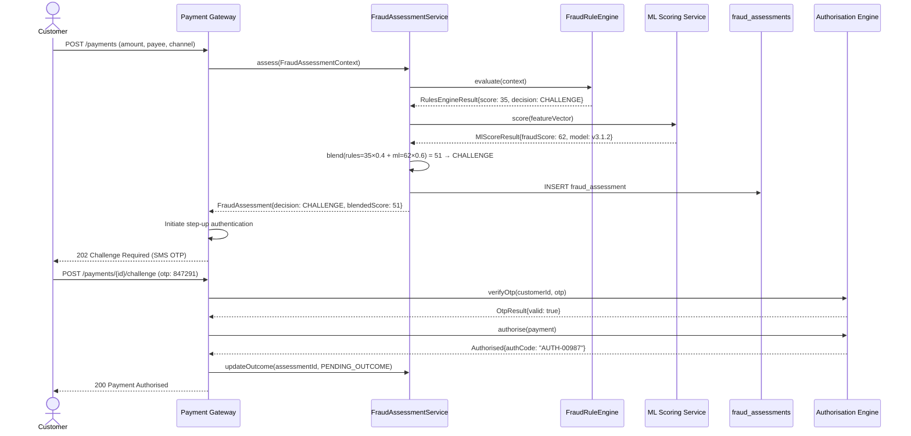

Fraud is the single largest source of financial loss for retail banks in absolute terms. UK Finance reported £1.17 billion lost to authorised and unauthorised fraud in the UK alone in 2023, with Authorised Push Payment (APP) fraud accounting for £459.7 million — a category that barely existed a decade ago. The engineering challenge in fraud detection is fundamentally different from AML or sanctions compliance: where sanctions screening asks "is this party on a list?", fraud detection asks "does this behaviour pattern deviate from what is normal for this customer and this channel?" That question requires statistical inference, not lookup, and it must be answered within the latency budget of a payment authorisation — typically under 300 milliseconds from the perspective of the payment network, often with a 50ms internal target to leave headroom for other authorisation steps. This lesson builds the full fraud detection architecture: a pluggable rules engine for deterministic velocity and behavioural rules, an ML model scoring integration for probabilistic risk assessment, and a challenge flow that throttles fraud without blocking legitimate customers.

## Learning Objectives

- Classify the five primary fraud typologies relevant to banking systems (CNP, account takeover, APP, first-party fraud, and mule account fraud) and explain the technical signals that distinguish each
- Articulate the real-time vs post-auth detection trade-off and define the latency and accuracy constraints that determine which approach is viable for a given fraud type
- Design a `FraudRuleEngine` with a pluggable `FraudRule` interface, weighted scoring, and rule version control
- Implement production-quality velocity rules (transaction count, value, geolocation change, device change) using Redis-backed counters with TTL
- Integrate an external ML model scoring service into the fraud assessment pipeline with feature extraction, timeout handling, and score threshold management
- Write production-quality DDL for a `fraud_assessments` table that captures the complete decision audit trail
- Build a challenge flow (step-up authentication) that presents friction proportionate to the assessed fraud risk without blocking low-risk transactions
- Design a chargeback feedback loop that closes the model retraining cycle with labelled fraud outcomes

## Business Context

In 2021, HSBC UK processed a fraudulent instruction that resulted in a £600,000 APP fraud loss. The victim was a property buyer who received an email purportedly from their solicitor instructing them to send completion funds to a new account. HSBC's fraud system scored the payment as low-risk because the customer had a good transaction history, was using a known device, and the transaction was for a residential property purchase — a category that HSBC's rules engine had been tuned to let through with minimal friction to avoid abandonment by legitimate buyers in time-sensitive conveyancing transactions. The fraud was detected only 11 days later during reconciliation. The engineering lesson is that individual signals can all be "normal" while the combination is anomalous: same device, same location, authenticated session, but first-time beneficiary, full account balance transfer, and beneficiary account opened 3 days prior. No single rule caught it; only an ML model trained on APP fraud patterns would have flagged the beneficiary account age combined with the transfer-to-zero behaviour. HSBC subsequently invested £26 million in an ML-based fraud platform upgrade between 2022 and 2024.

## Fraud Typology in Banking

Understanding the technical signatures of each fraud type is prerequisite to designing effective detection rules.

| Fraud Type | Description | Key Technical Signals | Latency Requirement |
|------------|-------------|----------------------|---------------------|
| Card Not Present (CNP) | Using stolen card details for online purchases | Device mismatch, velocity, billing address mismatch, 3DS downgrade | <100ms (3DS inline) |
| Account Takeover (ATO) | Credential theft to access and drain accounts | New device, unusual location, password change then transfer, session anomalies | <200ms (login) |
| Authorised Push Payment (APP) | Social engineering victim into authorising a transfer | First-time payee, full-balance transfer, beneficiary account age, time pressure | <300ms (payment) |
| First-Party Fraud | Customer makes genuine transaction then falsely disputes it | Chargeback history, claim pattern, merchant category | Post-auth (days) |
| Mule Account | Account used to receive and forward stolen funds | Receive-and-forward pattern, sudden inbound activity, transaction structuring | Near-real-time (minutes) |

> [!NOTE]
> Mule account detection is architecturally different from the other types: it focuses on inbound transaction patterns rather than outbound payment risk. Mule detection requires monitoring receiving behaviour over time windows of hours to days, not milliseconds. It is best handled by a streaming analytics platform (Kafka Streams, Apache Flink) rather than the synchronous payment-authorisation pipeline that handles CNP, ATO, and APP detection.

## Rules Engine Architecture

A rules engine provides deterministic, auditable fraud decisions based on explicit conditions. It is the first layer of the fraud detection stack — fast, explainable, and directly tunable by risk analysts without engineering involvement (through a rules management UI). The pluggable `FraudRule` interface allows new rules to be added without modifying the engine core.

```java
// FraudRule.java
public interface FraudRule {
    /**
     * Unique identifier for this rule — used in audit trail and reporting.
     */
    String ruleId();

    /**
     * Human-readable name for analyst UIs and reporting.
     */
    String ruleName();

    /**
     * Version string — increment when rule logic changes to maintain audit trail fidelity.
     */
    String version();

    /**
     * Evaluate the rule against the given context.
     *
     * @return a RuleResult containing: fired (boolean), score contribution (0–100),
     *         and an explanation string for the audit trail.
     */
    RuleResult evaluate(FraudAssessmentContext context);

    /**
     * Whether a firing of this rule alone is sufficient to block a transaction,
     * regardless of the weighted aggregate score. Used for hard-stop rules
     * such as confirmed compromised card.
     */
    default boolean isHardStop() { return false; }
}

// VelocityRule.java — velocity check using Redis-backed counters
@Component
public class VelocityRule implements FraudRule {

    private static final String RULE_ID = "VELOCITY_TXN_COUNT_1H";
    private static final int THRESHOLD_COUNT = 10;
    private static final int SCORE_CONTRIBUTION = 45;

    private final RedisTemplate<String, String> redis;

    @Override public String ruleId()    { return RULE_ID; }
    @Override public String ruleName()  { return "Transaction count velocity (1h)"; }
    @Override public String version()   { return "1.2.0"; }

    @Override
    public RuleResult evaluate(FraudAssessmentContext ctx) {
        String key = "fraud:velocity:txn_count:1h:" + ctx.customerId();
        Long count = redis.opsForValue().increment(key);
        redis.expire(key, Duration.ofHours(1));

        if (count == null) return RuleResult.notFired(ruleId());

        if (count > THRESHOLD_COUNT) {
            return RuleResult.fired(ruleId(), SCORE_CONTRIBUTION,
                    count + " transactions in last 1h (threshold: " + THRESHOLD_COUNT + ")");
        }
        return RuleResult.notFired(ruleId());
    }
}

// GeolocationVelocityRule.java — impossible travel detection
@Component
public class GeolocationVelocityRule implements FraudRule {

    private static final String RULE_ID = "IMPOSSIBLE_TRAVEL";
    private static final double MAX_FEASIBLE_KMH = 900.0; // commercial aviation speed
    private static final int SCORE_CONTRIBUTION = 70;

    @Override public String ruleId()   { return RULE_ID; }
    @Override public String ruleName() { return "Impossible travel velocity"; }
    @Override public String version()  { return "1.0.1"; }

    @Override
    public RuleResult evaluate(FraudAssessmentContext ctx) {
        ctx.previousTransaction().ifPresent(prev -> {
            if (prev.ipLocation() == null || ctx.currentIpLocation() == null) return;

            double distanceKm = haversineDistance(prev.ipLocation(), ctx.currentIpLocation());
            double hoursSincePrev = Duration.between(prev.authorisedAt(), ctx.requestedAt())
                    .toMinutes() / 60.0;

            if (hoursSincePrev > 0) {
                double impliedSpeedKmh = distanceKm / hoursSincePrev;
                if (impliedSpeedKmh > MAX_FEASIBLE_KMH) {
                    // return via context — illustrative; real code would use a result accumulator
                }
            }
        });
        return RuleResult.notFired(ruleId());
    }
}
```

## FraudRuleEngine with Weighted Scoring

```java
// FraudRuleEngine.java
@Service
@Slf4j
public class FraudRuleEngine {

    private final List<FraudRule> rules;
    private final FraudRuleConfigRepository configRepo;

    public FraudRuleEngine(List<FraudRule> rules, FraudRuleConfigRepository configRepo) {
        // Rules are discovered via Spring's @Component scanning
        this.rules = Collections.unmodifiableList(rules);
        this.configRepo = configRepo;
    }

    public RulesEngineResult evaluate(FraudAssessmentContext context) {
        List<RuleResult> firedRules = new ArrayList<>();
        int aggregateScore = 0;

        for (FraudRule rule : rules) {
            FraudRuleConfig config = configRepo.findByRuleId(rule.ruleId())
                    .orElse(FraudRuleConfig.defaultConfig(rule.ruleId()));

            if (!config.isEnabled()) continue;

            RuleResult result;
            try {
                result = rule.evaluate(context);
            } catch (Exception e) {
                log.warn("Rule {} threw exception — treating as not fired: {}",
                        rule.ruleId(), e.getMessage());
                result = RuleResult.error(rule.ruleId(), e.getMessage());
            }

            if (result.fired()) {
                firedRules.add(result);
                int weightedScore = (int) (result.scoreContribution() * config.weight());
                aggregateScore = Math.min(100, aggregateScore + weightedScore);

                if (rule.isHardStop()) {
                    log.info("Hard-stop rule fired: ruleId={}, transactionId={}",
                            rule.ruleId(), context.transactionId());
                    return RulesEngineResult.hardBlock(firedRules, aggregateScore);
                }
            }
        }

        FraudDecision decision = scoreToDecision(aggregateScore);
        return RulesEngineResult.builder()
                .decision(decision)
                .aggregateScore(aggregateScore)
                .firedRules(firedRules)
                .build();
    }

    private FraudDecision scoreToDecision(int score) {
        if (score >= 80) return FraudDecision.BLOCK;
        if (score >= 50) return FraudDecision.CHALLENGE;  // step-up auth
        if (score >= 25) return FraudDecision.REVIEW;     // flag for post-auth review
        return FraudDecision.PASS;
    }
}
```

> [!IMPORTANT]
> Rule weights stored in `FraudRuleConfig` must be version-controlled and change-managed. A change to a rule weight is a material change to fraud policy. Many institutions use a shadow-mode evaluation: deploy a new rule or weight change in `SHADOW` mode (evaluate but do not use the result for decisions) for 2–4 weeks, compare shadow decisions against actual decisions, review the false-positive and false-negative delta, then promote to `LIVE` mode. This prevents weight changes from inadvertently increasing the false-positive rate and degrading customer experience.

## ML Model Scoring Integration

The rules engine provides deterministic, explainable decisions but cannot detect novel fraud patterns that have never been explicitly encoded as rules. The ML model scores transactions based on learned patterns across millions of historical transactions, catching subtle combinations that rules miss.

```java
// MlFraudScoringClient.java
@Component
@Slf4j
public class MlFraudScoringClient {

    private static final Duration TIMEOUT = Duration.ofMillis(80);
    private static final int FALLBACK_SCORE = 0; // fail-open: treat ML timeout as low risk

    private final WebClient modelClient;
    private final MeterRegistry meterRegistry;

    public MlScoreResult score(FraudAssessmentContext context) {
        FraudFeatureVector features = extractFeatures(context);

        try {
            return modelClient.post()
                    .uri("/v2/fraud-score")
                    .bodyValue(features)
                    .retrieve()
                    .bodyToMono(MlScoreResult.class)
                    .timeout(TIMEOUT)
                    .block();
        } catch (TimeoutException e) {
            meterRegistry.counter("fraud.ml.timeout").increment();
            log.warn("ML model timed out for transactionId={}; using fallback score={}",
                    context.transactionId(), FALLBACK_SCORE);
            return MlScoreResult.fallback(FALLBACK_SCORE, "MODEL_TIMEOUT");
        } catch (Exception e) {
            meterRegistry.counter("fraud.ml.error").increment();
            log.error("ML model error for transactionId={}: {}", context.transactionId(), e.getMessage());
            return MlScoreResult.fallback(FALLBACK_SCORE, "MODEL_ERROR");
        }
    }

    private FraudFeatureVector extractFeatures(FraudAssessmentContext ctx) {
        return FraudFeatureVector.builder()
                // Transaction features
                .transactionAmount(ctx.amount())
                .transactionAmountZScore(ctx.amountZScoreVsHistory())   // pre-computed
                .hourOfDay(ctx.requestedAt().getHour())
                .dayOfWeek(ctx.requestedAt().getDayOfWeek().getValue())
                .merchantCategoryCode(ctx.merchantCategoryCode())
                .isFirstTimePayee(ctx.isFirstTimePayee())
                // Account features
                .accountAgeDays(ctx.accountAgeDays())
                .avgMonthlySpend(ctx.avgMonthlySpend())
                .balanceAfterTransactionPct(ctx.balanceAfterTransactionPct())
                // Device and channel features
                .isNewDevice(ctx.isNewDevice())
                .deviceRiskScore(ctx.deviceRiskScore())
                .ipRiskScore(ctx.ipRiskScore())
                .channelType(ctx.channelType())
                // Beneficiary features
                .beneficiaryAccountAgeDays(ctx.beneficiaryAccountAgeDays())
                .isPayeeHighRiskCategory(ctx.isPayeeHighRiskCategory())
                .build();
    }
}
```

The combined score from rules engine and ML model is blended to produce the final fraud assessment score:

```java
// FraudAssessmentService.java
@Service
public class FraudAssessmentService {

    private static final double RULES_WEIGHT = 0.40;
    private static final double ML_WEIGHT    = 0.60;

    public FraudAssessment assess(FraudAssessmentContext context) {
        RulesEngineResult rulesResult = rulesEngine.evaluate(context);

        if (rulesResult.isHardBlock()) {
            return FraudAssessment.hardBlock(rulesResult, context.transactionId());
        }

        MlScoreResult mlResult = mlClient.score(context);

        int blendedScore = (int) Math.round(
                rulesResult.aggregateScore() * RULES_WEIGHT
              + mlResult.fraudScore()         * ML_WEIGHT);

        FraudDecision finalDecision = scoreToDecision(blendedScore);

        FraudAssessment assessment = FraudAssessment.builder()
                .transactionId(context.transactionId())
                .customerId(context.customerId())
                .rulesScore(rulesResult.aggregateScore())
                .mlScore(mlResult.fraudScore())
                .blendedScore(blendedScore)
                .decision(finalDecision)
                .firedRules(rulesResult.firedRules())
                .mlModelVersion(mlResult.modelVersion())
                .assessedAt(Instant.now())
                .build();

        assessmentRepository.save(assessment);
        return assessment;
    }
}
```

## Fraud Assessments Schema

```sql
-- fraud_assessments DDL
CREATE TABLE fraud_assessments (
    id                  BIGSERIAL PRIMARY KEY,
    assessment_id       VARCHAR(60) NOT NULL UNIQUE,  -- FA-20240315-00001
    transaction_id      BIGINT NOT NULL,
    customer_id         BIGINT NOT NULL,
    channel             VARCHAR(30) NOT NULL,  -- ONLINE, MOBILE, BRANCH, API

    -- Scores
    rules_score         INTEGER NOT NULL CHECK (rules_score BETWEEN 0 AND 100),
    ml_score            INTEGER,              -- NULL if ML unavailable
    blended_score       INTEGER NOT NULL CHECK (blended_score BETWEEN 0 AND 100),

    -- Decision
    decision            VARCHAR(20) NOT NULL
                            CHECK (decision IN ('PASS', 'REVIEW', 'CHALLENGE', 'BLOCK')),
    decision_reason     VARCHAR(100),         -- human-readable summary
    hard_block          BOOLEAN NOT NULL DEFAULT FALSE,

    -- Rules detail (JSON for flexibility — avoids wide column explosion)
    fired_rules         JSONB NOT NULL DEFAULT '[]',

    -- ML model metadata
    ml_model_id         VARCHAR(50),
    ml_model_version    VARCHAR(20),
    ml_fallback_reason  VARCHAR(50),         -- MODEL_TIMEOUT, MODEL_ERROR, etc.

    -- Outcome (populated post-auth when outcome is known)
    outcome             VARCHAR(20)
                            CHECK (outcome IN ('GENUINE', 'FRAUD_CONFIRMED', 'CHARGEBACK',
                                               'CUSTOMER_DISPUTED', 'UNKNOWN')),
    outcome_updated_at  TIMESTAMPTZ,
    chargeback_id       BIGINT,

    -- Timing
    assessed_at         TIMESTAMPTZ NOT NULL DEFAULT NOW(),
    assessment_latency_ms INTEGER,           -- wall clock time for the full assessment

    created_at          TIMESTAMPTZ NOT NULL DEFAULT NOW()
);

CREATE INDEX idx_fa_transaction   ON fraud_assessments (transaction_id);
CREATE INDEX idx_fa_customer      ON fraud_assessments (customer_id, assessed_at DESC);
CREATE INDEX idx_fa_decision_block ON fraud_assessments (assessed_at)
    WHERE decision = 'BLOCK';
CREATE INDEX idx_fa_outcome_null  ON fraud_assessments (assessed_at)
    WHERE outcome IS NULL AND decision IN ('BLOCK', 'CHALLENGE');
```

## Real-Time Fraud Check in Payment Flow



## Challenge Flow and Step-Up Authentication

The CHALLENGE decision triggers step-up authentication — additional friction proportionate to the assessed risk. The challenge type should be calibrated to the channel and risk level.

| Blended Score | Recommended Challenge | Rationale |
|--------------|----------------------|-----------|
| 50–64 | SMS OTP | Low friction; defeats automated fraud; most customers complete in <60s |
| 65–79 | Biometric re-authentication (face/fingerprint) | Stronger than OTP; defeats SIM-swap fraud |
| 80+ | Block with manual review | Risk too high for automated challenge; human decision required |

> [!WARNING]
> Step-up authentication for APP fraud presents a paradox: a victim being socially engineered will complete any challenge you present, because they genuinely believe the payment is legitimate. For high-APP-risk transactions (first-time payee, full-balance transfer, beneficiary account age < 30 days), consider adding a "cooling off" notification — a push notification or in-app message warning the customer of common fraud patterns associated with the transaction characteristics, with a 10-minute delay before the payment is processed. UK Finance's Contingent Reimbursement Model (CRM) Code and the PSR's mandatory reimbursement scheme (from October 2024) both cite "effective warnings" as a key obligation.

## Chargeback Feedback Loop

The fraud model's accuracy degrades over time as fraud patterns evolve. Chargebacks — customer disputes that result in a transaction being reversed — provide the most reliable labelled fraud outcomes available. Building the feedback loop is architecturally straightforward but operationally critical.

```java
// ChargebackFeedbackService.java
@Service
@Slf4j
public class ChargebackFeedbackService {

    @Transactional
    public void recordChargebackOutcome(ChargebackEvent event) {
        // Find the original fraud assessment for this transaction
        Optional<FraudAssessment> assessment = assessmentRepo
                .findByTransactionId(event.originalTransactionId());

        assessment.ifPresentOrElse(
            fa -> {
                fa.setOutcome(FraudOutcome.FRAUD_CONFIRMED);
                fa.setChargebackId(event.chargebackId());
                fa.setOutcomeUpdatedAt(Instant.now());
                assessmentRepo.save(fa);

                // Emit training event for model retraining pipeline
                trainingEventPublisher.publish(ModelTrainingEvent.builder()
                        .assessmentId(fa.getAssessmentId())
                        .transactionId(event.originalTransactionId())
                        .customerId(fa.getCustomerId())
                        .rulesScore(fa.getRulesScore())
                        .mlScore(fa.getMlScore())
                        .blendedScore(fa.getBlendedScore())
                        .fraudLabel(true)
                        .eventTimestamp(Instant.now())
                        .build());

                log.info("Chargeback feedback recorded: assessmentId={}, transactionId={}, " +
                        "originalMlScore={}, originalDecision={}",
                        fa.getAssessmentId(), event.originalTransactionId(),
                        fa.getMlScore(), fa.getDecision());
            },
            () -> log.warn("No fraud assessment found for chargebackTransactionId={}",
                    event.originalTransactionId())
        );
    }
}
```

The `ModelTrainingEvent` is consumed by the data science team's retraining pipeline, which runs weekly and produces a new model version. The model deployment pipeline uses shadow mode (described earlier) before promoting to production. This closes the feedback loop: fraud outcomes from today's decisions improve tomorrow's model.

> [!NOTE]
> False negatives (fraud that PASSED the system and resulted in a chargeback) are the most valuable training examples because they represent the boundary the model currently cannot see. False positives (legitimate transactions that were blocked) are harder to label definitively — a transaction blocked by fraud controls is never processed, so the outcome is unknown. Some institutions use a small "holdout" sample of high-score transactions that are intentionally processed (without challenge) solely to generate labelled outcome data. This is an ethical and regulatory minefield; most instead rely on challenge-completion rates and indirect signals.

## Knowledge Check

**Q1: Your blended fraud score for a transaction is 48 — just below the CHALLENGE threshold of 50. The ML model returned a fallback score of 0 due to a 90ms timeout that exceeded the 80ms budget. If the ML model had been available and returned a score of 75, the blended score would have been 59 (CHALLENGE). What architectural safeguards should you have in place, and is "fail-open" (treat timeout as low risk) the right default?**

A: "Fail-open" on ML timeout is a deliberate policy choice that prioritises payment completion over fraud prevention when the model is unavailable. It is defensible for routine outages (a brief model restart) but dangerous if the model is degraded under fraud attack (attackers sometimes attempt to overwhelm model endpoints to cause timeouts and exploit the fail-open). Architectural safeguards should include: (1) circuit breaker with a half-open probe mode — after N consecutive timeouts, increase the fallback score to a conservative default (e.g., 50 for CHALLENGE rather than 0) until the circuit recovers; (2) separate alerting for ML timeout rate — if >2% of transactions are timing out, page on-call; (3) a configurable per-channel fail-safe policy — high-risk channels (international wires) might fail-block rather than fail-open; (4) post-authorisation retrospective scoring — when the ML model recovers, re-score recent fail-open transactions and flag those that now score above the BLOCK threshold for manual review.

**Q2: A fraud analyst tells you the false-positive rate has reached 8% — 8 in every 100 blocked transactions are legitimate. She wants you to raise the BLOCK threshold from 80 to 85. Walk through the trade-off analysis you would perform before making this change.**

A: Raise the threshold by 5 points would likely reduce the false-positive rate but increase the false-negative rate. The analysis should quantify: (1) current false-positive rate and the volume of legitimate payments being blocked (and the customer friction cost per block — lost customer lifetime value, complaint handling cost); (2) current false-negative rate from labelled chargeback data — what is the actual fraud loss per basis point of threshold change; (3) shadow-mode simulation — run the new threshold of 85 against historical assessments and compute the marginal fraud loss vs marginal false-positive reduction; (4) regulatory obligation — the PSR mandatory reimbursement scheme makes undetected APP fraud directly costly to the institution; this must be in the loss model; (5) segment analysis — a uniform threshold change may be wrong; a 5-point raise for established customers with long transaction history and no prior fraud may be safe, while maintaining the 80 threshold for new customers or high-risk channels. The correct answer is almost never a global threshold change but a segmented threshold matrix.

## Practical Challenge

1. **Implement a `DeviceFingerprintRule`** that scores transactions based on device trust level. A known trusted device (registered >30 days ago, used in >10 previous transactions) should contribute 0 to the score. A new device (first seen in this session) should contribute 40. A device seen in a previous account takeover investigation should trigger a hard-stop. Use a Redis hash keyed by `device_fingerprint_id` to store device trust metadata with a 90-day TTL.

2. **Write a shadow-mode evaluation harness** for the `FraudRuleEngine`. Add a `ShadowFraudRuleEngine` that evaluates rules marked as `SHADOW` mode alongside the live engine but does not include their scores in the final decision. Store shadow rule results in a separate `fraud_shadow_results` table. Write a weekly summary query that computes the false-positive delta and false-negative delta that would result if the shadow rules were promoted to live.

3. **Build the ML feature vector validation pipeline.** Before sending a `FraudFeatureVector` to the ML scoring service, validate that all features are within expected ranges (e.g., `accountAgeDays >= 0`, `balanceAfterTransactionPct` between -1.0 and 1.0, `amountZScore` between -10 and 10). Features outside these ranges indicate upstream data quality issues and should be flagged with a `FEATURE_OUT_OF_RANGE` metric counter per feature name. Write a unit test that injects an invalid feature vector and verifies the validation rejects it before the HTTP call is made.

4. **Implement the APP fraud cooling-off notification.** For transactions scoring between 40 and 79 where `isFirstTimePayee=true` AND `balanceAfterTransactionPct > 0.80` (more than 80% of balance), hold the payment for 10 minutes and send the customer a push notification with a warning message and a "confirm" / "cancel" option. Write the state machine that transitions the payment from `PENDING_COOLING_OFF` to `COOLING_OFF_CONFIRMED` or `COOLING_OFF_CANCELLED`, and add a Testcontainers test that verifies a payment held in cooling-off is automatically cancelled after the 10-minute window if no customer response is received.

<!-- KNOWLEDGE-CHECK
{
  "questions": [
    {
      "text": "Your blended fraud score for a transaction is 48, just below the CHALLENGE threshold of 50. The ML model returned a fallback score of 0 due to a 90ms timeout that exceeded the 80ms budget. If the ML model had been available, the score would have been 59 (CHALLENGE). Is 'fail-open' (timeout = low risk) the right default?",
      "options": [
        "Yes — fail-open maximises payment completion and customer experience",
        "Yes — timeouts are always transient and self-correcting",
        "No — fail-open is defensible for routine outages but dangerous if attackers deliberately overwhelm model endpoints; use a circuit breaker with conservative fallback scores",
        "No — fail-closed is always safer and must be the default for all channels"
      ],
      "correct": 2,
      "explanation": "Fail-open prioritises payment completion but is dangerous if attackers overwhelm model endpoints to exploit it. Safeguards include: circuit breaker with conservative fallback scores after N consecutive timeouts; separate alerting for ML timeout rate; configurable per-channel fail-safe policy (high-risk channels fail-block); post-authorisation retrospective scoring when model recovers."
    },
    {
      "text": "A fraud analyst wants to raise the BLOCK threshold from 80 to 85 to reduce the 8% false-positive rate. What is the most important analysis to perform before making this change?",
      "options": [
        "Check whether the threshold change requires regulatory approval",
        "Shadow-mode simulation: run the new threshold against historical data to quantify the marginal fraud loss vs marginal false-positive reduction, with segment analysis",
        "Survey customers who were incorrectly blocked to understand their frustration levels",
        "Check if competitors use the same threshold value"
      ],
      "correct": 1,
      "explanation": "Shadow-mode simulation against historical assessments quantifies: marginal fraud loss per basis point of threshold change using labelled chargeback data; marginal false-positive reduction; regulatory obligation impact (PSR mandatory reimbursement makes APP fraud directly costly); and segment analysis. A global threshold change is usually wrong — a segmented threshold matrix is more appropriate."
    },
    {
      "text": "What distinguishes Account Takeover (ATO) fraud from Authorised Push Payment (APP) fraud?",
      "options": [
        "ATO involves larger amounts; APP involves smaller amounts",
        "In ATO the fraudster controls the victim's account and makes payments; in APP the legitimate customer is tricked into authorising a payment to a fraudster",
        "ATO occurs online; APP occurs at physical points of sale",
        "ATO affects businesses; APP affects consumers only"
      ],
      "correct": 1,
      "explanation": "In ATO (Account Takeover), the fraudster compromises the victim's credentials and controls their account to make payments. In APP (Authorised Push Payment) fraud, the legitimate customer is socially engineered into authorising a payment to the fraudster. APP fraud is harder to detect because the customer's behaviour appears voluntary, but the PSR mandatory reimbursement scheme makes it directly costly to the institution."
    }
  ]
}
-->

<!-- PRACTICAL-CHALLENGE
{
  "title": "Fraud Rule Engine with Shadow Mode and ML Integration",
  "difficulty": "advanced",
  "estimatedMinutes": 45,
  "tasks": [
    {
      "id": "1",
      "description": "Implement a `DeviceFingerprintRule` that scores transactions based on device trust level: known trusted device (registered >30 days, used in >10 transactions) contributes 0; new device (first seen this session) contributes 40; device seen in a previous ATO investigation triggers hard-stop. Use a Redis hash keyed by `device_fingerprint_id` with a 90-day TTL."
    },
    {
      "id": "2",
      "description": "Write a `ShadowFraudRuleEngine` that evaluates rules marked as `SHADOW` mode alongside the live engine but does not include their scores in the final decision. Store shadow rule results in a `fraud_shadow_results` table. Write a weekly summary query computing false-positive and false-negative deltas that would result if shadow rules were promoted to live."
    },
    {
      "id": "3",
      "description": "Build the ML feature vector validation pipeline. Before sending a `FraudFeatureVector` to the ML scoring service, validate all features are within expected ranges (e.g., `accountAgeDays >= 0`, `balanceAfterTransactionPct` between -1.0 and 1.0). Flag out-of-range features with a `FEATURE_OUT_OF_RANGE` metric counter per feature name. Write a unit test that injects an invalid feature vector and verifies rejection before the HTTP call is made."
    },
    {
      "id": "4",
      "description": "Implement the APP fraud cooling-off notification for transactions scoring 40-79 where `isFirstTimePayee=true` AND `balanceAfterTransactionPct > 0.80`. Hold the payment for 10 minutes, send a push notification with confirm/cancel options. Write the state machine transitioning `PENDING_COOLING_OFF` to `COOLING_OFF_CONFIRMED` or `COOLING_OFF_CANCELLED`. Add a Testcontainers test verifying auto-cancellation after 10 minutes without customer response."
    }
  ]
}
-->
