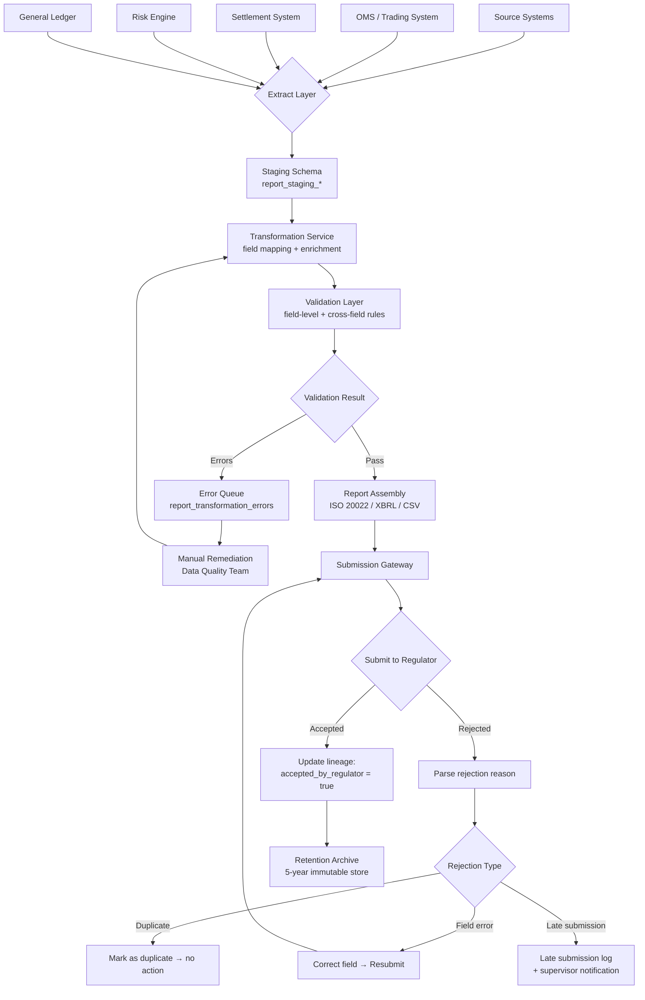

Regulatory reporting is the unglamorous backbone of financial market oversight. It does not generate revenue, it does not improve the customer experience, and it only becomes visible to the board when it fails. When it fails, the consequences are severe: Deutsche Bank was fined €7 million by BaFin in 2019 for 1.6 million late or missing MiFID II transaction reports; Goldman Sachs was fined £34.3 million by the FCA in 2019 for failing to report 220.4 million transactions accurately between November 2007 and March 2017. The engineering challenge in regulatory reporting is not technical complexity — the algorithms are simple aggregations and format conversions. The challenge is correctness, completeness, and the ability to prove both to a regulator who may ask, two years after the fact, why a specific transaction was reported the way it was. That question demands a data lineage architecture that can reconstruct the exact state of source data, transformation rules, and reporting logic at any historical point in time.

## Learning Objectives

- Map the four primary regulatory reporting regimes — MiFID II transaction reporting, Basel III capital ratio reporting, PSD2 fraud reporting, and EMIR derivatives reporting — to their concrete data requirements and submission deadlines
- Enumerate the mandatory fields in a MiFID II transaction report and explain the data sourcing challenges for fields such as LEI, ISIN, and national client identifier
- Implement a `MifidReportingService` that extracts eligible transactions, transforms them into ISO 20022 REDA-format XML, and submits them to an Approved Reporting Mechanism (ARM)
- Design a `report_data_lineage` table that records the complete provenance chain from source system record to submitted report field
- Explain the CET1 capital ratio formula under Basel III and implement a `CapitalRatioCalculator` that computes it from risk-weighted asset data
- Architect a report submission pipeline with retry, idempotency, and resubmission-on-rejection capability
- Build an audit trail that satisfies the five-year retention obligation under MiFID II Article 25(1) and Basel III Pillar 3
- Explain the correction and cancellation workflow for previously submitted reports and its implications for data immutability

## Business Context

In January 2020, Commerzbank AG was fined £37.8 million by the UK FCA for transaction reporting failures under EMIR between 2013 and 2015. The core failure was a system migration: when Commerzbank migrated its derivatives booking system in 2013, the mapping between the old system's trade identifiers and the EMIR Unique Trade Identifier (UTI) format was implemented incorrectly. Because the error was in a mapping table that no one reviewed after go-live, 56.7 million derivative trade reports were submitted with structurally incorrect UTI values. The FCA found no evidence of intent to deceive — this was a pure engineering failure. The fine calculation works out to approximately £0.67 per incorrect report. The lesson is not that you must never make mistakes — it is that you must have controls that detect mapping errors within days, not years. A data lineage system that tracks source trade ID → UTI transformation would have made this error visible in the first week's output, when a reconciliation query would have revealed UTI collisions or format violations in the submitted data.

## Regulatory Reporting Landscape

Regulated financial institutions face reporting obligations across multiple regimes simultaneously. Each regime has distinct data requirements, submission frequencies, and submission channels.

| Regime | Regulation | Scope | Frequency | Deadline | Submission Channel |
|--------|------------|-------|-----------|----------|--------------------|
| Transaction reporting | MiFID II Art. 26 | Trades in financial instruments on EU venues | Per transaction | T+1 (next business day) | ARM → ESMA/NCA |
| Capital adequacy | Basel III / CRD IV | Credit, market, and operational risk | Quarterly + annual | 45 days after quarter end | National supervisor portal |
| Derivatives reporting | EMIR Art. 9 | OTC and exchange-traded derivatives | Per trade | T+1 | Trade Repository |
| Fraud reporting | PSD2 Art. 96(6) | Payment fraud statistics | Semi-annual | 31 Jan / 31 Jul | EBA / NCA |
| Large exposures | CRR Art. 394 | Exposures > 10% of Tier 1 capital | Quarterly | 45 days after quarter end | National supervisor portal |

> [!IMPORTANT]
> MiFID II transaction reporting has a T+1 deadline — reports are due the next business day after the transaction date. For a firm trading across multiple time zones, this means the reporting pipeline must be capable of processing all transactions from the previous day and submitting them by the ARM's cut-off time, typically 15:00 CET. Any pipeline outage that delays batch processing by more than a few hours can breach this deadline. The pipeline must have automated alerting if the submission has not been sent by 12:00 CET and emergency reprocessing procedures documented and tested.

## MiFID II Transaction Reporting Requirements

A MiFID II transaction report under Article 26 and RTS 22 contains 65 mandatory fields. The most architecturally challenging fields are those that require cross-system data joins at report time.

| Field | RTS 22 Field # | Sourcing Challenge |
|-------|---------------|-------------------|
| Trading venue transaction ID | 3 | Must be populated by the execution venue; lost if OMS strips it |
| LEI of executing firm | 4 | LEI registry lookup required; LEIs expire annually |
| ISIN | 41 | Instrument master data must be synchronized with FIRDS (ESMA's reference data system) |
| National client identifier | 10–13 | Different formats per country: NI (UK), passport (non-EU), LEI (legal entities) |
| Buyer/seller decision time | 28, 36 | Microsecond-precision timestamp from OMS required; derived fields fail audit |
| Short selling indicator | 62 | Requires position data from prime broker; not always available pre-settlement |

```java
// MifidReportingService.java
@Service
@Slf4j
public class MifidReportingService {

    private final TransactionRepository transactionRepo;
    private final InstrumentMasterDataService instrumentService;
    private final LeiRegistryClient leiClient;
    private final ArmSubmissionClient armClient;
    private final ReportLineageService lineageService;
    private final MifidReportRepository reportRepo;

    /**
     * Extract all reportable transactions for the given trade date,
     * transform to MiFID II format, and submit to the ARM.
     * Idempotent: safe to call multiple times for the same date.
     */
    @Transactional
    public ReportingRunResult runDailyReporting(LocalDate tradeDate) {
        log.info("Starting MiFID II daily reporting for tradeDate={}", tradeDate);

        // Check for existing successful submission — idempotency guard
        Optional<MifidReportRun> existingRun = reportRepo
                .findSuccessfulRunByTradeDate(tradeDate);
        if (existingRun.isPresent()) {
            log.info("Trade date {} already successfully reported: runId={}",
                    tradeDate, existingRun.get().getId());
            return ReportingRunResult.alreadySubmitted(existingRun.get());
        }

        // 1. Extract eligible transactions
        List<Transaction> transactions = transactionRepo
                .findReportableTransactions(tradeDate);
        log.info("Found {} reportable transactions for tradeDate={}", transactions.size(), tradeDate);

        // 2. Transform to MiFID II report records
        List<MifidTransactionReport> reports = new ArrayList<>();
        List<TransformationError> errors = new ArrayList<>();

        for (Transaction txn : transactions) {
            try {
                MifidTransactionReport report = transform(txn);
                reports.add(report);
                lineageService.recordTransformation(txn, report);
            } catch (TransformationException e) {
                errors.add(new TransformationError(txn.getId(), e.getMessage()));
                log.error("Transformation failed for transactionId={}: {}", txn.getId(), e.getMessage());
            }
        }

        if (!errors.isEmpty()) {
            log.warn("{} transformation errors — submitting {} successful records; "
                    + "failed records queued for manual review", errors.size(), reports.size());
            reportRepo.saveTransformationErrors(errors, tradeDate);
        }

        // 3. Generate ISO 20022 REDA XML
        String xmlPayload = generateRedaXml(reports, tradeDate);

        // 4. Submit to ARM
        MifidReportRun run = MifidReportRun.builder()
                .tradeDate(tradeDate)
                .recordCount(reports.size())
                .errorCount(errors.size())
                .xmlPayloadHash(sha256(xmlPayload))
                .status(ReportRunStatus.SUBMITTING)
                .build();
        reportRepo.save(run);

        ArmSubmissionResult submission = armClient.submit(xmlPayload, tradeDate);
        run.setArmSubmissionId(submission.submissionId());
        run.setStatus(submission.accepted() ? ReportRunStatus.ACCEPTED : ReportRunStatus.REJECTED);
        run.setSubmittedAt(Instant.now());
        reportRepo.save(run);

        if (!submission.accepted()) {
            handleRejection(run, submission);
        }

        return ReportingRunResult.from(run, errors);
    }

    private MifidTransactionReport transform(Transaction txn) {
        InstrumentDetails instrument = instrumentService
                .lookupByIsin(txn.getInstrumentIsin())
                .orElseThrow(() -> new TransformationException(
                        "ISIN not found in instrument master: " + txn.getInstrumentIsin()));

        String executingFirmLei = leiClient.lookupLei(txn.getExecutingFirmId())
                .orElseThrow(() -> new TransformationException(
                        "LEI not found for firm: " + txn.getExecutingFirmId()));

        return MifidTransactionReport.builder()
                .reportingFirmId(txn.getExecutingFirmId())
                .executingFirmLei(executingFirmLei)
                .tradingVenueTxnId(txn.getVenueTxnId())
                .instrumentIsin(txn.getInstrumentIsin())
                .instrumentDescription(instrument.description())
                .tradingDateTime(txn.getExecutionTimestamp())     // microsecond precision
                .quantity(txn.getQuantity())
                .price(txn.getPrice())
                .currency(txn.getCurrency())
                .buySellIndicator(txn.getSide())
                .buyerLei(resolveLeiOrNci(txn.getBuyer()))
                .sellerLei(resolveLeiOrNci(txn.getSeller()))
                .transmittedOrder(txn.isTransmitted())
                .tradingCapacity(txn.getTradingCapacity())
                .shortSellingIndicator(txn.getShortSellingIndicator())
                .build();
    }
}
```

## Data Lineage Architecture

Data lineage is the ability to answer: "For field X in report Y submitted on date Z, which source record did the value come from, what transformation was applied, and who triggered the extraction?" This is a first-class regulatory requirement under MiFID II Article 25(1) and must be retained for five years.

```sql
-- report_data_lineage DDL
CREATE TABLE report_data_lineage (
    id                      BIGSERIAL PRIMARY KEY,
    lineage_id              VARCHAR(80) NOT NULL UNIQUE,  -- LIN-20240315-00001

    -- Report identification
    report_run_id           BIGINT NOT NULL,
    report_type             VARCHAR(50) NOT NULL,  -- MIFID2_TRANSACTION, EMIR_TRADE, BASEL3_CET1
    report_date             DATE NOT NULL,
    submission_id           VARCHAR(100),          -- ARM/TR submission reference

    -- Source record
    source_system           VARCHAR(100) NOT NULL,  -- e.g. OMS, SETTLEMENT_SYSTEM, RISK_ENGINE
    source_entity_type      VARCHAR(50)  NOT NULL,  -- e.g. TRANSACTION, POSITION, EXPOSURE
    source_entity_id        VARCHAR(100) NOT NULL,  -- primary key in source system
    source_record_version   BIGINT,                 -- optimistic locking version at extract time
    source_extracted_at     TIMESTAMPTZ NOT NULL,

    -- Transformation
    transformation_service  VARCHAR(100) NOT NULL,  -- service that performed transform
    transformation_version  VARCHAR(30)  NOT NULL,  -- version of transform logic (git SHA preferred)
    transformation_input_hash  VARCHAR(64),         -- SHA-256 of serialised input record
    transformation_output_hash VARCHAR(64),         -- SHA-256 of serialised output record

    -- Report field mapping (selectively recorded for high-risk fields)
    report_field_name       VARCHAR(100),
    report_field_value      TEXT,                   -- the actual value submitted
    report_field_source     TEXT,                   -- derivation expression or source field path

    -- Outcome
    accepted_by_regulator   BOOLEAN,
    regulator_error_code    VARCHAR(50),
    regulator_error_detail  TEXT,

    created_at              TIMESTAMPTZ NOT NULL DEFAULT NOW()
);

CREATE INDEX idx_lineage_run        ON report_data_lineage (report_run_id);
CREATE INDEX idx_lineage_source     ON report_data_lineage (source_system, source_entity_id);
CREATE INDEX idx_lineage_report_date ON report_data_lineage (report_date, report_type);
```

> [!NOTE]
> Storing `source_record_version` (the optimistic locking version of the source record at extraction time) is critical. If a source record is amended after extraction but before you can answer a regulatory query, you can prove exactly which version of the data was used to generate the report. Without this, a source record amendment creates ambiguity about whether the report was based on correct or incorrect data — an ambiguity that regulators interpret unfavourably.

## Basel III Capital Ratio Calculation

Basel III's headline metric is the Common Equity Tier 1 (CET1) ratio, which measures the highest-quality capital a bank holds relative to its risk-weighted assets. The minimum requirement is 4.5% CET1, with a 2.5% capital conservation buffer bringing the effective minimum to 7.0% for most institutions.

The CET1 ratio formula:

```
CET1 Ratio = CET1 Capital / Risk-Weighted Assets (RWA)
```

Where CET1 Capital = Common shares + Retained earnings + Other comprehensive income – Regulatory deductions (goodwill, deferred tax assets, etc.)

```java
// CapitalRatioCalculator.java
@Service
public class CapitalRatioCalculator {

    /**
     * Calculate the CET1 ratio for the given reporting period.
     * RWA components cover credit risk (standardised approach),
     * market risk (standardised approach), and operational risk (basic indicator approach).
     */
    public CapitalRatioResult calculateCet1(LocalDate reportingDate) {
        CapitalComponents capital = capitalRepo.findByReportingDate(reportingDate)
                .orElseThrow(() -> new ReportingDataNotFoundException(
                        "Capital components not found for " + reportingDate));

        // CET1 Capital
        BigDecimal cet1Capital = capital.commonEquity()
                .add(capital.retainedEarnings())
                .add(capital.otherComprehensiveIncome())
                .subtract(capital.goodwillAndIntangibles())    // regulatory deduction
                .subtract(capital.deferredTaxAssets())         // regulatory deduction
                .subtract(capital.pensionFundAssets())         // regulatory deduction
                .subtract(capital.otherDeductions());

        // Risk-Weighted Assets
        RwaComponents rwa = rwaRepo.findByReportingDate(reportingDate)
                .orElseThrow(() -> new ReportingDataNotFoundException(
                        "RWA components not found for " + reportingDate));

        BigDecimal totalRwa = rwa.creditRiskRwa()
                .add(rwa.marketRiskRwa())
                .add(rwa.operationalRiskRwa());

        if (totalRwa.compareTo(BigDecimal.ZERO) == 0) {
            throw new CapitalCalculationException("Total RWA is zero — data quality error");
        }

        BigDecimal cet1Ratio = cet1Capital
                .divide(totalRwa, 6, RoundingMode.HALF_UP)
                .multiply(new BigDecimal("100"));  // express as percentage

        BigDecimal leverageRatio = cet1Capital
                .divide(rwa.totalExposureMeasure(), 6, RoundingMode.HALF_UP)
                .multiply(new BigDecimal("100"));

        return CapitalRatioResult.builder()
                .reportingDate(reportingDate)
                .cet1Capital(cet1Capital)
                .totalRwa(totalRwa)
                .cet1Ratio(cet1Ratio)
                .leverageRatio(leverageRatio)
                .breachesMinimum(cet1Ratio.compareTo(new BigDecimal("7.0")) < 0)
                .calculatedAt(Instant.now())
                .build();
    }
}
```

> [!WARNING]
> A CET1 ratio breach (falling below 7.0% including the conservation buffer) triggers automatic capital conservation constraints: restrictions on dividend payments, bonus pools, and AT1 coupon payments. These restrictions are legally binding under CRD IV Article 141. Your capital ratio monitoring system must alert the CFO and treasury team immediately when the ratio approaches 8.0% (100bps headroom) — not when it breaches the minimum. By the time the system reports a breach, it is too late to take corrective action before the reporting deadline.

## Regulatory Reporting Pipeline



## Report Submission Architecture: Idempotency and Resubmission

Regulatory report submissions must be idempotent and must support correction submissions. A correction submission cancels a previously accepted report and replaces it with corrected values. This requires that every submitted record has a unique, stable `transaction_reference_number` (TRN) that the ARM uses to match corrections to originals.

```java
// ArmSubmissionClient.java
@Component
@Slf4j
public class ArmSubmissionClient {

    private static final int MAX_RETRIES = 3;
    private static final Duration RETRY_BACKOFF = Duration.ofSeconds(30);

    public ArmSubmissionResult submit(String xmlPayload, LocalDate tradeDate) {
        String submissionId = generateSubmissionId(tradeDate);

        for (int attempt = 1; attempt <= MAX_RETRIES; attempt++) {
            try {
                ResponseEntity<ArmResponse> response = restTemplate.exchange(
                        armProperties.getSubmissionEndpoint(),
                        HttpMethod.POST,
                        buildRequest(xmlPayload, submissionId),
                        ArmResponse.class);

                if (response.getStatusCode().is2xxSuccessful()) {
                    log.info("ARM submission accepted: submissionId={}, tradeDate={}",
                            submissionId, tradeDate);
                    return ArmSubmissionResult.accepted(submissionId, response.getBody());
                }

                log.warn("ARM submission rejected (attempt {}/{}): status={}, body={}",
                        attempt, MAX_RETRIES, response.getStatusCode(), response.getBody());

                if (attempt < MAX_RETRIES) {
                    Thread.sleep(RETRY_BACKOFF.toMillis());
                }

            } catch (HttpClientErrorException e) {
                // 4xx — do not retry; fix the payload
                log.error("ARM submission client error (non-retryable): {}", e.getResponseBodyAsString());
                return ArmSubmissionResult.rejected(submissionId, e.getResponseBodyAsString());
            } catch (Exception e) {
                log.error("ARM submission error (attempt {}/{}): {}", attempt, MAX_RETRIES, e.getMessage());
                if (attempt == MAX_RETRIES) {
                    return ArmSubmissionResult.failed(submissionId, e.getMessage());
                }
            }
        }
        return ArmSubmissionResult.failed(submissionId, "Max retries exceeded");
    }

    public ArmSubmissionResult submitCorrection(String originalTrn, String correctedXml) {
        log.info("Submitting correction for originalTrn={}", originalTrn);
        // Corrections use the same endpoint but include ActionType=CANC + replacement record
        String correctionPayload = wrapAsCorrection(originalTrn, correctedXml);
        return submit(correctionPayload, LocalDate.now());
    }
}
```

## Audit Trail and Governance

The five-year retention obligation under MiFID II Article 25(1) is non-negotiable. The practical implication is that every submitted report, every correction, every rejection, and every lineage record must be preserved in an immutable form. "Immutable" in this context means more than "not deleted" — it means tamper-evident: a regulator who requests all reports and lineage records for a given transaction must be able to verify cryptographically that the records have not been altered since submission.

| Retention Period | Regulation | Data Covered |
|-----------------|------------|-------------|
| 5 years minimum | MiFID II Art. 25(1) | Transaction reports, order records, communications |
| 5 years from relationship end | 4AMLD Art. 40 | Customer due diligence records |
| 7 years | Basel III Pillar 3 | Capital adequacy disclosures |
| 10 years | EMIR Art. 9(2) | Derivatives trade reports |

> [!NOTE]
> When designing your retention architecture, treat regulatory retention periods as minimums. Some regulators (notably the SEC under Rule 17a-4) require WORM (Write Once Read Many) storage that physically prevents modification. Even where WORM storage is not mandated by regulation, using it eliminates the risk of accidental or deliberate tampering and simplifies the response to regulatory data requests. AWS S3 Object Lock, Azure Immutable Blob Storage, and Google Cloud Storage Object Holds all provide WORM-equivalent guarantees in cloud-native architectures.

The resubmission and correction workflow must track the full history of a report's lifecycle:

```java
// ReportLifecycleStatus represents the state machine for a submitted report
public enum ReportLifecycleStatus {
    DRAFT,              // assembled, not yet submitted
    SUBMITTING,         // HTTP call in progress
    ACCEPTED,           // ARM/TR acknowledged acceptance
    REJECTED,           // ARM/TR returned rejection code
    CORRECTION_PENDING, // error found post-acceptance; correction being prepared
    CANCELLED,          // cancellation submitted and accepted
    REPLACED,           // cancellation accepted; replacement accepted
    ARCHIVED            // past retention period; data archived/deleted per policy
}
```

## Knowledge Check

**Q1: Your MiFID II reporting pipeline processes 50,000 transactions per day. At 09:00, your instrument master data service returns a "service unavailable" error for 200 ISIN lookups, causing 200 transformation errors. The ARM submission deadline is 15:00 CET. Walk through the complete response architecture — what happens to those 200 records between 09:00 and 15:00?**

A: The 200 failed records should be written to `report_transformation_errors` with the specific error (ISIN lookup failed) and a retry timestamp. The 49,800 successful records should be submitted on time — a partial submission that meets the deadline for clean records is better than holding the entire batch. A retry job should attempt ISIN lookups for the 200 failed records every 15 minutes. If the instrument master data service recovers before 13:00, the retry produces a second (supplementary) submission for those records before the 15:00 deadline, which satisfies the obligation. If it does not recover, the records are logged as late submissions and the operations team notifies the NCA proactively. The key architectural principle is that the pipeline must not block the majority of clean records waiting for a minority of errored records to resolve.

**Q2: A data analyst discovers that for three months in 2023, the `price` field in MiFID II reports was populated from the settlement price rather than the execution price, due to a configuration error in the transformation service. 45,000 reports were submitted with incorrect prices. What must happen and in what order?**

A: This is a material reporting error that must be reported proactively to the NCA — do not wait for the regulator to discover it. The remediation sequence is: (1) freeze further reporting from the same transformation configuration until the error is confirmed fixed; (2) extract the 45,000 affected reports using the lineage table (query by `transformation_version` = the misconfigured version); (3) reprocess those transactions using the corrected transformation logic to generate corrected report values; (4) submit correction records to the ARM for each of the 45,000 original reports, using the original TRN values to cancel and replace; (5) notify the NCA in writing, enclosing the correction submission IDs and an explanation of the root cause; (6) retain all original submitted reports, correction submissions, and lineage records — do not delete the erroneous originals; (7) add a data quality check to the validation layer that cross-validates execution price against settlement price and flags outliers above a configurable tolerance. The FCA treats voluntary disclosure of reporting errors significantly more favourably than discovered errors — in several published cases, voluntary disclosure resulted in no fine where a discovered error of similar scale attracted a seven-figure penalty.

## Practical Challenge

1. **Implement the transformation validation layer.** Write a `MifidReportValidator` that validates all 65 RTS 22 fields before submission. Mandatory field checks (not null, correct format), cross-field checks (buy-side LEI must be populated if `tradingCapacity = DEAL`), and reference data checks (ISIN must exist in FIRDS, LEI must be active in the GLEIF registry). Structure the validator to return a `ValidationReport` listing all errors per record (not fail-fast) so a single validation pass identifies all issues. Write unit tests covering at least 10 field validation rules.

2. **Build the lineage query API.** Implement a `LineageQueryService` with two methods: `traceReportField(submissionId, reportFieldName)` returns the complete source-to-report chain for a given field in a given submission; and `findReportsBySourceRecord(sourceSystem, entityId)` returns all reports that included data derived from a given source record. Both methods must work for records up to five years old. Write a test that creates a lineage chain with two transformation steps and verifies both query methods return the correct chain.

3. **Implement the late submission alerting system.** Write a scheduled job that runs at 11:00 and 13:00 CET on every business day. At 11:00, it checks whether the daily MiFID II run for yesterday's trade date has been submitted; if not, it sends a P2 alert to the operations team. At 13:00, if still not submitted, it sends a P1 alert to the Head of Compliance and CTO. The job must be idempotent and must not send duplicate alerts if already sent in the same day. Write a test that mocks the clock and verifies the correct alert severity is sent at each time boundary.

4. **Write an end-to-end integration test** for the daily reporting run covering: (a) seed 500 transactions in a test database with a mix of valid and invalid ISINs; (b) mock the instrument master data service to return data for 480 ISINs and an error for 20; (c) run `MifidReportingService.runDailyReporting()`; (d) verify exactly 480 records are assembled and submitted; (e) verify 20 transformation errors are recorded in the errors table; (f) verify lineage records exist for all 480 submitted records; (g) simulate the ARM returning a rejection for 5 records and verify the rejection-handling code updates the lineage records with `accepted_by_regulator = false` and the rejection reason code.

<!-- KNOWLEDGE-CHECK
{
  "questions": [
    {
      "text": "Your MiFID II reporting pipeline has 200 ISIN lookup failures at 09:00. The ARM submission deadline is 15:00 CET. What is the correct response architecture?",
      "options": [
        "Hold the entire batch until all 200 ISINs resolve before submitting",
        "Submit the 49,800 successful records on time; retry failed records every 15 minutes; submit supplementary batch for recovered records before 15:00",
        "Cancel today's submission and report all 50,000 as late",
        "Auto-fill the failed ISINs with a placeholder value and submit all 50,000"
      ],
      "correct": 1,
      "explanation": "Submit the 49,800 successful records on time — a partial submission meeting the deadline for clean records is better than holding the entire batch. Failed records go to `report_transformation_errors` with retry timestamps. If the instrument service recovers before 13:00, a supplementary submission before 15:00 satisfies the obligation. The pipeline must not block the majority waiting for a minority to resolve."
    },
    {
      "text": "A data analyst discovers that for 3 months in 2023, the `price` field in MiFID II reports was populated from settlement price rather than execution price. 45,000 reports were submitted with incorrect prices. What must happen first?",
      "options": [
        "Wait to see if the regulator identifies the error before taking action",
        "Silently resubmit corrections without notifying the regulator",
        "Freeze further reporting from the same configuration, then proactively notify the NCA and submit correction records for all 45,000 original reports",
        "Delete the erroneous originals and resubmit clean versions"
      ],
      "correct": 2,
      "explanation": "This is a material reporting error requiring proactive NCA notification — do not wait for the regulator to discover it. Freeze further reporting, extract affected reports via lineage table, reprocess to generate corrected values, submit corrections to the ARM using original TRN values, notify the NCA in writing, and retain all originals. The FCA treats voluntary disclosure significantly more favourably than discovered errors."
    },
    {
      "text": "What is the purpose of data lineage in a regulatory reporting pipeline?",
      "options": [
        "To improve query performance by caching intermediate results",
        "To trace each reported field from its original source system through every transformation step, enabling audit and correction workflows",
        "To reduce storage costs by deduplicating source data",
        "To comply with GDPR data minimisation requirements"
      ],
      "correct": 1,
      "explanation": "Data lineage traces each reported field from its original source system through every transformation step to the final submitted value. It enables: identifying which source records contributed to a given submission; extracting all reports affected by a transformation error (e.g., by querying `transformation_version`); and generating correction submissions that reference original report IDs."
    }
  ]
}
-->

<!-- PRACTICAL-CHALLENGE
{
  "title": "MiFID II Reporting Pipeline with Lineage and Late Submission Alerting",
  "difficulty": "advanced",
  "estimatedMinutes": 45,
  "tasks": [
    {
      "id": "1",
      "description": "Write a `MifidReportValidator` that validates all 65 RTS 22 fields before submission: mandatory field checks, cross-field checks (buy-side LEI required when `tradingCapacity = DEAL`), and reference data checks (ISIN in FIRDS, LEI active in GLEIF). Return a `ValidationReport` listing all errors per record (not fail-fast). Write unit tests covering at least 10 field validation rules."
    },
    {
      "id": "2",
      "description": "Implement a `LineageQueryService` with two methods: `traceReportField(submissionId, reportFieldName)` returning the complete source-to-report chain for a given field; and `findReportsBySourceRecord(sourceSystem, entityId)` returning all reports derived from a given source record. Both must work for records up to 5 years old. Write a test creating a 2-step lineage chain and verifying both query methods."
    },
    {
      "id": "3",
      "description": "Implement a scheduled job running at 11:00 and 13:00 CET on business days. At 11:00, check if yesterday's MiFID II run has been submitted; if not, send P2 alert to operations. At 13:00, if still not submitted, send P1 alert to Head of Compliance and CTO. Ensure the job is idempotent and does not send duplicate alerts in the same day."
    },
    {
      "id": "4",
      "description": "Write an end-to-end integration test: seed 500 transactions with mixed valid/invalid ISINs; mock master data service to return data for 480 and error for 20; run `MifidReportingService.runDailyReporting()`; verify 480 records submitted, 20 transformation errors recorded, lineage records exist for all 480, and ARM rejection for 5 records updates lineage with `accepted_by_regulator = false`."
    }
  ]
}
-->
