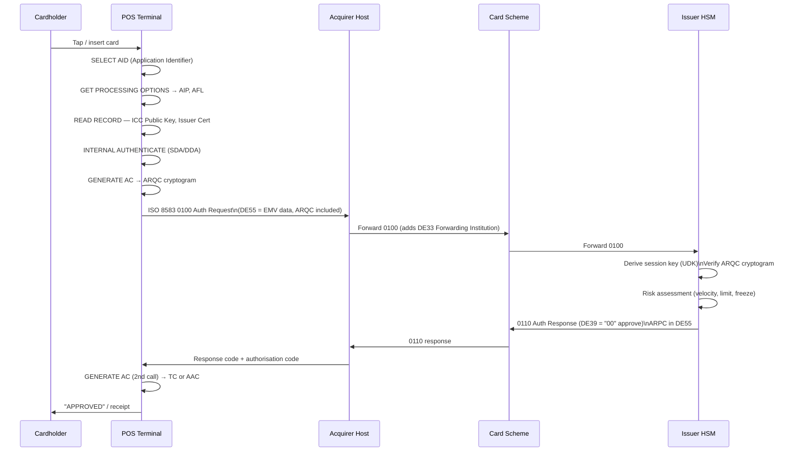

Every time a consumer taps a card at a point-of-sale terminal, an intricate multi-party protocol executes in under two seconds, coordinating cryptographic proof-of-presence, credit-risk decisioning, and cross-bank fund reservation across a minimum of four independent organisations. Card payments remain the highest-volume retail payment rail on earth — Visa alone processed 212 billion transactions in fiscal year 2023 — and the engineering systems behind them must reconcile the conflicting demands of sub-second latency, cryptographic integrity, offline resilience, and eventual-consistency settlement across a T+1 clearing cycle.

## Learning Objectives

- Map the five actors in a card payment (cardholder, merchant, acquirer, scheme, issuer) and explain the contractual obligations each one carries
- Trace an EMV chip-and-PIN authorisation from terminal tap through issuer response and understand the cryptographic objects exchanged at each step
- Parse and construct ISO 8583 messages in Java, including MTI decoding, bitmap expansion, and data-element extraction
- Design a network-token vs PAN architecture and implement a `CardAuthorizationService` that generates and validates authorisation codes
- Explain the clearing file format and T+1 settlement cycle, including how interchange fees are calculated and who pays whom
- Implement a 3D Secure v2 integration for card-not-present transactions, covering frictionless vs challenge flows and exemption handling
- Identify the most common chargeback reason codes and design a representment flow with supporting evidence collection
- Apply PCI DSS scope-reduction patterns — tokenisation, point-to-point encryption — to minimise cardholder data exposure in a Java microservice

## Business Context

In March 2022, a European e-commerce platform processing roughly 180,000 card transactions per day discovered that their authorisation service was storing raw PANs in application logs. A PCI DSS Level 2 assessor flagged the finding; the subsequent forensic investigation revealed logs had been shipped to a centralised ELK stack retained for 90 days, exposing approximately 16 million PANs. The remediation programme cost €4.2 million in consultant fees, €1.1 million in emergency PCI re-assessment, and triggered a Visa BRAM (Business Risk Assessment and Mitigation) programme that imposed a €25-per-compromised-account liability on the acquiring bank, eventually passed through to the merchant. The root cause was an `AuthorizationRequest` object whose `toString()` included all fields — a Java anti-pattern that engineers must actively defend against when PAN-bearing objects cross service boundaries.

## Card Payment Ecosystem Actors

Five parties participate in every card transaction, bound together by scheme rules rather than bilateral contracts.

| Actor | Role | Commercial relationship |
|---|---|---|
| Cardholder | Initiates payment; presents card | Customer of issuing bank |
| Merchant | Accepts card; routes via terminal | Customer of acquiring bank |
| Acquirer | Processes merchant's transactions; connects to scheme | Licensed scheme member |
| Scheme (Visa/MC) | Clears transactions; sets rules; manages disputes | Owned by member banks or public |
| Issuer | Approves or declines; holds cardholder's account | Licensed scheme member |

The **four-party model** (cardholder ↔ issuer ↔ scheme ↔ acquirer ↔ merchant) is distinct from the **three-party model** used by American Express and Discover, where the scheme is also the issuer and acquirer. The distinction matters because interchange fees — the dominant revenue mechanism — flow from acquirer to issuer in the four-party model at a rate set by the scheme.

> [!NOTE]
> American Express operates both as scheme and issuer for most cards, which means it captures interchange internally rather than transferring it to a separate bank. This gives Amex higher merchant fees (typically 2.5-3.5%) compared with Visa/Mastercard (typically 1.5-2.2% blended).

## EMV Chip Authorisation Flow

EMV (Europay, Mastercard, Visa) authentication uses public-key cryptography stored on the chip to prove card presence. The terminal reads static and dynamic data, generates a cryptogram (ARQC — Authorisation Request Cryptogram), and the issuer verifies it using a session key derived from the card's master key.



**Online vs offline authorisation** is a scheme- and issuer-configured decision. Offline authorisation occurs entirely within the terminal and chip using stored counters (ATC — Application Transaction Counter) and accumulated offline limits. If the floor limit is not exceeded and the chip's offline data authentication passes, the terminal can approve without contacting the issuer, deferring the ARQC submission to the next clearing batch.

> [!WARNING]
> Offline authorisation creates issuer credit exposure: if a card is blocked (lost/stolen) after an offline approval occurs but before clearing, the issuer cannot recover funds from the cardholder. Modern risk management caps cumulative offline limits at €50-200 depending on card product.

## ISO 8583 Message Format and Java Parsing

ISO 8583 is a binary/ASCII financial messaging standard. Every message begins with a **Message Type Indicator (MTI)** — 4 hex digits — followed by one or two 64-bit bitmaps indicating which of 128 data elements are present, then the data elements themselves in packed binary or ASCII depending on element type.

```java
// ISO 8583 MTI: version (1 digit), class (1 digit), function (1 digit), origin (1 digit)
// 0100 = version 0 (1987), class 1 (authorisation), function 0 (request), origin 0 (acquirer)
// 0110 = authorisation response from issuer

public record Iso8583Header(int version, int messageClass, int function, int origin) {

    public static Iso8583Header parse(byte[] mtiBytes) {
        // MTI is 4 BCD digits packed into 2 bytes
        int high = Byte.toUnsignedInt(mtiBytes[0]);
        int low  = Byte.toUnsignedInt(mtiBytes[1]);
        return new Iso8583Header(
            (high >> 4) & 0xF,
            high & 0xF,
            (low >> 4) & 0xF,
            low & 0xF
        );
    }

    public boolean isAuthRequest()   { return messageClass == 1 && function == 0; }
    public boolean isAuthResponse()  { return messageClass == 1 && function == 1; }
    public boolean isReversalRequest(){ return messageClass == 4 && function == 0; }
}
```

```java
public final class BitmapParser {

    private BitmapParser() {}

    /**
     * Parses primary (and optional secondary) 64-bit bitmaps.
     * Bit 1 of the primary bitmap set → secondary bitmap present.
     * Returns a boolean[128] where index i corresponds to data element i+1.
     */
    public static boolean[] parse(byte[] message, int offset) {
        boolean[] present = new boolean[128];
        long primary = readLong(message, offset);
        for (int i = 0; i < 64; i++) {
            present[i] = (primary & (1L << (63 - i))) != 0;
        }
        if (present[0]) { // secondary bitmap
            long secondary = readLong(message, offset + 8);
            for (int i = 0; i < 64; i++) {
                present[64 + i] = (secondary & (1L << (63 - i))) != 0;
            }
        }
        return present;
    }

    private static long readLong(byte[] data, int offset) {
        long v = 0;
        for (int i = 0; i < 8; i++) {
            v = (v << 8) | Byte.toUnsignedInt(data[offset + i]);
        }
        return v;
    }
}
```

Key data elements every authorisation engineer must know:

| DE | Name | Format | Example |
|---|---|---|---|
| DE2 | Primary Account Number (PAN) | LLVAR n..19 | 4111111111111111 |
| DE3 | Processing Code | n6 | 000000 (purchase) |
| DE4 | Transaction Amount | n12 | 000000010000 (£100.00) |
| DE7 | Transmission Date/Time | n10 | 1108143022 |
| DE11 | STAN (System Trace Audit Number) | n6 | 123456 |
| DE22 | POS Entry Mode | n3 | 051 (chip+PIN) |
| DE35 | Track 2 Equivalent | LLVAR z..37 | — |
| DE39 | Response Code | an2 | 00 (approve) / 05 (decline) |
| DE41 | Card Acceptor Terminal ID | ans8 | TERM0001 |
| DE49 | Currency Code | n3 | 826 (GBP) |
| DE55 | ICC Data (EMV) | LLLVAR b..255 | ARQC + other TLV data |

> [!IMPORTANT]
> DE2 (PAN) must **never** appear in application logs, tracing spans, or metrics labels. Annotate PAN-bearing value objects with a custom `@Sensitive` annotation and configure your logging framework to redact fields so annotated. Consider overriding `toString()` to return a masked representation: `"****` + last4`.

## Network Tokenisation Architecture

Network tokenisation replaces the PAN with a **Payment Token** — a surrogate value that is scheme-specific, merchant-specific, and device-specific. Tokens are issued by **Token Service Providers (TSPs)** operated by Visa (VTS) and Mastercard (MDES).

```
Tokenisation actors:
  Token Requestor (merchant / wallet) ─── provision request ──▶ TSP
  TSP ──────────────────────────────────── token issued ───────▶ Token Requestor
  TSP ──────── token + TRID stored ──────────────────────────▶ Token Vault
  At authorisation:
  Merchant sends token ──▶ Acquirer ──▶ Scheme (detokenises) ──▶ Issuer sees real PAN
```

```java
public record PaymentToken(
    String token,          // 16-digit BIN-compatible surrogate PAN
    String tokenReferenceId,  // TRID linking token to real PAN at TSP
    String merchantId,
    String deviceId,
    Instant expiresAt,
    TokenDomain domain     // ECOMMERCE, INAPP, CONTACTLESS
) {
    // Token is safe to log — it cannot be used outside its domain
    // Real PAN never leaves the TSP vault after provisioning
}
```

The key operational advantage: a merchant data breach exposes tokens, not PANs. Tokens cannot be used outside their domain binding, making them useless to attackers. Issuers can also **push-provision** replacement PANs to existing tokens after card reissuance, so recurring subscriptions survive card expiry without requiring the customer to re-enter details.

## CardAuthorizationService Implementation

```java
@Service
@Slf4j
public class CardAuthorizationService {

    private final IssuerRiskEngine riskEngine;
    private final EmvCryptogramVerifier cryptogramVerifier;
    private final AuthorizationCodeGenerator codeGenerator;
    private final AuthorizationRepository repository;

    public AuthorizationResponse authorize(AuthorizationRequest request) {
        // Validate structure before any processing
        validateRequest(request);

        // Log with PAN masked — never log raw PAN
        log.info("Authorization request: stan={}, amount={}, currency={}, maskedPan={}",
            request.stan(),
            request.amount(),
            request.currencyCode(),
            maskPan(request.pan()));

        // Verify EMV cryptogram (ARQC) if chip transaction
        if (request.posEntryMode() == PosEntryMode.CHIP_PIN
                || request.posEntryMode() == PosEntryMode.CHIP_NO_PIN) {
            EmvVerificationResult emvResult = cryptogramVerifier.verify(
                request.pan(),
                request.emvData()
            );
            if (!emvResult.valid()) {
                return AuthorizationResponse.decline(request.stan(),
                    ResponseCode.DO_NOT_HONOUR, "EMV cryptogram invalid");
            }
        }

        // Issuer risk assessment: velocity, credit limit, account status
        RiskDecision risk = riskEngine.assess(request);
        if (risk.outcome() == RiskOutcome.DECLINE) {
            return AuthorizationResponse.decline(request.stan(),
                risk.responseCode(), risk.reason());
        }
        if (risk.outcome() == RiskOutcome.REFER) {
            return AuthorizationResponse.referral(request.stan());
        }

        // Generate authorisation code and persist reservation
        String authCode = codeGenerator.generate();
        AuthorizationRecord record = AuthorizationRecord.builder()
            .stan(request.stan())
            .authCode(authCode)
            .maskedPan(maskPan(request.pan()))
            .amount(request.amount())
            .currencyCode(request.currencyCode())
            .terminalId(request.terminalId())
            .authorisedAt(Instant.now())
            .status(AuthorizationStatus.APPROVED)
            .build();

        repository.save(record);
        return AuthorizationResponse.approve(request.stan(), authCode,
            ResponseCode.APPROVED);
    }

    private void validateRequest(AuthorizationRequest request) {
        Objects.requireNonNull(request.pan(), "PAN required");
        Objects.requireNonNull(request.amount(), "Amount required");
        if (request.amount().compareTo(BigDecimal.ZERO) <= 0) {
            throw new InvalidAuthorizationRequestException("Amount must be positive");
        }
        if (request.pan().length() < 13 || request.pan().length() > 19) {
            throw new InvalidAuthorizationRequestException("Invalid PAN length");
        }
    }

    private static String maskPan(String pan) {
        if (pan == null || pan.length() < 10) return "****";
        return pan.substring(0, 6) + "******" + pan.substring(pan.length() - 4);
    }
}
```

```java
// Authorisation code is a 6-character alphanumeric scheme-unique reference
@Component
public class AuthorizationCodeGenerator {

    private static final String ALPHABET = "ABCDEFGHJKLMNPQRSTUVWXYZ23456789";
    private static final SecureRandom SECURE_RANDOM = new SecureRandom();

    public String generate() {
        char[] code = new char[6];
        for (int i = 0; i < 6; i++) {
            code[i] = ALPHABET.charAt(SECURE_RANDOM.nextInt(ALPHABET.length()));
        }
        return new String(code);
    }
}
```

## Clearing and Settlement

Authorisation **reserves** funds but does not move them. Actual movement occurs in a two-step batch process.

**Clearing (T+0 or T+1):** Merchants submit clearing files — typically ISO 8583 Financial Presentments (0220 or 0200) or Visa's BASE II format — to their acquirer. The acquirer aggregates these into a clearing file and submits to the scheme's clearing house by the daily cut-off time (typically 22:00 UTC for Visa/MC).

**Settlement (T+1):** The scheme's net settlement system calculates multilateral net positions across all participating members and instructs settlement banks to move funds. Settlement is final and irrevocable.

```java
public record ClearingRecord(
    String rrn,                     // Retrieval Reference Number
    String authCode,
    String maskedPan,
    BigDecimal transactionAmount,
    String transactionCurrency,
    BigDecimal settlementAmount,
    String settlementCurrency,
    BigDecimal exchangeRate,
    BigDecimal interchangeFee,      // Calculated by scheme, deducted from settlement
    LocalDate transactionDate,
    LocalDate clearingDate,
    String merchantCategoryCode
) {}
```

**Interchange fee calculation** is scheme-defined and varies by card product, MCC, and region. The simplified formula is:

```
Interchange = transactionAmount × interchangeRatePercent + fixedFee

Example (Visa EU consumer credit, face-to-face):
  interchangeRatePercent = 0.30%
  fixedFee = €0.00
  For a €50 transaction: interchange = €0.15
```

```java
public class InterchangeFeeCalculator {

    private final InterchangeRateRepository rateRepository;

    public BigDecimal calculate(ClearingRecord record) {
        InterchangeRate rate = rateRepository.find(
            record.merchantCategoryCode(),
            determineCardProduct(record.maskedPan()),
            record.transactionCurrency()
        );
        BigDecimal percentFee = record.transactionAmount()
            .multiply(rate.percentageRate())
            .divide(BigDecimal.valueOf(100), 4, RoundingMode.HALF_UP);
        return percentFee.add(rate.fixedFee())
            .setScale(2, RoundingMode.HALF_UP);
    }
}
```

## 3D Secure for Card-Not-Present

3D Secure v2 (EMV 3DS) addresses card-not-present fraud by authenticating the cardholder through their issuer during the payment flow, without requiring a redirect in the common (frictionless) case.

Three flows exist:

| Flow | Trigger | User experience |
|---|---|---|
| Frictionless | Issuer's risk score is low | No additional step; authentication via device fingerprint/data |
| Challenge | Issuer requires explicit proof | OTP via SMS, biometric in banking app, or PIN entry |
| Decoupled | Asynchronous auth via banking app | Cardholder authenticates independently; merchant polls for result |

```java
public record ThreeDsAuthenticationResult(
    String transactionId,       // 3DS Server Transaction ID
    AuthenticationStatus status,  // Y=authenticated, A=attempt, C=challenge required, U=unavailable
    String eci,                 // Electronic Commerce Indicator: 05=fully authenticated, 06=attempt
    String authenticationValue, // CAVV / AVV — cryptographic proof for issuer
    String dsTransactionId
) {}
```

**SCA Exemptions (PSD2):** Under PSD2, issuers and PSPs may request SCA exemptions for low-risk transactions, reducing friction. Common exemptions:

- **Low-value exemption:** transactions ≤ €30 (cumulative cap €100 or 5 consecutive)
- **Low-risk TRA exemption:** issuer/acquirer fraud rate below threshold (0.01% for ≤€100)
- **Trusted beneficiary:** cardholder has pre-whitelisted the merchant
- **Recurring fixed-amount:** subsequent transactions in a series

> [!NOTE]
> Requesting a TRA exemption shifts fraud liability to the requesting party. If the issuer grants the exemption and fraud occurs, the PSP that requested the exemption absorbs the loss rather than the issuer. Always evaluate your fraud rate before requesting TRA exemptions at scale.

## Chargeback Reasons and Representment Flow

Chargebacks are issuer-initiated reversals raised at the cardholder's request. Each scheme defines reason codes.

| Reason Code (Visa) | Category | Merchant defence |
|---|---|---|
| 10.1 | EMV Liability Shift: counterfeit | N/A — chip terminals absorb |
| 10.4 | Other fraud — card absent | 3DS authentication value (CAVV) |
| 11.1 | Card Recovery Bulletin | N/A |
| 12.6 | Duplicate Processing | Evidence of two distinct transactions |
| 13.1 | Merchandise/Services Not Received | Proof of delivery, tracking number |
| 13.2 | Cancelled Recurring Transaction | Cancellation confirmation |

**Representment** is the merchant's right to dispute a chargeback by submitting evidence (called a "rebuttal packet") within the scheme's time limit (typically 30 days). If the issuer rejects the representment, a **pre-arbitration** and then **arbitration** process follows, with the losing party paying arbitration fees (~$500).

> [!WARNING]
> Merchants with chargeback ratios above scheme thresholds (Visa: >0.9% volume, Mastercard: >1.0% volume) are enrolled in monitoring programmes (VDMP/VFMP for Visa) that impose monthly fines starting at $50 per excess chargeback and escalating to $25,000/month. At >1.8% they face programme termination.

## Knowledge Check

**Q1: During an EMV chip-and-PIN transaction, what is the ARQC and why does it matter for authorisation security?**

A: The ARQC (Authorisation Request Cryptogram) is a MAC (Message Authentication Code) generated by the chip using a session key derived from a master key stored securely in the chip's secure element. The ARQC covers the transaction data (amount, currency, date, ATC) and can only be generated by the genuine chip — not by a card skimmer that only captured the magnetic stripe. When the issuer verifies the ARQC using their own copy of the card master key, it cryptographically proves both card presence and transaction data integrity. This eliminates counterfeit card fraud for chip transactions, which is why the EMV liability shift moved counterfeit fraud liability from issuers to merchants still using magnetic-stripe-only terminals.

**Q2: A merchant wants to reduce PCI DSS scope for their e-commerce platform. What two architectural mechanisms should a principal engineer recommend, and what scope does each eliminate?**

A: First, **network tokenisation** (Visa VTS / Mastercard MDES): the merchant stores a payment token rather than the PAN, so their systems never hold cardholder data. The token is scoped to the merchant and domain, so a breach yields nothing usable. This eliminates PAN storage scope entirely. Second, **point-to-point encryption (P2PE)**: for in-person channels, the POS device encrypts the PAN at the point of swipe/tap before it reaches the merchant's application layer. The merchant's application processes only ciphertext, eliminating in-flight PAN exposure from their system boundary. Together, these two measures can reduce a merchant from PCI DSS SAQ D (the most demanding — hundreds of controls) to SAQ P2PE (fewer than 35 controls).

## Practical Challenge

1. **ISO 8583 Parser:** Implement a complete `Iso8583Message` parser in Java that can read a hex-encoded ISO 8583 0100 message, extract the MTI, expand primary and secondary bitmaps, and return a `Map<Integer, byte[]>` of present data elements. Write a unit test using a known test vector that round-trips a parse → rebuild → parse cycle and asserts equality.

2. **Authorisation Service with EMV Stub:** Extend the `CardAuthorizationService` to integrate with a stubbed `EmvCryptogramVerifier`. The verifier should accept the ARQC TLV from DE55, derive the expected value using HMAC-SHA256 keyed on a test card master key, and return `EmvVerificationResult.valid()` or `EmvVerificationResult.invalid(reason)`. Wire up an integration test that sends an 0100 message with a valid ARQC and asserts a 00 response code, and another with a tampered amount that asserts a 05 decline.

3. **Interchange Fee Engine:** Build an `InterchangeRateRepository` backed by a PostgreSQL table with columns `(mcc, card_product, currency, percentage_rate, fixed_fee_minor_units)`. Populate it with at least five representative interchange rates (consumer debit, consumer credit, business credit, premium consumer, MCC 5411 grocery discount). Implement `InterchangeFeeCalculator` and test it against a matrix of scenarios, asserting fee accuracy to two decimal places.

4. **Chargeback Workflow:** Design and implement a `ChargebackWorkflowService` that models the lifecycle: `RAISED → MERCHANT_NOTIFIED → REPRESENTMENT_SUBMITTED → ACCEPTED | REJECTED → PRE_ARBITRATION → ARBITRATION`. Use a PostgreSQL-backed state machine (store current state in a `chargeback_cases` table) with an event log in `chargeback_events`. Expose a Spring MVC endpoint `POST /chargebacks/{id}/represent` that accepts a representment payload (evidence type, description, file reference) and transitions the case to `REPRESENTMENT_SUBMITTED`, returning 409 if the deadline has passed.

<!-- KNOWLEDGE-CHECK
{
  "questions": [
    {
      "text": "During an EMV chip-and-PIN transaction, what is the ARQC and why does it matter for authorisation security?",
      "options": [
        "It is the merchant's terminal identifier; it matters for routing decisions",
        "It is a MAC generated by the chip using a session key derived from a master key stored in the chip's secure element, cryptographically proving card presence and transaction data integrity",
        "It is the network code that identifies the card scheme (Visa or Mastercard)",
        "It is the encrypted PIN block sent to the issuer for verification"
      ],
      "correct": 1,
      "explanation": "The ARQC (Authorisation Request Cryptogram) is a MAC generated by the chip using a session key derived from a master key stored in the chip's secure element. It covers transaction data (amount, currency, date, ATC) and can only be generated by the genuine chip — not a card skimmer. When the issuer verifies the ARQC, it cryptographically proves both card presence and transaction data integrity, eliminating counterfeit card fraud."
    },
    {
      "text": "A merchant wants to reduce PCI DSS scope for their e-commerce platform. What two architectural mechanisms should a principal engineer recommend?",
      "options": [
        "Tokenisation and encryption at rest for stored card data",
        "Network tokenisation (Visa VTS/Mastercard MDES) and Point-to-Point Encryption (P2PE)",
        "HTTPS and a Web Application Firewall",
        "3D Secure and biometric authentication"
      ],
      "correct": 1,
      "explanation": "Network tokenisation stores a payment token instead of the PAN, so the merchant's systems never hold cardholder data, eliminating PAN storage scope entirely. P2PE encrypts the PAN at the point of swipe/tap before it reaches the merchant's application layer, eliminating in-flight PAN exposure. Together, these can reduce a merchant from PCI DSS SAQ D (hundreds of controls) to SAQ P2PE (fewer than 35 controls)."
    },
    {
      "text": "What is the ISO 8583 field structure that determines which data elements are present in a message?",
      "options": [
        "The Message Type Indicator (MTI) in the first 4 bytes",
        "The primary and secondary bitmaps, where each bit position indicates whether the corresponding data element is present",
        "The header length field preceding each data element",
        "The TLV (Tag-Length-Value) structure in DE55"
      ],
      "correct": 1,
      "explanation": "ISO 8583 uses a bitmap structure to indicate which data elements are present. The primary bitmap (64 bits) covers DE1-DE64. If bit 1 of the primary bitmap is set, a secondary bitmap is present covering DE65-DE128. Each bit position in the bitmap corresponds to a data element number — if the bit is set, that element is present in the message body."
    }
  ]
}
-->

<!-- PRACTICAL-CHALLENGE
{
  "title": "ISO 8583 Parser and Card Payment Services",
  "difficulty": "advanced",
  "estimatedMinutes": 45,
  "tasks": [
    {
      "id": "1",
      "description": "Implement a complete `Iso8583Message` parser in Java that reads a hex-encoded ISO 8583 0100 message, extracts the MTI, expands primary and secondary bitmaps, and returns a `Map<Integer, byte[]>` of present data elements. Write a unit test using a known test vector that round-trips a parse → rebuild → parse cycle and asserts equality."
    },
    {
      "id": "2",
      "description": "Extend `CardAuthorizationService` to integrate with a stubbed `EmvCryptogramVerifier` that accepts the ARQC TLV from DE55, derives the expected value using HMAC-SHA256 keyed on a test card master key, and returns `EmvVerificationResult.valid()` or `EmvVerificationResult.invalid(reason)`. Write integration tests for a valid ARQC (00 response code) and a tampered amount (05 decline)."
    },
    {
      "id": "3",
      "description": "Build an `InterchangeRateRepository` backed by PostgreSQL with columns `(mcc, card_product, currency, percentage_rate, fixed_fee_minor_units)`. Populate with at least five representative interchange rates. Implement `InterchangeFeeCalculator` and test against a matrix of scenarios, asserting fee accuracy to two decimal places."
    },
    {
      "id": "4",
      "description": "Design and implement a `ChargebackWorkflowService` modelling the lifecycle: `RAISED → MERCHANT_NOTIFIED → REPRESENTMENT_SUBMITTED → ACCEPTED | REJECTED → PRE_ARBITRATION → ARBITRATION`. Use PostgreSQL-backed state machine with event log. Expose `POST /chargebacks/{id}/represent` accepting representment payload, returning 409 if the deadline has passed."
    }
  ]
}
-->
