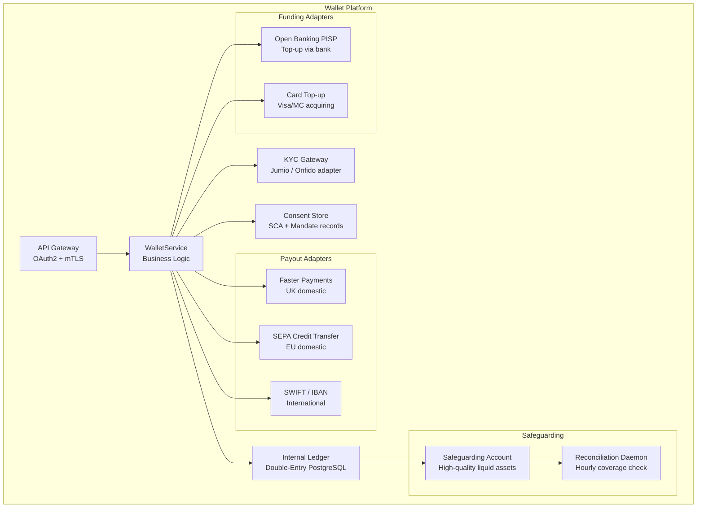

Digital wallets have matured from convenience features into critical financial infrastructure: PayPal holds $38.5 billion in customer funds, Revolut manages 35 million accounts across 160+ currencies, and Alipay processes 175,000 transactions per second at Lunar New Year peak. The engineering challenge is not primarily one of velocity — the internal ledger of a wallet is a relatively constrained domain — but of regulatory compliance at every layer of the stack. The choice of legal structure (e-money institution, payment institution, or bank) determines which safeguarding rules apply, which transactions are permissible, and which capital requirements constrain product features.

## Learning Objectives

- Distinguish between e-money (EMD2), stored-value instruments, prepaid cards, and bank accounts and explain the engineering implications of each classification
- Describe the EU EMD2 / PSD2 and US state money transmitter licence frameworks and map regulatory obligations to architectural constraints
- Design the five core components of a wallet platform: ledger, funding adapter, payout adapter, KYC gateway, and consent store
- Implement a `WalletService` with an internal double-entry ledger, funding source abstraction, and idempotent transfer semantics
- Model fund-in (bank transfer top-up and card top-up) and fund-out (bank withdrawal) flows as explicit state machines with compensating transactions
- Implement safeguarding-compliant fund segregation using a designated safeguarding account per currency and a reconciliation daemon
- Execute atomic wallet-to-wallet P2P transfers using database-level serialisable isolation and conflict-free retry semantics
- Integrate a wallet with open banking PISP rails for bank-funded top-ups, reducing card interchange cost from ~1.8% to a fixed £0.20 per transfer

## Business Context

In October 2021, an e-money institution (EMI) operating in the UK had a safeguarding failure. The firm had been co-mingling client e-money with operating funds in a single bank account, contrary to Regulation 23 of the Payment Services Regulations 2017. When a Barclays correspondent banking relationship was terminated at short notice, the safeguarding shortfall was discovered to be £23 million — the firm could not demonstrate that 100% of outstanding e-money liabilities were covered by segregated funds. The FCA imposed a requirement for the firm to cease issuing new e-money immediately, triggering a run-off process that cost 400,000 customers access to their funds for 11 weeks. The engineering lesson: safeguarding reconciliation must be automated, run on every settlement cycle, and alert immediately when the coverage ratio falls below 100.00%. It cannot be a manual monthly finance exercise.

## E-Money vs Stored-Value vs Bank Account

These three instruments are legally distinct and carry very different engineering consequences.

| Instrument | Regulatory regime | Segregation required | Interest bearing | Deposit guarantee |
|---|---|---|---|---|
| E-Money (EU) | EMD2 + national transposition | Yes — 100% safeguarding | No (prohibited by EMD2) | No (not FSCS/DGS) |
| Prepaid card (US) | State MTL + CFPB Reg E | Varies by state | Generally no | No |
| Bank current account | CRD IV / banking licence | N/A (fractional reserve) | Yes | Yes (FSCS £85k) |
| Stored-value loop | Closed-loop exemption | No | No | No |

> [!IMPORTANT]
> The closed-loop exemption (Art. 3(k) EMD2) allows gift cards, public transport cards, and similar instruments to operate without an EMI licence only if the network is limited to a single issuer, used for a limited range of goods/services, and the outstanding liability stays below €5 million. If a "loyalty wallet" grows beyond this, it crosses into regulated e-money territory without the operator being aware, creating retroactive compliance liability.

**E-money** is the dominant model for general-purpose wallets (Revolut, Wise, Monese). An EMI is authorised by a central bank or financial regulator, must hold 100% of outstanding e-money liabilities in safeguarded funds (high-quality liquid assets — government bonds, central bank deposits, or segregated bank accounts), and cannot pay interest on balances.

## Regulatory Basis and Architectural Constraints

The regulatory regime maps directly to system design decisions:

| Constraint | EMD2 (EU EMI) | US Money Transmitter |
|---|---|---|
| Safeguarding | 100% segregated per Art. 7 | "Permissible investments" per state law |
| AML/KYC | PSD2 + AMLD5 | BSA + FinCEN SAR obligations |
| Transaction limits (un-KYC'd) | €150 per transaction / €2500 lifetime | Varies: typically $1,000/day anonymous |
| Cross-border | Passporting in EEA | 50 separate state licences or federal charter |
| Data residency | GDPR — EU/EEA for personal data | No federal mandate; California CCPA |

```java
// Wallet legal entity type drives which rules apply at runtime
public enum WalletRegime {
    EU_EMI,           // Electronic Money Institution — EMD2 + PSD2
    UK_EMI,           // Post-Brexit UK FCA-regulated EMI
    US_MTL,           // US Money Services Business with state MTLs
    CLOSED_LOOP,      // Exempt stored-value (gift cards etc.)
    BANK_ACCOUNT      // Full banking licence
}

public record WalletAccount(
    UUID accountId,
    UUID customerId,
    WalletRegime regime,
    Currency currency,
    BigDecimal balance,          // Always positive or zero for client funds
    KycLevel kycLevel,           // NONE, BASIC, FULL — drives transaction limits
    boolean safeguardingEnabled,
    Instant createdAt,
    Instant lastUpdated
) {}
```

## Wallet Architecture Components



**Ledger** is the authoritative source of truth — a double-entry accounting system (see Track 5 Lesson 3) with immutable journal entries. Every balance is derived from the sum of posted entries, never stored as a mutable field without derivability from the ledger.

**Funding adapters** abstract the mechanics of getting money into the wallet. Each adapter implements a common `FundingSource` interface but has very different latency and cost profiles: open banking bank transfers settle in seconds and cost a fixed fee; card top-ups are instantaneous but carry 1.5-2% interchange.

**KYC gateway** enforces transaction limits based on KYC level and routes enhanced due diligence checks for high-value customers to manual review queues.

## WalletService Implementation

```java
@Service
@Slf4j
public class WalletService {

    private final WalletAccountRepository walletRepo;
    private final LedgerService ledger;
    private final FundingSourceRegistry fundingSources;
    private final PayoutAdapterRegistry payoutAdapters;
    private final KycLimitEnforcer kycEnforcer;
    private final IdempotencyStore idempotencyStore;

    /**
     * Atomically transfers value between two wallet accounts within the same platform.
     * Uses SELECT FOR UPDATE with consistent lock ordering (lower UUID first) to
     * prevent deadlocks on concurrent transfers between the same pair of accounts.
     */
    @Transactional(isolation = Isolation.SERIALIZABLE)
    public TransferResult transfer(TransferRequest request) {
        // Idempotency check — return cached result for duplicate request keys
        return idempotencyStore.computeIfAbsent(request.idempotencyKey(), () -> {
            WalletAccount source = walletRepo.findByIdForUpdate(request.sourceAccountId())
                .orElseThrow(() -> new AccountNotFoundException(request.sourceAccountId()));
            WalletAccount target = walletRepo.findByIdForUpdate(request.targetAccountId())
                .orElseThrow(() -> new AccountNotFoundException(request.targetAccountId()));

            kycEnforcer.checkTransferLimit(source, request.amount());

            if (source.balance().compareTo(request.amount()) < 0) {
                throw new InsufficientFundsException(source.accountId(), request.amount());
            }

            // Double-entry: debit source, credit target — atomic in same transaction
            LedgerEntry debit = ledger.post(LedgerEntry.builder()
                .accountId(source.accountId())
                .entryType(EntryType.DEBIT)
                .amount(request.amount())
                .currency(source.currency())
                .reference(request.reference())
                .narrative("P2P transfer out to " + target.accountId())
                .build());

            LedgerEntry credit = ledger.post(LedgerEntry.builder()
                .accountId(target.accountId())
                .entryType(EntryType.CREDIT)
                .amount(request.amount())
                .currency(target.currency())
                .reference(request.reference())
                .narrative("P2P transfer in from " + source.accountId())
                .build());

            log.info("P2P transfer complete: ref={}, amount={} {}",
                request.reference(), request.amount(), source.currency());

            return TransferResult.success(debit.entryId(), credit.entryId());
        });
    }
}
```

> [!NOTE]
> Lock ordering is critical for deadlock prevention. When acquiring row-level locks on two wallet accounts simultaneously, always lock the account with the lexicographically smaller UUID first. Without consistent ordering, two concurrent transfers in opposite directions (A→B and B→A) will deadlock on the second lock acquisition.

## Fund-In and Fund-Out Flows

**Fund-in via open banking PISP** (bank transfer top-up):

```java
public FundInResult fundInViaBankTransfer(FundInRequest request) {
    // Step 1: Create pending ledger entry (funds not yet available)
    String pendingRef = ledger.createPendingCredit(
        request.walletAccountId(),
        request.amount(),
        request.currency(),
        "PENDING_OB_TOPUP"
    );

    // Step 2: Initiate payment via PISP — asynchronous
    OpenBankingPaymentOrder order = pipsp.initiatePayment(
        OpenBankingPaymentOrder.builder()
            .amount(request.amount())
            .currency(request.currency())
            .creditorAccount(safeguardingAccount.iban(request.currency()))
            .creditorReference(pendingRef)       // Used for reconciliation
            .debtorAccount(request.linkedBankAccount())
            .build()
    );

    // Step 3: Return immediately — funds arrive via webhook on settlement
    return FundInResult.pending(pendingRef, order.consentUrl());
}

// Called by webhook handler when PISP payment settles
@Transactional
public void onBankTransferSettled(String creditorReference, BigDecimal settledAmount) {
    ledger.confirmPendingCredit(creditorReference, settledAmount);
    // Safeguarding: the inbound funds are already in the safeguarding bank account
    // (they were credited there directly). Ledger confirmation makes them available.
    safeguardingReconciliation.recordReceipt(creditorReference, settledAmount);
}
```

**Fund-out via Faster Payments:**

```java
public PayoutResult fundOut(PayoutRequest request) {
    // Atomically debit wallet and create a payout instruction
    // If the payment rail fails, the debit must be reversed
    String payoutId = UUID.randomUUID().toString();

    try {
        ledger.debitForPayout(request.walletAccountId(), request.amount(), payoutId);

        PayoutAdapter adapter = payoutAdapters.forCurrency(request.currency());
        PaymentResult result = adapter.send(PaymentInstruction.builder()
            .payoutId(payoutId)
            .amount(request.amount())
            .currency(request.currency())
            .creditorIban(request.destinationIban())
            .creditorName(request.destinationName())
            .reference(request.reference())
            .build());

        ledger.confirmPayout(payoutId, result.networkReference());
        return PayoutResult.success(payoutId, result.networkReference());

    } catch (PaymentRailException ex) {
        // Compensating transaction — reverse the debit
        ledger.reverseDebit(payoutId, "PAYOUT_FAILED: " + ex.getMessage());
        log.warn("Payout failed, debit reversed: payoutId={}", payoutId, ex);
        return PayoutResult.failed(payoutId, ex.getRailErrorCode());
    }
}
```

> [!WARNING]
> Never debit the wallet ledger and dispatch the payment instruction in separate transactions. If the outbound payment is dispatched and the ledger debit rolls back (due to a crash between the two operations), money leaves the safeguarding account without a corresponding ledger debit — a safeguarding shortfall that must be detected and corrected before the next regulatory report.

## Safeguarding Obligations

Under Article 10 of PSD2 and Regulation 23 of the UK PSRs 2017, an EMI must at all times hold assets equal in value to its outstanding e-money liabilities. Acceptable safeguarding methods are:

1. **Segregated bank account:** Funds held in an account with a credit institution, ring-fenced from operating funds, labeled as safeguarding.
2. **Insurance/guarantee policy:** Third-party guarantee covering the full outstanding liability (rarely used in practice).
3. **Secure, low-risk assets:** Government bonds or money market funds of equivalent value.

```java
@Scheduled(cron = "0 */1 * * * *")  // Every 1 minute
public void reconcileSafeguarding() {
    for (Currency currency : supportedCurrencies) {
        BigDecimal emoneyLiability = ledger.totalClientBalances(currency);
        BigDecimal safeguardingBalance = safeguardingAccountClient.balance(currency);

        BigDecimal coverageRatio = safeguardingBalance
            .divide(emoneyLiability, 6, RoundingMode.DOWN);

        safeguardingMetrics.record(currency, coverageRatio, emoneyLiability, safeguardingBalance);

        if (coverageRatio.compareTo(MINIMUM_COVERAGE_RATIO) < 0) {
            // 100% = BigDecimal.ONE; alert if coverage drops even £0.01 below
            String message = String.format(
                "SAFEGUARDING BREACH: currency=%s, liability=%s, safeguarded=%s, ratio=%s",
                currency, emoneyLiability, safeguardingBalance, coverageRatio);
            alertingService.criticalAlert("SAFEGUARDING_BREACH", message);
            // Also raise incident automatically — this is regulatory non-compliance
            incidentService.raise(IncidentSeverity.P0, "SAFEGUARDING_COVERAGE", message);
        }
    }
}

private static final BigDecimal MINIMUM_COVERAGE_RATIO = BigDecimal.ONE; // 100%
```

## Tokenisation for Recurring Payments

When a customer saves their wallet as a funding source for recurring payments (e.g., subscription billing), the merchant stores a **mandate token** rather than account credentials. This follows the PSD2 Secure Customer Authentication (SCA) model: the first payment requires explicit customer authentication (SCA challenge), and subsequent payments may qualify for the recurring exemption.

```java
public record RecurringMandate(
    UUID mandateId,
    UUID walletAccountId,
    String merchantId,
    BigDecimal maxAmountPerCharge,
    Currency currency,
    MandateFrequency frequency,     // WEEKLY, MONTHLY, ON_DEMAND
    Instant firstPaymentAuthAt,     // When initial SCA was performed
    Instant expiresAt,
    MandateStatus status            // ACTIVE, SUSPENDED, CANCELLED
) {}
```

> [!NOTE]
> Under PSD2 Article 97, recurring transactions of a fixed amount to the same payee after the initial SCA-authenticated setup are exempt from subsequent SCA. However, the payment amount must match the mandated amount exactly. Any deviation — even a currency conversion rounding difference — requires a new SCA challenge.

## Wallet-to-Wallet P2P Transfer Atomicity

The key safety guarantee is that money cannot appear or disappear: total wallet balances across the platform must be conserved across every transfer. This requires that the debit and credit journal entries are written in a single ACID transaction and that the ledger check and balance updates are locked against concurrent modification.

```sql
-- Serialisable isolation prevents phantom reads from concurrent transfers
BEGIN TRANSACTION ISOLATION LEVEL SERIALIZABLE;

-- Lock both accounts in consistent order (smaller UUID first)
SELECT balance FROM wallet_accounts
WHERE account_id IN (:sourceId, :targetId)
ORDER BY account_id
FOR UPDATE;

-- Verify sufficient balance
-- Post debit entry
INSERT INTO ledger_entries (entry_id, account_id, entry_type, amount, currency, reference, created_at)
VALUES (gen_random_uuid(), :sourceId, 'DEBIT', :amount, :currency, :reference, NOW());

-- Post credit entry
INSERT INTO ledger_entries (entry_id, account_id, entry_type, amount, currency, reference, created_at)
VALUES (gen_random_uuid(), :targetId, 'CREDIT', :amount, :currency, :reference, NOW());

COMMIT;
```

## Interoperability with Open Banking Rails

Wallets can integrate with open banking infrastructure as both TPP (Third Party Provider) and as a destination. A wallet acting as PISP can initiate bank transfers on behalf of its users to external beneficiaries at lower cost than card payments. A wallet acting as a destination can receive bank push payments credited directly to its safeguarding account.

| Integration pattern | Cost to merchant | Latency | Use case |
|---|---|---|---|
| Card top-up (Visa/MC) | 1.5-2.2% interchange + scheme fees | Immediate | Emergency top-up |
| Open Banking PISP top-up | £0.10-0.25 fixed | 10-30s (FPS) | Regular top-up |
| SEPA CT top-up | €0.05-0.15 fixed | Same day (SEPA Inst: 10s) | EU users |
| SWIFT top-up | $5-25 correspondent fees | 1-3 business days | International |

## Knowledge Check

**Q1: An EMI holds client e-money balances in a single multi-currency account with a tier-1 bank. The operations team notices the safeguarding coverage ratio for GBP drops to 97% briefly during end-of-day processing. What is the most likely root cause and how should the architecture prevent it?**

A: The most likely root cause is a timing mismatch between when wallets are credited (immediately upon open banking PISP settlement confirmation) and when the corresponding inbound funds actually clear into the safeguarding account. If the platform credits wallets as soon as the PISP payment order status transitions to `AcceptedSettlementCompleted`, but the actual funds arrive in the safeguarding account 60-90 seconds later via the interbank settlement cycle, there is a transient window where liabilities exceed assets. The architectural fix has two parts: first, credit wallets only after the inbound payment is confirmed at the safeguarding account level (use the bank's webhook or polling the account statement), not at the PISP payment order status level; second, hold pending credits in a separate `PENDING` ledger state that is included in the safeguarding calculation but not yet available for spending, ensuring the safeguarding ratio is always computed conservatively.

**Q2: Why can a digital wallet built on an EMI licence not pay interest on customer balances, and what are the engineering consequences of this restriction?**

A: EMD2 Article 12 prohibits EMIs from paying interest on e-money or providing any benefit related to the length of time the customer holds the e-money, because this would effectively convert the e-money into deposit-taking (a banking activity requiring a full banking licence). The engineering consequences are significant: the wallet ledger must not apply any periodic credit entries to customer accounts, any cashback or rewards earned on spending must be tracked as a separate product (e.g., a rewards points system) and not accrued directly into the wallet balance, and any "savings pots" features must route funds to a partner bank (which holds a banking licence) rather than holding them on the EMI's own balance sheet. This requires an additional ledger entity type to represent "externally placed" funds that are off the EMI's balance sheet while remaining accessible to the customer.

## Practical Challenge

1. **Safeguarding Reconciliation Daemon:** Implement the `SafeguardingReconciliationService` as a Spring scheduled task that runs every 5 minutes. It should query the total sum of all client wallet balances per currency from the ledger, compare against the balance reported by a stubbed `SafeguardingAccountClient`, compute a coverage ratio, and emit a Prometheus metric `wallet_safeguarding_coverage_ratio{currency="GBP"}`. Write a test that injects a scenario where the safeguarding balance is £5,000 less than the total client balances and asserts that `alertingService.criticalAlert()` is called with severity `SAFEGUARDING_BREACH`.

2. **P2P Transfer with Deadlock Prevention:** Implement the `WalletService.transfer()` method using JDBC with explicit `SELECT ... FOR UPDATE` and consistent lock ordering. Write a concurrent test using 10 threads, each executing a random transfer between accounts A, B, and C simultaneously. Assert that after all transfers complete, the sum of all three balances equals the initial total (conservation of value), and that no deadlock exceptions propagate to callers (they should retry internally up to 3 times).

3. **Fund-In State Machine:** Model the fund-in flow as a `FundInStateMachine` with states `INITIATED → CONSENT_GRANTED → PAYMENT_SUBMITTED → SETTLEMENT_PENDING → CREDITED | FAILED`. Implement state transitions as methods, persist the current state to PostgreSQL, and wire up a webhook handler that drives `PAYMENT_SUBMITTED → SETTLEMENT_PENDING → CREDITED`. Write an integration test with a stubbed PISP adapter that simulates a delayed settlement (arriving 2 seconds after initiation).

4. **KYC Limit Enforcer:** Implement `KycLimitEnforcer` with three KYC tiers: NONE (£150/transaction, £2500 lifetime), BASIC (£1000/transaction, £10000/month), FULL (£50000/transaction, unlimited). The enforcer must track cumulative amounts using a rolling window query on the ledger table and throw `KycLimitExceededException` with a message indicating how much headroom remains. Test all boundary conditions (exactly at limit, 1p below, 1p above) for each tier.

<!-- KNOWLEDGE-CHECK
{
  "questions": [
    {
      "text": "An EMI holds client e-money balances in a safeguarding account. The safeguarding coverage ratio briefly drops to 97% during end-of-day processing. What is the most likely root cause?",
      "options": [
        "The EMI is illegally paying interest on e-money balances",
        "A timing mismatch between when wallets are credited upon PISP settlement confirmation and when funds actually clear into the safeguarding account",
        "The KYC tier limits were exceeded and pending transactions are holding up settlement",
        "The open banking PISP adapter is rounding currency amounts incorrectly"
      ],
      "correct": 1,
      "explanation": "If wallets are credited when the PISP payment order status transitions to AcceptedSettlementCompleted, but funds arrive in the safeguarding account 60-90 seconds later via the interbank settlement cycle, there is a transient window where liabilities exceed assets. The fix is to credit wallets only after the inbound payment is confirmed at the safeguarding account level."
    },
    {
      "text": "Why does EMD2 Article 12 prohibit EMIs from paying interest on customer balances, and what is the primary engineering consequence?",
      "options": [
        "Interest calculations are too complex for real-time ledger systems",
        "Paying interest converts e-money into deposit-taking, which requires a full banking licence; the ledger must never apply periodic credit entries to customer accounts",
        "Interest payments violate PSD2 strong customer authentication requirements",
        "EMIs cannot hold customer funds for more than 24 hours, making interest accrual impossible"
      ],
      "correct": 1,
      "explanation": "EMD2 Article 12 prohibits interest because it would effectively convert e-money into deposit-taking (a banking activity requiring a full banking licence). The engineering consequence is that the wallet ledger must not apply any periodic credit entries to customer accounts, and any rewards must be tracked as a separate product not accrued directly into the wallet balance."
    },
    {
      "text": "A wallet P2P transfer service uses SELECT FOR UPDATE without consistent lock ordering. Thread 1 wants to transfer from Account A to Account B, and Thread 2 wants to transfer from Account B to Account A. What is the likely outcome?",
      "options": [
        "Thread 2 fails immediately with an insufficient funds error",
        "Both transfers succeed because PostgreSQL detects the deadlock automatically",
        "A deadlock occurs: Thread 1 holds lock on A waiting for B, Thread 2 holds lock on B waiting for A",
        "Thread 1 succeeds; Thread 2 is queued and executes after Thread 1 commits"
      ],
      "correct": 2,
      "explanation": "Without consistent lock ordering, two transactions acquiring locks in opposite orders create a deadlock cycle. Thread 1 locks A and waits for B; Thread 2 locks B and waits for A. The fix is canonical lock ordering — always sort account IDs before acquiring locks so all threads acquire them in the same order."
    }
  ]
}
-->

<!-- PRACTICAL-CHALLENGE
{
  "title": "Build Core Digital Wallet Infrastructure",
  "difficulty": "advanced",
  "estimatedMinutes": 60,
  "tasks": [
    {"id": "1", "description": "Implement SafeguardingReconciliationService as a Spring @Scheduled task (every 5 minutes) that queries total client balances per currency, compares against a SafeguardingAccountClient stub, computes a coverage ratio, and emits a Prometheus metric. Write a test asserting criticalAlert() is called when coverage falls below 100%."},
    {"id": "2", "description": "Implement WalletService.transfer() using JDBC with SELECT FOR UPDATE and consistent lock ordering. Write a concurrent test with 10 threads executing random transfers between accounts A, B, C, asserting value is conserved and no deadlock exceptions propagate to callers."},
    {"id": "3", "description": "Model the fund-in flow as a FundInStateMachine with states INITIATED, CONSENT_GRANTED, PAYMENT_SUBMITTED, SETTLEMENT_PENDING, CREDITED, FAILED. Persist state to PostgreSQL and wire up a webhook handler driving the settlement transitions. Write an integration test simulating delayed settlement."},
    {"id": "4", "description": "Implement KycLimitEnforcer with tiers NONE, BASIC, FULL enforcing per-transaction and rolling window limits via ledger queries. Throw KycLimitExceededException with remaining headroom. Test all boundary conditions (exactly at limit, 1p below, 1p above) for each tier."}
  ]
}
-->

