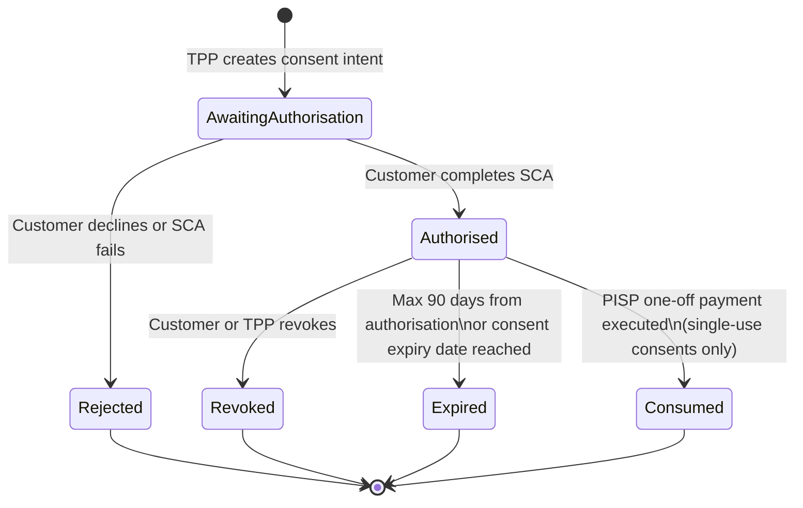

Open banking mandates that financial institutions expose customer account data and payment initiation capabilities to regulated third parties via standardised APIs — fundamentally changing the competitive architecture of retail banking. As of 2024, the UK Open Banking ecosystem processes over 11 million API calls per day, with more than 7 million active users sharing data or making payments via TPP applications. For the engineering teams building both the bank-side API infrastructure (Account Servicing Payment Service Providers — ASPSPs) and the TPP-side integrations, the domain introduces a distinctive set of challenges: consent management as a first-class stateful resource, cryptographic identity via eIDAS certificates rather than symmetric API keys, and the Financial-grade API (FAPI) security profile that extends OAuth2 to meet banking-specific threat models.

## Learning Objectives

- Define the three PSD2 TPP roles (AISP, PISP, CBPII) and map their permissions to the specific API endpoints and data scopes each requires
- Model the consent lifecycle (grant, active, revoked, expired) as a state machine and implement it as a PostgreSQL-backed `ConsentService`
- Compare Open Banking UK, Berlin Group NextGenPSD2, and Australian CDR API standards across data model, authorisation flow, and consent semantics
- Implement an OAuth2 + FAPI 2.0 authorisation flow including PAR (Pushed Authorisation Request) and DPoP-bound access tokens
- Build an `AccountInformationController` exposing balances and transactions with correct consent scope verification
- Implement a `PaymentInitiationController` with strict idempotency semantics and domestic/international payment routing
- Apply SCA exemption logic to reduce unnecessary friction, tracking exemption application rates in Prometheus metrics
- Configure mTLS client authentication against an eIDAS QWAC certificate and validate it against the scheme's trust store (e.g., Open Banking Directory)

## Business Context

In 2023, a UK challenger bank operating as an ASPSP received a £1.4 million fine from the FCA for deficiencies in its open banking API implementation. The specific failures were: consent grants persisting beyond the 90-day maximum permitted by RTS Article 10(5), TPP access not being revoked when customers changed their banking app credentials (password reset), and the account information API returning transactions beyond the consented date range. All three failures shared a common root cause: consent was modelled as a flag on the user account rather than as an independent stateful entity with its own lifecycle. When credentials changed, the flag was not cleared. When 90 days elapsed, nothing expired the flag. When the transaction query ran, it did not validate that the requested date range fell within the consent's coverage period. Modelling consent as a first-class domain entity — with explicit state transitions, TTL enforcement, and scope validation at every API call — would have prevented all three findings.

## PSD2 Roles: AISP, PISP, and CBPII

PSD2 defines three categories of third-party payment service provider, each with distinct permissions:

| Role | Full name | Permitted actions | Data accessed |
|---|---|---|---|
| AISP | Account Information Service Provider | Read balances, transactions, account metadata | Account data only — no payment initiation |
| PISP | Payment Initiation Service Provider | Initiate payments from customer's account | Only confirms initiation; no balance/transaction access |
| CBPII | Card-Based Payment Instrument Issuer | Check available funds before card authorisation | Balance confirmation only (yes/no) — no amounts |

A single TPP may hold all three licences. The permissions are additive but scope-isolated: an AISP consent does not grant payment initiation rights; a PISP cannot access transaction history unless it also holds AISP consent separately granted.

> [!NOTE]
> Under PSD2 RTS Article 32, an ASPSP may refuse a TPP access in the event of "objectively justified and evidenced reasons related to unauthorised or fraudulent access" but must notify the competent authority within 24 hours. Building an automated TPP anomaly detection system (unusual request rates, out-of-hours access patterns) with the ability to suspend TPP access and auto-notify the regulator is therefore a compliance requirement, not an optional feature.

## Consent Lifecycle



Each transition must be persisted with a timestamp and actor (customer, TPP, ASPSP system) for audit. The `AwaitingAuthorisation` state has its own timeout (typically 15-30 minutes): if the customer does not complete SCA within the window, the consent intent is abandoned.

## ConsentService Implementation

```java
@Service
@Slf4j
public class ConsentService {

    private final ConsentRepository consentRepo;
    private final Clock clock;

    /**
     * Creates a consent intent (AwaitingAuthorisation).
     * Returns a consentId that the TPP embeds in the OAuth2 authorisation request.
     */
    @Transactional
    public Consent createConsentIntent(ConsentRequest request) {
        validateScopes(request.scopes(), request.tppRole());

        Consent consent = Consent.builder()
            .consentId(UUID.randomUUID().toString())
            .tppId(request.tppId())
            .customerId(null)              // Not yet known — customer hasn't authenticated
            .scopes(request.scopes())
            .permissions(request.permissions())
            .fromDate(request.fromDate())
            .toDate(request.toDate())
            .expirationDateTime(request.expirationDateTime())
            .status(ConsentStatus.AWAITING_AUTHORISATION)
            .createdAt(clock.instant())
            .intentExpiresAt(clock.instant().plus(Duration.ofMinutes(15)))
            .build();

        return consentRepo.save(consent);
    }

    /**
     * Customer has completed SCA — transition to Authorised.
     * Called by the ASPSP's authorisation server after successful authentication.
     */
    @Transactional
    public Consent authorise(String consentId, String customerId) {
        Consent consent = getConsentOrThrow(consentId);

        if (consent.status() != ConsentStatus.AWAITING_AUTHORISATION) {
            throw new InvalidConsentStateException(consentId, consent.status(),
                ConsentStatus.AWAITING_AUTHORISATION);
        }
        if (clock.instant().isAfter(consent.intentExpiresAt())) {
            throw new ConsentIntentExpiredException(consentId);
        }

        // Compute actual expiry: min(requested expiry, now + 90 days per RTS Art 10)
        Instant maxExpiry = clock.instant().plus(Duration.ofDays(90));
        Instant effectiveExpiry = consent.expirationDateTime() != null
            ? consent.expirationDateTime().isBefore(maxExpiry)
                ? consent.expirationDateTime() : maxExpiry
            : maxExpiry;

        return consentRepo.save(consent.toBuilder()
            .customerId(customerId)
            .status(ConsentStatus.AUTHORISED)
            .authorisedAt(clock.instant())
            .effectiveExpiresAt(effectiveExpiry)
            .build());
    }

    /**
     * Revoke an existing consent. Any party (customer, TPP, or ASPSP) may revoke.
     */
    @Transactional
    public void revoke(String consentId, RevocationActor actor, String reason) {
        Consent consent = getConsentOrThrow(consentId);
        if (!consent.isRevocable()) {
            throw new InvalidConsentStateException(consentId, consent.status(), null);
        }
        consentRepo.save(consent.toBuilder()
            .status(ConsentStatus.REVOKED)
            .revokedAt(clock.instant())
            .revokedBy(actor)
            .revocationReason(reason)
            .build());
        log.info("Consent revoked: consentId={}, actor={}, reason={}", consentId, actor, reason);
    }

    /**
     * Verifies that an active consent covers the requested permission and date range.
     * Called by API controllers before returning any data.
     */
    public void verifyActive(String consentId, Permission requiredPermission,
                              LocalDate queryFromDate, LocalDate queryToDate) {
        Consent consent = getConsentOrThrow(consentId);

        if (consent.status() != ConsentStatus.AUTHORISED) {
            throw new ConsentNotActiveException(consentId, consent.status());
        }
        if (clock.instant().isAfter(consent.effectiveExpiresAt())) {
            // Expire lazily on access
            consentRepo.save(consent.toBuilder().status(ConsentStatus.EXPIRED).build());
            throw new ConsentExpiredException(consentId);
        }
        if (!consent.permissions().contains(requiredPermission)) {
            throw new InsufficientConsentPermissionsException(consentId, requiredPermission);
        }
        if (queryFromDate != null && consent.fromDate() != null
                && queryFromDate.isBefore(consent.fromDate())) {
            throw new ConsentDateRangeViolationException(consentId, queryFromDate, consent.fromDate());
        }
    }

    private Consent getConsentOrThrow(String consentId) {
        return consentRepo.findById(consentId)
            .orElseThrow(() -> new ConsentNotFoundException(consentId));
    }
}
```

## OAuth2 and FAPI 2.0 Security Profile

FAPI (Financial-grade API) is an OpenID Foundation profile that extends OAuth2 with additional security requirements for high-value API access.

| Requirement | Vanilla OAuth2 | FAPI 1.0 Advanced | FAPI 2.0 |
|---|---|---|---|
| Client authentication | client_secret_post | private_key_jwt | DPoP + private_key_jwt |
| Authorisation request | Query string | JAR (signed JWT) | PAR + JAR |
| Token binding | None | MTLS token binding | DPoP (sender-constrained) |
| Redirect URI | Pre-registered | Pre-registered + exact match | Pre-registered + exact match |
| PKCE | Recommended | Required | Required (S256) |
| State parameter | Recommended | Required | Required |

**Pushed Authorisation Requests (PAR):** Instead of sending authorisation parameters in the browser redirect URL (exposing them in browser history, server logs), PAR sends them directly to the authorisation server in a back-channel POST, returning an opaque `request_uri` reference used in the browser redirect.

```java
// FAPI 2.0 PAR request (back-channel, server-to-server)
@PostMapping("/as/par")
public ParResponse pushedAuthorisationRequest(
        @RequestHeader("Authorization") String dPopHeader,
        @RequestBody MultiValueMap<String, String> params,
        HttpServletRequest httpRequest) {

    // Extract and verify client's mTLS certificate (eIDAS QWAC)
    X509Certificate clientCert = extractAndVerifyClientCertificate(httpRequest);
    String tppId = eIDasValidator.extractOrganisationId(clientCert);

    // Validate signed JWT request object (JAR)
    JwtClaimsSet claims = jarValidator.validate(params.getFirst("request"),
        tppPublicKeyResolver.resolve(tppId));

    String consentId = claims.getClaim("consentId");
    consentService.getConsentOrThrow(consentId); // Must exist

    String requestUri = "urn:openbanking:request:" + UUID.randomUUID();
    parStore.store(requestUri, claims, Duration.ofMinutes(10));

    return new ParResponse(requestUri, 600);
}
```

> [!IMPORTANT]
> eIDAS QWACs (Qualified Website Authentication Certificates) must be validated against the Open Banking Directory's revocation list at every API call, not just at onboarding. A TPP's licence can be revoked mid-session. Implement OCSP stapling for performance, but fall back to OCSP direct query if the stapled response is stale. Certificate validation failures must respond with HTTP 403 and a `CERTIFICATE_REVOKED` error code, not a generic 401.

## AccountInformationController

```java
@RestController
@RequestMapping("/open-banking/v3.1/aisp")
public class AccountInformationController {

    private final ConsentService consentService;
    private final AccountService accountService;
    private final TransactionService transactionService;

    @GetMapping("/accounts")
    public ResponseEntity<OBReadAccount6> getAccounts(
            @RequestAttribute("consentId") String consentId,
            @RequestAttribute("customerId") String customerId) {

        consentService.verifyActive(consentId, Permission.READ_ACCOUNTS_BASIC, null, null);

        List<Account> accounts = accountService.findByCustomer(customerId);
        OBReadAccount6 response = accountMapper.toOBReadAccount6(accounts);
        return ResponseEntity.ok(response);
    }

    @GetMapping("/accounts/{accountId}/transactions")
    public ResponseEntity<OBReadTransaction6> getTransactions(
            @PathVariable String accountId,
            @RequestParam(required = false) @DateTimeFormat(iso = ISO.DATE) LocalDate fromBookingDate,
            @RequestParam(required = false) @DateTimeFormat(iso = ISO.DATE) LocalDate toBookingDate,
            @RequestAttribute("consentId") String consentId,
            @RequestAttribute("customerId") String customerId) {

        // Verify consent covers this permission and date range
        consentService.verifyActive(consentId, Permission.READ_TRANSACTIONS_DETAIL,
            fromBookingDate, toBookingDate);

        // Verify the account belongs to the consenting customer
        accountService.verifyOwnership(accountId, customerId);

        List<Transaction> transactions = transactionService.find(
            accountId, fromBookingDate, toBookingDate);

        return ResponseEntity.ok(transactionMapper.toOBReadTransaction6(transactions));
    }
}
```

## Strong Customer Authentication and Exemptions

SCA requires at least two factors from: something you know (PIN/password), something you have (device/card), something you are (biometric). PSD2 RTS specifies several exemptions where SCA may be skipped.

```java
public class ScaExemptionEvaluator {

    private final TransactionRiskAssessor riskAssessor;
    private final TrustedBeneficiaryRegistry trustedBeneficiaries;
    private final ExemptionMetrics metrics;

    public ScaExemptionResult evaluate(PaymentInitiationRequest request) {
        // Low-value exemption: single ≤ €30, cumulative ≤ €100 or 5 consecutive
        if (request.amount().compareTo(LOW_VALUE_THRESHOLD) <= 0
                && !lowValueCumulativeExceeded(request.psuId())) {
            metrics.increment("low_value_exemption_applied");
            return ScaExemptionResult.exempt(ExemptionType.LOW_VALUE);
        }

        // Trusted beneficiary: PSU has pre-whitelisted this payee
        if (trustedBeneficiaries.isTrusted(request.psuId(), request.creditorIban())) {
            metrics.increment("trusted_beneficiary_exemption_applied");
            return ScaExemptionResult.exempt(ExemptionType.TRUSTED_BENEFICIARY);
        }

        // TRA exemption: acquirer fraud rate below threshold
        // ≤ €100: fraud reference rate ≤ 0.13%; ≤ €250: ≤ 0.06%; ≤ €500: ≤ 0.01%
        TransactionRiskScore riskScore = riskAssessor.score(request);
        if (riskScore.fraudLiability().compareTo(TRA_MAX_AMOUNT) <= 0
                && fraudRateWithinThreshold(request.amount())) {
            metrics.increment("tra_exemption_applied");
            return ScaExemptionResult.exempt(ExemptionType.TRANSACTION_RISK_ANALYSIS);
        }

        return ScaExemptionResult.scaRequired();
    }
}
```

## PaymentInitiationController with Idempotency

```java
@RestController
@RequestMapping("/open-banking/v3.1/pisp")
public class PaymentInitiationController {

    private final ConsentService consentService;
    private final PaymentInitiationService paymentService;
    private final IdempotencyStore idempotencyStore;

    @PostMapping("/domestic-payments")
    public ResponseEntity<OBWriteDomesticResponse5> createDomesticPayment(
            @RequestHeader("x-idempotency-key") String idempotencyKey,
            @RequestBody OBWriteDomestic2 request,
            @RequestAttribute("consentId") String consentId,
            @RequestAttribute("customerId") String customerId) {

        consentService.verifyActive(consentId, Permission.CREATE_DOMESTIC_PAYMENT, null, null);

        // Idempotency: return cached response for duplicate requests
        OBWriteDomesticResponse5 cached = idempotencyStore.get(idempotencyKey,
            OBWriteDomesticResponse5.class);
        if (cached != null) {
            log.info("Idempotent response returned: key={}", idempotencyKey);
            return ResponseEntity.status(200).body(cached);
        }

        // Validate that payment data matches the consent
        validatePaymentMatchesConsent(request, consentId);

        PaymentInitiationResult result = paymentService.initiate(
            mapToInternalRequest(request, customerId, consentId));

        OBWriteDomesticResponse5 response = responseMapper.map(result);

        // Cache response for idempotency window (24 hours per OB spec)
        idempotencyStore.put(idempotencyKey, response, Duration.ofHours(24));

        return ResponseEntity.status(201).body(response);
    }

    private void validatePaymentMatchesConsent(OBWriteDomestic2 payment, String consentId) {
        // The payment data element must exactly match the consent intent
        // Any deviation — amount, creditor account, reference — is a protocol error
        Consent consent = consentService.getConsentOrThrow(consentId);
        if (!payment.getData().getConsentId().equals(consentId)) {
            throw new PaymentConsentMismatchException("ConsentId mismatch");
        }
        // Amount, currency, creditor account must match consent intent exactly
        // (Open Banking UK spec requirement)
    }
}
```

> [!WARNING]
> Idempotency keys for payment initiation must be validated for exact payload match — not just key existence. If a TPP sends the same idempotency key with a different payment amount (a bug or attempted fraud), the ASPSP must return HTTP 422 `PAYLOAD_MISMATCH` rather than processing the second request or returning the cached first response. This prevents a class of attack where a low-value payment is used to establish an idempotency key, which is then reused with a high-value amount.

## eIDAS Certificates and mTLS

```java
@Component
public class EidasCertificateValidator {

    private final OpenBankingDirectoryClient directoryClient;

    /**
     * Validates that the client's TLS certificate is:
     * 1. A valid eIDAS QWAC (Qualified Website Authentication Certificate)
     * 2. Issued by a CA in the Open Banking Directory trust store
     * 3. Not revoked (checked via OCSP)
     * 4. Contains an organisationId matching a registered TPP
     */
    public TppIdentity validateAndExtract(X509Certificate cert) {
        // Check certificate policy OID for QWAC (0.4.0.194112.1.4)
        verifyQwacPolicyOid(cert);

        // Extract organisationId from subject alternate name (OID 2.5.4.97)
        String orgId = extractOrganisationId(cert);

        // OCSP check against issuing CA
        OcspResult ocsp = performOcspCheck(cert);
        if (ocsp.status() == OcspStatus.REVOKED) {
            throw new CertificateRevokedException(orgId, ocsp.revocationTime());
        }

        // Verify TPP is registered and active in OB Directory
        TppRegistration tpp = directoryClient.lookupTpp(orgId)
            .orElseThrow(() -> new UnregisteredTppException(orgId));

        if (!tpp.isActive()) {
            throw new TppNotActiveException(orgId, tpp.status());
        }

        return new TppIdentity(orgId, tpp.name(), tpp.roles(), cert.getNotAfter().toInstant());
    }
}
```

## API Rate Limiting per TPP

Each TPP's API access must be rate-limited independently to prevent a single misbehaving or compromised TPP from impacting the ASPSP's availability for all other TPPs.

```java
@Component
public class TppRateLimiter {

    // Open Banking UK specifies minimum thresholds: ASPSPs must support
    // at least 500 requests per minute per TPP for AIS, 50 per minute for PIS
    private static final int AIS_RPM = 500;
    private static final int PIS_RPM = 50;

    private final RateLimiterRegistry registry;  // Resilience4j

    public void checkLimit(String tppId, ApiEndpointType endpointType) {
        String limiterKey = tppId + ":" + endpointType.category();
        RateLimiter limiter = registry.rateLimiter(limiterKey, () ->
            buildConfig(endpointType));

        if (!limiter.acquirePermission()) {
            throw new TppRateLimitExceededException(tppId, endpointType,
                limiter.getMetrics().getAvailablePermissions());
        }
    }

    private RateLimiterConfig buildConfig(ApiEndpointType type) {
        int rpm = type.isAccountInformation() ? AIS_RPM : PIS_RPM;
        return RateLimiterConfig.custom()
            .limitForPeriod(rpm)
            .limitRefreshPeriod(Duration.ofMinutes(1))
            .timeoutDuration(Duration.ZERO)   // Fail fast — do not queue
            .build();
    }
}
```

## Open Banking UK vs Berlin Group vs CDR Comparison

| Dimension | Open Banking UK | Berlin Group NextGenPSD2 | Australian CDR |
|---|---|---|---|
| Mandate | CMA Order 2017 (9 banks) | PSD2 RTS (all EU banks) | Consumer Data Right Act 2019 |
| API standard body | Open Banking Ltd | Berlin Group | Data Standards Body (Treasury) |
| Authorisation | Redirect + embedded (hybrid) | Redirect | Redirect |
| Consent UI | ASPSP-hosted | ASPSP-hosted | ASPSP-hosted |
| Data model | OB UK schema v3.1 | BIAN/NextGenPSD2 schema | CDR Banking schema |
| Payment types | FPS domestic + BACS | SEPA CT / SEPA Inst | NPP (New Payments Platform) |
| Data sharing | 90 days renewable | 90 days renewable | 12 months renewable |
| Accreditation | FCA register + OB Directory | NCA register + eIDAS | ACCC accreditation |

## Knowledge Check

**Q1: A PISP submits a payment initiation request with idempotency key `pay-abc-001`. The request succeeds and the payment enters `AcceptedSettlementInProcess` status. Five minutes later, the same TPP resubmits with key `pay-abc-001` but with the payment amount doubled. What must the ASPSP return and why?**

A: The ASPSP must return HTTP 422 Unprocessable Entity with error code `PAYLOAD_MISMATCH` (or equivalent per the Open Banking specification being implemented). Idempotency in payment APIs means that the same key guarantees the same payment is not processed twice — it does not mean the key can be reused to submit a different payment. When a key is reused with a different payload, it indicates either a TPP bug or an attempted fraud pattern (establishing a key with a low-value payment, then attempting to reuse it for a high-value one). The ASPSP must compare the hash of the new request body against the stored hash for the idempotency key and reject any mismatch. It must not process the new payment and must not return the cached response for the original payment, since that would give the TPP a false impression of which payment was executed.

**Q2: Explain the difference between PAR (Pushed Authorisation Request) and a standard OAuth2 authorisation request, and why FAPI 2.0 mandates PAR for open banking.**

A: In a standard OAuth2 authorisation request, the client embeds authorisation parameters (client ID, scope, state, PKCE challenge, redirect URI) in the URL of the browser redirect to the authorisation server. This means the parameters travel through the browser — they appear in browser history, can be logged by intermediary proxies, and are visible to browser extensions. For standard OAuth2 this is an acceptable trade-off. In FAPI 2.0 for open banking, PAR requires the client to first POST the authorisation parameters directly to the authorisation server's PAR endpoint over mTLS (back-channel), receiving an opaque `request_uri` in response. The browser redirect to the authorisation server then contains only this short-lived `request_uri` reference. This means sensitive parameters (including the signed JAR containing payment details or account consent scope) never traverse the browser. PAR also enables the authorisation server to validate the request before the customer is redirected, returning errors immediately in the back-channel rather than via a browser redirect that could be observed or manipulated.

## Practical Challenge

1. **ConsentService with State Machine:** Implement the full `ConsentService` including all five state transitions, the 90-day RTS cap enforcement on `authorise()`, and lazy expiry detection in `verifyActive()`. Use a PostgreSQL-backed repository with a `consents` table and a `consent_audit_log` table that records every state transition with actor, timestamp, and reason. Write integration tests covering: consent created → authorised → expired after 91 days (using a `TestClock`); consent created → revoked by customer → subsequent API call returns `ConsentNotActive`; consent created → intent expires after 15 minutes without authorisation.

2. **FAPI 2.0 PAR Endpoint:** Implement the `/as/par` endpoint with mTLS client authentication, JAR (signed JWT request object) validation, and an in-memory PAR store with 10-minute TTL. The JAR must be validated with the TPP's registered public key (retrieved from a stubbed `TppKeystore`). Write a test using a real RSA key pair that generates a valid signed JAR and asserts a `request_uri` is returned, and another test with a tampered JWT signature that asserts HTTP 400 `INVALID_REQUEST_OBJECT`.

3. **Rate Limiter Integration Test:** Configure Resilience4j rate limiters for a set of three test TPPs with AIS limits of 10 requests per minute. Write a test that fires 15 rapid requests from TPP-1 and asserts that requests 11-15 receive `TppRateLimitExceededException`. Concurrently fire 10 requests from TPP-2 and assert all succeed (TPP limits are independent). Verify that after a 60-second `TestClock` advance, TPP-1 can make requests again.

4. **Berlin Group NextGenPSD2 Compatibility:** Research the Berlin Group NextGenPSD2 Account Information API v1.3 (GET `/v1/accounts/{account-id}/transactions`) and implement a second controller alongside `AccountInformationController` that serves the same underlying data in NextGenPSD2 JSON schema. The two controllers should share the same `ConsentService` and `TransactionService` but use separate schema mappers. Write a contract test using a Pact consumer contract file that validates the JSON response structure matches the NextGenPSD2 specification.

<!-- KNOWLEDGE-CHECK
{
  "questions": [
    {
      "text": "A PISP submits a payment initiation request with idempotency key `pay-abc-001`. The request succeeds. Five minutes later the same TPP resubmits with the same key but a doubled payment amount. What must the ASPSP return?",
      "options": [
        "HTTP 200 with the cached response from the first request",
        "HTTP 422 Unprocessable Entity with error code `PAYLOAD_MISMATCH` — the idempotency key cannot be reused with a different payload",
        "HTTP 409 Conflict — a payment with this key already exists",
        "HTTP 201 Created — process the new payment as a fresh request"
      ],
      "correct": 1,
      "explanation": "The ASPSP must return HTTP 422 with `PAYLOAD_MISMATCH`. Idempotency guarantees the same payment is not processed twice — it does not allow the key to be reused for a different payment. The ASPSP must compare the hash of the new request against the stored hash and reject any mismatch. It must not process the new payment nor return the cached response for the original."
    },
    {
      "text": "What is the key difference between PAR (Pushed Authorisation Request) and a standard OAuth2 authorisation request, and why does FAPI 2.0 mandate PAR?",
      "options": [
        "PAR is faster because it eliminates the browser redirect entirely",
        "PAR requires the client to first POST authorisation parameters directly to the authorisation server over mTLS (back-channel), receiving an opaque `request_uri`, so sensitive parameters never traverse the browser",
        "PAR adds a second factor of authentication for the customer",
        "PAR replaces OAuth2 tokens with certificate-based authentication"
      ],
      "correct": 1,
      "explanation": "In standard OAuth2, authorisation parameters travel through the browser redirect — visible in browser history, proxy logs, and browser extensions. In FAPI 2.0 PAR, the client POSTs parameters directly to the authorisation server over mTLS (back-channel), receiving only an opaque `request_uri`. The browser redirect contains only this reference, so sensitive parameters (including signed JAR with payment details) never traverse the browser."
    },
    {
      "text": "Under PSD2, what is the maximum duration that a consent for account information access (AIS) can remain valid after authorisation under the RTS?",
      "options": [
        "30 days",
        "90 days",
        "180 days",
        "1 year with strong customer authentication re-required every 90 days"
      ],
      "correct": 1,
      "explanation": "Under the PSD2 Regulatory Technical Standards (RTS), AIS consent can remain valid for a maximum of 90 days after the strong customer authentication that authorised it. After 90 days, the customer must re-authenticate with SCA to renew access. This is enforced in the `ConsentService.authorise()` method with a `MAX_CONSENT_DURATION_DAYS` cap."
    }
  ]
}
-->

<!-- PRACTICAL-CHALLENGE
{
  "title": "Open Banking Consent Management and FAPI 2.0 PAR",
  "difficulty": "advanced",
  "estimatedMinutes": 45,
  "tasks": [
    {
      "id": "1",
      "description": "Implement the full `ConsentService` including all five state transitions, the 90-day RTS cap enforcement on `authorise()`, and lazy expiry detection in `verifyActive()`. Use PostgreSQL-backed repository with `consents` and `consent_audit_log` tables. Write integration tests covering: 91-day expiry via `TestClock`; customer revocation; 15-minute intent expiry without authorisation."
    },
    {
      "id": "2",
      "description": "Implement the `/as/par` endpoint with mTLS client authentication, JAR (signed JWT request object) validation, and in-memory PAR store with 10-minute TTL. Validate JAR with the TPP's registered public key from a stubbed `TppKeystore`. Write tests for a valid signed JAR returning `request_uri` and a tampered JWT signature returning HTTP 400 `INVALID_REQUEST_OBJECT`."
    },
    {
      "id": "3",
      "description": "Configure Resilience4j rate limiters for three test TPPs with AIS limits of 10 requests per minute. Write a test firing 15 rapid requests from TPP-1 asserting requests 11-15 receive `TppRateLimitExceededException`. Concurrently fire 10 requests from TPP-2 asserting all succeed (limits are independent). Verify after a 60-second `TestClock` advance, TPP-1 can make requests again."
    },
    {
      "id": "4",
      "description": "Research the Berlin Group NextGenPSD2 Account Information API v1.3 and implement a second controller alongside `AccountInformationController` serving the same data in NextGenPSD2 JSON schema. Share the same `ConsentService` and `TransactionService` but use separate schema mappers. Write a Pact contract test validating the JSON response structure."
    }
  ]
}
-->
