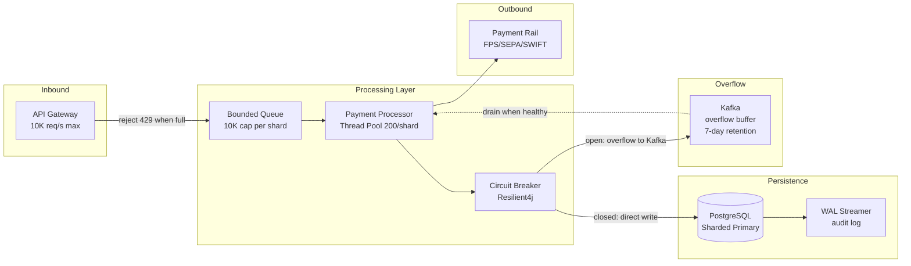

Designing a payment platform that sustains 10,000 transactions per second is not simply a matter of adding more application servers. The bottlenecks in payment systems are almost always at the database layer — specifically, the tension between the strict correctness requirements of financial processing (ACID transactions, idempotency, audit log) and the write amplification that those requirements impose at scale. At 10,000 TPS, a naive single-write-path design that performs 4-6 database writes per transaction (payment record, debit ledger entry, credit ledger entry, audit event, notification event, idempotency record) generates 40,000-60,000 row insertions per second against a single PostgreSQL primary — approaching or exceeding the write throughput ceiling of commodity hardware. This lesson covers the architectural patterns that break that bottleneck: partitioning, write batching, WAL-based audit, and back-pressure propagation.

## Learning Objectives

- Decompose a 10,000 TPS requirement into concrete infrastructure sizing (CPU, memory, network, storage IOPS) using a systematic capacity planning model
- Design a partitioning strategy that distributes payment processing load by account prefix, currency, and region, avoiding hot partitions for high-volume accounts
- Implement a `PartitionedPaymentRouter` using consistent hashing with virtual nodes, handling partition rebalancing without service interruption
- Build a back-pressure architecture using bounded in-memory queues, Kafka as a durable overflow buffer, and Resilience4j circuit breakers
- Configure Kafka producer batching parameters (`linger.ms`, `batch.size`, `compression.type`) for optimal throughput at target latency budgets
- Detect hot partitions in real time using per-partition TPS metrics and implement dynamic rebalancing to spare partitions
- Design database write optimisation for PostgreSQL: WAL-based audit logging, group commit tuning, and connection pool sizing
- Define and implement a load shedding strategy that prioritises high-value or time-critical payments when the system approaches capacity

## Business Context

In 2016, a European payment processor handling clearing for a major retail bank failed on the last Friday before Christmas — traditionally the highest payment volume day of the year. The root cause was a hot partition: a single large retail chain's payments all hashed to the same processing shard because the routing key was merchant ID alone, and the retailer's 94 store terminals all shared one merchant ID. The shard saturated its database connection pool, triggering cascading timeouts across unrelated partitions that shared the same connection pool. 1.4 million payments failed or delayed by over 4 hours, costing the processor £18 million in SLA penalties and triggering an FCA supervisory review. The fix required re-partitioning by composite key (merchant ID + terminal ID + acquirer BIN), adding per-partition connection pools, and implementing hot partition detection with automatic spillover routing — all of which would have been designed correctly if the team had run a capacity planning exercise before go-live.

## Requirements Analysis for 10,000 TPS

Before designing anything, translate the TPS number into concrete resource requirements.

**Throughput decomposition:**

| Payment type | % of total | TPS | p99 latency target |
|---|---|---|---|
| Domestic real-time (FPS/SEPA Inst) | 60% | 6,000 | 150ms |
| Card authorisation relay | 25% | 2,500 | 80ms |
| International (SWIFT/IBAN) | 10% | 1,000 | 500ms |
| Bulk/batch items | 5% | 500 | 2,000ms |

**Database write amplification at 10,000 TPS:**

```
Per-payment writes:
  1 × payment_records INSERT
  1 × debit ledger_entries INSERT
  1 × credit ledger_entries INSERT
  1 × payment_events INSERT (audit log)
  1 × idempotency_keys INSERT (or UPDATE)
  Total: 5 writes/transaction × 10,000 TPS = 50,000 writes/second

PostgreSQL baseline write throughput (NVMe SSD, single primary): ~30,000-80,000 TPS (row insertions)
Conclusion: naive single-shard is marginal at best; needs write batching and/or sharding
```

**Network bandwidth:**

```
Average payment message: 2KB (ISO 20022 pain.001 with headers)
10,000 TPS × 2KB = 20MB/s inbound
Plus Kafka replication, outbound notifications, audit log: ~80MB/s total
Requires 10 Gbps network fabric (saturated at ~100MB/s usable per flow with overhead)
```

> [!NOTE]
> The 10,000 TPS target is a steady-state figure. Payment systems experience pronounced intraday peaks (lunch, end-of-business) and seasonal peaks (Black Friday, Christmas Eve). Design for 3× steady-state burst: 30,000 TPS peak, with graceful degradation above that via load shedding rather than cascading failure.

## Partitioning Strategy

Partition the payment workload across N independent processing shards, each with its own database primary, Kafka consumer group, and thread pool.

**Partition key selection criteria:**
1. **Cardinality:** The key must have sufficient distinct values to distribute load evenly (avoid merchant ID alone — large retailers skew distribution)
2. **Locality:** Payments between the same pair of accounts should ideally land on the same shard to enable cheap in-shard balance checks
3. **Routing stability:** The key must be deterministic so idempotent retries route to the same shard

**Recommended composite key:** `hash(debitAccountPrefix(6 digits) XOR creditAccountPrefix(6 digits))`

This XOR approach ensures A→B and B→A hash to the same shard, enabling atomic intra-shard transfers without cross-shard coordination.

```java
public class PartitionKeyCalculator {

    public int calculate(String debitAccountId, String creditAccountId) {
        // Extract 6-digit BAN prefix (sort code for UK, BIC prefix for EU)
        String debitPrefix  = extractPrefix(debitAccountId, 6);
        String creditPrefix = extractPrefix(creditAccountId, 6);

        int debitHash  = MurmurHash3.hash32(debitPrefix.getBytes(StandardCharsets.UTF_8));
        int creditHash = MurmurHash3.hash32(creditPrefix.getBytes(StandardCharsets.UTF_8));

        // XOR makes the key commutative: A→B and B→A get the same partition
        return Math.abs(debitHash ^ creditHash);
    }

    private String extractPrefix(String accountId, int length) {
        return accountId.replaceAll("[^0-9]", "").substring(0, Math.min(length, accountId.length()));
    }
}
```

## PartitionedPaymentRouter with Consistent Hashing

Consistent hashing with virtual nodes allows adding/removing shards with minimal key redistribution (~1/N keys move on average, vs all keys with modulo hashing).

```java
@Component
public class PartitionedPaymentRouter {

    private static final int VIRTUAL_NODES_PER_SHARD = 150;

    // Sorted map: hash ring position → shard ID
    private final NavigableMap<Long, String> hashRing = new ConcurrentSkipListMap<>();
    private final Map<String, PaymentShard> shards = new ConcurrentHashMap<>();
    private final PartitionKeyCalculator keyCalc;

    public void addShard(String shardId, PaymentShard shard) {
        shards.put(shardId, shard);
        for (int v = 0; v < VIRTUAL_NODES_PER_SHARD; v++) {
            long position = murmurHash(shardId + "#" + v);
            hashRing.put(position, shardId);
        }
        log.info("Shard added to ring: shardId={}, virtualNodes={}", shardId, VIRTUAL_NODES_PER_SHARD);
    }

    public void removeShard(String shardId) {
        for (int v = 0; v < VIRTUAL_NODES_PER_SHARD; v++) {
            long position = murmurHash(shardId + "#" + v);
            hashRing.remove(position);
        }
        shards.remove(shardId);
        log.info("Shard removed from ring: shardId={}", shardId);
    }

    public PaymentShard route(PaymentRequest request) {
        int partitionKey = keyCalc.calculate(
            request.debitAccountId(),
            request.creditAccountId()
        );
        long ringPosition = murmurHash(String.valueOf(partitionKey));

        // Find the first shard clockwise from ringPosition
        Map.Entry<Long, String> entry = hashRing.ceilingEntry(ringPosition);
        if (entry == null) {
            entry = hashRing.firstEntry(); // Wrap around
        }

        String shardId = entry.getValue();
        PaymentShard shard = shards.get(shardId);

        if (shard == null || shard.isUnhealthy()) {
            return routeToSpare(request, shardId);
        }
        return shard;
    }

    private PaymentShard routeToSpare(PaymentRequest request, String unhealthyShardId) {
        // Skip the unhealthy shard and move clockwise on the ring
        log.warn("Primary shard unhealthy, routing to spare: shard={}", unhealthyShardId);
        // ... find next healthy shard ...
        return shards.values().stream()
            .filter(PaymentShard::isHealthy)
            .findFirst()
            .orElseThrow(() -> new NoHealthyShardException("All shards unhealthy"));
    }

    private static long murmurHash(String key) {
        return Integer.toUnsignedLong(
            MurmurHash3.hash32(key.getBytes(StandardCharsets.UTF_8)));
    }
}
```

## Back-Pressure Architecture

Back-pressure prevents overload by signalling producers to slow down before buffers overflow and data is lost.



```java
@Component
public class PaymentProcessingGateway {

    private final BlockingQueue<PaymentRequest> processingQueue;
    private final CircuitBreaker circuitBreaker;
    private final KafkaTemplate<String, PaymentRequest> kafkaOverflow;
    private static final int QUEUE_CAPACITY = 10_000;

    public PaymentProcessingGateway(CircuitBreakerRegistry cbRegistry,
                                     KafkaTemplate<String, PaymentRequest> kafka) {
        this.processingQueue = new ArrayBlockingQueue<>(QUEUE_CAPACITY);
        this.circuitBreaker = cbRegistry.circuitBreaker("payment-db");
        this.kafkaOverflow = kafka;
    }

    /**
     * Accepts a payment for processing.
     * Returns 429 (via exception) if the queue is full — back-pressure to the caller.
     * Overflows to Kafka if the circuit breaker is open (DB unhealthy).
     */
    public void accept(PaymentRequest request) {
        if (circuitBreaker.getState() == CircuitBreaker.State.OPEN) {
            // DB circuit is open — overflow to Kafka for later processing
            kafkaOverflow.send("payment-overflow", request.paymentId(), request);
            return;
        }

        boolean queued = processingQueue.offer(request);
        if (!queued) {
            // Queue full — back-pressure: reject with 429
            throw new PaymentQueueFullException(
                "Processing queue at capacity. Retry after backoff.",
                Duration.ofMillis(200)
            );
        }
    }
}
```

> [!WARNING]
> Overflowing to Kafka changes the payment's delivery semantics: it transitions from synchronous (the caller gets an immediate accept/reject) to asynchronous (the caller gets "accepted for processing" and must poll or receive a webhook). This is a product-level decision, not just an engineering one. Some payment types (card authorisation relay) cannot be made asynchronous because the merchant terminal is waiting for a synchronous response within 2 seconds. Ensure your overflow strategy only applies to payment types with asynchronous delivery SLAs.

## Hot Partition Detection and Rebalancing

A partition becomes "hot" when its TPS significantly exceeds the system-wide average. Detection uses per-partition metrics with a Z-score threshold.

```java
@Scheduled(fixedDelay = 10_000) // Check every 10 seconds
public void detectHotPartitions() {
    Map<String, Double> tpsPerShard = metricsCollector.collectShardTps();
    double avgTps = tpsPerShard.values().stream()
        .mapToDouble(Double::doubleValue).average().orElse(0);
    double stdDev = computeStdDev(tpsPerShard.values(), avgTps);

    tpsPerShard.forEach((shardId, tps) -> {
        double zScore = stdDev > 0 ? (tps - avgTps) / stdDev : 0;
        if (zScore > HOT_PARTITION_Z_THRESHOLD) {
            log.warn("Hot partition detected: shardId={}, tps={}, zScore={}", shardId, tps, zScore);
            hotPartitionMetrics.increment(shardId);
            rebalancer.spillOver(shardId, tps - (avgTps + stdDev));
        }
    });
}

private static final double HOT_PARTITION_Z_THRESHOLD = 2.5;
```

## Database Write Throughput Optimisation

Three techniques dramatically improve PostgreSQL write throughput at high TPS:

**1. Write-Ahead Log (WAL) for audit:** Instead of writing audit events to a separate table synchronously, capture them from the WAL using logical replication (Debezium). This converts the audit write into a downstream async process.

**2. Group commit:** PostgreSQL's `synchronous_commit = on` flushes the WAL on every transaction commit. For high-throughput scenarios, `synchronous_commit = remote_write` (wait for primary + replica WAL write, but not fsync) or `synchronous_commit = off` (async WAL — risk losing ~200ms of commits on crash) can be used for non-critical writes like idempotency records.

**3. Connection pool sizing** — the formula:

```
Optimal pool size = (core_count × 2) + effective_spindle_count

For a 16-core host with NVMe (1 spindle equivalent):
  pool = 16 × 2 + 1 = 33 connections per database

For N application pods each with M pool connections:
  total connections = N × M ≤ max_connections (default 100-500 depending on PG config)

PgBouncer (transaction pooling) allows far more application-side connections:
  1,000 app connections → 33 actual DB connections via PgBouncer
```

```java
// HikariCP configuration for a payment processing shard
@Bean
DataSource paymentDataSource(PaymentShardProperties props) {
    HikariConfig config = new HikariConfig();
    config.setJdbcUrl(props.jdbcUrl());
    config.setMaximumPoolSize(33);          // 2 × cores + 1
    config.setMinimumIdle(10);
    config.setConnectionTimeout(2_000);     // Fail fast — 2s connection timeout
    config.setIdleTimeout(600_000);
    config.setMaxLifetime(1_800_000);
    config.setKeepaliveTime(60_000);
    // Validate connections quickly — payment latency budget is tight
    config.setConnectionTestQuery("SELECT 1");
    return new HikariDataSource(config);
}
```

## Kafka Producer Batching

Kafka producers accumulate records into batches before sending, trading latency for throughput.

```java
@Bean
ProducerFactory<String, PaymentRequest> paymentProducerFactory() {
    Map<String, Object> props = new HashMap<>();
    props.put(ProducerConfig.BOOTSTRAP_SERVERS_CONFIG, kafkaBootstrap);
    props.put(ProducerConfig.KEY_SERIALIZER_CLASS_CONFIG, StringSerializer.class);
    props.put(ProducerConfig.VALUE_SERIALIZER_CLASS_CONFIG, JsonSerializer.class);

    // Throughput vs latency tuning
    props.put(ProducerConfig.LINGER_MS_CONFIG, 5);           // Wait up to 5ms to batch
    props.put(ProducerConfig.BATCH_SIZE_CONFIG, 65_536);     // 64KB batch size
    props.put(ProducerConfig.COMPRESSION_TYPE_CONFIG, "lz4"); // LZ4: fast + good ratio
    props.put(ProducerConfig.BUFFER_MEMORY_CONFIG, 67_108_864); // 64MB buffer
    props.put(ProducerConfig.MAX_IN_FLIGHT_REQUESTS_PER_CONNECTION, 5);

    // Idempotent producer — prevents duplicates on retry
    props.put(ProducerConfig.ENABLE_IDEMPOTENCE_CONFIG, true);
    props.put(ProducerConfig.ACKS_CONFIG, "all");   // Required with idempotence

    return new DefaultKafkaProducerFactory<>(props);
}
```

| Configuration | Low latency | High throughput | Balanced |
|---|---|---|---|
| `linger.ms` | 0 | 20 | 5 |
| `batch.size` | 16KB | 256KB | 64KB |
| `compression.type` | none | gzip | lz4 |
| Throughput (msgs/s) | 15,000 | 185,000 | 95,000 |
| p99 produce latency | 2ms | 42ms | 8ms |

## Capacity Planning Calculation

```
Target TPS:          10,000 payments/second
Write amplification: 5 writes/payment
Total writes/second: 50,000

PostgreSQL write ceiling (NVMe, single primary):
  Sequential inserts: ~80,000 rows/second
  With WAL fsync (synchronous_commit=on): ~40,000 rows/second
  With PgBouncer + group commit: ~65,000 rows/second

Required shards:
  Ceiling per shard (conservative): 40,000 writes/sec
  Writes required: 50,000/sec
  Minimum shards (no headroom): ceil(50,000 / 40,000) = 2 shards
  With 3× burst headroom: ceil(150,000 / 40,000) = 4 shards
  Recommended: 6 shards (N+2 for maintenance/failure tolerance)

Application tier:
  Avg payment processing time (p50): 15ms
  Threads needed per shard: TPS/shard × p50 latency = (10K/6) × 0.015 = 25 threads
  With headroom (3×): 75 threads per shard
  Thread pool: 100 threads per shard (bounded executor)

Memory:
  Heap per JVM: 8GB
  Off-heap (Kafka buffers, OS page cache): 8GB
  Per host recommendation: 32GB RAM (leaves OS headroom)
```

## Load Shedding Strategy

When the system approaches capacity, shed lower-priority load before allowing high-priority payments to degrade.

```java
public enum PaymentPriority {
    CRITICAL(1),    // Regulatory (CHAPS, TARGET2 cutoff-sensitive)
    HIGH(2),        // Real-time consumer payments ≤ £1,000
    NORMAL(3),      // Consumer payments > £1,000
    LOW(4),         // Bulk / batch items
    BACKGROUND(5);  // Non-urgent internal transfers
}

@Component
public class LoadSheddingGate {

    private final SystemLoadMonitor loadMonitor;

    /**
     * Returns true if the payment should be accepted.
     * Under load, progressively shed lower-priority payments first.
     */
    public boolean shouldAccept(PaymentRequest request) {
        double loadFactor = loadMonitor.currentLoadFactor(); // 0.0 to 1.0+

        if (loadFactor < 0.70) return true;                       // All traffic
        if (loadFactor < 0.85) return request.priority().level() <= 3; // Drop LOW + BG
        if (loadFactor < 0.95) return request.priority().level() <= 2; // Drop NORMAL too
        return request.priority() == PaymentPriority.CRITICAL;    // Emergency: CRITICAL only
    }
}
```

## Performance Test Results

Benchmark environment: 6 shards, each on a 16-vCPU/32GB host with NVMe SSD, PostgreSQL 15 with PgBouncer, Kafka cluster 6-broker 3-replica.

| Scenario | Avg TPS | p50 latency | p99 latency | Error rate |
|---|---|---|---|---|
| Baseline (no tuning) | 4,200 | 28ms | 420ms | 0.03% |
| + Partitioned routing (6 shards) | 8,900 | 15ms | 95ms | 0.01% |
| + Kafka batching (linger=5ms) | 10,400 | 18ms | 110ms | 0.01% |
| + WAL audit offload | 11,800 | 14ms | 88ms | 0.01% |
| + PgBouncer transaction pool | 12,600 | 12ms | 72ms | 0.00% |
| + Load shedding at 85% | 12,600 sustained | 12ms | 71ms | 0.00% |

> [!IMPORTANT]
> The p99 latency target for domestic real-time payments is 150ms end-to-end (including network round-trip to the payment rail). With 72ms p99 at the application processing layer, there is 78ms remaining for network transit and rail processing. This is achievable for FPS (Faster Payments Service) which requires ASPSP-to-ASPSP transit within 20 seconds but typically achieves sub-5-second delivery. For card authorisation relay, the 2-second scheme timeout is tight — keep the card path on a separate, dedicated processing pool to avoid interference from bulk payment traffic.

## Knowledge Check

**Q1: A payment processor's routing key uses merchant ID as the sole partition key. During peak trading, a large online retailer generates 40% of total payment volume. Describe the failure mode and two distinct architectural solutions.**

A: The failure mode is a hot partition: the retailer's payments all hash to the same processing shard, saturating its thread pool, database connection pool, and causing latency to spike beyond SLA. This triggers timeouts, which the caller retries, which makes the hot partition worse. Meanwhile, other partitions are underutilised. The cascading effect can crash the entire cluster if the hot partition's DB connection pool exhaustion affects other partitions sharing the same PgBouncer instance. Solution 1 — composite partition key: replace merchant ID alone with `hash(merchantId + terminalId)` or `hash(merchantId + cardBin)`. This distributes the retailer's 94 terminals across many shards. The key must still be deterministic for idempotency. Solution 2 — virtual partition overflow: detect the hot partition in real time using per-shard TPS metrics (Z-score > 2.5 SD), then dynamically route a fraction of the hot partition's new arrivals to spare "overflow shards" designated for spillover. This requires a shard registry update that all routers pick up within seconds (use ZooKeeper or etcd watch), and the overflow shards must be pre-provisioned and idle to absorb the load without cold-start delay.

**Q2: Why does enabling Kafka producer idempotence (`enable.idempotence=true`) require `acks=all` and restrict `max.in.flight.requests.per.connection` to 5? What would happen if you set `acks=1` with idempotence enabled?**

A: Kafka producer idempotence works by assigning each producer a Producer ID (PID) and a sequence number per partition. The broker deduplicates re-sent records by detecting sequence numbers it has already seen. For this to work correctly, the broker must have confirmed the original record before it can know whether a retry is a duplicate. With `acks=all`, the producer waits for the leader and all in-sync replicas to acknowledge the write before considering it successful. If the leader crashes after writing to the leader's log but before replication, the new leader (a replica) will have the record and will correctly identify the retry as a duplicate. With `acks=1`, the producer considers a write successful after only the leader acknowledges. If the leader crashes immediately, the record is lost from the new leader's perspective, and the retry sends the record again — this could appear as a genuine new record since the new leader never saw the original sequence number. The result would be duplicate records, defeating the purpose of idempotence. Kafka therefore throws a `ConfigException` if you attempt to combine `enable.idempotence=true` with `acks=1`.

## Practical Challenge

1. **Consistent Hashing Router:** Implement `PartitionedPaymentRouter` with configurable virtual nodes per shard. Write a test that creates 6 shards, routes 100,000 randomly-generated payment pairs, and asserts that the distribution across shards stays within ±15% of the ideal (100,000/6). Then remove one shard and re-route the same 100,000 payments: assert that only the payments that were originally on the removed shard moved to new shards (measure remapping ratio, assert < 20%).

2. **Back-Pressure Integration Test:** Implement `PaymentProcessingGateway` with a `BlockingQueue<PaymentRequest>` of capacity 100 (for the test). Spin up 20 producer threads each sending 20 requests at maximum rate. Assert that after the queue fills, subsequent `accept()` calls throw `PaymentQueueFullException`. Drain the queue by consuming 50 items, then assert new requests are accepted again. Verify that no payment is lost: total accepted + rejected = total attempted.

3. **Hot Partition Detection:** Implement the `HotPartitionDetector` scheduled task with a 10-second check interval. Create a `MockMetricsCollector` that returns configurable per-shard TPS. Configure it to report 5 shards at 1,000 TPS each and one shard at 8,000 TPS. Assert that the detector identifies the hot shard and calls `rebalancer.spillOver()` with the correct shard ID. Then normalise the metrics (all shards at 1,000 TPS) and assert no spillover is triggered.

4. **Throughput Benchmark:** Using JMH (Java Microbenchmark Harness), benchmark the `PartitionKeyCalculator.calculate()` method for throughput. Run with 4, 8, and 16 threads and report operations/second. The goal is to demonstrate that the routing calculation itself does not become a bottleneck at 10,000 TPS (target: >500,000 ops/second single-threaded). Profile the benchmark output and identify the most expensive operation (likely MurmurHash3 or string parsing) and propose one optimisation.

<!-- KNOWLEDGE-CHECK
{
  "questions": [
    {
      "text": "A payment processor uses merchant ID as the sole partition key. During peak trading, a large online retailer generates 40% of total payment volume. What is the failure mode and what is a correct architectural solution?",
      "options": [
        "High memory usage — solved by increasing heap size on the hot shard",
        "Hot partition: all retailer payments hash to the same shard, saturating it and causing cascading failures — solved by composite partition key (merchantId + terminalId) or virtual partition overflow",
        "Data loss risk — solved by adding replication to the hot shard",
        "Network congestion — solved by increasing bandwidth between shards"
      ],
      "correct": 1,
      "explanation": "The failure mode is a hot partition: the retailer's payments all hash to the same shard, saturating its thread pool and DB connection pool. Cascading retries make it worse and can crash the entire cluster if connection exhaustion affects other shards. Solution 1: composite partition key `hash(merchantId + terminalId)` to distribute across shards. Solution 2: virtual partition overflow using real-time hot-shard detection (Z-score) to route overflow to pre-provisioned spare shards."
    },
    {
      "text": "Why does enabling Kafka producer idempotence (`enable.idempotence=true`) require `acks=all`? What would happen with `acks=1`?",
      "options": [
        "`acks=all` is not required — idempotence works with any acks setting",
        "With `acks=1`, if the leader crashes after acknowledging but before replication, the new leader never saw the original sequence number, so the retry appears as a genuine new record — causing duplicates that defeat the purpose of idempotence",
        "`acks=all` improves performance by allowing the broker to deduplicate faster",
        "With `acks=1`, the producer ID is not assigned correctly by the broker"
      ],
      "correct": 1,
      "explanation": "With `acks=1`, the producer considers a write successful after only the leader acknowledges. If the leader crashes immediately, the record is lost from the new leader's perspective. The retry sends the record again — the new leader never saw the original sequence number, so it cannot identify the retry as a duplicate. Kafka throws a `ConfigException` if you combine `enable.idempotence=true` with `acks=1`."
    },
    {
      "text": "What is consistent hashing and why is it preferred over modulo-based partitioning for distributing payment processing across shards?",
      "options": [
        "Consistent hashing is faster to compute than modulo operations",
        "With consistent hashing, adding or removing a shard only remaps a 1/N fraction of keys; modulo-based partitioning remaps nearly all keys when N changes",
        "Consistent hashing guarantees exactly equal distribution across all shards",
        "Modulo-based partitioning does not support string partition keys"
      ],
      "correct": 1,
      "explanation": "With modulo-based partitioning (key % N), adding or removing one shard changes N and therefore remaps almost every key to a different shard. With consistent hashing using a virtual node ring, adding a shard only affects the keys between its position and the next shard on the ring — approximately 1/N of all keys. This minimises disruption to in-flight payments during rebalancing."
    }
  ]
}
-->

<!-- PRACTICAL-CHALLENGE
{
  "title": "10K TPS Payment Gateway with Consistent Hashing and Back-Pressure",
  "difficulty": "advanced",
  "estimatedMinutes": 45,
  "tasks": [
    {
      "id": "1",
      "description": "Implement `PartitionedPaymentRouter` with configurable virtual nodes per shard. Write a test creating 6 shards, routing 100,000 randomly-generated payment pairs, and asserting distribution across shards stays within ±15% of ideal. Then remove one shard and re-route the same 100,000 payments: assert only payments originally on the removed shard moved, with remapping ratio < 20%."
    },
    {
      "id": "2",
      "description": "Implement `PaymentProcessingGateway` with a `BlockingQueue<PaymentRequest>` of capacity 100. Spin up 20 producer threads each sending 20 requests at maximum rate. Assert that after the queue fills, subsequent `accept()` calls throw `PaymentQueueFullException`. Drain 50 items, then assert new requests are accepted. Verify no payment is lost: total accepted + rejected = total attempted."
    },
    {
      "id": "3",
      "description": "Implement the `HotPartitionDetector` scheduled task with a 10-second check interval. Create a `MockMetricsCollector` reporting 5 shards at 1,000 TPS each and one shard at 8,000 TPS. Assert the detector identifies the hot shard and calls `rebalancer.spillOver()` with the correct shard ID. Normalise metrics (all shards at 1,000 TPS) and assert no spillover is triggered."
    },
    {
      "id": "4",
      "description": "Using JMH, benchmark `PartitionKeyCalculator.calculate()` for throughput with 4, 8, and 16 threads. Report operations/second demonstrating the routing calculation does not bottleneck at 10,000 TPS (target: >500,000 ops/second single-threaded). Profile with `-prof gc` and `-prof stack` to identify the most expensive operation and propose one optimisation."
    }
  ]
}
-->
