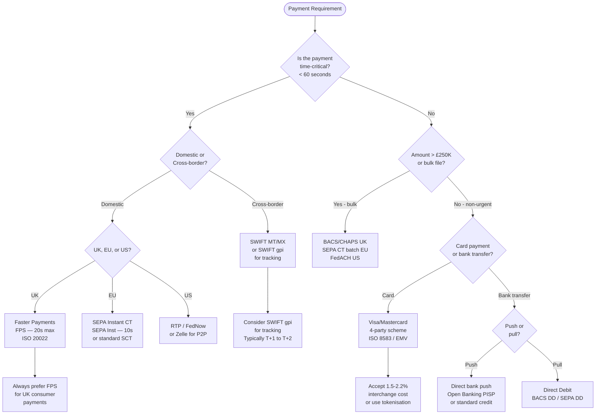
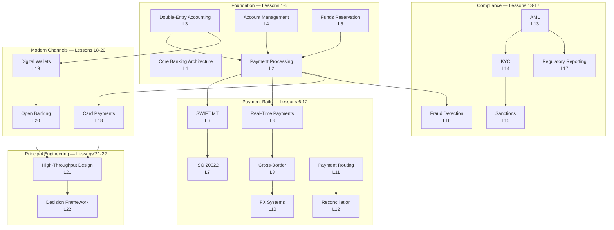

A principal engineer in a banking or payments company occupies a rare intersection: deep enough in the technical stack to understand why a 50-microsecond NUMA-aware memory allocation matters for a card authorisation service, yet close enough to the business to know that the answer to "should we build our own core banking system?" is almost always no. The decisions that define a bank's technical architecture — which payment rails to connect, whether to build or buy fraud detection, how to structure a multi-jurisdiction data model — are irreversible at the time-scale of a typical engineering career. Getting them right requires a structured decision process that holds correctness, availability, latency, cost, and regulatory compliance simultaneously, without allowing any single dimension to dominate by default.

## Learning Objectives

- Articulate the four fundamental tensions in banking system architecture (correctness vs availability, latency vs cost, flexibility vs vendor lock-in, speed vs compliance) and use them to frame any technology decision
- Apply a structured five-question framework to evaluate any banking system design decision before committing resources
- Select the appropriate payment scheme (real-time push, batch ACH/BACS, SWIFT, card) for a given use case using an explicit decision flowchart
- Evaluate build vs buy decisions for core banking system components using a total cost of ownership model that includes regulatory compliance, operational burden, and exit cost
- Identify and explain the five most dangerous anti-patterns in banking system design and articulate the specific failure mode each produces
- Apply the principal engineer design review checklist to a proposed banking system architecture, identifying gaps across correctness, compliance, operability, and scalability dimensions
- Explain how the 22 lessons of Track 5 compose into a complete mental model of banking infrastructure
- Draft an Architecture Decision Record (ADR) for a payment scheme selection that explicitly documents the trade-offs, constraints, and decision rationale

## Business Context

In 2019, TSB Bank in the UK completed a core banking migration that caused a 5-day outage affecting 1.9 million customers. The system was unavailable for online and mobile banking; customers could not access funds, pay bills, or view balances. The subsequent independent review identified multiple contributing factors, but the architectural root cause was the absence of a structured decision process for the migration approach. The team chose a "big bang" cutover — migrate all 5.5 million customer records and all application state in a single weekend — rather than a staged, parallel-run approach. The decision was driven primarily by cost (parallel-run would require running two systems simultaneously for months) without adequate analysis of the probability and consequence of a cutover failure. The FCA fined TSB £48.65 million. The lesson is not technical — the engineers involved were competent — it is methodological: high-consequence, irreversible architectural decisions require a formal process that makes trade-offs explicit before they are locked in.

## The Fundamental Tension in Banking Systems

Every architectural decision in banking systems sits at the intersection of four competing forces:

```
Correctness ◄──────────────────────────► Availability
     │          Banking systems live        │
     │          in this space               │
     ▼                                      ▼
   Latency ◄──────────────────────────► Cost
```

**Correctness vs Availability (the CAP intersection):** Banking systems require strong consistency for balance management — a customer must never see more money than they have, and two concurrent withdrawals must not both succeed. But strong consistency (serialisable isolation, synchronous replication) reduces availability: if the primary database is unreachable, the system must reject transactions rather than allow inconsistency. This is the right trade-off for financial systems (you should prefer a declined transaction to a double-spend), but it must be a conscious choice, not an accident.

**Latency vs Cost:** Sub-100ms payment processing requires expensive infrastructure — NVMe SSDs, in-memory caches, synchronous replication to standby regions. Relaxing latency to 2-5 seconds (acceptable for many payment types) enables cheaper infrastructure, batch processing, and geographic diversity for disaster recovery. The choice should be driven by the payment rail's SLA, not by default "make it fast."

**Flexibility vs Vendor Lock-in:** Building on a third-party core banking system (Temenos T24, FIS, Finastra) buys 20 years of regulatory compliance and feature completeness but creates deep dependency on a vendor's roadmap, pricing, and API stability. Building in-house provides control but requires a team that can maintain and evolve a system of comparable complexity indefinitely.

**Speed vs Compliance:** Regulatory requirements (PSD2, AML, GDPR, PCI DSS, local licensing) add lead time, constraint, and cost to every architectural decision. Teams that treat compliance as a final-step audit will discover that their architecture requires redesign. Teams that build regulatory requirements into their initial data models and API designs ship faster — the compliance review is a confirmation, not a rework.

## Decision Framework for Payment Scheme Selection



| Scheme | Speed | Cost | Reversibility | Use when |
|---|---|---|---|---|
| FPS (UK) | < 20s | £0.10-0.25 | Irrevocable after 2h | Consumer P2P, payroll emergency |
| SEPA Inst | < 10s | €0.10-0.20 | Irrevocable | EU real-time consumer/business |
| BACS (UK) | 3 days | £0.03-0.08 | Reversible T+0 | Payroll, supplier payments |
| CHAPS (UK) | Same day | £15-30 | Irrevocable same day | Property, high-value B2B |
| SWIFT (intl) | T+1 to T+2 | $5-25 | Reversible with difficulty | Cross-border B2B |
| Visa/MC | Auth 2s, settle T+1 | 1.5-2.2% | Chargeback 120 days | Retail, online payments |
| Open Banking PISP | 10-20s | £0.10-0.25 | Irrevocable | Bank-funded e-commerce |

## Build vs Buy for Core Components

```java
// The build vs buy decision should be formalised as a structured evaluation
public record BuildVsBuyAnalysis(
    String component,
    int buildYearOneNzd,       // Cost to build year 1 (staff + infra)
    int buildOperationalCostYr,// Annual operational cost years 2+
    int buySaasAnnualCost,     // SaaS licence / per-transaction cost annualised
    int exitCostIfBuy,         // Cost to switch away from vendor in year 5
    int regulatoryRiskIfBuild, // Estimated cost of regulatory non-compliance if built wrong
    String recommendation
) {}
```

| Component | Build cost (Y1) | Buy (annual SaaS) | Build recommendation |
|---|---|---|---|
| Core Banking System | £10M-50M | £500K-5M | **Buy** — 20+ years of regulatory compliance |
| Ledger / double-entry | £500K-2M | £50K-200K | **Build** — strategic differentiator, well-understood domain |
| AML transaction monitoring | £3M-10M | £200K-800K | **Buy** — regulatory risk of building wrong is severe |
| Payment router | £500K-2M | £100K-400K | **Build** — critical path latency, vendor latency is uncontrollable |
| KYC document verification | £2M-8M | £50K-500K | **Buy** — ML models for ID verification require massive datasets |
| FX rate engine | £300K-1M | £20K-100K | **Build** — straightforward; vendor lock-in risk is high |
| Fraud scoring | £5M-20M | £300K-1M | **Buy** (early) → **Build** (at scale, with data advantage) |
| Card issuer processing | £20M-80M | £1M-10M | **Buy** — scheme certification alone takes 18 months |

> [!IMPORTANT]
> The "build" recommendation for a ledger does not mean build a general-purpose accounting system. It means build a narrow, purpose-specific double-entry ledger that serves your payment types and currency model. The moment you try to build a general-purpose accounting system that also handles GL accounts, depreciation schedules, and multi-entity consolidation, you are rebuilding commercial accounting software and the buy decision flips decisively.

## Data Residency and Regulatory Jurisdiction Constraints

Multi-jurisdiction banking systems must satisfy data residency requirements that constrain where data can be stored, processed, and replicated.

| Jurisdiction | Regulation | Personal data constraint | Financial record constraint |
|---|---|---|---|
| European Union | GDPR Art. 44-49 | Must stay in EEA or adequacy decision country | 5-10 years retention (depends on member state) |
| United Kingdom | UK GDPR + FCA SYSC | Must stay in UK or approved transfer country | 7 years minimum (Companies Act) |
| India | DPDP Act 2023 | Sensitive personal data: mirror copy in India | RBI: payment data must remain in India |
| China | PIPL + DSL | Critical data: cannot leave China | PBOC: payment data onshore only |
| United States | No federal mandate | CCPA (California) + sector laws | BSA: 5 years minimum |

```java
public record DataResidencyPolicy(
    String jurisdiction,
    boolean personalDataMayLeave,
    List<String> approvedDestinations,  // ISO 3166-1 alpha-2 country codes
    int financialRecordRetentionYears,
    boolean replicationToDisasterRecoveryAllowed,
    String regulatoryBasis
) {
    public static DataResidencyPolicy EU_GDPR = new DataResidencyPolicy(
        "EU", false,
        List.of("DE","FR","NL","IE","SE","NO","IS","LI", // EEA
                "GB",  // UK adequacy decision post-Brexit (review pending)
                "JP","CA","NZ","KR","IL"), // Adequacy decisions as of 2024
        10, true, "GDPR Art 44, Regulation (EU) 2016/679"
    );
}
```

> [!WARNING]
> Data residency violations carry severe penalties: GDPR fines up to 4% of global annual turnover, plus regulatory censure that can trigger banking licence review. Replicating EU customer personal data to a US region for disaster recovery — without adequate safeguards (SCCs, BCRs) in place — is a common engineering mistake. Engage your DPO before making any cross-region replication architecture decision.

## Five-Question Architecture Checklist

Before approving any significant banking system design, a principal engineer should be able to answer these five questions affirmatively:

**1. What breaks first at 10× load?**
Identify the bottleneck (usually the database or a synchronous external call) and ensure it either scales gracefully or fails in a controlled, monitored way. If you cannot answer this question from first principles, the design needs more capacity modelling before approval.

**2. How do you detect and recover from partial failures?**
In distributed systems, partial failures (a downstream service accepting but not processing a request) are more dangerous than total failures (which trigger circuit breakers). Every external call must have an observable outcome — either success, explicit failure, or a timeout that triggers a compensating transaction. "Fire and forget" in financial systems is an anti-pattern.

**3. Where is the idempotency boundary?**
Every mutating operation must be idempotent — submitting the same operation twice must produce the same result as submitting it once. Identify where idempotency keys enter and leave your system, and ensure every handler at the boundary stores the key before executing the side effect, returning the stored result on retry.

**4. Which regulatory obligations attach to this component?**
Before writing a line of code, enumerate: which data elements are personal data (GDPR subject rights), which transactions require AML screening, which customer interactions require audit log retention, and which API endpoints require SCA. These are not features that can be bolted on — they are constraints that shape the data model.

**5. What is the disaster recovery plan and have you tested it?**
Define RTOs (Recovery Time Objective) and RPOs (Recovery Point Objective) for the component, then verify the architecture can meet them. For payment systems: RTO ≤ 4 hours, RPO ≤ 1 minute are typical FCA expectations. Document the runbook, and run a chaos engineering exercise that tests the actual recovery path, not a theoretical one.

```java
// Encode the checklist as a formal ADR template in code
public record ArchitectureDecisionRecord(
    String id,              // ADR-005
    String title,
    LocalDate date,
    List<String> deciders,
    String context,         // Why is this decision needed?
    List<String> options,   // What alternatives were considered?
    String decision,        // What was decided?
    String rationale,       // Why this option?
    List<String> consequences, // What does this make harder?
    String bottleneckAt10x,
    String partialFailureRecovery,
    String idempotencyBoundary,
    String regulatoryObligations,
    String disasterRecoveryPlan
) {}
```

## Banking Anti-Patterns

| Anti-pattern | Description | Failure mode |
|---|---|---|
| Synchronous external call in payment path | Calling an AML service or fraud scorer synchronously while holding a DB transaction | External service latency spike causes DB connection pool exhaustion; cascading failure |
| Shared mutable balance field | Storing account balance as a mutable column updated on every transaction | Concurrent updates cause lost updates even with transactions; balance drift over time |
| Missing idempotency at API boundary | No idempotency key on payment initiation endpoints | Network timeouts cause duplicate payments on retry; customer complaints; regulatory breach |
| Big-bang migrations | Migrating all data and cutting over all traffic simultaneously | Single point of irreversibility; any defect causes full outage; TSB-pattern failure |
| Soft-deleting financial records | Using `deleted_at` flags to "delete" ledger entries or audit logs | Regulatory violation (financial records must be immutable and retained); GDPR tension |
| Implicit currency handling | Storing amounts as floating-point (`double` or `float`) without explicit currency | IEEE 754 rounding errors accumulate; 0.1 + 0.2 ≠ 0.3 in binary floating point |
| Timezone naivety in settlement | Using `LocalDateTime` for settlement timestamps without explicit timezone | Settlement cutoffs are always in a specific timezone (UTC or local exchange time); naive datetimes cause wrong-day processing around DST transitions |

> [!NOTE]
> The "shared mutable balance field" anti-pattern is the most common root cause of financial data integrity issues in systems originally built without banking domain knowledge. The correct pattern — a double-entry ledger with immutable journal entries and a derived balance — appears more complex initially but eliminates an entire class of concurrency bugs. If you see `UPDATE accounts SET balance = balance - :amount` in a codebase, that is the first line of a production incident waiting to happen without extremely careful locking.

## Regulatory Incident Response Obligations

Banking systems are subject to mandatory incident reporting obligations that have direct architectural implications. A principal engineer must ensure the system can produce the evidence regulators require within the stipulated timeframes.

| Regulator | Jurisdiction | Incident type | Reporting deadline | Required data |
|---|---|---|---|---|
| FCA | UK | Major operational/security incident | As soon as practicable; full report ≤ 72h | Affected customers, payment types, duration, root cause |
| ECB / NCAs | EU | PSD2 major incident | Initial ≤ 4h; final ≤ 2 weeks | Transactions affected, estimated financial impact |
| Visa/Mastercard | Global | Card data compromise | ≤ 24h | Estimated PAN count, breach window, forensic firm engaged |
| FCA | UK | Operational resilience breach | ≤ 72h | Duration of impact tolerance exceedance, affected services |

```java
// Every payment system component should expose a structured incident evidence endpoint
@RestController
@RequestMapping("/internal/incident-evidence")
@PreAuthorize("hasRole('INCIDENT_RESPONDER')")
public class IncidentEvidenceController {

    private final LedgerService ledger;
    private final AuditLogService auditLog;
    private final PaymentRepository payments;

    /**
     * Returns all data needed for a regulatory incident report within
     * a given time window. Designed to respond within 30 seconds even
     * at 7 years' data depth (uses pre-built audit indexes).
     */
    @GetMapping("/payment-impact")
    public IncidentImpactReport getPaymentImpact(
            @RequestParam Instant from,
            @RequestParam Instant to,
            @RequestParam(required = false) String paymentType) {

        long affectedPayments = payments.countInWindow(from, to, paymentType);
        BigDecimal totalValue = payments.sumValueInWindow(from, to, paymentType);
        List<String> affectedCustomerSample = payments.sampleCustomerIds(from, to, 1000);

        return new IncidentImpactReport(
            from, to,
            affectedPayments,
            totalValue,
            affectedCustomerSample.size(),
            auditLog.fetchWindow(from, to)
        );
    }
}
```

> [!IMPORTANT]
> The `IncidentEvidenceController` must be available even during the incident — which means it must not share infrastructure with the impacted component. Host it on a separate, minimal service that queries read replicas or a time-series audit store that is architecturally isolated from the payment processing path. If your audit log lives on the same database that is down, you cannot produce the evidence the regulator requires.

## Principal Engineer Design Review Checklist

When reviewing a proposed banking system architecture, check each dimension:

**Correctness:**
- [ ] All balance-affecting operations use double-entry ledger (no mutable balance fields)
- [ ] Transactions use appropriate isolation level (SERIALIZABLE or SELECT FOR UPDATE)
- [ ] All external calls are idempotent with client-side idempotency keys
- [ ] Compensating transactions exist for every non-atomic multi-step operation
- [ ] Financial arithmetic uses `BigDecimal` with explicit rounding modes throughout

**Compliance:**
- [ ] Personal data classified (PII/non-PII) in the data model; retention periods defined
- [ ] AML screening points identified; SAR filing workflow exists
- [ ] Audit log covers all balance-affecting events; log is immutable and retained ≥ 7 years
- [ ] SCA requirements identified for all PSP-facing endpoints
- [ ] Data residency constraints mapped for each data element

**Operability:**
- [ ] Structured logging with correlation IDs (payment ID, customer ID, trace ID) on all paths
- [ ] Prometheus metrics for TPS, p99 latency, error rate, and queue depth per partition
- [ ] Circuit breakers on all external calls with dashboards showing open/closed state
- [ ] Database connection pool metrics exposed; alert on pool exhaustion
- [ ] Runbook exists for top 5 failure scenarios; last tested within 90 days

**Scalability:**
- [ ] Capacity plan at steady-state and 3× peak documented
- [ ] Partition key analysed for hot partition risk (histogram of key distribution)
- [ ] Database write amplification calculated; write path load-tested
- [ ] Kafka consumer lag monitored; consumer group recovery time estimated
- [ ] Load shedding strategy defined and implemented

## Track 5 Synthesis: A Complete Banking Architecture Mental Model

The 22 lessons of Track 5 compose into a layered architecture of knowledge:



**The mental model in one paragraph:**

A bank is fundamentally a ledger operator (Lessons 3, 4) that accepts and disburses funds via payment rails (Lessons 6-12). The ledger must be correct under concurrency (double-entry, serialisable isolation, idempotency — Lesson 5). Compliance layers (AML, KYC, sanctions, fraud — Lessons 13-16) sit across the payment path, adding decisioning latency that must be bounded and accounted for in the capacity model. Modern retail channels — card payments (Lesson 18), digital wallets (Lesson 19), and open banking APIs (Lesson 20) — are essentially well-defined protocol adapters over the same underlying ledger and payment-routing infrastructure. At scale (Lesson 21), the bottleneck is always the write path to the ledger, which is solved by consistent-hash partitioning, Kafka-buffered back-pressure, and disciplined write amplification control. The decision framework (Lesson 22) is the meta-skill: knowing which lesson's patterns apply to a given problem, and being able to articulate the trade-off clearly enough that a business stakeholder can make an informed decision.

## Knowledge Check

**Q1: A fintech startup is building a cross-border payments product targeting SME businesses. They are evaluating: (a) connecting directly to SWIFT as a direct participant, (b) partnering with a correspondent bank for SWIFT access, (c) building on top of a stablecoin/crypto rail. Apply the five-question framework to recommend an approach.**

A: Applying the five-question framework: (1) What breaks first at 10×? For direct SWIFT participation, it is the operational complexity — SWIFT requires 24/7 payment operations, HSM infrastructure, and ISO 15022/20022 compliance at a level that typically requires a team of 10+ specialists. At 10× volume this team doesn't scale, so the bottleneck is operational capacity, not technology. For the correspondent bank model, it is the correspondent's rate limits and cutoff times. For crypto rails, it is regulatory acceptance in the destination country. (2) Partial failure recovery: SWIFT gpi provides end-to-end tracking and can identify stuck payments in the correspondent network. Crypto settlements are irreversible with no recourse on failure. (3) Idempotency boundary: SWIFT uses UETR (Unique End-to-end Transaction Reference) for idempotency — this must be generated once and preserved through the entire lifecycle. (4) Regulatory obligations: direct SWIFT participation requires a full banking or payment institution licence; a correspondent arrangement may be possible with a narrower licence. Crypto rails face uncertain regulatory status in most SME target markets. (5) Disaster recovery: correspondent banking provides built-in resilience (can switch correspondents); crypto rail availability depends on blockchain network. Recommendation for an early-stage startup: option (b), correspondent bank, with a SWIFT gpi-capable correspondent. This provides the fastest path to regulatory compliance, the most familiar experience for SME customers, and the clearest failure recovery model. Build towards direct SWIFT participation as a 2-3 year goal once volume justifies the operational investment.

**Q2: Describe the "shared mutable balance field" anti-pattern in detail — specifically the SQL-level concurrency failure mode — and explain why a double-entry ledger with derived balances eliminates the problem rather than merely mitigating it.**

A: The anti-pattern is storing account balance as a column (`balance DECIMAL(19,4)`) in the accounts table and updating it with each transaction using `UPDATE accounts SET balance = balance - :amount WHERE account_id = :id AND balance >= :amount`. The concurrency failure occurs as follows: two concurrent withdrawals both execute `SELECT balance FROM accounts WHERE account_id = X` within the same transaction snapshot under READ COMMITTED isolation. Both see balance = £100. Both pass the balance check. Both execute the UPDATE. Under READ COMMITTED, the second UPDATE sees the already-committed first UPDATE and correctly computes `£100 - £50 - £50 = £0`. But under a subtle variant — if the amount check and the update are separated by any application code, or if the check happens in a service layer before the transaction begins — both reads can return £100, both checks pass, and both updates execute, resulting in a balance of -£50. Even with `SELECT FOR UPDATE`, the problem is that the balance column is a derived aggregate (the sum of all transactions to date) stored redundantly. If a bug, crash, or replication lag corrupts it, there is no way to verify correctness without replaying every transaction. A double-entry ledger with immutable journal entries eliminates the problem structurally: there is no balance column to corrupt. Balance is always computed as `SUM(credits) - SUM(debits)` over the ledger entries for the account. Concurrent insertions into the ledger are safe because INSERT is append-only — there is no UPDATE to race on. The correctness of the balance follows from the correctness of the entries, which are verified by the double-entry invariant (total debits = total credits across all accounts at every point in time). You cannot have a data race on a computed aggregate.

## Practical Challenge

1. **Architecture Decision Record:** Write a formal ADR for the payment scheme selection decision for a new UK-based B2B payroll disbursement product. The product must pay 50,000 employees simultaneously on the last working day of each month, with individual payments ranging from £800 to £25,000. Use the ADR template from this lesson (all five checklist fields populated), evaluate at least three schemes (BACS, CHAPS, FPS), and document why the final choice is BACS with FPS as a fallback for failed items. Include a risk register with mitigations.

2. **Build vs Buy TCO Model:** Implement a Java `BuildVsBuyAnalyzer` that takes as input: build year-1 cost, build annual operating cost, buy annual SaaS cost, vendor exit cost in year 5, and discount rate. It should compute net present value for both options over a 5-year horizon and output a recommendation with break-even year. Test it with the AML monitoring scenario from the lesson's table and verify it recommends "Buy" at the given cost assumptions. Then find the cross-over point where building becomes cheaper and assert the break-even year is calculated correctly.

3. **Anti-Pattern Detector:** Write a static analysis tool (using JavaParser or a simple regex-based AST visitor) that scans a Java codebase and flags: (a) any `UPDATE ... SET balance =` SQL string literals (mutable balance anti-pattern), (b) any `@Transactional` methods that contain HTTP client calls or Kafka producer sends within the transaction boundary (I/O inside transaction), (c) any method named `delete*` on a repository that operates on entities with the word `Ledger`, `Entry`, `Transaction`, or `Audit` in their class name (deleting financial records). Run it against a sample codebase containing one instance of each anti-pattern and assert all three are flagged.

4. **Design Review Simulation:** Given the following system description, apply the Principal Engineer Design Review Checklist and produce a written review identifying at least one gap in each of the four dimensions (Correctness, Compliance, Operability, Scalability): "A new payment initiation service stores account balances in a Redis cache, refreshing from PostgreSQL every 30 seconds. When a payment is initiated, it checks the Redis balance, deducts the amount, writes a payment record to PostgreSQL, and sends a Kafka event. There is no idempotency key on the initiation endpoint. Logs are stored in ElasticSearch and rotated after 30 days." For each gap identified, write one concrete remediation recommendation with enough specificity to be actionable in a sprint.

<!-- KNOWLEDGE-CHECK
{
  "questions": [
    {
      "text": "A new UK-based B2B payroll disbursement product must pay 50,000 employees simultaneously on the last working day of each month. Individual payments range from £800 to £25,000. Which payment scheme should be the primary choice, and why?",
      "options": [
        "CHAPS — it provides same-day settlement for all amounts with no upper limit",
        "BACS — it supports bulk file submission, is designed for payroll volumes, and has lower per-transaction cost than CHAPS or FPS",
        "FPS — it provides instant settlement and is mandatory for all UK payments above £10,000",
        "SWIFT — it is the most reliable for large-value payments across UK banks"
      ],
      "correct": 1,
      "explanation": "BACS is designed for bulk payroll disbursement: it accepts file-based bulk submissions, is used by virtually all UK payroll processors, and costs significantly less per transaction than CHAPS. Its 3-business-day settlement cycle is acceptable for scheduled payroll. FPS is appropriate as a fallback for failed BACS items requiring same-day retry."
    },
    {
      "text": "A team proposes storing account balances in a Redis cache refreshed every 30 seconds and checking the cached balance before debiting. What is the primary correctness risk?",
      "options": [
        "Redis cannot store decimal values accurately for financial amounts",
        "The 30-second stale window means payments may be approved against an outdated balance, allowing overdrafts or double-spending within the cache TTL",
        "Redis does not support the idempotency patterns required for payment initiation",
        "Caching balances violates PCI-DSS requirements for cardholder data storage"
      ],
      "correct": 1,
      "explanation": "A 30-second stale balance cache means any transaction that modifies the balance during that window is invisible to subsequent payment checks. Two concurrent payments could both pass the balance check against a stale cached value, both debit the database, and together exceed the actual balance. The authoritative balance check must be performed against the database with appropriate locking."
    },
    {
      "text": "When evaluating a build vs buy decision for an AML monitoring system, which factor most strongly favours buying a vendor solution over building in-house?",
      "options": [
        "The vendor offers an API — integrating any API is straightforward regardless of domain complexity",
        "The regulatory domain (transaction monitoring rules, typology libraries, SAR filing workflows) requires deep specialist knowledge that the internal team lacks and would take years to develop",
        "Building an AML system is technically impossible without a vendor's proprietary algorithms",
        "Buying is always cheaper than building for financial compliance systems"
      ],
      "correct": 1,
      "explanation": "AML monitoring requires deep specialist knowledge: transaction monitoring rules, typology libraries, SAR filing workflows, and ongoing regulatory updates. The expertise to build this correctly is expensive to acquire and maintain. Build costs for specialist regulatory domains are almost always underestimated because the domain knowledge gap only becomes apparent after several years of iteration."
    }
  ]
}
-->

<!-- PRACTICAL-CHALLENGE
{
  "title": "Apply the Banking Systems Decision Framework",
  "difficulty": "advanced",
  "estimatedMinutes": 60,
  "tasks": [
    {"id": "1", "description": "Write a formal Architecture Decision Record for payment scheme selection for a UK-based B2B payroll disbursement product paying 50,000 employees monthly. Evaluate BACS, CHAPS, and FPS. Document why BACS is primary with FPS as fallback, populating all five ADR checklist fields and including a risk register with mitigations."},
    {"id": "2", "description": "Implement a Java BuildVsBuyAnalyzer that takes build year-1 cost, build annual operating cost, buy annual SaaS cost, vendor exit cost, and discount rate as inputs. Compute NPV for both options over 5 years, output a recommendation with break-even year. Test with the AML monitoring scenario and find the crossover point where building becomes cheaper."},
    {"id": "3", "description": "Write a static analysis tool (using JavaParser or regex-based AST visitor) that flags: (a) UPDATE ... SET balance = SQL strings (mutable balance anti-pattern), (b) @Transactional methods containing HTTP client calls or Kafka sends, (c) delete* methods on Ledger/Entry/Transaction/Audit repositories. Test against sample code with one instance of each anti-pattern."},
    {"id": "4", "description": "Apply the Principal Engineer Design Review Checklist to the following design and identify one gap per dimension (Correctness, Compliance, Operability, Scalability): a payment service stores balances in Redis (30s TTL), checks Redis before debiting, writes to PostgreSQL, sends a Kafka event, with no idempotency key on the initiation endpoint and logs rotated after 30 days."}
  ]
}
-->

