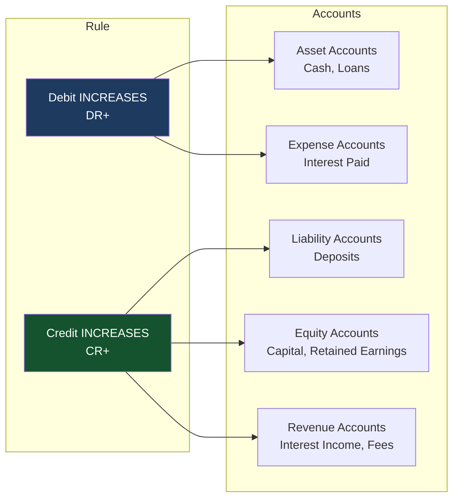
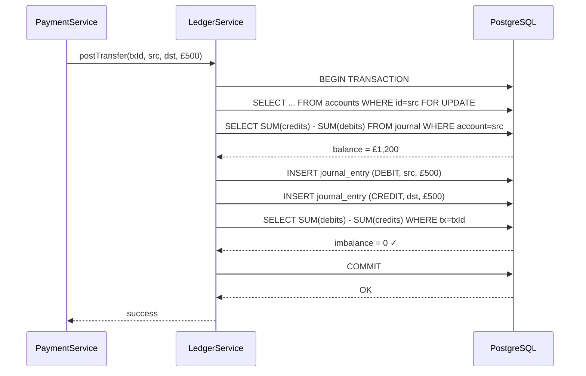

# دفتر الأستاذ بالقيد المزدوج — البنية والثوابت

## نظرة عامة

كل نظام مالي — من واجهة الدفع في شركة ناشئة إلى نظام التسوية الإجمالية الآنية في بنك مركزي — مبني على فكرة عمرها 700 عام: **مسك الدفاتر بالقيد المزدوج**. فكل معاملة تمس حسابين على الأقل، والمدين يساوي الدائن دائمًا. والمجموع لا يكذب أبدًا.

يضع هذا الدرس الأساس النظري والتقني لتصميم دفتر الأستاذ. ويغطي المعادلة المحاسبية، وحسابات T، ودلالات القيود اليومية، وتصميم مخطط قاعدة البيانات، والقيود المعمارية التي تبقي الدفتر صحيحًا تحت الحمل المتزامن. وكل ما في هذا المسار — حالات السباق، والـ idempotency، وأنماط outbox، وتعويض saga — موجود لحماية الثوابت التي يقدمها هذا الدرس.

## أهداف التعلم

في نهاية هذا الدرس ستستطيع:

- ذكر المعادلة المحاسبية وشرح أهميتها كثابت للنظام
- وصف دلالات المدين والدائن لكل نوع حساب
- قراءة القيود اليومية وكتابتها بالترميز المحاسبي وبلغة SQL
- تصميم مخطط قاعدة بيانات أدنى لدفتر قيد مزدوج
- تنفيذ حساب الرصيد كتجميع SQL فوق دفتر اليومية
- شرح لماذا يُفضل التصميم بالإضافة فقط (append-only) لدفاتر الأستاذ المالية
- تحديد الثوابت التي يجب أن تصمد عند ترحيل كل معاملة

## سياق العمل

يعالج بنك رقمي 400,000 دفعة يوميًا. ويستخدم النظام البنكي الأساسي (CBS) دفترًا علائقيًا كنظام سجل. ويضم فريق الهندسة مهندسين جددًا جاؤوا من خلفيات غير مالية ولم يتعاملوا قط مع المحاسبة بالقيد المزدوج.

ولاحظ المهندس الرئيسي في الفريق ثلاث فئات متكررة من الأخطاء:

1. مهندسون يحدّثون عمود `balance` مباشرة بدل ترحيل قيود يومية — فينحرف الدفتر عن تاريخ المعاملات الفعلي
2. مهندسون يرحّلون قيدًا مدينًا دون قيد دائن مقابل — فينكسر الثابت الأساسي ويصبح دفتر الأستاذ العام غير متوازن
3. مهندسون لا يفهمون أي جانب من القيد موجب لأي نوع حساب — فيرحّلون قيودًا معكوسة تضخم الأرصدة بدل خفضها

يقضي هذا الدرس على الفئات الثلاث ببناء نموذج ذهني صحيح من الأساس.

## المعادلة المحاسبية

أساس كل المحاسبة المالية معادلة واحدة:

> **الأصول = الالتزامات + حقوق الملكية**

هذه المعادلة متوازنة دائمًا. وهي ليست إرشادًا — بل ثابت. وأي معاملة تخالفها خطأ.

| المصطلح | التعريف | أمثلة |
|---|---|---|
| **الأصول** | ما يملكه البنك أو المستحق له | النقد، والقروض للعملاء، والاستثمارات |
| **الالتزامات** | ما يدين به البنك للآخرين | ودائع العملاء، والسندات المصدرة، والاقتراض |
| **حقوق الملكية** | الحق المتبقي للمالكين | رأس المال، والأرباح المحتجزة |

**ودائع العملاء التزامات** — فعندما يودع عميل 1,000 جنيه، يدين له البنك بـ 1,000 جنيه. فالبنك يحتفظ بالنقد (أصل)، لكن الوديعة التزام على البنك بالسداد.

وهذا أهم تحول مفاهيمي للمهندسين: فمن منظور العميل، رصيد حسابه أصل يملكه. ومن منظور البنك، الرصيد نفسه التزام يدين به البنك.

## حسابات T وقواعد المدين والدائن

كل حساب في الدفتر **حساب T** — يُتصور على شكل حرف T، المدين على اليسار والدائن على اليمين. وقاعدة أي جانب **يزيد** الحساب تعتمد على نوع الحساب:



| نوع الحساب | المدين (DR) | الدائن (CR) | الرصيد الطبيعي |
|---|---|---|---|
| أصل | ↑ زيادة | ↓ نقص | مدين |
| التزام | ↓ نقص | ↑ زيادة | دائن |
| حقوق ملكية | ↓ نقص | ↑ زيادة | دائن |
| إيراد | ↓ نقص | ↑ زيادة | دائن |
| مصروف | ↑ زيادة | ↓ نقص | مدين |

> [!NOTE]
> **الرصيد الطبيعي** هو الجانب الذي تتوقع أن يكون رصيد الحساب عليه. فحساب أصل برصيد دائن خطأ عادة (أو أصل سالب مثل مجمع الإهلاك). وحساب التزام برصيد مدين غير معتاد ويستدعي التحقيق.

## القيود اليومية — الآلية

**القيد اليومي** يسجل معاملة مالية. ويجب أن يحقق كل قيد يومي:

1. **سطرين على الأقل** (مدين واحد ودائن واحد)
2. **مجموع المدين = مجموع الدائن** (القيد متوازن)
3. **الذرية** — إما تُرحّل كل الأسطر أو لا يُرحّل أي منها

### مثال: عميل يودع 1,000 جنيه

```
DR  Cash (Asset)              £1,000
    CR  Customer Deposits (Liability)   £1,000
```

يزيد نقد البنك 1,000 جنيه (مدين أصل). والبنك يدين الآن للعميل بـ 1,000 جنيه (دائن التزام). وتبقى المعادلة متوازنة: الأصول (+1,000) = الالتزامات (+1,000).

### مثال: عميل يسحب 200 جنيه

```
DR  Customer Deposits (Liability)   £200
    CR  Cash (Asset)                       £200
```

ينخفض التزام البنك (المدين على الالتزام يخفضه). ويدفع البنك نقدًا (الدائن على الأصل يخفضه).

### مثال: عميل يرسل 500 جنيه إلى عميل آخر (في البنك نفسه)

```
DR  Customer Deposits — Sender Account     £500
    CR  Customer Deposits — Receiver Account   £500
```

كلاهما حسابا التزام. فينخفض الالتزام تجاه المرسل؛ ويزيد الالتزام تجاه المستلم. ويبقى مجموع الالتزامات دون تغيير.

### مثال: البنك يفرض رسومًا 15 جنيهًا

```
DR  Customer Deposits — Account     £15
    CR  Fee Income (Revenue)              £15
```

ينخفض رصيد العميل (الالتزام ينخفض بالمدين). ويسجل البنك إيرادًا (دائن).

## مخطط قاعدة بيانات الدفتر

يتطلب دفتر القيد المزدوج الأدنى والصحيح جدولين:

```sql
/*
 * accounts — chart of accounts
 * Each row represents one account in the general ledger.
 * The source of truth for balances is journal_entries (any cached balance
 * must be updated in the same transaction and reconciled — see later lessons).
 */
CREATE TABLE accounts (
    id            UUID        PRIMARY KEY DEFAULT gen_random_uuid(),
    code          VARCHAR(20) UNIQUE NOT NULL,  -- e.g. '1001', 'CASH-GBP'
    name          VARCHAR(100) NOT NULL,
    type          VARCHAR(20) NOT NULL           -- ASSET, LIABILITY, EQUITY, REVENUE, EXPENSE
                  CHECK (type IN ('ASSET','LIABILITY','EQUITY','REVENUE','EXPENSE')),
    currency      CHAR(3) NOT NULL,              -- ISO 4217 e.g. 'GBP'
    is_active     BOOLEAN NOT NULL DEFAULT TRUE,
    created_at    TIMESTAMPTZ NOT NULL DEFAULT NOW()
);

/*
 * journal_entries — append-only transaction log
 * Every financial event is a row here. Rows are NEVER updated or deleted.
 * Balance for any account = SUM of amounts where account_id matches,
 *   with debits positive and credits negative (or vice versa, pick a convention).
 */
CREATE TABLE journal_entries (
    id              UUID        PRIMARY KEY DEFAULT gen_random_uuid(),
    transaction_id  UUID        NOT NULL,  -- groups lines of the same journal entry
    account_id      UUID        NOT NULL REFERENCES accounts(id),
    entry_type      VARCHAR(6)  NOT NULL CHECK (entry_type IN ('DEBIT','CREDIT')),
    amount          BIGINT      NOT NULL CHECK (amount > 0),  -- minor units (pence, cents)
    currency        CHAR(3)     NOT NULL,
    description     VARCHAR(255),
    reference       VARCHAR(100),          -- external ref (shared by all lines of a transaction;
                                           -- uniqueness is enforced on a separate
                                           -- idempotency / transactions table)
    posted_at       TIMESTAMPTZ NOT NULL DEFAULT NOW(),
    created_by      VARCHAR(50) NOT NULL   -- service or user that posted
);

CREATE INDEX idx_journal_account ON journal_entries(account_id, posted_at);
CREATE INDEX idx_journal_transaction ON journal_entries(transaction_id);
CREATE INDEX idx_journal_reference ON journal_entries(reference);
```

> [!WARNING]
> لا تجعل أبدًا عمود `balance` مخزنًا مصدرَ الحقيقة، ولا تحدّثه أبدًا منفصلًا عن دفتر اليومية. فذلك ينشئ سجلين للحقيقة نفسها قد ينحرفان، ثم لا يستطيع أحد أن يقول أيهما الصحيح. الرصيد قيمة مشتقة: دفتر اليومية هو الحقيقة. (كثيرًا ما *تخزّن* الدفاتر عالية الحجم رصيدًا مؤقتًا في صف الحساب من أجل السرعة والقفل — وهذا مقبول فقط إذا حُدّث في المعاملة **نفسها** مع القيود اليومية وطوبق معها بانتظام. وتغطي الدروس اللاحقة في هذا المسار ذلك.)

### حساب الرصيد بلغة SQL

```sql
-- Balance of a single account, in its NORMAL direction:
--   ASSET / EXPENSE accounts:            DEBIT − CREDIT
--   LIABILITY / EQUITY / REVENUE:        CREDIT − DEBIT
-- (a customer deposit account is a LIABILITY, so its balance is credits − debits)
SELECT
    a.id,
    a.name,
    a.type,
    COALESCE(SUM(
        CASE
            WHEN je.entry_type = 'DEBIT'  THEN  je.amount
            WHEN je.entry_type = 'CREDIT' THEN -je.amount
        END
    ), 0)
    * CASE WHEN a.type IN ('ASSET','EXPENSE') THEN 1 ELSE -1 END
        AS balance_minor_units
FROM accounts a
LEFT JOIN journal_entries je ON je.account_id = a.id
WHERE a.id = :accountId
GROUP BY a.id, a.name, a.type;

-- Balance as of a specific point in time (for historical reporting),
-- here for a LIABILITY account (credits − debits)
SELECT COALESCE(SUM(
    CASE
        WHEN entry_type = 'CREDIT' THEN  amount
        WHEN entry_type = 'DEBIT'  THEN -amount
    END
), 0) AS balance_minor_units
FROM journal_entries
WHERE account_id = :accountId
  AND posted_at <= :asOf;

-- Trial balance — verify debits = credits, PER CURRENCY
-- (adding GBP to EUR would be meaningless)
SELECT
    currency,
    SUM(CASE WHEN entry_type = 'DEBIT'  THEN amount ELSE 0 END) AS total_debits,
    SUM(CASE WHEN entry_type = 'CREDIT' THEN amount ELSE 0 END) AS total_credits,
    SUM(CASE WHEN entry_type = 'DEBIT'  THEN amount ELSE 0 END) -
    SUM(CASE WHEN entry_type = 'CREDIT' THEN amount ELSE 0 END) AS imbalance
FROM journal_entries
GROUP BY currency;
-- imbalance MUST always be 0 for every currency — if not, an entry was posted incorrectly
```

## التنفيذ في Java — LedgerService

```java17
// Java 17 — LedgerService posting a double-entry transfer
@Service
@Transactional
public class LedgerService {

    private final JournalEntryRepository journalRepo;
    private final AccountRepository      accountRepo;

    // Post a transfer: debit source, credit destination
    // All within ONE database transaction — atomicity guaranteed
    public void postTransfer(UUID transactionId,
                              UUID sourceAccountId,
                              UUID destinationAccountId,
                              long amountMinorUnits,
                              String currency,
                              String description,
                              String reference) {

        validateAccounts(sourceAccountId, destinationAccountId, currency);

        // Lock the source account row FIRST (SELECT ... FOR UPDATE). Without it,
        // two concurrent transfers can both read the same balance, both pass the
        // check and both insert a debit — an overdraft (lessons 2 and 4 of this
        // track explore this race). With two accounts, lock in a fixed order.
        accountRepo.lockForUpdate(sourceAccountId);
        validateBalance(sourceAccountId, amountMinorUnits, currency);

        // Debit source account (reduces its balance)
        JournalEntry debitEntry = JournalEntry.builder()
            .transactionId(transactionId)
            .accountId(sourceAccountId)
            .entryType(EntryType.DEBIT)
            .amount(amountMinorUnits)
            .currency(currency)
            .description(description)
            .reference(reference)
            .postedAt(Instant.now())
            .createdBy("payment-service")
            .build();

        // Credit destination account (increases its balance)
        JournalEntry creditEntry = JournalEntry.builder()
            .transactionId(transactionId)
            .accountId(destinationAccountId)
            .entryType(EntryType.CREDIT)
            .amount(amountMinorUnits)
            .currency(currency)
            .description(description)
            .reference(reference)
            .postedAt(Instant.now())
            .createdBy("payment-service")
            .build();

        // Both saved in the same transaction — atomically
        journalRepo.save(debitEntry);
        journalRepo.save(creditEntry);

        // Invariant check: journal must balance after every post
        // Run in dev/staging; consider async in production
        assertJournalBalances(transactionId);
    }

    // Balance in the account's NORMAL direction (credits − debits for a
    // customer deposit account, which is a LIABILITY)
    public long getBalance(UUID accountId, String currency) {
        return journalRepo.calculateBalance(accountId, currency);
    }

    private void assertJournalBalances(UUID transactionId) {
        long imbalance = journalRepo.calculateImbalance(transactionId);
        if (imbalance != 0) {
            throw new LedgerImbalanceException(
                "Journal entry imbalance detected for transaction " + transactionId +
                ": " + imbalance + " minor units");
        }
    }

    private void validateBalance(UUID accountId, long amount, String currency) {
        long balance = getBalance(accountId, currency);
        if (balance < amount) {
            throw new InsufficientFundsException(accountId, balance, amount);
        }
    }
}
```

```java21
// Java 21 — LedgerService with records and sealed hierarchy
@Service
@Transactional
public class LedgerService {

    // Sealed posting command hierarchy — the records are nested INSIDE the
    // interface, so `permits PostingCommand.Transfer` refers to real types
    public sealed interface PostingCommand
        permits PostingCommand.Transfer,
                PostingCommand.Fee,
                PostingCommand.Reversal {

        record Transfer(
            UUID transactionId,
            UUID sourceAccountId,
            UUID destinationAccountId,
            long amountMinorUnits,
            String currency,
            String description,
            String reference
        ) implements PostingCommand {}

        record Fee(
            UUID transactionId,
            UUID customerAccountId,
            UUID revenueAccountId,
            long feeMinorUnits,
            String currency,
            String reference
        ) implements PostingCommand {}

        record Reversal(
            UUID originalTransactionId,
            String reason
        ) implements PostingCommand {}
    }

    private final JournalEntryRepository journalRepo;
    private final AccountRepository      accountRepo;
    private final Clock                  clock;

    public void post(PostingCommand command) {
        // Exhaustive: the compiler knows every permitted subtype
        switch (command) {
            case PostingCommand.Transfer t -> executeTransfer(t);
            case PostingCommand.Fee f      -> executeFee(f);
            case PostingCommand.Reversal r -> executeReversal(r);
        }
    }

    private void executeTransfer(PostingCommand.Transfer t) {
        accountRepo.lockForUpdate(t.sourceAccountId());    // serialise the balance check
        validateBalance(t.sourceAccountId(), t.amountMinorUnits(), t.currency());

        var entries = List.of(
            buildEntry(t.transactionId(), t.sourceAccountId(),
                       EntryType.DEBIT,  t.amountMinorUnits(), t.currency(), t.reference()),
            buildEntry(t.transactionId(), t.destinationAccountId(),
                       EntryType.CREDIT, t.amountMinorUnits(), t.currency(), t.reference())
        );

        journalRepo.saveAll(entries);
        assertBalances(t.transactionId());
    }

    private JournalEntry buildEntry(UUID txId, UUID accountId, EntryType type,
                                     long amount, String currency, String ref) {
        return new JournalEntry(
            UUID.randomUUID(), txId, accountId, type,
            amount, currency, ref, clock.instant(), "payment-service"
        );
    }
}
```

يُقفل صف الحساب المصدر **أولًا** (`SELECT ... FOR UPDATE`). فدونه قد يقرأ تحويلان متزامنان الرصيد نفسه، وينجحان في الفحص كلاهما، ويدرجان قيد خصم كلاهما — سحب على المكشوف (يستكشف الدرسان 2 و4 من هذا المسار هذا السباق). وفي نسخة Java 21، السجلات (records) متداخلة **داخل** الواجهة المختومة، فتشير `permits PostingCommand.Transfer` إلى أنواع حقيقية، والـ switch شامل لأن المترجم يعرف كل نوع فرعي مسموح.

## تسلسل التحويل



## التصميم بالإضافة فقط ولماذا يهم

دفتر الأستاذ المالي المصمم بشكل صحيح **لا يحذف القيود اليومية ولا يحدّثها أبدًا**. فكل حدث مالي صف جديد. وهذا التصميم يوفر:

| الخاصية | الفائدة |
|---|---|
| **سجل تدقيق كامل** | كل تغيير في الرصيد يمكن تتبعه إلى قيد يومي محدد |
| **استعلامات لحظة زمنية** | يمكن حساب الرصيد في أي تاريخ بتصفية `posted_at` |
| **مقاومة التلاعب** | سحب صلاحيات `UPDATE`/`DELETE` يصعّب التعديل الصامت؛ وربط القيود بسلسلة تجزئة (hash chain) يجعل أي تعديل قابلًا للكشف |
| **التعويض بالعكس** | تُصحح الأخطاء بترحيل قيد عكسي، لا بتعديل الأصل |
| **الامتثال الرقابي** | يستطيع المدققون تتبع كل معاملة؛ ولا "ثقوب سوداء" في التاريخ |

> [!IMPORTANT]
> لعكس معاملة خاطئة، **رحّل قيدًا تعويضيًا** — قيدًا يوميًا جديدًا تُبدّل فيه جهتا المدين والدائن. ولا تحدّث القيد الأصلي ولا تحذفه أبدًا. فالخطأ وتصحيحه يظهران كلاهما في سجل التدقيق، وهذا بالضبط ما تتوقع الجهات الرقابية رؤيته.

```java17
// Reversal — not update/delete
public void reversePosting(UUID originalTransactionId, String reason) {
    // Idempotent: a transaction can be reversed only once. A unique constraint
    // on reversal_of (or on the "REV-" reference in the transactions table)
    // stops a retried request from reversing it twice.
    if (journalRepo.existsReversalOf(originalTransactionId)) {
        return;
    }
    List<JournalEntry> originals = journalRepo.findByTransactionId(originalTransactionId);
    if (originals.isEmpty()) {
        throw new TransactionNotFoundException(originalTransactionId);
    }

    UUID reversalTxId = UUID.randomUUID();

    List<JournalEntry> reversals = originals.stream()
        .map(original -> JournalEntry.builder()
            .transactionId(reversalTxId)
            .accountId(original.getAccountId())
            // Swap debit/credit
            .entryType(original.getEntryType() == EntryType.DEBIT
                       ? EntryType.CREDIT : EntryType.DEBIT)
            .amount(original.getAmount())
            .currency(original.getCurrency())
            .description("REVERSAL: " + reason)
            .reference("REV-" + originalTransactionId)
            .postedAt(clock.instant())
            .createdBy("reconciliation-service")
            .build())
        .toList();

    journalRepo.saveAll(reversals);
    // Note: reversing a transfer DEBITS the receiver. If the receiver has
    // already spent the money, the reversal can make that balance negative —
    // decide by policy whether to allow it, hold it, or recover the funds.
}
```

العكس idempotent: فلا يمكن عكس معاملة إلا مرة واحدة، ويمنع قيد فريد إعادة طلب مكرر من عكسها مرتين. ولاحظ أن عكس تحويل **يخصم** من المستلم؛ فإذا كان المستلم قد أنفق المال، قد يجعل العكس رصيده سالبًا — فقرر بالسياسة هل تسمح بذلك أو تحتجزه أو تسترد الأموال.

## ثوابت الدفتر — القائمة

يجب أن يفرض دفتر الأستاذ بجودة إنتاجية هذه الثوابت في كل معاملة:

| الثابت | طريقة الفرض |
|---|---|
| مجموع المدين = مجموع الدائن لكل معاملة | تأكيد بعد كل `postTransfer` |
| المبلغ > 0 (لا قيود صفرية أو سالبة) | قيد قاعدة البيانات `CHECK (amount > 0)` |
| الحساب موجود ونشط | تحقق قبل الترحيل |
| العملة تطابق عملة الحساب | تحقق قبل الترحيل |
| الحساب المصدر لديه رصيد كافٍ | فحص الرصيد قبل الترحيل، مع قفل صف الحساب |
| كل القيود تتشارك `transaction_id` نفسه | تجميع على مستوى التطبيق (واختياريًا trigger قيد مؤجل يتحقق من توازن كل معاملة عند الالتزام) |
| لا يُحدّث أي قيد ولا يُحذف | لا صلاحيات `UPDATE`/`DELETE` على الجدول |


<!-- KNOWLEDGE-CHECK [
  {
    "id": "kc-del-01",
    "question": "لدى عميل حساب جارٍ برصيد 500 جنيه. في دفتر البنك يُسجل هذا كـ:",
    "options": [
      "مدين 500 جنيه على حساب التزام",
      "دائن 500 جنيه على حساب أصل",
      "دائن 500 جنيه على حساب التزام",
      "مدين 500 جنيه على حساب حقوق ملكية"
    ],
    "correct": 2,
    "explanation": "ودائع العملاء التزامات — فالبنك يدين للعميل بـ 500 جنيه. ولحسابات الالتزام رصيد طبيعي دائن. والدائن بـ 500 جنيه يمثل التزام البنك. وعندما يسحب العميل، يرحّل البنك قيدًا مدينًا على حساب الالتزام هذا، فينخفض الالتزام."
  },
  {
    "id": "kc-del-02",
    "question": "ترحّل خدمة دفع قيدًا مدينًا بـ 300 جنيه على الحساب A لكن القيد الدائن المقابل على الحساب B يفشل (استثناء قبل الإدراج الثاني). ما الذي يمنع الدفتر من أن يصبح غير متوازن؟",
    "options": [
      "فحص ثابت التوازن في نهاية postTransfer",
      "معاملة قاعدة البيانات — فالقيدان إما يلتزمان معًا أو يُتراجع عنهما معًا",
      "خطوة التحقق من الحسابات في بداية postTransfer",
      "عمود المرجع للـ idempotency"
    ],
    "correct": 1,
    "explanation": "معاملات ACID في قاعدة البيانات هي خط الدفاع الأساسي. فإذا فشل إدراج القيد الدائن، يُتراجع عن المعاملة كلها، بما فيها إدراج القيد المدين. وفحص الثابت في النهاية شبكة أمان — يتحقق من الصحة عندما يلتزم القيدان، لكنه لا يستطيع منع الالتزام الجزئي. فحدود المعاملة وحدها تضمن الذرية."
  },
  {
    "id": "kc-del-03",
    "question": "لماذا يجب ألا يكون رصيد الحساب أبدًا عمودًا مخزنًا هو مصدر الحقيقة ويُحدّث منفصلًا عن دفتر اليومية؟",
    "options": [
      "لا تستطيع قواعد البيانات تنفيذ UPDATE وINSERT في المعاملة نفسها",
      "ينشئ مشكلة كتابة مزدوجة: قد ينحرف الرصيد المخزن عن تاريخ دفتر اليومية، فتُدمّر سلامة التدقيق",
      "أعمدة BIGINT أصغر من أن تحمل الأرصدة المالية",
      "المجاميع الجارية دقيقة فقط مع عزل SERIALIZABLE"
    ],
    "correct": 1,
    "explanation": "إذا احتفظت برصيد جارٍ وأضفت قيودًا يومية ككتابتين مستقلتين، فلديك مصدران للحقيقة. وأي خلل، أو تعطل بين الكتابتين، أو تحديث متزامن قد يجعلهما ينحرفان: عمود الرصيد يقول 800 جنيه بينما مجموع القيود 750 — فأيهما الصحيح؟ يجب أن يكون دفتر اليومية هو الحقيقة والرصيد مشتقًا منه. وإذا خُزّن رصيد مؤقتًا للأداء، فيجب تحديثه في المعاملة نفسها مع القيود ومطابقته معها."
  },
  {
    "id": "kc-del-04",
    "question": "يكتشف مهندس أن قيدًا يوميًا رُحّل بمبلغ خاطئ (150 جنيهًا بدل 250). الإجراء الصحيح هو:",
    "options": [
      "UPDATE journal_entries SET amount = 250 WHERE id = :wrongEntryId",
      "حذف القيد الخاطئ وإدراج قيد صحيح",
      "ترحيل قيد عكسي بـ 150 جنيهًا، ثم ترحيل قيد جديد بالمبلغ الصحيح 250 جنيهًا",
      "ترحيل قيد تصحيحي بالفرق البالغ 100 جنيه"
    ],
    "correct": 2,
    "explanation": "دفاتر الأستاذ المالية للإضافة فقط: يبقى القيد الخاطئ في سجل التدقيق دليلًا على ما حدث. والمعالجة القياسية عكس كامل (تبديل المدين/الدائن على القيد الأصلي بـ 150 جنيهًا) يتبعه القيد الصحيح بـ 250 جنيهًا، فيكون كل قيد واضحًا بذاته. وترحيل فرق الـ 100 جنيه فقط يُرى أيضًا عمليًا، لكنه يترك مبلغًا غريب المظهر يعتمد معناه على الأصل. ولا تستخدم أبدًا UPDATE أو DELETE على القيود اليومية."
  }
] -->


<!-- PRACTICAL-CHALLENGE {
  "id": "pc-double-entry-ledger",
  "title": "تنفيذ الدفتر: ترحيل دفعة مع رسوم",
  "description": "نفّذ القيود اليومية بالقيد المزدوج لتدفق دفع كامل يشمل تحويل المبلغ الأساسي وتحصيل الرسوم.",
  "tasks": [
    {
      "id": "pc-del-01",
      "description": "اكتب القيود اليومية (نوع الحساب، ومدين/دائن، والمبلغ) لما يلي: العميل A يرسل 750 جنيهًا إلى العميل B. ويفرض البنك على العميل A رسومًا 5 جنيهات. وبيّن الحسابات الثلاثة المعنية."
    },
    {
      "id": "pc-del-02",
      "description": "اكتب SQL لحساب الرصيد الحالي بالجنيه للحساب 'acc-123' (حساب وديعة عميل، أي التزام) باستخدام جدول journal_entries، في اتجاه رصيده الطبيعي (الدائن ناقص المدين)."
    },
    {
      "id": "pc-del-03",
      "description": "نفّذ دالة Java باسم `assertLedgerBalances(UUID transactionId)` تستعلم مجموع المدين والدائن لمعاملة وترمي `LedgerImbalanceException` إذا اختلفا."
    },
    {
      "id": "pc-del-04",
      "description": "أضف قيدًا إلى جدول journal_entries يمنع أي UPDATE أو DELETE (تلميح: استخدم trigger في PostgreSQL أو سياسة أمان على مستوى الصفوف)."
    },
    {
      "id": "pc-del-05",
      "description": "اكتب القيود اليومية العكسية للمعاملة في المهمة 1 (تحويل 750 جنيهًا + رسوم 5 جنيهات)، كما لو أن الدفعة أُرسلت إلى الحساب الخطأ ويجب عكسها بالكامل."
    }
  ]
} -->
