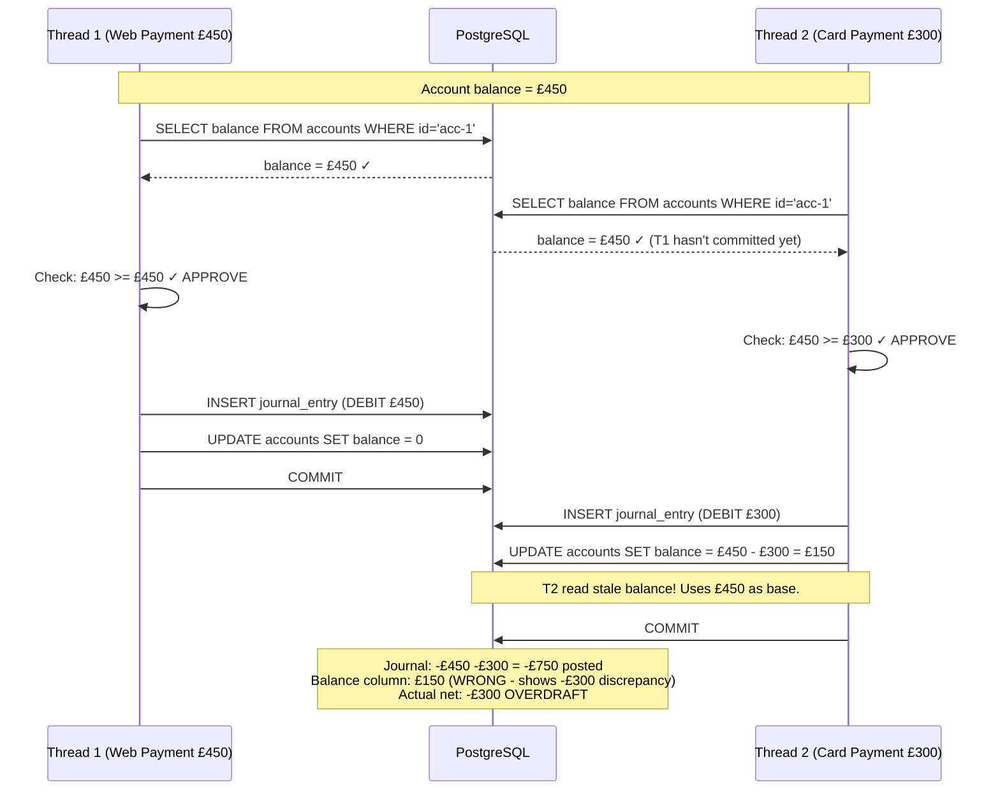
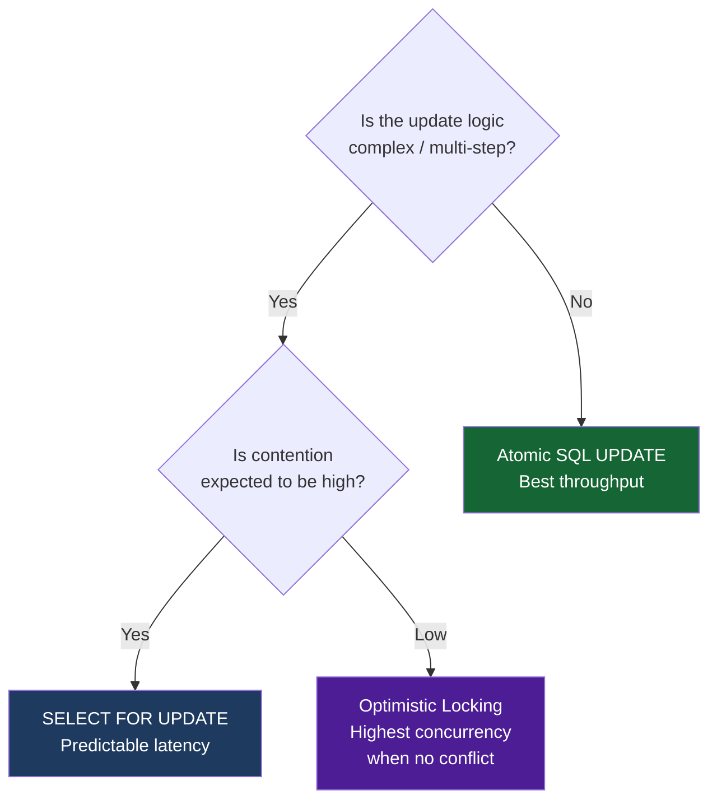

# السيناريو A — السحوبات المتزامنة ومشكلة التحديث الضائع

## نظرة عامة

**مشكلة التحديث الضائع** أكثر فئات أخطاء التزامن ضررًا ماليًا. فمعاملتان متزامنتان تقرآن رصيد الحساب نفسه، وتقرران كلتاهما أن الرصيد كافٍ، وتمضيان كلتاهما في السحب. والنتيجة: يُسحب الحساب على المكشوف بكامل مبلغ أحد السحبين. ولم تكتشف أي معاملة خطأً. ولم يُرمَ أي استثناء. وتصرف النظام كما بُرمج — بشكل خاطئ.

يتتبع هذا السيناريو المشكلة من المبادئ الأولى، ويعرض التنفيذ المعطوب، ويشرح لماذا ينكسر، ويمر بثلاثة حلول صحيحة بملفات مقايضة مختلفة. وفي النهاية ستملك المفردات التقنية، ومعرفة التنفيذ، ومعايير القرار لمنع السحب على المكشوف في أي نظام مالي متزامن.

## أهداف التعلم

في نهاية هذا الدرس ستستطيع:

- تحديد نمط التحديث الضائع في دورة القراءة-التعديل-الكتابة في قاعدة البيانات وشرحه
- شرح لماذا لا يمنع MVCC ‏(التحكم في التزامن متعدد الإصدارات) التحديثات الضائعة عند READ COMMITTED
- تنفيذ القفل المتشائم باستخدام `SELECT FOR UPDATE` في SQL وJPA
- تنفيذ القفل المتفائل باستخدام عمود إصدار و`@Version` في JPA
- تنفيذ UPDATE شرطي ذري في SQL كبديل
- اختيار الاستراتيجية الصحيحة حسب التنافس والزمن ومتطلبات الاتساق
- كتابة اختبار تكامل متزامن (Testcontainers + مزلاج بدء) يكشف حالة سباق في السحب

## سياق العمل

*مثال مركّب:* تتلقى خدمة الحسابات الجارية في بنك ناشئ تقرير حادث حرج: دفتر عميل يُظهر الحساب عند −300 جنيه، بينما عمود الرصيد المخزن في صف الحساب ما زال يقول 150 جنيهًا. ولم يكن للحساب تسهيل سحب على المكشوف قط. ويكشف تحقيق ما بعد الحادث:

- كان رصيد الحساب 450 جنيهًا
- عند 14:23:07.142 بدأت دفعة ويب بقيمة 450 جنيهًا (المتصفح)
- عند 14:23:07.149 بدأت دفعة بطاقة بقيمة 300 جنيه (جهاز نقطة البيع)
- نجحت المعاملتان في فحص الرصيد
- رحّلت المعاملتان قيد خصمهما
- رصيد الدفتر: 450 − 450 − 300 = −300 جنيه. لكن عمود الرصيد خزّن 150 جنيهًا — فقد كتب الطلب الثاني فوق تحديث الأول (تحديث ضائع)

كانت الفجوة البالغة 7 مللي ثوانٍ بين الطلبين كافية لحدوث السباق. والسبب الجذري: دورة **قراءة-تعديل-كتابة** نُفذت دون أي تحكم في التزامن.

## التنفيذ المعطوب

هذه هي الشيفرة التي سببت السحب على المكشوف. اقرأها بعناية — فهي تمثل أخطاء إنتاج حقيقية.

```java17
// BROKEN — Race condition in balance check and debit
@Service
@Transactional(isolation = Isolation.READ_COMMITTED)
public class WithdrawalService {

    private final AccountRepository accountRepo;
    private final LedgerService     ledgerService;

    public WithdrawalResult withdraw(String accountId, long amountMinorUnits) {

        // Step 1: Read current balance
        // At READ_COMMITTED, this reads the last committed value
        Account account = accountRepo.findById(accountId)
            .orElseThrow(() -> new AccountNotFoundException(accountId));

        long balance = account.getBalance(); // e.g., £450 = 45000 minor units

        // Step 2: Check if balance is sufficient
        // RACE WINDOW OPENS HERE — another transaction can read the same balance
        if (balance < amountMinorUnits) {
            return WithdrawalResult.declined("INSUFFICIENT_FUNDS");
        }

        // Step 3: Post the debit
        // Both transactions reach here with the same stale balance
        ledgerService.postDebit(accountId, amountMinorUnits);

        // Step 4: Update the balance cache (additional write that may also race)
        account.setBalance(balance - amountMinorUnits);
        accountRepo.save(account);

        return WithdrawalResult.success();
    }
}
```

## لماذا ينكسر — حالة السباق



**لماذا لا ينقذك MVCC:** يستخدم مستوى العزل الافتراضي `READ COMMITTED` في PostgreSQL ‏MVCC ليعطي كل **عبارة** لقطة متسقة — لا كل معاملة. فبحلول وقت تنفيذ UPDATE في الخيط 2، يكون الخيط 1 قد التزم. وUPDATE في الخيط 2 يرى أحدث حالة ملتزمة لعمود الرصيد، لكن القيمة المكتوبة حُسبت من قراءة قديمة. فيُضبط عمود الرصيد على 150 جنيهًا، بينما يُظهر الدفتر خصم 750 جنيهًا من حساب فيه 450.

> [!DANGER]
> هذا **تحديث ضائع**. فكتابة الخيط 1 (ضبط الرصيد على 0) تُكتب فوقها كتابة الخيط 2 (ضبط الرصيد على 150). فيختفي فعليًا خصم الخيط 1 من عمود الرصيد، رغم وجوده في الدفتر. ومصدرا الحقيقة الآن غير متسقين. ولهذا يجب حساب الرصيد من الدفتر دائمًا — لكن حتى حينها، ترحيل الخصمين المتزامنين دون فحص محمي يسبب السحب على المكشوف.

## الحل 1: القفل المتشائم — SELECT FOR UPDATE

الحل الأكثر موثوقية. تحصل قاعدة البيانات على قفل صف حصري وقت القراءة. وأي معاملة أخرى تحاول قفل الصف نفسه أو تعديله (`SELECT ... FOR UPDATE` أو `UPDATE` أو `DELETE`) يجب أن تنتظر حتى تلتزم المعاملة الأولى أو تتراجع. أما عبارات `SELECT` العادية فلا تُحجب — فهي تحت MVCC تستمر في قراءة آخر إصدار ملتزم — لذلك يجب أن يأخذ كل مسار شيفرة يفحص هذا الرصيد القفل أيضًا.

```java17
// Java 17 — Pessimistic locking via JPA @Lock
@Repository
public interface AccountRepository extends JpaRepository<Account, String> {

    // PESSIMISTIC_WRITE acquires an exclusive lock (SELECT ... FOR UPDATE)
    // Other transactions block on this row until this transaction completes
    @Lock(LockModeType.PESSIMISTIC_WRITE)
    @Query("SELECT a FROM Account a WHERE a.id = :id")
    Optional<Account> findByIdWithLock(@Param("id") String id);
}

@Service
@Transactional(isolation = Isolation.READ_COMMITTED)
public class WithdrawalService {

    public WithdrawalResult withdraw(String accountId, long amountMinorUnits) {

        // Lock acquired here — Thread 2 blocks until Thread 1 commits
        Account account = accountRepo.findByIdWithLock(accountId)
            .orElseThrow(() -> new AccountNotFoundException(accountId));

        long balance = account.getBalance();

        if (balance < amountMinorUnits) {
            // Lock released on transaction end (even on DECLINE)
            return WithdrawalResult.declined("INSUFFICIENT_FUNDS");
        }

        // Safe to post — we hold the exclusive lock on this account row
        ledgerService.postDebit(accountId, amountMinorUnits);
        account.setBalance(balance - amountMinorUnits);
        accountRepo.save(account);

        return WithdrawalResult.success();
        // Lock released here on COMMIT
    }
}
```

**كيف تبدو SQL:**

```sql
-- JPA generates this under the hood
SELECT id, balance, version FROM accounts WHERE id = 'acc-1' FOR UPDATE;

-- Thread 2 issues the same query milliseconds later
-- and BLOCKS here until Thread 1's transaction commits
SELECT id, balance, version FROM accounts WHERE id = 'acc-1' FOR UPDATE;
-- After Thread 1 commits, Thread 2 unblocks and reads balance = 0
-- Thread 2 then correctly declines: balance 0 < amount £300
```

> [!NOTE]
> يعمل `SELECT FOR UPDATE` بشكل صحيح عند `READ COMMITTED` وما فوقه. ويُحتفظ بالقفل حتى تلتزم المعاملة أو تتراجع — لا حتى انتهاء SELECT فقط. وهذا يسلسل كل الوصول المتزامن إلى صف الحساب نفسه، فيقضي على السباق.

**خطر الجمود:** إذا احتاجت خدمتان كلتاهما إلى قفل الحسابين A وB، فيجب أن تفعلا ذلك بترتيب ثابت. فإذا قفلت الخدمة 1 ‏A ثم B، وقفلت الخدمة 2 ‏B ثم A، فقد تتجمدان. فاحصل دائمًا على أقفال الحسابات **بترتيب قياسي ثابت** (مثلًا مرتبة حسب معرّف الحساب).

```java17
// Deadlock-safe multi-account lock acquisition
// Always sort accounts before locking to enforce consistent ordering
public void transferWithLocking(String fromId, String toId, long amount) {
    // Sort IDs to ensure consistent lock order across all callers
    List<String> lockOrder = Stream.of(fromId, toId).sorted().toList();

    Account first  = accountRepo.findByIdWithLock(lockOrder.get(0)).orElseThrow(...);
    Account second = accountRepo.findByIdWithLock(lockOrder.get(1)).orElseThrow(...);

    Account from = first.getId().equals(fromId) ? first : second;
    Account to   = first.getId().equals(toId)   ? first : second;

    // ... rest of transfer logic
}
```

## الحل 2: القفل المتفائل — عمود الإصدار

القفل المتشائم يسلسل كل الوصول إلى الحساب. وتحت تنافس عالٍ (آلاف المعاملات في الثانية على حسابات شائعة)، يخلق ذلك طابورًا ويرفع الزمن. ويتخذ القفل المتفائل نهجًا مختلفًا: يسمح بالقراءات المتزامنة، لكنه يكشف التعارضات وقت الكتابة ويعيد المحاولة.

```java17
// Java 17 — Optimistic locking via JPA @Version
@Entity
@Table(name = "accounts")
public class Account {

    @Id
    private String id;

    private long balance;

    @Version
    private long version; // Auto-managed by JPA — incremented on every update

    // getters, setters...
}
```

```java17
// Optimistic withdrawal with retry on conflict
// The RETRY must wrap the WHOLE transaction: put @Retryable on a caller bean
// (or make sure the retry advice runs outside the transaction advice).
// A retry inside a failed transaction cannot help — that transaction is
// already marked rollback-only.
@Service
public class WithdrawalService {

    // In WithdrawalFacade (a separate bean) — calls the transactional method below:
    @Retryable(
        retryFor = OptimisticLockingFailureException.class,
        maxAttempts = 3,
        backoff = @Backoff(delay = 50, multiplier = 1.5, random = true) // jitter
    )
    public WithdrawalResult withdrawWithRetry(String accountId, long amountMinorUnits) {
        return withdrawalService.withdraw(accountId, amountMinorUnits);
    }

    // In WithdrawalService:
    @Transactional
    public WithdrawalResult withdraw(String accountId, long amountMinorUnits) {

        // No lock acquired — just a regular read
        Account account = accountRepo.findById(accountId)
            .orElseThrow(() -> new AccountNotFoundException(accountId));

        if (account.getBalance() < amountMinorUnits) {
            return WithdrawalResult.declined("INSUFFICIENT_FUNDS");
        }

        // Deduct balance
        account.setBalance(account.getBalance() - amountMinorUnits);

        // JPA generates: UPDATE accounts SET balance=?, version=version+1
        //                WHERE id=? AND version=<version-we-read>
        // If another transaction committed in the meantime, version has changed
        // JPA detects 0 rows updated → throws OptimisticLockException → @Retryable retries.
        // saveAndFlush makes the version check happen NOW; with plain save() it
        // happens at commit, after this method has returned.
        accountRepo.saveAndFlush(account);

        ledgerService.postDebit(accountId, amountMinorUnits);
        return WithdrawalResult.success();
    }
}
```

يجب أن **تحيط** إعادة المحاولة بالمعاملة كلها: ضع `@Retryable` على حبة مستدعية (أو تأكد من أن نصيحة إعادة المحاولة تعمل خارج نصيحة المعاملة). فإعادة المحاولة داخل معاملة فاشلة لا تفيد — فتلك المعاملة معلّمة للتراجع بالفعل. و`saveAndFlush` يجعل فحص الإصدار يحدث **الآن**؛ أما مع `save()` العادي فيحدث عند الالتزام، بعد عودة الدالة.

**كيف يعمل فحص الإصدار:**

```sql
-- Thread 1 reads: version = 5
-- Thread 2 reads: version = 5

-- Thread 1 updates:
UPDATE accounts
SET balance = 0, version = 6
WHERE id = 'acc-1' AND version = 5;  -- matches → 1 row updated, success

-- Thread 2 tries to update (version 5 → 6, but version is now 6):
UPDATE accounts
SET balance = 150, version = 6
WHERE id = 'acc-1' AND version = 5;  -- 0 rows updated → JPA throws OptimisticLockException
-- @Retryable re-reads account (balance=0), re-checks: 0 < 300 → DECLINE
```

> [!WARNING]
> يعمل القفل المتفائل جيدًا عندما تكون **التعارضات نادرة**. فإذا كان الحساب حسابًا ساخنًا (مثل حساب تسوية لشركة يتلقى آلاف المعاملات في الثانية)، سترى `OptimisticLockException` باستمرار وعواصف إعادة محاولة. وتحت تنافس عالٍ يؤدي القفل المتشائم أو SQL الذري أداءً أفضل.

## الحل 3: UPDATE شرطي ذري (دون قراءة في التطبيق)

الحل الأعلى أداءً لفحوص الرصيد البسيطة: ادفع دورة القراءة-الفحص-الكتابة كلها إلى عبارة SQL واحدة. فتفحص قاعدة البيانات الشرط وتحدّث الصف في عملية واحدة، دون قراءة في التطبيق. (وهو ليس خاليًا من الأقفال: فـ UPDATE يأخذ قفل صف يُحتفظ به حتى الالتزام — لكنه يحتفظ به لأقصر وقت ممكن.)

```java17
// Atomic conditional UPDATE — the most efficient approach for simple withdrawals
@Repository
public interface AccountRepository extends JpaRepository<Account, String> {

    // Returns 1 if the update succeeded, 0 if balance was insufficient.
    // nativeQuery = true: this is SQL on the table, not JPQL on the entity
    @Modifying
    @Query(nativeQuery = true, value = """
        UPDATE accounts
        SET balance = balance - :amount
        WHERE id = :accountId
          AND balance >= :amount
        """)
    int deductBalanceIfSufficient(@Param("accountId") String accountId,
                                   @Param("amount") long amount);
}

@Service
@Transactional
public class WithdrawalService {

    public WithdrawalResult withdraw(String accountId, long amountMinorUnits) {

        // Single atomic operation — no race window
        int rowsUpdated = accountRepo.deductBalanceIfSufficient(accountId, amountMinorUnits);

        if (rowsUpdated == 0) {
            // Either account not found OR balance insufficient
            // Check which case it is for a meaningful error message
            Account account = accountRepo.findById(accountId)
                .orElseThrow(() -> new AccountNotFoundException(accountId));
            return WithdrawalResult.declined("INSUFFICIENT_FUNDS");
        }

        // Balance has been deducted atomically — now post the journal entry
        ledgerService.postDebit(accountId, amountMinorUnits);
        return WithdrawalResult.success();
    }
}
```

**كيف يعمل:**

عبارة SQL ‏`UPDATE accounts SET balance = balance - :amount WHERE id = :id AND balance >= :amount` ذرية على مستوى الصف. فتأخذ قاعدة البيانات قفل صف، وتقيّم الشرط على **أحدث** إصدار ملتزم للصف (في PostgreSQL ينتظر UPDATE المتزامن حتى يلتزم الأول ثم يعيد فحص شرط WHERE)، وتخصم الرصيد. ويُحتفظ بقفل الصف حتى تلتزم المعاملة. ولا تستطيع أي شيفرة تطبيق التدخل بين الفحص والكتابة.

```sql
-- Thread 1: balance=45000, amount=45000
UPDATE accounts SET balance = 45000 - 45000 WHERE id='acc-1' AND 45000 >= 45000;
-- → 1 row updated, balance = 0

-- Thread 2: balance=0 (after T1 committed), amount=30000
UPDATE accounts SET balance = 0 - 30000 WHERE id='acc-1' AND 0 >= 30000;
-- → 0 rows updated (condition 0 >= 30000 is FALSE)
-- Thread 2 declines correctly ✓
```

## مقارنة الاستراتيجيات

| الاستراتيجية | كيف تعمل | الأفضل لـ | نقطة الضعف |
|---|---|---|---|
| **SELECT FOR UPDATE** | قفل صف في قاعدة البيانات وقت القراءة | الحسابات عالية القيمة، والمنطق المعقد متعدد الخطوات | يسلسل كل الوصول؛ وخطر جمود مع صفوف متعددة |
| **متفائل (@Version)** | كشف التعارض عند الالتزام | الحسابات منخفضة التنافس، والتدفقات التي تتحمل إعادة المحاولة | عواصف إعادة المحاولة تحت تنافس عالٍ |
| **UPDATE شرطي ذري** | عبارة واحدة تفحص وتحدّث | فحوص الرصيد البسيطة، وأعلى إنتاجية | لا تستطيع التعبير عن منطق عمل معقد متعدد الخطوات |



## الاختبار: كشف السباق باختبار تكامل متزامن

```java17
// Concurrent integration test against a REAL PostgreSQL (Testcontainers).
// (jcstress is the right tool for in-memory JVM concurrency — memory model,
//  atomics — but it cannot drive a Spring service and a database.)
@SpringBootTest
@Testcontainers
class WithdrawalRaceIT {

    @Autowired WithdrawalService withdrawalService;
    @Autowired AccountRepository accountRepo;

    @RepeatedTest(50)   // races are probabilistic: repeat many times
    void twoConcurrentWithdrawalsNeverOverdraw() throws Exception {
        String accountId = createAccountWithBalance(450_00L);
        CountDownLatch start = new CountDownLatch(1);

        try (ExecutorService pool = Executors.newFixedThreadPool(2)) {
            Future<WithdrawalResult> f1 = pool.submit(() -> { start.await(); return withdrawalService.withdraw(accountId, 450_00L); });
            Future<WithdrawalResult> f2 = pool.submit(() -> { start.await(); return withdrawalService.withdraw(accountId, 300_00L); });
            start.countDown();   // release both threads at the same moment

            long successes = Stream.of(f1.get(), f2.get()).filter(WithdrawalResult::isSuccess).count();

            // FORBIDDEN outcome: both succeed
            assertThat(successes).isEqualTo(1);
            assertThat(ledgerBalance(accountId)).isGreaterThanOrEqualTo(0);
            // the cached column must agree with the journal
            assertThat(accountRepo.findById(accountId).orElseThrow().getBalance())
                .isEqualTo(ledgerBalance(accountId));
        }
    }
}
```

أداة jcstress مناسبة للتزامن داخل ذاكرة JVM (نموذج الذاكرة، والعمليات الذرية)، لكنها لا تستطيع تشغيل خدمة Spring وقاعدة بيانات. ولأن السباقات احتمالية، يُكرر الاختبار مرات كثيرة، ويُطلق الخيطان في اللحظة نفسها بمزلاج.

## المراقبة في الإنتاج

```java17
// Micrometer metrics for withdrawal contention monitoring
@Service
public class InstrumentedWithdrawalService {

    private final Counter withdrawalSuccessCounter;
    private final Counter withdrawalDeclineCounter;
    private final Counter optimisticRetryCounter;
    private final Timer   withdrawalLatencyTimer;

    public WithdrawalResult withdraw(String accountId, long amount) {
        return withdrawalLatencyTimer.record(() -> {
            try {
                WithdrawalResult result = doWithdraw(accountId, amount);
                if (result.isSuccess()) withdrawalSuccessCounter.increment();
                else                    withdrawalDeclineCounter.increment();
                return result;
            } catch (OptimisticLockingFailureException e) {
                optimisticRetryCounter.increment();
                throw e; // the retrying caller (outside the transaction) retries
            }
        });
    }
}
```

**المقاييس الأساسية للتنبيه:**

| المقياس | حد التنبيه | التفسير |
|---|---|---|
| `withdrawal.optimistic.retries` | أكثر من 5% من الطلبات | تنافس على حساب ساخن — فكّر في القفل المتشائم |
| `withdrawal.latency.p99` | أكثر من 500 مللي ثانية | زمن انتظار الأقفال مفرط — حقق في المعاملات الحاجبة |
| `withdrawal.declined.rate` | قفزة مفاجئة | قد تدل على سباق يسبب رفضًا خاطئًا لعدم كفاية الرصيد |
| `account.balance.negative` | أكثر من 0 | حرج — نشأ سحب على المكشوف؛ حقق فورًا |


<!-- KNOWLEDGE-CHECK [
  {
    "id": "kc-sca-01",
    "question": "تقرأ معاملتان متزامنتان كلتاهما رصيد حساب قدره 500 جنيه عند عزل READ COMMITTED. وتخصم المعاملة 1 ‏500 جنيه، والمعاملة 2 ‏400 جنيه. وبعد التزامهما، يُظهر الدفتر خصم 900 جنيه، لكن عمود الرصيد المخزن يقول 100 جنيه. ما فئة هذه المشكلة؟",
    "options": [
      "قراءة قذرة — قرأت المعاملة 2 بيانات غير ملتزمة",
      "قراءة شبحية — أُدرج صف بين القراءتين",
      "تحديث ضائع — كُتب فوق كتابة المعاملة 1 بالمعاملة 2 باستخدام قيمة أساس قديمة",
      "جمود — المعاملتان تنتظر كل منهما الأخرى"
    ],
    "correct": 2,
    "explanation": "هذا تحديث ضائع تقليدي. فالمعاملتان قرأتا 500 جنيه وقررتا كلتاهما أنه كافٍ. والتزمت المعاملة 1: الرصيد = 0. واستخدمت المعاملة 2 أيضًا 500 كأساس، فكتبت 500 − 400 = 100، فوق نتيجة المعاملة 1. فخُصم 900 جنيه من حساب فيه 500، ومع ذلك لم يُكتشف أي خطأ — فقد 'ضاع' تحديث المعاملة 1."
  },
  {
    "id": "kc-sca-02",
    "question": "أُضيف SELECT FOR UPDATE إلى قراءة الرصيد في خدمة سحب. ويحصل الخيط 1 على القفل. ويصدر الخيط 2 عبارة SELECT FOR UPDATE نفسها بعد 5 مللي ثوانٍ. ماذا يحدث للخيط 2؟",
    "options": [
      "يقرأ الخيط 2 لقطة من الرصيد وقت إصدار الاستعلام",
      "يتلقى الخيط 2 فورًا LockTimeoutException",
      "يُحجب الخيط 2 وينتظر حتى يلتزم الخيط 1 أو يتراجع",
      "يقرأ الخيط 2 الرصيد ويمضي؛ فالقفل استشاري فقط"
    ],
    "correct": 2,
    "explanation": "يحصل SELECT FOR UPDATE على قفل صف حصري. وأي SELECT FOR UPDATE لاحق على الصف نفسه يُحجب حتى تكتمل المعاملة الأولى. فينتظر الخيط 2. وعندما يلتزم الخيط 1 (الرصيد الآن 0)، يُفك حجب الخيط 2، فيقرأ الرصيد = 0، ويرفض السحب بشكل صحيح."
  },
  {
    "id": "kc-sca-03",
    "question": "القفل المتفائل مع @Version يضبط version=5 عند القراءة الأولى. وعبارة UPDATE هي `UPDATE accounts SET balance=?, version=6 WHERE id=? AND version=5`. وقرأ الخيط 2 أيضًا version=5 لكنه التزم أولًا. ماذا يحدث عندما يحاول الخيط 1 تنفيذ UPDATE؟",
    "options": [
      "ينجح UPDATE في الخيط 1 لأن لديه رقم إصدار صالحًا",
      "يفشل UPDATE في الخيط 1 بتحديث 0 صفوف لأن الإصدار الآن 6 لا 5",
      "يعيد الخيط 1 المحاولة آليًا دون رمي أي استثناء",
      "يقرأ الخيط 1 الإصدار الجديد ويدمج التغييرات"
    ],
    "correct": 1,
    "explanation": "التزم الخيط 2 أولًا، فغيّر الإصدار من 5 إلى 6. وشرط WHERE في الخيط 1 يتضمن AND version=5. والإصدار الآن 6، فالشرط خاطئ. فيُحدّث 0 صفوف. وتكتشف JPA ذلك (توقعت صفًا واحدًا) وترمي OptimisticLockException. ثم تعيد إعادة المحاولة قراءة الحساب (version=6، والرصيد=0) وتعيد التقييم — فترفض بشكل صحيح إذا كان الرصيد أقل من المبلغ."
  },
  {
    "id": "kc-sca-04",
    "question": "حساب فيه 450 جنيهًا يتلقى سحبين متزامنين بقيمة 450 و300 جنيه. وتستخدم الخدمة: `UPDATE accounts SET balance = balance - ? WHERE id = ? AND balance >= ?`. ما النتائج الممكنة؟",
    "options": [
      "ينجح السحبان — التحديث الذري لا يمنع السحب على المكشوف",
      "ينجح سحب واحد (450 جنيهًا)، ويحصل الآخر على تحديث 0 صفوف فيُرفض (300 جنيه)",
      "يفشل السحبان لأن قاعدة البيانات لا تستطيع معالجتهما في آن واحد",
      "الأول التزامًا يفوز؛ ويُتراجع عن الثاني آليًا"
    ],
    "correct": 1,
    "explanation": "يتسلسل UPDATE الشرطي الذري على مستوى الصف. فيُنفذ أحد عبارتي UPDATE أولًا بالضبط. لنقل إن سحب 450 جنيهًا ذهب أولًا: يصبح الرصيد 0. وعندما يُنفذ UPDATE سحب 300 جنيه، يقيّم `0 >= 300` وهو خاطئ ← تحديث 0 صفوف ← تكتشف الخدمة الرفض. والنتيجة دائمًا: واحد ينجح وواحد يُرفض. ولا سحب على المكشوف ممكن."
  }
] -->


<!-- PRACTICAL-CHALLENGE {
  "id": "pc-scenario-a",
  "title": "تنفيذ السيناريو A: خدمة سحب خالية من السباق",
  "description": "نفّذ خدمة سحب متزامنة لا تستطيع إنشاء سحب على المكشوف وتحقق منها.",
  "tasks": [
    {
      "id": "pc-sca-01",
      "description": "حدد الأماكن الثلاثة في WithdrawalService المعطوبة حيث توجد نافذة السباق (بين أي أسطر من الشيفرة يستطيع خيط آخر التداخل ليسبب سحبًا على المكشوف)."
    },
    {
      "id": "pc-sca-02",
      "description": "نفّذ حل القفل المتشائم: أضف @Lock(PESSIMISTIC_WRITE) إلى استعلام المستودع واشرح أي SQL يُولّد ومتى يُحرر القفل."
    },
    {
      "id": "pc-sca-03",
      "description": "نفّذ حل UPDATE الشرطي الذري. اكتب تعليق @Query ‏(SQL أصلي مع nativeQuery = true، أو JPQL على الكيان) وشيفرة الخدمة المستدعية التي تفسر نتيجة تحديث 0 صفوف بشكل صحيح كـ INSUFFICIENT_FUNDS."
    },
    {
      "id": "pc-sca-04",
      "description": "اشرح سيناريو الجمود الذي قد يحدث عندما يقفل تحويلان كل منهما حسابين بترتيبين مختلفين، وبيّن الإصلاح باستخدام الحصول على الأقفال بترتيب مرتب."
    },
    {
      "id": "pc-sca-05",
      "description": "صمم تنبيه Micrometer ينطلق عندما يؤدي أكثر من 1% من طلبات السحب إلى إعادات محاولة بسبب OptimisticLockingFailureException، دلالة على مشكلة تنافس على حساب ساخن."
    }
  ]
} -->
