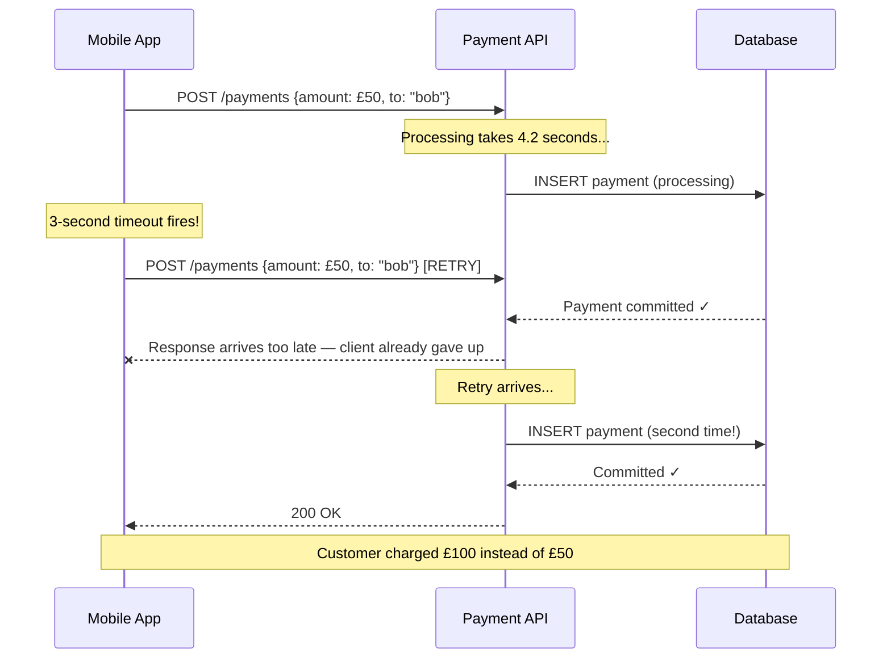
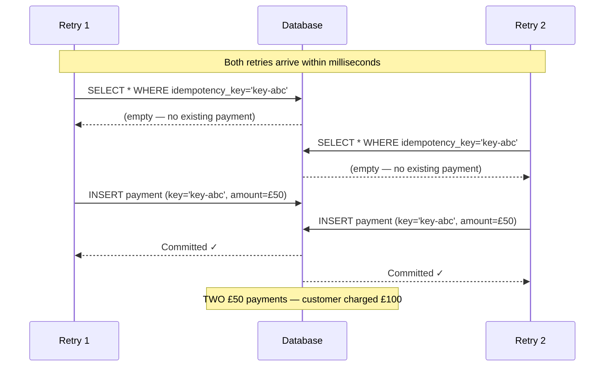

# السيناريو B — الدفع المكرر ومفاتيح الـ Idempotency

## نظرة عامة

**الـ Idempotency** تعني أن تنفيذ العملية نفسها عدة مرات ينتج النتيجة نفسها كتنفيذها مرة واحدة. وفي الأنظمة المالية هذا ليس تحسينًا اختياريًا — بل متطلب صحة. فالشبكات غير موثوقة. والعملاء تنتهي مهلتهم ويعيدون المحاولة. وطوابير الرسائل تسلّم مرة واحدة على الأقل. ودون idempotency، يضاعف انتهاء مهلة تتبعه إعادة محاولة الخصم.

يغطي هذا السيناريو المشكلة كاملة: لماذا تحدث المدفوعات المكررة، وكيف تعمل مفاتيح الـ idempotency، وحالة سباق "افحص ثم نفّذ" في التنفيذات الساذجة، وكيف توفر قيود قاعدة البيانات الضمان الموثوق الوحيد لإزالة التكرار. وفي النهاية ستكون خدمات الدفع لديك آمنة لإعادة المحاولة من أي عميل، في أي ظرف شبكي.

## أهداف التعلم

في نهاية هذا الدرس ستستطيع:

- شرح لماذا الـ idempotency متطلب صحة في أنظمة الدفع الموزعة
- تصميم نظام مفاتيح idempotency لواجهات HTTP ومستهلكي الرسائل
- تنفيذ ترحيل دفع idempotent بحجز المفتاح أولًا بقيد UNIQUE في قاعدة البيانات (`INSERT ... ON CONFLICT DO NOTHING`)
- شرح حالة سباق "افحص ثم نفّذ" في الطلبات المكررة المتزامنة ومنعها
- معالجة التعارض على المفتاح بشكل صحيح لإعادة رد متسق
- تنفيذ مستهلكي Kafka بشكل idempotent باستخدام إزالة التكرار القائمة على الإزاحة والقائمة على المفتاح
- الاختيار بين مفاتيح idempotency يولّدها العميل ومفاتيح يولّدها الخادم

## سياق العمل

تخدم واجهة دفع تطبيق جوال وواجهة ويب معًا. وتحت الحمل، لدى عميل HTTP في تطبيق الجوال سياسة إعادة محاولة عدوانية: إذا لم يتلقَ ردًا خلال 3 ثوانٍ، يعيد الطلب آليًا حتى 3 مرات.

وفي ذروة الحمل تستغرق خدمة الدفع أحيانًا 4–5 ثوانٍ للرد (تنافس على أقفال قاعدة البيانات تحت الاندفاع). فيعيد عميل الجوال المحاولة. وبحلول وصول إعادة المحاولة يكون الطلب الأول قد التزم غالبًا. والنتيجة: يُخصم من العميل مرتين. *(مثال مركّب.)* وتُكتشف المعاملات المكررة أثناء كشف الحساب الشهري — وقد خُصم من عشرات العملاء مرتين.

يتطلب الإصلاح idempotency على مستوى الواجهة. لكن التنفيذ الساذج الأول فيه خلل أيضًا: يستخدم نمط "افحص قبل الإدراج" الذي ينشئ حالة سباق جديدة تحت إعادات المحاولة المتزامنة.

## لماذا تحدث التكرارات — مشكلة إعادة المحاولة



المشكلة الأساسية: **العميل لا يعرف هل نجح الطلب الأول**. فمن منظور العميل، انتهاء المهلة والفشل متطابقان. والاستجابة الآمنة الوحيدة إعادة المحاولة. لكن إعادة محاولة نقطة غير idempotent تنشئ تكرارًا.

> [!NOTE]
> هذه المشكلة موجودة في كل طبقة من النظام الموزع. فعملاء HTTP يعيدون المحاولة عند انتهاء المهلة. وطوابير الرسائل تسلّم مرة واحدة على الأقل. ومنسقو saga يعيدون محاولة الخطوات الفاشلة. ومهام Kubernetes قد تُعاد. وأي مكون يعيد المحاولة يتطلب معالجات idempotent بعده.

## نمط مفتاح الـ Idempotency

الحل **مفتاح idempotency يولّده العميل**: معرّف ثابت وفريد يولّده العميل مرة واحدة لكل عملية منطقية ويضمّنه في كل إعادة محاولة لتلك العملية. ويستخدم الخادم هذا المفتاح لكشف إعادات المحاولة وإزالة تكرارها.

### مبادئ تصميم المفتاح

1. **يولّده العميل** — يولّد العميل المفتاح قبل المحاولة الأولى. وكل إعادات المحاولة تستخدم المفتاح نفسه.
2. **فريد عالميًا** — عادة UUID v4، يُولّد لكل نية دفع
3. **محدد بالعملية** — لا يمكن إعادة استخدام مفتاح "اخصم 50 جنيهًا من العميل" لـ "اخصم 100 جنيه من العميل"
4. **نافذة الـ idempotency** — عادة 24 ساعة؛ وبعدها قد تنتهي صلاحية المفاتيح وتنشئ إعادة الاستخدام دفعة جديدة

```java17
// Client-side idempotency key generation
// Generated ONCE, before the first request, stored in the client's retry context
public class PaymentClient {

    public PaymentResponse initiatePayment(PaymentRequest request) {
        // Key generated here — same key used for all retries of this payment.
        // In a real app, generate it when the payment INTENT is created and
        // store it with the intent, so a crash/restart or a second tap of the
        // "Pay" button reuses the same key instead of creating a new payment.
        String idempotencyKey = request.idempotencyKey();

        return retryTemplate.execute(context -> {
            HttpHeaders headers = new HttpHeaders();
            headers.set("Idempotency-Key", idempotencyKey);

            ResponseEntity<PaymentResponse> response = restTemplate.exchange(
                "/api/payments",
                HttpMethod.POST,
                new HttpEntity<>(request, headers),
                PaymentResponse.class
            );
            return response.getBody();
        });
    }
}
```

في تطبيق حقيقي، ولّد المفتاح عند إنشاء **نية** الدفع وخزّنه معها، فيعيد التعطل/إعادة التشغيل أو الضغط الثاني على زر "ادفع" استخدام المفتاح نفسه بدل إنشاء دفعة جديدة.

## التنفيذ الساذج — خلل "افحص ثم نفّذ"

أول تنفيذ يلجأ إليه المطور نمط **افحص ثم أدرج**:

```java17
// BROKEN — check-then-act race condition
@Service
@Transactional
public class PaymentService {

    public PaymentResponse processPayment(PaymentRequest request, String idempotencyKey) {

        // Step 1: Check if we've seen this key before
        Optional<Payment> existing = paymentRepo.findByIdempotencyKey(idempotencyKey);

        if (existing.isPresent()) {
            // Key seen before — return the previous result
            return toResponse(existing.get());
        }

        // RACE WINDOW: Two concurrent retries both reach here simultaneously
        // Both found no existing payment above
        // Both now proceed to insert

        // Step 2: Process and save
        Payment payment = processNewPayment(request);
        payment.setIdempotencyKey(idempotencyKey);
        paymentRepo.save(payment); // Both threads save here → TWO payments!

        return toResponse(payment);
    }
}
```



الفحص والإدراج ليسا ذريين. فبين الفحص والإدراج يستطيع خيط آخر اجتياز الفحص. وهذا **النمط الخاطئ "افحص ثم نفّذ"** — يبدو صحيحًا في عالم بخيط واحد لكنه يفشل تحت التزامن.

## التنفيذ الصحيح — إزالة التكرار بقيد UNIQUE

الإصلاح الموثوق الوحيد: فوّض إزالة التكرار إلى قاعدة البيانات عبر **قيد UNIQUE** على عمود مفتاح الـ idempotency، و**احجز المفتاح أولًا**. فتفرض قاعدة البيانات القيد ذريًا — لا يمكن أبدًا إدراج صفين بالمفتاح نفسه، مهما حاولت خيوط كثيرة في آن واحد. واستخدم `INSERT ... ON CONFLICT (idempotency_key) DO NOTHING RETURNING id`: فإذا عاد صف، فهذا الطلب يملك المفتاح وينفذ العمل؛ وإذا لم يعد شيء، فطلب آخر حجزه بالفعل، فاقرأ نتيجته وأعدها. (وإذا لم يكن الطلب الأول قد التزم بعد، يجعل PostgreSQL الإدراج الثاني ينتظره، ثم يبلغ عن التعارض.)

لماذا لا نستدعي `save()` ونلتقط استثناء تكرار المفتاح؟ فخّان. مع JPA لا يصل `save()` عادة إلى قاعدة البيانات حتى التفريغ (flush) أو الالتزام، فيفلت الاستثناء *بعد* كتلة `try`. وفي PostgreSQL، بمجرد فشل عبارة داخل معاملة، تُجهض المعاملة كلها — فيفشل `SELECT` اللاحق لجلب الأصل بخطأ "current transaction is aborted"، وتكون Spring قد علّمت المعاملة للتراجع.

```sql
-- Database schema: UNIQUE constraint on idempotency_key
CREATE TABLE payments (
    id               UUID        PRIMARY KEY DEFAULT gen_random_uuid(),
    idempotency_key  VARCHAR(64) NOT NULL,
    request_hash     CHAR(64)    NOT NULL,   -- SHA-256 of the request body: detects key reuse
    amount           BIGINT      NOT NULL,
    currency         CHAR(3)     NOT NULL,
    source_account   UUID        NOT NULL,
    dest_account     UUID        NOT NULL,
    status           VARCHAR(20) NOT NULL,
    result_payload   JSONB,       -- store the response for idempotent replay
    created_at       TIMESTAMPTZ NOT NULL DEFAULT NOW(),
    -- the UNIQUE constraint creates its own index; no second index needed
    CONSTRAINT uq_payments_idempotency UNIQUE (idempotency_key)
);
```

```java17
// Java 17 — Correct idempotency: claim the key first with ON CONFLICT DO NOTHING
@Service
public class PaymentService {

    @Transactional
    public PaymentResponse processPayment(PaymentRequest request,
                                           String idempotencyKey) {
        String requestHash = sha256(canonicalJson(request));

        // Claim: returns the new id, or empty if the key already exists.
        //   INSERT INTO payments (idempotency_key, request_hash, amount, currency,
        //                         source_account, dest_account, status)
        //   VALUES (?, ?, ?, ?, ?, ?, 'PROCESSING')
        //   ON CONFLICT (idempotency_key) DO NOTHING
        //   RETURNING id
        Optional<UUID> claimed = paymentRepo.insertIfAbsent(idempotencyKey, requestHash, request);

        if (claimed.isEmpty()) {
            // Someone already owns this key — replay, never re-execute.
            // No exception was thrown, so the transaction is still healthy.
            Payment original = paymentRepo.findByIdempotencyKey(idempotencyKey).orElseThrow();
            if (!original.getRequestHash().equals(requestHash)) {
                throw new IdempotencyKeyReuseException(idempotencyKey);   // → HTTP 422
            }
            return replay(original);
        }

        // We own the key: do the work in the SAME transaction (ledger post etc.).
        // If anything fails, the claim rolls back too, so a retry can try again.
        PaymentResponse response = executePayment(claimed.get(), request);
        paymentRepo.storeResult(claimed.get(), response);   // for later replays
        return response;
    }
}
```

```java21
// Java 21 — Idempotent service with sealed result type
@Service
public class PaymentService {

    // Records nested INSIDE the sealed interface, so `permits` names real types
    public sealed interface ProcessingResult
        permits ProcessingResult.NewPayment, ProcessingResult.DuplicatePayment {

        record NewPayment(UUID paymentId)          implements ProcessingResult {}
        record DuplicatePayment(Payment original)  implements ProcessingResult {}
    }

    @Transactional
    public PaymentResponse processPayment(PaymentRequest request, String idempotencyKey) {
        String requestHash = sha256(canonicalJson(request));

        return switch (claim(request, idempotencyKey, requestHash)) {
            case ProcessingResult.NewPayment(var id) -> {
                PaymentResponse response = executePayment(id, request);   // ledger post etc.
                paymentRepo.storeResult(id, response);
                yield response;
            }
            case ProcessingResult.DuplicatePayment(var original) -> {
                if (!original.getRequestHash().equals(requestHash)) {
                    throw new IdempotencyKeyReuseException(idempotencyKey);   // → HTTP 422
                }
                log.info("Idempotent replay for key={}", idempotencyKey);
                yield replay(original);   // same response as the first attempt
            }
        };
    }

    private ProcessingResult claim(PaymentRequest request, String key, String hash) {
        // INSERT ... ON CONFLICT (idempotency_key) DO NOTHING RETURNING id
        return paymentRepo.insertIfAbsent(key, hash, request)
            .<ProcessingResult>map(ProcessingResult.NewPayment::new)
            .orElseGet(() -> new ProcessingResult.DuplicatePayment(
                paymentRepo.findByIdempotencyKey(key).orElseThrow()));
    }
}
```

لم يُرمَ أي استثناء في حالة التكرار، فتبقى المعاملة سليمة. وإذا فشل أي شيء أثناء العمل، يُتراجع عن الحجز أيضًا، فتستطيع إعادة المحاولة المحاولة مجددًا. ويُفحص تجزئة جسم الطلب: المفتاح نفسه بجسم مختلف يُرفض بـ HTTP 422.

## تخزين الرد لإعادة تشغيله

متطلب صحة دقيق: يجب أن تعيد إعادة التشغيل idempotent **الرد نفسه** كالطلب الأصلي. فإذا فشل الطلب الأصلي (مثلًا DECLINED)، يجب أن تعيد إعادة التشغيل DECLINED أيضًا — لا أن تحاول دفعة جديدة.

```java17
// Store the serialised response payload for replay
@Entity
public class Payment {
    // ... other fields ...

    @Column(columnDefinition = "JSONB")
    private String resultPayload; // Serialised PaymentResponse — stored after first attempt

    @Enumerated(EnumType.STRING)
    private PaymentStatus status;  // PROCESSING, SETTLED, DECLINED, FAILED
}

// When returning an idempotent response:
public PaymentResponse getIdempotentResponse(String idempotencyKey) {
    Payment payment = paymentRepo.findByIdempotencyKey(idempotencyKey)
        .orElseThrow(() -> new PaymentNotFoundException(idempotencyKey));

    if (payment.getStatus() == PaymentStatus.PROCESSING) {
        // The original request is still in-flight
        // Return 202 Accepted — client should poll for the result
        return PaymentResponse.inProgress(payment.getId());
    }

    // Deserialise and return the stored result
    if (payment.getResultPayload() != null) {
        return objectMapper.readValue(payment.getResultPayload(), PaymentResponse.class);
    }

    return toResponse(payment); // Fall back to building from current state
}
```

> [!IMPORTANT]
> إذا كان الطلب الأصلي ما زال قيد المعالجة (الحالة = PROCESSING)، يجب أن يدل الرد idempotent على ذلك — لا أن يُحجب بانتظاره. فأعد `HTTP 202 Accepted` مع عنوان استطلاع. ويستطيع العميل الاستطلاع حتى تُعرف الحالة النهائية.

## مستهلكو Kafka بشكل Idempotent

يسلّم Kafka الرسائل مرة واحدة على الأقل افتراضيًا (حتى مع `enable.auto.commit=false`). والمستهلك الذي يعالج حدث دفع يجب أن يكون idempotent: معالجة الحدث نفسه مرتين يجب أن تنتج النتيجة نفسها.

```java17
// Idempotent Kafka consumer using idempotency key in the message
@KafkaListener(topics = "payment-commands", groupId = "payment-processor")
@Transactional
public void handlePaymentCommand(PaymentCommandEvent event) {

    // The event carries a stable idempotency key — set by the producer
    String idempotencyKey = event.getIdempotencyKey();

    try {
        paymentService.processPayment(
            event.toRequest(),
            idempotencyKey
        );
        // If duplicate: processPayment finds the key already claimed and replays —
        // no exception. Consumer commits offset normally.
        log.debug("Processed payment event key={}", idempotencyKey);

    } catch (Exception e) {
        // Don't commit offset — message will be redelivered
        log.error("Failed to process payment event key={}: {}", idempotencyKey, e.getMessage());
        throw e; // Spring Kafka will seek back to this offset
    }
}
```

**إزالة التكرار القائمة على الإزاحة** (للمستهلكين الذين لا يستطيعون الاعتماد على مفاتيح idempotency). ولها حدود: فهي تلتقط فقط *إعادة تسليم* السجل نفسه. فالمنتج الذي يرسل الحدث نفسه مرتين ينشئ سجلين بإزاحتين مختلفتين، وإعادة ضبط مجموعة مستهلكين أو إعادة إنشاء موضوع تغيّر الإزاحات. ففضّل مفتاح idempotency تجاريًا كلما استطاع الحدث حمله.

```java17
// Store the last processed offset per partition
// Prevents reprocessing on consumer restart or rebalance
@Service
public class IdempotentOffsetConsumer {

    private final ProcessedOffsetRepository offsetRepo;

    @Transactional
    public void process(ConsumerRecord<String, PaymentEvent> record) {
        TopicPartitionOffset tpo = new TopicPartitionOffset(
            record.topic(), record.partition(), record.offset()
        );

        // Safe as a check because one partition is consumed by one consumer at a
        // time; still back it with a UNIQUE (topic, partition, offset) constraint
        if (offsetRepo.existsByTopicAndPartitionAndOffset(tpo)) {
            log.debug("Skipping already-processed offset: {}", tpo);
            return; // Idempotent skip
        }

        // Process the payment
        paymentService.processPayment(record.value().toRequest(),
                                       record.value().getIdempotencyKey());

        // Record that we processed this offset
        offsetRepo.save(tpo);
        // Both operations are in the same @Transactional boundary
        // Either both succeed or both are rolled back — no partial state
    }
}
```

## رموز استجابة HTTP للواجهات Idempotent

| السيناريو | حالة HTTP | المعنى |
|---|---|---|
| الطلب الأول، نجاح | `201 Created` | أُنشئت دفعة جديدة |
| إعادة محاولة، نجح الأصل | مثل الأصل (`201`) | إعادة تشغيل idempotent — الحالة والجسم نفسهما (واختياريًا ترويسة مثل `Idempotent-Replayed: true`) |
| إعادة محاولة، الأصل قيد التنفيذ | `202 Accepted` (أو `409` مع Retry-After) | ما زال قيد المعالجة — استطلع لاحقًا |
| إعادة محاولة، رُفض الأصل | مثل الأصل (مثلًا `402` / `422`) | يعيد نتيجة DECLINED الأصلية — دون محاولة جديدة |
| المفتاح نفسه، جسم طلب مختلف | `422 Unprocessable Entity` | إعادة استخدام المفتاح بحمولة مختلفة — ارفض |
| إعادة استخدام مفتاح منتهي | حسب السياسة: يُعامل كجديد، أو `400 Bad Request` | المفتاح خارج نافذة الـ idempotency |

> [!WARNING]
> لا تُعد أبدًا `409 Conflict` لتكرار أُزيل بنجاح. فـ `409` تعني أن على العميل فعل شيء لحل التعارض. والتكرار المعالج بشكل صحيح ليس تعارضًا — بل نجاح. فأعد الرد نفسه كالطلب الأصلي.


<!-- KNOWLEDGE-CHECK [
  {
    "id": "kc-scb-01",
    "question": "يرسل عميل جوال طلب دفع. ويعالجه الخادم بنجاح لكن الرد يضيع بسبب عطل في الشبكة. ويعيد العميل المحاولة. ماذا يجب أن يفعل الخادم لتجنب الخصم من العميل مرتين؟",
    "options": [
      "رفض إعادة المحاولة بـ HTTP 409 — الدفعة موجودة بالفعل",
      "إعادة نتيجة الدفعة الأصلية باستخدام مفتاح الـ idempotency — الرد نفسه، دون خصم ثانٍ",
      "معالجة الدفعة مجددًا مع إلغاء الأولى آليًا",
      "إعادة HTTP 500 ليعرف العميل أن يجرب خادمًا آخر"
    ],
    "correct": 1,
    "explanation": "السلوك الصحيح إعادة تشغيل idempotent: أعد نتيجة الدفعة الأصلية الناجحة. فلا يُخصم من العميل مجددًا. وجسم الرد مطابق لما كان العميل سيتلقاه لو لم تفشل الشبكة. وHTTP 409 خاطئ — فالتكرار عولج؛ وليس خطأً من منظور العميل."
  },
  {
    "id": "kc-scb-02",
    "question": "لماذا نمط 'افحص ثم أدرج' لمفاتيح الـ idempotency غير آمن تحت التزامن؟",
    "options": [
      "لأن عبارات SELECT لا تقرأ البيانات الملتزمة عند READ COMMITTED",
      "لأن إعادتي محاولة متزامنتين قد تجتازان فحص SELECT كلتاهما قبل أن تدرج أي منهما الصف",
      "لأن معاملات قاعدة البيانات ليست آمنة للخيوط",
      "لأن مفاتيح الـ idempotency يجب أن يولّدها الخادم لا العميل"
    ],
    "correct": 1,
    "explanation": "عبارتا SELECT وINSERT عمليتان منفصلتان. وبينهما يستطيع خيط متزامن آخر تنفيذ SELECT أيضًا (فلا يجد شيئًا) قبل أن يلتزم أي من الخيطين بالإدراج. فيمضي الخيطان كلاهما في الإدراج، فينشأ تكرار. وقيد UNIQUE يجعل الإدراج نفسه ذريًا وحصريًا — فلا ينجح إلا واحد."
  },
  {
    "id": "kc-scb-03",
    "question": "إدراج بمفتاح idempotency يصطدم بقيد UNIQUE (أو، مع ON CONFLICT DO NOTHING، لا يعيد صفًا). ماذا يجب أن تفعل الخدمة؟",
    "options": [
      "إعادة رمي الاستثناء — فهو يدل على خطأ برمجي",
      "إعادة HTTP 500 — تعذر إنشاء الدفعة",
      "البحث عن الدفعة الموجودة بمفتاح الـ idempotency وإعادة نتيجتها",
      "حذف الصف المتعارض وإعادة محاولة الإدراج"
    ],
    "correct": 2,
    "explanation": "التعارض على مفتاح الـ idempotency يعني أن هذه الدفعة بالضبط حجزها طلب سابق أو متزامن. ويجب أن تبحث الخدمة عن الدفعة الموجودة وتعيد نتيجتها — إعادة التشغيل idempotent (بعد التحقق من تطابق جسم الطلب). وليس هذا خطأً؛ بل آلية إزالة التكرار تعمل. وفضّل ON CONFLICT DO NOTHING على التقاط الاستثناء: ففي PostgreSQL تُجهض العبارة الفاشلة المعاملة كلها."
  },
  {
    "id": "kc-scb-04",
    "question": "يعالج مستهلك Kafka أحداث دفع. ويتعطل المستهلك بعد معالجة حدث لكن قبل التزام إزاحة Kafka. فيُعاد تسليم الحدث. ما الذي يمنع معالجة الدفعة مرتين؟",
    "options": [
      "دلالات التسليم مرة واحدة بالضبط في Kafka تزيل تكرار الحدث آليًا",
      "يتحقق المستهلك هل عولج الحدث بالفعل باستخدام مفتاح الـ idempotency المخزن في سجل الدفعة",
      "منسق مجموعة المستهلكين يمنع إعادة التسليم إلى النسخة نفسها",
      "تعليق @KafkaListener في Spring Kafka يعالج إزالة التكرار آليًا"
    ],
    "correct": 1,
    "explanation": "ضمان التسليم الافتراضي في Kafka هو مرة واحدة على الأقل. ودلالات التسليم مرة واحدة بالضبط في Kafka تغطي المعالجة من Kafka إلى Kafka، لا الآثار الجانبية في قاعدة بياناتك. والنهج الموثوق idempotency على مستوى التطبيق: يحمل الحدث مفتاح idempotency، وتحجزه خدمة الدفع بقيد UNIQUE، فيجد الحدث المعاد تسليمه المفتاح محجوزًا بالفعل فيعيد تشغيل النتيجة بدل الدفع مجددًا."
  }
] -->


<!-- PRACTICAL-CHALLENGE {
  "id": "pc-scenario-b",
  "title": "تنفيذ السيناريو B: واجهة دفع Idempotent",
  "description": "نفّذ الـ idempotency لنقطة دفع يجب أن تتعامل بأمان مع إعادات المحاولة من عملاء الجوال.",
  "tasks": [
    {
      "id": "pc-scb-01",
      "description": "صمم مخطط قاعدة البيانات لجدول `idempotency_keys` يخزن المفتاح، وحمولة الرد، والحالة، ووقت انتهاء الصلاحية. واكتب عبارة CREATE TABLE بالفهارس المناسبة."
    },
    {
      "id": "pc-scb-02",
      "description": "نفّذ دالة الخدمة في Spring ‏`processPayment(PaymentRequest, String idempotencyKey)` بنهج الحجز أولًا: INSERT ... ON CONFLICT (idempotency_key) DO NOTHING RETURNING id. وعندما لا يعود صف، حمّل الدفعة الموجودة وأعد نتيجتها المخزنة."
    },
    {
      "id": "pc-scb-03",
      "description": "يرسل عميل مفتاح الـ idempotency نفسه لكن بجسم طلب مختلف (مبلغ مختلف). ما رمز حالة HTTP الذي يجب أن يعيده الخادم ولماذا؟ ونفّذ فحص التحقق."
    },
    {
      "id": "pc-scb-04",
      "description": "نفّذ مستهلك Kafka بشكل idempotent لحدث `PaymentCommandEvent`. ويجب أن يتعامل المستهلك مع إعادة التسليم بسلاسة — فمعالجة حدث معاد تسليمه يجب أن تنتج النتيجة نفسها كمعالجته مرة واحدة."
    },
    {
      "id": "pc-scb-05",
      "description": "ما زال طلب الدفع الأصلي في حالة PROCESSING عندما تصل إعادة محاولة. ما الرد الذي يجب إعادته؟ ونفّذ الرد idempotent لحالة 'قيد التنفيذ' مع عنوان استطلاع."
    }
  ]
} -->
