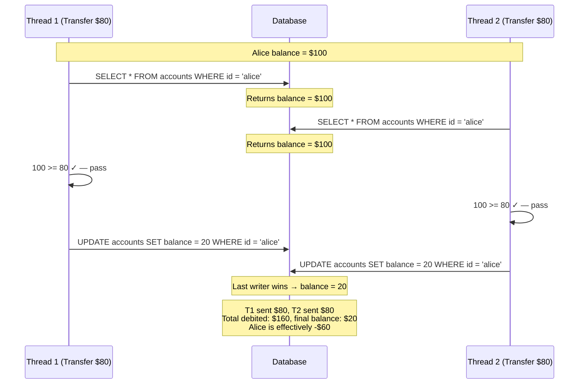
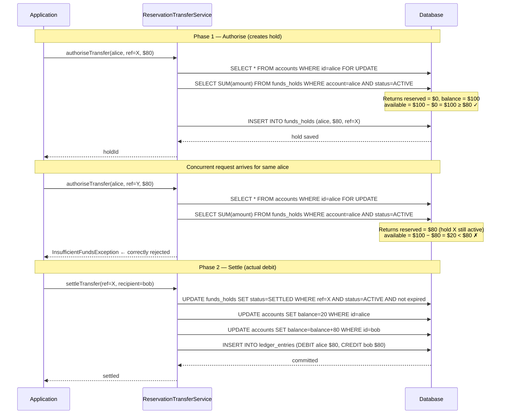

# السيناريو C — الإنفاق المزدوج والقفل والحجوزات

## نظرة عامة

تعالج محفظة رقمية تحويلات من شخص لشخص في مللي ثوانٍ. وهذه السرعة ميزة — حتى يصل طلبان للحساب نفسه في النافذة نفسها فيتسابق فحص الرصيد مع نفسه إلى منطقة سالبة. يشرّح هذا الدرس التسلسل الدقيق الذي يسبب الإنفاق المزدوج، ثم يبني ثلاث طبقات دفاع: قفلًا متشائمًا في قاعدة البيانات، ونموذج حجز أموال يفصل "التفويض" عن "التسوية"، وحارسًا في الذاكرة قائمًا على CAS للمحافظ التي تخزن الأرصدة مؤقتًا. وفي النهاية ستستطيع اختيار الآلية الصحيحة لمقايضة إنتاجية/اتساق معينة واختبارها بأداة متزامنة من 50 خيطًا تثبت الصحة تحت الحمل.

## أهداف التعلم

- تحديد حالة سباق "افحص ثم نفّذ" التي تمكّن الإنفاق المزدوج في خدمة تحويل متزامنة.
- تنفيذ `SELECT FOR UPDATE` عبر `@Lock(PESSIMISTIC_WRITE)` في JPA وشرح ما يحدث على مستوى قاعدة البيانات للطلب المتزامن الثاني.
- تصميم نموذج حجز أموال ("hold") يحافظ على ثابت الرصيد المتاح تحت القفل المتفائل.
- كتابة حلقة `CompareAndSet` على `AtomicLong` لفرض قيد الرصيد غير السالب في ذاكرة أرصدة مؤقتة.
- تأليف اختبار JUnit 5 متعدد الخيوط يطلق 50 طلب خصم متزامنًا ويؤكد عدم حدوث إنفاق مزدوج.

## سياق العمل

*مثال مركّب:* تشغّل "Moneta Pay"، وهي مؤسسة نقود إلكترونية أوروبية خيالية لديها 4.2 مليون محفظة نشطة، ميزة تحويل من شخص لشخص باتفاقية توفر 99.95%. وخلال حملة استرداد نقدي في الجمعة السوداء، أرسل التسويق إشعارًا فوريًا لكل المستخدمين في آن واحد. فأطلقت الحملة قفزة من 38,000 طلب تحويل في الثانية. وخلال 90 ثانية تلقى فريق عمليات الاحتيال تنبيهات آلية: أصبحت أرصدة 1,247 محفظة سالبة، وبلغ إجمالي السحب على المكشوف 83,400 يورو. ولم يكن السبب الجذري مسار شيفرة يسمح بالسحب على المكشوف عمدًا — فقد كان لدى Moneta Pay فحص للرصيد. بل كان السبب أن فحص الرصيد والخصم عمليتان منفصلتان غير ذريتين، وعند 38,000 طلب في الثانية كانت الفجوة بينهما واسعة بما يكفي لتسلل طلب ثانٍ.

كلّف الحادث 83,400 يورو مسؤولية مباشرة، و12,000 يورو عمل معالجة يدوي، وأطلق تحقيقًا إشرافيًا من الجهة الرقابية الوطنية. واستغرق إصلاح حالة السباق أربع ساعات. واستغرقت مراجعة السمعة أربعة أشهر.

## الخلل: حالة سباق "افحص ثم نفّذ"

بدت شيفرة التحويل التي وصلت إلى الإنتاج هكذا:

```java
@Service
@RequiredArgsConstructor
public class TransferService {

    private final AccountRepository accountRepository;
    private final LedgerEntryRepository ledgerEntryRepository;

    @Transactional
    public void transfer(UUID senderId, UUID recipientId, BigDecimal amount) {
        Account sender = accountRepository.findById(senderId)
                .orElseThrow(() -> new AccountNotFoundException(senderId));

        // BUG: balance read and debit are NOT atomic
        if (sender.getBalance().compareTo(amount) < 0) {
            throw new InsufficientFundsException(senderId, sender.getBalance(), amount);
        }

        sender.setBalance(sender.getBalance().subtract(amount));
        accountRepository.save(sender);

        Account recipient = accountRepository.findById(recipientId)
                .orElseThrow(() -> new AccountNotFoundException(recipientId));
        recipient.setBalance(recipient.getBalance().add(amount));
        accountRepository.save(recipient);

        ledgerEntryRepository.saveAll(List.of(
                LedgerEntry.debit(senderId, amount),
                LedgerEntry.credit(recipientId, amount)
        ));
    }
}
```

لا تظهر المشكلة عند قراءة هذه الدالة منفردة. بل تظهر فقط عندما ينفذها خيطان بالتزامن لـ `senderId` نفسه.

### الجدول الزمني الدقيق



> [!WARNING]
> تستخدم `@Transactional` في Spring مستوى العزل الافتراضي لقاعدة البيانات ما لم تحدد غيره: READ COMMITTED في PostgreSQL وOracle وSQL Server ‏(REPEATABLE READ في MySQL InnoDB). وتحت READ COMMITTED، يرى `findById` في T2 الصف *قبل* التزام `UPDATE` في T1 — لأن T1 لم يلتزم بعد. فتمضي المعاملتان كلتاهما، وتكتبان كلتاهما، وتفوز قيمة الكاتب الأخير. ويُكتب فوق خصم الكاتب الأول بصمت.

النمط الأساسي هو النمط الخاطئ التقليدي **افحص ثم نفّذ**:

1. اقرأ الحالة المشتركة (الرصيد).
2. اتخذ قرارًا بناءً على تلك الحالة (هل هو كافٍ؟).
3. نفّذ على افتراض أن الحالة ما زالت صالحة (اخصم).

الخطوتان 1 و3 ليستا ذريتين. وأي عدد من المعاملات الأخرى يستطيع تعديل الحالة المشتركة بين الخطوتين 1 و3.

## الحل 1 — القفل المتشائم بـ SELECT FOR UPDATE

الإصلاح الأكثر مباشرة هو الحصول على قفل صف حصري على صف الحساب قبل قراءة الرصيد. فلا تستطيع أي معاملة أخرى قراءة ذلك الصف (بـ `FOR UPDATE`) أو كتابته حتى يُحرر القفل عند الالتزام.

### المستودع

```java
public interface AccountRepository extends JpaRepository<Account, UUID> {

    @Lock(LockModeType.PESSIMISTIC_WRITE)
    @Query("SELECT a FROM Account a WHERE a.id = :id")
    Optional<Account> findByIdForUpdate(@Param("id") UUID id);
}
```

تترجم JPA ‏`PESSIMISTIC_WRITE` إلى `SELECT ... FOR UPDATE` في PostgreSQL. وSQL الصادرة بالضبط:

```sql
SELECT a.id, a.balance, a.version, a.owner_id
FROM   accounts a
WHERE  a.id = $1
FOR UPDATE;
```

> [!NOTE]
> يأخذ `FOR UPDATE` في PostgreSQL قفلًا حصريًا **على مستوى الصفوف** المختارة (إضافة إلى قفل `ROW SHARE` ضعيف على الجدول لا يحجب الكتّاب الآخرين). ولا يقفل الجدول كله. فمعاملتان متزامنتان تحدّثان حسابين *مختلفين* تمضيان بالتوازي دون أن تحجب إحداهما الأخرى. والتنافس على الأقفال يتناسب مع عدد مرات ظهور الحساب نفسه في الطلبات المتزامنة — وهي بالضبط الحالة التي نحتاج التعامل معها.

### الخدمة

```java
@Service
@RequiredArgsConstructor
public class TransferService {

    private final AccountRepository accountRepository;
    private final LedgerEntryRepository ledgerEntryRepository;

    @Transactional(isolation = Isolation.READ_COMMITTED)
    public TransferResult transfer(UUID senderId, UUID recipientId, BigDecimal amount) {
        // Lock BOTH accounts in canonical (UUID) order before reading anything —
        // locking sender first and recipient second would deadlock against a
        // concurrent transfer in the opposite direction
        Map<UUID, Account> locked = lockAccountsOrdered(senderId, recipientId);
        Account sender    = locked.get(senderId);
        Account recipient = locked.get(recipientId);

        if (sender.getBalance().compareTo(amount) < 0) {
            throw new InsufficientFundsException(senderId, sender.getBalance(), amount);
        }

        // Safe: no other transaction can modify either balance until this commit
        sender.setBalance(sender.getBalance().subtract(amount));
        recipient.setBalance(recipient.getBalance().add(amount));

        accountRepository.saveAll(List.of(sender, recipient));

        List<LedgerEntry> entries = List.of(
                LedgerEntry.debit(senderId, amount),
                LedgerEntry.credit(recipientId, amount)
        );
        ledgerEntryRepository.saveAll(entries);

        return TransferResult.success(senderId, recipientId, amount);
    }
}
```

> [!IMPORTANT]
> اقفل الحسابات دائمًا **بترتيب ثابت** (مثلًا بالترتيب الطبيعي لـ UUID) عندما يجب على معاملة واحدة قفل عدة صفوف. فإذا قفل الخيط 1 الحساب A ثم B، بينما قفل الخيط 2 الحساب B ثم A، سيتجمد الخيطان منتظرين أحدهما الآخر. رتّب الأقفال فتصبح دورة الجمود مستحيلة.

```java
// Deadlock-safe multi-account lock acquisition
private Map<UUID, Account> lockAccountsOrdered(UUID id1, UUID id2) {
    // Sort so every thread always acquires the locks in the same order
    Map<UUID, Account> locked = new HashMap<>();
    Stream.of(id1, id2).sorted().forEach(id ->
            locked.put(id, accountRepository.findByIdForUpdate(id)
                    .orElseThrow(() -> new AccountNotFoundException(id))));
    return locked;
}
```

### ماذا يحدث للطلب المتزامن الثاني

عندما يحصل T1 على `FOR UPDATE` لصف أليس:

1. يصدر T2 عبارة `SELECT ... FOR UPDATE` نفسها لصف أليس.
2. تضع قاعدة البيانات T2 في طابور انتظار — فلا يعود حتى يلتزم T1 أو يتراجع.
3. يلتزم T1: الرصيد الآن 20 دولارًا، ويُحرر القفل.
4. يستيقظ T2 ويقرأ الرصيد *بعد الالتزام* وهو 20 دولارًا.
5. فحص الرصيد في T2: ‏20 < 80 ← `InsufficientFundsException`. فيُرفض التحويل بشكل صحيح.

لا يفشل الطلب الثاني بصمت — بل يُحجب، ثم يفشل سريعًا باستثناء عمل يستطيع المستدعي عرضه للمستخدم كـ "رصيد غير كافٍ". ولا يحدث سحب على المكشوف.

> [!WARNING]
> القيمة الافتراضية لـ `lock_timeout` في PostgreSQL هي 0 — أي الانتظار إلى الأبد — فيُحجب T2 إلى ما لا نهاية إذا كان T1 بطيئًا. في الإنتاج اضبط `lock_timeout` في PostgreSQL (لكل جلسة أو لكل معاملة بـ `SET LOCAL lock_timeout = '2s'`)، أو أضف `@QueryHints(@QueryHint(name = "jakarta.persistence.lock.timeout", value = "2000"))` (بالمللي ثانية؛ و`javax.` في إصدارات Spring/Hibernate الأقدم) إلى دالة المستودع. (أما `connection-timeout` في Hikari فشيء مختلف: مدة انتظار اتصال من المجمع، لا انتظار قفل صف.) ويرمي الحصول على قفل منتهي المهلة `LockTimeoutException`، وهو خطأ قابل لإعادة المحاولة — فاعرضه مثلًا كـ HTTP 409 أو 503 مع Retry-After ودع العميل يعيد المحاولة بمفتاح الـ idempotency نفسه.

## الحل 2 — نموذج حجز الأموال

القفل المتشائم يسلسل كل التحويلات عبر حساب واحد. وللمحافظ عالية الإنتاجية (فكّر في حساب تاجر يتلقى آلاف الدفعات الصغيرة في الثانية)، يخلق ذلك عنق زجاجة. ويحقق نموذج حجز الأموال الصحة دون أقفال صفوف طويلة.

الفكرة: افصل لحظة *التفويض* (حجز الأموال) عن لحظة *التسوية* (التزام الخصم). فالحجز سجل خفيف يقول "هذا المبلغ محجوز". ويُحسب الرصيد المتاح كـ `totalBalance − sumOfActiveHolds`. ويحدث الفحص وإدراج الحجز معًا تحت قفل صف **قصير جدًا** على الحساب، فلا يستطيع تفويضان متزامنان رؤية الرصيد المتاح نفسه. ثم يحدث العمل البطيء (فحوص الاحتيال، والاستدعاءات لأنظمة أخرى، والتسوية) دون الاحتفاظ بذلك القفل.

### مخطط قاعدة البيانات

```sql
CREATE TABLE accounts (
    id            UUID        PRIMARY KEY DEFAULT gen_random_uuid(),
    owner_id      UUID        NOT NULL REFERENCES users(id),
    balance       NUMERIC(19,4) NOT NULL DEFAULT 0,
    currency      CHAR(3)     NOT NULL,
    version       BIGINT      NOT NULL DEFAULT 0,
    created_at    TIMESTAMPTZ NOT NULL DEFAULT now(),
    updated_at    TIMESTAMPTZ NOT NULL DEFAULT now(),
    CONSTRAINT chk_balance_non_negative CHECK (balance >= 0)
);

CREATE TABLE funds_holds (
    id            UUID        PRIMARY KEY DEFAULT gen_random_uuid(),
    account_id    UUID        NOT NULL REFERENCES accounts(id),
    amount        NUMERIC(19,4) NOT NULL,
    reason        VARCHAR(100) NOT NULL,
    transfer_ref  UUID        NOT NULL,
    status        VARCHAR(20) NOT NULL DEFAULT 'ACTIVE',  -- ACTIVE | SETTLED | RELEASED
    expires_at    TIMESTAMPTZ NOT NULL,
    created_at    TIMESTAMPTZ NOT NULL DEFAULT now(),
    CONSTRAINT chk_hold_amount_positive CHECK (amount > 0),
    CONSTRAINT uq_hold_transfer_ref UNIQUE (transfer_ref)
);

CREATE INDEX idx_funds_holds_account_active
    ON funds_holds(account_id)
    WHERE status = 'ACTIVE';
```

> [!NOTE]
> قيد `CHECK (balance >= 0)` على `accounts` حارس أخير على مستوى قاعدة البيانات. ويجب ألا ينطلق أبدًا في تطبيق منفذ بشكل صحيح — فإذا انطلق، فهذا يعني أن منطق الحجز فيه خلل. فعامل `CheckViolationException` كتنبيه حرج، لا كخطأ قابل للتعافي.

### كيانات JPA

```java
@Entity
@Table(name = "accounts")
@OptimisticLocking(type = OptimisticLockType.VERSION)
public class Account {

    @Id
    private UUID id;

    @Column(nullable = false, precision = 19, scale = 4)
    private BigDecimal balance;

    @Column(nullable = false, length = 3)
    private String currency;

    @Version
    private Long version;

    // Transient — computed from active holds; not persisted
    @Transient
    private BigDecimal reservedAmount = BigDecimal.ZERO;

    public BigDecimal availableBalance() {
        return balance.subtract(reservedAmount);
    }

    public void loadReservedAmount(BigDecimal reserved) {
        this.reservedAmount = reserved != null ? reserved : BigDecimal.ZERO;
    }

    // Package-private — only the service layer should call this
    void deductBalance(BigDecimal amount) {
        BigDecimal next = this.balance.subtract(amount);
        if (next.compareTo(BigDecimal.ZERO) < 0) {
            throw new IllegalStateException(
                    "Deduct would make balance negative: balance=%s, amount=%s"
                    .formatted(this.balance, amount));
        }
        this.balance = next;
    }

    void addBalance(BigDecimal amount) {
        this.balance = this.balance.add(amount);
    }
}

@Entity
@Table(name = "funds_holds")
public class FundsHold {

    public enum Status { ACTIVE, SETTLED, RELEASED }

    @Id
    private UUID id;

    @Column(name = "account_id", nullable = false)
    private UUID accountId;

    @Column(nullable = false, precision = 19, scale = 4)
    private BigDecimal amount;

    @Column(nullable = false, length = 100)
    private String reason;

    @Column(name = "transfer_ref", nullable = false)
    private UUID transferRef;

    @Enumerated(EnumType.STRING)
    @Column(nullable = false, length = 20)
    private Status status = Status.ACTIVE;

    @Column(name = "expires_at", nullable = false)
    private Instant expiresAt;

    public static FundsHold create(UUID accountId, BigDecimal amount,
                                    String reason, UUID transferRef,
                                    Duration ttl) {
        FundsHold hold = new FundsHold();
        hold.id = UUID.randomUUID();
        hold.accountId = accountId;
        hold.amount = amount;
        hold.reason = reason;
        hold.transferRef = transferRef;
        hold.expiresAt = Instant.now().plus(ttl);
        return hold;
    }

    public void settle() {
        if (this.status != Status.ACTIVE) {
            throw new IllegalStateException("Cannot settle hold in status: " + this.status);
        }
        this.status = Status.SETTLED;
    }

    public void release() {
        if (this.status != Status.ACTIVE) {
            throw new IllegalStateException("Cannot release hold in status: " + this.status);
        }
        this.status = Status.RELEASED;
    }
}
```

### المستودع

```java
public interface AccountRepository extends JpaRepository<Account, UUID> {

    @Lock(LockModeType.PESSIMISTIC_WRITE)
    @Query("SELECT a FROM Account a WHERE a.id = :id")
    Optional<Account> findByIdForUpdate(@Param("id") UUID id);
}

public interface FundsHoldRepository extends JpaRepository<FundsHold, UUID> {

    @Query("SELECT COALESCE(SUM(h.amount), 0) FROM FundsHold h " +
           "WHERE h.accountId = :accountId AND h.status = 'ACTIVE' " +
           "AND h.expiresAt > :now")
    BigDecimal sumActiveHolds(@Param("accountId") UUID accountId,
                              @Param("now") Instant now);

    Optional<FundsHold> findByTransferRef(UUID transferRef);

    @Modifying
    @Query("UPDATE FundsHold h SET h.status = 'SETTLED' " +
           "WHERE h.transferRef = :ref AND h.status = 'ACTIVE' AND h.expiresAt > :now")
    int settleIfActive(@Param("ref") UUID transferRef, @Param("now") Instant now);
}
```

### الخدمة

```java
@Service
@RequiredArgsConstructor
@Slf4j
public class ReservationTransferService {

    private static final Duration HOLD_TTL = Duration.ofMinutes(5);

    private final AccountRepository accountRepository;
    private final FundsHoldRepository fundsHoldRepository;
    private final LedgerEntryRepository ledgerEntryRepository;

    /**
     * Phase 1 — Authorise: reserve the funds.
     * Returns the hold ID. Fast path, short transaction.
     */
    @Transactional
    public UUID authoriseTransfer(UUID senderId, UUID transferRef,
                                   BigDecimal amount) {
        // Acquire short-lived lock only to compute available balance + insert hold
        Account sender = accountRepository.findByIdForUpdate(senderId)
                .orElseThrow(() -> new AccountNotFoundException(senderId));

        BigDecimal reserved = fundsHoldRepository
                .sumActiveHolds(senderId, Instant.now());
        sender.loadReservedAmount(reserved);

        if (sender.availableBalance().compareTo(amount) < 0) {
            throw new InsufficientFundsException(
                    senderId, sender.availableBalance(), amount);
        }

        FundsHold hold = FundsHold.create(senderId, amount,
                "P2P transfer", transferRef, HOLD_TTL);
        fundsHoldRepository.save(hold);

        log.info("Hold created: account={} amount={} ref={} holdId={}",
                senderId, amount, transferRef, hold.getId());
        return hold.getId();
    }

    /**
     * Phase 2 — Settle: convert hold into actual debit + credit.
     * Idempotent on transferRef, and safe against concurrent settles.
     */
    @Transactional
    public void settleTransfer(UUID transferRef, UUID recipientId) {
        // Claim the hold with ONE conditional update: only an ACTIVE, unexpired
        // hold can be settled, and only once. Two concurrent settle calls for
        // the same ref cannot both get 1 row — read-then-settle() could.
        //   UPDATE funds_holds SET status = 'SETTLED'
        //   WHERE transfer_ref = :ref AND status = 'ACTIVE' AND expires_at > now()
        int claimed = fundsHoldRepository.settleIfActive(transferRef, Instant.now());
        FundsHold hold = fundsHoldRepository.findByTransferRef(transferRef)
                .orElseThrow(() -> new HoldNotFoundException(transferRef));

        if (claimed == 0) {
            if (hold.getStatus() == FundsHold.Status.SETTLED) {
                log.info("Transfer {} already settled — idempotent return", transferRef);
                return;
            }
            // RELEASED or EXPIRED: the reserved money is no longer counted as
            // held, so settling now could spend it twice
            throw new HoldNotActiveException(transferRef, hold.getStatus());
        }

        // Lock both accounts in canonical order, then move the money
        Map<UUID, Account> locked = lockAccountsOrdered(hold.getAccountId(), recipientId);
        Account sender    = locked.get(hold.getAccountId());
        Account recipient = locked.get(recipientId);
        sender.deductBalance(hold.getAmount());
        recipient.addBalance(hold.getAmount());

        accountRepository.saveAll(List.of(sender, recipient));

        ledgerEntryRepository.saveAll(List.of(
                LedgerEntry.debit(hold.getAccountId(), hold.getAmount()),
                LedgerEntry.credit(recipientId, hold.getAmount())
        ));
    }
}
```

تُحجز الأموال في التسوية بتحديث شرطي واحد: لا يمكن تسوية إلا حجز ACTIVE غير منتهي الصلاحية، ومرة واحدة فقط. فلا يستطيع استدعاءا تسوية متزامنان للمرجع نفسه الحصول كلاهما على صف واحد — بينما نمط "اقرأ ثم settle()" يستطيع. والحجز المحرَّر أو المنتهي لم يعد يُحسب محجوزًا، فتسويته الآن قد تنفق المال مرتين.

### تدفق نموذج الحجز



## الحل 3 — حارس في الذاكرة قائم على CAS

للمحافظ عالية التكرار ومنخفضة الزمن التي تحتفظ بذاكرة أرصدة مؤقتة (مدعومة مثلًا بـ Redis أو `ConcurrentHashMap` محلي)، تستطيع فرض قيد عدم السالبية دون رحلة إلى قاعدة البيانات باستخدام حلقة Compare-And-Set على `AtomicLong`.

> [!NOTE]
> هذا الحل **طبقة دفاع إضافية**، لا بديل عن الصحة على مستوى قاعدة البيانات. فاستخدمه عندما تكون قاعدة البيانات هي المرجع لكنك تريد اختصار الطلبات التي ستفشل بوضوح (توفيرًا لرحلة إلى قاعدة البيانات)، أو عندما تكون الذاكرة المؤقتة مصدر الحقيقة الوحيد لمحفظة ساخنة تُطابق بشكل غير متزامن.

```java
/**
 * In-memory balance cache using fixed-point arithmetic.
 * Balances stored as long (cents / minor currency units) to avoid
 * floating-point races on AtomicLong.
 */
@Component
public class InMemoryBalanceCache {

    // accountId -> balance in minor units (e.g. cents)
    private final ConcurrentHashMap<UUID, AtomicLong> balances =
            new ConcurrentHashMap<>();

    public void initialise(UUID accountId, long balanceInMinorUnits) {
        balances.put(accountId, new AtomicLong(balanceInMinorUnits));
    }

    /**
     * Atomically debit the account.
     *
     * @return true if the debit succeeded; false if insufficient balance.
     */
    public boolean tryDebit(UUID accountId, long amountInMinorUnits) {
        AtomicLong balance = balances.get(accountId);
        if (balance == null) {
            return true;   // not cached: no fast rejection — let the database decide
        }

        long current;
        long next;
        do {
            current = balance.get();
            next = current - amountInMinorUnits;
            if (next < 0) {
                // Balance would go negative — reject without modifying state
                return false;
            }
            // CAS: only set if balance hasn't changed since we read it
            // If another thread modified balance between get() and compareAndSet(),
            // compareAndSet returns false and we retry the loop
        } while (!balance.compareAndSet(current, next));

        return true;
    }

    public void credit(UUID accountId, long amountInMinorUnits) {
        // Only adjust accounts that are already cached. Creating an entry at 0
        // here would make the cache show just this credit, not the real balance.
        AtomicLong bal = balances.get(accountId);
        if (bal != null) {
            bal.addAndGet(amountInMinorUnits);
        }
    }

    public long getBalance(UUID accountId) {
        AtomicLong bal = balances.get(accountId);
        return bal == null ? 0L : bal.get();
    }
}
```

تضمن حلقة CAS الذرية لأن `compareAndSet` تعليمة عتاد ذرية واحدة (`LOCK CMPXCHG` على x86). فإذا قرأ خيطان `current = 10000` وحاولا كلاهما `compareAndSet(10000, 2000)`، ينجح واحد فقط. ويعيد الخيط الخاسر قراءة القيمة الجديدة (`2000`)، فيحسب `next = 2000 − 8000 = −6000 < 0`، ويعيد `false`.

<!-- KNOWLEDGE-CHECK
{
  "questions": [
    {
      "text": "رصيد حساب 100 دولار. ويصل طلبا تحويل متزامنان في آن واحد: التحويل A بـ 80 دولارًا والتحويل B بـ 80 دولارًا. ويستخدم كلاهما SELECT FOR UPDATE على صف الحساب. ما النتيجة المضمونة؟",
      "options": [
        "ينجح التحويلان، فيبقى رصيد -60 دولارًا",
        "يفشل التحويلان بانتهاء مهلة القفل",
        "ينجح تحويل واحد (100 − 80 = 20 دولارًا)، ويقرأ الآخر الرصيد المحدّث 20 دولارًا فيُرفض بشكل صحيح لعدم كفاية الرصيد",
        "يفوز التحويل الأول التزامًا؛ وتتراجع قاعدة البيانات عن الثاني آليًا"
      ],
      "correct": 2,
      "explanation": "يسلسل SELECT FOR UPDATE الوصول. فتحصل المعاملة الأولى على القفل، وتخصم 80 دولارًا، وتلتزم — الرصيد الآن 20 دولارًا. ويُفك حجب المعاملة الثانية، فتقرأ الرصيد بعد الالتزام 20 دولارًا، وتفحص 20 >= 80 وهو خاطئ، فترفض بشكل صحيح. ولا يحدث سحب على المكشوف."
    },
    {
      "text": "ما الميزة الأساسية لنموذج حجز الأموال على SELECT FOR UPDATE للمحافظ عالية الإنتاجية؟",
      "options": [
        "يلغي الحاجة إلى معاملات قاعدة البيانات كليًا",
        "يفصل لحظة التفويض (حجز الأموال) عن التسوية، فيسمح بتفويضات متزامنة دون أقفال صفوف طويلة",
        "يسمح للأرصدة بأن تصبح سالبة مؤقتًا ما دامت تتعافى قبل نهاية اليوم",
        "يستخدم Redis بدل PostgreSQL، وهو أسرع للبيانات المالية"
      ],
      "correct": 1,
      "explanation": "ينشئ نموذج حجز الأموال سجل حجز خفيفًا، ويفحص الرصيد المتاح (إجمالي الرصيد − مجموع الحجوزات النشطة) تحت قفل صف قصير جدًا. وهذا يتجنب قفلًا مركزيًا يُحتفظ به طوال مدة العملية كلها، فيتيح إنتاجية أعلى مع الحفاظ على الصحة."
    },
    {
      "text": "تُستخدم ذاكرة أرصدة مؤقتة من AtomicLong لاختصار طلبات الدفع. ويتعطل JVM بعد أن تلتزم قاعدة البيانات بخصم لكن قبل تحديث الذاكرة المؤقتة. ما العاقبة وكيف تُخفف؟",
      "options": [
        "يضيع الخصم لأن الذاكرة المؤقتة هي مصدر الحقيقة",
        "تُظهر الذاكرة المؤقتة رصيدًا أعلى قديمًا من قاعدة البيانات؛ ويجب أن تعيد مهمة مطابقة ضبط الذاكرة المؤقتة دوريًا من رصيد قاعدة البيانات المعتمد",
        "تتراجع قاعدة البيانات عن الخصم آليًا عند تعطل JVM",
        "سيكتشف طلب الدفع التالي عدم الاتساق ويرفض المعالجة"
      ],
      "correct": 1,
      "explanation": "قد تنحرف الذاكرة المؤقتة وقاعدة البيانات إذا تعطل JVM بعد التزام قاعدة البيانات لكن قبل تحديث الذاكرة المؤقتة. والذاكرة المؤقتة ليست مصدر الحقيقة — بل طبقة تحسين. ويجب أن تقرأ مهمة مطابقة دورية الأرصدة الحقيقية من قاعدة البيانات وتعيد ضبط الذاكرة المؤقتة. ولا تعرض أبدًا الأرصدة المخزنة مؤقتًا للمستخدمين النهائيين دون تنبيه إلى قِدمها."
    }
  ]
}
-->

<!-- PRACTICAL-CHALLENGE
{
  "title": "تنفيذ منع الإنفاق المزدوج",
  "difficulty": "advanced",
  "estimatedMinutes": 50,
  "tasks": [
    {"id": "1", "description": "نفّذ حل القفل المتشائم بـ SELECT FOR UPDATE وترتيب أقفال قياسي لتحويلات الحسابين. واكتب دالة lockAccountsOrdered آمنة من الجمود ترتب معرّفات الحسابات قبل الحصول على الأقفال."},
    {"id": "2", "description": "نفّذ نموذج حجز الأموال بدالة authoriseTransfer تفحص الرصيد المتاح (إجمالي الرصيد ناقص الحجوزات النشطة) وتنشئ سجل حجز تحت قفل قصير، ودالة settleTransfer تحجز الحجز بتحديث شرطي ثم تحوّله إلى زوج خصم/إضافة في الدفتر."},
    {"id": "3", "description": "نفّذ InMemoryBalanceCache باستخدام ConcurrentHashMap<UUID, AtomicLong> مع دالة tryDebit قائمة على CAS. وغلّفها في CachedTransferService ترفض الطلبات سريعًا مقابل الذاكرة المؤقتة قبل الوصول إلى قاعدة البيانات، مع التراجع في الذاكرة المؤقتة إذا فشلت كتابة قاعدة البيانات."},
    {"id": "4", "description": "اكتب اختبار تكامل متزامنًا بخمسين خيطًا يحاول كل منها خصم 80 دولارًا من حساب رصيده 100 دولار. وأكد أن خصمًا واحدًا بالضبط ينجح، وأن كل البقية تُرفض، وأن رصيد قاعدة البيانات النهائي 20 دولارًا بالضبط دون سحب على المكشوف."}
  ]
}
-->

```java
// Usage in a transfer service layer
@Service
@RequiredArgsConstructor
public class CachedTransferService {

    private final InMemoryBalanceCache cache;
    private final TransferService persistenceTransferService;

    public TransferResult transfer(UUID senderId, UUID recipientId,
                                    BigDecimal amount) {
        // Minor units depend on the currency: 2 for EUR/USD, 0 for JPY, 3 for BHD
        long amountMinor = amount.movePointRight(currencyDigits(senderId)).longValueExact();

        // Fast rejection without hitting the database
        if (!cache.tryDebit(senderId, amountMinor)) {
            throw new InsufficientFundsException(senderId);
        }

        try {
            // Persist to the database (also has its own locking)
            TransferResult result =
                    persistenceTransferService.transfer(senderId, recipientId, amount);
            cache.credit(recipientId, amountMinor);
            return result;
        } catch (Exception e) {
            // Roll back the in-memory debit if persistence fails. (If the failure
            // was a timeout AFTER the database committed, the cache is now too
            // high — which is why the reconciliation job below is mandatory.)
            cache.credit(senderId, amountMinor);
            throw e;
        }
    }
}
```

> [!WARNING]
> قد تنحرف الذاكرة المؤقتة وقاعدة البيانات إذا تعطل JVM بعد التزام قاعدة البيانات لكن قبل تحديث الذاكرة المؤقتة، أو العكس. فنفّذ دائمًا **مهمة مطابقة** تقرأ دوريًا الأرصدة الحقيقية من قاعدة البيانات وتعيد ضبط الذاكرة المؤقتة. ولا تعرض أبدًا الرصيد المخزن مؤقتًا للمستخدمين النهائيين دون تنبيه إلى قِدمه — استخدمه فقط لتحديد المعدل الداخلي / الرفض السريع.

## اختبار المعرفة

**س1: تحت عزل READ COMMITTED، تقرأ معاملتان متزامنتان كلتاهما رصيد أليس كـ 100 دولار وتجتازان كلتاهما فحص `>= 80`. وتلتزم المعاملة T1 أولًا، فتكتب 20 دولارًا. ماذا تكتب T2، وما الرصيد النهائي؟**

ج: تكتب T2 أيضًا 20 دولارًا. فقد حسبت `100 − 80 = 20` من قراءتها الخاصة، قبل أن تلتزم T1. وتحت READ COMMITTED ينتظر `UPDATE` الخاص بها قفل صف T1، ثم يضبط الرصيد على 20 بغض النظر عما كتبته T1. فالرصيد النهائي 20 دولارًا — وهو *يبدو* معقولًا لكنه خاطئ. فقد غادر الحساب تحويلان بـ 80 دولارًا لكل منهما (160 دولارًا إجمالًا) مقابل رصيد ابتدائي 100 دولار. والنتيجة الصحيحة كانت −60 دولارًا (وما كان يجب السماح بها أصلًا)؛ والرصيد المخزن البالغ 20 دولارًا يعكس خصمًا واحدًا فقط من الخصمين. فتحديث "الكاتب الأخير يفوز" أسقط خصم T1 بصمت — بفارق 80 دولارًا بالضبط.

**س2: لماذا ما زال نموذج حجز الأموال يستخدم `SELECT FOR UPDATE` أثناء مرحلة إنشاء الحجز، إذا كانت ميزته الأساسية تجنب الأقفال الطويلة؟**

ج: قفل `SELECT FOR UPDATE` أثناء إنشاء الحجز قفل *قصير* جدًا — يدوم فقط طوال معاملة "حساب الرصيد المتاح + إدراج الحجز"، التي تكتمل في مللي ثوانٍ. ودونه قد يقرأ طلبان متزامنان مجموع الحجوزات النشطة نفسه، ويحسبان الرصيد المتاح نفسه، ويجتازان فحص كفاية الأموال كلاهما، ويدرجان حجزيهما كلاهما. فقد يتجاوز مجموع الحجزين الرصيد الفعلي. والفرق الأساسي عن الخلل الأصلي أن القفل المتشائم يُحتفظ به الآن لمدة صغيرة ومحدودة (دون استدعاءات HTTP لاحقة، ودون إدخال/إخراج بطيء داخل القفل). ولا تحتاج مرحلة التسوية إلى إعادة فحص الرصيد — فالمال محجوز بالفعل بالحجز. فهي فقط تحجز الحجز بتحديث شرطي ثم تأخذ أقفالًا قصيرة ومرتبة لنقل المال.

## التحدي العملي

**السيناريو:** طلبت منك Moneta Pay تنفيذ حل القفل المتشائم والتحقق منه.

**المهمة 1 — أداة الاختبار المتزامن**

اكتب اختبار تكامل JUnit 5 يقوم بـ:
1. إنشاء محفظة برصيد ابتدائي 500 دولار.
2. تشغيل 50 خيطًا، يحاول كل منها تحويل 20 دولارًا من تلك المحفظة إلى حساب "مصرف".
3. بعد اكتمال كل الخيوط، التأكد من أن:
   - رصيد المحفظة `>= 0` (لا سحب على المكشوف).
   - رصيد المحفظة `>= 500 − (successCount * 20)` (لا خصوم مزدوجة صامتة).
   - عدد التحويلات الناجحة `<= 25` (محفظة بـ 500 دولار تستطيع تمويل 25 × 20 دولارًا على الأكثر).

```java
@SpringBootTest
@Transactional(propagation = Propagation.NOT_SUPPORTED) // each thread manages its own TX
class DoubleSpendConcurrentTest {

    @Autowired TransferService transferService;
    @Autowired AccountRepository accountRepository;

    @Test
    void fiftyThreadsConcurrentDebit_noOverdraft() throws InterruptedException {
        UUID walletId = createWallet(new BigDecimal("500.00"));
        UUID sinkId   = createWallet(new BigDecimal("0.00"));

        int threadCount = 50;
        BigDecimal transferAmount = new BigDecimal("20.00");

        ExecutorService executor = Executors.newFixedThreadPool(threadCount);
        CountDownLatch startGate = new CountDownLatch(1);
        CountDownLatch endGate   = new CountDownLatch(threadCount);
        AtomicInteger successCount = new AtomicInteger(0);
        AtomicInteger failCount    = new AtomicInteger(0);

        for (int i = 0; i < threadCount; i++) {
            executor.submit(() -> {
                try {
                    startGate.await(); // All threads start simultaneously
                    transferService.transfer(walletId, sinkId, transferAmount);
                    successCount.incrementAndGet();
                } catch (InsufficientFundsException e) {
                    failCount.incrementAndGet();
                } catch (Exception e) {
                    failCount.incrementAndGet(); // LockTimeoutException etc.
                } finally {
                    endGate.countDown();
                }
            });
        }

        startGate.countDown(); // Release all threads at once
        endGate.await(30, TimeUnit.SECONDS);
        executor.shutdown();

        Account wallet = accountRepository.findById(walletId).orElseThrow();
        BigDecimal expectedMinBalance = new BigDecimal("500.00")
                .subtract(transferAmount.multiply(BigDecimal.valueOf(successCount.get())));

        assertThat(successCount.get()).isLessThanOrEqualTo(25);
        assertThat(wallet.getBalance()).isGreaterThanOrEqualTo(BigDecimal.ZERO);
        assertThat(wallet.getBalance()).isEqualByComparingTo(expectedMinBalance);
        assertThat(successCount.get() + failCount.get()).isEqualTo(threadCount);

        System.out.printf("Successes: %d | Failures: %d | Final balance: %s%n",
                successCount.get(), failCount.get(), wallet.getBalance());
    }

    private UUID createWallet(BigDecimal initialBalance) {
        Account account = new Account();
        account.setId(UUID.randomUUID());
        account.setBalance(initialBalance);
        account.setCurrency("USD");
        return accountRepository.save(account).getId();
    }
}
```

**المهمة 2 — الحجوزات المنتهية**

لنموذج حجز الأموال مدة صلاحية على الحجوزات. نفّذ مهمة مجدولة:
1. تجد كل `funds_holds` ذات `status = 'ACTIVE'` و`expires_at < now()`.
2. تعلّمها كـ `RELEASED`.
3. تسجل معرّف الحساب والمبلغ لكل حجز محرر ليستطيع فريق العمليات التحقيق في سبب عدم وصول التسوية.

فكّر: هل يجب أن تعمل المهمة داخل معاملة واحدة كبيرة أم لكل حجز على حدة؟ وماذا يحدث إذا تعطلت المهمة في منتصفها؟ وصمم المهمة لتكون آمنة عند إعادة التشغيل.

**المهمة 3 — إضافة المقاييس**

باستخدام Micrometer، أضف المقاييس التالية إلى `ReservationTransferService`:

| اسم المقياس | النوع | الغرض |
|---|---|---|
| `wallet.hold.created` | Counter | موسوم بـ `currency` |
| `wallet.hold.settled` | Counter | موسوم بـ `currency` |
| `wallet.hold.rejected` | Counter | موسوم بـ `reason=insufficient_funds` |
| `wallet.hold.duration` | Timer | الزمن من إنشاء الحجز حتى التسوية |

واربطها بتنبيه في لوحة Grafana ينطلق عندما يتجاوز `wallet.hold.rejected` نسبة 5% من `wallet.hold.created` خلال نافذة 5 دقائق — وهو الحد الذي تستخدمه Moneta Pay كإشارة إنذار مبكر لاحتيال محتمل (مستخدمون يحاولون تحويلات يعرفون أنها ستفشل، لاستكشاف معلومات الرصيد).
