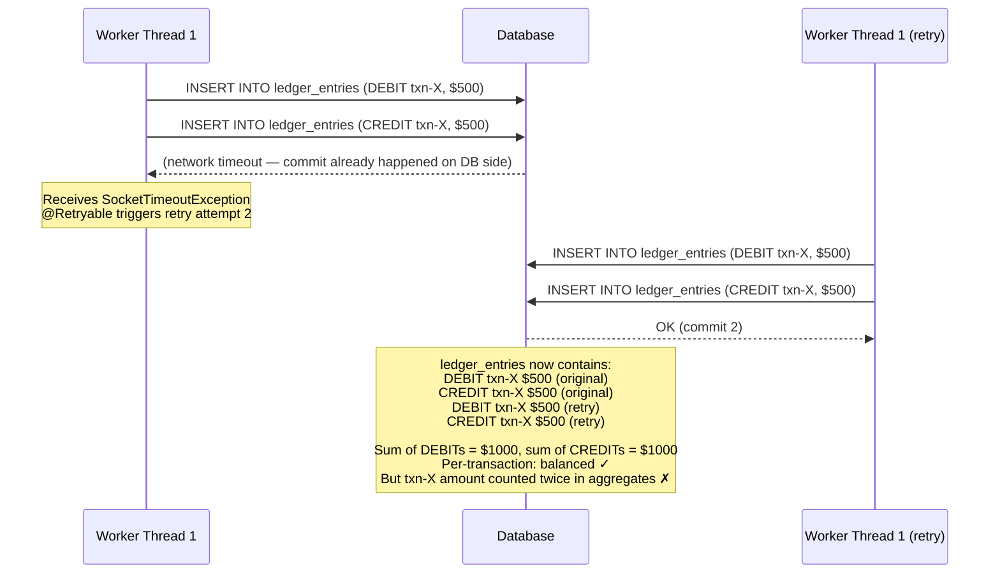
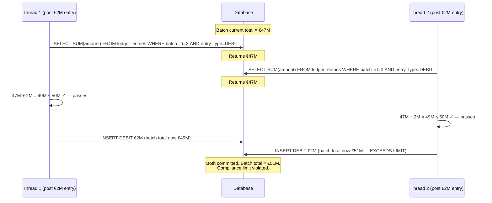

# السيناريو D — الترحيل المتزامن في الدفتر والانحراف في الكتابة

## نظرة عامة

أنظمة التسوية بيئات لا ترحم. فالقيد الذي يُرحّل مرتين، أو الخصم دون إضافة مقابلة، أو مجموع دفعة لا يتفق مع صفوفها، ليست حالات طرفية تُعالج بلطف — بل مخالفات رقابية، وإخفاقات تدقيق، وفي بعض الولايات القضائية حوادث واجبة الإبلاغ. يتتبع هذا الدرس محرك تسوية كسر ثابت القيد المزدوج تحت حمل متزامن، ويشرّح لماذا لم تستطع مستويات العزل الأعلى وحدها إنقاذه، ويبني الـ idempotency والحماية من الانحراف في الكتابة (write skew) واستراتيجية التقسيم التي تجعل النظام صحيحًا على نطاق واسع معًا. وفي النهاية ستفهم لا ما الذي ساء فقط، بل لماذا كل إصلاح ضروري وأي فئة من الأخطاء يمنعها كل منها.

## أهداف التعلم

- شرح لماذا تكسر عاصفة إعادة محاولات مع إدراجات غير idempotent ثابت القيد المزدوج حتى عندما يكون كل ترحيل منفرد متوازنًا داخليًا.
- إثبات أن عزل `SERIALIZABLE` لا يمنع إدراج صفوف مكررة وشرح لماذا الـ idempotency على مستوى التطبيق/المخطط هي الإصلاح الصحيح.
- تنفيذ إدراج قيود دفتر بشكل idempotent باستخدام قيد `UNIQUE` و`INSERT ... ON CONFLICT DO NOTHING`، ومعاملة القيد المرحّل مسبقًا كنجاح لا كخطأ.
- تحديد الانحراف في الكتابة في سيناريو حد الدفعة وتطبيق قفل متشائم على صف ترويسة الدفعة للقضاء عليه.
- تصميم جدول دفتر في PostgreSQL مقسم بالنطاقات يقلل التنافس دون التضحية بصحة الاستعلامات.
- فرض ترتيب الترحيل لكل حساب عبر قيد `UNIQUE(account_id, sequence_number)` وعداد لكل حساب خالٍ من الفجوات.

## سياق العمل

*مثال مركّب:* تشغّل "ClearPath Securities"، وهي غرفة مقاصة خيالية متوسطة الحجم تعالج صفقات الأسهم والسندات لـ 47 شركة عضو، دفعة تسوية في نهاية اليوم ترحّل بين 800,000 و1.4 مليون قيد دفتر كل ليلة. وتتوزع الدفعة على 16 خيط عمل للوفاء بنافذة تسوية مدتها 90 دقيقة تفرضها قواعد البورصة.

وخلال تسوية نهاية ربع بحجم مرتفع (1.38 مليون قيد)، أبلغت مهمة المطابقة التي تعمل فور الدفعة عن فرق: كانت القيمة المسوّاة في الدفتر أعلى بـ 2,184,300 يورو من القيمة في ملف صفقات البورصة. وأظهرت الدفعة كل الترحيلات البالغة 1.38 مليون ناجحة. وكان الفرق يطابق بالضبط 2,184 معاملة رُحّلت مرتين — مرة بالخيط الأصلي، ومرة بإعادة محاولة أطلقها انتهاء مهلة لاحق كان الأصل قد تعافى منه بصمت.

وضع فريق المخاطر في البورصة ClearPath تحت نظام مراقبة معززة لمدة 30 يومًا. والتزم المدير التقني للشركة بتقرير السبب الجذري وخطة المعالجة خلال خمسة أيام عمل. وكان أمام فريق الهندسة 72 ساعة لتنفيذ الإصلاح واختباره ونشره دون إيقاف النظام.

## الخلل: ترحيل مكرر من عاصفة إعادة محاولات

تعالج دفعة التسوية كل معاملة باستدعاء `LedgerPostingService.post()`. وكان للشيفرة المستدعية سياسة إعادة محاولة:

```java
// In the batch orchestrator
@Retryable(
    retryFor = {TransientDataAccessException.class, CannotAcquireLockException.class},
    maxAttempts = 3,
    backoff = @Backoff(delay = 500, multiplier = 2)
)
public void processTransaction(SettlementTransaction tx) {
    ledgerPostingService.post(tx);
}
```

خدمة الترحيل نفسها:

```java
@Service
@RequiredArgsConstructor
public class LedgerPostingService {

    private final LedgerEntryRepository ledgerEntryRepository;

    @Transactional
    public void post(SettlementTransaction tx) {
        // BUG: no idempotency check — posts unconditionally every time it is called
        LedgerEntry debit = LedgerEntry.builder()
                .transactionId(tx.getId())
                .accountId(tx.getDebitAccountId())
                .entryType(EntryType.DEBIT)
                .amount(tx.getAmount())
                .currency(tx.getCurrency())
                .postedAt(Instant.now())
                .build();

        LedgerEntry credit = LedgerEntry.builder()
                .transactionId(tx.getId())
                .accountId(tx.getCreditAccountId())
                .entryType(EntryType.CREDIT)
                .amount(tx.getAmount())
                .currency(tx.getCurrency())
                .postedAt(Instant.now())
                .build();

        ledgerEntryRepository.saveAll(List.of(debit, credit));
    }
}
```

الجدول الزمني للترحيل المزدوج:



> [!IMPORTANT]
> لاحظ أن الترحيل المزدوج *لا* يخالف ثابت القيد المزدوج لكل معاملة. فمجموع المدين ما زال يساوي مجموع الدائن للمعاملة X. وتظهر المخالفة في التجميعات: فعندما تجمع المطابقة كل قيود المدين لدفعة، تساهم المعاملة X بـ 1000 دولار بدل 500. ولهذا نجحت فحوص التوازن لكل معاملة ولم يظهر الخطأ إلا في خطوة المطابقة.

## لماذا لا يصلح عزل SERIALIZABLE هذا

من المغري اللجوء إلى عزل `SERIALIZABLE` كعلاج شامل لأخطاء التزامن. لكنه لا يساعد في هذا الخلل.

يمنع `SERIALIZABLE` الشذوذات التي لا يمنعها `READ COMMITTED` و`REPEATABLE READ`:

| الشذوذ | الوصف | يمنعه SERIALIZABLE؟ |
|---|---|---|
| القراءة القذرة | قراءة بيانات غير ملتزمة من معاملة أخرى | نعم (وREAD COMMITTED أيضًا) |
| القراءة غير المتكررة | الصف نفسه يُقرأ بشكل مختلف داخل معاملة واحدة | نعم (وREPEATABLE READ أيضًا) |
| القراءة الشبحية | استعلام يعيد صفوفًا مختلفة عند إعادة تنفيذه | نعم |
| الانحراف في الكتابة | معاملتان تقرآن المجموعة نفسها، وتعدّل كل منهما صفًا *مختلفًا* بناءً على تلك القراءة | نعم |
| إدراج مكرر لصف *جديد* | معاملتان تدرج كل منهما صفًا لم يكن موجودًا | **لا** |

تدرج إعادة المحاولة صفًا *جديدًا* بمفتاح أساسي *جديد*. ولا يوجد صف قائم يستطيع `SERIALIZABLE` كشف تعارض عليه. فالمعاملتان تمسان مجموعتين منفصلتين تمامًا من الصفوف. ولا تملك قاعدة البيانات أساسًا لكشف أنهما متكافئتان منطقيًا.

```java
// This is what SERIALIZABLE sees:
// TX1: INSERT row with pk=uuid-A (DEBIT txn-X)  → no conflict
// TX1: INSERT row with pk=uuid-B (CREDIT txn-X) → no conflict
// TX2: INSERT row with pk=uuid-C (DEBIT txn-X)  → no conflict with A or B
// TX2: INSERT row with pk=uuid-D (CREDIT txn-X) → no conflict with A, B, or C
// SERIALIZABLE verdict: both transactions can commit. ✓ (but logically wrong)
```

> [!NOTE]
> كان `SERIALIZABLE` *سيساعد* لو تضمن الإصلاح قراءة صف علم ثم إدراجًا مشروطًا. فمثلًا لو قرأ التطبيق أولًا `SELECT 1 FROM ledger_entries WHERE transaction_id = X` ثم أدرج فقط إذا لم يجد صفًا، فسيكشف `SERIALIZABLE` الشبح ويُجهض إحدى المعاملتين المتزامنتين. لكن هذا قراءة-ثم-كتابة من خطوتين، هشة وأبطأ من `INSERT` واحد بقيد فريد.

الإصلاح الصحيح جعل الإدراج نفسه idempotent على مستوى المخطط.

## الإصلاح الصحيح: إدراج قيود الدفتر بشكل Idempotent

### تغيير المخطط

أضف قيدًا فريدًا مركبًا يجسد "مدين واحد ودائن واحد لكل معاملة لكل حساب":

```sql
ALTER TABLE ledger_entries
    ADD CONSTRAINT uq_ledger_txn_account_type
    UNIQUE (transaction_id, account_id, entry_type);
```

لأنظمة التسوية التي قد ترحّل فيها معاملة واحدة مشروعًا عدة قيود إلى الحساب نفسه (مثل التنفيذات الجزئية في صفقة أسهم)، استخدم مفتاح idempotency أدق:

```sql
ALTER TABLE ledger_entries
    ADD COLUMN idempotency_key UUID NOT NULL,
    ADD CONSTRAINT uq_ledger_idempotency_key UNIQUE (idempotency_key);
```

يولّد المستدعي مفتاح الـ idempotency مرة واحدة ويحمله عبر كل محاولات الإعادة. وتضمن قاعدة البيانات أن صفًا واحدًا فقط بذلك المفتاح يمكن أن يوجد.

### المخطط الكامل

```sql
CREATE TABLE ledger_entries (
    id               UUID         PRIMARY KEY DEFAULT gen_random_uuid(),
    transaction_id   UUID         NOT NULL,
    idempotency_key  UUID         NOT NULL,
    account_id       UUID         NOT NULL REFERENCES accounts(id),
    entry_type       VARCHAR(10)  NOT NULL CHECK (entry_type IN ('DEBIT', 'CREDIT')),
    amount           NUMERIC(19,4) NOT NULL CHECK (amount > 0),
    currency         CHAR(3)      NOT NULL,
    batch_id         UUID,
    sequence_number  BIGINT,
    posted_at        TIMESTAMPTZ  NOT NULL DEFAULT now(),
    created_at       TIMESTAMPTZ  NOT NULL DEFAULT now(),
    CONSTRAINT uq_ledger_idempotency_key UNIQUE (idempotency_key),
    CONSTRAINT uq_ledger_account_sequence UNIQUE (account_id, sequence_number)
);

CREATE INDEX idx_ledger_entries_transaction_id ON ledger_entries(transaction_id);
CREATE INDEX idx_ledger_entries_account_posted  ON ledger_entries(account_id, posted_at DESC);
CREATE INDEX idx_ledger_entries_batch_id        ON ledger_entries(batch_id) WHERE batch_id IS NOT NULL;
```

### توليد مفتاح الـ Idempotency

يجب أن يكون مفتاح الـ idempotency:
1. حتميًا — العملية المنطقية نفسها تنتج دائمًا المفتاح نفسه.
2. فريدًا عبر العمليات المختلفة.
3. مولّدًا قبل المحاولة الأولى ومحفوظًا عبر إعادات المحاولة.

```java
public record LedgerPostingRequest(
        UUID transactionId,
        UUID debitAccountId,
        UUID creditAccountId,
        BigDecimal amount,
        String currency,
        UUID batchId
) {
    /**
     * Deterministic idempotency keys derived from the transaction ID.
     * The same transaction always produces the same keys.
     * Different entry types (DEBIT vs CREDIT) produce different keys.
     */
    public UUID debitIdempotencyKey() {
        return UUID.nameUUIDFromBytes(
                (transactionId.toString() + ":DEBIT:" + debitAccountId).getBytes(
                        StandardCharsets.UTF_8));
    }

    public UUID creditIdempotencyKey() {
        return UUID.nameUUIDFromBytes(
                (transactionId.toString() + ":CREDIT:" + creditAccountId).getBytes(
                        StandardCharsets.UTF_8));
    }
}
```

> [!WARNING]
> لا تستخدم `UUID.randomUUID()` لتوليد مفاتيح الـ idempotency داخل الدالة التي ستُعاد محاولتها. فـ UUID عشوائي جديد في كل إعادة محاولة يهدم الـ idempotency كليًا — فكل إعادة محاولة ستنتج مفتاحًا فريدًا ولن ينطلق القيد الفريد. يجب حساب المفتاح من الهوية المنطقية للعملية، لا من العشوائية.

### الخدمة Idempotent

تحجز الخدمة القيدين بـ `INSERT ... ON CONFLICT (idempotency_key) DO NOTHING`. ولا تعتمد على `save()` مع التقاط `DataIntegrityViolationException` داخل المعاملة: فمع JPA يُنفذ الإدراج عادة عند التفريغ/الالتزام (بعد كتلة `try`)، وفي PostgreSQL تُجهض العبارة الفاشلة المعاملة كلها.

```java
@Service
@RequiredArgsConstructor
@Slf4j
public class IdempotentLedgerPostingService {

    private final LedgerEntryRepository ledgerEntryRepository;
    private final LedgerEntryMapper mapper;

    @Transactional
    public PostingResult post(LedgerPostingRequest request) {
        LedgerEntry debit = mapper.toDebitEntry(request);
        LedgerEntry credit = mapper.toCreditEntry(request);

        // Native multi-row insert:
        //   INSERT INTO ledger_entries (...) VALUES (...debit...), (...credit...)
        //   ON CONFLICT (idempotency_key) DO NOTHING
        // Returns how many rows were actually inserted. No exception on a
        // duplicate, so the transaction stays healthy.
        int inserted = ledgerEntryRepository.insertIgnoringDuplicates(List.of(debit, credit));

        return switch (inserted) {
            case 2 -> {
                log.debug("Posted transaction {}: DEBIT {} CREDIT {}",
                        request.transactionId(), request.debitAccountId(), request.creditAccountId());
                yield PostingResult.posted(request.transactionId());
            }
            case 0 -> {
                // Both keys already exist: a retry of an already-posted transaction.
                // Success — the caller's intent (post this transaction) is fulfilled.
                log.info("Idempotent: transaction {} already posted, returning success",
                        request.transactionId());
                yield PostingResult.alreadyPosted(request.transactionId());
            }
            // Exactly one leg exists: should be impossible (both legs are always
            // inserted in one transaction) — the ledger is inconsistent. Roll back.
            default -> throw new LedgerInconsistencyException(request.transactionId());
        };
    }
}
```

```java
public sealed interface PostingResult {

    record Posted(UUID transactionId, Instant postedAt) implements PostingResult {}
    record AlreadyPosted(UUID transactionId) implements PostingResult {}

    static PostingResult posted(UUID transactionId) {
        return new Posted(transactionId, Instant.now());
    }

    static PostingResult alreadyPosted(UUID transactionId) {
        return new AlreadyPosted(transactionId);
    }

    default boolean isSuccess() {
        return true; // Both variants represent a successfully-posted transaction
    }
}
```

> [!IMPORTANT]
> التعارض على مفتاح الـ idempotency يعني أن المعاملة رُحّلت بالفعل. والاستجابة الصحيحة **نجاح** — لا خطأ. فالمستدعي طلب ترحيل المعاملة X؛ والمعاملة X مرحّلة. وإعادة خطأ هنا ستجعل منسق الدفعة يعلّم المعاملة كفاشلة وربما يطلق سير عمل معالجة يدوية لمعاملة سليمة فعلًا.

### المحوّل (Mapper)

```java
@Component
public class LedgerEntryMapper {

    public LedgerEntry toDebitEntry(LedgerPostingRequest req) {
        return LedgerEntry.builder()
                .id(UUID.randomUUID())
                .transactionId(req.transactionId())
                .idempotencyKey(req.debitIdempotencyKey())
                .accountId(req.debitAccountId())
                .entryType(EntryType.DEBIT)
                .amount(req.amount())
                .currency(req.currency())
                .batchId(req.batchId())
                .postedAt(Instant.now())
                .build();
    }

    public LedgerEntry toCreditEntry(LedgerPostingRequest req) {
        return LedgerEntry.builder()
                .id(UUID.randomUUID())
                .transactionId(req.transactionId())
                .idempotencyKey(req.creditIdempotencyKey())
                .accountId(req.creditAccountId())
                .entryType(EntryType.CREDIT)
                .amount(req.amount())
                .currency(req.currency())
                .batchId(req.batchId())
                .postedAt(Instant.now())
                .build();
    }
}
```

## الانحراف في الكتابة في ترحيل الدفتر: فرض حد الدفعة

تصلح الـ idempotency خلل الترحيل المكرر. لكن يوجد خلل تزامن منفصل ذو صلة في فرض حد الدفعة — انحراف كتابة تقليدي.

تتطلب قواعد الامتثال لدى ClearPath ألا تتجاوز أي دفعة تسوية منفردة 50,000,000 يورو إجمالي قيمة مدينة. وشيفرة الفرض:

```java
// BROKEN: write skew under READ COMMITTED
@Transactional
public void postWithBatchLimitCheck(LedgerPostingRequest request, UUID batchId) {
    // 1. Read current batch total
    BigDecimal currentTotal = ledgerEntryRepository
            .sumDebitsByBatch(batchId);

    // 2. Check limit
    BigDecimal limit = new BigDecimal("50000000.00");
    if (currentTotal.add(request.amount()).compareTo(limit) > 0) {
        throw new BatchLimitExceededException(batchId, currentTotal, request.amount());
    }

    // 3. Post (write)
    post(request);
}
```

سيناريو الانحراف في الكتابة:



يقرأ الخيطان مجموع الدفعة نفسه (47 مليون يورو)، ويقرر كل منهما مستقلًا أن قيده البالغ 2 مليون يورو يقع ضمن حد 50 مليونًا، ويلتزمان كلاهما. فيصبح مجموع الدفعة النهائي 51 مليون يورو — مخالفة امتثال.

هذا انحراف في الكتابة: لا تعدّل أي معاملة الصفوف التي تقرؤها الأخرى. فكل منهما تقرأ المجموعة الحالية من القيود وتكتب صفًا *جديدًا* بناءً على تلك القراءة. وتحت READ COMMITTED وحتى REPEATABLE READ، لا ترى أي معاملة كتابة الأخرى قبل الالتزام.

### الإصلاح: قفل متشائم على صف ترويسة الدفعة

الإصلاح الصحيح إدخال صف ترويسة للدفعة يعمل كنقطة تسلسل. فأي معاملة تريد إضافة قيود إلى دفعة يجب أن تقفل الترويسة أولًا:

```sql
CREATE TABLE settlement_batches (
    id              UUID         PRIMARY KEY DEFAULT gen_random_uuid(),
    batch_date      DATE         NOT NULL,
    status          VARCHAR(20)  NOT NULL DEFAULT 'OPEN',
    total_debit     NUMERIC(19,4) NOT NULL DEFAULT 0,
    total_credit    NUMERIC(19,4) NOT NULL DEFAULT 0,
    debit_limit     NUMERIC(19,4),
    created_at      TIMESTAMPTZ  NOT NULL DEFAULT now(),
    updated_at      TIMESTAMPTZ  NOT NULL DEFAULT now(),
    CONSTRAINT uq_batch_date UNIQUE (batch_date)
);
```

```java
public interface SettlementBatchRepository extends JpaRepository<SettlementBatch, UUID> {

    @Lock(LockModeType.PESSIMISTIC_WRITE)
    @Query("SELECT b FROM SettlementBatch b WHERE b.id = :id")
    Optional<SettlementBatch> findByIdForUpdate(@Param("id") UUID id);
}

@Service
@RequiredArgsConstructor
public class BatchLedgerPostingService {

    private final SettlementBatchRepository batchRepository;
    private final IdempotentLedgerPostingService ledgerPostingService;

    @Transactional
    public PostingResult postWithBatchLimit(LedgerPostingRequest request) {
        // Lock the batch header row — serialises all concurrent postings for this batch
        SettlementBatch batch = batchRepository
                .findByIdForUpdate(request.batchId())
                .orElseThrow(() -> new BatchNotFoundException(request.batchId()));

        // Now that we hold the lock, the total we read is authoritative
        if (batch.getDebitLimit() != null) {
            BigDecimal projectedTotal = batch.getTotalDebit().add(request.amount());
            if (projectedTotal.compareTo(batch.getDebitLimit()) > 0) {
                throw new BatchLimitExceededException(
                        request.batchId(), batch.getTotalDebit(), request.amount());
            }
        }

        PostingResult result = ledgerPostingService.post(request);

        // Update the running total on the batch header
        if (result instanceof PostingResult.Posted) {
            batch.addDebit(request.amount());
            batchRepository.save(batch);
        }

        return result;
    }
}
```

> [!NOTE]
> قفل صف ترويسة الدفعة يسلسل كل الترحيلات المتزامنة لتلك الدفعة. وهذا مقصود — فهو ثمن فرض الحد التجميعي. وإذا كانت الإنتاجية حرجة، ففكّر في تقسيم الدفعة إلى دفعات فرعية بحدود خاصة، لكل منها صف ترويسة. وهذا يوازي الحصول على الأقفال مع فرض الحدود لكل دفعة فرعية.

## التقسيم من أجل الإنتاجية

مع 1.4 مليون قيد كل ليلة وسنوات من الحفظ، ينمو جدول `ledger_entries` إلى مئات ملايين الصفوف. ويصبح الجدول الواحد عنق زجاجة بطريقتين:

1. **نقاط الكتابة الساخنة والصيانة**: الإدراجات المتزامنة تقع كلها على صفحات "الطرف الأيمن" نفسها في الفهارس الكبيرة، ويبطؤ تنظيف الجدول (vacuum) وصيانة الفهارس في جدول ضخم أكثر فأكثر.
2. **أداء الاستعلامات**: استعلامات المطابقة التي تمسح قيود تاريخ معين يجب أن تجتاز فهرسًا ينمو باستمرار.

يعالج التقسيم التصريحي في PostgreSQL حسب التاريخ الأمرين. وقسّم حسب **تاريخ التسوية المحمول في الطلب** (حتمي)، لا حسب `now()` وقت الإدراج: فإعادة المحاولة التي تعمل بعد منتصف الليل يجب أن تقع في القسم نفسه كالمحاولة الأصلية.

```sql
-- Parent (partitioned) table
CREATE TABLE ledger_entries (
    id               UUID         NOT NULL,
    transaction_id   UUID         NOT NULL,
    idempotency_key  UUID         NOT NULL,
    account_id       UUID         NOT NULL,
    entry_type       VARCHAR(10)  NOT NULL CHECK (entry_type IN ('DEBIT', 'CREDIT')),
    amount           NUMERIC(19,4) NOT NULL CHECK (amount > 0),
    currency         CHAR(3)      NOT NULL,
    batch_id         UUID,
    sequence_number  BIGINT,
    posted_at        TIMESTAMPTZ  NOT NULL,
    created_at       TIMESTAMPTZ  NOT NULL DEFAULT now()
) PARTITION BY RANGE (posted_at);

-- Daily partitions — created by a maintenance job before each settlement window
CREATE TABLE ledger_entries_2024_01_15
    PARTITION OF ledger_entries
    FOR VALUES FROM ('2024-01-15 00:00:00+00') TO ('2024-01-16 00:00:00+00');

CREATE TABLE ledger_entries_2024_01_16
    PARTITION OF ledger_entries
    FOR VALUES FROM ('2024-01-16 00:00:00+00') TO ('2024-01-17 00:00:00+00');

-- Indexes are defined per-partition (or on the parent and inherited)
CREATE UNIQUE INDEX uq_ledger_idempotency_key_20240115
    ON ledger_entries_2024_01_15 (idempotency_key);

CREATE UNIQUE INDEX uq_ledger_account_sequence_20240115
    ON ledger_entries_2024_01_15 (account_id, sequence_number);
```

> [!WARNING]
> في الجدول المقسم، لا يسمح PostgreSQL إلا بقيد فريد **يتضمن مفتاح التقسيم** (مثل `UNIQUE (idempotency_key, posted_at)`)، والفهارس الفريدة لكل قسم لا تضمن التفرد إلا *داخل* كل قسم. ولا يضمن أي منهما تفرد مفتاح الـ idempotency عبر الأيام. فالتفرد لكل قسم آمن فقط إذا كان مفتاح التقسيم حتميًا للعملية (تاريخ التسوية من الطلب — لا `now()` وقت إعادة المحاولة أبدًا). وإذا احتجت تفردًا عالميًا، فاحجز المفتاح في جدول منفصل غير مقسم `ledger_idempotency_keys` (بقيد UNIQUE عادي) في المعاملة نفسها مع الإدراج.

### إدارة الأقسام في Java

```java
@Component
@RequiredArgsConstructor
@Slf4j
public class PartitionMaintenanceJob {

    private final JdbcTemplate jdbc;

    /**
     * Creates partitions for the next N days if they do not already exist.
     * Run daily at midnight via @Scheduled.
     */
    @Scheduled(cron = "0 0 0 * * *")
    @Transactional
    public void ensurePartitionsExist() {
        LocalDate today = LocalDate.now(ZoneOffset.UTC);
        int daysAhead = 7; // Create partitions 7 days in advance

        for (int i = 0; i <= daysAhead; i++) {
            LocalDate date = today.plusDays(i);
            createPartitionIfAbsent(date);
        }
    }

    private void createPartitionIfAbsent(LocalDate date) {
        String partitionName = "ledger_entries_" +
                date.format(DateTimeFormatter.ofPattern("yyyy_MM_dd"));
        String fromDate = date.atStartOfDay(ZoneOffset.UTC).toString();
        String toDate   = date.plusDays(1).atStartOfDay(ZoneOffset.UTC).toString();

        String ddl = """
                CREATE TABLE IF NOT EXISTS %s
                    PARTITION OF ledger_entries
                    FOR VALUES FROM ('%s') TO ('%s')
                """.formatted(partitionName, fromDate, toDate);

        try {
            jdbc.execute(ddl);
            log.info("Ensured partition exists: {}", partitionName);
        } catch (Exception e) {
            log.error("Failed to create partition {}: {}", partitionName, e.getMessage());
            throw e;
        }
    }
}
```

### أثر الإنتاجية

بالتقسيم حسب التاريخ:

- الترحيلات المتزامنة لتاريخ التسوية نفسه تذهب كلها إلى القسم نفسه، لكن فهارسه صغيرة وتبقى في الذاكرة، ويعمل vacuum على جدول صغير.
- استعلامات المطابقة لتاريخ محدد تستخدم تقليم الأقسام (partition pruning) — فيستعلم PostgreSQL القسم المعني فقط ويتجاهل البقية.
- يمكن فصل الأقسام القديمة وأرشفتها إلى تخزين بارد دون التأثير على القسم الحي.
- يعمل التنظيف الآلي (autovacuum) لكل قسم، فيتوزع عبء الإدخال/الإخراج.

## ضمانات الترتيب: أرقام تسلسل لكل حساب

يجب تطبيق قيود الدفتر بالترتيب لكل حساب لحساب رصيد جارٍ دقيق ولاستعلامات سجل التدقيق. ويفرض ذلك عمود `sequence_number` مع قيد `UNIQUE(account_id, sequence_number)`:

```sql
-- The constraint is already in the schema above.
-- How to generate GAP-FREE per-account sequence numbers safely:

-- Not a PostgreSQL SEQUENCE: sequences are not transactional — a rolled-back
-- transaction still consumes its value, so sequences leave gaps.
-- Not MAX(sequence_number) + 1 without a lock: two transactions can read the
-- same MAX and collide.

-- Recommended: a per-account counter row, incremented in the SAME transaction
-- as the ledger insert. The UPDATE locks the counter row (serialising postings
-- for that account), and a rollback also undoes the increment — no gaps.
CREATE TABLE account_sequences (
    account_id UUID   PRIMARY KEY REFERENCES accounts(id),
    last_seq   BIGINT NOT NULL DEFAULT 0
);

UPDATE account_sequences
SET    last_seq = last_seq + 1
WHERE  account_id = :accountId
RETURNING last_seq;
```

```java
@Service
@RequiredArgsConstructor
public class SequenceNumberService {

    private final JdbcTemplate jdbc;

    /**
     * Allocates the next sequence number for an account.
     * MUST be called inside the same transaction that inserts the ledger entry:
     * the counter row stays locked until commit, and a rollback returns the
     * number — so the sequence has no gaps.
     */
    @Transactional(propagation = Propagation.MANDATORY)
    public long nextSequenceNumber(UUID accountId) {
        Long next = jdbc.queryForObject("""
                UPDATE account_sequences
                SET    last_seq = last_seq + 1
                WHERE  account_id = ?
                RETURNING last_seq
                """, Long.class, accountId);
        if (next == null) {
            throw new SequenceAllocationException(accountId);
        }
        return next;
    }
}
```

يجب استدعاء `nextSequenceNumber` داخل المعاملة نفسها التي تدرج قيد الدفتر: فيبقى صف العداد مقفلًا حتى الالتزام، والتراجع يعيد الرقم — فلا فجوات في التسلسل. وتسلسلات PostgreSQL ليست خالية من الفجوات لأنها غير معاملاتية: المعاملة المتراجع عنها تستهلك قيمتها.

```java
// Repository addition
public interface LedgerEntryRepository extends JpaRepository<LedgerEntry, UUID> {

    @Query("SELECT MAX(e.sequenceNumber) FROM LedgerEntry e WHERE e.accountId = :accountId")
    Long findMaxSequenceNumber(@Param("accountId") UUID accountId);

    // Customer (liability) convention: credits increase the balance
    @Query("""
            SELECT SUM(CASE WHEN e.entryType = 'DEBIT'  THEN -e.amount
                            WHEN e.entryType = 'CREDIT' THEN  e.amount
                       END)
            FROM LedgerEntry e
            WHERE e.accountId = :accountId
              AND e.sequenceNumber <= :upToSequence
            """)
    BigDecimal computeRunningBalance(@Param("accountId") UUID accountId,
                                     @Param("upToSequence") long upToSequence);

    @Query("""
            SELECT COALESCE(SUM(e.amount), 0)
            FROM LedgerEntry e
            WHERE e.batchId = :batchId
              AND e.entryType = 'DEBIT'
            """)
    BigDecimal sumDebitsByBatch(@Param("batchId") UUID batchId);
}
```

> [!NOTE]
> للحسابات ذات معدلات الترحيل العالية جدًا (مثل حساب الطرف المقابل المركزي الذي يتلقى قيدًا لكل شركة عضو في كل دفعة)، يصبح صف العداد لكل حساب نقطة تسلسل. والخيارات: ترحيل تلك القيود من خيط واحد لكل حساب (وهو غالبًا التصميم الطبيعي للدفعة)، أو التخلي عن الخلو الصارم من الفجوات لذلك الحساب وحجز كتل أرقام مسبقًا — لكن حينها يترك العامل المتعطل فجوات، فيجب أن يعرف فحص الفجوات أدناه أي الحسابات تستخدم الحجز بالكتل.

### التحقق من استمرارية التسلسل

فحص مطابقة يكشف الفجوات في التسلسل لكل حساب:

```sql
-- Finds accounts with gaps in their sequence numbers
-- A gap means an entry was deleted or never inserted (possible data corruption)
WITH ordered AS (
    SELECT
        account_id,
        sequence_number,
        LAG(sequence_number) OVER (PARTITION BY account_id ORDER BY sequence_number) AS prev_seq
    FROM ledger_entries
    WHERE posted_at >= CURRENT_DATE - INTERVAL '1 day'
)
SELECT
    account_id,
    prev_seq,
    sequence_number,
    sequence_number - prev_seq - 1 AS gap_size
FROM ordered
WHERE sequence_number - prev_seq > 1
ORDER BY account_id, sequence_number;
```

```java
// In the reconciliation service
@Service
@RequiredArgsConstructor
@Slf4j
public class LedgerReconciliationService {

    private final JdbcTemplate jdbc;
    private final AlertingService alertingService;

    @Scheduled(cron = "0 30 6 * * *") // 06:30 UTC, after overnight settlement
    public void reconcileLastSettlement() {
        checkDoubleEntryBalance();
        checkSequenceContinuity();
        checkIdempotencyKeyUniqueness();
    }

    private void checkDoubleEntryBalance() {
        String sql = """
                SELECT
                    batch_id,
                    currency,
                    SUM(CASE WHEN entry_type = 'DEBIT'  THEN amount ELSE 0 END) AS total_debit,
                    SUM(CASE WHEN entry_type = 'CREDIT' THEN amount ELSE 0 END) AS total_credit
                FROM ledger_entries
                WHERE posted_at >= CURRENT_DATE - INTERVAL '1 day'
                  AND posted_at <  CURRENT_DATE
                GROUP BY batch_id, currency      -- never net EUR against USD
                -- NUMERIC sums are EXACT: any difference at all is a real error
                HAVING SUM(CASE WHEN entry_type = 'DEBIT'  THEN amount ELSE 0 END) <>
                       SUM(CASE WHEN entry_type = 'CREDIT' THEN amount ELSE 0 END)
                """;

        List<Map<String, Object>> imbalances = jdbc.queryForList(sql);
        if (!imbalances.isEmpty()) {
            log.error("RECONCILIATION FAILURE: {} batch(es) have debit ≠ credit",
                    imbalances.size());
            alertingService.criticalAlert("Ledger imbalance detected", imbalances);
        } else {
            log.info("Reconciliation passed: all batches balanced");
        }
    }

    private void checkSequenceContinuity() {
        String sql = """
                WITH ordered AS (
                    SELECT account_id, sequence_number,
                           LAG(sequence_number) OVER (
                               PARTITION BY account_id ORDER BY sequence_number
                           ) AS prev_seq
                    FROM ledger_entries
                    WHERE posted_at >= CURRENT_DATE - INTERVAL '1 day'
                )
                SELECT COUNT(*) AS gap_count
                FROM ordered
                WHERE sequence_number - prev_seq > 1
                """;

        Long gapCount = jdbc.queryForObject(sql, Long.class);
        if (gapCount != null && gapCount > 0) {
            log.warn("Sequence gaps detected: {} instance(s)", gapCount);
            alertingService.warning("Ledger sequence gaps", Map.of("gapCount", gapCount));
        }
    }

    private void checkIdempotencyKeyUniqueness() {
        String sql = """
                SELECT idempotency_key, COUNT(*) AS cnt
                FROM ledger_entries
                WHERE posted_at >= CURRENT_DATE - INTERVAL '1 day'
                GROUP BY idempotency_key
                HAVING COUNT(*) > 1
                """;

        List<Map<String, Object>> duplicates = jdbc.queryForList(sql);
        if (!duplicates.isEmpty()) {
            // This should be impossible if the UNIQUE constraint is in place —
            // if we see duplicates it means the constraint was disabled or dropped
            log.error("CRITICAL: idempotency key duplicates found: {}", duplicates.size());
            alertingService.criticalAlert("Idempotency key collision — schema constraint possibly missing",
                    duplicates);
        }
    }
}
```

مجاميع NUMERIC **دقيقة**: فأي فرق على الإطلاق خطأ حقيقي، ولا تُقابل أبدًا قيود اليورو بقيود الدولار.

## اختبار المعرفة

**س1: تُعاد محاولة دفعة التسوية عند `TransientDataAccessException`. وبعد الإصلاح (قيد فريد على `idempotency_key`)، تصطدم المحاولة الثانية بالقيد وترمي `DataIntegrityViolationException`. وينتشر الاستثناء إلى تعليق `@Retryable`. هل يجب أن يكون `DataIntegrityViolationException` في قائمة الاستثناءات القابلة لإعادة المحاولة؟ ولماذا؟**

ج: لا. التكرار على مفتاح الـ idempotency يعني أن المعاملة مرحّلة بالفعل — حالة *دائمة*، لا عابرة. وإعادة المحاولة ستصطدم بالقيد مرارًا حتى تنفد `maxAttempts`، ثم تبلغ عن فشل لمعاملة سليمة. والسلوك الصحيح معالجة التكرار داخل خدمة الترحيل وإعادة `PostingResult.alreadyPosted()` — نجاحًا. ومع `INSERT ... ON CONFLICT DO NOTHING` لا يوجد استثناء أصلًا؛ بل ترى ببساطة أن 0 صفوف أُدرجت. ولا يرى تعليق `@Retryable` أي شيء يعيد محاولته. و`DataIntegrityViolationException` لقيود *أخرى* (مثل مفتاح أجنبي لحساب غير موجود) ليس قابلًا لإعادة المحاولة أيضًا — فهو يمثل خطأ بيانات لن تصلحه إعادة المحاولة. وكقاعدة، أعد المحاولة فقط عند الاستثناءات التي تمثل عدم توفر موارد (انتهاءات مهلة الشبكة، وفشل الحصول على الأقفال، والجمود)، لا عند الاستثناءات التي تمثل أخطاء منطقية.

**س2: لماذا يتطلب إصلاح الانحراف في الكتابة لحد الدفعة قفل صف ترويسة الدفعة بدل مجرد الترقية إلى عزل `SERIALIZABLE`؟**

ج: كان `SERIALIZABLE` سيعمل في هذه الحالة تحديدًا — فهو يكشف الانحراف في الكتابة ويُجهض إحدى المعاملتين المتزامنتين. لكن هناك ثلاثة أسباب لتفضيل القفل المتشائم الصريح. أولًا، `SERIALIZABLE` على دفعة تسوية عالية الإنتاجية يسبب إخفاقات تسلسل يجب إعادة محاولتها — وتحت تنافس شديد على الدفعة نفسها قد يكون معدل الإجهاض مرتفعًا، فيزيد العمل الكلي كثيرًا. ثانيًا، القفل الصريح على ترويسة الدفعة يجعل نقطة التسلسل مرئية في الشيفرة — فيرى المراجع بالضبط أين يُتحكم في الوصول المتزامن، بدل الاعتماد على قاعدة البيانات لإجهاض معاملة بصمت. ثالثًا، قفل ترويسة الدفعة يضمن أيضًا دقة المجموع الجاري `total_debit` في صف الترويسة، الذي تستطيع خدمة المطابقة قراءته دون إعادة جمع كل القيود — ميزة أداء كبيرة للدفعات الكبيرة. ولا يوفر عزل `SERIALIZABLE` مثل هذا الملخص المخزن.

## التحدي العملي

**السيناريو:** طلبت منك ClearPath Securities بناء مجموعة اختبارات تثبت صحة إصلاح الـ idempotency وتنفيذ ترحيل مخطط الدفتر المقسم.

**المهمة 1 — اختبار تكامل الـ Idempotency**

اكتب اختبار تكامل JUnit 5 يقوم بـ:
1. إنشاء معاملة تسوية بـ UUID ثابت.
2. استدعاء `IdempotentLedgerPostingService.post()` **مرتين** بطلب `LedgerPostingRequest` نفسه (مفاتيح الـ idempotency نفسها).
3. التأكد من أن:
   - الاستدعاءين يعيدان نتيجة نجاح كلاهما (الثاني يعيد `AlreadyPosted`).
   - يوجد **صفان** بالضبط في `ledger_entries` (مدين واحد ودائن واحد — لا أربعة).
   - مجموع قيود المدين يساوي مجموع قيود الدائن.

```java
@SpringBootTest
@Transactional
class IdempotentLedgerPostingTest {

    @Autowired IdempotentLedgerPostingService postingService;
    @Autowired LedgerEntryRepository entryRepository;

    @Test
    void duplicatePost_isIdempotent() {
        UUID txId       = UUID.fromString("00000000-0000-0000-0000-000000000001");
        UUID debitAcct  = UUID.fromString("00000000-0000-0000-0000-000000000002");
        UUID creditAcct = UUID.fromString("00000000-0000-0000-0000-000000000003");
        BigDecimal amount = new BigDecimal("1000.00");

        LedgerPostingRequest request = new LedgerPostingRequest(
                txId, debitAcct, creditAcct, amount, "EUR", null);

        PostingResult first  = postingService.post(request);
        PostingResult second = postingService.post(request); // simulated retry

        assertThat(first).isInstanceOf(PostingResult.Posted.class);
        assertThat(second).isInstanceOf(PostingResult.AlreadyPosted.class);
        assertThat(first.isSuccess()).isTrue();
        assertThat(second.isSuccess()).isTrue();

        List<LedgerEntry> entries = entryRepository
                .findAllByTransactionId(txId); // add this query to the repo
        assertThat(entries).hasSize(2);

        BigDecimal totalDebits  = entries.stream()
                .filter(e -> e.getEntryType() == EntryType.DEBIT)
                .map(LedgerEntry::getAmount)
                .reduce(BigDecimal.ZERO, BigDecimal::add);
        BigDecimal totalCredits = entries.stream()
                .filter(e -> e.getEntryType() == EntryType.CREDIT)
                .map(LedgerEntry::getAmount)
                .reduce(BigDecimal.ZERO, BigDecimal::add);

        assertThat(totalDebits).isEqualByComparingTo(totalCredits);
        assertThat(totalDebits).isEqualByComparingTo(amount);
    }
}
```

**المهمة 2 — ترحيل Flyway للمخطط المقسم**

اكتب سكربت ترحيل Flyway ‏(`V7__partition_ledger_entries.sql`) يقوم بـ:
1. إعادة تسمية جدول `ledger_entries` الحالي إلى `ledger_entries_legacy`.
2. إنشاء جدول `ledger_entries` المقسم الجديد بالمخطط الكامل المعروض في هذا الدرس.
3. إنشاء أول ثلاثة أقسام يومية (أمس، واليوم، وغدًا).
4. نقل البيانات من `ledger_entries_legacy` إلى الجدول الجديد باستخدام `INSERT INTO ledger_entries SELECT * FROM ledger_entries_legacy`.
5. إنشاء كل الفهارس المطلوبة على الجدول الجديد.

فكّر: يجب أن يعمل الترحيل دون توقف. كيف تتعامل مع صفوف في `ledger_entries_legacy` لها قيمة `posted_at` تقع خارج الأقسام الموجودة؟ أضف قسمًا افتراضيًا (`CREATE TABLE ledger_entries_default PARTITION OF ledger_entries DEFAULT`) لالتقاطها.

**المهمة 3 — حد تنبيه المطابقة**

تطلق خدمة المطابقة تنبيهًا حرجًا عند اكتشاف أي عدم توازن. وسّعها لـ:
1. الإبقاء على المقارنة الدقيقة (`<>`، دون تسامح) في SQL — وتأكد من فهمك السبب: حساب `NUMERIC` دقيق، فأي تسامح سيخفي أخطاء حقيقية فقط.
2. إضافة **مستوى خطورة** للتنبيه: عدم التوازن تحت 100 يورو WARNING، وفوق 100 يورو CRITICAL.
3. نشر التنبيه كغلاف JSON بصيغة CloudEvents 1.0 إلى موضوع Kafka ‏`ledger.reconciliation.alerts`، مع:
   - `type`: `com.clearpath.ledger.reconciliation.imbalance`
   - `source`: `/settlement/reconciliation`
   - `datacontenttype`: `application/json`
   - `data`: `{ "batchId": "...", "totalDebit": ..., "totalCredit": ..., "delta": ..., "severity": "WARNING|CRITICAL" }`

<!-- KNOWLEDGE-CHECK
{
  "questions": [
    {
      "text": "تُعاد محاولة دفعة تسوية عند TransientDataAccessException. وبعد إضافة قيد UNIQUE على idempotency_key، ترمي المحاولة الثانية DataIntegrityViolationException. هل يجب أن يكون هذا الاستثناء في قائمة @Retryable؟",
      "options": [
        "نعم — ستنجح إعادة المحاولة في النهاية بمجرد استيفاء القيد",
        "لا — فهو يعني أن المعاملة مرحّلة بالفعل؛ ويجب أن تعالج الخدمة التكرار وتعيد AlreadyPosted كنجاح",
        "نعم — DataIntegrityViolationException عابر دائمًا في الأنظمة الموزعة",
        "لا — يجب إلغاء الدفعة كلها وإطلاق تنبيه"
      ],
      "correct": 1,
      "explanation": "التكرار على مفتاح الـ idempotency حالة دائمة لا عابرة: المعاملة مرحّلة بالفعل. ويجب أن تعالجه الخدمة (ويُفضل بـ INSERT ... ON CONFLICT DO NOTHING، الذي لا يرمي استثناءً) وتعيد PostingResult.alreadyPosted() — نجاحًا. وأعد المحاولة فقط عند الاستثناءات التي تمثل عدم توفر موارد، لا الأخطاء المنطقية."
    },
    {
      "text": "لماذا يتطلب إصلاح الانحراف في الكتابة لحد الدفعة قفل صف ترويسة الدفعة بدل مجرد الترقية إلى عزل SERIALIZABLE؟",
      "options": [
        "عزل SERIALIZABLE غير مدعوم في PostgreSQL لأحمال الإدراج الكثيفة",
        "قفل ترويسة الدفعة يجعل نقطة التسلسل مرئية في الشيفرة، ويتجنب معدلات إخفاق التسلسل العالية تحت الحمل، ويخزن أيضًا المجموع الجاري لقراءات مطابقة سريعة",
        "لا يستطيع عزل SERIALIZABLE منع الانحراف في الكتابة في الجداول المقسمة",
        "قفل صف ترويسة الدفعة تشترطه معايير التسوية في ISO 20022"
      ],
      "correct": 1,
      "explanation": "كان SERIALIZABLE سيعمل لكنه قد يسبب إخفاقات تسلسل كثيرة تحت تنافس شديد على الدفعة نفسها. والقفل المتشائم الصريح على ترويسة الدفعة يجعل نقطة التسلسل مرئية للمراجعين، ويقلل عبء إعادة المحاولة، ويحافظ أيضًا على مجموع جارٍ مخزن total_debit في صف الترويسة تستطيع خدمة المطابقة قراءته بكفاءة."
    },
    {
      "text": "لرقم التسلسل لكل حساب قيد UNIQUE(account_id, sequence_number). ويجد استعلام مطابقة فجوة: للحساب ACC-1 قيود بالتسلسلات 1 و2 و4 و5 — والتسلسل 3 مفقود. ماذا يدل ذلك؟",
      "options": [
        "أرقام التسلسل تأتي من SEQUENCE في PostgreSQL، ومن المتوقع أن يتخطى قيمًا",
        "قيد دفتر حُذف أو لم يُدرج قط، وهذا مخالفة محتملة لسلامة البيانات لأن الدفاتر للإضافة فقط",
        "فُصل قسم تاريخ الترحيل ذاك قبل التزام القيد",
        "التسلسل 3 محجوز في جدول مفاتيح الـ idempotency لكنه ما زال في حالة PROCESSING"
      ],
      "correct": 1,
      "explanation": "يجب أن تكون أرقام التسلسل لكل حساب متصلة لسجل تدقيق صحيح. والفجوة تعني أن قيدًا إما حُذف (مخالفة لقيد الإضافة فقط) أو لم يُدرج بنجاح قط (فشل ترحيل ترك عداد التسلسل غير متسق). وكلاهما شذوذ في سلامة البيانات يجب التحقيق فيه. ويجب أن تنبّه خدمة المطابقة عند اكتشاف أي فجوات."
    }
  ]
}
-->

<!-- PRACTICAL-CHALLENGE
{
  "title": "دفعة تسوية Idempotent ودفتر مقسم",
  "difficulty": "advanced",
  "estimatedMinutes": 60,
  "tasks": [
    {"id": "1", "description": "اكتب اختبار تكامل JUnit 5 يستدعي IdempotentLedgerPostingService.post() مرتين بطلب LedgerPostingRequest نفسه. وأكد أن الاستدعاءين يعيدان نجاحًا، وأن صفين بالضبط موجودان في ledger_entries (مدين واحد ودائن واحد)، وأن مجموع المدين يساوي مجموع الدائن."},
    {"id": "2", "description": "اكتب ترحيل Flyway ‏V7__partition_ledger_entries.sql يعيد تسمية الجدول الحالي، وينشئ البديل المقسم، وينشئ ثلاثة أقسام يومية (أمس/اليوم/غدًا)، ويضيف قسمًا افتراضيًا، وينقل البيانات، وينشئ كل الفهارس."},
    {"id": "3", "description": "وسّع LedgerReconciliationService لتصنيف تنبيهات عدم التوازن كـ WARNING ‏(< 100 يورو) أو CRITICAL ‏(>= 100 يورو)، ونشرها كأغلفة JSON بصيغة CloudEvents 1.0 إلى موضوع Kafka ‏ledger.reconciliation.alerts."},
    {"id": "4", "description": "نفّذ فرض حد الدفعة باستخدام SELECT FOR UPDATE على صف ترويسة الدفعة. واكتب اختبارًا متزامنًا بعشرة خيوط ترحّل كل منها قيودًا إلى الدفعة نفسها التي لها حد مدين أقل من المجموع التجميعي. وأكد أن الحد لا يُتجاوز أبدًا وأن العدد الصحيح بالضبط من القيود يُقبل."}
  ]
}
-->
