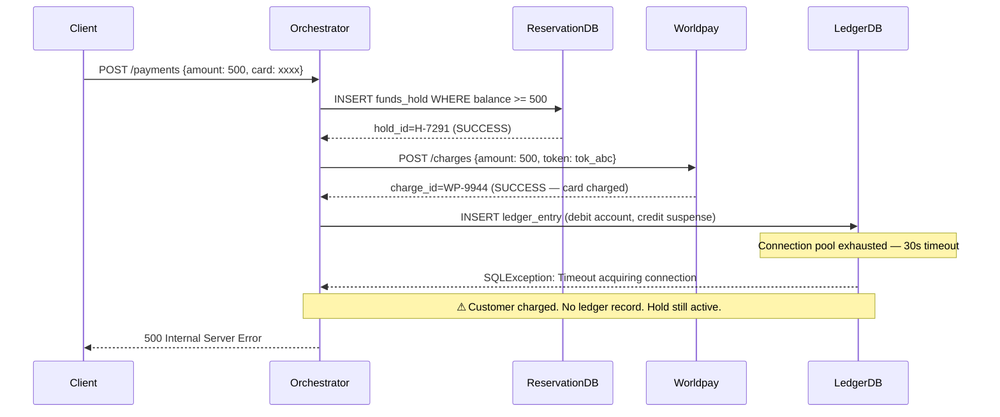
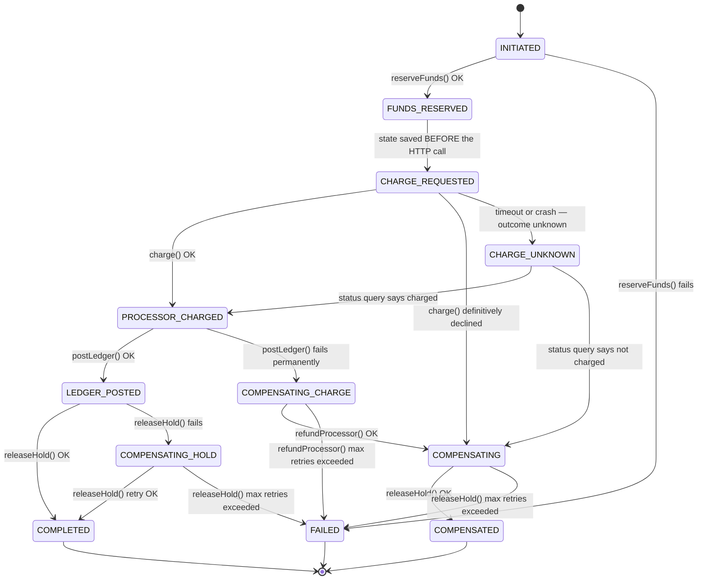

# السيناريو E — الفشل الجزئي للدفع والتعويض بنمط Saga

## نظرة عامة

الدفعة الملتزمة نصفيًا أسوأ من دفعة لم تحدث قط. فعندما يخصم معالج خارجي من بطاقة العميل لكن الدفتر الداخلي لا يسجل الخصم أبدًا، تكون الشركة قد حصّلت مالًا لا تستطيع تفسيره — ويكون رصيد العميل خاطئًا. يشرّح هذا السيناريو نمط الفشل هذا بالضبط، ويفحص لماذا لا تستطيع معاملات قاعدة البيانات العادية منعه، ويعلّمك بناء saga قائمة على التعويض تتعافى بموثوقية حتى عندما يفشل التعافي نفسه.

## أهداف التعلم

في نهاية هذا الدرس ستستطيع:

- وصف التسلسل الدقيق للأحداث الذي ينشئ حالة دفع جزئي غير متسقة
- شرح لماذا لا تستطيع معاملات ACID في قاعدة البيانات وXA/2PC أن تمتد عبر استدعاءات HTTP الخارجية
- تصميم آلة حالة saga لتنسيق دفع متعدد الخطوات
- تنفيذ استدعاءات تعويض idempotent لواجهة العكس لدى معالج خارجي
- حفظ عمل التعويض في مخزن دائم لينجو من إعادة تشغيل التطبيق
- بناء مجدول خلفي يعيد محاولة التعويضات الفاشلة بتراجع محدود
- كتابة اختبارات تكامل تؤكد سلوك التعويض عند فشل خطوة محددة

## سياق العمل

*مثال مركّب:* تشغّل "Apex Payments"، وهي شركة خيالية، تدفق دفع منسقًا لـ 2.3 مليون عميل نشط شهريًا عبر ستة أسواق أوروبية. وتعبر كل دفعة أربعة حدود أنظمة: خدمة حجز الأموال الداخلية، ومعالج البطاقات الخارجي (Worldpay أو Adyen حسب البنك المحصّل للتاجر)، ودفتر القيد المزدوج الداخلي، وخدمة تحرير الأموال.

وفي فترة ستة أسابيع لاحظ الفريق 47 حادثًا أبلغ فيها معالج البطاقات عن خصم ناجح لكن الدفتر الداخلي لا يُظهر خصمًا مقابلًا. وتتجمع الحوادث حول أحداث استنفاد مجمع اتصالات قاعدة البيانات — فقاعدة بيانات الدفتر مشبعة في ساعات الذروة (08:00–09:30 بتوقيت وسط أوروبا)، وينتهي الحصول على اتصال JDBC بعد 30 ثانية. وبحلول تلك النقطة يكون Worldpay قد حصّل الأموال بالفعل.

الأثر المالي: 184,000 يورو من الخصومات التي لا يمكن مطابقتها بقيود الدفتر، فتنطلق مطابقة يدوية، وتتأخر التسويات، وتُرسل ثلاثة إخطارات للجهة الرقابية عن إخفاقات في حفظ السجلات. ويجب أن ينتج فريق الهندسة إصلاحًا دائمًا وآليًا خلال دورتي عمل (sprints).

## تشريح الفشل الجزئي

تنفذ خدمة تنسيق الدفع أربع خطوات بالتتابع. وكل خطوة عملية إدخال/إخراج متمايزة تعبر حد نظام. ولا توجد معاملة مشتركة تغلّف الأربع — وهذا هو الواقع المعماري الأساسي الذي يجب أن تعمل ضمنه.

```
Step 1: Reserve Funds    → Internal DB (holds $500 against account balance)
Step 2: Charge Processor → External HTTP (Worldpay captures $500)
Step 3: Post Ledger      → Internal DB (records debit/credit pair)
Step 4: Release Hold     → Internal DB (removes the funds reservation)
```

عندما تفشل الخطوة 3 بعد نجاح الخطوة 2، يكون النظام في حالة غير متسقة:



الحالة بعد هذا الفشل:

| النظام | الحالة |
|--------|-------|
| Worldpay | الخصم WP-9944 محصّل: خُصم 500 دولار من البطاقة |
| حجز الأموال | الحجز H-7291 ما زال نشطًا: 500 دولار مقفلة في الحساب |
| الدفتر | لا قيد — كأن الدفعة لم تحدث قط |
| رصيد العميل | دون تغيير (لم يُرحّل خصم) |

حصّلت الشركة مالًا لا سجل لديها به. وحساب العميل يُظهر 500 دولار متاحة ذهبت فعلًا. وهذا ليس عدم اتساق يُصلح نفسه — بل يتطلب تعويضًا نشطًا.

## لماذا لا تستطيع معاملات قاعدة البيانات المساعدة

غريزة كل مهندس تدرّب على ACID أن يغلّف كل شيء في معاملة. وهذه الغريزة صحيحة داخل قاعدة بيانات واحدة. لكنها تنهار تمامًا لحظة دخول الخطوة 2.

تستطيع كتلة `BEGIN / COMMIT` في قاعدة البيانات حماية الخطوات 1 و3 و4 ذريًا داخل نظام قاعدة البيانات نفسه. لكن الخطوة 2 — استدعاء HTTP إلى Worldpay — لا تستطيع المشاركة في معاملة قاعدة بيانات. فليس لـ HTTP مفهوم مرحلة تحضير، أو مرحلة التزام، أو تراجع. ولحظة يعيد `POST /charges` الرد `200 OK`، يكون مال حقيقي قد انتقل. ولا يوجد `ROLLBACK` لتحصيل بطاقة.

> [!NOTE]
> توجد XA ‏(eXtended Architecture) والالتزام على مرحلتين (2PC) تحديدًا لتنسيق المعاملات عبر عدة مديري موارد — عادة قاعدتي بيانات أو قاعدة بيانات ووسيط JMS. لكن XA تتطلب أن ينفذ المشاركان كلاهما واجهة XA: استدعاء `prepare()` يحجز العمل مؤقتًا، يتبعه `commit()` أو `rollback()` منسق. وواجهة REST لدى Worldpay لا تنفذ XA. ولا يفعل ذلك أي معالج دفع خارجي. فلا تستطيع XA أن تمتد عبر استدعاءات HTTP عشوائية.

وحتى داخل الأنظمة التي تدعم XA، تتراجع شعبيتها في الأنظمة الموزعة لأن تعطل المنسق خلال نافذة "محضّر لكن غير ملتزم" يترك كل المشاركين محجوبين إلى أجل غير مسمى. وتستخدم الأنظمة الموزعة الحديثة أنماط saga بدلًا من ذلك تحديدًا لأنها تعمل دون منسقي معاملات مشتركين.

```java
// THIS DOES NOT WORK — the external call is outside the transaction boundary
@Transactional  // only protects the DB operations in the same DataSource
public PaymentResult processPayment(PaymentRequest request) {
    // Step 1: protected by @Transactional
    fundsReservationRepository.save(new FundsHold(request));

    // Step 2: NOT protected — this HTTP call commits real money immediately
    // If anything after this throws, @Transactional rolls back the DB,
    // but the Worldpay charge CANNOT be rolled back automatically.
    ProcessorResponse charge = worldpayClient.charge(request);

    // Step 3: protected by @Transactional — but Step 2 is already final
    ledgerRepository.save(new LedgerEntry(charge));

    // Step 4: protected by @Transactional
    fundsReservationRepository.releaseHold(request.getAccountId());

    return PaymentResult.success(charge.getChargeId());
}
// If Step 3 throws: @Transactional rolls back Steps 1 and 4 (DB operations)
// But Step 2 (Worldpay charge) is ALREADY committed. Money is gone.
```

> [!WARNING]
> تعليم دالة بـ `@Transactional` ووضع استدعاء HTTP خارجي داخلها يخلق خطرًا صامتًا على الصحة. فتعليق `@Transactional` يعطي إحساسًا زائفًا بالذرية. فالخطوات قبل استدعاء HTTP وبعده ستتراجع عند الاستثناء. أما استدعاء HTTP فلا. وهذا أكثر مصادر أخطاء الفشل الجزئي شيوعًا في خدمات الدفع.

تعترف البنية الصحيحة بأنك تركّب عمليات عبر أنظمة لها أنماط فشل مستقلة. والنمط لذلك هو **saga**.

## نمط Saga والتعويض

تفكك saga معاملة عمل طويلة إلى تسلسل من المعاملات المحلية، لكل منها **معاملة تعويضية** تلغي أثرها إذا فشلت خطوة لاحقة.

لتنسيق الدفع:

| الخطوة | الإجراء الأمامي | الإجراء التعويضي |
|------|---------------|---------------------|
| 1 | حجز الأموال (إنشاء حجز) | تحرير الحجز |
| 2 | الخصم لدى المعالج الخارجي | استرداد/عكس الخصم |
| 3 | ترحيل قيد الدفتر | عكس قيد الدفتر |
| 4 | تحرير الحجز | (نهائي — لا حاجة لتعويض) |

الفكرة الأساسية: عندما تفشل الخطوة 3 فشلًا دائمًا، **تعوّض** saga **إلى الخلف**، فتنفذ الإجراءات التعويضية للخطوتين 2 و1 بترتيب عكسي.

> [!IMPORTANT]
> قاعدتان تقرران متى تعوّض. **أولًا، انتهاء المهلة ليس فشلًا.** فإذا انتهت مهلة استدعاء الخصم لدى المعالج، فربما خُصم من البطاقة وربما لا. وتحرير الحجز والمضي سيعيد إنشاء الحادث أعلاه بالضبط. فتسجل saga الحالة `CHARGE_REQUESTED` *قبل* الاستدعاء، وعند انتهاء المهلة تنتقل إلى `CHARGE_UNKNOWN` و**تستعلم المعالج** (بمفتاح الـ idempotency) قبل أن تقرر. **ثانيًا، فضّل المضي إلى الأمام في الخطوات الداخلية.** فترحيل الدفتر عملية داخلية idempotent؛ وانتهاء مهلة مجمع الاتصالات عابر. واسترداد المال لعميل أراد الدفع نتيجة سيئة — فإعادة محاولة ترحيل الدفتر idempotent حتى ينجح أفضل عادة. وعوّض عندما تفشل خطوة *فشلًا دائمًا* (رفض، أو خطأ تحقق، أو قاعدة عمل).



## جدول حالة Saga

يُحفظ كل تنفيذ saga في قاعدة البيانات. وهذا السجل مصدر الحقيقة لما نُفذ، وما يجب تعويضه، والتعويضات المعلقة.

```sql
CREATE TABLE payment_sagas (
    saga_id             UUID            PRIMARY KEY DEFAULT gen_random_uuid(),
    payment_id          UUID            NOT NULL,
    account_id          UUID            NOT NULL,
    amount_cents        BIGINT          NOT NULL,
    currency            CHAR(3)         NOT NULL,

    state               VARCHAR(30)     NOT NULL DEFAULT 'INITIATED',
    -- Allowed values:
    -- INITIATED, FUNDS_RESERVED, PROCESSOR_CHARGED, LEDGER_POSTED,
    -- COMPLETED, COMPENSATING_CHARGE, COMPENSATING, COMPENSATED, FAILED

    -- References to work already done (needed for compensation)
    -- INITIATED, FUNDS_RESERVED, CHARGE_REQUESTED, CHARGE_UNKNOWN, ... (see enum)
    next_attempt_at     TIMESTAMPTZ,    -- backoff: when the scheduler may retry next
    hold_id             VARCHAR(100),   -- internal funds reservation ID
    processor_charge_id VARCHAR(100),   -- Worldpay/Adyen charge ID
    ledger_entry_id     UUID,           -- internal ledger entry ID

    -- Outstanding compensation work (JSON array of pending actions)
    compensation_actions JSONB          NOT NULL DEFAULT '[]',
    -- Example:
    -- [
    --   {"action": "REFUND_PROCESSOR", "chargeId": "WP-9944", "attempts": 2},
    --   {"action": "RELEASE_HOLD",     "holdId":   "H-7291",  "attempts": 0}
    -- ]

    compensation_attempts INT           NOT NULL DEFAULT 0,
    last_compensation_at  TIMESTAMPTZ,
    failure_reason        TEXT,

    created_at          TIMESTAMPTZ     NOT NULL DEFAULT NOW(),
    updated_at          TIMESTAMPTZ     NOT NULL DEFAULT NOW()
);

-- Index for the background compensation scheduler
CREATE INDEX idx_payment_sagas_compensation
    ON payment_sagas (state, updated_at)
    WHERE state IN ('CHARGE_UNKNOWN', 'COMPENSATING_CHARGE', 'COMPENSATING', 'COMPENSATING_HOLD');

-- Idempotent lookups by payment_id: one saga per payment, ever
CREATE UNIQUE INDEX idx_payment_sagas_payment_id
    ON payment_sagas (payment_id);
```

> [!NOTE]
> يخزن عمود JSONB ‏`compensation_actions` العمل الذي يجب تنفيذه لتعويض saga. وعندما تلتقط العملية الخلفية المعوّضة saga، تقرأ هذا العمود لتعرف بالضبط ما تستدعي وبأي معاملات. وهذا يفصل منطق التعويض عن منطق انتقال الحالات.

## التنفيذ في Java: PaymentSagaOrchestrator

المنسّق هو الصنف الذي يقود saga إلى الأمام. فهو يملك انتقالات الحالة و**يلتزم** بكل انتقال في معاملته القصيرة الخاصة — وتحديدًا يسجل `CHARGE_REQUESTED` *قبل* استدعاء المعالج. ولا يجوز أن يعمل شيء هنا داخل `@Transactional` واحد كبير: فلن يُلتزم صف saga حتى النهاية تمامًا، فيترك التعطل في المنتصف دون أثر لخصم حدث فعلًا.

```java
@Service
@RequiredArgsConstructor
@Slf4j
public class PaymentSagaOrchestrator {

    private final PaymentSagaRepository sagaRepository;
    private final FundsReservationService reservationService;
    private final ProcessorClient processorClient;
    private final LedgerService ledgerService;
    private final CompensationScheduler compensationScheduler;

    /**
     * Entry point. Creates the saga record and drives it forward.
     * Returns when the saga reaches COMPLETED or hands off to compensation.
     */
    // NOT @Transactional: each sagaRepository.save() commits on its own.
    // (A @Transactional here would wrap the HTTP call and every transition in one
    //  transaction, committed only at the end — the opposite of what we need.)
    public SagaResult initiatePayment(PaymentRequest request) {
        // Create the saga record — this is the first durable write
        PaymentSaga saga = PaymentSaga.builder()
                .paymentId(request.getPaymentId())
                .accountId(request.getAccountId())
                .amountCents(request.getAmountCents())
                .currency(request.getCurrency())
                .state(SagaState.INITIATED)
                .compensationActions(List.of())
                .build();
        sagaRepository.save(saga);

        // Drive the saga steps outside the transaction boundary
        // Each step persists its own state transition
        return executeSaga(saga, request);
    }

    private SagaResult executeSaga(PaymentSaga saga, PaymentRequest request) {
        try {
            // Step 1: Reserve funds
            String holdId = reservationService.reserveFunds(
                    saga.getAccountId(), saga.getAmountCents(), saga.getCurrency());
            transitionTo(saga, SagaState.FUNDS_RESERVED,
                    s -> s.setHoldId(holdId));

            // Step 2: Charge the external processor.
            // Record the INTENT first: if we crash during the call, the recovery
            // job finds CHARGE_REQUESTED and asks the processor what happened.
            transitionTo(saga, SagaState.CHARGE_REQUESTED, s -> {});
            ProcessorCharge charge;
            try {
                charge = processorClient.charge(
                        request.getCardToken(), saga.getAmountCents(), saga.getCurrency(),
                        saga.getSagaId().toString());  // sagaId as idempotency key
            } catch (ProcessorTimeoutException e) {
                // UNKNOWN outcome — never release the hold or "retry blindly" here.
                // The scheduler queries the processor by idempotency key and decides.
                transitionTo(saga, SagaState.CHARGE_UNKNOWN,
                        s -> s.setFailureReason("Charge timed out — status query pending"));
                return SagaResult.pending(saga.getSagaId(),
                        "Payment status is being confirmed. Reference: " + saga.getSagaId());
            }
            transitionTo(saga, SagaState.PROCESSOR_CHARGED,
                    s -> {
                        s.setProcessorChargeId(charge.getChargeId());
                        // Record compensation action — if ledger post fails, we must refund
                        s.addCompensationAction(CompensationAction.refundProcessor(charge.getChargeId()));
                        s.addCompensationAction(CompensationAction.releaseHold(holdId));
                    });

            // Step 3: Post to internal ledger (idempotent on the charge id, so the
            // scheduler can safely retry it — rolling forward — on a transient error)
            UUID ledgerEntryId = ledgerService.postPaymentDebit(
                    saga.getAccountId(), saga.getAmountCents(), saga.getCurrency(),
                    charge.getChargeId());
            transitionTo(saga, SagaState.LEDGER_POSTED,
                    s -> {
                        s.setLedgerEntryId(ledgerEntryId);
                        // Ledger posted successfully — refund is no longer needed
                        // Only the hold release remains
                        s.clearCompensationActions();
                    });

            // Step 4: Release the funds hold
            reservationService.releaseHold(holdId);
            transitionTo(saga, SagaState.COMPLETED, s -> {
                s.setCompensationActions(List.of());
            });

            return SagaResult.success(saga.getSagaId(), charge.getChargeId());

        } catch (InsufficientFundsException e) {
            transitionTo(saga, SagaState.FAILED,
                    s -> s.setFailureReason("Insufficient funds: " + e.getMessage()));
            return SagaResult.declined(saga.getSagaId(), "INSUFFICIENT_FUNDS");

        } catch (Exception e) {
            // Any other failure after Step 2 means we have a compensation obligation
            log.error("Saga {} failed at state {}. Scheduling compensation.",
                    saga.getSagaId(), saga.getState(), e);
            scheduleCompensation(saga, e);
            return SagaResult.pending(saga.getSagaId(),
                    "Payment is being reversed. Reference: " + saga.getSagaId());
        }
    }

    /**
     * Transitions the saga to a new state, applying the given mutation,
     * and persists the transition. Each call is a separate DB write.
     */
    private void transitionTo(PaymentSaga saga, SagaState newState,
                               Consumer<PaymentSaga> mutation) {
        saga.setState(newState);
        mutation.accept(saga);
        saga.setUpdatedAt(Instant.now());
        sagaRepository.save(saga);   // its own short transaction — committed NOW
        log.info("Saga {} transitioned to {}", saga.getSagaId(), newState);
    }

    private void scheduleCompensation(PaymentSaga saga, Exception cause) {
        SagaState compensatingState = switch (saga.getState()) {
            case PROCESSOR_CHARGED -> SagaState.COMPENSATING_CHARGE;
            case CHARGE_REQUESTED  -> SagaState.CHARGE_UNKNOWN;   // did the charge happen? ask first
            case FUNDS_RESERVED    -> SagaState.COMPENSATING;
            case LEDGER_POSTED     -> SagaState.COMPENSATING_HOLD;
            default                -> SagaState.FAILED;
        };
        transitionTo(saga, compensatingState,
                s -> s.setFailureReason(cause.getMessage()));
    }
}
```

```java
// SagaState enum
public enum SagaState {
    INITIATED,
    FUNDS_RESERVED,
    CHARGE_REQUESTED,      // saved BEFORE the processor call
    CHARGE_UNKNOWN,        // call timed out / crashed: query the processor first
    PROCESSOR_CHARGED,
    LEDGER_POSTED,
    COMPLETED,
    COMPENSATING_CHARGE,   // must refund processor AND release hold
    COMPENSATING,          // must only release hold
    COMPENSATING_HOLD,     // charge + ledger succeeded, only hold release failed
    COMPENSATED,           // all compensations done
    FAILED                 // terminal failure — manual intervention required
}
```

## التعويض بشكل Idempotent

تستدعي خطوة التعويض واجهة الاسترداد لدى المعالج. ويجب أن يكون هذا الاستدعاء **idempotent**. فسيعيد المجدول الخلفي محاولته إذا فشل. ودون idempotency، قد يصدر انتهاء مهلة شبكة تتبعه إعادة محاولة استردادين — فيحصل العميل على ضعف ماله.

آلية الـ idempotency: مرّر `saga_id` كمفتاح idempotency في طلب الاسترداد. ويزيل المعالج الخارجي التكرار بهذا المفتاح — فطلب `POST /refunds` ثانٍ بمفتاح الـ idempotency نفسه يعيد رد الاسترداد نفسه دون إنشاء استرداد جديد.

```java
@Service
@RequiredArgsConstructor
@Slf4j
public class ProcessorRefundClient {

    private final RestTemplate restTemplate;
    private final ProcessorProperties props;

    /**
     * Issues a refund for the given charge. Idempotent: calling this multiple
     * times with the same sagaId will not create duplicate refunds.
     *
     * @param chargeId  The processor's charge reference (e.g., WP-9944)
     * @param sagaId    Used as the idempotency key — stable across retries
     */
    public RefundResponse refund(String chargeId, String sagaId,
                                 long amountCents, String currency) {
        RefundRequest body = RefundRequest.builder()
                .chargeId(chargeId)
                .amountCents(amountCents)
                .currency(currency)
                .build();

        HttpHeaders headers = new HttpHeaders();
        headers.set("Idempotency-Key", "refund-" + sagaId);
        headers.setContentType(MediaType.APPLICATION_JSON);

        try {
            ResponseEntity<RefundResponse> response = restTemplate.exchange(
                    props.getBaseUrl() + "/refunds",
                    HttpMethod.POST,
                    new HttpEntity<>(body, headers),
                    RefundResponse.class);

            log.info("Refund issued for charge {} (saga {}): refund_id={}",
                    chargeId, sagaId, response.getBody().getRefundId());
            return response.getBody();

        } catch (HttpClientErrorException.UnprocessableEntity e) {
            // A 422 can mean many things — only the processor's specific
            // "already refunded" error code is an idempotent success
            if (isAlreadyRefunded(e.getResponseBodyAsString())) {
                log.info("Charge {} already refunded (saga {}). Treating as success.", chargeId, sagaId);
                return RefundResponse.alreadyRefunded(chargeId);
            }
            throw e;   // other 422s are permanent errors: needs a human, not retries
        }
        // Any other exception propagates — the scheduler will retry
    }
}
```

> [!IMPORTANT]
> يجب أن يكون مفتاح الـ idempotency **ثابتًا وفريدًا لكل محاولة استرداد منطقية**، لا لكل استدعاء HTTP. فاستخدام `UUID.randomUUID()` كمفتاح idempotency في كل إعادة محاولة سينشئ استردادًا جديدًا في كل محاولة. استخدم `saga_id` — فهو ثابت طوال عمر saga ويعرّف بشكل فريد التزام التعويض هذا تحديدًا.

## معالجة فشل التعويض: طابور التعويض الدائم

ماذا يحدث عندما يفشل استدعاء الاسترداد نفسه؟ قد يكون المعالج معطلًا. وقد تكون الشبكة مزدحمة. وقد تُعاد تشغيل الخدمة في منتصف إعادة المحاولة.

الجواب: سجل saga في قاعدة البيانات **هو** طابور التعويض. فما دام صف saga موجودًا في حالة معلقة (`CHARGE_UNKNOWN` أو `COMPENSATING_CHARGE` أو `COMPENSATING` أو `COMPENSATING_HOLD`)، سيستمر المجدول الخلفي في إعادة المحاولة. وحتى إذا أُعيد تشغيل التطبيق كله، يستعلم المجدول قاعدة البيانات ويستأنف كل العمل الجاري. (ويجب أن يلتقط فحص استعادة منفصل أيضًا عمليات saga العالقة في `INITIATED` أو `FUNDS_RESERVED` أو `CHARGE_REQUESTED` لأكثر من بضع دقائق — وهي بصمة تعطل في منتصف التدفق.)

تفصيلان يجعلان المجدول آمنًا. فعدة نسخ من التطبيق تشغّله، لذلك **تحجز** كل نسخة عمليات saga بـ `SELECT ... FOR UPDATE SKIP LOCKED` وتعمل على كل saga في معاملتها القصيرة الخاصة — لا معاملة واحدة أبدًا حول الحلقة كلها واستدعاءات HTTP فيها. وهو يحفظ التقدم بعد **كل** خطوة (اكتمل الاسترداد ← `COMPENSATING`)، فلا يؤدي فشل أثناء تحرير الحجز إلى استدعاء الاسترداد من جديد من البداية.

هذا نمط outbox مطبقًا على التعويضات: يضمن المخزن الدائم (Postgres) ألا يضيع عمل التعويض أبدًا، بغض النظر عن إخفاقات مستوى التطبيق.

```java
@Component
@RequiredArgsConstructor
@Slf4j
public class CompensationScheduler {

    private final PaymentSagaRepository sagaRepository;
    private final ProcessorRefundClient refundClient;
    private final ProcessorClient processorClient;
    private final FundsReservationService reservationService;
    private final TransactionTemplate tx;
    private final Clock clock;

    private static final int MAX_ATTEMPTS = 10;
    private static final Duration BASE_BACKOFF = Duration.ofSeconds(10);

    /**
     * Runs every 30 seconds. NOT @Transactional: claims a batch of due sagas
     * (FOR UPDATE SKIP LOCKED, so instances never work on the same saga) and
     * handles each one separately.
     */
    @Scheduled(fixedDelay = 30_000)
    public void processOutstandingCompensations() {
        List<UUID> due = tx.execute(status -> sagaRepository.claimDueSagaIds(
                List.of(SagaState.CHARGE_UNKNOWN, SagaState.COMPENSATING_CHARGE,
                        SagaState.COMPENSATING, SagaState.COMPENSATING_HOLD),
                clock.instant(), 50));
        // claimDueSagaIds: SELECT saga_id ... WHERE state IN (...) AND
        //   (next_attempt_at IS NULL OR next_attempt_at <= now) ORDER BY updated_at
        //   LIMIT 50 FOR UPDATE SKIP LOCKED — and pushes next_attempt_at forward
        //   as a lease, so another instance will not pick them up meanwhile.

        log.info("Compensation scheduler: {} saga(s) require attention", due.size());

        for (UUID sagaId : due) {
            PaymentSaga saga = sagaRepository.findById(sagaId).orElseThrow();
            try {
                compensate(saga);
            } catch (Exception e) {
                log.warn("Compensation attempt {} failed for saga {}: {}",
                        saga.getCompensationAttempts() + 1, saga.getSagaId(), e.getMessage());
                incrementAttempts(saga, e);
            }
        }
    }

    private void compensate(PaymentSaga saga) {
        switch (saga.getState()) {
            case CHARGE_UNKNOWN -> {
                // Ask the processor what really happened (lookup by idempotency key)
                ChargeStatus status = processorClient.findByIdempotencyKey(saga.getSagaId().toString());
                if (status.charged()) {
                    saga.setProcessorChargeId(status.chargeId());
                    save(saga, SagaState.PROCESSOR_CHARGED);   // resume: post ledger (roll forward)
                } else if (status.notFound() || status.declined()) {
                    save(saga, SagaState.COMPENSATING);        // nothing was charged
                }
                // still processing at the processor: leave it, try again later
            }
            case COMPENSATING_CHARGE -> {
                refundClient.refund(saga.getProcessorChargeId(), saga.getSagaId().toString(),
                        saga.getAmountCents(), saga.getCurrency());
                save(saga, SagaState.COMPENSATING);   // persist progress BEFORE the next step
                releaseHold(saga);
                save(saga, SagaState.COMPENSATED);
            }
            case COMPENSATING -> {
                // Processor refunded (or was never charged). Just release hold.
                releaseHold(saga);
                save(saga, SagaState.COMPENSATED);
            }
            case COMPENSATING_HOLD -> {
                // Charge and ledger post succeeded; only the hold release is left.
                releaseHold(saga);
                save(saga, SagaState.COMPLETED);
            }
            default -> { }
        }
        log.info("Saga {} processed. State: {}", saga.getSagaId(), saga.getState());
    }

    private void save(PaymentSaga saga, SagaState newState) {
        saga.setState(newState);
        saga.setLastCompensationAt(clock.instant());
        sagaRepository.save(saga);   // own short transaction
    }

    private void releaseHold(PaymentSaga saga) {
        if (saga.getHoldId() != null) {
            reservationService.releaseHold(saga.getHoldId());   // idempotent
        }
    }

    private void incrementAttempts(PaymentSaga saga, Exception e) {
        int attempts = saga.getCompensationAttempts() + 1;
        saga.setCompensationAttempts(attempts);
        saga.setLastCompensationAt(clock.instant());
        // Exponential backoff: 10s, 20s, 40s ... capped at 1 hour
        long delaySeconds = Math.min(3600, BASE_BACKOFF.getSeconds() << Math.min(attempts, 10));
        saga.setNextAttemptAt(clock.instant().plusSeconds(delaySeconds));
        if (attempts >= MAX_ATTEMPTS) {
            saga.setState(SagaState.FAILED);
            saga.setFailureReason("Max compensation attempts exceeded: " + e.getMessage());
            log.error("Saga {} exceeded max compensation attempts. Manual intervention required.",
                    saga.getSagaId());
            alertingService.page("SAGA_TERMINAL_FAILURE", Map.of("saga_id", saga.getSagaId().toString()));
        }
        sagaRepository.save(saga);
    }
}
```

> [!WARNING]
> عندما يُبلغ `MAX_ATTEMPTS` وتُعلّم saga كـ `FAILED`، يجب أن تطلق تنبيهًا تشغيليًا. فـ saga عالقة في `FAILED` بعد استنفاد إعادات المحاولة تعني أن عميلًا خُصم منه ولم يصدر استرداد ناجح. وهذا حادث P1 يتطلب معالجة يدوية وربما إبلاغًا رقابيًا. والصمت غير مقبول — يجب أن تستدعي عمليات saga الفاشلة شخصًا ما.

## كيان JPA

```java
@Entity
@Table(name = "payment_sagas")
@Data
@Builder
@NoArgsConstructor
@AllArgsConstructor
public class PaymentSaga {

    @Id
    @GeneratedValue(strategy = GenerationType.UUID)
    private UUID sagaId;

    @Column(nullable = false, unique = true)
    private UUID paymentId;

    @Column(nullable = false)
    private UUID accountId;

    @Column(nullable = false)
    private Long amountCents;

    @Column(nullable = false, length = 3)
    private String currency;

    @Enumerated(EnumType.STRING)
    @Column(nullable = false, length = 30)
    private SagaState state;

    private String holdId;
    private String processorChargeId;
    private UUID ledgerEntryId;

    @JdbcTypeCode(SqlTypes.JSON)  // Hibernate 6 maps JSON/JSONB natively
    @Column(columnDefinition = "jsonb")
    private List<CompensationAction> compensationActions;

    @Column(nullable = false)
    @Builder.Default
    private int compensationAttempts = 0;

    private Instant lastCompensationAt;
    private Instant nextAttemptAt;
    private String failureReason;

    @Column(nullable = false)
    private Instant createdAt;

    @Column(nullable = false)
    private Instant updatedAt;

    @PrePersist
    void onCreate() {
        createdAt = Instant.now();
        updatedAt = Instant.now();
        if (compensationActions == null) compensationActions = new ArrayList<>();
    }

    @PreUpdate
    void onUpdate() {
        updatedAt = Instant.now();
    }

    public void addCompensationAction(CompensationAction action) {
        if (this.compensationActions == null) this.compensationActions = new ArrayList<>();
        this.compensationActions.add(action);
    }

    public void clearCompensationActions() {
        this.compensationActions = new ArrayList<>();
    }
}
```

```java
@Value
@Builder
@JsonDeserialize(builder = CompensationAction.CompensationActionBuilder.class)
public class CompensationAction {

    public enum ActionType { REFUND_PROCESSOR, RELEASE_HOLD, REVERSE_LEDGER }

    ActionType action;
    String chargeId;
    String holdId;
    UUID ledgerEntryId;
    int attempts;

    public static CompensationAction refundProcessor(String chargeId) {
        return CompensationAction.builder()
                .action(ActionType.REFUND_PROCESSOR)
                .chargeId(chargeId)
                .attempts(0)
                .build();
    }

    public static CompensationAction releaseHold(String holdId) {
        return CompensationAction.builder()
                .action(ActionType.RELEASE_HOLD)
                .holdId(holdId)
                .attempts(0)
                .build();
    }
}
```

## اختبار الإخفاقات الجزئية

يحاكي اختبار التكامل فشل الخطوة 3 (ترحيل الدفتر) بعد نجاح الخطوة 2 (الخصم لدى المعالج). ويتحقق التأكيد من أن التعويض حُفظ في قاعدة البيانات بالحالة الصحيحة وأن المجدول الخلفي ينفذه في النهاية.

```java
@SpringBootTest
class PaymentSagaCompensationIntegrationTest {

    // No class-level @Transactional: the orchestrator commits each transition
    // separately, and a test transaction would hide whether that really happens.
    // Clean the tables in @AfterEach instead.
    @Autowired
    private PaymentSagaOrchestrator orchestrator;

    @Autowired
    private PaymentSagaRepository sagaRepository;

    @MockBean
    private LedgerService ledgerService;

    @MockBean
    private ProcessorRefundClient refundClient;

    @MockBean
    private FundsReservationService reservationService;

    @MockBean
    private ProcessorClient processorClient;

    @Autowired
    private CompensationScheduler compensationScheduler;

    @Test
    @DisplayName("When ledger post fails after processor charge, saga enters COMPENSATING_CHARGE and compensation is persisted")
    void whenLedgerPostFails_thenCompensationIsPersisted() {
        // Arrange
        UUID paymentId = UUID.randomUUID();
        PaymentRequest request = PaymentRequest.builder()
                .paymentId(paymentId)
                .accountId(UUID.randomUUID())
                .amountCents(50000L)  // $500.00
                .currency("USD")
                .cardToken("tok_test_visa")
                .build();

        // Step 1 (reserve funds): succeeds
        given(reservationService.reserveFunds(any(), anyLong(), anyString()))
                .willReturn("H-7291");

        // Step 2 (charge processor): succeeds — money is captured
        given(processorClient.charge(any(), anyLong(), anyString(), anyString()))
                .willReturn(ProcessorCharge.builder().chargeId("WP-9944").build());

        // Step 3 (post ledger): FAILS — simulates connection pool exhaustion
        given(ledgerService.postPaymentDebit(any(), anyLong(), anyString(), anyString()))
                .willThrow(new DataAccessResourceFailureException(
                        "Timeout acquiring JDBC connection after 30000ms"));

        // Act
        SagaResult result = orchestrator.initiatePayment(request);

        // Assert: result indicates pending compensation
        // (the ledger failure here is simulated as PERMANENT; a transient one
        //  would be retried — rolled forward — by the scheduler instead)
        assertThat(result.getStatus()).isEqualTo(SagaResult.Status.PENDING_COMPENSATION);

        // Assert: saga was persisted in COMPENSATING_CHARGE state
        PaymentSaga saga = sagaRepository.findByPaymentId(paymentId).orElseThrow();
        assertThat(saga.getState()).isEqualTo(SagaState.COMPENSATING_CHARGE);
        assertThat(saga.getProcessorChargeId()).isEqualTo("WP-9944");
        assertThat(saga.getHoldId()).isEqualTo("H-7291");
        assertThat(saga.getCompensationActions()).hasSize(2);
        assertThat(saga.getCompensationActions())
                .extracting(a -> a.getAction().name())
                .containsExactly("REFUND_PROCESSOR", "RELEASE_HOLD");
    }

    @Test
    @DisplayName("Background scheduler executes compensation and transitions saga to COMPENSATED")
    void compensationScheduler_whenRun_executesCompensationAndMarksDone() {
        // Arrange: pre-seed a saga in COMPENSATING_CHARGE state
        PaymentSaga saga = buildSagaInCompensatingChargeState();
        sagaRepository.save(saga);

        given(refundClient.refund(eq("WP-9944"), eq(saga.getSagaId().toString()),
                eq(50000L), eq("USD")))
                .willReturn(RefundResponse.builder().refundId("RF-1234").build());
        given(reservationService.releaseHold(eq("H-7291")))
                .willReturn(true);  // idempotent — does not throw if hold already released

        // Act: run the scheduler manually
        compensationScheduler.processOutstandingCompensations();

        // Assert: saga is now COMPENSATED
        PaymentSaga updated = sagaRepository.findById(saga.getSagaId()).orElseThrow();
        assertThat(updated.getState()).isEqualTo(SagaState.COMPENSATED);
        assertThat(updated.getLastCompensationAt()).isNotNull();

        // Assert: refund was called exactly once
        then(refundClient).should(times(1))
                .refund(eq("WP-9944"), anyString(), anyLong(), anyString());
    }

    @Test
    @DisplayName("When compensation refund call fails, attempt count increments and saga stays in COMPENSATING_CHARGE")
    void whenRefundFails_attemptCountIncrementsAndSagaRemainsCompensating() {
        PaymentSaga saga = buildSagaInCompensatingChargeState();
        sagaRepository.save(saga);

        given(refundClient.refund(any(), any(), anyLong(), any()))
                .willThrow(new ProcessorUnavailableException("Worldpay gateway timeout"));

        compensationScheduler.processOutstandingCompensations();

        PaymentSaga updated = sagaRepository.findById(saga.getSagaId()).orElseThrow();
        assertThat(updated.getState()).isEqualTo(SagaState.COMPENSATING_CHARGE);
        assertThat(updated.getCompensationAttempts()).isEqualTo(1);
    }

    private PaymentSaga buildSagaInCompensatingChargeState() {
        return PaymentSaga.builder()
                .paymentId(UUID.randomUUID())
                .accountId(UUID.randomUUID())
                .amountCents(50000L)
                .currency("USD")
                .state(SagaState.COMPENSATING_CHARGE)
                .holdId("H-7291")
                .processorChargeId("WP-9944")
                .compensationActions(List.of(
                        CompensationAction.refundProcessor("WP-9944"),
                        CompensationAction.releaseHold("H-7291")))
                .compensationAttempts(0)
                .build();
    }
}
```

> [!NOTE]
> لاحظ أن `CompensationScheduler` غير معلّم بـ `@MockBean` في الاختبارين الثاني والثالث — فهو **النظام قيد الاختبار**. وتُحاكى `LedgerService` و`ProcessorClient` و`ProcessorRefundClient` و`FundsReservationService` لأنها تعبر حدودًا خارجية. أما مستودع saga وقاعدة البيانات فحقيقيان — واستخدم PostgreSQL عبر Testcontainers بدل H2، لأن `FOR UPDATE SKIP LOCKED` وJSONB يتصرفان بشكل مختلف في H2. وهذا يمنحك ثقة بأن انتقالات الحالة، واستعلامات SQL، ومنطق إعادة المحاولة كلها تعمل بشكل صحيح كوحدة متكاملة.

## المراقبة التشغيلية

آلة حالة saga دون مراقبة صندوق أسود. فأضف هذه المقاييس وأحداث السجل عند كل انتقال حالة:

```java
// In transitionTo():
meterRegistry.counter("payment_saga.transition",
        "from", previousState.name(),
        "to", newState.name()).increment();

// On compensation start:
meterRegistry.counter("payment_saga.compensation_started",
        "trigger_state", saga.getState().name()).increment();

// On compensation success:
meterRegistry.counter("payment_saga.compensation_completed").increment();

// On FAILED terminal state:
meterRegistry.counter("payment_saga.terminal_failure").increment();
// Also alert:
alertingService.page("SAGA_TERMINAL_FAILURE",
        Map.of("saga_id", saga.getSagaId().toString(),
               "payment_id", saga.getPaymentId().toString()));
```

اللوحات التي يجب بناؤها: (1) معدل نجاح saga حسب الحالة؛ (2) عمليات saga الموجودة حاليًا في حالة تعويض (يجب أن تقترب من الصفر في الحالة المستقرة)؛ (3) عمليات saga في حالة `FAILED` (يجب أن تكون صفرًا — نبّه فورًا إذا لم تكن)؛ (4) زمن التعويض P95 من الفشل حتى `COMPENSATED`.

## اختبار المعرفة

**س1: يقترح مطور تغليف خطوات الدفع الأربع كلها في دالة `@Transactional` واحدة لضمان الذرية. تحت أي شرط بالضبط يفشل ذلك، وما حالة النظام الناتجة؟**

تحمي حدود `@Transactional` فقط العمليات على `DataSource` ‏JDBC نفسه. فعندما تعود الخطوة 2 — استدعاء HTTP إلى معالج الدفع الخارجي — بنجاح، يكون المعالج قد حصّل الأموال. وهذا غير قابل للعكس من منظور قاعدة البيانات. فإذا رمت الخطوة 3 (ترحيل الدفتر) أي استثناء بعد ذلك، يتراجع مدير المعاملات في Spring عن عمليات JDBC ‏(الخطوات 1 و3 و4)، لكنه لا يستطيع عكس استدعاء HTTP الذي عاد بالفعل بـ 200. والحالة الناتجة: حجز الأموال محرّر (متراجع عنه)، والدفتر بلا قيد، لكن بطاقة العميل خُصم منها. فقد حصّلت الشركة مالًا حقيقيًا دون سجل داخلي. وهذا حادث P1.

**س2: يعيد المجدول الخلفي للتعويض محاولة استدعاءات الاسترداد حتى 10 مرات. ما الخاصيتان اللتان يجب أن تظهرهما واجهة الاسترداد لدى المعالج الخارجي لجعل ذلك آمنًا، وكيف تفرضهما من جانب المستدعي؟**

يجب أن تكون واجهة الاسترداد (1) **idempotent** — فاستدعاء `POST /refunds` عدة مرات بالمعاملات نفسها يجب أن ينتج استردادًا واحدًا، لا عدة استردادات — و(2) **حتمية عند التعارض** — فإذا كان الاسترداد قد صدر بالفعل، يجب أن تعيد رد نجاح (أو مؤشر `already_refunded` ثابتًا)، لا خطأ قد يجعل المستدعي يستسلم قبل الأوان. ومن جانب المستدعي تفرض الـ idempotency بتمرير ترويسة `Idempotency-Key` ثابتة في كل استدعاء، باستخدام `saga_id` كقيمة للمفتاح. ويجب ألا يتغير المفتاح بين محاولات الإعادة. وتفرض الحتمية بمعالجة رمز رد `already_refunded` صراحة كحالة نجاح في شيفرة العميل، فيعلّم المجدول التعويض كمكتمل بدل إعادة المحاولة إلى ما لا نهاية.

## التحدي العملي

**السيناريو:** تضيف Apex Payments خطوة لاحقة رابعة: بعد ترحيل الدفتر، يجب أن يستدعي منسق الدفع **خدمة تسجيل نقاط الاحتيال** الداخلية (الخطوة 3.5) التي تحدّث نموذج الاحتيال الآني للعميل. وهذا الاستدعاء اختياري — فإذا فشل، يجب أن تكتمل الدفعة مع ذلك (فترحيل الدفتر حدث بالفعل). لكن إذا ظلت خدمة تسجيل نقاط الاحتيال غير متاحة أكثر من 15 دقيقة، يريد فريق المخاطر حفظ تراكم من أحداث التسجيل الفائتة في جدول لإعادة تشغيلها لاحقًا.

**مهامك:**

1. أضف حالة `FRAUD_SCORING_PENDING` إلى تعداد `SagaState`. وقرر هل تحتاج هذه الحالة إلى حالة تعويضية. وبرر إجابتك.

2. عدّل `PaymentSagaOrchestrator.executeSaga()` لتستدعي خدمة تسجيل نقاط الاحتيال بعد `LEDGER_POSTED` وقبل `COMPLETED`. والتقط `FraudScoringUnavailableException` تحديدًا وانتقل إلى `FRAUD_SCORING_PENDING` دون إطلاق تعويض الدفع (فدفعة العميل ناجحة).

3. أنشئ مخطط جدول `missed_fraud_scores` بأعمدة لمرجع saga، والحساب، والمبلغ، والطابع الزمني، وعدد إعادات المحاولة.

4. عدّل `CompensationScheduler` ليعالج أيضًا عمليات saga في `FRAUD_SCORING_PENDING`: أعد محاولة استدعاء تسجيل نقاط الاحتيال، وعند النجاح انقل saga إلى `COMPLETED`. وعند استنفاد إعادات المحاولة، علّم saga كـ `COMPLETED` على أي حال (فالدفعة نجحت) لكن اكتب سجلًا في `missed_fraud_scores` لفريق المخاطر.

5. اكتب اختبار تكامل واحدًا: حاكِ عدم توفر خدمة تسجيل نقاط الاحتيال، وأكد أن نتيجة الدفع `SUCCESS` (لا `PENDING_COMPENSATION`)، وأكد أنه بعد تشغيل المجدول تصل saga إلى `COMPLETED` ويوجد سجل في `missed_fraud_scores`.

**هدف إضافي:** تعود خدمة تسجيل نقاط الاحتيال للعمل في النهاية بعد 20 دقيقة. نفّذ نقطة مطابقة `POST /admin/replay-fraud-scores` تقرأ كل سجلات `missed_fraud_scores` وتعيد تشغيلها إلى خدمة الاحتيال، مع حماية idempotency مناسبة.

<!-- KNOWLEDGE-CHECK
{
  "questions": [
    {
      "text": "يغلّف مطور خطوات saga الدفع الأربع كلها في دالة @Transactional واحدة. وينجح معالج البطاقات الخارجي في الخطوة 2 لكن ترحيل الدفتر في الخطوة 3 يرمي استثناءً. ما حالة النظام الناتجة؟",
      "options": [
        "يُتراجع عن الخطوات الأربع ذريًا، بما فيها الخصم لدى المعالج",
        "الخصم لدى المعالج غير قابل للعكس؛ ويُتراجع عن حجز الأموال والدفتر، فيبقى العميل مخصومًا منه دون سجل داخلي",
        "يعيد تعليق @Transactional محاولة الخطوة الفاشلة آليًا",
        "تتراجع قاعدة البيانات عن كل الخطوات لكنها تضع الخصم لدى المعالج في طابور استرداد تعويضي"
      ],
      "correct": 1,
      "explanation": "تحمي حدود @Transactional عمليات JDBC فقط. واستدعاء HTTP إلى المعالج الخارجي عاد بالفعل بـ 200 — فقد حصّل المعالج الأموال، ولا يمكن إلغاء ذلك بتراجع قاعدة البيانات. والحالة الناتجة: حجز الأموال محرّر، والدفتر فارغ، لكن بطاقة العميل مخصوم منها. وهذا حادث P1."
    },
    {
      "text": "يعيد مجدول التعويض محاولة واجهة الاسترداد لدى المعالج الخارجي حتى 10 مرات. ما الخاصيتان اللتان يجب أن تظهرهما واجهة الاسترداد ليكون ذلك آمنًا؟",
      "options": [
        "التوفر العالي والزمن المنخفض",
        "الـ Idempotency (الاستدعاء بالمعاملات نفسها ينتج استردادًا واحدًا لا عدة) ورد نجاح حتمي عند التعارض (المسترد مسبقًا يعيد نجاحًا لا خطأ)",
        "الامتثال لـ REST ومصادقة OAuth 2.0",
        "المعالجة المتزامنة وأزمنة رد أقل من 100 مللي ثانية"
      ],
      "correct": 1,
      "explanation": "يجب أن تكون واجهة الاسترداد idempotent (الاستدعاءات المتعددة بـ saga_id نفسه كـ Idempotency-Key تنتج استردادًا واحدًا بالضبط) ويجب أن تعيد مؤشر نجاح ثابتًا إذا كان الاسترداد موجودًا بالفعل بدل خطأ. فدون idempotency قد تنتج 10 إعادات محاولة 10 استردادات. ودون نجاح حتمي عند التعارض، سيعامل المجدول الاستردادات الصادرة مسبقًا كإخفاقات ويستنفد ميزانية إعادة المحاولة."
    },
    {
      "text": "تصل saga إلى حالة FAILED بعد استنفاد كل إعادات محاولة التعويض. وكان التعويض لاسترداد لدى المعالج تعذر إصداره. ما الاستجابة التشغيلية المطلوبة؟",
      "options": [
        "يمكن تجاهل حالة FAILED — فإطار saga سيتعافى في النهاية",
        "يجب إطلاق حادث P1 فورًا: خُصم من عميل ولم يصدر استرداد ناجح، فتلزم معالجة يدوية وربما إبلاغ رقابي",
        "يجب أن يشطب فريق المالية المبلغ ببساطة كخسارة تشغيلية",
        "يمكن إعادة محاولة saga الفاشلة بإعادة تشغيل التطبيق"
      ],
      "correct": 1,
      "explanation": "saga في حالة FAILED بعد استنفاد إعادات محاولة التعويض تعني أن عميلًا خُصم منه وأن آلية الاسترداد الآلية فشلت تمامًا. وهذا حادث P1 يتطلب تدخلًا يدويًا فوريًا: استردادًا يدويًا عبر المعالج، وتحليل السبب الجذري، وربما إبلاغًا رقابيًا. والصمت غير مقبول."
    }
  ]
}
-->

<!-- PRACTICAL-CHALLENGE
{
  "title": "توسيع saga الدفع بتسجيل نقاط احتيال اختياري",
  "difficulty": "advanced",
  "estimatedMinutes": 60,
  "tasks": [
    {"id": "1", "description": "أضف حالة FRAUD_SCORING_PENDING إلى SagaState. وقرر هل تحتاج حالة تعويضية وبرر تفكيرك بناءً على أن الدفعة ناجحة بالفعل عند هذه النقطة أم لا."},
    {"id": "2", "description": "عدّل PaymentSagaOrchestrator.executeSaga() لتستدعي خدمة تسجيل نقاط الاحتيال بعد LEDGER_POSTED. والتقط FraudScoringUnavailableException تحديدًا وانتقل إلى FRAUD_SCORING_PENDING دون إطلاق تعويض الدفع."},
    {"id": "3", "description": "أنشئ مخطط جدول missed_fraud_scores بأعمدة لمرجع saga، والحساب، والمبلغ، والطابع الزمني، وعدد إعادات المحاولة. واكتب سكربت ترحيل Flyway."},
    {"id": "4", "description": "اكتب اختبار تكامل يحاكي عدم توفر خدمة تسجيل نقاط الاحتيال، ويؤكد أن نتيجة الدفع SUCCESS ‏(لا PENDING_COMPENSATION)، وبعد تشغيل المجدول يؤكد أن saga تصل إلى COMPLETED وأن سجلًا موجود في missed_fraud_scores."}
  ]
}
-->
