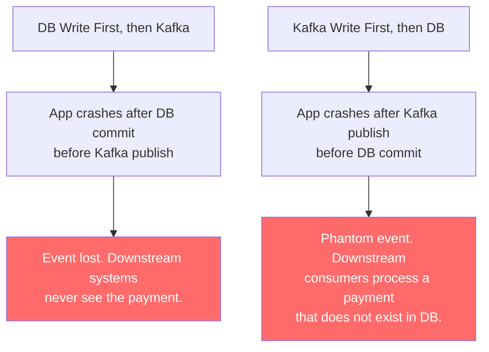
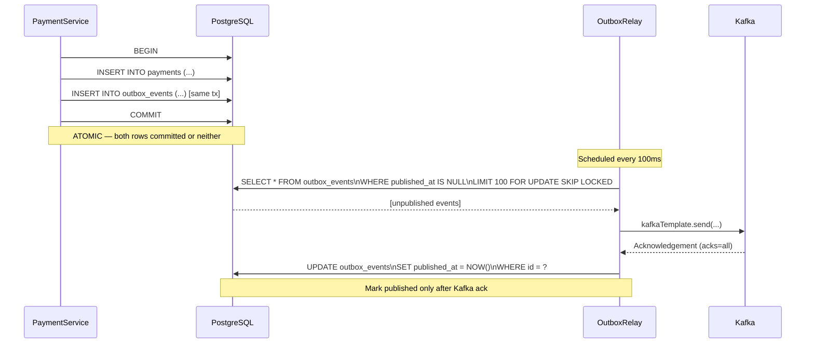
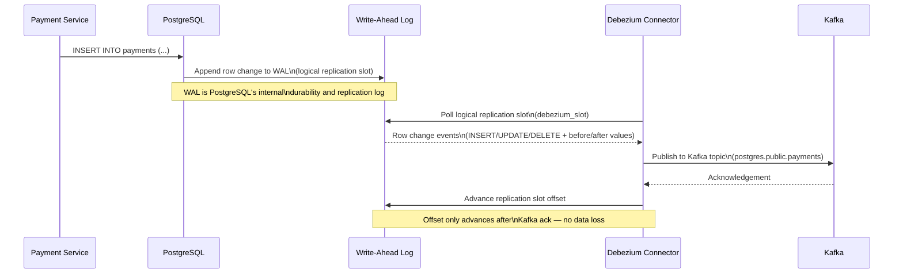

# السيناريو F — الكتابة المزدوجة ونمط Outbox وCDC

## نظرة عامة

لا توجد معاملة موزعة تمتد عبر قاعدة بيانات علائقية وApache Kafka. وهذا ليس قيدًا سيُصلح في الإصدار القادم من أي منهما. بل خاصية أساسية في طريقة تصميمهما. وأي شيفرة تكتب إلى قاعدة بيانات ثم تنشر إلى Kafka في عمليتين منفصلتين لها نافذة فشل — لحظة قد يتعطل فيها التطبيق فيترك النظامين غير متسقين. وفي الأنظمة المالية يعني عدم الاتساق هذا أن الخدمات اللاحقة — الدفتر، والإشعارات، وإعادة تشغيل الاحتيال، والتدقيق — لا ترى أبدًا أحداثًا تحتاجها. ويعلّم هذا الدرس نمطين بجودة إنتاجية يقضيان على نافذة الفشل كليًا.

## أهداف التعلم

في نهاية هذا الدرس ستستطيع:

- شرح مشكلة الكتابة المزدوجة ولماذا لا يقضي عليها أي ترتيب للكتابتين
- تنفيذ نمط outbox المعاملاتي في خدمة دفع بـ Spring Boot
- تصميم مخطط جدول outbox وكتابة خدمة الترحيل (relay) التي تنشر إلى Kafka
- ضبط إعدادات منتج Kafka لأقصى ديمومة في سياق مالي
- شرح نهج CDC باستخدام Debezium وWAL في PostgreSQL
- الاختيار بين نمط outbox وCDC بناءً على القيود التشغيلية
- تنفيذ مستهلكي Kafka بشكل idempotent يتعاملون بأمان مع التسليم مرة واحدة على الأقل

## سياق العمل

*مثال مركّب:* تشغّل "Apex Clearing"، وهي شركة خيالية، خلفية لمعالجة المدفوعات تخدم 14 خدمة مستهلكة لاحقة: دفتر قيد مزدوج، ومحرك تسجيل نقاط احتيال آني، وخدمة إشعارات (SMS/بريد)، ومسار تقارير رقابية، ومجمّع لسجل التدقيق، وواجهة جوال للعملاء، وثمانية مستهلكين داخليين آخرين. وتتلقى كل هذه الخدمات أحداث الدفع عبر مواضيع Kafka.

بعد حادث إنتاج سببه انقسام في شبكة مركز البيانات، يراجع فريق الهندسة تدفق إتمام الدفع. فالخدمة تكتب سجل الدفعة في Postgres ثم تنشر حدث `PaymentCompleted` إلى Kafka. وخلال الانقسام تعذر الوصول إلى Kafka لمدة 4 دقائق. وفي تلك النافذة التُزم بـ 2,841 دفعة في قاعدة البيانات لكن لم تُنشر أي أحداث Kafka. ففاتت هذه الدفعات كل الخدمات اللاحقة الـ 14.

الأثر: الدفتر ينقصه 2,841 قيدًا مجموعها 4.2 مليون جنيه. وفاتت المعاملات محرك الاحتيال كليًا. ومسار التقارير الرقابية فيه فجوة 4 دقائق. ويجب أن يعيد فريق الهندسة بناء الأحداث المفقودة من قاعدة البيانات (يستطيع ذلك، لأن البيانات موجودة)، لكن الحادث ما كان يجب أن يحدث — وإعادة البناء اليدوية ليست إجراء تعافٍ مقبولًا في الحالة المستقرة.

يجب أن يضمن الإصلاح أن كل دفعة ملتزمة تصل في النهاية إلى Kafka، حتى لو كان Kafka غير متاح مؤقتًا، وحتى لو تعطل التطبيق عند أي نقطة في العملية.

## مشكلة الكتابة المزدوجة

تحدث "الكتابة المزدوجة" كلما كتبت شيفرة التطبيق إلى نظامين مستقلين بالتتابع، معاملة المزيج كأنه ذري. وهو ليس كذلك. هذه شيفرة إتمام الدفع التي يكتبها كل فريق أولًا في النهاية:

```java
// THE NAIVE APPROACH — has a critical failure window
@Service
@RequiredArgsConstructor
public class PaymentCompletionService {

    private final PaymentRepository paymentRepository;
    private final KafkaTemplate<String, PaymentCompletedEvent> kafkaTemplate;

    @Transactional  // protects only the DB write
    public void completePayment(Payment payment) {
        // Write 1: persist to database
        paymentRepository.save(payment);  // DB commit happens here

        // ---- APPLICATION CAN CRASH HERE ----
        // DB committed. Kafka publish has not happened.
        // Downstream services will never see this payment.

        // Write 2: publish to Kafka
        kafkaTemplate.send("payments.completed",
                payment.getPaymentId().toString(),
                new PaymentCompletedEvent(payment));
    }
}
```

يلتزم تعليق `@Transactional` بكتابة قاعدة البيانات عندما تعود `completePayment`. ويحدث النشر إلى Kafka بعد ذلك الالتزام. فإذا تعطل JVM، أو انقطعت الشبكة، أو كان Kafka غير متاح مؤقتًا بين هذين السطرين، توجد الدفعة في قاعدة البيانات لكن لا يُنشر أي حدث.

أنماط الفشل لكل ترتيب للكتابتين:



> [!WARNING]
> سيناريو الحدث الشبحي (Kafka أولًا ثم قاعدة البيانات) أسوأ على الأرجح من حدث مفقود. فقد يخصم مستهلك من حساب عميل بناءً على رسالة Kafka تقابل دفعة لم تُلتزم قط في قاعدة البيانات مصدر الحقيقة. وعندما يستعلم العميل عن كشف حسابه، يكون الخصم موجودًا لكن سجل الدفعة الأصلي غير موجود. وهذا عدم اتساق غير قابل للمطابقة لا يمكن كشفه دون تدقيق كامل عبر الأنظمة.

لا يوجد ترتيب آمن. والحل الآمن الوحيد جعل الكتابتين ذريتين بالنسبة لبعضهما — وهذا يتطلب إدخالهما في حدود المعاملة نفسها.

## نمط Outbox المعاملاتي

الفكرة الأساسية: تستطيع قاعدة البيانات الكتابة إلى جدولين ذريًا في معاملة واحدة. فاستخدم هذه الخاصية لصالحك. فبدل الكتابة إلى Kafka مباشرة، اكتب **سجل outbox** في جدول بقاعدة البيانات في المعاملة نفسها مع سجل الدفعة. ثم تقرأ عملية ترحيل منفصلة الـ outbox وتنشر إلى Kafka.

ضمان الذرية: إما يُلتزم بصف الدفعة وصف الـ outbox كليهما، أو لا يُلتزم بأي منهما. ثم يملك المرحّل سجلًا دائمًا لكل حدث يجب نشره، دون نافذة فشل.



## مخطط جدول Outbox

```sql
CREATE TABLE outbox_events (
    id              UUID            PRIMARY KEY DEFAULT gen_random_uuid(),
    aggregate_type  VARCHAR(100)    NOT NULL,
    -- e.g. 'Payment', 'Account', 'Transfer'
    aggregate_id    VARCHAR(100)    NOT NULL,
    -- The business entity ID (payment_id, account_id, etc.)
    event_type      VARCHAR(100)    NOT NULL,
    -- e.g. 'PaymentCompleted', 'AccountCredited', 'TransferInitiated'
    payload         JSONB           NOT NULL,
    -- Full event payload. Include all fields needed by consumers.
    created_at      TIMESTAMPTZ     NOT NULL DEFAULT NOW(),
    published_at    TIMESTAMPTZ,    -- NULL = not yet published
    failed_at       TIMESTAMPTZ,    -- set when an event can never be published (poison)
    failure_reason  TEXT
);

-- Index for the relay: efficiently find unpublished events in creation order
CREATE INDEX idx_outbox_events_unpublished
    ON outbox_events (created_at ASC)
    WHERE published_at IS NULL;

-- Partitioning strategy for high-volume deployments:
-- Partition by created_at (monthly). Old published partitions can be archived.
-- Unpublished events are always in the current partition (small, fast scan).
```

> [!NOTE]
> عبارة `FOR UPDATE SKIP LOCKED` في استعلام SELECT لدى المرحّل أساسية عند تشغيل عدة نسخ من المرحّل. فهي تمنع عمليتي ترحيل من التقاط سجل outbox نفسه في آن واحد. ويجعل `SKIP LOCKED` ‏(متاح منذ PostgreSQL 9.5) الصفوف المقفلة بمرحّل غير مرئية للآخرين، بدل جعلهم يُحجبون وينتظرون. **وتدوم الأقفال طوال المعاملة فقط** — فيجب أن يعمل الاختيار، والإرسالات إلى Kafka، وتحديث `published_at` داخل معاملة واحدة. فدونها (الالتزام التلقائي) يُحرر القفل لحظة عودة SELECT، ويستطيع مرحّلان نشر الصفوف نفسها.

## تنفيذ خدمة الدفع

تكتب خدمة الدفع سجل الدفعة وحدث الـ outbox معًا في دالة `@Transactional` واحدة. وهذا التغيير الوحيد المطلوب في طبقة التطبيق لتنفيذ نمط outbox.

```java
@Entity
@Table(name = "outbox_events")
@Data
@Builder
@NoArgsConstructor
@AllArgsConstructor
public class OutboxEvent {

    @Id
    @GeneratedValue(strategy = GenerationType.UUID)
    private UUID id;

    @Column(nullable = false, length = 100)
    private String aggregateType;

    @Column(nullable = false, length = 100)
    private String aggregateId;

    @Column(nullable = false, length = 100)
    private String eventType;

    @JdbcTypeCode(SqlTypes.JSON)   // Hibernate 6: native JSON mapping
    @Column(nullable = false, columnDefinition = "jsonb")
    private Map<String, Object> payload;

    @Column(nullable = false)
    private Instant createdAt;

    private Instant publishedAt;

    @PrePersist
    void onCreate() { createdAt = Instant.now(); }

    /**
     * Factory method: creates an outbox event from a Payment domain object.
     * All fields that downstream consumers will ever need should be included
     * in the payload at write time — consumers should not need to query back.
     */
    public static OutboxEvent fromPayment(Payment payment) {
        return OutboxEvent.builder()
                .aggregateType("Payment")
                .aggregateId(payment.getPaymentId().toString())
                .eventType("PaymentCompleted")
                .payload(Map.of(
                        "paymentId",      payment.getPaymentId().toString(),
                        "accountId",      payment.getAccountId().toString(),
                        "amountCents",    payment.getAmountCents(),
                        "currency",       payment.getCurrency(),
                        "processorRef",   payment.getProcessorReference(),
                        "completedAt",    payment.getCompletedAt().toString(),
                        "merchantId",     payment.getMerchantId().toString()
                ))
                .build();
    }
}
```

```java
@Service
@RequiredArgsConstructor
@Slf4j
public class PaymentCompletionService {

    private final PaymentRepository paymentRepository;
    private final OutboxEventRepository outboxEventRepository;

    /**
     * Completes a payment atomically. The payment record and the outbox event
     * are written in the same database transaction. If Kafka is down, the
     * outbox relay will publish the event when Kafka recovers.
     */
    @Transactional
    public Payment completePayment(CompletePaymentCommand command) {
        Payment payment = Payment.builder()
                .paymentId(command.getPaymentId())
                .accountId(command.getAccountId())
                .amountCents(command.getAmountCents())
                .currency(command.getCurrency())
                .processorReference(command.getProcessorReference())
                .merchantId(command.getMerchantId())
                .completedAt(Instant.now())
                .status(PaymentStatus.COMPLETED)
                .build();

        // Write 1: persist payment
        paymentRepository.save(payment);

        // Write 2: persist outbox event — SAME transaction, ATOMIC
        OutboxEvent outboxEvent = OutboxEvent.fromPayment(payment);
        outboxEventRepository.save(outboxEvent);

        log.info("Payment {} completed and queued for event publication (outbox_id={})",
                payment.getPaymentId(), outboxEvent.getId());

        return payment;
        // On @Transactional method exit: DB commits BOTH rows atomically.
        // Kafka is not involved at this point. No failure window.
    }
}
```

## تنفيذ مرحّل Outbox

المرحّل مكون مجدول يعمل باستمرار، يستطلع جدول الـ outbox بحثًا عن الأحداث غير المنشورة ويمررها إلى Kafka.

```java
@Component
@RequiredArgsConstructor
@Slf4j
public class OutboxRelay {

    private final OutboxEventRepository outboxEventRepository;
    private final KafkaTemplate<String, String> kafkaTemplate;
    private final ObjectMapper objectMapper;
    private final MeterRegistry meterRegistry;
    private final TransactionTemplate tx;

    private static final int BATCH_SIZE = 100;

    /**
     * Runs every 100ms. Publishes up to BATCH_SIZE unpublished outbox events
     * to Kafka. Marks each event published only after Kafka acknowledges it.
     *
     * The whole batch runs in ONE transaction: FOR UPDATE SKIP LOCKED only
     * protects rows while the transaction that locked them is open.
     */
    @Scheduled(fixedDelay = 100)
    public void relay() {
        tx.executeWithoutResult(status -> {
            List<OutboxEvent> unpublished = outboxEventRepository.findUnpublishedBatch(BATCH_SIZE);
            if (unpublished.isEmpty()) return;

            log.debug("OutboxRelay: processing {} events", unpublished.size());

            // If one event of an aggregate fails, later events of the SAME aggregate
            // must wait — publishing them would deliver that aggregate out of order
            Set<String> blockedAggregates = new HashSet<>();
            for (OutboxEvent event : unpublished) {
                if (blockedAggregates.contains(event.getAggregateId())) continue;
                if (!publishAndMark(event)) {
                    blockedAggregates.add(event.getAggregateId());
                }
            }
        });
    }

    /** @return true if published (or skipped as poison), false if it must be retried */
    private boolean publishAndMark(OutboxEvent event) {
        try {
            String kafkaTopic = resolveKafkaTopic(event);   // explicit mapping, see below
            String payload = objectMapper.writeValueAsString(event.getPayload());

            ProducerRecord<String, String> record = new ProducerRecord<>(
                    kafkaTopic,
                    null,                           // partition: let Kafka decide
                    event.getCreatedAt().toEpochMilli(),
                    event.getAggregateId(),         // key: partition by entity ID
                    payload);

            // Add headers for consumer use (explicit UTF-8, never the platform default)
            record.headers()
                    .add("event_id",       event.getId().toString().getBytes(StandardCharsets.UTF_8))
                    .add("event_type",     event.getEventType().getBytes(StandardCharsets.UTF_8))
                    .add("aggregate_type", event.getAggregateType().getBytes(StandardCharsets.UTF_8))
                    .add("aggregate_id",   event.getAggregateId().getBytes(StandardCharsets.UTF_8));

            // Synchronous send: block until Kafka acknowledges (acks=all configured)
            // This ensures we only mark published after a durable Kafka write
            kafkaTemplate.send(record).get(10, TimeUnit.SECONDS);

            // Mark published — only after confirmed Kafka ack
            outboxEventRepository.markPublished(event.getId(), Instant.now());

            meterRegistry.counter("outbox.relay.published",
                    "event_type", event.getEventType()).increment();
            return true;

        } catch (TimeoutException | ExecutionException e) {
            // Kafka unavailable or slow. Event stays unpublished; the next run retries.
            // (If Kafka DID store it, the retry creates a duplicate — consumers dedupe.)
            log.warn("OutboxRelay: failed to publish event {} ({}): {}",
                    event.getId(), event.getEventType(), e.getMessage());
            meterRegistry.counter("outbox.relay.failed",
                    "event_type", event.getEventType()).increment();
            return false;
        } catch (InterruptedException e) {
            Thread.currentThread().interrupt();
            return false;
        } catch (JsonProcessingException | IllegalArgumentException e) {
            // Poison event (bad payload, unmapped type): a programming error, not
            // transient. Park it and ALERT — skipping silently would lose an event.
            log.error("OutboxRelay: poison event {}. Parking it.", event.getId(), e);
            outboxEventRepository.markFailed(event.getId(), e.getMessage());
            return false;
        }
    }

    private String resolveKafkaTopic(OutboxEvent event) {
        return switch (event.getEventType()) {
            case "PaymentCompleted"   -> "payments.completed";
            case "PaymentFailed"      -> "payments.failed";
            case "PaymentReversed"    -> "payments.reversed";
            case "AccountCredited"    -> "accounts.credited";
            default -> throw new IllegalArgumentException(
                    "No Kafka topic mapped for event type: " + event.getEventType());
        };
    }
}
```

تعمل الدفعة كلها في معاملة واحدة. وإذا فشل حدث لكيان (aggregate)، يجب أن تنتظر الأحداث اللاحقة للكيان **نفسه** — فنشرها سيسلّم ذلك الكيان خارج الترتيب. والحدث المسموم (حمولة تالفة، أو نوع غير مربوط بموضوع) خطأ برمجي لا عابر: يُركن وتُطلق تنبيهات — فتخطيه بصمت يضيع حدثًا.

```java
// Repository method using SKIP LOCKED for concurrent relay safety
@Repository
public interface OutboxEventRepository extends JpaRepository<OutboxEvent, UUID> {

    @Query(value = """
            SELECT * FROM outbox_events
            WHERE published_at IS NULL
              AND failed_at IS NULL
            ORDER BY created_at ASC
            LIMIT :limit
            FOR UPDATE SKIP LOCKED
            """, nativeQuery = true)
    List<OutboxEvent> findUnpublishedBatch(@Param("limit") int limit);

    @Modifying
    @Query("UPDATE OutboxEvent e SET e.publishedAt = :publishedAt WHERE e.id = :id")
    void markPublished(@Param("id") UUID id, @Param("publishedAt") Instant publishedAt);

    @Modifying
    @Query("UPDATE OutboxEvent e SET e.failedAt = CURRENT_TIMESTAMP, e.failureReason = :reason WHERE e.id = :id")
    void markFailed(@Param("id") UUID id, @Param("reason") String reason);
}
```

## إعداد منتج Kafka للديمومة

يجب ضبط منتج Kafka لدى المرحّل للديمومة. فإعدادات المنتج الافتراضية تحسّن الإنتاجية والزمن المنخفض. وأحداث الدفع تتطلب الديمومة قبل كل شيء.

```java
@Configuration
public class KafkaProducerConfig {

    @Bean
    public ProducerFactory<String, String> outboxProducerFactory(KafkaProperties kafkaProperties) {
        Map<String, Object> config = new HashMap<>(kafkaProperties.buildProducerProperties(null));

        // DURABILITY: Leader and all in-sync replicas must acknowledge before success.
        // acks=1 risks data loss if the leader crashes after ack but before replication.
        config.put(ProducerConfig.ACKS_CONFIG, "all");

        // IDEMPOTENCE: Producer assigns sequence numbers so the broker deduplicates
        // retries. Without this, a network timeout followed by a retry can produce
        // duplicate messages at the broker level.
        config.put(ProducerConfig.ENABLE_IDEMPOTENCE_CONFIG, true);

        // Required by idempotent producer: limits in-flight requests per connection.
        // With enable.idempotence=true, Kafka enforces this is <= 5 automatically.
        config.put(ProducerConfig.MAX_IN_FLIGHT_REQUESTS_PER_CONNECTION, 5);

        // RETRIES: Retry on transient failures (network blips, leader elections),
        // bounded by delivery.timeout.ms. Kafka REQUIRES
        //   delivery.timeout.ms >= linger.ms + request.timeout.ms
        // (otherwise the producer fails to start), so lower request.timeout.ms
        // from its 30s default when using a short delivery timeout.
        config.put(ProducerConfig.RETRIES_CONFIG, Integer.MAX_VALUE);
        config.put(ProducerConfig.REQUEST_TIMEOUT_MS_CONFIG, 5_000);
        config.put(ProducerConfig.DELIVERY_TIMEOUT_MS_CONFIG, 9_000);  // < relay's 10s wait

        // Retry backoff: wait 100ms between retries to avoid thundering-herd on broker recovery
        config.put(ProducerConfig.RETRY_BACKOFF_MS_CONFIG, 100);

        // Compression: lz4 for good ratio/speed trade-off on JSON payloads
        config.put(ProducerConfig.COMPRESSION_TYPE_CONFIG, "lz4");

        // Serializers
        config.put(ProducerConfig.KEY_SERIALIZER_CLASS_CONFIG,
                StringSerializer.class);
        config.put(ProducerConfig.VALUE_SERIALIZER_CLASS_CONFIG,
                StringSerializer.class);

        return new DefaultKafkaProducerFactory<>(config);
    }

    @Bean
    public KafkaTemplate<String, String> outboxKafkaTemplate(
            ProducerFactory<String, String> outboxProducerFactory) {
        return new KafkaTemplate<>(outboxProducerFactory);
    }
}
```

يشترط Kafka أن يكون `delivery.timeout.ms` أكبر من أو يساوي `linger.ms + request.timeout.ms` (وإلا يفشل المنتج عند البدء)، فاخفض `request.timeout.ms` من قيمته الافتراضية البالغة 30 ثانية عند استخدام مهلة تسليم قصيرة.

ملف `application.yml` المقابل للتجاوز حسب البيئة:

```yaml
spring:
  kafka:
    bootstrap-servers: ${KAFKA_BOOTSTRAP_SERVERS:localhost:9092}
    producer:
      acks: all
      enable-idempotence: true
      retries: 2147483647        # Integer.MAX_VALUE
      compression-type: lz4
      properties:
        max.in.flight.requests.per.connection: 5
        request.timeout.ms: 5000     # must satisfy delivery >= linger + request timeout
        delivery.timeout.ms: 9000
        retry.backoff.ms: 100
      key-serializer: org.apache.kafka.common.serialization.StringSerializer
      value-serializer: org.apache.kafka.common.serialization.StringSerializer
```

> [!IMPORTANT]
> يتطلب `acks=all` أن يكون لموضوع Kafka **معامل نسخ 3 على الأقل** وأن تكون **النسخ المتزامنة الدنيا (min.insync.replicas) 2 على الأقل**. فمع `acks=all` ومعامل نسخ 1، سيُقرّ Kafka بعد كتابة القائد وحده — دون أي فائدة للديمومة. فاضبط موضوعك: `min.insync.replicas=2` و`replication.factor=3`. ودون ذلك لا معنى لـ `acks=all`.

## التقاط تغيير البيانات (CDC): بديل Debezium

يتطلب نمط outbox تغيير شيفرة التطبيق — فكل خدمة يجب أن تنشر أحداثًا يجب تعديلها لتكتب أيضًا إلى جدول الـ outbox. وفي المؤسسات ذات الخدمات الكثيرة، ينشئ ذلك عبء تنسيق.

يوفر التقاط تغيير البيانات (CDC) بديلًا: فبدل أن تكتب شيفرة التطبيق إلى جدول outbox، تراقب عملية مخصصة **سجل الكتابة المسبقة (WAL)** لقاعدة البيانات وتنشر كل تغيير صف إلى Kafka آليًا — دون أي تغييرات في شيفرة التطبيق.

**كيف يعمل CDC في PostgreSQL مع Debezium:**



**إعداد موصل Debezium لـ PostgreSQL:**

```json
{
    "name": "payments-postgres-connector",
    "config": {
        "connector.class": "io.debezium.connector.postgresql.PostgresConnector",
        "database.hostname": "postgres.internal",
        "database.port": "5432",
        "database.user": "debezium_user",
        "database.password": "${file:/secrets/db-creds.properties:password}",
        "database.dbname": "payments_db",
        "topic.prefix": "payments",
        "plugin.name": "pgoutput",
        "slot.name": "debezium_slot",
        "publication.name": "debezium_publication",

        "table.include.list": "public.outbox_events",

        "transforms": "outbox",
        "transforms.outbox.type":
            "io.debezium.transforms.outbox.EventRouter",
        "transforms.outbox.table.field.event.id": "id",
        "transforms.outbox.table.field.event.key": "aggregate_id",
        "transforms.outbox.table.field.event.type": "event_type",
        "transforms.outbox.table.field.event.payload": "payload",
        "transforms.outbox.route.by.field": "aggregate_type",
        "transforms.outbox.route.topic.replacement": "payments.${routedByValue}.events",
        "transforms.outbox.table.expand.json.payload": "true",

        "heartbeat.interval.ms": "1000",
        "snapshot.mode": "never",

        "key.converter": "org.apache.kafka.connect.storage.StringConverter",
        "value.converter": "org.apache.kafka.connect.json.JsonConverter",
        "value.converter.schemas.enable": "false"
    }
}
```

> [!NOTE]
> يستخدم Debezium ميزة **الفك المنطقي (logical decoding)** في PostgreSQL عبر فتحة نسخ (replication slot). وتخزن الفتحة مؤقتًا مدخلات WAL التي لم يستهلكها Debezium بعد. فإذا أُوقف Debezium لفترة طويلة، تجعل الفتحة WAL يُحتفظ به على القرص — وقد يستهلك ذلك مساحة كبيرة على الخادم الرئيسي. فراقب عرض `pg_replication_slots` واضبط `max_slot_wal_keep_size` ‏(PostgreSQL 13+) لمنع نمو WAL غير المحدود: `ALTER SYSTEM SET max_slot_wal_keep_size = '10GB';`. وإذا بُلغ الحد، تُبطل الفتحة ويجب أن يعيد Debezium أخذ لقطة كاملة — فنبّه قبل ذلك بوقت كافٍ.

يجمع الإعداد أعلاه بين CDC وجدول outbox: فيقرأ Debezium جدول `outbox_events` فقط، ويحوّل موجّه الـ outbox لديه كل صف إلى حدث نظيف. والتقاط جداول العمل الخام (`payments`) بدلًا من ذلك يعمل دون تغييرات في الشيفرة، لكن حينها يصبح تخطيط جدولك مخطط الأحداث العام.

**نمط outbox مقابل CDC — متى تختار كلًا منهما:**

| البعد | Outbox المعاملاتي | CDC ‏(Debezium) |
|-----------|---------------------|----------------|
| تغييرات التطبيق المطلوبة | نعم — الخدمات تكتب إلى جدول outbox | لا — صفر تغييرات في شيفرة التطبيق |
| التعقيد التشغيلي | منخفض — مجرد مكون Spring مجدول | متوسط–عالٍ — مجموعة Kafka Connect، وإدارة الموصلات |
| التحكم في مخطط الحدث | صريح — يحدد المطور حمولة الـ outbox | صريح إذا قرأ Debezium جدول outbox؛ وضمني (تخطيط الجدول = مخطط الحدث) إذا قرأ جداول العمل |
| زمن النشر | 100–500 مللي ثانية (فاصل الاستطلاع) | شبه آني (مللي ثوانٍ، قائم على WAL) |
| متطلب إصدار Postgres | أي إصدار | ‏10+ لإضافة `pgoutput` المدمجة |
| دعم قواعد بيانات متعددة | نعم — يعمل مع أي مصدر بيانات JDBC | لكل موصل — لدى Debezium موصلات لمعظم قواعد البيانات |
| خطر تضخم الجدول | نعم — ينمو جدول الـ outbox حتى يعمل التنظيف | منخفض — يمكن حذف صفوف الـ outbox فور إدراجها (يقرأ Debezium من WAL)؛ لكن يجب مراقبة احتفاظ WAL بدلًا من ذلك |
| مناسب للخدمات الجديدة | نعم | نعم |
| مناسب للخدمات القديمة دون تغييرات في الشيفرة | لا | نعم |

في حالة Apex Clearing، نمط outbox المعاملاتي هو الاختيار الصحيح: فالفريق يملك تحكمًا كاملًا في شيفرة خدمة الدفع، ويريد تحكمًا صريحًا في مخططات الأحداث، ولا يريد إدخال عبء تشغيل Kafka Connect في هذه المرحلة. ويصبح CDC جذابًا لاحقًا عندما يحتاجون إلى التقاط التغييرات من نظام بنكي أساسي قديم يكون تعديل شيفرته مكلفًا أو خطرًا.

## التسليم مرة واحدة على الأقل والـ Idempotency لدى المستهلك

يوفر مرحّل الـ outbox **تسليمًا مرة واحدة على الأقل** — لا مرة واحدة بالضبط. فكّر في سيناريو التعطل هذا:

1. ينشر المرحّل الحدث إلى Kafka. ويكتبه قائد Kafka وينسخه. ويرسل Kafka الإقرار.
2. **يتعطل المرحّل قبل تنفيذ** `markPublished()`.
3. يُعاد تشغيل المرحّل. فيجد أن الحدث ما زال `published_at = NULL`.
4. ينشر المرحّل الحدث نفسه مجددًا.

يتلقى المستهلك اللاحق حدث `PaymentCompleted` نفسه مرتين. فإذا أضاف المستهلك إلى حساب عميل عند كل استلام، يُضاف إلى الحساب مرتين. وهذا السبب الأساسي لوجوب أن يكون المستهلكون idempotent.

**الـ Idempotency لدى المستهلك باستخدام Redis:**

```java
@Component
@RequiredArgsConstructor
@Slf4j
public class LedgerUpdateConsumer {

    private final LedgerService ledgerService;
    private final StringRedisTemplate redis;
    private static final Duration DEDUP_TTL = Duration.ofDays(7);

    @KafkaListener(
            topics = "payments.completed",
            groupId = "ledger-service",
            containerFactory = "paymentCompletedListenerFactory")
    public void onPaymentCompleted(ConsumerRecord<String, String> record,
                                   Acknowledgment ack) {
        String eventId = getHeader(record, "event_id");

        if (eventId == null) {
            log.error("PaymentCompleted event missing event_id header. Offset {}/{}. Skipping.",
                    record.partition(), record.offset());
            ack.acknowledge();
            return;
        }

        String dedupKey = "ledger:processed:" + eventId;

        // Check-and-set: SET NX (set if not exists) with TTL
        // Returns true if the key was newly set (first processing)
        // Returns false if the key already exists (duplicate — already processed)
        Boolean isNew = redis.opsForValue()
                .setIfAbsent(dedupKey, "1", DEDUP_TTL);

        if (Boolean.FALSE.equals(isNew)) {
            log.info("Duplicate event {} detected. Skipping ledger update.", eventId);
            ack.acknowledge();
            return;
        }

        try {
            PaymentCompletedEvent event = deserialize(record.value());
            ledgerService.postDebitEntry(
                    event.getPaymentId(),
                    event.getAccountId(),
                    event.getAmountCents(),
                    event.getCurrency(),
                    event.getProcessorRef());

            ack.acknowledge();
            log.info("Ledger updated for payment {} (event {})",
                    event.getPaymentId(), eventId);

        } catch (Exception e) {
            // Processing failed — delete the Redis key so a retry can reprocess
            redis.delete(dedupKey);
            log.error("Ledger update failed for event {}. Redis key released for retry.", eventId, e);
            // Do NOT ack — let Kafka retry according to consumer error handler config
            throw e;
        }
    }

    private String getHeader(ConsumerRecord<String, String> record, String key) {
        Header header = record.headers().lastHeader(key);
        return header != null ? new String(header.value()) : null;
    }
}
```

> [!WARNING]
> نهج Redis ليس معاملاتيًا مع الدفتر. فإذا تعطل المستهلك بعد نجاح `SET NX` لكن قبل التزام الدفتر (أو فشل `delete` في كتلة catch)، يبقى المفتاح في Redis: فتُتخطى كل إعادة تسليم كـ "تكرار" ولا يُعالج الحدث **أبدًا**. ومدة الصلاحية البالغة 7 أيام تعني أن إعادة التشغيل الأقدم من ذلك تُعالج مرتين. وللأنظمة المالية، سجّل `event_id` المعالج في **معاملة قاعدة البيانات نفسها** مع تحديث الدفتر (قيد فريد)، مع Redis على الأكثر كاختصار اختياري أمامه.

**الـ Idempotency على مستوى قاعدة البيانات (أكثر متانة):**

```sql
CREATE TABLE processed_payment_events (
    event_id    UUID        PRIMARY KEY,
    processed_at TIMESTAMPTZ NOT NULL DEFAULT NOW()
);
```

```java
@Transactional
public void processIdempotently(String eventId, Runnable processingLogic) {
    // Claim the event id in the SAME transaction as the processing:
    //   INSERT INTO processed_payment_events (event_id) VALUES (?)
    //   ON CONFLICT (event_id) DO NOTHING
    // returns 1 the first time, 0 for a duplicate. No exception, so the
    // transaction stays usable (catching a duplicate-key exception inside a
    // PostgreSQL transaction would leave it aborted / rollback-only).
    int claimed = processedEventsRepository.insertIfAbsent(eventId);
    if (claimed == 0) {
        log.info("Event {} already processed. Skipping.", eventId);
        return;   // idempotent success
    }
    processingLogic.run();   // ledger update commits together with the claim
}
```

يُحجز معرّف الحدث في المعاملة **نفسها** مع المعالجة بـ `INSERT ... ON CONFLICT DO NOTHING`، الذي يعيد 1 في المرة الأولى و0 للتكرار. ولا يُرمى استثناء، فتبقى المعاملة صالحة للاستخدام (فالتقاط استثناء تكرار المفتاح داخل معاملة PostgreSQL سيتركها مجهضة / معلّمة للتراجع).

## اختبار تكامل من البداية للنهاية

```java
@SpringBootTest
@EmbeddedKafka(
        partitions = 1,
        topics = {"payments.completed"},
        brokerProperties = {
                "listeners=PLAINTEXT://localhost:9092",
                "port=9092"
        })
class OutboxPatternIntegrationTest {

    @Autowired
    private PaymentCompletionService paymentCompletionService;

    @Autowired
    private OutboxEventRepository outboxEventRepository;

    @Autowired
    private OutboxRelay outboxRelay;

    @Autowired
    private PaymentRepository paymentRepository;

    @Value("${spring.embedded.kafka.brokers}")
    private String kafkaBrokers;

    private Consumer<String, String> testConsumer;

    @BeforeEach
    void setUpConsumer() {
        Map<String, Object> consumerProps = new HashMap<>();
        consumerProps.put(ConsumerConfig.BOOTSTRAP_SERVERS_CONFIG, kafkaBrokers);
        consumerProps.put(ConsumerConfig.GROUP_ID_CONFIG, "test-consumer");
        consumerProps.put(ConsumerConfig.AUTO_OFFSET_RESET_CONFIG, "earliest");
        consumerProps.put(ConsumerConfig.KEY_DESERIALIZER_CLASS_CONFIG, StringDeserializer.class);
        consumerProps.put(ConsumerConfig.VALUE_DESERIALIZER_CLASS_CONFIG, StringDeserializer.class);
        testConsumer = new KafkaConsumer<>(consumerProps);
        testConsumer.subscribe(List.of("payments.completed"));
    }

    @Test
    @DisplayName("Payment completion atomically writes DB record and outbox event")
    void completePayment_atomicallyWritesPaymentAndOutboxEvent() {
        CompletePaymentCommand command = buildTestCommand();

        paymentCompletionService.completePayment(command);

        // Both records must exist in the DB in the same transaction
        assertThat(paymentRepository.findById(command.getPaymentId())).isPresent();

        List<OutboxEvent> outboxEvents = outboxEventRepository
                .findByAggregateId(command.getPaymentId().toString());
        assertThat(outboxEvents).hasSize(1);
        assertThat(outboxEvents.get(0).getPublishedAt()).isNull();  // not yet relayed
    }

    @Test
    @DisplayName("OutboxRelay publishes event to Kafka and marks it published")
    void outboxRelay_publishesEventAndMarksPublished() throws Exception {
        // Arrange: create a payment with an unpublished outbox event
        CompletePaymentCommand command = buildTestCommand();
        paymentCompletionService.completePayment(command);

        // Act: run the relay
        outboxRelay.relay();

        // Assert: Kafka received the event
        ConsumerRecords<String, String> records =
                testConsumer.poll(Duration.ofSeconds(5));
        assertThat(records.count()).isEqualTo(1);

        ConsumerRecord<String, String> kafkaRecord = records.iterator().next();
        assertThat(kafkaRecord.key()).isEqualTo(command.getPaymentId().toString());

        // Assert: event_id header present (for consumer idempotency)
        assertThat(kafkaRecord.headers().lastHeader("event_id")).isNotNull();

        // Assert: outbox event marked published in DB
        await().atMost(Duration.ofSeconds(2)).untilAsserted(() -> {
            OutboxEvent event = outboxEventRepository
                    .findByAggregateId(command.getPaymentId().toString())
                    .get(0);
            assertThat(event.getPublishedAt()).isNotNull();
        });
    }

    @Test
    @DisplayName("If Kafka is unavailable, outbox event stays unpublished and is retried")
    void whenKafkaUnavailable_outboxEventRemainsUnpublishedForRetry(
            @Autowired OutboxRelay relayWithBadKafka) {
        // This test uses a relay configured with an unreachable Kafka broker
        // The event should remain with published_at = NULL after the relay run
        CompletePaymentCommand command = buildTestCommand();
        paymentCompletionService.completePayment(command);

        // Act: relay with Kafka unavailable (broker address overridden in test config)
        relayWithBadKafka.relay();  // should not throw

        // Assert: event still unpublished
        OutboxEvent event = outboxEventRepository
                .findByAggregateId(command.getPaymentId().toString())
                .get(0);
        assertThat(event.getPublishedAt()).isNull();
    }

    private CompletePaymentCommand buildTestCommand() {
        return CompletePaymentCommand.builder()
                .paymentId(UUID.randomUUID())
                .accountId(UUID.randomUUID())
                .amountCents(42000L)
                .currency("GBP")
                .processorReference("WP-TEST-" + System.nanoTime())
                .merchantId(UUID.randomUUID())
                .build();
    }
}
```

## صيانة جدول Outbox

ينمو جدول الـ outbox باستمرار. ولم يعد المرحّل يحتاج الأحداث المنشورة، لكنها قيّمة لتصحيح الأخطاء وإعادة تشغيل التدقيق. فنفّذ مهمة صيانة:

```java
@Component
@RequiredArgsConstructor
@Slf4j
public class OutboxMaintenanceJob {

    private final OutboxEventRepository outboxEventRepository;

    /**
     * Runs nightly at 02:00. Archives published events older than 30 days
     * to an outbox_events_archive table, then deletes them from outbox_events.
     * Keeps the hot outbox table small for relay query performance.
     */
    @Scheduled(cron = "0 0 2 * * *")  // 02:00 daily
    @Transactional
    public void archivePublishedEvents() {
        Instant cutoff = Instant.now().minus(Duration.ofDays(30));

        int archived = outboxEventRepository.archivePublishedBefore(cutoff);
        log.info("OutboxMaintenance: archived {} events published before {}", archived, cutoff);
    }
}
```

```sql
-- Archive table (identical structure, different retention policy)
CREATE TABLE outbox_events_archive (LIKE outbox_events INCLUDING ALL);

-- Archive + delete in one statement (PostgreSQL CTE)
WITH archived AS (
    DELETE FROM outbox_events
    WHERE published_at IS NOT NULL
      AND published_at < $1  -- cutoff timestamp
    RETURNING *
)
INSERT INTO outbox_events_archive SELECT * FROM archived;
```

## اختبار المعرفة

**س1: يقول مطور: "بدل جدول outbox، سأغلّف كتابة قاعدة البيانات والإرسال إلى Kafka في try/catch. فإذا رمى Kafka استثناءً، سأتراجع عن معاملة قاعدة البيانات." لماذا لا يحل هذا مشكلة الكتابة المزدوجة؟**

هناك سيناريوها فشل متمايزان لا يغطيهما هذا النهج. أولًا، قد يتعطل التطبيق (قتل JVM، أو نفاد الذاكرة، أو انقطاع الطاقة) بعد عودة التزام قاعدة البيانات لكن قبل حتى محاولة الإرسال إلى Kafka — فلا تُنفذ try/catch في تلك الحالة. ثانيًا، قد ينجح الإرسال إلى Kafka على مستوى الوسيط لكن يضيع إقرار العميل بسبب انقطاع شبكة بعد أن يلتزم الوسيط بالرسالة. وفي تلك الحالة يرمي `kafkaTemplate.send()` استثناء انتهاء مهلة، فتتراجع كتلة catch لدى المطور عن قاعدة البيانات، لكن رسالة Kafka دائمة بالفعل — فسيعالج المستهلكون حدثًا تُراجع عن سجله في قاعدة البيانات (حدث شبحي). والمشكلة الأساسية أن "تراجع عن قاعدة البيانات إذا فشل Kafka" يفترض أن العمليات قابلة للعكس وأن الفشل قابل للكشف، ولا شيء من ذلك مضمون.

**س2: يعمل مرحّل الـ outbox لديك بنسختين للتوفر العالي. دون `FOR UPDATE SKIP LOCKED`، ما نمط الفشل الذي يحدث، وكيف يصلحه `SKIP LOCKED` بالضبط؟**

دون `FOR UPDATE SKIP LOCKED`، تنفذ نسختا المرحّل كلتاهما `SELECT * FROM outbox_events WHERE published_at IS NULL`. فتريان مجموعة الصفوف غير المنشورة نفسها. وتحاولان كلتاهما نشر الأحداث نفسها إلى Kafka. وفي أحسن الأحوال يُنشر الحدث مرتين (يصبح "مرة على الأقل" "مرتين على الأقل"). وفي أسوئها يتسابق تحديث قاعدة البيانات لدى نسخة مع الأخرى، وتعلّم كلتاهما الصف كمنشور — وهذا يبدو صحيحًا لكنه يعني أن المستهلكين تلقوا تكرارات لا يعكسها سجل الـ outbox. ويجعل `FOR UPDATE` الصفوف مقفلة عند قراءتها أولًا (ويُحتفظ بالقفل حتى نهاية تلك المعاملة، فيجب أن ينشر المرحّل ويعلّم داخل المعاملة نفسها). ويعدّل `SKIP LOCKED` السلوك بحيث تُتخطى بصمت الصفوف المقفلة بالفعل من معاملة أخرى — بدل أن تُحجب المعاملة الثانية وتنتظر. والنتيجة: تعالج نسخة مرحّل واحدة كل صف في وقت واحد، فتزول التكرارات على مستوى المرحّل. ويبقى الـ idempotency لدى المستهلك ضروريًا لسيناريو التعطل بعد الإقرار وقبل markPublished، لكن `SKIP LOCKED` يزيل التكرار الناتج عن تزامن المرحّلات.

## التحدي العملي

**السيناريو:** تحتاج Apex Clearing إلى توسيع نمط outbox لدعم **تسليم الأحداث مرتبًا لكل حساب**. فحاليًا قد تُنشر دفعتان للحساب نفسه إلى قسمي Kafka مختلفين (تجزئة `payment_id` كمفتاح). ويتطلب محرك الاحتيال أن تصل كل الأحداث لـ `account_id` نفسه إلى قسم Kafka نفسه وبترتيب إنشائها، ليحافظ على تسلسل أحداث صحيح لكل حساب.

**مهامك:**

1. عدّل `OutboxEvent.fromPayment()` لتستخدم `account_id` كمفتاح رسالة Kafka بدل `payment_id`. واشرح المقايضة: عدد الأقسام يحد مباشرة من التوازي لكل حساب. ومع 50 قسمًا و2.3 مليون حساب، احسب متوسط الحسابات لكل قسم.

2. ينشر مرحّل الـ outbox حاليًا السجلات `ORDER BY created_at ASC`. وأثبت بمثال SQL لماذا لا يكفي هذا الترتيب لضمان الترتيب لكل حساب عندما تُدرج دفعتان للحساب نفسه بتتابع سريع بطابع `created_at` نفسه. واقترح إصلاحًا باستخدام عمود تسلسل متزايد رتيب — ثم بيّن لماذا حتى التسلسل لا يكفي وحده (المهمة التالية).

3. أضف عمود `outbox_sequence BIGSERIAL` إلى جدول الـ outbox ورتّب استعلام SELECT لدى المرحّل به. ثم اشرح حده: تُسند قيمة التسلسل عند **إدراج** الصف، لكن المعاملات **تلتزم** بترتيب مختلف — فقد يرى المرحّل التسلسل 11 ملتزمًا بينما 10 ما زال جاريًا، فينشر 11، ثم ينشر 10 لاحقًا. ولضمان الترتيب لكل حساب، سلسل أيضًا الكتابات لكل حساب (مثلًا اقفل صف الحساب في المعاملة التي تكتب حدث الـ outbox)، أو أعط كل حدث رقم إصدار لكل حساب واجعل المرحّل ينشر أحداث الحساب بترتيب الإصدار بصرامة.

4. نفّذ **قفل مرحّل لكل قسم** باستخدام الأقفال الاستشارية في PostgreSQL ‏(`pg_try_advisory_lock(partition_number)`) حتى لا تنشر نسختا مرحّل إلى قسم Kafka نفسه بالتزامن أبدًا. وبيّن شيفرة الحصول على القفل وتحريره، واشرح ماذا يحدث إذا تعطلت عملية المرحّل وهي تمسك القفل الاستشاري.

5. اكتب اختبارًا يدرج 10 دفعات للحساب نفسه بتتابع سريع، ويشغّل المرحّل، ويستهلك رسائل Kafka، ويؤكد أنها تصل بترتيب `outbox_sequence` الصحيح.

**هدف إضافي:** نفّذ **مراقب تأخر** يستعلم `SELECT COUNT(*) FROM outbox_events WHERE published_at IS NULL` كل 60 ثانية وينشر النتيجة كمقياس Micrometer ‏(`outbox.relay.lag`). ونبّه (عبر Prometheus AlertManager) عندما يتجاوز التأخر 500 حدث لأكثر من دقيقتين متتاليتين. واشرح اختيار الحد بالنظر إلى فاصل مرحّل 100 مللي ثانية وإنتاجية إنتاج نموذجية.

<!-- KNOWLEDGE-CHECK
{
  "questions": [
    {
      "text": "يغلّف مطور كتابة قاعدة البيانات والإرسال إلى Kafka في try/catch، ويتراجع عن قاعدة البيانات إذا رمى Kafka استثناءً. لماذا لا يحل هذا مشكلة الكتابة المزدوجة؟",
      "options": [
        "لا يدعم Kafka دلالات معاملاتية مع PostgreSQL",
        "قد يتعطل JVM بعد التزام قاعدة البيانات لكن قبل محاولة الإرسال إلى Kafka، وقد يتلقى Kafka الرسالة لكن تنتهي المهلة قبل أن يحصل العميل على الإقرار — فتبقى الرسالة دائمة بينما تُراجع قاعدة البيانات",
        "لا يستطيع تعليق @Transactional في Spring أن يمتد عبر عدة مديري موارد",
        "منتجو Kafka ليسوا آمنين للخيوط ولا يمكن استخدامهم داخل معاملة"
      ],
      "correct": 1,
      "explanation": "سيناريوهان لا يُغطيان: (1) تعطل JVM بعد التزام قاعدة البيانات لكن قبل الإرسال إلى Kafka — فلا تعمل try/catch أبدًا؛ (2) يتلقى Kafka الرسالة ويجعلها دائمة، لكن الشبكة تُسقط الإقرار — فيرمي العميل استثناء انتهاء مهلة، وتُراجع قاعدة البيانات، لكن المستهلكين سيرون الحدث دون سجل مقابل في قاعدة البيانات (حدث شبحي). ويحل نمط outbox ذلك بجعل كتابة الـ outbox جزءًا من معاملة قاعدة البيانات نفسها."
    },
    {
      "text": "يعمل مرحّل outbox بنسختين. دون FOR UPDATE SKIP LOCKED، ما نمط الفشل الذي يحدث؟",
      "options": [
        "تقفل النسختان الصفوف نفسها فيحدث جمود",
        "تقرأ النسختان الصفوف غير المنشورة نفسها وتنشرانها كلتاهما، فتنشأ أحداث Kafka مكررة",
        "تفوز نسخة بقفل قاعدة البيانات وتُجوَّع الأخرى فلا تعالج أي أحداث",
        "ينمو جدول الـ outbox دون حد لأن أيًا من النسختين لا تستطيع حذف الصفوف المعالجة"
      ],
      "correct": 1,
      "explanation": "دون قفل، تختار نسختا المرحّل الصفوف غير المنشورة نفسها وتنشرانها كلتاهما إلى Kafka. ويجعل FOR UPDATE SKIP LOCKED كل مرحّل يقفل الصفوف التي يقرؤها (طوال مدة معاملته) ويتخطى الصفوف المقفلة بالفعل من النسخة الأخرى، فتعالج نسخة واحدة كل صف في وقت واحد. ويبقى الـ idempotency لدى المستهلك ضروريًا لسيناريو التعطل قبل markPublished."
    },
    {
      "text": "لماذا لا يكفي ORDER BY created_at ASC لضمان ترتيب الأحداث لكل حساب في مرحّل الـ outbox؟",
      "options": [
        "دقة TIMESTAMPTZ غير كافية للمعاملات المالية",
        "قد تحصل دفعتان للحساب نفسه أُدرجتا بالتزامن على الطابع الزمني نفسه، فيصبح ترتيبهما النسبي غير محدد",
        "‏created_at طابع زمني يولّده العميل ويستطيع المهاجمون التلاعب به",
        "لا يحافظ PostgreSQL على ترتيب الإدراج للصفوف ذات قيم الطابع الزمني المتطابقة"
      ],
      "correct": 1,
      "explanation": "قد يحصل إدراجان على الطابع الزمني نفسه، فيصبح ترتيبهما النسبي غير محدد. ويعطي عمود BIGSERIAL كل صف رقمًا فريدًا ومتزايدًا — لكن الأرقام تُسند وقت الإدراج بينما تلتزم المعاملات بترتيب مختلف، فقد يرى المرحّل رقمًا لاحقًا قبل أن يُلتزم برقم سابق. والترتيب الصارم لكل حساب يحتاج أيضًا تسلسلًا للكتابات لكل حساب (أو إصدارًا لكل حساب يتبعه المرحّل)."
    }
  ]
}
-->

<!-- PRACTICAL-CHALLENGE
{
  "title": "توسيع نمط Outbox للتسليم المرتب لكل حساب",
  "difficulty": "advanced",
  "estimatedMinutes": 60,
  "tasks": [
    {"id": "1", "description": "عدّل OutboxEvent.fromPayment() لتستخدم account_id كمفتاح رسالة Kafka بدل payment_id. واشرح مقايضة القسم لكل حساب واحسب متوسط الحسابات لكل قسم مع 50 قسمًا و2.3 مليون حساب."},
    {"id": "2", "description": "أضف عمود outbox_sequence BIGSERIAL إلى جدول الـ outbox ورتّب استعلام SELECT لدى المرحّل به. واشرح لماذا لا يضمن التسلسل وحده الترتيب لكل حساب (تُسند القيم وقت الإدراج، وتلتزم المعاملات بترتيب مختلف) وأضف تسلسلًا للكتابات لكل حساب أو رقم إصدار لكل حساب."},
    {"id": "3", "description": "نفّذ أقفال مرحّل لكل قسم باستخدام الأقفال الاستشارية في PostgreSQL ‏(pg_try_advisory_lock) حتى لا تنشر نسختا مرحّل إلى قسم Kafka نفسه بالتزامن أبدًا. وبيّن شيفرة الحصول على القفل وتحريره واشرح دورة حياة القفل عند تعطل العملية."},
    {"id": "4", "description": "اكتب اختبارًا يدرج 10 دفعات للحساب نفسه بسرعة، ويشغّل المرحّل، ويستهلك رسائل Kafka، ويؤكد أنها تصل بترتيب outbox_sequence الصحيح."}
  ]
}
-->
