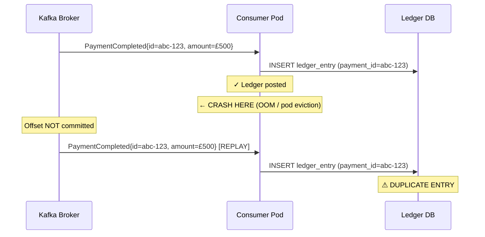

# السيناريو G — رسائل Kafka المكررة والمستهلك Idempotent

## نظرة عامة

مستهلك Kafka يعالج حدث `PaymentCompleted`، ويرحّل إلى الدفتر، ثم يتعطل قبل التزام إزاحته سيعيد تشغيل ذلك الحدث عند إعادة التشغيل — وسيقبل الدفتر النسختين بصمت. وهذه ليست حالة طرفية نظرية؛ بل السلوك الافتراضي لكل مستهلك Kafka يسلّم مرة واحدة على الأقل ولا يدافع عن نفسه. يكشف هذا الدرس بالضبط كيف تنفتح نافذة الفشل، ثم يغلقها بثلاث تقنيات متكاملة: جدول idempotency على مستوى قاعدة البيانات، ودلالات التسليم مرة واحدة بالضبط المعاملاتية في Kafka نفسه، ونافذة إزالة تكرار في Redis للمسارات عالية الإنتاجية. وستخرج بالإعداد الإنتاجي وشيفرة Spring Kafka لتنفيذ الثلاث.

## أهداف التعلم

- شرح ضمانات التسليم الثلاثة في Kafka (مرة على الأكثر، ومرة على الأقل، ومرة واحدة بالضبط فعليًا) ولماذا "مرة على الأقل" هو الوضع التشغيلي الافتراضي للأنظمة المالية.
- تحديد نافذة الفشل الدقيقة بين المعالجة والتزام الإزاحة التي تسبب قيود دفتر مكررة.
- تنفيذ مستهلك idempotent باستخدام نمط `INSERT … ON CONFLICT DO NOTHING RETURNING` في PostgreSQL داخل `@KafkaListener` في Spring.
- ضبط منتجي Kafka المعاملاتيين ومستهلكي `read_committed` لتحقيق التسليم مرة واحدة بالضبط فعليًا وشرح مقايضة العبء.
- تصميم نافذة إزالة تكرار قائمة على `SETNX` في Redis كحارس منخفض الزمن قبل كتابات قاعدة البيانات.
- ضبط `enable.auto.commit=false`، و`acknowledge()` اليدوي، وموضوع رسائل ميتة (DLT) لمعالجة الرسائل المسمومة.

## سياق العمل

*مثال مركّب:* تشغّل "Nexus Payments"، وهي مؤسسة دفع خيالية مرخصة في المملكة المتحدة تعالج 2.1 مليون معاملة يوميًا، مسار أحداث قائمًا على Kafka بين بوابة الدفع ودفتر القيد المزدوج. وعند 02:17 يوم ثلاثاء، تسببت إعادة تشغيل متدرجة روتينية لحاويات مستهلك الدفتر في تعطل خمس عشرة حاوية بين المعالجة والتزام الإزاحة بسبب خطأ نفاد ذاكرة في JVM أطلقته قفزة غير متوقعة في حجم حمولات الأحداث. وعند إعادة التشغيل أعادت تلك الحاويات الخمس عشرة تشغيل بين 1 و23 حدثًا لكل منها. وإجمالًا عولج 94 حدث `PaymentCompleted` مرتين. وجعلت كل إعادة تشغيل `ledgerService.post()` تُنفذ مرة ثانية، فنشأت 94 قيد إضافة مكررًا مجموعها 127,340 جنيهًا.

لم تُكتشف القيود المكررة حتى عملت مهمة المطابقة الصباحية عند 06:00. وبحلول تلك النقطة كان 11 عميلًا قد رأوا الأرصدة المضخمة، وبدأ 3 منهم تحويلات ثانوية من الأموال الشبحية. وتطلبت المعالجة تعديلات يدوية في الدفتر، واسترداد الأموال المنفقة زيادة، و11 تواصلًا مع العملاء، وتقرير حادث إلى الجهة الرقابية. والسبب الجذري: لم يكن لدى المستهلك فحص idempotency، فتحوّل التسليم مرة واحدة على الأقل الذي *يعِد* به Kafka مباشرة إلى ترحيلات مكررة.

## دلالات التسليم في Kafka

يوفر Kafka ثلاثة أوضاع تسليم، والفرق بينها مهم جدًا في الأنظمة المالية.

**مرة على الأكثر (At-most-once)**: تُلتزم الإزاحة قبل معالجة الرسالة. فإذا تعطل المستهلك أثناء المعالجة، تضيع الرسالة. مقبول للقياسات عن بُعد؛ ولا يُقبل أبدًا لأحداث الدفع.

**مرة على الأقل (At-least-once)**: تُلتزم الإزاحة بعد معالجة الرسالة بنجاح. فإذا تعطل المستهلك بعد المعالجة لكن قبل التزام الإزاحة، يُعاد تسليم الرسالة. وهذا الوضع القياسي ويعني أن منطق المستهلك **يجب أن يكون idempotent**.

**مرة واحدة بالضبط فعليًا (Effectively-exactly-once)**: تجعل معاملات Kafka التزام الإزاحة وأي رسائل منتجة تُكتب ذريًا. وما زال المستهلك يعيد قراءة الرسالة عند الفشل، لكن الأنظمة اللاحقة ترى الأثر مرة واحدة فقط. وهذا يتطلب معاملات المنتج و`isolation.level=read_committed` لدى المستهلكين معًا.

> [!IMPORTANT]
> "مرة واحدة بالضبط" في Kafka خاصية لحلقة القراءة-المعالجة-الكتابة داخل منظومة Kafka. ولحظة يصبح الأثر الجانبي لمعالجتك كتابة في قاعدة بيانات أو استدعاء HTTP، تعود إلى "مرة على الأقل". وعبء الـ idempotency على تطبيقك لا يختفي — بل ينتقل.

## نافذة الفشل

الفجوة بين المعالجة والتزام الإزاحة هي السبب الجذري لكل حادث تسليم مكرر.



نافذة الفشل موجودة لكل مستهلك يسلّم مرة على الأقل. والسؤال الوحيد هل الآثار الجانبية للمستهلك idempotent داخل تلك النافذة.

## الإصلاح 1 — مستهلك Idempotent بجدول إزالة التكرار

الإصلاح الأكثر قابلية للنقل جدول `processed_events` يسجل كل معرّف حدث. ويُنفذ الحجز (إدراج معرّف الحدث) ومنطق العمل في **معاملة قاعدة البيانات نفسها**، فتصبح العملية كلها ذرية — ولا يُقرّ بالإزاحة إلا **بعد** التزام تلك المعاملة.

خطآن يجب تجنبهما. فتنفيذ إدراج إزالة التكرار على اتصاله الخاص (`dataSource.getConnection()`) يلتزم به فورًا وبشكل منفصل: فإذا فشل ترحيل الدفتر بعد ذلك، يُعلّم الحدث كمعالج لكنه لا يُرحّل أبدًا — ضائع. والإقرار داخل المعاملة يلتزم بإزاحة Kafka قبل التزام قاعدة البيانات: فإذا فشل الالتزام بعد ذلك، تضيع الرسالة أيضًا. (و`KafkaTransactionManager` لا يساعد هنا — فهو يغطي Kafka، لا قاعدة بياناتك.)

### المخطط

```sql
CREATE TABLE processed_events (
    event_id        UUID        NOT NULL,
    consumer_group  VARCHAR(128) NOT NULL,
    processed_at    TIMESTAMPTZ NOT NULL DEFAULT now(),
    payload_hash    VARCHAR(64),          -- optional integrity check
    CONSTRAINT pk_processed_events PRIMARY KEY (event_id, consumer_group)
);

-- Index for TTL-based cleanup (run DELETE WHERE processed_at < now() - interval '7 days')
CREATE INDEX idx_processed_events_at ON processed_events (processed_at);
```

### مستمع Spring Kafka

```java
@Service
@RequiredArgsConstructor
@Slf4j
public class PaymentCompletedConsumer {

    private final PaymentPostingService postingService;

    private static final String CONSUMER_GROUP = "ledger-posting-service";

    @KafkaListener(
            topics = "payments.completed",
            groupId = CONSUMER_GROUP,
            containerFactory = "manualAckContainerFactory"
    )
    public void onPaymentCompleted(
            @Payload PaymentCompletedEvent event,
            Acknowledgment acknowledgment) {

        // DB transaction (claim + ledger post) commits inside this call...
        postingService.postOnce(event, CONSUMER_GROUP);
        // ...and only THEN is the offset committed. A crash between the two
        // causes a redelivery, which postOnce recognises as a duplicate.
        acknowledgment.acknowledge();
    }
}

@Service
@RequiredArgsConstructor
@Slf4j
public class PaymentPostingService {

    private final LedgerService ledgerService;
    private final JdbcTemplate jdbc;   // joins the Spring-managed DB transaction

    @Transactional   // the DATABASE transaction manager — claim and post commit together
    public void postOnce(PaymentCompletedEvent event, String consumerGroup) {
        // Claim the event: 1 row inserted = first time; 0 rows = duplicate
        int claimed = jdbc.update("""
                INSERT INTO processed_events (event_id, consumer_group)
                VALUES (?, ?)
                ON CONFLICT (event_id, consumer_group) DO NOTHING
                """, event.eventId(), consumerGroup);

        if (claimed == 0) {
            log.warn("Duplicate event detected, skipping: eventId={}", event.eventId());
            return;
        }

        ledgerService.post(LedgerPostingRequest.from(event));   // same transaction
        log.info("Payment posted to ledger: eventId={} paymentId={}",
                event.eventId(), event.paymentId());
    }
}
```

### إعداد مصنع الحاويات في Kafka

```java
@Configuration
@EnableKafka
public class KafkaConsumerConfig {

    @Bean
    public ConcurrentKafkaListenerContainerFactory<String, PaymentCompletedEvent>
            manualAckContainerFactory(ConsumerFactory<String, PaymentCompletedEvent> cf) {

        ConcurrentKafkaListenerContainerFactory<String, PaymentCompletedEvent> factory =
                new ConcurrentKafkaListenerContainerFactory<>();
        factory.setConsumerFactory(cf);
        // MANUAL_IMMEDIATE: app calls acknowledgment.acknowledge() explicitly
        factory.getContainerProperties().setAckMode(ContainerProperties.AckMode.MANUAL_IMMEDIATE);
        factory.getContainerProperties().setPollTimeout(3000);
        return factory;
    }

    // "${...}" placeholders are NOT resolved inside Java string literals —
    // inject the value instead
    @Bean
    public ConsumerFactory<String, PaymentCompletedEvent> consumerFactory(
            @Value("${kafka.bootstrap-servers}") String bootstrapServers) {
        Map<String, Object> props = new HashMap<>();
        props.put(ConsumerConfig.BOOTSTRAP_SERVERS_CONFIG, bootstrapServers);
        props.put(ConsumerConfig.GROUP_ID_CONFIG, "ledger-posting-service");
        props.put(ConsumerConfig.ENABLE_AUTO_COMMIT_CONFIG, false);       // critical
        props.put(ConsumerConfig.MAX_POLL_RECORDS_CONFIG, 100);
        props.put(ConsumerConfig.AUTO_OFFSET_RESET_CONFIG, "earliest");
        props.put(ConsumerConfig.KEY_DESERIALIZER_CLASS_CONFIG, StringDeserializer.class);
        props.put(ConsumerConfig.VALUE_DESERIALIZER_CLASS_CONFIG, JsonDeserializer.class);
        props.put(JsonDeserializer.TRUSTED_PACKAGES, "com.nexus.payments.events");
        return new DefaultKafkaConsumerFactory<>(props);
    }
}
```

العناصر النائبة `"${...}"` لا تُحل داخل النصوص الحرفية في Java — فاحقن القيمة بدلًا من ذلك.

> [!WARNING]
> لا تضبط أبدًا `enable.auto.commit=true` في مستهلك مالي. فالالتزام التلقائي ينطلق على مؤقت (افتراضيًا 5 ثوانٍ) دون ارتباط بنجاح المعالجة. فقد تُلتزم الإزاحة لرسالة فشلت معالجتها، فتُسقط بصمت إلى الأبد.

## الإصلاح 2 — معاملات Kafka (مرة واحدة بالضبط فعليًا)

عندما يكون المنتج والمستهلك كلاهما داخل منظومة Kafka (المستهلك يقرأ والمنتج يكتب إلى موضوع Kafka آخر)، تستطيع معاملات Kafka جعل التزام الإزاحة والإنتاج الصادر ذريين.

### إعداد المنتج

```java
@Bean
public ProducerFactory<String, Object> transactionalProducerFactory(
        @Value("${kafka.bootstrap-servers}") String bootstrapServers,
        @Value("${POD_NAME:local}") String podName) {
    Map<String, Object> props = new HashMap<>();
    props.put(ProducerConfig.BOOTSTRAP_SERVERS_CONFIG, bootstrapServers);
    props.put(ProducerConfig.ENABLE_IDEMPOTENCE_CONFIG, true);
    props.put(ProducerConfig.ACKS_CONFIG, "all");
    props.put(ProducerConfig.RETRIES_CONFIG, Integer.MAX_VALUE);
    props.put(ProducerConfig.MAX_IN_FLIGHT_REQUESTS_PER_CONNECTION, 5);
    DefaultKafkaProducerFactory<String, Object> pf = new DefaultKafkaProducerFactory<>(props);
    // The transactional.id must be unique per producer instance and STABLE across
    // restarts (a restarted pod reuses it, which fences off its old "zombie" self).
    // Spring appends a suffix to this prefix for each producer it creates.
    pf.setTransactionIdPrefix("ledger-poster-" + podName + "-");
    return pf;
}

@Bean
public KafkaTransactionManager<String, Object> kafkaTransactionManager(
        ProducerFactory<String, Object> pf) {
    return new KafkaTransactionManager<>(pf);
}
```

يجب أن يكون `transactional.id` فريدًا لكل نسخة منتج و**ثابتًا** عبر إعادات التشغيل (فالحاوية المعاد تشغيلها تعيد استخدامه، وهذا يحجب نسختها القديمة "الزومبي").

### إعداد المستهلك لعزل Read-Committed

```java
props.put(ConsumerConfig.ISOLATION_LEVEL_CONFIG, "read_committed");
```

مع `read_committed`، لن يرى المستهلك الرسائل المنتجة داخل معاملة غير ملتزمة. وهذا يضمن أنه إذا تعطل جانب المنتج في حلقة استهلاك-تحويل-إنتاج في منتصف المعاملة، فلن يرى المستهلك على الموضوع الآخر المخرجات الجزئية أبدًا.

> [!NOTE]
> لا تساعد معاملات Kafka عندما يكون أثرك الجانبي كتابة في PostgreSQL، أو استدعاء HTTP، أو أي مورد غير Kafka. وللذرية عبر الأنظمة استخدم نمط Outbox المعاملاتي (الدرس 13) أو جدول idempotency (الإصلاح 1 أعلاه). وتتألق معاملات Kafka في الطوبولوجيات الخالصة على Kafka: معالجة التدفقات، ومسارات التوزيع، والخدمات المصغرة القائمة على الأحداث التي لا تنتج إلا إلى Kafka.

### مقايضة العبء

تكاليف تقريبية توضيحية — قِس تكاليفك:

| النهج | أثر الإنتاجية | التعقيد | دعم عبر الأنظمة |
|---|---|---|---|
| مستهلك idempotent (جدول قاعدة بيانات) | نحو 5 مللي ثوانٍ لكل حدث (بحث في الفهرس) | منخفض | نعم |
| نافذة إزالة تكرار في Redis | نحو 0.3 مللي ثانية لكل حدث | متوسط | نعم |
| معاملات Kafka | زيادة زمن نحو 20–40 مللي ثانية | عالٍ | Kafka فقط |

## الإصلاح 3 — نافذة إزالة التكرار في Redis

للمستهلكين عاليي الإنتاجية حيث كلفة رحلة قاعدة البيانات لجدول الـ idempotency عالية جدًا، يوفر فحص Redis حارسًا بأقل من مللي ثانية. وهو حارس احتمالي (غير مضمون): فقد تضيع بيانات Redis عند الفشل، فاستخدمه أمام فحص قاعدة البيانات، لا بدلًا منه أبدًا. وقاعدة ترتيب واحدة حاسمة: **اكتب علامة Redis فقط بعد التزام معاملة قاعدة البيانات.** فإذا ضبطتها *قبل* المعالجة ثم فشلت المعالجة، يتخطى Redis كل إعادة تسليم ولا يُعالج الحدث أبدًا.

```java
@Service
@RequiredArgsConstructor
public class RedisDeduplicationService {

    private final StringRedisTemplate redisTemplate;

    private static final Duration DEDUP_WINDOW = Duration.ofHours(24);
    private static final String KEY_PREFIX = "dedup:payment:";

    /** Fast path: true if this event is KNOWN to be processed already. */
    public boolean isKnownProcessed(UUID eventId) {
        return Boolean.TRUE.equals(redisTemplate.hasKey(KEY_PREFIX + eventId));
    }

    /** Call only AFTER the database transaction has committed. */
    public void markProcessed(UUID eventId) {
        redisTemplate.opsForValue().set(KEY_PREFIX + eventId, "1", DEDUP_WINDOW);
    }
}
```

### استراتيجية إزالة التكرار متعددة الطبقات

```java
@KafkaListener(topics = "payments.completed", groupId = "ledger-posting-service",
               containerFactory = "manualAckContainerFactory")
public void onPaymentCompleted(PaymentCompletedEvent event, Acknowledgment ack) {

    // Layer 1: Redis fast path — sub-millisecond, read-only, probabilistic
    if (redisDeduplicationService.isKnownProcessed(event.eventId())) {
        log.debug("Redis dedup hit for eventId={}", event.eventId());
        ack.acknowledge();
        return;
    }

    // Layer 2: DB authoritative claim + ledger post, in ONE transaction
    postingService.postOnce(event, "ledger-posting-service");   // see Fix 1

    // After commit: remember it in Redis, then commit the offset
    redisDeduplicationService.markProcessed(event.eventId());
    ack.acknowledge();
}
```

تختصر طبقة Redis إعادات التسليم بكلفة منخفضة. وطبقة قاعدة البيانات هي الضمان الحقيقي، بما في ذلك الحالات التي فقد فيها Redis حالته (إعادة تشغيل، أو إخلاء). وفي نظام مالي طبقة قاعدة البيانات إلزامية؛ وRedis تحسين.

## موضوع الرسائل الميتة ومعالجة الرسائل المسمومة

"الرسالة المسمومة" حدث يفشل دائمًا في المعالجة — حمولة تالفة، أو عدم تطابق مخطط، أو مرجع غير قابل للحل. ودون استراتيجية رسائل ميتة، ستحجب الرسالة المسمومة القسم إلى أجل غير مسمى (أو تدور إلى الأبد إذا كانت إعادات المحاولة غير محدودة).

### إعداد إعادة المحاولة وDLT

```java
@Bean
public DefaultErrorHandler errorHandler(KafkaOperations<?, ?> template) {
    // Retry 3 times with exponential backoff before routing to DLT
    ExponentialBackOffWithMaxRetries backoff = new ExponentialBackOffWithMaxRetries(3);
    backoff.setInitialInterval(1_000L);   // 1 second
    backoff.setMultiplier(2.0);           // 1s → 2s → 4s
    backoff.setMaxInterval(30_000L);      // cap at 30 seconds

    // Same partition number on the DLT: the DLT topic needs at least as many
    // partitions as the source topic
    DeadLetterPublishingRecoverer recoverer =
            new DeadLetterPublishingRecoverer(template,
                    (record, ex) -> new TopicPartition("payments.DLT", record.partition()));

    return new DefaultErrorHandler(recoverer, backoff);
}
```

### معالج DLT

```java
@Component
@RequiredArgsConstructor
@Slf4j
public class PaymentDltHandler {

    private final AlertingService alertingService;
    private final DltEventRepository dltEventRepository;

    // With DefaultErrorHandler + DeadLetterPublishingRecoverer the DLT is an
    // ordinary topic, so it is consumed by an ordinary @KafkaListener.
    // (@DltHandler belongs to the @RetryableTopic mechanism.)
    @KafkaListener(topics = "payments.DLT", groupId = "payments-dlt-handler")
    public void handleDlt(
            PaymentCompletedEvent event,
            @Header(KafkaHeaders.DLT_ORIGINAL_TOPIC) String topic,
            @Header(KafkaHeaders.DLT_EXCEPTION_MESSAGE) String exceptionMessage) {

        log.error("Poison message routed to DLT: topic={} eventId={} error={}",
                topic, event.eventId(), exceptionMessage);

        DltEvent record = DltEvent.builder()
                .eventId(event.eventId())
                .sourceTopic(topic)
                .payload(event)
                .errorMessage(exceptionMessage)
                .arrivedAt(Instant.now())
                .build();

        dltEventRepository.save(record);

        alertingService.page(
                PagerDutyAlert.critical()
                        .summary("Payment event unprocessable: " + event.eventId())
                        .details(Map.of(
                                "paymentId", event.paymentId(),
                                "amount", event.amount(),
                                "error", exceptionMessage))
                        .build());
    }
}
```

مع `DefaultErrorHandler` و`DeadLetterPublishingRecoverer` يكون DLT موضوعًا عاديًا، فيُستهلك بـ `@KafkaListener` عادي (أما `@DltHandler` فينتمي إلى آلية `@RetryableTopic`).

> [!IMPORTANT]
> كل حدث في DLT يمثل دفعة لم تُرحّل إلى الدفتر. فعامل DLT كطابور حرج يتطلب مراجعة بشرية ضمن اتفاقية الخدمة لديك. وأضف المقياس `dlt.events.unresolved.count` كتنبيه P0. وأحداث DLT التي تبقى دون مراجعة أكثر من 24 ساعة في نظام دفع ملاحظة رقابية تنتظر الحدوث.

## مرجع إعداد المستهلك

```yaml
# application.yml — ledger-posting-service
spring:
  kafka:
    consumer:
      bootstrap-servers: ${KAFKA_BOOTSTRAP_SERVERS}
      group-id: ledger-posting-service
      enable-auto-commit: false          # NEVER true for financial consumers
      auto-offset-reset: earliest
      max-poll-records: 100              # batch size per poll cycle
      isolation-level: read_committed    # required for Kafka Transactions
      key-deserializer: org.apache.kafka.common.serialization.StringDeserializer
      value-deserializer: org.springframework.kafka.support.serializer.JsonDeserializer
      properties:
        spring.json.trusted.packages: "com.nexus.payments.events"
        fetch.min.bytes: 1
        fetch.max.wait.ms: 500
        session.timeout.ms: 30000
        heartbeat.interval.ms: 10000
        max.poll.interval.ms: 300000     # allow 5 minutes for slow processing batches
    producer:
      transaction-id-prefix: ledger-poster-${POD_NAME:default}-   # enables Kafka transactions
      acks: all
      retries: 2147483647
      enable-idempotence: true
```

## اختبار المعرفة

**س1: يستدعي مستهلك PaymentCompleted الدالة `ledgerService.post()` بنجاح، ثم يتعطل JVM قبل استدعاء `acknowledgment.acknowledge()`. ماذا يحدث عند إعادة التشغيل، وما الحد الأدنى من التغيير المطلوب لجعل المستهلك آمنًا؟**

ج: عند إعادة التشغيل يعيد وسيط Kafka تشغيل الرسالة لأن الإزاحة لم تُلتزم قط. فتُنفذ `ledgerService.post()` مرة ثانية، فينشأ قيد دفتر مكرر. والحد الأدنى من التغيير إضافة فحص idempotency باستخدام `INSERT INTO processed_events (event_id, consumer_group) ON CONFLICT DO NOTHING RETURNING event_id` داخل معاملة قاعدة البيانات نفسها مع ترحيل الدفتر. فإذا لم يُدرج الإدراج صفًا (تعارض)، يكون الحدث قد عولج بالفعل ويجب الإقرار به وتخطيه. ويجب أن يكون هذا الفحص داخل المعاملة نفسها مع كتابة الدفتر حتى لا يستطيع تعطل بينهما تركهما في حالة غير متسقة — ويجب الإقرار بالإزاحة فقط بعد التزام تلك المعاملة.

**س2: متى يجب أن تفضّل معاملات Kafka على جدول idempotency، وما القيد الأساسي لكل منهما؟**

ج: فضّل معاملات Kafka عندما تكون حلقة القراءة-المعالجة-الكتابة كلها داخل Kafka — مثل معالج تدفقات يستهلك من موضوع وينتج إلى آخر. فمعاملات Kafka تجعل التزام الإزاحة والإنتاج ذريين داخل Kafka، فتزيل مشكلة التكرار عند إعادة التشغيل كليًا داخل تلك الطوبولوجيا. والقيد أن معاملات Kafka تغطي موارد Kafka فقط: فكتابة PostgreSQL، أو استدعاء HTTP، أو أي أثر جانبي خارجي غير مغطى ويجب جعله idempotent مستقلًا. أما جدول الـ idempotency فيعمل لأي أثر جانبي خارجي وينجو من إعادات تشغيل الحاويات وإخلاءات Redis، لكنه يضيف رحلة إلى قاعدة البيانات (نحو 5 مللي ثوانٍ) لكل حدث. وجدول الـ idempotency هو التقنية الأوسع انطباقًا؛ ومعاملات Kafka تحسين أداء لمسارات Kafka الخالصة.

## التحدي العملي

ينشر فريقك `FraudAlertConsumer` جديدًا يستهلك من `fraud.alerts` ويستدعي ثلاث خدمات لاحقة: (1) حجب الحساب عبر `AccountService.block()`، (2) إنشاء حالة في `CaseManagementService.createCase()`، (3) إرسال إشعار عبر `NotificationService.send()`. ويجب أن تنجح الاستدعاءات الثلاثة ليُعتبر الحدث معالجًا.

صمم مستهلكًا idempotent بجودة إنتاجية لهذا السيناريو. ويجب أن يعالج تصميمك:

1. أي مفتاح idempotency ستستخدم ولماذا؟ وماذا يحدث إذا وصل تنبيه الاحتيال نفسه من منتجَين مختلفين بمعرّف التنبيه نفسه؟
2. كيف تتعامل مع الفشل الجزئي — ينجح `AccountService.block()` لكن `CaseManagementService.createCase()` يرمي 503؟ هل تعيد التشغيل من البداية، أم تحفظ نقطة تقدم جزئية؟
3. اكتب مخطط `processed_events` وتوقيع دالة `@KafkaListener` في Spring مع `AckMode` الصحيح، وإعداد إعادة المحاولة، وإعداد DLT.
4. يبلغ فريق الاحتيال أن الحجب المكرر يسبب شكاوى العملاء (حساب محجوب مرتين، والحجب الثاني يطلق إشعارًا ثانيًا). كيف يمنع تصميم الـ idempotency لديك ذلك، وأي اختبار يثبته؟

اكتب اختبار JUnit 5 فاشلًا يرسل `FraudAlertEvent` نفسه مرتين إلى وسيط Kafka مضمّن ويؤكد أن `AccountService.block()` يُستدعى مرة واحدة بالضبط (استخدم `verify(..., times(1))` في Mockito).

<!-- KNOWLEDGE-CHECK
{
  "questions": [
    {
      "text": "يستدعي مستهلك Kafka لحدث PaymentCompleted الدالة ledgerService.post() بنجاح، ثم يتعطل JVM قبل استدعاء acknowledgment.acknowledge(). ماذا يحدث عند إعادة التشغيل؟",
      "options": [
        "يكتشف Kafka التعطل ويتخلص من الرسالة آليًا",
        "يعيد الوسيط تشغيل الرسالة لأن الإزاحة لم تُلتزم قط؛ ودون حماية idempotency يُرحّل قيد الدفتر مرة ثانية فينشأ تكرار",
        "يعيد منسق مجموعة المستهلكين إسناد القسم إلى نسخة أخرى تتخطى الرسالة",
        "يزيل @KafkaListener في Spring Kafka تكرار الرسائل المعاد تشغيلها آليًا"
      ],
      "correct": 1,
      "explanation": "التسليم مرة واحدة على الأقل يعني أن Kafka يعيد تشغيل أي رسالة لم تُلتزم إزاحتها قبل تعطل المستهلك. فإذا نجح ترحيل الدفتر لكن لم ينجح التزام الإزاحة، يُعاد تسليم حدث PaymentCompleted نفسه عند إعادة التشغيل. ودون فحص idempotency على مستوى قاعدة البيانات (INSERT ... ON CONFLICT DO NOTHING)، يُرحّل قيد الدفتر مرتين."
    },
    {
      "text": "متى يجب تفضيل معاملات Kafka (دلالات مرة واحدة بالضبط) على جدول idempotency في قاعدة البيانات، وما القيد الأساسي؟",
      "options": [
        "دائمًا — معاملات Kafka متفوقة تمامًا في كل الحالات",
        "عندما تبقى حلقة القراءة-المعالجة-الكتابة كلها داخل Kafka (استهلاك من موضوع، وإنتاج إلى آخر)؛ ولا تغطي كتابات PostgreSQL أو استدعاءات HTTP، التي ما زالت تحتاج idempotency على مستوى التطبيق",
        "عندما يحتاج المستهلك زمنًا أقل من مللي ثانية ولا يتحمل رحلة قاعدة البيانات",
        "عندما تعمل مجموعة Kafka في وضع مرة واحدة بالضبط وكل المستهلكين مضبوطون على isolation.level=read_committed"
      ],
      "correct": 1,
      "explanation": "تجعل معاملات Kafka التزام الإزاحة والإنتاج ذريين داخل Kafka، فتزيل التكرار عند إعادة التشغيل لمسارات Kafka إلى Kafka الخالصة. ولا تستطيع تغطية كتابات PostgreSQL، أو استدعاءات HTTP، أو أي أثر جانبي خارجي. وجدول idempotency في قاعدة البيانات أوسع انطباقًا — يعمل لأي أثر جانبي وينجو من إعادات تشغيل الحاويات وإخلاءات Redis، بكلفة رحلة إلى قاعدة البيانات بنحو 5 مللي ثوانٍ."
    },
    {
      "text": "ضُبط enable.idempotence=true على منتج Kafka. ويُعاد تشغيل JVM بعد انقسام في الشبكة. وبعد إعادة التشغيل يعيد المنتج محاولة آخر دفعة. هل يرشّح الوسيط التكرارات؟",
      "options": [
        "نعم — enable.idempotence=true يوفر تسليمًا مرة واحدة بالضبط من البداية للنهاية بما في ذلك عبر إعادات التشغيل",
        "لا — يسند الوسيط معرّف منتج جديدًا عند إعادة التشغيل؛ ولا يستطيع مطابقة أرقام تسلسل الجلسة الجديدة بالجلسة السابقة، فما زالت إزالة التكرار في جانب المستهلك مطلوبة",
        "نعم — يتتبع الوسيط تجزئات كل الرسائل لمدة 24 ساعة ويرفض التكرارات",
        "لا — يُعطّل الإنتاج idempotent خلال أول 60 ثانية بعد تحول الوسيط"
      ],
      "correct": 1,
      "explanation": "يزيل enable.idempotence=true تكرار إعادات المحاولة داخل جلسة منتج واحدة. والمنتج غير المعاملاتي المعاد تشغيله يحصل على معرّف منتج جديد، ولا يستطيع الوسيط مطابقة أرقام تسلسله بسجلات الجلسة القديمة. (والمنتج المعاملاتي الذي يعيد استخدام transactional.id نفسه يحتفظ بهويته ويحجب نسخته القديمة، لكن ذلك ما زال يغطي كتابات Kafka فقط.) فتبقى إزالة التكرار في جانب المستهلك بجدول processed_events وقيد فريد إلزامية."
    }
  ]
}
-->

<!-- PRACTICAL-CHALLENGE
{
  "title": "بناء مستهلك Kafka Idempotent بجودة إنتاجية",
  "difficulty": "advanced",
  "estimatedMinutes": 50,
  "tasks": [
    {"id": "1", "description": "صمم استراتيجية الـ idempotency لـ FraudAlertConsumer يستدعي AccountService.block() وCaseManagementService.createCase() وNotificationService.send(). وحدد مفتاح الـ idempotency واشرح ماذا يحدث إذا وصل التنبيه نفسه من منتجَين مختلفين بمعرّف التنبيه نفسه."},
    {"id": "2", "description": "تعامل مع الفشل الجزئي: ينجح AccountService.block() لكن CaseManagementService.createCase() يرمي 503. صمم هل تعيد التشغيل من البداية أم تحفظ نقطة تقدم جزئية، مع التبرير."},
    {"id": "3", "description": "اكتب مخطط processed_events وتوقيع دالة @KafkaListener في Spring مع AckMode الصحيح، وإعداد إعادة المحاولة، وإعداد موضوع الرسائل الميتة."},
    {"id": "4", "description": "اكتب اختبار JUnit 5 فاشلًا يرسل FraudAlertEvent نفسه مرتين إلى وسيط Kafka مضمّن ويؤكد أن AccountService.block() يُستدعى مرة واحدة بالضبط باستخدام verify(..., times(1)) في Mockito."}
  ]
}
-->
