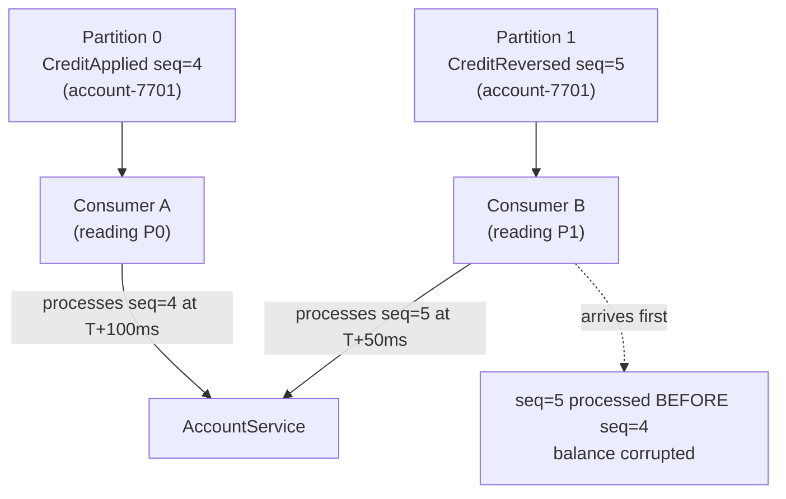
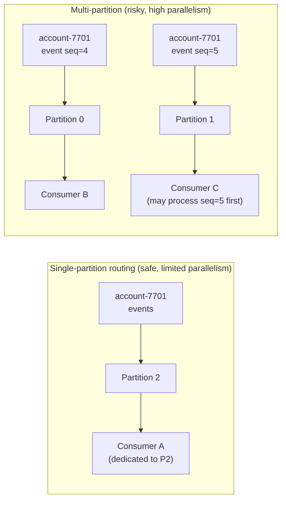

# السيناريو H — الأحداث خارج الترتيب وأرقام التسلسل

## نظرة عامة

يضمن Kafka ترتيبًا صارمًا داخل قسم واحد لمجموعة مستهلكين واحدة. وهذا الضمان أضيق مما يفترضه معظم المهندسين. فإعادة توازن قسم، أو قفزة في تأخر المستهلك، أو موضوع متعدد الأقسام تتوزع فيه أحداث الحساب عبر الأقسام، تكفي لأن يصل حدث `CreditReversed` قبل `CreditApplied` الذي يعكسه — فيفسد رصيد الحساب بطريقة لا يكتشفها التطبيق ولا قاعدة البيانات، لأن SQL نُفذت بشكل صحيح. يتتبع هذا الدرس الشروط الدقيقة التي تكسر ترتيب الأحداث، ثم ينفذ ثلاث استراتيجيات دفاعية: مخزن فجوات بأرقام التسلسل، والتوجيه بقسم لكل كيان، ونموذج إعادة تشغيل قائمًا على مصادر الأحداث يعامل مخالفات الترتيب كهم أساسي.

## أهداف التعلم

- شرح الشروط التي ينكسر فيها الترتيب لكل كيان: توزع أحداث الكيان على عدة أقسام، وإعادة التسليم بعد إعادات التوازن، وتمرير سجلات قسم واحد إلى عدة خيوط.
- تنفيذ مستهلك بمخزن فجوات يخزن الأحداث خارج الترتيب بشكل دائم ويطبقها بمجرد وصول التسلسل المفقود.
- معالجة حالة انتهاء مهلة الفجوة بمهمة مجدولة تنبّه وتطبق الأحداث المتاحة عندما تتجاوز الفجوة 5 ثوانٍ.
- توجيه كل أحداث الكيان إلى قسم Kafka واحد باستخدام معرّف الكيان كمفتاح الرسالة، وشرح مقايضة التوازي.
- تصميم نهج قائم على مصادر الأحداث يُشتق فيه الرصيد بإعادة تشغيل الأحداث بالتسلسل، فيُلغى تحديث الرصيد في مكانه كليًا.
- إضافة جدول مراقبة `event_gaps` وتحديد حدود تنبيه مناسبة لاتفاقية الخدمة.

## سياق العمل

*مثال مركّب:* يشغّل "Accord Bank"، وهو بنك أفراد رقمي خيالي لديه 890,000 حساب جارٍ، خدمة حسابات قائمة على الأحداث تتدفق فيها كل تغييرات الأرصدة عبر Kafka. وعند 09:14 صباح يوم اثنين، تسببت إعادة توازن مجدولة لمجموعة المستهلكين أطلقها نشر متدرج في Kubernetes في إعادة إسناد 23 قسمًا. وخلال نافذة إعادة التوازن البالغة 400 مللي ثانية، كان مستهلكان يعالجان قسمين متجاورين يحملان كلاهما أحداثًا جارية لمجموعة من الحسابات كانت لها أحداث على القسمين (مشكلة معروفة في نظام التقسيم بالتجزئة السابق). وعند استئناف الاستهلاك، عولجت أحداث `CreditReversed` ‏(التسلسل N+1) لـ 61 حسابًا قبل أحداث `CreditApplied` المقابلة (التسلسل N).

طبّق حساب الرصيد العكس على الرصيد قبل الإضافة، فنتجت قيمة أقل من الصحيح. ولسبعة حسابات كان الرصيد الفاسد تحت الصفر — فأطلق ذلك إشعارات تجميد ائتمان آلية لأولئك العملاء. وبحلول امتلاء الفجوة ومعالجة أحداث `CreditApplied` (بعد 231 مللي ثانية)، كانت إشعارات التجميد قد أُرسلت وعُلّمت الحسابات في نظام الاحتيال. وتطلبت المعالجة 7 مراجعات يدوية للحسابات، و7 مكالمات اعتذار للعملاء، ومراجعات عناية إضافية لعميلين تبيّن أنهما من الفئات الضعيفة. ولم يجد تحليل ما بعد الحادث أي مراقبة لفجوات التسلسل. فقد وُجدت الفجوة 231 مللي ثانية وكانت غير مرئية تمامًا.

## لماذا ينكسر الترتيب في Kafka

يضمن Kafka أن الرسائل داخل قسم واحد تُسلّم إلى المستهلك بترتيب إنتاجها (ومع منتج idempotent، حتى عبر إعادات المحاولة). ومع ذلك ينكسر الترتيب *لكل كيان* في ثلاثة سيناريوهات.



**السيناريو 1 — موضوع متعدد الأقسام دون توجيه بالمفتاح**: تتوزع أحداث الحساب عبر الأقسام. ويعالجها مستهلكون مختلفون بمعدلات مختلفة.

**السيناريو 2 — إعادة توازن مجموعة المستهلكين**: كان القسم P0 مسندًا إلى المستهلك A. وخلال إعادة التوازن يُعاد إسناد P0 إلى المستهلك B، الذي يبدأ من آخر إزاحة *ملتزمة*. فالأحداث التي عالجها A لكنه لم يلتزم بها بعد تُسلّم مجددًا — فيرى B أرقام تسلسل *أقدم* مجددًا (تكرارات)، وإذا كان A ما زال ينهي عمله بينما بدأ B، فقد يتداخلان.

**السيناريو 3 — المعالجة المتزامنة داخل قسم واحد**: الإعداد `setConcurrency(N)` في Spring آمن بحد ذاته — فكل قسم ما زال يُقرأ بخيط واحد بالضبط. وينكسر الترتيب عندما يمرر المستمع السجلات إلى مجمع خيوط (`@Async`، أو `CompletableFuture`، أو التدفقات المتوازية) فيُعالج سجلان من القسم نفسه في الوقت نفسه.

> [!WARNING]
> ضبط `concurrency > 1` على `@KafkaListener` يعالج الرسائل من عدة أقسام بالتوازي، وهذا هو السلوك المقصود. فإذا كان لموضوعك أقسام أقل من مستوى التزامن، ستبقى بعض الخيوط عاطلة. وإذا امتدت أحداث كيانك عبر عدة أقسام، تحصل على معالجة خارج الترتيب. فأبقِ التزامن عند عدد الأقسام أو أقل، وتأكد من أن أحداث كل حساب تعيش في قسم واحد بالضبط، ولا تعالج أبدًا سجلات قسم واحد بالتزامن داخل المستمع.

## أرقام التسلسل على الأحداث

يجب أن يحمل كل حدث مغيّر رقم تسلسل متزايدًا رتيبًا محددًا بالكيان الذي يؤثر فيه.

```java
public record AccountEvent(
        UUID        accountId,
        long        sequenceNumber,    // monotonically increasing per accountId
        EventType   type,              // CREDIT_APPLIED, CREDIT_REVERSED, DEBIT_APPLIED, etc.
        long        amountCents,
        Instant     occurredAt,
        UUID        eventId,           // globally unique event ID for deduplication
        String      correlationId      // links to originating payment/transfer
) {
    public enum EventType {
        ACCOUNT_OPENED, CREDIT_APPLIED, DEBIT_APPLIED,
        CREDIT_REVERSED, DEBIT_REVERSED, ACCOUNT_CLOSED
    }
}
```

يسند المنتج رقم التسلسل وقت إنشاء الحدث ويُخزن في مخزن الأحداث. وهو ليس إزاحة Kafka — بل ضمان على مستوى العمل يملكه النطاق.

## الإصلاح 1 — مخزن الفجوات

يحتفظ مخزن الفجوات بالأحداث التي وصلت خارج الترتيب ويطبقها بمجرد وصول السابق المفقود. ويجب أن تكون حالته **دائمة**. فللمخزن في الذاكرة عيبان قاتلان: يُقرّ المستهلك بإزاحة Kafka لحدث *خزّنه* فقط، فتضيع إعادة التشغيل ذلك الحدث إلى الأبد؛ وبعد إعادة التشغيل أو إعادة التوازن يختفي "رقم التسلسل التالي المتوقع" من الذاكرة. لذلك يعيش آخر تسلسل مطبق على صف الحساب (يُحدّث في المعاملة نفسها مع الرصيد)، وتنتظر الأحداث المبكرة في جدول `pending_account_events`.

```java
@Service
@RequiredArgsConstructor
@Slf4j
public class SequencedEventConsumer {

    private final AccountBalanceService accountBalanceService;
    private final PendingEventRepository pendingEvents;   // pending_account_events table
    private final GapMonitoringService  gapMonitoringService;

    @KafkaListener(topics = "account.events", groupId = "balance-service",
                   containerFactory = "manualAckContainerFactory")
    public void onAccountEvent(AccountEvent event, Acknowledgment ack) {
        accountBalanceService.processInOrder(event);   // one DB transaction (below)
        ack.acknowledge();   // safe: the event is now either applied or durably buffered
    }
}

@Service
@RequiredArgsConstructor
@Slf4j
public class AccountBalanceService {

    private final AccountRepository accounts;
    private final PendingEventRepository pendingEvents;
    private final GapMonitoringService gapMonitoringService;

    @Transactional
    public void processInOrder(AccountEvent event) {
        UUID accountId = event.accountId();
        // Row lock: serialises all processing for this account
        Account account = accounts.findByIdForUpdate(accountId).orElseThrow();
        long expected = account.getLastAppliedSeq() + 1;

        if (event.sequenceNumber() < expected) {
            // Already applied (redelivery after a rebalance) — idempotent skip
            log.info("Stale/duplicate event ignored: accountId={} seq={} expected={}",
                    accountId, event.sequenceNumber(), expected);
            return;
        }
        if (event.sequenceNumber() > expected) {
            // Arrived early — buffer it DURABLY (unique on account_id + seq)
            log.warn("Gap detected: accountId={} expected={} received={}",
                    accountId, expected, event.sequenceNumber());
            pendingEvents.insertIgnoringDuplicate(event);
            gapMonitoringService.recordGap(accountId, expected, event.sequenceNumber());
            return;
        }

        // In order: apply it, then drain any buffered successors
        apply(account, event);
        long next = event.sequenceNumber() + 1;
        Optional<AccountEvent> buffered;
        while ((buffered = pendingEvents.find(accountId, next)).isPresent()) {
            apply(account, buffered.get());
            pendingEvents.delete(accountId, next);
            gapMonitoringService.clearGap(accountId, next);
            next++;
        }
    }

    private void apply(Account account, AccountEvent event) {
        account.applyEvent(event);                       // balance change
        account.setLastAppliedSeq(event.sequenceNumber()); // same transaction
        log.debug("Applied event: accountId={} seq={} type={}",
                event.accountId(), event.sequenceNumber(), event.type());
    }
}
```

يسلسل قفل صف الحساب كل المعالجة لذلك الحساب. والحدث الأقدم من المتوقع (إعادة تسليم بعد إعادة توازن) يُتخطى بشكل idempotent، والحدث المبكر يُخزن بشكل دائم بقيد فريد على الحساب والتسلسل، والإقرار بالإزاحة آمن لأن الحدث الآن إما مطبق أو مخزن بشكل دائم.

## الإصلاح 2 — معالجة انتهاء مهلة الفجوة

الفجوة التي لا تمتلئ أبدًا أسوأ من فجوة تُكتشف سريعًا. فالحدث المفقود (أسقطه المنتج، أو ضاع في DLT) سيوقف تدفق أحداث الحساب إلى أجل غير مسمى إذا لم توجد مهلة. والخطوة الأولى عند انتهاء المهلة يجب أن تكون **جلب الحدث المفقود من مخزن الأحداث المعتمد** — ولا ينطبق قرار السياسة أدناه إلا إذا تعذر العثور عليه.

```java
@Component
@RequiredArgsConstructor
@Slf4j
public class GapTimeoutMonitor {

    private final GapMonitoringService   gapMonitoringService;
    private final AlertingService        alertingService;
    private final AccountBalanceService  accountBalanceService;

    private static final Duration GAP_TIMEOUT  = Duration.ofSeconds(5);
    private static final Duration CHECK_INTERVAL = Duration.ofSeconds(1);

    @Scheduled(fixedDelayString = "1000")   // every 1 second
    public void checkForStaleGaps() {
        Instant now      = Instant.now();
        Instant deadline = now.minus(GAP_TIMEOUT);

        // Open gaps come from the durable event_gaps table, not from memory,
        // so they survive restarts and are visible to every instance
        gapMonitoringService.findOpenGaps().forEach((accountId, expectedSeq) -> {
            Instant detectedAt = gapMonitoringService.detectedAt(accountId, expectedSeq);

            if (detectedAt.isBefore(deadline)) {
                log.error("Gap timeout: accountId={} missingSeq={} gapAge={}ms",
                        accountId, expectedSeq,
                        Duration.between(detectedAt, now).toMillis());

                alertingService.page(PagerDutyAlert.high()
                        .summary("Account event gap timeout: " + accountId)
                        .details(Map.of("accountId", accountId,
                                        "missingSequence", expectedSeq,
                                        "gapAgeMs", Duration.between(detectedAt, now).toMillis()))
                        .build());

                // Apply buffered events that follow the gap — balance will be inaccurate
                // but the account unblocks. Flag for manual reconciliation.
                accountBalanceService.forceApplyBuffered(accountId);   // skips the missing seq
                accountBalanceService.flagForReconciliation(accountId,
                        "gap-timeout: missing seq=" + expectedSeq);
            }
        });
    }
}
```

تأتي الفجوات المفتوحة من جدول `event_gaps` الدائم، لا من الذاكرة، فتنجو من إعادات التشغيل وتكون مرئية لكل النسخ.

> [!NOTE]
> استراتيجية التطبيق القسري عند انتهاء المهلة تقبل عمدًا رصيدًا ربما يكون غير صحيح لإبقاء الحساب قيد المعالجة. وعلامة `flagForReconciliation` تضمن أن مهمة المطابقة الليلية ستلتقط الفرق وتصححه. والبديل إيقاف المعالجة للحساب المتأثر وإطلاق حادث P0 — وهو مناسب للحسابات عالية القيمة. والاختيار سياسة عمل، لا قرار تقني.

## الإصلاح 3 — التوجيه بقسم Kafka لكل حساب

الإصلاح المعماري الأبسط: تأكد من أن كل أحداث الحساب تقع دائمًا في قسم Kafka نفسه باستخدام `accountId` كمفتاح الرسالة. ويجزّئ المقسّم الافتراضي في Kafka المفتاح (murmur2) بباقي القسمة على عدد الأقسام — فتغيير عدد الأقسام لاحقًا يعيد ربط المفاتيح بأقسام مختلفة. ومع منتج idempotent ‏(`max.in.flight.requests.per.connection` ≤ 5) لا تعيد إعادات المحاولة ترتيب السجلات داخل القسم.

```java
@Service
@RequiredArgsConstructor
@Slf4j
public class AccountEventProducer {

    private final KafkaTemplate<String, AccountEvent> kafkaTemplate;

    private static final String TOPIC = "account.events";

    public void publish(AccountEvent event) throws Exception {
        // Using accountId as the key guarantees same-partition delivery.
        // Wait for the result: throwing inside an async whenComplete callback
        // reaches nobody. (In production, publish via the outbox — lesson 13.)
        SendResult<String, AccountEvent> result =
                kafkaTemplate.send(TOPIC, event.accountId().toString(), event)
                        .get(10, TimeUnit.SECONDS);
        log.debug("Published: accountId={} seq={} partition={}",
                event.accountId(), event.sequenceNumber(),
                result.getRecordMetadata().partition());
    }
}
```

انتظر نتيجة الإرسال: فرمي استثناء داخل دالة `whenComplete` غير المتزامنة لا يصل إلى أحد. (وفي الإنتاج انشر عبر الـ outbox — الدرس 13.)

### مقايضة التوازي



المقايضة حقيقية: التوجيه بقسم لكل حساب يحد التوازي بمستهلك واحد لكل حساب في وقت واحد. فلموضوع بـ 100 قسم يعالج مليون حساب، يتعامل كل قسم مع 10,000 حساب. والحساب البطيء لا يوقف الآخرين على أقسام مختلفة. لكن إذا ولّد حساب واحد 50,000 حدث في الثانية (تاجر ساخن)، فقد يشبع ذلك الحساب خيط مستهلك واحدًا.

> [!IMPORTANT]
> لا تزد التوازي أبدًا باستهلاك قسم الحساب نفسه بعدة خيوط. فرافعة التوسع الصحيحة زيادة عدد الأقسام (إعادة تقسيم الموضوع) مع الحفاظ على الثابت بأن كل أحداث الحساب تُربط بالقسم نفسه. وتتطلب إعادة تقسيم الموضوع نافذة ترحيل وتنسيقًا دقيقًا مع المنتجين.

## الإصلاح 4 — مصادر الأحداث: الرصيد كإسقاط مشتق

في نموذج مصادر الأحداث، لا يُخزن الرصيد أبدًا كمصدر حقيقة. بل يُشتق بإعادة تشغيل أحداث الحساب بترتيب التسلسل (عمليًا من لقطة دورية، لا من التسلسل 1 كل مرة). ولا يستطيع التسليم خارج الترتيب إفساد الرصيد لأن الرصيد لا يُحدّث في مكانه — بل يُعاد حسابه من مخزن الأحداث المرتب، وتُكتشف الفجوات.

```java
@Service
@RequiredArgsConstructor
public class EventSourcedAccountService {

    private final AccountEventStore eventStore;

    /**
     * Derive current balance by replaying all events in sequence order.
     * Gaps cause an exception, forcing the caller to fetch the missing event.
     */
    public BalanceResult deriveBalance(UUID accountId) {
        List<AccountEvent> events = eventStore.findByAccountIdOrderBySequenceNumber(accountId);

        validateNoGaps(accountId, events);

        long balanceCents = 0L;
        for (AccountEvent event : events) {
            balanceCents = applyEvent(balanceCents, event);
        }
        return new BalanceResult(accountId, balanceCents, events.size());
    }

    private void validateNoGaps(UUID accountId, List<AccountEvent> events) {
        for (int i = 0; i < events.size(); i++) {
            long expected = i + 1L;
            long actual   = events.get(i).sequenceNumber();
            if (actual != expected) {
                throw new EventSequenceGapException(accountId, expected, actual);
            }
        }
    }

    private long applyEvent(long currentBalance, AccountEvent event) {
        return switch (event.type()) {
            case CREDIT_APPLIED  -> currentBalance + event.amountCents();
            case DEBIT_APPLIED   -> currentBalance - event.amountCents();
            case CREDIT_REVERSED -> currentBalance - event.amountCents();
            case DEBIT_REVERSED  -> currentBalance + event.amountCents();
            default              -> currentBalance;
        };
    }
}
```

### مخطط مخزن الأحداث

```sql
CREATE TABLE account_events (
    id              UUID         NOT NULL DEFAULT gen_random_uuid(),
    account_id      UUID         NOT NULL,
    sequence_number BIGINT       NOT NULL,
    event_type      VARCHAR(64)  NOT NULL,
    amount_cents    BIGINT       NOT NULL DEFAULT 0,
    occurred_at     TIMESTAMPTZ  NOT NULL,
    event_id        UUID         NOT NULL,
    correlation_id  VARCHAR(128),
    metadata        JSONB,
    CONSTRAINT pk_account_events PRIMARY KEY (id),
    CONSTRAINT uq_account_sequence UNIQUE (account_id, sequence_number),
    CONSTRAINT chk_sequence_positive CHECK (sequence_number > 0)
);

CREATE INDEX idx_account_events_account_seq
    ON account_events (account_id, sequence_number);
```

يمنع قيد `UNIQUE (account_id, sequence_number)` **التكرارات** على مستوى قاعدة البيانات. لكنه لا يمنع الفجوات ولا الإدراجات خارج الترتيب — فيمكن إدراج التسلسل 5 قبل 4 — ولهذا تفحص `validateNoGaps` التسلسل المعاد تشغيله. (وإذا كان مخزن الأحداث هو الكاتب، فاحجز أرقام التسلسل بعداد لكل حساب في المعاملة نفسها حتى لا تظهر فجوات.)

## المراقبة التشغيلية — جدول فجوات الأحداث

```sql
CREATE TABLE event_gaps (
    account_id          UUID         NOT NULL,
    expected_sequence   BIGINT       NOT NULL,
    received_sequence   BIGINT       NOT NULL,
    detected_at         TIMESTAMPTZ  NOT NULL DEFAULT now(),
    resolved_at         TIMESTAMPTZ,
    resolution_type     VARCHAR(32), -- FILLED, TIMEOUT_FORCE_APPLY, MANUAL
    gap_duration_ms     INTEGER GENERATED ALWAYS AS
                            (EXTRACT(EPOCH FROM (resolved_at - detected_at)) * 1000) STORED,
    CONSTRAINT pk_event_gaps PRIMARY KEY (account_id, expected_sequence)
);

-- Alert query: unresolved gaps older than 5 seconds
SELECT account_id, expected_sequence, detected_at,
       EXTRACT(EPOCH FROM (now() - detected_at)) * 1000 AS age_ms
FROM   event_gaps
WHERE  resolved_at IS NULL
AND    detected_at < now() - INTERVAL '5 seconds'
ORDER  BY detected_at;
```

اربط هذا الاستعلام بمسار التنبيه لديك (قاعدة تسجيل في Prometheus أو مهمة مجدولة) لاستدعاء المناوب عندما تستمر الفجوات بعد حد اتفاقية الخدمة.

## اختبار المعرفة

**س1: لموضوع `account.events` لديك 32 قسمًا. ويتلقى حساب 5 أحداث بسرعة: seq=1،2،3،4،5. ويُنتج seq=3 إلى القسم 15 وseq=4 إلى القسم 16 بسبب خطأ إعداد في المنتج أفقده مفتاح القسم مؤقتًا. ويقرأ المستهلك A القسم 15 والمستهلك B القسم 16. ما المشكلة التي تنشأ، وما الإصلاح النهائي على مستوى المنتج؟**

ج: يعالج المستهلك B ‏seq=4 قبل أن يعالج المستهلك A ‏seq=3، لأن الحدثين على قسمين مختلفين بترتيب مستقل. فإذا كان معالج الحدث يحدّث الرصيد في مكانه، يُطبق seq=4 (خصم أو إضافة) على رصيد لم يُطبق عليه seq=3 بعد، فتفسد حالة الحساب. والإصلاح النهائي على مستوى المنتج ضمان أن `accountId` للحساب مضبوط دائمًا كمفتاح رسالة Kafka. فالمقسّم الافتراضي في Kafka يطبق تجزئة ثابتة على المفتاح، فيضمن أن كل الرسائل بالمفتاح نفسه تقع في القسم نفسه فتُسلّم بترتيب الإنتاج إلى مستهلك واحد. ويجب كشف خطأ الإعداد بتأكيد في جانب المنتج يرفض أي نشر لـ `AccountEvent` لا يطابق فيه مفتاح الرسالة `event.accountId().toString()`.

**س2: ما مقايضة الصحة عندما يطبق مخزن الفجوات تطبيقًا قسريًا بعد 5 ثوانٍ من انتظار رقم تسلسل مفقود؟**

ج: تطبيق الأحداث المخزنة قسريًا عند انتهاء مهلة الفجوة يعني حساب رصيد الحساب دون الحدث المفقود. فإذا لم يصل seq=4 (إضافة 200 جنيه) أبدًا، وطُبق seq=5 (عكس 200 جنيه) على أي حال، يكون الرصيد أقل بـ 200 جنيه مما يجب — فالعكس يُطبق على رصيد لم يتلقَ الإضافة الأصلية قط. وقد يظهر الحساب خطأً كأن رصيده غير كافٍ أو حتى سالب. واستراتيجية المهلة مقايضة تقدّم التوفر على الاتساق: تبقي تدفق الأحداث قيد المعالجة بدل التوقف إلى أجل غير مسمى، لكنها تتطلب تعليم الحساب للمطابقة وجلب الحدث المفقود من مخزن الأحداث وإعادة تشغيله يدويًا. وللحسابات ذات متطلب اتساق صارم (مثل التقارير الرقابية، وحدود الائتمان الآنية)، الخيار الأكثر أمانًا إيقاف المعالجة لذلك الحساب، واستدعاء المناوب، وجلب الحدث المفقود من المصدر المعتمد قبل الاستئناف.

## التحدي العملي

يصون فريقك خدمة حسابات متعددة العملات يولّد فيها كل حساب فرعي بعملة (GBP وEUR وUSD) أحداثًا مستقلة. ويقدم العمل نوع حدث جديدًا: `FxConversionApplied`، يخصم ذريًا من الحساب الفرعي باليورو (seq N) ويضيف إلى الحساب الفرعي بالجنيه (seq M). ويُنتج هذان الحدثان إلى موضوعي Kafka مختلفين (`account.events.eur` و`account.events.gbp`).

صمم استراتيجية ترتيب لهذا السيناريو:

1. كيف تضمن تطبيق خصم اليورو وإضافة الجنيه ذريًا، حتى لو استُهلكت رسالتا Kafka في أوقات مختلفة؟ ارسم مخطط تسلسل يبين سيناريو الفشل حيث يُطبق جانب واحد فقط.
2. وسّع تنفيذ مخزن الفجوات لدعم "حجز عبر العملات": عندما يُستلم `FxConversionApplied` لجانب اليورو، لا يُحدّث رصيد اليورو حتى تتأكد معالجة إضافة الجنيه المقابلة (أو العكس). أي بنية بيانات تتتبع الارتباط المعلق عبر العملات؟
3. اكتب استعلام مراقبة `event_gaps` الذي يعد الفجوات غير المحلولة حسب فئة العمر: 0–1 ثانية، و1–5 ثوانٍ، و5–30 ثانية، وأكثر من 30 ثانية. وسيقود هذا الاستعلام لوحة Grafana.
4. يكشف اختبار حمل أن مخزن الفجوات ينمو دون حد تحت تسليم مستمر خارج الترتيب. اقترح استراتيجية محدودة (مثل حد لكل حساب وأقصى عمر للفجوة) تمنع النمو غير المحدود مع الحفاظ على الصحة — واشرح لماذا "إخلاء أقدم حدث مخزن" سيضيع حركات مالية بصمت.

<!-- KNOWLEDGE-CHECK
{
  "questions": [
    {
      "text": "لموضوع account.events ‏32 قسمًا. ويفقد خطأ إعداد في المنتج مفتاح القسم مؤقتًا، فتقع الأحداث seq=3 وseq=4 للحساب نفسه في قسمين مختلفين. ما الإصلاح النهائي على مستوى المنتج؟",
      "options": [
        "زيادة عدد الأقسام لتزيد احتمالية وقوع الأحداث في القسم نفسه",
        "ضبط accountId دائمًا كمفتاح رسالة Kafka؛ فالمقسّم الافتراضي يجزّئ المفتاح بثبات، فيضمن وقوع كل أحداث الحساب في القسم نفسه",
        "استخدام Kafka Streams لدمج الأحداث من كل الأقسام في تدفق واحد",
        "ضبط المستهلك لقراءة كل الأقسام في خيط واحد لاستعادة الترتيب"
      ],
      "correct": 1,
      "explanation": "يضمن Kafka الترتيب فقط داخل قسم واحد لمجموعة مستهلكين. وباستخدام accountId كمفتاح الرسالة، يطبق المقسّم الافتراضي تجزئة ثابتة تضمن وقوع كل رسائل الحساب نفسه دائمًا في القسم نفسه، فيُحفظ ترتيب التسليم. ويجب أن يرفض تأكيد في جانب المنتج أي نشر لـ AccountEvent لا يطابق فيه مفتاح الرسالة event.accountId()."
    },
    {
      "text": "يتلقى مخزن فجوات seq=1 وseq=2 وseq=4 لحساب. وينتظر 5 ثوانٍ ثم يطبق الأحداث المخزنة قسريًا رغم فقدان seq=3. ما مقايضة الصحة؟",
      "options": [
        "لا مقايضة — التطبيق القسري بعد المهلة آمن دائمًا لأن Kafka يعيد تشغيل الأحداث المفقودة آليًا",
        "تُطبق الأحداث المخزنة (seq=4) دون seq=3، فقد يُحسب رصيد غير صحيح؛ ويجب تعليم الحساب للمطابقة وجلب الحدث المفقود وإعادة تشغيله يدويًا",
        "استراتيجية المهلة تخالف خصائص ACID للدفتر وتُبطل كل الأحداث اللاحقة",
        "التطبيق القسري ينتج سجل تحذير لكن دون أثر فعلي على الصحة لأن أرقام التسلسل استشارية"
      ],
      "correct": 1,
      "explanation": "تطبيق الأحداث المخزنة قسريًا عند انتهاء مهلة فجوة مقايضة تقدّم التوفر على الاتساق. فإذا كان seq=3 إضافة 200 جنيه وseq=4 عكس 200 جنيه، فتطبيق seq=4 دون seq=3 ينتج رصيدًا غير صحيح — فالعكس يُطبق على أساس لم يتلقَ الإضافة الأصلية قط. ويجب تعليم الحساب للمطابقة وجلب الحدث المفقود وإعادة تشغيله يدويًا."
    },
    {
      "text": "ما متطلب الصحة الذي يجعل التوجيه بقسم لكل كيان الحل الأبسط والأكثر موثوقية لمعالجة الأحداث خارج الترتيب؟",
      "options": [
        "يضمن التسليم مرة واحدة بالضبط بإزالة الأحداث المكررة",
        "يضمن Kafka تسليمًا مرتبًا صارمًا داخل قسم واحد لمجموعة مستهلكين، فتُسلّم كل أحداث كيان معين على القسم نفسه دائمًا بترتيب الإنتاج",
        "يلغي الحاجة إلى أرقام التسلسل لأن الأقسام مرتبة حسب الإزاحة",
        "يسمح للمستهلك بتوازي معالجة الأحداث عبر عدة خيوط لكل كيان"
      ],
      "correct": 1,
      "explanation": "ضمان الترتيب الأساسي في Kafka داخل القسم لكل مجموعة مستهلكين. فبتوجيه كل أحداث كيان (حساب) إلى القسم نفسه باستخدام معرّف الكيان كمفتاح الرسالة، تحصل على تسليم مرتب مجانًا دون أي تخزين أو كشف فجوات أو منطق مهلة على مستوى التطبيق. ومخزن الفجوات إجراء دفاع إضافي للحالات التي يكون فيها التوجيه بقسم لكل كيان غير عملي."
    }
  ]
}
-->

<!-- PRACTICAL-CHALLENGE
{
  "title": "بناء استراتيجية لمعالجة الأحداث خارج الترتيب",
  "difficulty": "advanced",
  "estimatedMinutes": 50,
  "tasks": [
    {"id": "1", "description": "صمم استراتيجية ترتيب عبر العملات لأحداث FxConversionApplied التي تخصم ذريًا من اليورو (seq N على account.events.eur) وتضيف إلى الجنيه (seq M على account.events.gbp). وارسم مخطط تسلسل يبين سيناريو الفشل حيث يُطبق جانب واحد فقط."},
    {"id": "2", "description": "وسّع مخزن الفجوات لدعم حجز عبر العملات: عندما يُستلم FxConversionApplied لجانب اليورو، احجز تحديث رصيد اليورو حتى تتأكد إضافة الجنيه المقابلة. وحدد بنية البيانات التي تتتبع الارتباط المعلق عبر العملات."},
    {"id": "3", "description": "اكتب استعلام SQL لمراقبة event_gaps يعد الفجوات غير المحلولة حسب فئة العمر: 0-1 ثانية، و1-5 ثوانٍ، و5-30 ثانية، وأكثر من 30 ثانية. وسيقود هذا الاستعلام لوحة Grafana لتنبيه المناوب."},
    {"id": "4", "description": "صمم استراتيجية محدودة لمخزن الفجوات (مثل حد للأحداث المعلقة لكل حساب وأقصى عمر للفجوة) تمنع النمو غير المحدود تحت تسليم مستمر خارج الترتيب مع الحفاظ على الصحة. وصف ما يحدث للأحداث بعد الحد (مثلًا إيقاف استهلاك ذلك القسم والتنبيه، بدل إسقاطها)."}
  ]
}
-->
