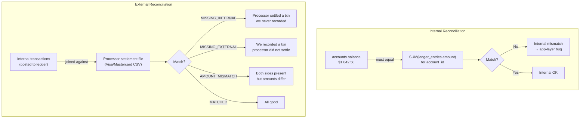
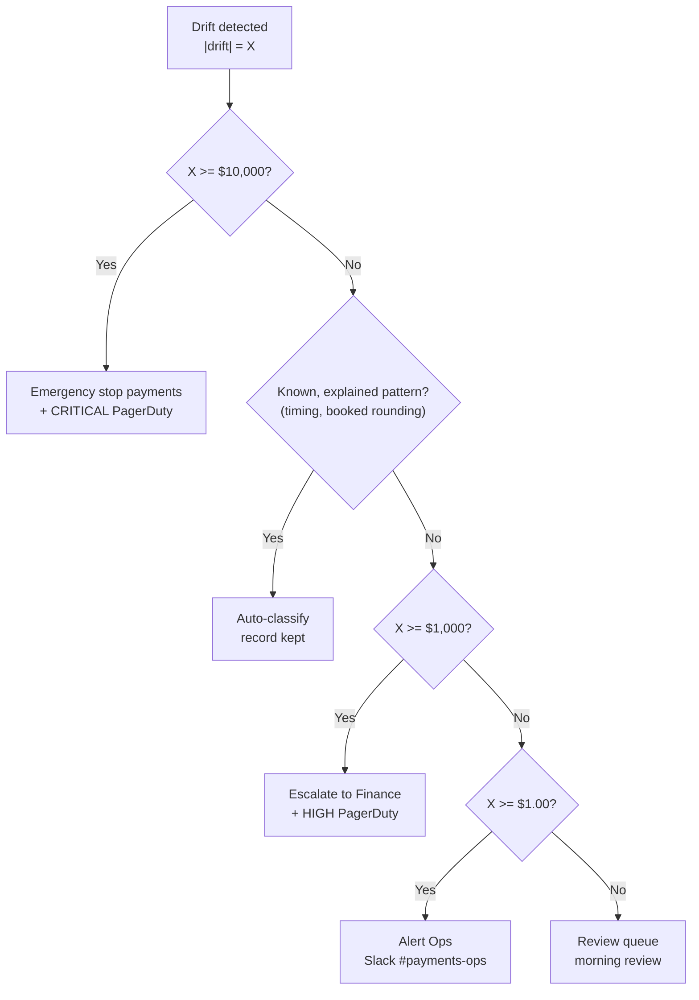

# السيناريو I — المطابقة الداخلية والخارجية ودفتر الظل

## نظرة عامة

وجدت مطابقة نهاية اليوم لدى معالج مدفوعات 150 حسابًا يختلف فيها رصيد الدفتر الداخلي عن ملف التسوية — بفروق بين 0.01 و500 دولار. ولم يكن لدى المهندس المناوب أي أداة للإجابة عن أهم سؤال في الدقائق الأولى: هل أي مال حقيقي لعميل في خطر الآن، أم أن هذا أثر بيانات؟ يبني هذا الدرس منظومة المطابقة كاملة — فحوص الرصيد الداخلية، ومطابقة التسوية الخارجية، ودفاتر الظل، والتنبيه القائم على الحدود — لتكون إجابة ذلك السؤال دائمًا على بُعد استعلام واحد.

## أهداف التعلم

- التمييز بين المطابقة الداخلية (رصيد الحساب مقابل مجموع قيود الدفتر) والمطابقة الخارجية (المعاملات الداخلية مقابل ملف تسوية معالج الدفع)، وشرح لماذا يلزم الاثنان.
- كتابة استعلام PostgreSQL باستخدام `SUM` و`HAVING` لكشف الحسابات التي انحرف رصيدها المخزن عن مجموع قيود دفترها.
- تنفيذ مهمة Spring Batch ‏`InternalReconciliationJob` تعمل ليلًا وتكتب حالات عدم التطابق في جدول `reconciliation_items`.
- تحميل ملف تسوية CSV من معالج دفع وإجراء ربط خارجي كامل مقابل سجلات المعاملات الداخلية، وتصنيف النتائج كـ `MATCHED` أو `MISSING_INTERNAL` أو `MISSING_EXTERNAL` أو `AMOUNT_MISMATCH`.
- تصميم دفتر ظل يحافظ عليه مسار شيفرة مستقل (مستهلك أحداث يكتب في جدوله الخاص)، وشرح أنماط الفشل التي يكشفها وتفوتها المطابقة الداخلية.
- تطبيق توجيه التنبيهات القائم على الحدود: التصنيف الآلي للأنماط المعروفة المفسَّرة فقط، وتنبيه العمليات فوق دولار واحد، والتصعيد للمالية فوق 1,000 دولار، وإطلاق تعليق طارئ للمدفوعات فوق 10,000 دولار.

## سياق العمل

*مثال مركّب:* تشغّل "Meridian Payments"، وهي ميسّر دفع أمريكي خيالي يعالج 4.2 مليار دولار سنويًا لـ 23,000 حساب تاجر، مهمة دفعية ليلية تقارن أرصدة الدفتر الداخلي بملف تسوية Visa ليوم العمل السابق. ومساء يوم ثلاثاء في الربع الثالث، كشفت مهمة المطابقة 150 حالة عدم تطابق تؤثر في 150 حسابًا متمايزًا. وتراوحت الفروق بين 0.01 دولار (تُتُبعت إلى تحويل عملة أُضيف قبل 6 أسابيع كان يقرّب بحساب `double`) و487.33 دولارًا (غير مفسَّر).

لم يكن لدى المهندس المناوب أداة تصنيف. فكل حالة عدم تطابق بدت متطابقة في التنبيه — UUID ومبلغان بالدولار. واستغرق العمل على 150 صفًا يدويًا عند الحادية عشرة ليلًا 3 ساعات. ومن الفروق الـ 150: كانت 142 أخطاء بسنت أو سنتين من خلل التحويل ذاك — صغيرة، لكنها عيب حقيقي ومنهجي كان يجب إصلاحه لا تجاهله؛ و6 فروق توقيت سُوّي فيها استرداد في اليوم D لكنه رُحّل داخليًا في اليوم D+1 (حالة طرفية معروفة دون تذكرة مفتوحة)؛ و2 فرقان حقيقيان غير مفسَّرين مجموعهما 912.11 دولارًا يتطلبان مراجعة فريق المالية. ولم يكن أي مال لعميل في خطر في النهاية، لكن تأخر التحقيق 3 ساعات خالف اتفاقية الخدمة الداخلية لدى Meridian البالغة 45 دقيقة لفرز أي تنبيه مطابقة. وأنتج تحليل ما بعد الحادث أربعة بنود عمل: إصلاح التحويل (وحدات صغرى صحيحة، بقاعدة تقريب صريحة وتسجيل أي فرق تقريب في حساب تقريب)، والتصنيف الآلي لحالات عدم التطابق، والاستدعاء القائم على الحدود، ودفتر ظل لكشف الانحراف قبل نهاية اليوم.

## أنواع المطابقة

للمطابقة طبقتان متمايزتان، والخلط بينهما أكثر الأخطاء الهندسية شيوعًا في هذا المجال.

**المطابقة الداخلية** تجيب عن: هل الرصيد المخزن في جدول `accounts` يساوي مجموع كل قيود الدفتر لذلك الحساب؟ وهذا يكشف الأخطاء في طبقة التطبيق — مسار شيفرة حدّث `accounts.balance` لكنه فشل في كتابة صف `ledger_entries` المقابل، أو العكس.

**المطابقة الخارجية** تجيب عن: هل المعاملات المسجلة داخليًا تطابق ما سوّاه معالج الدفع فعلًا؟ وهذا يكشف إخفاقات الشبكة، وأخطاء المعالج، وفروق التوقيت، والاحتيال. فقد يجتاز الحساب المطابقة الداخلية (الرصيد = مجموع قيود الدفتر) مع وجود عدم تطابق خارجي (سوّى المعالج مبلغًا مختلفًا عما رُحّل داخليًا).



> [!IMPORTANT]
> يجب أن يعمل نوعا المطابقة كل يوم، بهذا الترتيب: الداخلية أولًا، ثم الخارجية. فإذا وجدت المطابقة الداخلية عدم تطابق، لا يمكن الوثوق بالدفتر الداخلي كمصدر حقيقة للربط في المطابقة الخارجية. فأصلح حالات عدم التطابق الداخلية قبل تفسير الخارجية.

## المطابقة الداخلية: الاستعلام والمهمة

### استعلام الكشف

```sql
-- Detect accounts where stored balance differs from sum of ledger entries.
-- Run in ONE consistent snapshot (REPEATABLE READ, or against a replica at a
-- known point) — otherwise postings that land mid-query look like drift.
-- (Signed convention here: credits positive, debits negative.)
SELECT
    a.id                                                 AS account_id,
    a.balance_cents                                      AS stored_balance,
    COALESCE(SUM(le.amount_cents), 0)                    AS ledger_sum,
    a.balance_cents - COALESCE(SUM(le.amount_cents), 0)  AS drift_cents
FROM       accounts       a
LEFT JOIN  ledger_entries le ON le.account_id = a.id
WHERE      a.status = 'ACTIVE'
GROUP BY   a.id, a.balance_cents
HAVING     a.balance_cents != COALESCE(SUM(le.amount_cents), 0)
ORDER BY   ABS(a.balance_cents - COALESCE(SUM(le.amount_cents), 0)) DESC;
```

يرشّح شرط `HAVING` الحسابات المنحرفة فقط. ولقاعدة بيانات بمليوني حساب نشط يكتمل هذا الاستعلام في أقل من 30 ثانية مع فهرس مغطٍّ على `ledger_entries(account_id, amount_cents)`.

### InternalReconciliationJob

```java
// Spring Batch 5: JobBuilderFactory / StepBuilderFactory were removed —
// use JobBuilder / StepBuilder with the JobRepository and transaction manager
@Configuration
@RequiredArgsConstructor
public class InternalReconciliationJobConfig {

    private final JobRepository              jobRepository;
    private final PlatformTransactionManager txManager;
    private final DataSource                 dataSource;
    private final ReconciliationWriter       reconciliationWriter;

    @Bean
    public Job internalReconciliationJob() {
        return new JobBuilder("internalReconciliationJob", jobRepository)
                .start(detectDriftStep())
                .build();
    }

    @Bean
    public Step detectDriftStep() {
        // No skip policy: any exception fails the job (zero tolerance)
        return new StepBuilder("detectDriftStep", jobRepository)
                .<InternalMismatch, InternalMismatch>chunk(500, txManager)
                .reader(driftReader())
                .writer(reconciliationWriter)
                .build();
    }

    @Bean
    @StepScope
    public JdbcCursorItemReader<InternalMismatch> driftReader() {
        return new JdbcCursorItemReaderBuilder<InternalMismatch>()
                .name("driftReader")
                .dataSource(dataSource)
                .sql("""
                    SELECT a.id           AS account_id,
                           a.balance_cents AS stored_balance,
                           COALESCE(SUM(le.amount_cents), 0) AS ledger_sum,
                           a.balance_cents - COALESCE(SUM(le.amount_cents), 0) AS drift_cents
                    FROM       accounts a
                    LEFT JOIN  ledger_entries le ON le.account_id = a.id
                    WHERE      a.status = 'ACTIVE'
                    GROUP BY   a.id, a.balance_cents
                    HAVING     a.balance_cents != COALESCE(SUM(le.amount_cents), 0)
                    """)
                .rowMapper((rs, rowNum) -> new InternalMismatch(
                        rs.getObject("account_id", UUID.class),
                        rs.getLong("stored_balance"),
                        rs.getLong("ledger_sum"),
                        rs.getLong("drift_cents")
                ))
                .build();
    }
}

public record InternalMismatch(
        UUID accountId,
        long storedBalanceCents,
        long ledgerSumCents,
        long driftCents       // positive = balance overstated; negative = understated
) {}
```

```java
@Component
@RequiredArgsConstructor
@Slf4j
public class ReconciliationWriter implements ItemWriter<InternalMismatch> {

    private final ReconciliationRunRepository  runRepository;
    private final ReconciliationItemRepository itemRepository;
    private final AlertThresholdService        alertService;

    @Override
    public void write(Chunk<? extends InternalMismatch> chunk) {   // Spring Batch 5 signature
        List<? extends InternalMismatch> mismatches = chunk.getItems();
        UUID runId = runRepository.currentRunId();  // set at job start
        // (Alerts below fire even if this chunk's transaction later rolls back;
        //  for strict behaviour, send alerts from a step listener after commit.)
        List<ReconciliationItem> items = mismatches.stream()
                .map(m -> ReconciliationItem.fromInternal(runId, m))
                .toList();
        itemRepository.saveAll(items);

        for (InternalMismatch m : mismatches) {
            alertService.evaluate(m.driftCents(), m.accountId(), ReconciliationType.INTERNAL);
        }

        log.info("Wrote {} internal mismatches for run {}", mismatches.size(), runId);
    }
}
```

## المطابقة الخارجية: تحميل ملف التسوية

يسلّم معالج الدفع ملف CSV عند 23:30 بالتوقيت العالمي يحتوي كل معاملة سُوّيت ذلك اليوم. ويحمل كل صف رقم مرجع المعالج، ومعرّف حساب التاجر، والمبلغ المسوّى بالسنت. وتجري مهمة Java الربط الخارجي الكامل في الذاكرة لأحجام حتى نحو 500,000 صف؛ وفوق ذلك حمّل الملف في جدول تجهيز واستخدم الربط الخارجي الكامل بلغة SQL المعروض أدناه.

### الربط الخارجي الكامل بلغة SQL (نهج جدول التجهيز للأحجام الكبيرة)

```sql
-- After bulk-loading the CSV into settlement_staging:
SELECT
    COALESCE(it.transaction_ref, ss.external_ref)        AS ref,
    it.amount_cents                                       AS internal_amount,
    ss.amount_cents                                       AS external_amount,
    CASE
        WHEN it.transaction_ref IS NULL          THEN 'MISSING_INTERNAL'
        WHEN ss.external_ref    IS NULL          THEN 'MISSING_EXTERNAL'
        WHEN it.amount_cents != ss.amount_cents  THEN 'AMOUNT_MISMATCH'
        ELSE                                          'MATCHED'
    END                                                   AS category
FROM       internal_transactions it
FULL OUTER JOIN settlement_staging ss
    ON  it.transaction_ref = ss.external_ref
    AND it.settlement_date = ss.settlement_date;
```

### ExternalReconciliationJob

```java
@Service
@RequiredArgsConstructor
@Slf4j
public class ExternalReconciliationJob {

    private final TransactionRepository        transactionRepository;
    private final ReconciliationItemRepository itemRepository;
    private final AlertThresholdService        alertService;

    public ReconciliationRunSummary run(UUID runId, Path settlementFile,
                                        LocalDate settlementDate) throws IOException {
        List<ReconciliationItem> items = new ArrayList<>();

        // Step 1: load settlement file into a ref → amount map
        Map<String, Long> settledAmounts = loadSettlementFile(settlementFile, runId, items);

        // Step 2: load today's internal transactions.
        // A reference that appears TWICE on either side is itself a finding
        // (a double posting or a double settlement) — toMap without a merge
        // function would just crash, and a silent merge would hide it.
        Map<String, Long> internalAmounts = new HashMap<>();
        for (Transaction t : transactionRepository.findBySettlementDate(settlementDate)) {
            if (internalAmounts.putIfAbsent(t.processorReference(), t.amountCents()) != null) {
                items.add(ReconciliationItem.fromExternal(runId, t.processorReference(),
                        MismatchCategory.DUPLICATE_INTERNAL, t.amountCents()));
            }
        }

        // Step 3: full outer join in memory — classify every reference
        Set<String> allRefs = new HashSet<>();
        allRefs.addAll(settledAmounts.keySet());
        allRefs.addAll(internalAmounts.keySet());

        int matched = 0, missingInternal = 0, missingExternal = 0, amountMismatch = 0;

        for (String ref : allRefs) {
            Long external = settledAmounts.get(ref);
            Long internal = internalAmounts.get(ref);

            MismatchCategory category;
            long drift = 0L;

            if (external != null && internal != null) {
                if (external.equals(internal)) {
                    category = MismatchCategory.MATCHED;
                    matched++;
                } else {
                    category = MismatchCategory.AMOUNT_MISMATCH;
                    drift    = internal - external;   // positive = internal overstated
                    amountMismatch++;
                }
            } else if (external != null) {
                // Processor settled a transaction we have no record of internally
                category = MismatchCategory.MISSING_INTERNAL;
                drift    = -external;
                missingInternal++;
            } else {
                // We recorded it; processor did not settle it yet
                category = MismatchCategory.MISSING_EXTERNAL;
                drift    = internal;
                missingExternal++;
            }

            if (category != MismatchCategory.MATCHED) {
                items.add(ReconciliationItem.fromExternal(runId, ref, category, drift));
                alertService.evaluate(drift, ref, ReconciliationType.EXTERNAL);
            }
        }

        itemRepository.saveAll(items);
        return new ReconciliationRunSummary(runId, matched, missingInternal,
                missingExternal, amountMismatch);
    }

    private Map<String, Long> loadSettlementFile(Path file, UUID runId,
                                                 List<ReconciliationItem> items) throws IOException {
        Map<String, Long> result = new HashMap<>();
        // Use a real CSV parser (quoted fields, embedded commas) — never String.split(",")
        try (Reader reader = Files.newBufferedReader(file, StandardCharsets.UTF_8);
             CSVParser csv = CSVFormat.DEFAULT.builder()
                     .setHeader().setSkipHeaderRecord(true).build().parse(reader)) {
            for (CSVRecord row : csv) {
                // columns: processor_ref, merchant_account_id, settled_amount_cents, currency
                String ref = row.get("processor_ref").trim();
                if (!"USD".equals(row.get("currency"))) {
                    throw new SettlementFileException("Unexpected currency in row " + row.getRecordNumber());
                }
                long amount = Long.parseLong(row.get("settled_amount_cents").trim());
                if (result.putIfAbsent(ref, amount) != null) {
                    items.add(ReconciliationItem.fromExternal(runId, ref,
                            MismatchCategory.DUPLICATE_EXTERNAL, amount));
                }
            }
        }
        return result;
    }
}

public enum MismatchCategory {
    MATCHED, MISSING_INTERNAL, MISSING_EXTERNAL, AMOUNT_MISMATCH,
    DUPLICATE_INTERNAL, DUPLICATE_EXTERNAL
}
```

المرجع الذي يظهر **مرتين** في أي جانب نتيجة بحد ذاته (ترحيل مزدوج أو تسوية مزدوجة)، واستخدم محلل CSV حقيقيًا لا `String.split(",")`.

> [!WARNING]
> فئة `MISSING_INTERNAL` أخطر الفئات ماليًا. فهي تعني أن المعالج خصم أموالًا من حساب التسوية لديك لمعاملة لا سجل داخليًا لها. وهذا إما احتيال، أو خلل في مسار تسجيل المعاملات، أو حالة سباق تلقى فيها المعالج تفويضًا لم يُحفظ قط. ويجب أن تطلق هذه البنود تنبيهًا فوريًا بغض النظر عن المبلغ — فلا يوجد حد أدنى آمن لمعاملة يجب ألا توجد.

## دفتر الظل

يحتفظ دفتر الظل برصيد ثانٍ محسوب مستقلًا يعمل بجانب الرصيد الأساسي لكنه يُحدّث بمسار شيفرة منفصل تمامًا. ويجب أن تتفق القيمتان (عند النقطة نفسها من تدفق الأحداث). والانحراف يعني أن أحد مساري الشيفرة فيه خلل لا يشاركه الآخر.

احفظ رصيد الظل في **جدوله الخاص**، يحدّثه مستهلك منفصل لأحداث الدفع (مثلًا من الـ outbox). ولا تحدّث عمود `shadow_balance` في صف `accounts` نفسه من معاملة `REQUIRES_NEW` داخل الترحيل: فالمعاملة الخارجية تمسك قفل ذلك الصف بالفعل، فتنتظر المعاملة الداخلية الخارجية، التي تنتظر الداخلية — جمود ذاتي.

```sql
-- Shadow balances in their own table, owned by the shadow consumer
CREATE TABLE account_shadow_balances (
    account_id          UUID    PRIMARY KEY,
    shadow_balance_cents BIGINT NOT NULL DEFAULT 0,
    last_event_seq      BIGINT  NOT NULL DEFAULT 0   -- position in the account's event stream
);
```

```java
@Service
@RequiredArgsConstructor
public class ShadowLedgerService {

    private final JdbcTemplate jdbc;

    /**
     * Applied by an independent consumer of payment events — a different code
     * path (ideally a different team) from the primary posting logic.
     * Idempotent and ordered: only the next event in sequence changes the row.
     */
    @Transactional
    public void applyShadowEvent(UUID accountId, long eventSeq, long signedAmountCents) {
        int rows = jdbc.update("""
                UPDATE account_shadow_balances
                SET    shadow_balance_cents = shadow_balance_cents + ?,
                       last_event_seq       = ?
                WHERE  account_id = ? AND last_event_seq = ? - 1
                """, signedAmountCents, eventSeq, accountId, eventSeq);

        if (rows != 1) {
            // Duplicate (already applied) or a gap — check which, never double-apply
            throw new ShadowLedgerException("Shadow event out of sequence for " + accountId);
        }
    }
}
```

### استعلام مقارنة الظل الليلي

```sql
-- Accounts where shadow balance diverges from primary balance.
-- Compare at the SAME position in each account's event stream (the shadow is
-- updated asynchronously, so a plain comparison would flag in-flight events).
SELECT
    a.id                    AS account_id,
    a.balance_cents         AS primary_balance,
    s.shadow_balance_cents  AS shadow_balance,
    a.balance_cents - s.shadow_balance_cents AS divergence_cents
FROM   accounts a
JOIN   account_shadow_balances s ON s.account_id = a.id
WHERE  a.status = 'ACTIVE'
AND    a.last_event_seq = s.last_event_seq            -- same point in the stream
AND    a.balance_cents != s.shadow_balance_cents
ORDER  BY ABS(a.balance_cents - s.shadow_balance_cents) DESC;
```

> [!NOTE]
> نمط دفتر الظل أكثر قيمة عندما يحافظ على مسار الظل فريق مختلف، أو حتى خدمة مختلفة تستهلك الأحداث من outbox. فإذا تشارك المساران دالة المكتبة نفسها، يفسد خلل في تلك الدالة الرصيدين بالتساوي ولن يكشفه الظل. فتنوع التنفيذ هو ما يعطي دفاتر الظل قوتها التشخيصية — فهي ليست مفيدة كفحص أداء بل ككاشف لانحراف مسارات الشيفرة.

## مخطط المطابقة

```sql
-- One row per nightly run, one per reconciliation type.
CREATE TABLE reconciliation_runs (
    id               UUID         NOT NULL DEFAULT gen_random_uuid(),
    run_type         VARCHAR(32)  NOT NULL,    -- INTERNAL, EXTERNAL
    business_date    DATE         NOT NULL,
    started_at       TIMESTAMPTZ  NOT NULL DEFAULT now(),
    completed_at     TIMESTAMPTZ,
    status           VARCHAR(16)  NOT NULL DEFAULT 'RUNNING', -- RUNNING, COMPLETED, FAILED
    total_checked    INTEGER      NOT NULL DEFAULT 0,
    total_mismatches INTEGER      NOT NULL DEFAULT 0,
    settlement_file  TEXT,         -- S3 URI or local path of CSV; NULL for INTERNAL runs
    CONSTRAINT pk_reconciliation_runs PRIMARY KEY (id),
    CONSTRAINT uq_run_date_type UNIQUE (business_date, run_type)
);

-- Individual mismatch items written during each run.
CREATE TABLE reconciliation_items (
    id                  UUID         NOT NULL DEFAULT gen_random_uuid(),
    run_id              UUID         NOT NULL REFERENCES reconciliation_runs(id),
    item_type           VARCHAR(16)  NOT NULL,    -- INTERNAL, EXTERNAL
    account_id          UUID,                     -- populated for INTERNAL items
    processor_reference VARCHAR(128),             -- populated for EXTERNAL items
    category            VARCHAR(32)  NOT NULL,    -- MATCHED, MISSING_INTERNAL, etc.
    drift_cents         BIGINT       NOT NULL,
    status              VARCHAR(16)  NOT NULL DEFAULT 'OPEN', -- OPEN, AUTO_CLOSED, ESCALATED, RESOLVED
    resolution_note     TEXT,
    created_at          TIMESTAMPTZ  NOT NULL DEFAULT now(),
    resolved_at         TIMESTAMPTZ,
    CONSTRAINT pk_reconciliation_items PRIMARY KEY (id)
);

CREATE INDEX idx_recon_items_run_id  ON reconciliation_items (run_id);
CREATE INDEX idx_recon_items_open    ON reconciliation_items (status) WHERE status = 'OPEN';
CREATE INDEX idx_recon_items_account ON reconciliation_items (account_id)
    WHERE account_id IS NOT NULL;
```

## حدود التنبيه والتصنيف الآلي

ليست كل حالات عدم التطابق متساوية — لكن مع المبالغ بوحدات صغرى صحيحة لا توجد "آثار فاصلة عائمة": فأي انحراف غير صفري فرق حقيقي يجب تفسيره. والحجم يقرر **الاستعجال**، لا هل ننظر أم لا. والتصنيف الآلي مسموح فقط للأنماط المعروفة المفسَّرة (فرق توقيت سيمحوه ملف الغد، أو فرق تقريب سُجّل في حساب تقريب)، وحتى حينها يُسجّل البند ولا يُحذف أبدًا. والانحراف البالغ 12,000 دولار حادث احتيال محتمل. وتصنّف طبقة توجيه التنبيهات وتوجّه آليًا.

```java
@Service
@RequiredArgsConstructor
@Slf4j
public class AlertThresholdService {

    // All thresholds in cents (integer minor units — there is no "sub-cent" drift)
    private static final long CENTS_OPS_ALERT         =     100L;   // >= $1.00
    private static final long CENTS_FINANCE_ESCALATE  = 100_000L;   // >= $1,000
    private static final long CENTS_EMERGENCY_STOP    = 1_000_000L; // >= $10,000

    private final ReconciliationItemRepository itemRepository;
    private final KnownPatternClassifier       knownPatterns;
    private final PagerDutyService             pagerDuty;
    private final SlackNotificationService     slack;
    private final PaymentSuspensionService     paymentSuspension;

    public void evaluate(long driftCents, Object reference, ReconciliationType type) {
        long absDrift = Math.abs(driftCents);

        if (absDrift >= CENTS_EMERGENCY_STOP) {
            triggerEmergencyStop(reference, driftCents, type);
            return;
        }
        // Known, explained pattern (e.g. timing difference cleared by tomorrow's
        // file, rounding booked to a rounding account): classify, keep the record
        Optional<String> explanation = knownPatterns.explain(reference, driftCents, type);
        if (explanation.isPresent()) {
            itemRepository.autoClassify(reference, explanation.get());
            return;
        }
        if (absDrift >= CENTS_FINANCE_ESCALATE) {
            escalateToFinance(reference, driftCents, type);
            return;
        }
        if (absDrift >= CENTS_OPS_ALERT) {
            alertOps(reference, driftCents, type);
            return;
        }
        // $0.01 to $0.99, unexplained: still a real difference — queue for review
        log.info("Low-value recon mismatch: ref={} drift={}c type={}", reference, driftCents, type);
    }

    private void alertOps(Object reference, long driftCents, ReconciliationType type) {
        slack.sendToChannel("#payments-ops",
                ":warning: Reconciliation mismatch ref=%s drift=%s type=%s — investigate before 09:00"
                        .formatted(reference, formatCents(driftCents), type));
    }

    private void escalateToFinance(Object reference, long driftCents, ReconciliationType type) {
        pagerDuty.createIncident(PagerDutyIncident.builder()
                .severity(Severity.HIGH)
                .summary("Recon mismatch %s — finance review required".formatted(formatCents(driftCents)))
                .details(Map.of("reference", reference.toString(), "type", type.name()))
                .build());
        log.error("Finance escalation: ref={} drift={}c", reference, driftCents);
    }

    private void triggerEmergencyStop(Object reference, long driftCents, ReconciliationType type) {
        log.error("EMERGENCY: Recon drift >= $10,000 for ref={} drift={}c — suspending payments.",
                reference, driftCents);

        paymentSuspension.suspendOutboundPayments(
                SuspensionReason.RECONCILIATION_EMERGENCY,
                String.valueOf(reference));

        pagerDuty.createIncident(PagerDutyIncident.builder()
                .severity(Severity.CRITICAL)
                .summary("EMERGENCY: Recon mismatch %s — payments suspended".formatted(formatCents(driftCents)))
                .details(Map.of("reference", reference.toString(),
                                "type",      type.name(),
                                "action",    "OUTBOUND_PAYMENTS_SUSPENDED"))
                .build());
    }

    // Exact formatting from integer cents — no double arithmetic
    private static String formatCents(long cents) {
        return BigDecimal.valueOf(cents, 2).toPlainString();
    }
}
```



> [!WARNING]
> يجب تنفيذ تعليق المدفوعات الطارئ عند انحراف 10,000 دولار كقاطع دائرة فوري، لا كتنبيه متأخر. فاستمرار المدفوعات الصادرة بينما يوجد فرق كبير غير مفسَّر قد يضاعف الخسائر. ويجب أن يتطلب رفع التعليق تجاوزًا يدويًا صريحًا من عضوين في فريق المالية — ضابط "الأعين الأربع". ووثّق هذا في دليل التشغيل قبل أن تحتاجه أبدًا.

## اختبار المعرفة

**س: لحساب `balance_cents = 50000` ‏(500.00 دولار). ويعيد استعلام المطابقة الداخلية مجموع دفتر `49999` سنتًا. ورصيد الظل (الذي يبنيه مستهلك مستقل لأحداث الدفع) هو `50000`. ماذا يخبرك هذا النمط، وماذا يستبعد؟**

**ج:** يتفق الرصيد الأساسي ورصيد الظل مع بعضهما لكنهما يختلفان مع مجموع الدفتر. فمسارا شيفرة مستقلان — الترحيل الأساسي ومستهلك الظل — رأيا كلاهما حدث دفع بقيمة أكبر بسنت واحد مما سجله الدفتر. وهذا يستبعد خللًا في مسار تحديث الرصيد وحده (فالظل، الذي تكتبه شيفرة مختلفة، يتفق معه). والسبب الأرجح مسار كتابة الدفتر: مثلًا تصميم يحدث فيه تحديث الرصيد وإدراج الدفتر في معاملتين منفصلتين (كتابة مزدوجة)، وفشل إدراج الدفتر — أو فرق تقريب في شيفرة الدفتر لا تملكه المسارات الأخرى. والإصلاح إيجاد المعاملة في سجلات التطبيق، والتأكد مع المعالج الخارجي هل حدثت الدفعة فعلًا، ثم إما ترحيل قيد الدفتر المفقود أو المصحح أو عكس تغيير الرصيد. وقيمة دفتر الظل هنا الاستبعاد التشخيصي: فهو يضيّق التحقيق إلى مسار شيفرة كتابة الدفتر.

**س: تصنّف مهمة المطابقة الخارجية لديك 12 معاملة كـ `MISSING_EXTERNAL` — موجودة داخليًا، وغائبة عن ملف تسوية المعالج. وتريد المالية معرفة هل تمثل هذه مالًا مستحقًا لـ Meridian. ما التفسيرات الثلاثة المتمايزة لهذه الفئة، وكيف تميز بينها؟**

**ج:** أولًا، فرق توقيت: فُوّضت المعاملة قبل وقت قطع التسوية لكنها سُوّيت بعده، فستظهر في ملف يوم العمل التالي. وميّزها بالتحقق هل يقع طابع `settled_at` للمعاملة ضمن نافذة التسوية وهل تظهر في ملف اليوم التالي. ثانيًا، خطأ المعالج: فشل المعالج في تسوية معاملة فوّضها — قابل للاسترداد عبر طلب تسوية يدوي أو نزاع. وميّزها بمقارنة رمز التفويض ببوابة النزاعات لدى المعالج. ثالثًا، ترحيل داخلي شبحي: كُتبت معاملة في الدفتر الداخلي لكنها لم تُرسل فعلًا إلى المعالج قط — خلل في مسار الدفع الصادر، ربما استدعاء شبكة فاشل التُزم رغم ذلك بصفه في قاعدة البيانات. وميّزها بفحص سجل بوابة الدفع الصادر بحثًا عن رد HTTP مطابق من المعالج. وبنود الفئة الأولى تُحل آليًا في اليوم التالي. وبنود الثانية تتطلب إجراءً من المالية. وبنود الثالثة تتطلب عكسًا في الدفتر وإصلاحًا للسبب الجذري في بوابة الدفع.

## التحدي العملي

يبني فريقك مسار مطابقة جديدًا لمنتج "اشترِ الآن وادفع لاحقًا" تُحصّل فيه الأقساط الفردية بالخصم المباشر عبر جدول 12 شهرًا. ويصل ملف التسوية من مكتب الخصم المباشر بعد يومي عمل من كل تاريخ تحصيل.

1. يعني تأخر اليومين أن بنود `MISSING_EXTERNAL` ستظهر لكل معاملة لمدة يومين قبل أن تُحل. صمم حقل `settlement_lag_days` في `reconciliation_items` يكبت التنبيهات للتأخر المتوقع، واكتب عبارة SQL ‏`UPDATE` التي تعلّم البنود كـ `AWAITING_SETTLEMENT` مقابل `OVERDUE` بناءً على حدود تأخر قابلة للإعداد لكل مسار دفع مخزنة في جدول `payment_rail_config`.

2. تُحصّل بعض الأقساط جزئيًا عندما لا يملك العميل رصيدًا كافيًا — فيحصّل المكتب المتاح (مثلًا 47.00 دولارًا من قسط 50.00 دولارًا). اكتب منطق Java في `ExternalReconciliationJob` لكشف بنود `PARTIAL_SETTLEMENT` وتصنيفها منفصلة (المبلغ المحصّل أكبر من 0 لكن أقل من المتوقع)، وصف إجراء العمل اللاحق الذي يجب أن تطلقه هذه الفئة.

3. في نهاية الشهر تحتاج Meridian تقرير ملخص مطابقة مجمّعًا حسب التاجر ومسار الدفع. اكتب استعلام SQL على `reconciliation_runs` و`reconciliation_items` ينتج: معرّف التاجر، ومسار الدفع، وإجمالي المعاملات، وإجمالي المتطابق، وإجمالي الانحراف غير المحلول بالسنت، وعمود `risk_flag` يكون `true` عندما يتجاوز الانحراف غير المحلول 0.1% من حجم التسوية الإجمالي لذلك التاجر.

4. يسأل فريق المالية لماذا حد التعليق الطارئ ثابت عند 10,000 دولار بدل نسبة من حجم التسوية اليومي. فلتاجر يسوّي 5 ملايين دولار يوميًا، يمثل 10,000 دولار 0.2% — ضجيجًا على الأرجح. ولتاجر يسوّي 8,000 دولار يوميًا، يعني 10,000 دولار أن رصيده العائم كله اختفى. أعد تصميم `AlertThresholdService` لدعم حدود لكل تاجر مخزنة في جدول `merchant_recon_config`، مع الرجوع إلى القيم الافتراضية العامة للتجار دون إعداد مخصص.

<!-- KNOWLEDGE-CHECK
{
  "questions": [
    {
      "text": "ما الترتيب الصحيح الذي يجب أن تعمل به المطابقة الداخلية والخارجية، ولماذا؟",
      "options": [
        "الداخلية أولًا، ثم الخارجية — لأنه إذا وُجدت حالات عدم تطابق داخلية فلا يمكن الوثوق بالدفتر الداخلي كمصدر حقيقة للربط الخارجي",
        "الخارجية أولًا، ثم الداخلية — لأن ملف التسوية يصل قبل نافذة الدفعة الداخلية",
        "يمكن أن تعملا بالتوازي — فكلتاهما فحصان مستقلان",
        "الخارجية فقط — المطابقة الداخلية اختيارية للفروق الصغيرة"
      ],
      "correct": 0,
      "explanation": "يجب أن تعمل المطابقة الداخلية أولًا. فإذا انحرف رصيد الحساب عن مجموع قيود الدفتر، يكون الدفتر الداخلي غير موثوق. واستخدام دفتر غير موثوق كجانب أيسر لربط المطابقة الخارجية ينتج نتائج بلا معنى. فأصلح حالات عدم التطابق الداخلية قبل تفسير الخارجية."
    },
    {
      "text": "يُصنّف بند مطابقة كـ MISSING_INTERNAL. أي مما يلي يصف هذه الفئة وخطورتها أفضل وصف؟",
      "options": [
        "المعاملة موجودة داخليًا لكن المعالج لم يسوّها بعد — فرق توقيت عادي",
        "سوّى المعالج معاملة لا سجل داخليًا مقابلًا لها — أعلى فئات الخطورة، وتتطلب تنبيهًا فوريًا بغض النظر عن المبلغ",
        "عدم تطابق في المبلغ حيث المبلغ الخارجي أعلى من الداخلي",
        "أثر تقريب تحت 0.01 دولار يمكن إغلاقه آليًا"
      ],
      "correct": 1,
      "explanation": "تعني MISSING_INTERNAL أن المعالج خصم أموالًا من حساب التسوية لمعاملة لا سجل داخليًا لها. وهذا إما احتيال، أو خلل في التسجيل، أو حالة سباق. وهي أخطر الفئات ماليًا ويجب أن تطلق تنبيهًا فوريًا دون حد أدنى — فلا يوجد تسامح آمن لمعاملة يجب ألا توجد."
    },
    {
      "text": "أي نمط فشل يكشفه نمط دفتر الظل ولا تستطيع المطابقة الداخلية القياسية (الرصيد مقابل مجموع الدفتر) كشفه وحدها؟",
      "options": [
        "أخطاء التقريب بالفاصلة العائمة في تحويل العملات",
        "فروق التوقيت بين وقت قطع التسوية والترحيل الداخلي",
        "الأخطاء في أحد مساري شيفرة يُحافظ عليهما مستقلين — بما في ذلك الحالات التي ينحرف فيها الرصيد والدفتر معًا، فلا ترى المطابقة الداخلية شيئًا",
        "حالات عدم التطابق الخارجية حيث يختلف مبلغ المعالج عن المبلغ الداخلي"
      ],
      "correct": 2,
      "explanation": "تأتي القوة التشخيصية لدفتر الظل من تنوع مسارات الشيفرة: مستهلك مستقل يعيد حساب الأرصدة من أحداث الدفع. فإذا كان في مسار الترحيل الأساسي خلل يفسد الرصيد وقيود دفتره بشكل متسق، تنجح المطابقة الداخلية (الرصيد مقابل الدفتر) — لكن الظل المبني مستقلًا يختلف. وعندما تفشل المطابقة الداخلية، تُظهر المقارنة مع الظل أي مسار معطوب."
    }
  ]
}
-->

<!-- PRACTICAL-CHALLENGE
{
  "title": "بناء محرك مطابقة متعدد المسارات بحدود تنبيه لكل تاجر",
  "difficulty": "advanced",
  "estimatedMinutes": 45,
  "tasks": [
    {"id": "1", "description": "أضف جدول `payment_rail_config` بالأعمدة `rail_name` و`settlement_lag_days` و`auto_close_threshold_cents`. ووسّع `reconciliation_items` بعمود `settlement_lag_days` واكتب عبارة SQL ‏UPDATE التي تعلّم البنود كـ AWAITING_SETTLEMENT عندما يكون العمر أقل من التأخر المضبوط، وكـ OVERDUE عندما يكون العمر أكبر من أو يساوي التأخر، باستخدام ربط مع `payment_rail_config`."},
    {"id": "2", "description": "نفّذ `PartialSettlementDetector` في `ExternalReconciliationJob` يصنّف البنود التي يكون فيها المبلغ الخارجي أكبر من 0 لكن أقل من المبلغ الداخلي المتوقع كـ PARTIAL_SETTLEMENT ‏(متمايزة عن AMOUNT_MISMATCH). وصف إجراء العمل اللاحق الذي يجب أن تطلقه هذه الفئة وأضفها إلى تعداد `MismatchCategory`."},
    {"id": "3", "description": "اكتب استعلام SQL على `reconciliation_runs` و`reconciliation_items` ينتج تقرير ملخص نهاية الشهر مجمّعًا حسب التاجر ومسار الدفع، يشمل: merchant_id، وrail، وtotal_transactions، وtotal_matched، وtotal_unresolved_drift_cents، وعمودًا منطقيًا `risk_flag` يكون true عندما يتجاوز الانحراف غير المحلول 0.1% من حجم التسوية الإجمالي لذلك التاجر."},
    {"id": "4", "description": "أعد تصميم `AlertThresholdService` لتحميل حدود لكل تاجر من جدول `merchant_recon_config` (الأعمدة: merchant_id، وauto_close_cents، وops_alert_cents، وfinance_escalate_cents، وemergency_stop_cents) مع الرجوع إلى القيم الافتراضية العامة. وأضف كاش Caffeine بمدة صلاحية 5 دقائق حتى لا يصل البحث عن الحد إلى قاعدة البيانات في كل تقييم. واكتب اختبار وحدة يتحقق من أن تاجرًا بإعداد مخصص يستخدم حدوده الخاصة، وأن تاجرًا دون صف يرجع إلى القيم العامة."}
  ]
}
-->
