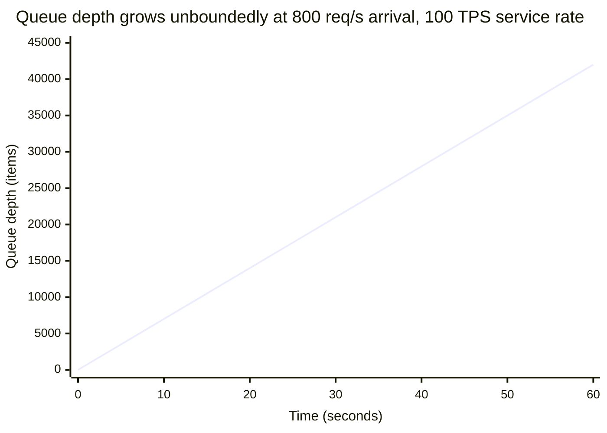
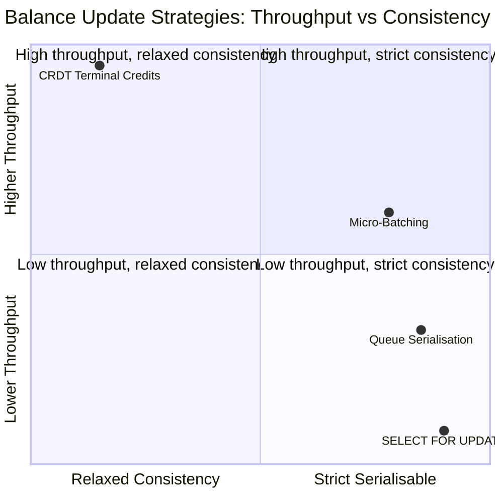

# السيناريو J — الأرصدة المتزامنة والحسابات الساخنة

## نظرة عامة

حساب تاجر يتلقى 800 خصم متزامن في الثانية كسر أحد أكثر الافتراضات شيوعًا في تصميم الأنظمة البنكية: أن `SELECT FOR UPDATE` أداة تزامن كافية. فعند 800 طلب في الثانية مع قفل قاعدة بيانات يُحتفظ به 10 مللي ثوانٍ لكل طلب، نما الطابور أسرع مما يُفرّغ، وصعد زمن p99 إلى 8 ثوانٍ، وبدأت أجهزة الدفع عبر ثلاث سلاسل تجزئة تنتهي مهلتها. يتتبع هذا الدرس فيزياء مشكلة الحساب الساخن، ثم ينفذ أربعة حلول متزايدة القابلية للتوسع — من التسلسل بالطابور، مرورًا بالدفعات الصغيرة، حتى بنية رصيد محجوز مستوحاة من CRDT تلغي القفل المركزي كليًا.

## أهداف التعلم

- حساب سقف الإنتاجية الذي يفرضه `SELECT FOR UPDATE` وإثبات رياضيًا لماذا تُغرق 800 طلب في الثانية زمن احتفاظ بالقفل قدره 10 مللي ثوانٍ.
- تنفيذ خدمة تسلسل بطابور `LinkedBlockingQueue` لكل حساب تزيل التنافس على أقفال قاعدة البيانات بتمرير كل خصوم الحساب عبر خيط واحد.
- تكييف نهج التسلسل بالطابور باستخدام الخيوط الافتراضية في Java 21 للتعامل مع آلاف الحسابات المتزامنة دون استنفاد مجمعات خيوط المنصة.
- بناء `BatchingDebitAccumulator` يجمع الخصوم عبر نافذة 10 مللي ثوانٍ ويطبقها كتحديث رصيد واحد، فيقلل الحصول على الأقفال حتى 8 أضعاف في الحالة المستقرة.
- تصميم مخطط أرصدة أجهزة مستوحى من CRDT يكتب فيه كل جهاز دفع مستقلًا دون قفل الرصيد الرئيسي، وشرح نموذج الاتساق الناتج.
- مقارنة النهج الأربعة — `SELECT FOR UPDATE`، والتسلسل بالطابور، والدفعات الصغيرة، وأرصدة الأجهزة على نمط CRDT — من حيث الإنتاجية، والاتساق، والتعقيد، والمخاطر التشغيلية.

## سياق العمل

*مثال مركّب:* تشغّل "Apex Retail"، وهي شركة تجزئة بريطانية خيالية متعددة القنوات، 1,400 جهاز دفع عبر 180 متجرًا. وتحدّث كل الأجهزة حساب تاجر مجمّعًا واحدًا يديره تكامل البنك المحصّل لديها. وفي السبت السابق لعيد الميلاد، رفع تخفيض سريع إنتاجية الأجهزة من 120 طلبًا في الثانية عادة إلى 820 طلبًا مستدامًا لمدة 47 دقيقة. وكانت خدمة الدفع لدى البنك المحصّل تستخدم `SELECT FOR UPDATE` على صف حساب التاجر لكل خصم. وكان كل خصم يحتفظ بالقفل نحو 11 مللي ثانية — لأن الشيفرة كانت تستدعي خدمة التفويض في شبكة الدفع *وهي تمسك قفل الصف*، وهذا بحد ذاته نمط خاطئ: لا تحتفظ أبدًا بقفل قاعدة بيانات عبر استدعاء بعيد.

عند 820 طلبًا في الثانية، بخصم كل 1.22 مللي ثانية، لكن خصم واحد فقط يستطيع إمساك القفل في وقت واحد لمدة 11 مللي ثانية، نما الطابور بمعدل 820 − (1000/11) = 820 − 91 = **729 عنصرًا في الثانية**. وخلال دقيقتين احتوى الطابور أكثر من 87,000 خصم معلق. وتبعه استنفاد مجمع اتصالات قاعدة البيانات في الدقيقة 3. وبدأت الخدمة رفض الاتصالات في الدقيقة 4. وبحلول الدقيقة 7 كانت 23% من محاولات الدفع على الأجهزة تفشل بأخطاء انتهاء المهلة. وحدّد فريق المناوبة في البنك المحصّل معدل التاجر يدويًا عند 150 طلبًا في الثانية لتثبيت النظام، فبقيت 670 طلبًا في الثانية من المبيعات المشروعة دون معالجة وذهبت إلى شبكة أجهزة منافس. والإيراد المفقود المقدّر: 340,000 جنيه في تلك النافذة البالغة 47 دقيقة. والسبب الجذري مسار شيفرة من سبعة أسطر عمل بشكل صحيح عند 120 طلبًا في الثانية لمدة عامين.

## مشكلة الحساب الساخن: الفيزياء

يتحدد سقف الإنتاجية لـ `SELECT FOR UPDATE` بمعادلة واحدة: كم مرة في الثانية يمكن قفل صف واحد في قاعدة البيانات حصريًا وتحديثه وتحريره؟

```
max_throughput_tps = 1000 ms / lock_hold_time_ms
```

إذا احتفظ كل خصم بالقفل 10 مللي ثوانٍ (تحديث قاعدة البيانات + معالجة التطبيق):

```
max_throughput_tps = 1000 / 10 = 100 TPS
```

عند 800 طلب في الثانية ينمو الطابور دون حد:

```
queue_growth_rate = arrival_rate - service_rate
queue_growth_rate = 800 - 100 = 700 items/second
```

بعد 60 ثانية: 42,000 عنصر في الطابور. وبعد 120 ثانية: 84,000. وينمو زمن p99 لطلب يصل حديثًا خطيًا مع عمق الطابور:

```
p99_wait_ms ≈ queue_size * lock_hold_time_ms
           ≈ 42,000 * 10 = 420,000 ms (7 minutes) after 60 seconds of saturation
```

هذه مشكلة قانون ليتل (Little's Law). فالنظام ليس متدهورًا — بل مشبع تمامًا. ولن يصلحه أي ضبط لمجمع الاتصالات أو تحسين للاستعلامات. يجب أن تنتقل نقطة التسلسل.



> [!WARNING]
> سينفد مجمع اتصالات قاعدة البيانات قبل أن يصل الطابور إلى هذه الأعماق عمليًا. فكل طلب في الطابور يمسك اتصالًا مفتوحًا بانتظار القفل. ومع مجمع من 100 اتصال، ينفد المجمع عندما يصل عمق الطابور إلى 100 — بعد نحو 0.14 ثانية من التشبع. وكل الطلبات اللاحقة تفشل فورًا بانتهاء مهلة الحصول على اتصال بدل انتهاء مهلة انتظار القفل. والعرض المرئي فشل صارم مفاجئ، لا تباطؤ تدريجي، ولهذا تظهر هذه المشكلة غالبًا دون إنذار على لوحات المراقبة.

## الإصلاح 1: التسلسل بالطابور لكل حساب

انقل نقطة التسلسل من قاعدة البيانات إلى التطبيق. فلكل حساب `LinkedBlockingQueue` مخصص يعالجه خيط واحد. ولا تنتظر كتابات قاعدة البيانات بعضها لأن خيطًا واحدًا فقط يكتب لحساب معين في وقت واحد.

تحذيران. أولًا، هذا يصح فقط **داخل نسخة خدمة واحدة**: فمع عدة نسخ يجب توجيه طلبات الحساب نفسه إلى النسخة نفسها (مثلًا بالتقسيم حسب معرّف الحساب)، وإلا لا تسلسل الطوابير شيئًا. لذلك يجب أن تأتي الصحة من قاعدة البيانات — عبر `UPDATE ... WHERE balance_cents >= ?` الشرطي أدناه — بينما يزيل الطابور *الانتظار* فقط. ثانيًا، خيط منصة لكل حساب لا يتوسع لحسابات كثيرة؛ فاستخدم هذا لمجموعة معروفة من الحسابات الساخنة، أو استخدم نسخة الخيوط الافتراضية.

### AccountSerializerService

```java
@Service
@Slf4j
public class AccountSerializerService {

    // accountId → dedicated single-thread executor for that account
    private final ConcurrentHashMap<UUID, ExecutorService> accountExecutors =
            new ConcurrentHashMap<>();

    // accountId → bounded pending debit queue
    private final ConcurrentHashMap<UUID, LinkedBlockingQueue<DebitRequest>> accountQueues =
            new ConcurrentHashMap<>();

    private final AccountRepository accountRepository;

    public AccountSerializerService(AccountRepository accountRepository) {
        this.accountRepository = accountRepository;
    }

    /**
     * Routes a debit request to the account's dedicated queue.
     * Returns a CompletableFuture that completes when the debit is applied.
     * Throws CardBusyException immediately if the account queue is full.
     */
    public CompletableFuture<DebitResult> submitDebit(UUID accountId, long amountCents,
                                                       String idempotencyKey) {
        CompletableFuture<DebitResult> future = new CompletableFuture<>();
        DebitRequest request = new DebitRequest(accountId, amountCents, idempotencyKey, future);

        boolean accepted = getQueue(accountId).offer(request);
        if (!accepted) {
            // Bounded queue is full — back-pressure: reject rather than block
            throw new AccountBusyException("Account " + accountId + " queue is full");
        }

        getExecutor(accountId).submit(() -> processNext(accountId));
        return future;
    }

    private void processNext(UUID accountId) {
        LinkedBlockingQueue<DebitRequest> queue = getQueue(accountId);
        DebitRequest request = queue.poll();
        if (request == null) return;

        try {
            // No SELECT FOR UPDATE needed in this instance — but the conditional
            // UPDATE still guarantees no overdraft if another instance writes too
            DebitResult result = accountRepository.applyDebitNoLock(
                    request.accountId(),
                    request.amountCents(),
                    request.idempotencyKey());
            request.future().complete(result);
        } catch (Exception ex) {
            request.future().completeExceptionally(ex);
            log.error("Debit failed: accountId={} amount={}",
                    accountId, request.amountCents(), ex);
        }
    }

    private LinkedBlockingQueue<DebitRequest> getQueue(UUID accountId) {
        return accountQueues.computeIfAbsent(accountId,
                k -> new LinkedBlockingQueue<>(10_000));  // bounded: 10k max pending
    }

    private ExecutorService getExecutor(UUID accountId) {
        return accountExecutors.computeIfAbsent(accountId,
                k -> Executors.newSingleThreadExecutor(
                        Thread.ofPlatform()
                              .name("account-" + accountId.toString().substring(0, 8))
                              .factory()));
    }
}

public record DebitRequest(
        UUID accountId,
        long amountCents,
        String idempotencyKey,
        CompletableFuture<DebitResult> future
) {}
```

### SQL لـ applyDebitNoLock

```sql
-- No SELECT FOR UPDATE — the queue means this rarely waits on another writer.
-- The balance check in the WHERE clause is what actually prevents overdraft.
-- (The ledger entry and idempotency record are written in the same transaction.)
UPDATE accounts
SET    balance_cents   = balance_cents - ?,   -- amountCents
       last_updated_at = now(),
       version         = version + 1
WHERE  id              = ?
AND    balance_cents   >= ?                   -- amountCents: reject if insufficient funds
RETURNING balance_cents, version;
```

### نسخة الخيوط الافتراضية (Java 21)

```java
@Service
@Slf4j
public class VirtualThreadAccountSerializer {

    // One semaphore per account — permits=1 means only one virtual thread writes at a time
    private final ConcurrentHashMap<UUID, Semaphore> accountSemaphores =
            new ConcurrentHashMap<>();
    // ONE shared executor. Creating newVirtualThreadPerTaskExecutor() per call
    // would leak an executor (never closed) on every request.
    private final ExecutorService virtualThreads = Executors.newVirtualThreadPerTaskExecutor();
    private final AccountRepository accountRepository;

    public VirtualThreadAccountSerializer(AccountRepository accountRepository) {
        this.accountRepository = accountRepository;
    }

    /**
     * Virtual threads allow massive concurrency without platform thread exhaustion.
     * The Semaphore(1) ensures only one virtual thread writes per account at a time.
     */
    public CompletableFuture<DebitResult> submitDebit(UUID accountId, long amountCents,
                                                       String idempotencyKey) {
        return CompletableFuture.supplyAsync(() -> {
            Semaphore semaphore = accountSemaphores.computeIfAbsent(accountId,
                    k -> new Semaphore(1));
            try {
                semaphore.acquire();   // virtual thread parks here if another write is in flight
            } catch (InterruptedException e) {
                Thread.currentThread().interrupt();
                throw new DebitInterruptedException(accountId, e);
            }
            // release() ONLY after a successful acquire(): releasing in a finally
            // that also covers a failed acquire would hand out a second permit
            try {
                return accountRepository.applyDebitNoLock(accountId, amountCents, idempotencyKey);
            } finally {
                semaphore.release();
            }
        }, virtualThreads);
    }
}
```

يُستخدم منفّذ واحد مشترك: فإنشاء `newVirtualThreadPerTaskExecutor()` في كل استدعاء يسرّب منفّذًا (لا يُغلق أبدًا) مع كل طلب. ولا يُستدعى `release()` إلا بعد `acquire()` ناجح: فالتحرير في finally يغطي أيضًا حصولًا فاشلًا سيمنح تصريحًا ثانيًا.

> [!NOTE]
> تتوقف الخيوط الافتراضية (Java 21) بكلفة منخفضة عند عمليات الحجب وتُنشأ بكلفة تقارب الصفر. (في Java 21–23 يثبّت الخيط الافتراضي المحجوب داخل كتلة `synchronized` — الشائعة في مشغّلات JDBC الأقدم — خيطَ الحمل الخاص به؛ وأزال JDK 24 هذا القيد، JEP 491.) ولخدمة فيها 50,000 حساب ساخن يحتاج كل منها تسلسلًا، تستهلك 50,000 خيط افتراضي متوقف نحو 50 ميغابايت من الذاكرة — ما يعادل 50 خيط منصة. ويضمن `Semaphore(1)` لكل حساب التسلسل دون مجمع خيوط مخصص لكل حساب، فيصبح هذا النهج أكفأ بكثير في الذاكرة من طوابير خيط منصة لكل حساب.

## الإصلاح 2: الدفعات الصغيرة (Micro-Batching)

يقلل التسلسل بالطابور التنافس على الأقفال لكنه ما زال يصدر تحديثًا واحدًا لكل خصم. وتجمع الدفعات الصغيرة كل الخصوم التي تصل ضمن نافذة قصيرة (10 مللي ثوانٍ) وتطبقها كتحديث رصيد واحد، فيقل الحصول على الأقفال على الصف الساخن بحجم الدفعة. وما زال كل خصم يحصل على قيد دفتر وسجل idempotency خاصين — يُكتبان في المعاملة **نفسها** مع تحديث الدفعة — فلا تخفي الدفعة أبدًا المدفوعات الفردية ولا يُطبق خصم معاد محاولته مرتين.

### BatchingDebitAccumulator

```java
@Component
@Slf4j
public class BatchingDebitAccumulator {

    private final ConcurrentHashMap<UUID, List<PendingDebit>>            pendingDebits   = new ConcurrentHashMap<>();
    private final ConcurrentHashMap<UUID, List<CompletableFuture<DebitResult>>> pendingFutures = new ConcurrentHashMap<>();
    private final Object flushLock = new Object();

    private final AccountRepository       accountRepository;
    private final ScheduledExecutorService scheduler;

    public BatchingDebitAccumulator(AccountRepository accountRepository) {
        this.accountRepository = accountRepository;
        this.scheduler = Executors.newScheduledThreadPool(4);
        // Drain all accounts every 10 ms — the micro-batch window
        scheduler.scheduleAtFixedRate(this::drainAll, 10, 10, TimeUnit.MILLISECONDS);
    }

    /**
     * Accumulates a debit into the pending batch for the account.
     * Returns a Future that completes when the 10 ms batch is flushed.
     */
    public CompletableFuture<DebitResult> accumulate(UUID accountId, long amountCents,
                                                      String idempotencyKey) {
        CompletableFuture<DebitResult> future = new CompletableFuture<>();

        synchronized (flushLock) {
            pendingDebits.computeIfAbsent(accountId, k -> new ArrayList<>())
                         .add(new PendingDebit(amountCents, idempotencyKey));
            pendingFutures.computeIfAbsent(accountId, k -> new ArrayList<>())
                          .add(future);
        }

        return future;
    }

    private void drainAll() {
        Set<UUID> accounts;
        Map<UUID, List<PendingDebit>>            snapshot;
        Map<UUID, List<CompletableFuture<DebitResult>>> snapshotFutures;

        // Atomically swap pending maps so new arrivals go into fresh collections
        synchronized (flushLock) {
            accounts        = new HashSet<>(pendingDebits.keySet());
            snapshot        = new HashMap<>(pendingDebits);
            snapshotFutures = new HashMap<>(pendingFutures);
            pendingDebits.clear();
            pendingFutures.clear();
        }

        for (UUID accountId : accounts) {
            drainAccount(accountId,
                    snapshot.getOrDefault(accountId, List.of()),
                    snapshotFutures.getOrDefault(accountId, List.of()));
        }
    }

    private void drainAccount(UUID accountId,
                               List<PendingDebit> debits,
                               List<CompletableFuture<DebitResult>> futures) {
        if (debits.isEmpty()) return;

        long totalDebitCents = debits.stream()
                .mapToLong(PendingDebit::amountCents)
                .sum();

        try {
            // One transaction: a single balance UPDATE for the whole window PLUS one
            // ledger entry and one idempotency claim per debit (duplicates skipped)
            DebitResult result = accountRepository.applyBatchDebit(accountId, debits);

            futures.forEach(f -> f.complete(result));
            log.debug("Micro-batch flushed: accountId={} debits={} totalCents={}",
                    accountId, debits.size(), totalDebitCents);

        } catch (InsufficientFundsException ex) {
            // Batch fails as a unit — callers must retry individually
            futures.forEach(f -> f.completeExceptionally(ex));
            log.warn("Micro-batch insufficient funds: accountId={} totalCents={}",
                    accountId, totalDebitCents);
        } catch (Exception ex) {
            futures.forEach(f -> f.completeExceptionally(ex));
            log.error("Micro-batch error: accountId={} totalCents={}", accountId, totalDebitCents, ex);
        }
    }
}

public record PendingDebit(long amountCents, String idempotencyKey) {}
```

### SQL لتحديث الدفعة

```sql
-- Applies the sum of all debits collected in the 10 ms window in a single statement.
-- One lock acquisition covers all N debits in the batch.
UPDATE accounts
SET    balance_cents   = balance_cents - ?,   -- total_debit_cents (SUM of batch)
       last_updated_at = now(),
       version         = version + 1
WHERE  id              = ?
AND    balance_cents   >= ?                   -- total_debit_cents (prevent overdraft)
RETURNING balance_cents, version;
```

عند 800 طلب في الثانية ونافذة دفعة 10 مللي ثوانٍ، تحتوي كل دفعة نحو 8 خصوم. ويُحصل على القفل مرة لكل دفعة بدل مرة لكل خصم — تخفيض 8 أضعاف في الحصول على الأقفال في الحالة المستقرة.

> [!IMPORTANT]
> تغيّر الدفعات الصغيرة دلالات الفشل. فإذا فشل تحديث الدفعة لأن مجموعها يتجاوز الرصيد، يفشل كل خصم في الدفعة معًا — بما فيها خصوم ما كانت لتسبب سحبًا على المكشوف منفردة. والنهج القياسي إفشال الكل ومطالبة المستدعين بإعادة المحاولة فرديًا. ويستخدم مسار إعادة المحاولة التسلسل بالطابور كبديل ويعالج كل خصم على حدة مقابل الرصيد المتاح.

## الإصلاح 3: أرصدة الأجهزة المستوحاة من CRDT

لأعلى متطلبات الإنتاجية، ألغِ قفل الرصيد المركزي كليًا. فلكل جهاز دفع صف `terminal_credits` خاص (عداد مقسم). ويُحسب الرصيد الرئيسي كـ `main_balance - SUM(terminal_credits.debited_cents)`. وتكتب الأجهزة في صفوفها دون تنافس على صف الحساب الرئيسي. وتدمج التسوية صفوف الأجهزة في الرصيد الرئيسي. والعدادات مجرد تجميع سريع: فكل معاملة فردية ما زالت تُسجل في الدفتر.

### المخطط

```sql
-- Main account balance — updated only during nightly settlement
CREATE TABLE accounts (
    id                  UUID        NOT NULL DEFAULT gen_random_uuid(),
    merchant_id         UUID        NOT NULL,
    main_balance_cents  BIGINT      NOT NULL DEFAULT 0,
    last_settled_at     TIMESTAMPTZ NOT NULL DEFAULT now(),
    CONSTRAINT pk_accounts PRIMARY KEY (id)
);

-- Each terminal has its own credits row — updated concurrently, no locks on accounts needed
CREATE TABLE terminal_credits (
    id              UUID        NOT NULL DEFAULT gen_random_uuid(),
    account_id      UUID        NOT NULL REFERENCES accounts(id),
    terminal_id     VARCHAR(64) NOT NULL,
    debited_cents   BIGINT      NOT NULL DEFAULT 0,   -- cumulative debits since last settlement
    last_updated_at TIMESTAMPTZ NOT NULL DEFAULT now(),
    CONSTRAINT pk_terminal_credits PRIMARY KEY (id),
    CONSTRAINT uq_account_terminal UNIQUE (account_id, terminal_id)
);

CREATE INDEX idx_terminal_credits_account ON terminal_credits (account_id);
```

### استعلام الرصيد الآني

```sql
-- Effective balance = main balance minus all terminal debits since last settlement.
-- A pure read — no locks, no contention.
SELECT
    a.main_balance_cents - COALESCE(SUM(tc.debited_cents), 0) AS available_balance_cents
FROM       accounts        a
LEFT JOIN  terminal_credits tc ON tc.account_id = a.id
WHERE      a.id = ?
GROUP BY   a.main_balance_cents;
```

### خدمة خصم الجهاز

```java
@Service
@RequiredArgsConstructor
@Slf4j
public class TerminalCreditService {

    private final JdbcTemplate jdbc;

    /**
     * Records a debit against a terminal's own row — no account-level lock.
     * Concurrent writes from different terminals do not contend with each other
     * because each terminal writes to its own row.
     */
    @Transactional
    public void recordDebit(UUID accountId, String terminalId, long amountCents) {
        // UPSERT: create terminal row on first debit, increment on subsequent debits
        int rows = jdbc.update("""
                INSERT INTO terminal_credits (account_id, terminal_id, debited_cents, last_updated_at)
                VALUES (?, ?, ?, now())
                ON CONFLICT (account_id, terminal_id)
                DO UPDATE SET debited_cents   = terminal_credits.debited_cents + EXCLUDED.debited_cents,
                              last_updated_at = now()
                """, accountId, terminalId, amountCents);

        if (rows != 1) {
            throw new TerminalCreditException(
                    "Terminal credit upsert failed: account=%s terminal=%s"
                            .formatted(accountId, terminalId));
        }

        log.debug("Terminal debit recorded: account={} terminal={} amount={}",
                accountId, terminalId, amountCents);
    }
}
```

### دمج التسوية الليلي

```java
@Component
@RequiredArgsConstructor
@Slf4j
public class TerminalSettlementJob {

    private final JdbcTemplate jdbc;

    @Scheduled(cron = "0 0 1 * * *")   // 01:00 UTC nightly
    @Transactional
    public void settle() {
        // Two separate statements ("subtract the SUM", then "reset to 0") would
        // LOSE every debit a terminal writes between them: the reset wipes amounts
        // the subtraction never saw. Instead: lock the terminal rows, subtract
        // exactly the amounts read, and move those same amounts to the main balance.
        int accountsSettled = jdbc.update("""
                WITH old AS (
                    SELECT id, account_id, debited_cents
                    FROM   terminal_credits
                    WHERE  debited_cents <> 0
                    FOR UPDATE
                ),
                reset AS (
                    UPDATE terminal_credits tc
                    SET    debited_cents   = tc.debited_cents - old.debited_cents,
                           last_updated_at = now()
                    FROM   old
                    WHERE  tc.id = old.id
                    RETURNING old.account_id, old.debited_cents
                )
                UPDATE accounts a
                SET    main_balance_cents = a.main_balance_cents - s.total,
                       last_settled_at    = now()
                FROM   (SELECT account_id, SUM(debited_cents) AS total
                        FROM reset GROUP BY account_id) s
                WHERE  a.id = s.account_id
                """);

        log.info("Settlement complete: {} accounts settled", accountsSettled);
        // (For large volumes, settle account by account in small transactions
        //  so terminals are blocked only for milliseconds.)
    }
}
```

عبارتان منفصلتان ("اطرح المجموع"، ثم "أعد الضبط إلى 0") **ستضيعان** كل خصم يكتبه جهاز بينهما: فإعادة الضبط تمحو مبالغ لم ترها عملية الطرح قط. لذلك: اقفل صفوف الأجهزة، واطرح بالضبط المبالغ المقروءة، وانقل المبالغ نفسها إلى الرصيد الرئيسي.

> [!WARNING]
> يقدم نموذج أرصدة الأجهزة على نمط CRDT مقايضة في الاتساق: الرصيد المتاح الذي يحسبه الاستعلام الآني متسق في النهاية. فبين لحظة كتابة جهاز خصمه ولحظة قراءة جهاز آخر الرصيد التجميعي، توجد نافذة يبدو فيها الرصيد المتاح أعلى من حقيقته. ولتاجر نادرًا ما تقترب إنتاجية أجهزته الكلية من رصيده الفعلي، هذا الخطر ضئيل. أما لبطاقة مدفوعة مسبقًا بحد رصيد ضيق، فالإنفاق الزائد المتزامن خطر حقيقي ويتطلب هذا النموذج تسامحًا تعويضيًا مع السحب على المكشوف أو خطوة حجز تفويض مسبق إلزامية.

## مقارنة النهج

| النهج | سقف الإنتاجية | الاتساق | التعقيد | المخاطر التشغيلية |
|---|---|---|---|---|
| `SELECT FOR UPDATE` | نحو 100 معاملة في الثانية (قفل 10 مللي ثوانٍ) | تسلسلي صارم | منخفض | جمود؛ واستنفاد مجمع الاتصالات فوق السقف |
| التسلسل بالطابور | نحو 1,000–5,000 معاملة في الثانية (طابور في الذاكرة) | تسلسلي لكل حساب | متوسط | الطابور في الذاكرة يضيع عند التعطل؛ ويجب معالجة الضغط العكسي للطابور المحدود |
| الدفعات الصغيرة | نحو 5,000–20,000 معاملة في الثانية (معامل الدفعة × سقف FOR UPDATE) | تسلسلي لكل دفعة | متوسط–عالٍ | فشل الدفعة يؤثر في كل الخصوم في النافذة؛ وغموض السحب الجزئي على المكشوف |
| أرصدة الأجهزة CRDT | أكثر من 100,000 معاملة في الثانية (كتابة محلية، دون قفل مركزي) | متسق في النهاية (تأخر التسوية) | عالٍ | نافذة إنفاق زائد بين كتابات الأجهزة؛ ومهمة التسوية على المسار الحرج |



## اختبار المعرفة

**س: يستغرق خصم `SELECT FOR UPDATE` في المتوسط 8 مللي ثوانٍ. عند أي معدل طلبات يصل النظام إلى سقف إنتاجيته، وماذا يحدث لاتصالات قاعدة البيانات فور تلك النقطة؟**

**ج:** سقف الإنتاجية `1000 ms / 8 ms = 125 TPS`. وعند 126 طلبًا في الثانية يبدأ الطابور النمو بعنصر واحد في الثانية. ويمسك كل طلب في الطابور اتصال قاعدة بيانات مفتوحًا أثناء انتظار القفل. ومع مجمع نموذجي من 100 اتصال، ينفد المجمع عندما يصل عمق الطابور إلى 100 — بعد نحو 100 ثانية من بدء التشبع. وبعد نفاد المجمع يُرفض كل طلب وارد جديد فورًا بانتهاء مهلة الحصول على اتصال بدل انتظار القفل. فيتحول نمط الفشل من بطيء (زمن عالٍ) إلى صارم (رفض فوري). والإصلاح ليس أبدًا زيادة حجم مجمع الاتصالات — فذلك يؤخر النفاد فقط بنسبة حجم المجمع الجديد إلى فائض معدل الوصول. والإصلاح المعماري تقليل زمن الاحتفاظ بالقفل أو نقل نقطة التسلسل خارج قاعدة البيانات.

**س: يسمح نموذج أرصدة الأجهزة على نمط CRDT بالإنفاق الزائد بين كتابات الأجهزة والتسوية. سمِّ ضابطين ملموسين تستطيع إضافتهما لتحديد أقصى تعرض للإنفاق الزائد دون إعادة إدخال قفل مركزي.**

**ج:** أولًا، حد خصم يومي لكل جهاز يُفرض على مستوى صف الجهاز: أضف عمود `daily_limit_cents` إلى `terminal_credits` وحارسًا في طبقة التطبيق يرفض أي خصم سيجعل `debited_cents > daily_limit_cents`. وهذا يحد أسوأ إنفاق زائد بـ `number_of_terminals * daily_limit_cents - main_balance`. فإذا كان لتاجر 10 أجهزة سقف كل منها 5,000 دولار يوميًا ورصيد 2,000 دولار، يقبل التاجر صراحة احتمال إنفاق زائد بـ 48,000 دولار في سيناريو شاذ — قرار سياسة عمل موثق في اتفاقية التاجر. ثانيًا، تسوية مصغرة دورية خلال اليوم تعمل كل 15 دقيقة بدل ليلًا: فتعمل `TerminalSettlementJob` أكثر تكرارًا، فتصغر النافذة التي تنحرف فيها أرصدة الأجهزة عن الرصيد الرئيسي. وتكرار التسوية رافعة تقايض العبء التشغيلي (مهام أكثر تكرارًا، وكتابات أكثر في قاعدة البيانات) مقابل تعرض الاتساق (نافذة إنفاق زائد أصغر). والضابطان متكاملان — حدود الأجهزة تحد حجم التعرض؛ والتسوية المتكررة تحد مدته.

## التحدي العملي

كُلّف فريقك بإعادة تصميم مسار تحديث الرصيد لمنتج بطاقة مدفوعة مسبقًا لدى كل من 500,000 حامل بطاقة فيه رصيد بحد إنفاق صارم. ويبلغ معالج البطاقات أن 0.3% من حاملي البطاقات يواجهون زمن p99 فوق ثانيتين، وكلهم في أعلى 1% من تكرار المعاملات.

1. أثبت رياضيًا أن تنفيذ `SELECT FOR UPDATE` الحالي لا يستطيع خدمة حامل بطاقة يجري 60 معاملة في الدقيقة (معاملة واحدة في الثانية لكل بطاقة) إذا استغرق كل احتفاظ بالقفل 25 مللي ثانية. وبيّن زمن p99 الذي يتنبأ به نموذج الطوابير لحامل بطاقة ساخن واحد بعد 10 ثوانٍ من وصول مستدام بمعاملة في الثانية واحتفاظ بالقفل 25 مللي ثانية.

2. نفّذ `CardholderDebitService` تستخدم التسلسل بالطابور مع `LinkedBlockingQueue` محدود بسعة 50. وعندما يمتلئ الطابور، يجب أن ترفض الخدمة الخصم فورًا بـ `CardBusyException` بدل الحجب إلى أجل غير مسمى. واكتب الصنف كاملًا بما في ذلك مسار الرفض واشرح لماذا الطوابير غير المحدودة أخطر من الطوابير المحدودة مع رفض صريح في سياق الدفع.

3. تجمّع الدفعات الصغيرة الخصوم حسب نافذة زمنية، لكن لبطاقة مدفوعة مسبقًا يجب أيضًا التحقق من أن أي خصم منفرد داخل الدفعة ما كان ليتجاوز الرصيد وقت تقديمه. صمم `BalanceCheckingBatchAccumulator` يفحص كل خصم مسبقًا مقابل رصيد تقديري جارٍ قبل إضافته إلى الدفعة، ويعالج حالة تجاوز مجموع الدفعة للرصيد وقت التفريغ بمعالجة الخصوم فرديًا حتى ينفد الرصيد.

4. يقترح المدير التقني تحويل أعلى 1% من حاملي البطاقات عاليي التكرار إلى نموذج أرصدة الأجهزة CRDT آليًا. اكتب استعلام SQL الذي يحدد حاملي البطاقات الذين يتجاوز `transaction_count` لديهم في آخر 24 ساعة حدًا قابلًا للإعداد، وصف مسار ترحيل البيانات لنقل حامل بطاقة حي من نموذج `SELECT FOR UPDATE` إلى نموذج CRDT دون انقطاع خدمة أو فرق رصيد أثناء التحويل.

<!-- KNOWLEDGE-CHECK
{
  "questions": [
    {
      "text": "يحتفظ خصم SELECT FOR UPDATE بالقفل 12 مللي ثانية في المتوسط. عند أي معدل وصول بالضبط يبدأ الطابور النمو، وما معدل نمو الطابور عند 200 طلب في الثانية؟",
      "options": [
        "السقف 83 معاملة في الثانية؛ وعند 200 طلب في الثانية ينمو الطابور بـ 117 عنصرًا في الثانية",
        "السقف 120 معاملة في الثانية؛ وعند 200 طلب في الثانية ينمو الطابور بـ 80 عنصرًا في الثانية",
        "السقف 100 معاملة في الثانية؛ وعند 200 طلب في الثانية ينمو الطابور بـ 100 عنصر في الثانية",
        "السقف 50 معاملة في الثانية؛ وعند 200 طلب في الثانية ينمو الطابور بـ 150 عنصرًا في الثانية"
      ],
      "correct": 0,
      "explanation": "‏max_throughput = 1000 ms / 12 ms = 83 TPS. وعند وصول 200 طلب في الثانية: queue_growth_rate = 200 − 83 = 117 عنصرًا في الثانية. وينمو الطابور دون حد من لحظة تجاوز معدل الوصول لمعدل الخدمة. ويتبعه استنفاد مجمع الاتصالات عندما يساوي عمق الطابور حجم المجمع."
    },
    {
      "text": "لماذا يعمل التسلسل بالطابور (كاتب واحد لكل حساب، أو Semaphore لكل حساب مع الخيوط الافتراضية) أفضل تحت تنافس شديد من مجرد إعادة محاولة محاولات القفل المتفائل الفاشلة؟",
      "options": [
        "لأن القفل المتفائل يتطلب عمود إصدار مكلف الصيانة",
        "لأن نقطة التسلسل تنتقل إلى طبقة التطبيق: خيط واحد فقط يكتب لكل حساب في وقت واحد، فيُمنع التنافس على أقفال قاعدة البيانات بدل مجرد إعادة محاولته",
        "لأن الكاتب الواحد أسرع من إعادات المحاولة تحت أي مستوى حمل، حتى دون تنافس",
        "لأن إعادات المحاولة ليست idempotent وستخصم من العملاء مرتين"
      ],
      "correct": 1,
      "explanation": "ينقل التسلسل بالطابور الانتظار من قفل صف قاعدة البيانات إلى طابور أو semaphore في الذاكرة: خيط واحد فقط يكتب لحساب معين في وقت واحد (داخل النسخة)، فلا يتصادم الكتّاب — يُمنع التنافس لا يُعاد. وإعادات محاولة القفل المتفائل ما زالت تصل إلى قاعدة البيانات عند كل تعارض. وما زالت الصحة تأتي من UPDATE الشرطي في قاعدة البيانات، الذي يحمي أيضًا من كتّاب في نسخ أخرى."
    },
    {
      "text": "ما مقايضة الاتساق الأساسية التي يقدمها نموذج أرصدة الأجهزة على نمط CRDT، وأي سيناريو لبطاقة مدفوعة مسبقًا يجعل هذه المقايضة غير مقبولة دون ضوابط إضافية؟",
      "options": [
        "يتطلب النموذج تسوية في النهاية، فتتأخر كشوف العملاء يومًا دائمًا",
        "بين كتابات الأجهزة واستعلام الرصيد، يبدو الرصيد المتاح أعلى من حقيقته — فتنشأ نافذة إنفاق زائد غير مقبولة للبطاقات المدفوعة مسبقًا ذات حدود الرصيد الضيقة",
        "تنشئ مهمة التسوية الليلية قفلًا مركزيًا يهزم غرض النموذج",
        "لا تستطيع أرصدة الأجهزة CRDT التعامل مع الاستردادات الجزئية لأن كل جهاز يكتب مستقلًا"
      ],
      "correct": 1,
      "explanation": "يحسب نموذج CRDT الرصيد المتاح كـ main_balance ناقص SUM(terminal_credits). وبين لحظة كتابة جهاز خصمًا وقراءة جهاز آخر التجميع، توجد نافذة يبدو فيها الرصيد أعلى من الواقع. فلبطاقة مدفوعة مسبقًا رصيدها 5 دولارات ويرى جهازان كل منهما 5 دولارات متاحة، يمكن أن يمضي كلاهما — فينتج إنفاق زائد بـ 10 دولارات. وضوابط مثل حدود الأجهزة اليومية أو التسوية المتكررة خلال اليوم تحد هذا الخطر لكنها لا تلغيه."
    }
  ]
}
-->

<!-- PRACTICAL-CHALLENGE
{
  "title": "تصميم نظام أرصدة متزامنة عالي الإنتاجية لمنتج بطاقة مدفوعة مسبقًا",
  "difficulty": "advanced",
  "estimatedMinutes": 45,
  "tasks": [
    {"id": "1", "description": "أثبت رياضيًا أن SELECT FOR UPDATE باحتفاظ قفل 25 مللي ثانية لا يستطيع خدمة حامل بطاقة يجري 60 معاملة في الدقيقة. وبيّن أقصى معاملات في الثانية، ومعدل نمو الطابور عند وصول طلب في الثانية، وزمن p99 بعد 10 ثوانٍ من وصول مستدام بمعاملة في الثانية باستخدام قانون ليتل."},
    {"id": "2", "description": "نفّذ `CardholderDebitService` باستخدام التسلسل بالطابور مع LinkedBlockingQueue بسعة 50. ويجب أن تعيد دالة submitDebit ‏CompletableFuture<DebitResult> وترمي CardBusyException فورًا — دون حجب — إذا امتلأ الطابور. واشرح في تعليقات الشيفرة لماذا الطوابير غير المحدودة أخطر من الطوابير المحدودة مع رفض صريح في سياق الدفع."},
    {"id": "3", "description": "صمم BalanceCheckingBatchAccumulator يتتبع رصيدًا تقديريًا جاريًا لكل حساب مع تراكم الخصوم خلال نافذة 10 مللي ثوانٍ. وافحص كل خصم وارد مسبقًا مقابل التقدير الجاري قبل إضافته إلى الدفعة. وعندما تُفرّغ الدفعة ويكون رصيد قاعدة البيانات الفعلي أقل من التقدير، عالج الخصوم فرديًا حتى ينفد الرصيد، مع إفشال الخصوم المتبقية بـ InsufficientFundsException."},
    {"id": "4", "description": "اكتب استعلام SQL الذي يحدد أعلى 1% من حاملي البطاقات حسب transaction_count في آخر 24 ساعة. وصف إجراء التحويل خطوة بخطوة لترحيل حامل بطاقة حي من SELECT FOR UPDATE إلى أرصدة الأجهزة CRDT: ماذا يحدث للمعاملات الجارية، وكيف تهيّئ عمود main_balance_cents، وكيف تتحقق من عدم وجود فرق بعد التحويل باستخدام استعلام مطابقة."}
  ]
}
-->
